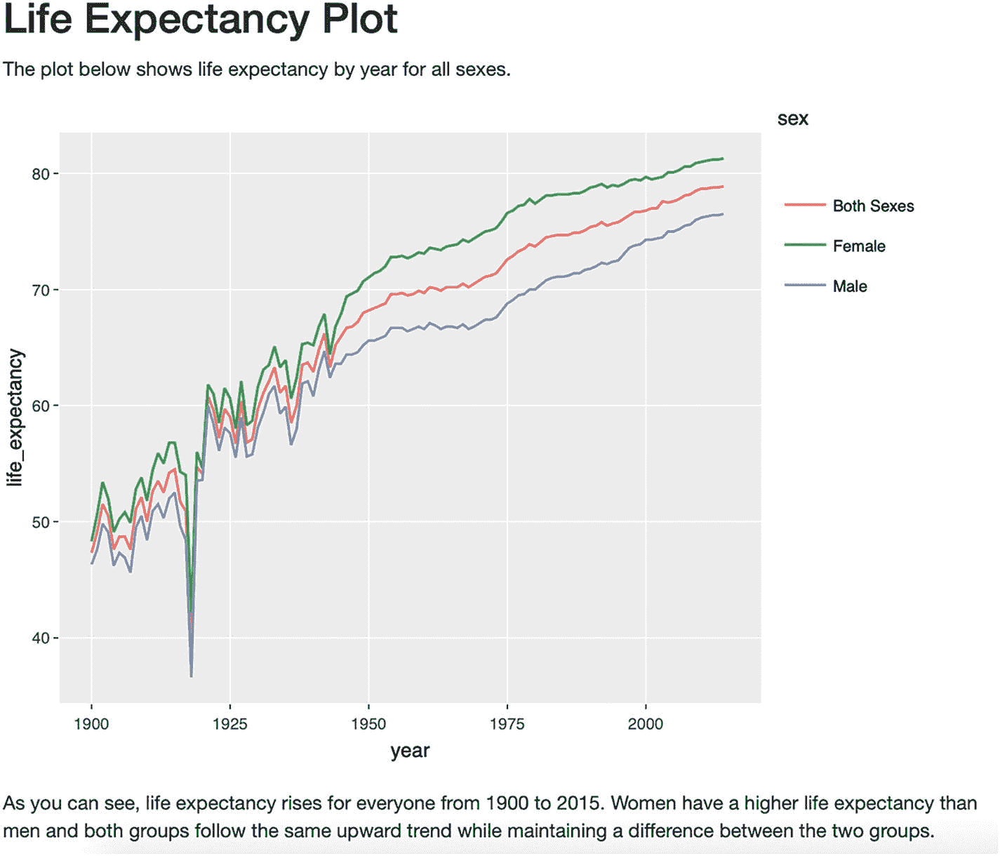

# R Markdown

您使用 R Markdown 来创建整合了前几章所述功能的报告。R Markdown 利用 `HTML`、`CSS` 和 `Markdown` 等免费可用的开源技术，以多种格式创建丰富的报告。

R Markdown 基于 Markdown，这是一种以人类可读的方式定义文档的简化方法。其理念是，您可以结构化的方式快速记笔记。这些笔记本身可读，但也可以翻译成精美的演示格式，如网页、演示文稿和 PDF 文件。

RStudio 通过将 R 语言中的代码和图形添加到 Markdown 文档中，扩展了 Markdown。这种类型的 Markdown 被称为“R Markdown”。让我们使用我们的预期寿命分析，通过 R Markdown 创建一个可分享的报告。

## R Markdown 文档

RStudio 完全支持 R Markdown。你不仅可以用 Markdown 撰写笔记，还可以在代码块中执行代码，并将结果显示在 R Markdown 文档中，而且是实时显示。要创建新的 R Markdown 文档，请转到 RStudio 菜单栏，依次点击“File”、“New File”和“R Markdown”，如图 8-1 所示。


**图 8-1** 添加新的 R Markdown 文档

在出现的对话框中（如图 8-2 所示），你将看到一些选项，这些选项决定了将要生成的文档类型。


**图 8-2** R Markdown 选项

在这里，你可以指定是需要 `HTML` 格式还是 `PDF` 格式的文档。还有一些其他不太常用的格式类型供你尝试，但通常人们会使用 `PDF` 或 `HTML` 报告。

RStudio 会自动生成一个包含模板文本的 R Markdown 文档，如图 8-3 所示。


**图 8-3** R Markdown 文档

上面的 R Markdown 文档中有四个不同的部分。前六行称为 YAML（又称“Yet Another Markup Language”）。

```
---
title: "Life Expectancy"
author: "Matthew Campbell"
date: "1/22/2019"
output: html_document
---
```

这种 YAML 标记指定了诸如输出格式类型和作者姓名等信息，本质上就是你在对话框中填写的内容。接下来高亮为灰色的三行用于设置 `knitr`（一个用于渲染 R Markdown 输出的包）所需的选项。

```{r setup, include=FALSE}
knitr::opts_chunk$set(echo = TRUE)
```

这里第一行包含三个反引号和花括号的代码值得注意。这是用来从 Markdown 代码中转移出来的符号，以便你能够在文档中包含 R 代码。其格式大致为：三个反引号、一个左花括号、字母 `r`，接着是一些选项，然后是一个右花括号。在上面的代码中，`setup` 只是一个标签，而 `include=FALSE` 表示代码将被执行，但不会在 R Markdown 输出中显示。

接下来的几行代码是基本的 Markdown。

```
### R Markdown
This is an R Markdown document. Markdown is a simple formatting syntax for authoring HTML, PDF, and MS Word documents. For more details on using R Markdown see .
```

这里用于撰写你的发现、过程以及数据分析的描述。开头的两个井号表示“标题 2”，格式将反映在输出文档中。你可以使用所有常规的 Markdown 功能。Markdown 的创建者在此处记录了可用的格式化功能：[`https://daringfireball.net/projects/markdown`](https://daringfireball.net/projects/markdown)。

剩下的代码是另一个 R 代码块；这次代码创建了一个图表，并嵌入到 R Markdown 输出中。

```{r cars}
summary(cars)
```

这将输出内置数据集 `cars` 的摘要信息。我们将在下一个示例中看到它的效果。

### R Markdown 示例

接下来，我们将本书中完成的一些工作添加到报告中，以此演示 R Markdown。同时，我们将在报告中引用 R 脚本文件并嵌入图形。首先，将我们新建的 R Markdown 文档保存为 `life_expectancy.Rmd`。

我们可以用描述我们工作的内容替换模板中提供的介绍性模板文本。

```
#### Introduction
[Life expectancy data](https://catalog.data.gov/dataset/age-adjusted-death-rates-and-life-expectancy-at-birth-all-races-both-sexes-united-sta-1900) was downloaded from data.gov. This dataset contains death rates and life-expectancy statistics from 1900 to 2015. Exploratory analysis was conducted on this dataset.
```

现在，让我们看看 R Markdown 输出文件的样子。选择 R Markdown 文档顶部的菜单栏，然后点击“Knit”下拉菜单，选择“Knit for HTML”，如图 8-4 所示。


**图 8-4** 创建 HTML 输出文件

这将获取你的 R 代码和 Markdown 代码，并使用 R 包 `knitr` 创建 `HTML` 报告，如图 8-5 所示。


**图 8-5** R Markdown HTML 输出

我们现在有了一个格式良好的报告的雏形。当然，我们仍然显示了 `cars` 数据集的填充内容，但我们将在下一步中处理这个问题。

#### R Markdown 可重复性

当我们说分析具有可重复性时，意味着我们能够重新运行一份报告，并得到与过去完全相同的结果。我们的分析不应依赖于我们在命令行中手动输入的任何临时命令。为了确保分析可重复，让我们运行 `source` 命令并加载用于导入 `expectancy` 数据集的文件。将 R 代码块替换为以下内容，并包含数据集的摘要。

```{r get_data}
source("process_data.R")
summary(expectancy)
```

在上面的代码块中，我们做了几件事。我们将标签更改为 `"get_data"`，使用 `source()` 执行保存在 `"process_data.R"` 中的所有代码，并展示了 `expectancy` 数据集的摘要。当我们编织 Markdown 文件时，`expectancy` 数据集的摘要将取代 `cars` 数据集出现。

更重要的是，R Markdown 文档中的其他代码将能够像我们之前那样引用 `expectancy` 数据集。我们之前遵循的所有数据处理规则将在每次编织新输出文档时执行。

您可能希望像我们在数据可视化章节中所做的那样，让用户一窥数据集的全貌。您可以简单地从上一章复制代码，并将其包裹在如下代码块中：

```
### 预期寿命数据集示例
下面您将看到一个可用于查看`expectancy`数据集内容的小部件。该数据集将在本分析后续部分进行探索。
```{r}
library(DT)
datatable(expectancy, options = list(pageLength = 5))
```
```

在这里，我们混合了 Markdown 注释和一段 R 代码，以生成我们在图 8-6 中看到的显示效果。


### 图 8-6

R Markdown 文档中的 HTML 数据表格小部件

最后，让我们添加各年份预期寿命率的折线图。这次，我们可能想对用户隐藏 R 代码块，因此我们将包含这两个指令：`echo=FALSE` 和 `message=FALSE`。

```
### 预期寿命折线图
下面的折线图显示了各性别每年的预期寿命。
```{r echo=FALSE, message=FALSE}
library(plotly)
i_plot %>%
  filter(race == "All Races") %>%
  ggplot(aes(year, life_expectancy)) +
  geom_line(aes(color = sex))
ggplotly(i_plot)
```

正如您所见，从 1900 年到 2015 年，每个人的预期寿命都在上升。女性的预期寿命高于男性，两组人群都遵循相同的上升趋势，同时保持两者之间的差异。

第一个指令阻止代码显示，而第二个指令则阻止因在文档中加载库而可能出现的任何消息。结果如图 8-7 所示。



### 图 8-7

R Markdown 文档中的 Plotly 小部件

## 结论

R Markdown 提供了一个强大的报告生成系统。本章仅触及了作为报告编写者可用功能的一小部分。当您开发可能在整个组织内共享的分析时，这将是您的报告主力工具。