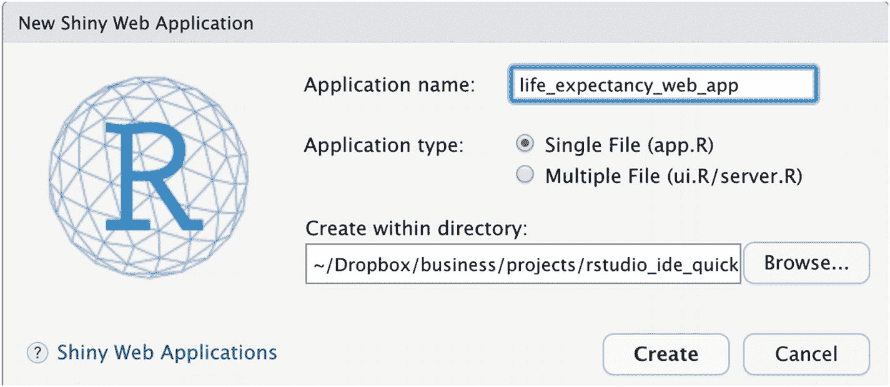
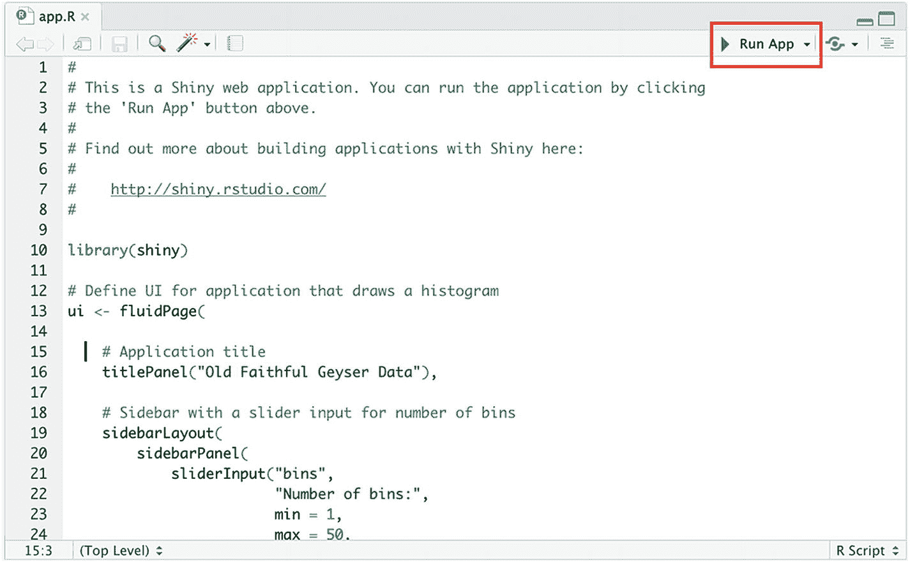
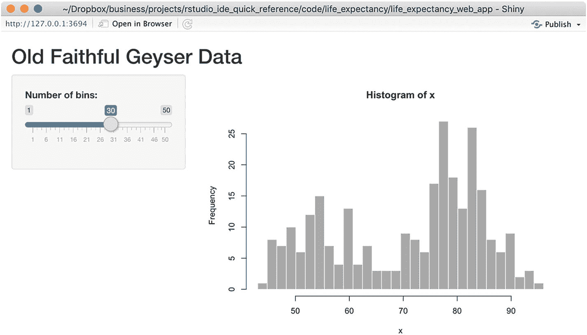
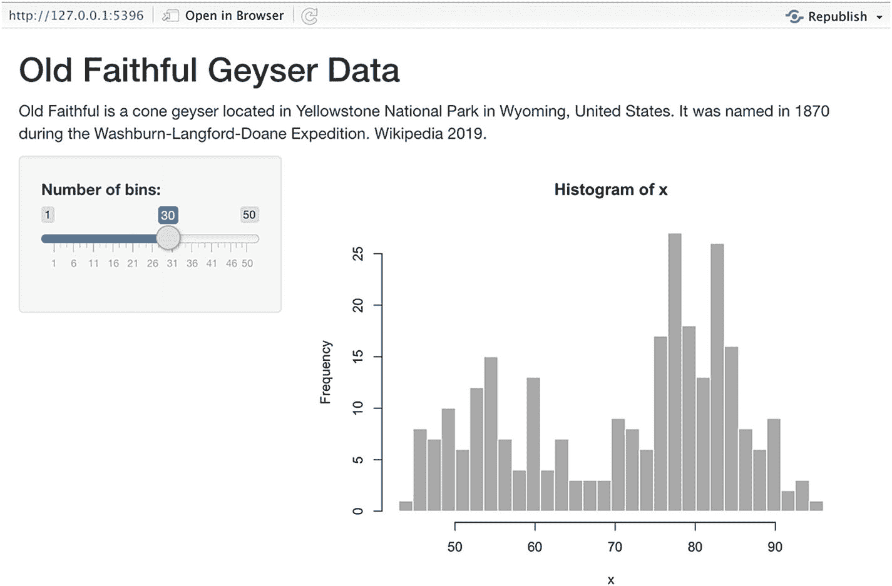
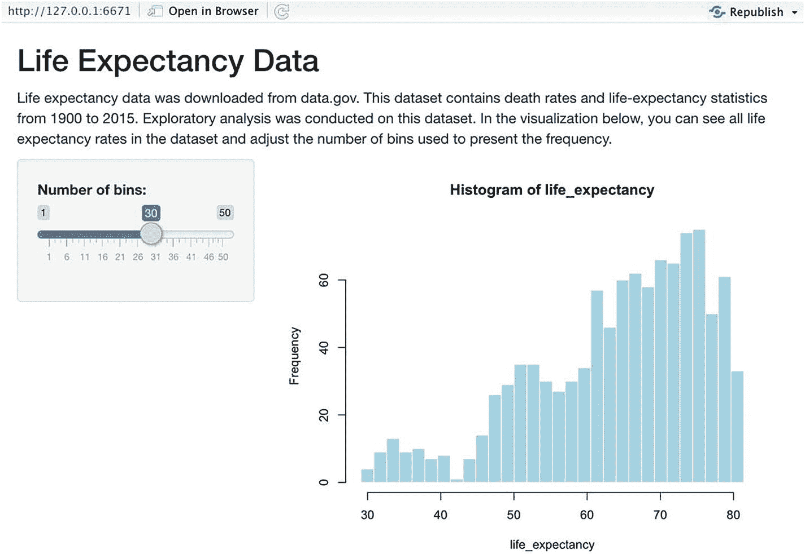

# 9. Shiny R 仪表板

R Markdown 和 `htmlwidgets` 能让您创建丰富甚至带有弹出框的交互式体验。然而，某些用例需要的不仅仅是这类静态工具所能提供的功能。例如，您可能需要用户提供分析中使用的参数、连接到后端数据库，或在用户探索您的分析时执行新的 R 脚本。

您可以在 RStudio 中使用 Shiny 来创建这类数据仪表板，它们具有与您的 R 系统完全集成的丰富功能。Shiny 是一个用于在 R 中创建交互式 Web 应用程序的包。这些应用程序可以在 RStudio 项目中使用、添加到 R Markdown 报告中，或作为 Web 应用在线发布。Shiny 提供了一个易于使用的框架来开发这些应用程序，并且您可以通过自己的 CSS 和 JavaScript 代码进一步扩展 Shiny。

## 新建 Shiny 应用

向您的 RStudio 项目添加一个 Shiny 应用非常简单。只需转到 RStudio 菜单栏，然后选择 `"File"`、`"New File"`，最后选择 `"Shiny Web App..."`。将会出现一个类似图 9-1 所示的对话框。



图 9-1

新建 Shiny 应用

您可以为应用命名，并选择代码是放在一个文件还是两个文件中。点击 `"Create"` 按钮来构建这个 Web 应用。

RStudio 将在您的项目中创建一个以您在对话框中提供的名称命名的新文件夹。如果您选择 `"Single File"`，则会出现一个名为 `"app.R"` 的新文件，并自动在编辑器视图中打开，如图 9-2 所示。



图 9-2

`app.R` 的内容

显示的代码是 RStudio 为您创建的模板，作为起点。这是一个可工作的 Shiny 应用，使用内置的 R 数据集作为示例。点击图 9-2 中所示的 `"Run App"` 按钮来运行这个 Web 应用。该应用将在由 R 管理的本地 Web 服务器上开始运行，如图 9-3 所示。



图 9-3

本地运行的 Shiny 应用

这个直方图具有很高的交互性，当您调整左侧的滑块控件时，会执行 R 代码以重新创建右侧的直方图。这比仅仅包含预置在静态报告中的弹出框更进一步。

在图 9-3 的顶部，您会看到一个 HTTP 地址和一个 `"Open in Browser"` 按钮。这个应用正在一个 Web 服务器上运行，因此您可以通过点击 `"Open in Browser"` 按钮或在浏览器的地址栏中输入 HTTP 地址，使用常规浏览器来查看该应用。

您可能还会注意到右侧有一个 `"Publish"` 按钮。Shiny 应用被发布到网站，以便任何人都可以使用。这些应用可以是公开的，既可以使用 RStudio 提供的服务，也可以从您的企业管理私有服务器。要获取免费账户来发布您的应用，请前往 [`https://www.shinyapps.io`](https://www.shinyapps.io) 注册。

## 理解 Shiny

Shiny 可用于创建使用 R 脚本且可以在 Web 上相对轻松访问的仪表板。然而，与大多数 R 包一样，您可以更深入地研究该系统，以构建真正定制化的体验。我们将在此讨论基础知识，为您提供一个良好的 Shiny 起点，但要真正掌握这个包，请前往 [`https://shiny.rstudio.com/`](https://shiny.rstudio.com/) 查看教程和文档，了解 Shiny 可以实现的功能。

Shiny 代码被分为两个职责明确的区域：用户界面和服务器。这也被称为“前端”和“后端”。其理念是，像滑块和按钮这样的可视化用户界面元素属于应用的前端部分，而数值计算和数据分析则属于应用的后端部分。

在我们生成的代码中，只有一个文件同时包含了用户界面和服务器。根据您选择的选项或最初编写应用的人的不同，您也可能会看到这两个组件被分离到各自的文件中。

### 用户界面

用户界面包含在为我们创建的`app.R`文件中编码的`ui`对象中。创建`ui`对象的代码位于`app.R`文件的顶部：

```r
ui <- fluidPage(
  # 应用标题
  titlePanel("老忠实泉数据"),
  
  # 用于设置分组数滑块输入的侧边栏
  sidebarLayout(
    sidebarPanel(
      sliderInput("bins",
                  "分组数：",
                  min = 1,
                  max = 50,
                  value = 30)
    ),
    
    # 显示生成的分布图
    mainPanel(
      plotOutput("distPlot")
    )
  )
)
```

这整段代码只是一个名为`fluidPage`的函数，它以逗号分隔的列表形式调用了两个参数`titlePanel`和`sidebarLayout`。该函数的结果被赋值给`ui`对象。这个`ui`对象将在文件末尾作为启动 Shiny 应用的函数的参数使用。

花点时间放慢节奏，仔细观察上面的代码。这可能不是你习惯的编码方式。函数名称所用的词汇暗示了正在发生的事情。如果仔细想想，你可能会预期我们会看到这样一个页面：它包含一个标题，后面跟着更复杂的内容（暂时忽略这一点）。你可以清楚地看到我们是从哪里获取首次在图 9-3 中看到的标题“老忠实泉数据”。

构建 Shiny 前端的核心过程就在于此。如果你想向应用添加内容，只需在逗号分隔的列表中包含一个新的函数调用即可。例如，如果想添加一个 HTML 段落来解释老忠实泉是什么，我可以在`titlePanel`之后的位置添加`p`函数。

```r
# 定义用于绘制直方图的应用 UI
ui <- fluidPage(
  # 应用标题
  titlePanel("老忠实泉数据"),
  p("老忠实泉是一座锥形间歇泉，位于美国怀俄明州的黄石国家公园。它于 1870 年在沃什伯恩-朗福德-多恩探险队期间被命名。维基百科 2019。"),
```

结果就是你在图 9-4 中看到的网页应用。它本质上与之前的应用相同，但现在包含了一些文本上下文信息。



图 9-4：向 Shiny 应用添加一个段落

在构建应用的过程中，你会不断向页面添加内容。有些函数是简单的 HTML 组件，比如`p`函数，有些则是 Shiny 特有的。你经常会发现对象嵌套在其他对象中，以便为应用定义布局。

这一点你可以在`sidebarLayout`中看到，它是整个`fluidPage`中的一个对象，而该对象本身又由另外两个对象组成，这两个对象以逗号分隔列表的形式作为参数出现。

```r
# 用于设置分组数滑块输入的侧边栏
sidebarLayout(
  sidebarPanel(
    sliderInput("bins",
                "分组数：",
                min = 1,
                max = 50,
                value = 30)
  ),
  
  # 显示生成的分布图
  mainPanel(
    plotOutput("distPlot")
  )
)
```

上述两个组件是`sidebarPanel`和`mainPanel`。`sidebarPanel`包含了另一个嵌套对象`sliderInput`，该对象定义了用户将用来控制可视化的滑块。第一个参数值`bins`被称为`inputID`，用于在网页应用的`server`后端标识该组件。

`mainPanel`包含`plotOutput`，这是呈现图形的对象。在`plotOutput`中，该参数被突出显示，因为它将被用作`inputID`，以便`server`组件能够识别此对象。

总之，`ui`对象现在包含了显示标题、段落、滑块控件、图形以及用于实现布局的其他对象的组件。其中两个对象，即滑块和图形，还带有`inputID`参数，这样服务器就能从滑块获取值，并知道在哪里呈现图形。

### 服务器

服务器组件负责后端繁重的工作。在这个例子中，服务器将收集用户在用户界面上定义的参数，以运行 R 代码进行分析并创建图形。`inputID`用于标识输入和输出组件。以下是服务器代码，其中输入和输出部分已突出显示。

## 定义绘制直方图所需的服务器逻辑

```r
server <- function(input, output) {
  output$distPlot <- renderPlot({
    # 根据 ui.R 中的 input$bins 生成分组
    x    <- faithful[, 2]
    bins <- seq(min(x), max(x),
                length.out = input$bins + 1)
    
    # 使用指定的分组数绘制直方图
    hist(x, breaks = bins,
         col = 'darkgray',
         border = 'white')
  })
}
```

在上面的代码中，我们正在为`server`对象赋值一个匿名函数。这些函数与我们在用户界面中所做的稍有不同。在用户界面中，我们简单地将函数调用的结果赋值给`ui`对象，而在这里，我们是将一组以匿名函数形式存在的指令赋值给`server`对象。这些指令将用于响应用户界面中的活动。

代码中突出的部分就是服务器连接到用户界面的连接点。所有内容都通过匿名函数的`input`和`output`参数来引用。`input`包含对用户界面中每个输入组件的引用，而`output`包含对用户界面中每个输出组件的引用。

你可以使用`input`对象后跟美元符号和`input`对象的`inputID`来引用一个`input`组件，例如`input$bins`。如果你还记得，"bins"是赋予滑块对象的标识符。`input$bins`将返回用户当前选择的值。

这里的输出对象正在获取上面`renderPlot`函数生成的所有代码。你可以看到，我们使用类似的方式，通过函数的参数`output$distPlot`来引用这个输出组件。你可以从`renderPlot`函数中包含的代码行中了解用户输入是如何被收集以及图形是如何显示的机制。

## 应用

在 Shiny 可以创建网页应用之前，还有一件事需要完成。我们需要将`ui`和`server`组件关联起来，然后使用以下代码启动它们：`shinyApp(ui = ui, server = server)`。

这部分代码作为样板代码包含在内，除非你更改了用户界面和服务器对象的名称，否则你可能根本不需要修改这段代码。但是，了解这段代码的位置以及它负责启动应用实例是值得的。

## 自定义 Shiny 应用

让我们将这个样板代码修改成适合我们分析的代码。目前，我们只需对用户界面进行一些小的调整，并显示我们自己的数据集，而不是内置的 `faithful` 数据集。

我们需要做的第一件事是将数据集复制到 Shiny 文件夹中，以便将来可以将所有资源部署在一个地方。使用 R 命令行上的以下代码，将数据集以 `rdata` 文件格式保存到 Shiny 应用文件夹中：

```r
save(expectancy, file = "life_expectancy_web_app/expectancy.rdata")
```

现在，当应用启动时，我们可以在 Shiny 会话中加载这个数据集。将以下代码放在 Shiny 的 `app.R` 文件顶部，以加载数据集。

```r
load("expectancy.rdata")
expectancy % filter(!is.na(life_expectancy))
```

这行代码会加载数据集，然后移除任何会干扰直方图的缺失值。现在，我们可以通过修改 `server` 组件中的一行代码，来查看我们自己的数据集，而不是 `faithful` 数据集。

```r
server <- function(input, output) {
  output$distPlot <- renderPlot({
    # generate bins based on input$bins from ui.R
    x  <- expectancy$life_expectancy
    bins <- seq(min(x), max(x), length.out = input$bins + 1)
    # draw the histogram with the specified number of bins
    hist(x, breaks = bins, col = 'darkgray', border = 'white')
  })
}
```

在我们测试之前，让我们修改标题描述，并在图表中添加我们自己的颜色。你大概能猜到我们会在哪里进行这些修改。在下面的代码中，所有修改都已用粗体标出。

```r
library(shiny)
library(tidyverse)
load("expectancy.rdata")
expectancy % filter(!is.na(life_expectancy))

# Define UI for application that draws a histogram
ui <- fluidPage(
  # Application title
  titlePanel("Life Expectancy Data"),
  p("Life expectancy data was downloaded from data.gov. This dataset contains death rates and life-expectancy statistics from 1900 to 2015. Exploratory analysis was conducted on this dataset. In the visualization below, you can see all life expectancy rates in the dataset and adjust the number of bins used to present the frequency."),
  # Sidebar with a slider input for number of bins
  sidebarLayout(
    sidebarPanel(
      sliderInput("bins", "Number of bins:", min = 1, max = 50, value = 30)
    ),
    # Show a plot of the generated distribution
    mainPanel(
      plotOutput("distPlot")
    )
  )
)

# Define server logic required to draw a histogram
server <- function(input, output) {
  output$distPlot <- renderPlot({
    # generate bins based on input$bins from ui.R
    life_expectancy  <- expectancy$life_expectancy
    bins <- seq(min(life_expectancy), max(life_expectancy), length.out = input$bins + 1)
    # draw the histogram with the specified number of bins
    hist(life_expectancy, breaks = bins, col = 'lightblue', border = 'white')
  })
}

# Run the application
shinyApp(ui = ui, server = server)
```

现在，当你运行这段代码时，你的应用将类似于图 9-5 中所示。



**图 9-5.** 预期寿命 Shiny 应用

现在的上下文是相关的，我们也调整了直方图中条形的颜色。你可以通过访问此 URL：[`mattjcamp.shinyapps.io/life_expectancy_web_app`](https://mattjcamp.shinyapps.io/life_expectancy_web_app)，在作者的 shiny.io 页面上看到这个应用的已发布版本。

## 结论

在本章中，我们介绍了 Shiny，并且只是浅尝辄止地了解了这个工具所能实现的功能。Shiny 创建了一条途径，可以直接将数据丰富的应用部署到网络上，而无需具备特定的网络开发背景。

话虽如此，`Shiny` 是一个非常丰富的包，即使不涉及 JavaScript，你也会发现自己需要花费大量时间在数据处理网络应用上。花一些时间学习基础知识，然后按照本章的模式，参考 [`shiny.rstudio.com`](https://shiny.rstudio.com) 上的示例代码。寻找你感兴趣且能与你所熟悉的数据配合使用的示例，并调整代码来制作你自己的可视化效果。当你这样做并掌握了这些模式后，部署 `Shiny` 应用将变得像现在的统计编程和数据分析一样得心应手。

