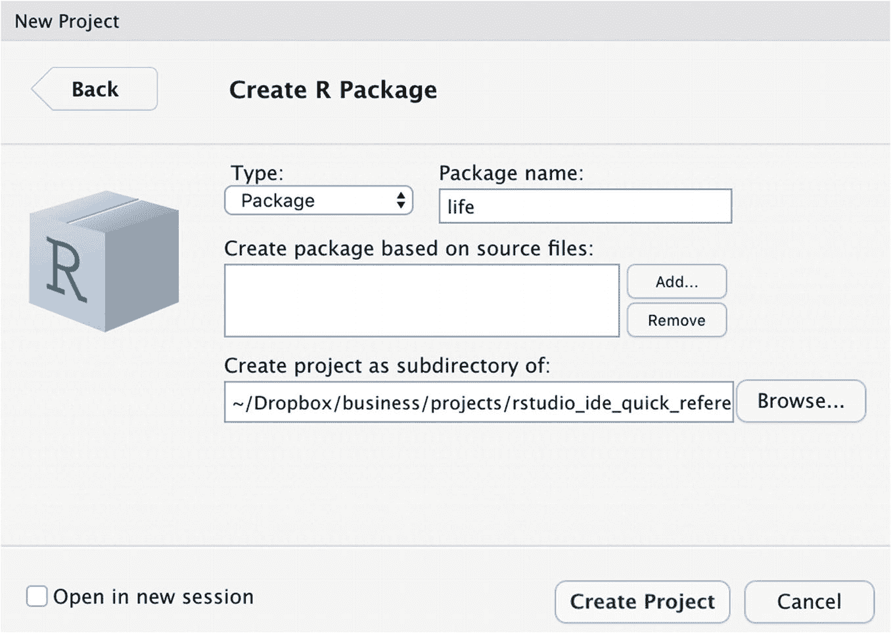
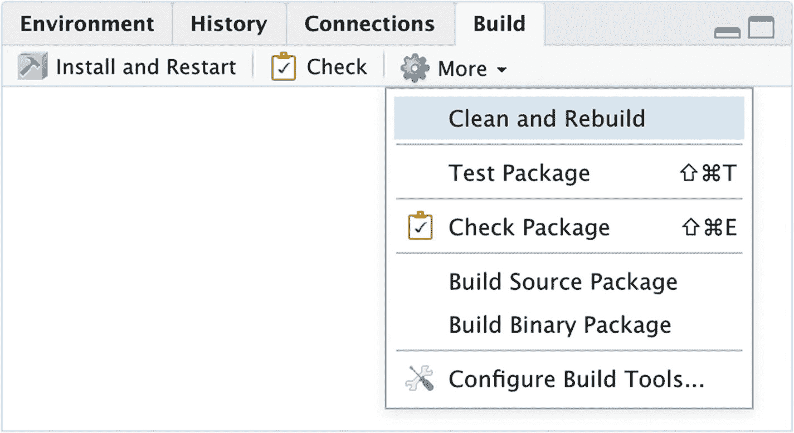
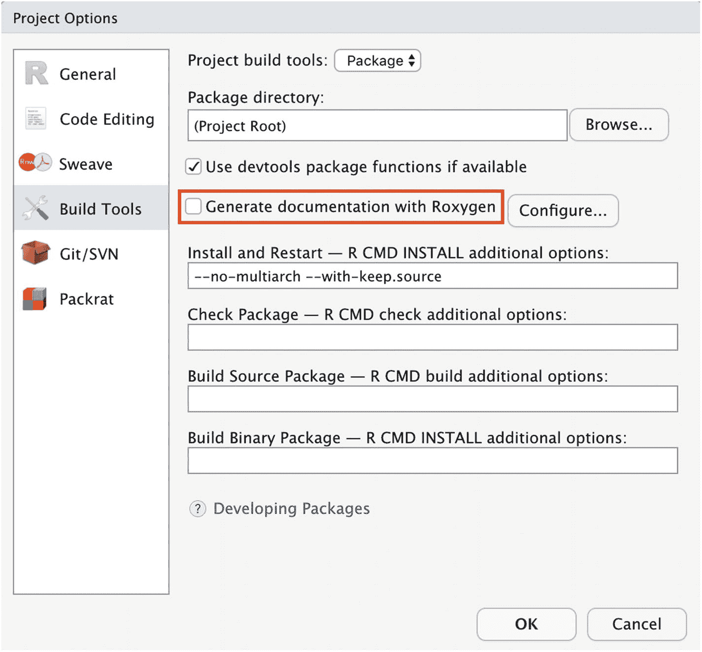
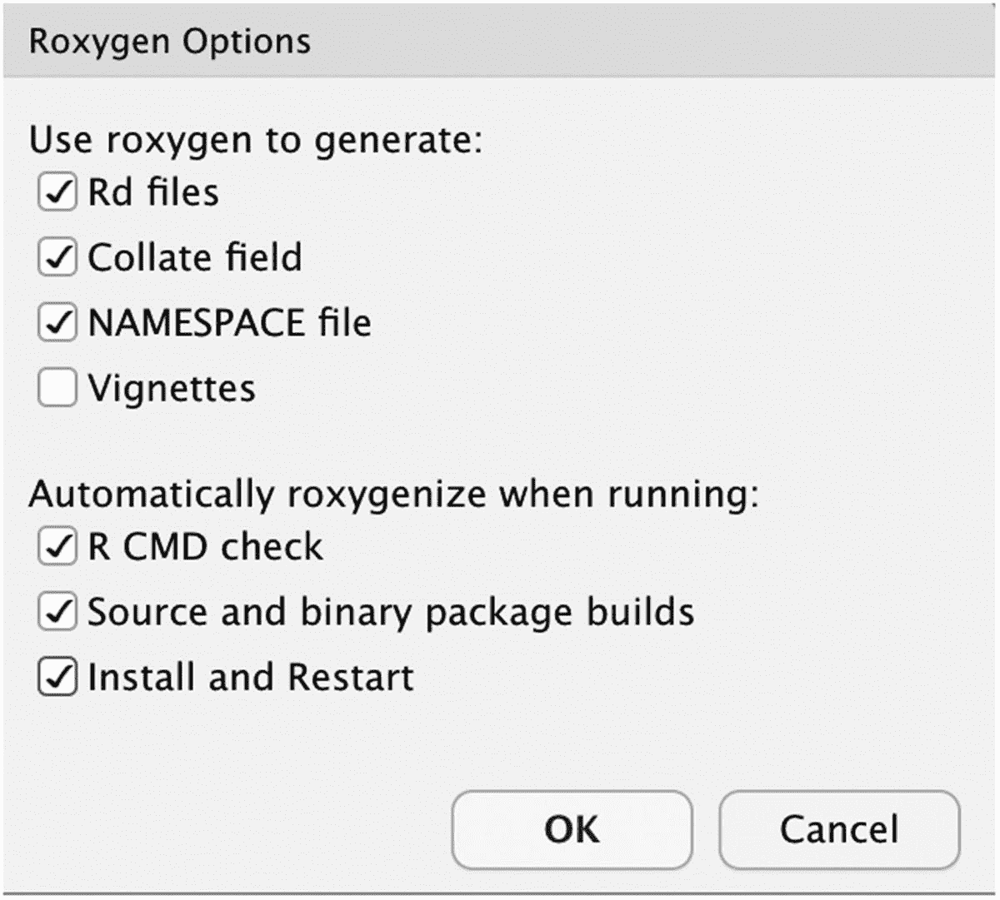
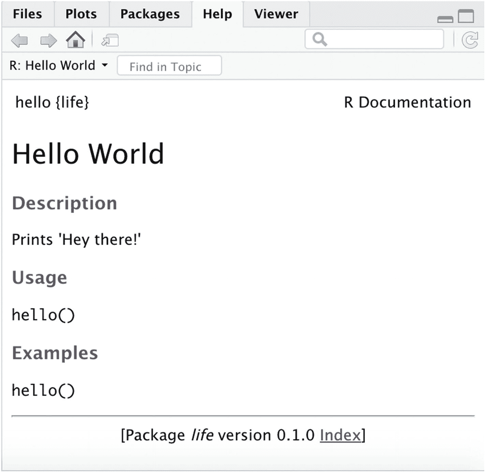
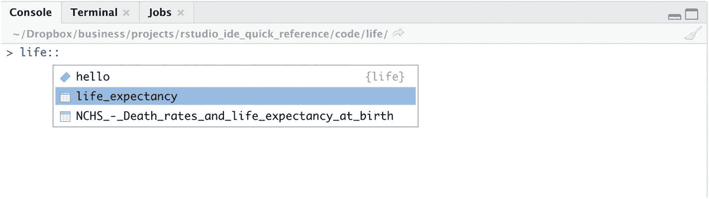

# 自定义 R 包

R 在数据领域的流行，很大程度上归功于其庞大的第三方包库，这些包为核心 R 语言增加了重要的功能。我们已经看到，使用 `tidyverse` 包如何能改变使用 R 的体验。许多数据问题已经得到解决，R 程序员将这些解决方案提供给任何人使用。事实上，许多数据项目都是从搜索已经存在的、能够解决当前问题的 R 包开始的。

在本章中，我们将讨论如何创建我们自己的 R 包，无论是用于我们自己的团队，还是分发给全世界。

## 自定义 R 包的使用场景

我们为什么要创建自己的包？创建包的一个显而易见的原因是与世界分享我们的工作。那些在 R 中已经解决，并且可以以普遍有用的方式编码的问题，是打包成包的理想选择。

你可能也想创建一些只适用于你自己团队或你自己项目的包。原因是，以包的形式进行编码可以促进代码复用和流程效率。你也可以使用包将数据和代码打包在一起提供给同事，特别是当你看到类似情况反复出现时。最后，R 包带有内置的文档工具，为你在工作中传达复杂材料提供了一种方式。

并非所有代码都适合放在包中，因此在将临时分析转化为包时，你需要运用一些判断力。通常，在 R 包格式下迭代和测试代码更加困难，因此通常最好等到你处于维护模式时，再将一组函数打包成一个包。

在本章中，我们将基于前几章所做的工作创建一个包。为此，我们将使用 `RStudio` 创建一个全新的项目，然后有选择地将功能引入包中。

## 创建新的自定义 R 包

`RStudio` 内置了创建包的支持。转到 `RStudio` 菜单栏，然后选择“文件”、“新建项目”、“新目录”，然后选择“R 包”。将出现一个类似图 10-1 的对话框。



**图 10-1.** R 包创建对话框

你可以为你的包添加一个名称，并指定一个目录来创建该包。点击“创建项目”按钮来创建 R 包项目。

你的文件夹中将获得一组模板文件，你可以将其作为指南。关键文件是 `R` 文件夹中的 `hello.R` 文件、`DESCRIPTION` 文件以及 `man` 文件夹中的 `hello.Rd` 文件。下面我们来逐一介绍这些文件。

### `hello.R`

所有你想要发布的代码都应放置在 `R` 文件夹中，就像 `hello.R` 一样。当你创建 R 包项目时，这个文件会被打开，你可以看到以下内容。

```r
# Hello, world!
#
# This is an example function named 'hello'
# which prints 'Hello, world!'.
#
# You can learn more about package authoring with
# RStudio at:
#
#   http://r-pkgs.had.co.nz/
#
# Some useful keyboard shortcuts for package
# authoring:
#
#   Install Package:           'Cmd + Shift + B'
#   Check Package:             'Cmd + Shift + E'
#   Test Package:              'Cmd + Shift + T'
hello <- function() {
print("Hello, world!")
}
```

这非常简单，但足以演示 R 包的构建过程是如何工作的。你可以将想要发布的函数放在这里，使其可用。一个良好的实践是在 `R` 文件夹中每个函数对应一个文件。

### `DESCRIPTION`

`DESCRIPTION` 文件提供了包的元数据。你可以在这里记录标题、描述、版本以及你的联系方式。只需点击文件将其打开，并用你 R 包的相关信息替换相应字段即可。

```
Package: life
Type: Package
Title: Shows Life Expectancy Trends Since 1900
Version: 0.1.0
Author: Matt
Maintainer: Matt 
Description: Includes datasets and helper functions to help present information on life expectancy rates.
License: None
Encoding: UTF-8
LazyData: true
RoxygenNote: 6.1.1
```

为了跟随演示，你不需要修改此文件，但当你准备发布时，请确保这些字段包含相关信息。

### `hello.Rd`

`hello.Rd` 是 R 的帮助文档文件。此文件会根据你包含在函数中的文档自动生成。我们稍后会详谈如何编写代码文档。

此处信息会出现在你在 `帮助` 窗格中阅读的包文档中。标题也会作为 `RStudio` 中代码补全的一部分出现，这样当你在编写一行代码时，你的内容就会直接显示在编辑器屏幕上。这是一种非常方便的方式，能在团队成员可能需要的时候，立刻为他们提供上下文。让我们来构建这个 R 包，以便了解这一切是如何运作的。

### 构建 R 包

当你使用 R 包项目时，右上角视图会多出一个名为 `构建` 的选项卡。此选项卡为你提供了一些构建 R 包的选项。转到此选项卡，点击 `更多`，然后选择 `清理并重新构建`，如图 10-2 所示。



**图 10-2** 构建视图

这将构建并打包你的代码。如果某些必需的库尚未安装，`RStudio` 会提示你进行安装。按照对话框向导安装所有必需的包。

现在你已经构建并安装了你的包，你可以像这样使用该函数：

```r
library(life)
hello()
```

这段简单的代码会在你的控制台中打印 `Hello, world!`。如果你想改变这个函数的行为，只需修改 `hello.R` 文件中的代码，然后重新构建该包即可。请尝试修改这个函数并查看结果。

你也可以在其它 `RStudio` 项目中使用相同的方式使用这些函数。这就是 R 包促进代码复用的方式。让我们继续为我们的预期寿命分析添加一些特性，以便更好地展示 R 包的功能。

### R 包文档

你可以通过使用 `roxygen2` 包来为你的 R 包添加注释。首先，你需要使用命令 `install.packages("roxygen2")` 来安装该包。这将安装 `roxygen2` 库及其任何必需的辅助包。

下一步是配置构建工具。转到构建视图，然后选择 `更多`，再选择 `配置构建工具...`。你会看到一个类似图 10-3 所示的对话框。



**图 10-3** 配置构建工具

勾选 `使用 Roxygen 生成文档` 复选框。然后点击 `配置...` 按钮，弹出图 10-4 所示的对话框。



**图 10-4** Roxygen 构建选项

确保勾选 `安装并重启` 复选框。现在，当你构建 R 包时，文档将根据你提供的字段自动生成。你使用包含反引号 `#'` 的特殊注释来包含文档。每个字段名都以 `@` 开头。一些常见的字段类型包括 `@name`、`@title` 和 `@description`。例如，以下是你可能包含在 `hello` 函数文档中的内容：

```r
# Hello, world!
#
# This is an example function named 'hello'
# which prints Hey there!.
#
#' @name hello
#' @aliases hello
#' @title Hello World
#' @usage hello()
#' @description  Prints 'Hey there!'
#' @examples hello()
hello <- function() {
print("Hey there!")
}
```

现在，当你构建 R 包时，你的帮助文档将反映你上面包含的内容，如图 10-5 所示。



**图 10-5** 自定义的帮助文档

在帮助文件中，我们修改了描述字段，以反映函数中 `Hello, world!` 消息已被更改。

### 向 R 包添加数据集

你可以在包中包含数据集和函数。你只需要在你的 R 包中添加一个 `data` 文件夹，然后将你的数据集放入该文件夹即可。这些数据集可以是 R 数据框，也可以是任何类型的原始数据文件。对于预期寿命项目，我们只是复制了包含从 `data.gov` 网站下载的 csv 文件的数据文件夹。然后使用以下代码将此数据集保存为 R 数据框。

```
library(readr)
life_expectancy <- read_csv("data/NCHS_-_Death_rates_and_life_expectancy_at_birth.csv")
# Clean up dataframe
# Use shorter column names
names(life_expectancy)[1] <- "year"
names(life_expectancy)[2] <- "race"
names(life_expectancy)[3] <- "sex"
names(life_expectancy)[4] <- "life_expectancy"
names(life_expectancy)[5] <- "death_rate"
save(life_expectancy,
file ="data/life_expectancy.rdata")
```

接下来，在 `构建` 视图中点击 `清理并重新构建` 来重新构建 `life` 包。一旦此过程完成，你可以使用以下代码从任何 RStudio 项目访问该数据集：

```
library(life)
head(life_expectancy)
```

这将显示该数据集的前几行，更重要的是，我们可以在任何分析中使用此代码，而无需重新运行我们的预期寿命分析。

### 代码补全

当你在 RStudio 中输入代码时，你可能会看到代码建议随着你的输入弹出。你的 R 包中的代码也会遵循这种模式。此外，你也可以像图 10-6 所示那样，通过输入包名后跟两个分号来快速查看可用的数据和函数。



**图 10-6** R 包代码补全

在上面的代码中，我们键入了 `life::`，这是一种过滤属于 `life` 包的所有内容的方法。你可以对任何 R 包执行此操作，以查看哪些函数包含在哪些包中。当你输入时，你帮助文档中的描述字段也会作为工具提示显示出来。

## 结论

在本章中，我们讨论了如何创建自定义的 `R` 包，以便与团队成员及更广泛的用户共享我们的工作成果。`R` 包是鼓励代码复用、并为我们的工作提供文档化和打包工具的优秀方式，从而延长代码在自身项目之外的生命周期。