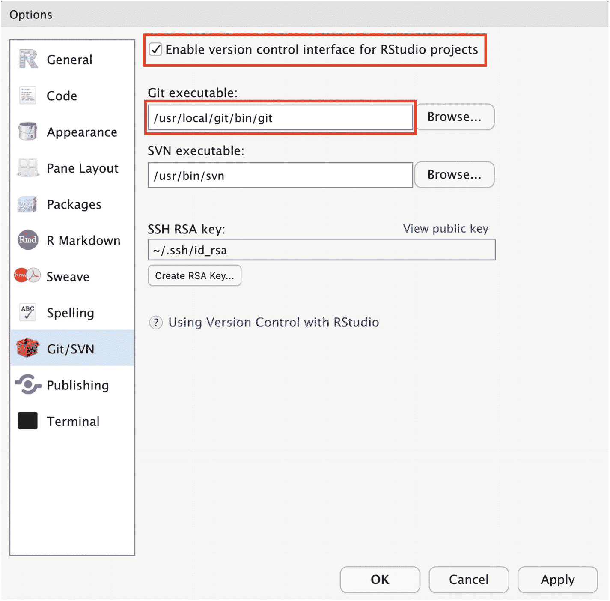
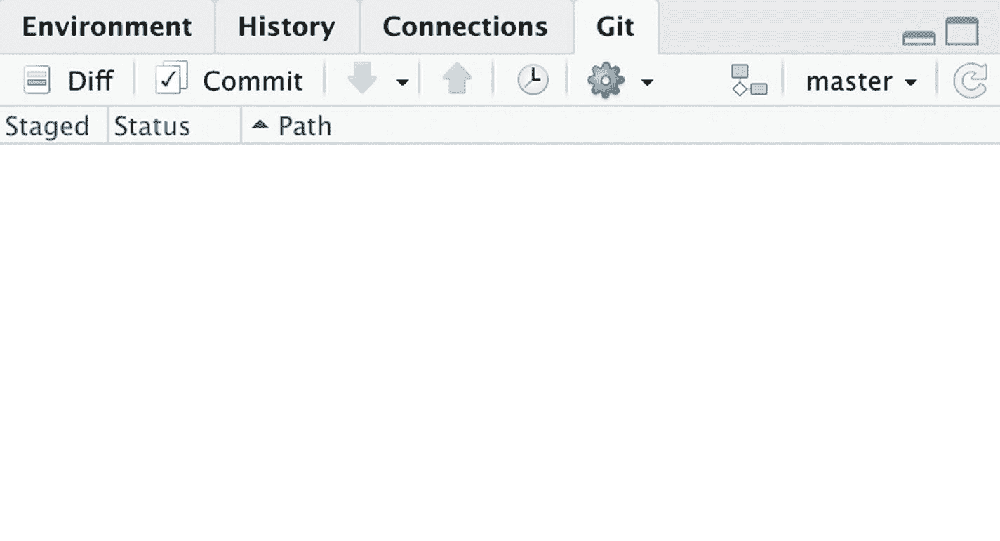
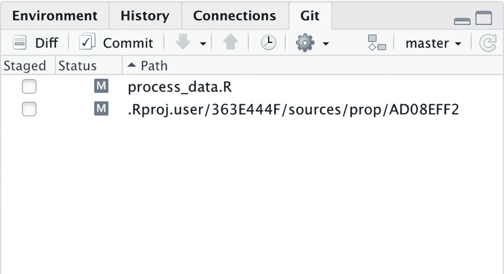
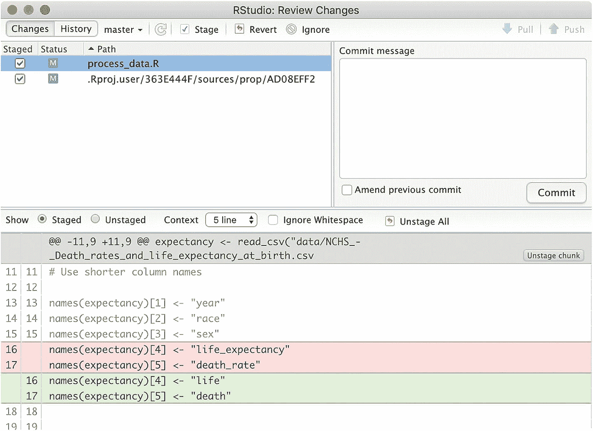
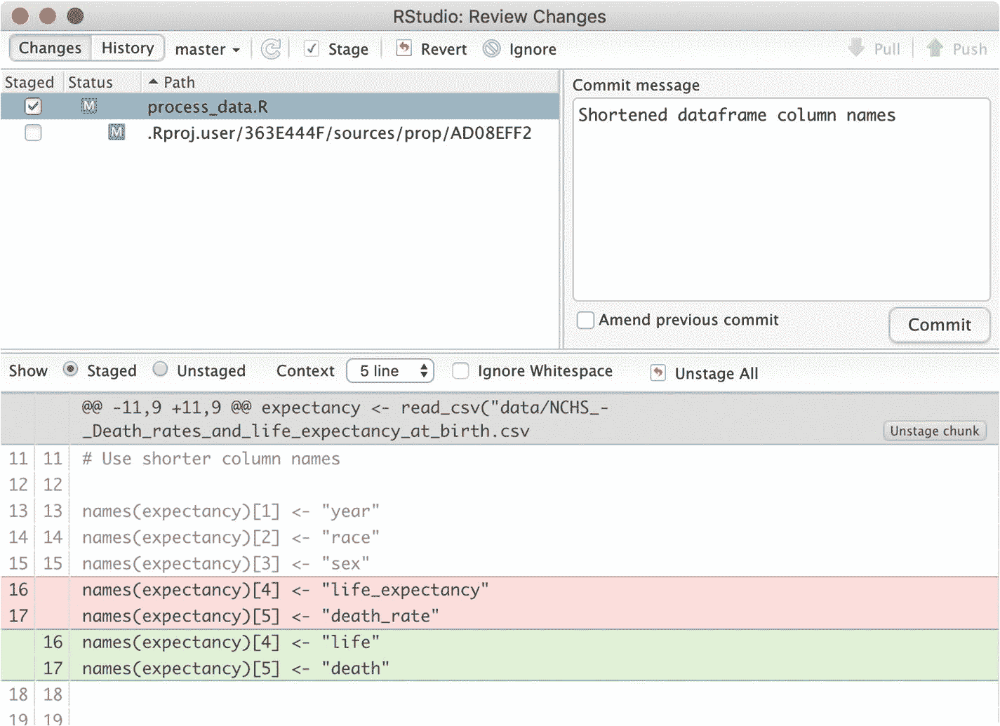
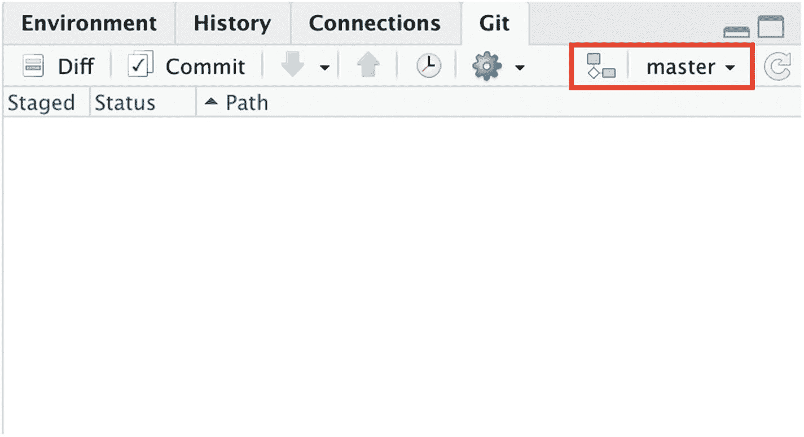
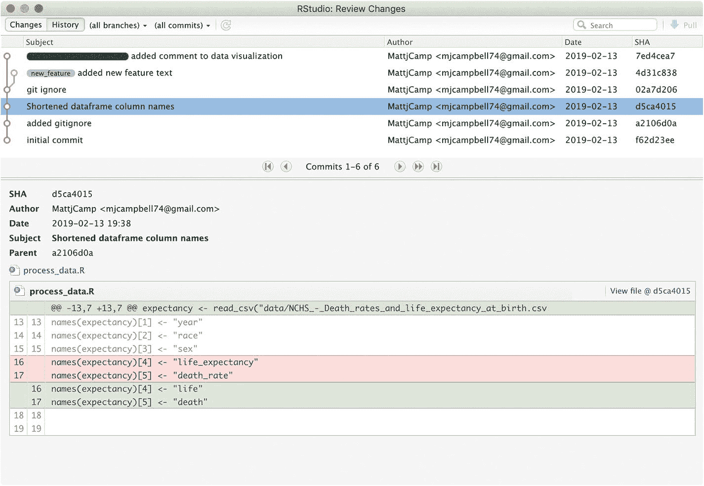
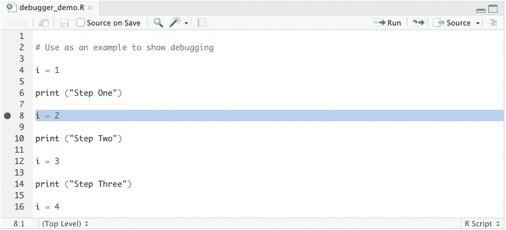
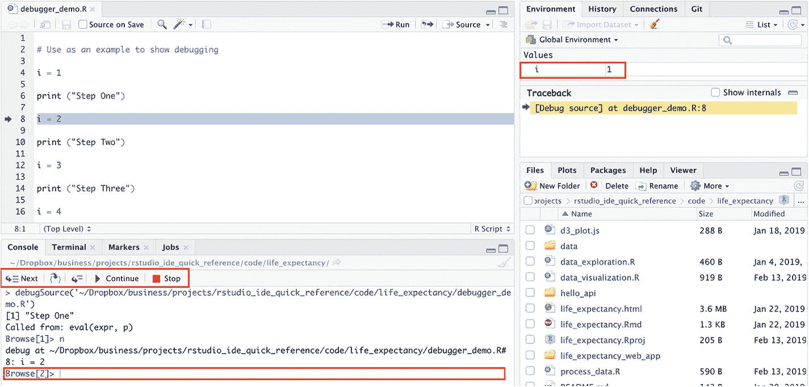

# 11. 代码工具

`RStudio` 包含一些工具，可帮助你编写、调试和跟踪代码。我们已经看到 `RStudio` 编辑器内置的代码工具，例如代码补全、语法高亮和工具提示。我们还可以集成 `git` 支持来帮助跟踪代码文件的版本，提供重构支持以方便编辑代码，以及使用调试工具来逐步执行并检查代码。

## 版本控制集成

版本控制是一个系统，你可以用它来跟踪对代码文件所做的更改。`RStudio` 支持与两个版本控制提供商的集成：Subversion 和 Git。两者都提供了通过代码版本来跟踪所做更改的基本功能。

如果你已经在使用版本控制，那么你会欣赏 `RStudio` 提供的集成功能。然而，如果版本控制从未成为你工作流程的一部分，那么其价值可能不会立刻显现。虽然使用版本控制是最佳实践，但它并非所有项目的必需功能。尽管如此，尝试将其纳入你的工作流程仍是一个好主意。

### 设置 Git

在本章中，我们将假设你正在使用 `git`，并且已在计算机上安装了该系统。如果没有，请参考第 1 章安装 `git`。需要执行几个步骤来确保 `RStudio` 知道如何为你使用版本控制。

我们需要在 `RStudio` 的首选项区域中指明我们正在使用 `git`。转到 `RStudio` 菜单栏，选择“RStudio”和“首选项”，以打开如图 11-1 所示的对话框。



图 11-1

设置版本控制

勾选标有“为 RStudio 项目启用版本控制界面”的复选框，并确保提供 `git` 安装路径。此路径取决于你的计算机以及你选择安装 `git` 的位置；图中显示的路径是 Mac 安装的默认文件夹。

#### 将项目添加到 Git 仓库

要将 `git` 添加到项目中，你需要通过点击 `RStudio` 中的“终端”选项卡来使用终端。然后输入命令 `git init` 并回车。这会在项目所在的文件夹中创建一个新的 `git` 仓库。我们可以像这样直接从终端使用 `git`，或者通过集成的 `RStudio` 工具。趁现在，我们将此文件夹中的文件添加到新的 `git` 仓库中，然后提交它们：

```
git add .
git commit -m "initial commit"
```

这两个命令将所有文件添加到仓库中，并使用消息“initial commit”进行提交。

#### Git 查看器

现在，我们需要重启 `RStudio`，以便看到 `git` 集成查看器，如图 11-2 所示。



图 11-2

版本控制查看器

当你对代码文件进行更改时，该文件将出现在此窗口中。例如，如果我决定对“process_data.R”文件进行一些更改，你会看到版本控制查看器更新以反映这一点，如图 11-3 所示。



图 11-3

仓库中的已修改文件

现在我们可以看到两个文件出现在 `git` 查看器中。我们预料到“process_data.R”会出现，但没想到第二个带有长文件路径名的文件也会出现。这两个文件旁边的蓝色“M”图标表示这些文件已被修改。让我们来看看第一个文件中的更改。

#### Git Diff 查看器

点击每个文件旁边的复选框，然后点击查看器左上角的“Diff”按钮。将出现一个新的屏幕，如图 11-4 所示。



图 11-4

差异屏幕

在此屏幕上，你将看到文件中的差异。白色空间显示两个文件中都有的内容。红色空间显示文件先前版本中的内容（即将被删除），而绿色内容显示文件的新增内容。

使用左上角区域中的列表在两个更改过的文件之间导航。如果你查看另一个文件，你会看到这些更改与我们的代码编辑器状态有关，这并不重要，可以忽略（稍后我们将看到如何忽略文件）。

如果你点击顶部的“History”按钮，你将看到自从开始处理此文件以来对其所做的所有更改的历史记录。在工作流程的这一点上，我们可以选择撤销这些更改，也可以将更改提交到我们的仓库。

#### 提交更改

要提交更改，我们可以在屏幕右上角区域输入“提交消息”，然后点击“Commit”按钮，如图 11-5 所示。



图 11-5

将更改提交到仓库

我们也可以点击“Revert”按钮而不是“Commit”按钮来撤销更改。

#### Git 分支

`Git` 支持分支。当你想要对项目的副本进行更改时，可以创建一个分支，这样就能在不影响原始代码的情况下测试新功能。如果在一个分支上工作，之后又决定保留新功能，你可以将分支“合并”回原始项目。

你可以为新分支任意命名，通常可以使用你正在处理的功能或缺陷的名称。你的原始源分支名为“master”。你通常遵循的 `git` 工作流程是：从 `master` 分支创建一个新分支，在新分支上工作，如果新分支满足你的要求，则将其合并回 `master`。

`RStudio` 支持创建新分支和切换分支。使用图 11-6 中高亮显示的按钮来添加新分支和切换分支。



图 11-6

管理 git 分支

第一个按钮用于创建分支，第二个按钮用于切换分支。当你切换分支时，项目中的所有代码都将被替换为该分支的代码。

你可以通过点击“Diff”按钮，然后点击“History”按钮，再在“History”按钮旁边的空间中选择“(all branches)”，来查看仓库中所有分支的概况。在图 11-7 中，展示了一个包含 `master` 分支和“new_feature”分支的项目示例。



图 11-7

Git 分支

你可以使用此工具浏览和可视化分支中的差异，并查看项目中的变更历史。`RStudio` 并不支持所有 `git` 功能。如果你想删除分支或合并分支，则需要使用终端选项卡并查找相应的命令。


## 调试器

调试是指识别并修复代码中缺陷的过程。最简单的调试方法可能就是将对象值直接打印到控制台屏幕上。然而，当你的分析状态随着每一行代码的执行而发生变化时，这可能会变得令人沮丧。

为了解决这个问题，RStudio 自带了一个内置工具，允许你设置断点，这些断点会阻止代码继续执行，并让你有机会检查对象的值。

通过设置断点来使用调试器。只需打开一个代码文件，然后在你希望 R 停止执行的代码行左侧区域点击即可。这个区域被称为“装订区”，如图 11-8 所示。



图 11-8

设置断点

位于 `i = 2` 代码行旁边的红点就是断点。当我们执行这段代码时，RStudio 将停在这一行，并显示代码调试器，如图 11-9 所示。



图 11-9

关键的调试器功能

在图 11-9 中，你可以看到所有调试器功能。在左中区域，我们有一组控件，可以用来控制代码的执行。既然我们停在了断点处，我们就可以前进到下一行，继续执行所有代码直到下一个断点，或者停止代码执行。

在屏幕底部，我们可以使用控制台编写代码来检查项目的当前状态。当你在测试有关代码缺陷的想法时，这是一个很好的功能。你还可以在顶部看到环境窗口，在那里你可以看到环境中所有对象的值。

通过进入 RStudio 的调试菜单，你还可以获得更多调试选项。特别是前两个选项非常有用，它们允许你切换和清除断点。

## 更多代码工具

RStudio 还附带了一些工具，使你的代码编辑和重构变得稍微容易一些。代码重构是指当你有一个运行中的项目，但你希望稍微整理一下代码时所做的事情。你可能想要更改函数名称、缩进代码或将代码区域提取为可重用的函数。

前往 RStudio 的标题栏，选择“代码”菜单项，即可查看所有帮助你重构代码的选项。其中一个关键功能是“在作用域内重命名”，使用时，你需要先高亮一个对象，然后选择该菜单。此时，你对对象所做的任何编辑都将反映在该对象在代码文件中的所有出现位置。

你还可以发现“重新缩进行”和“重新格式化代码”这些选项有助于让你的代码看起来更整洁。当你调用一个函数却不太记得它是在哪里定义的时候，使用“转到函数定义”功能导航代码会容易得多。

## 结论

在本章中，我们重点介绍了 RStudio 自带的一些内置工具，这些工具将帮助你组织和管理代码。Git 用于组织代码并查看代码版本之间的差异。你使用调试器来观察程序在执行代码过程中的状态，以便修复错误。最后，代码菜单为你提供了一系列实用工具，你可以使用它们快速重新格式化代码。

