# 1. 介绍 Salesforce Lightning

Salesforce 目前是用于业务管理的排名第一的客户关系管理（CRM）解决方案。通过提供强大的平台和突破性技术，Salesforce 为销售、服务和市场营销部门提供解决方案。Lightning Experience 提供了一个新的用户界面，该界面具有更快的平台、动态功能和增强的美学效果。企业报告称，转向 Lightning 后，成交率提高、协作增强、生产力提升且报告速度加快（见图 1-1）。

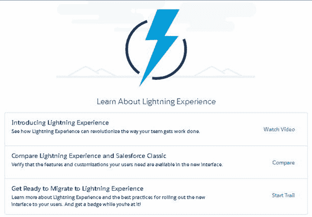
图 1-1：Salesforce Lightning Experience

## Lightning 页面

Lightning 页面将注意力聚焦于最重要的事项。关键信息会显示在“首屏上方”，即屏幕的上半部分，以便用户更快地查看要点。

此外，布局一致且易于导航。请对比 Classic 中的帐户记录（见图 1-2）与 Lightning 中的同一记录（图 1-3）。

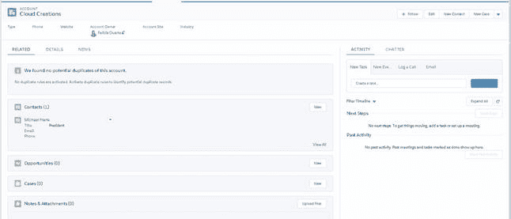
图 1-3：Lightning Experience 中的 Salesforce 帐户记录

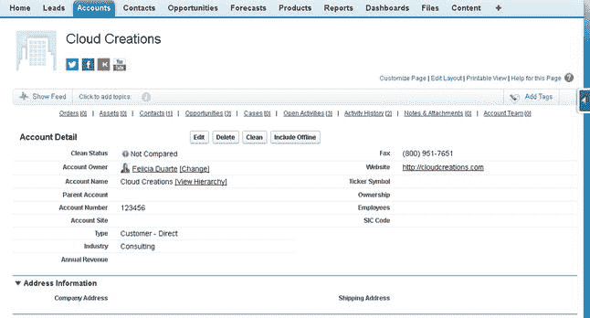
图 1-2：Salesforce Classic 中的 Salesforce 帐户记录

## 迁移到 Lightning Experience

迁移到 Salesforce Lightning Experience 非常简单。以下步骤描述了如何访问迁移助手。迁移助手将检查你的组织对 Lightning 的准备情况，并引导你完成一系列步骤，以便为你的组织启用 Lightning。这是你的 Lightning 之旅中一个很好的第一步。

> **注意：** 这些步骤并非必需，但强烈建议执行。Salesforce 花了大量时间思考潜在的迁移陷阱，并尝试在迁移助手中解决这些问题。

### 迁移助手

请执行以下步骤：

1.  在 Classic 中，选择 `Setup`（设置）（见图 1-4）。

    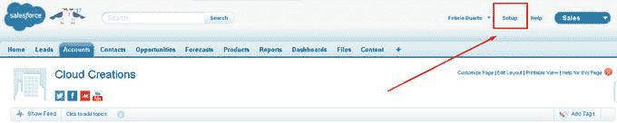
    图 1-4：Salesforce Classic 中的“设置”区域

2.  在 `Setup`（设置）菜单中，点击 `Get Started`（开始使用）按钮（见图 1-5）。

    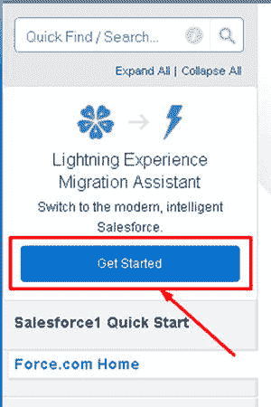
    图 1-5：设置中的“开始使用”按钮

3.  在这里，你有三个可用资源来了解更多关于 Lightning Experience 的信息。你可以从图 1-6 中的选项中进行选择。

    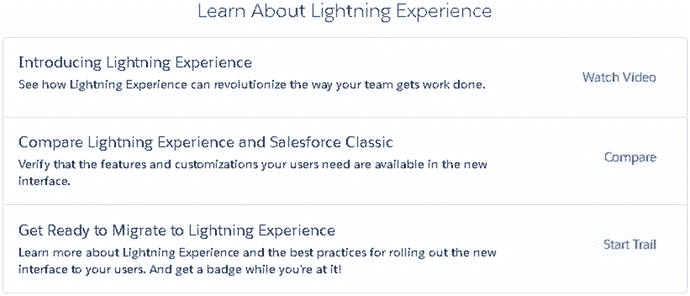
    图 1-6：Salesforce Lightning 的学习资源

4.  点击 `Next Step`（下一步）开始操作。

#### 检查准备情况

首先，Salesforce 将请求访问你的组织，以分析你当前的设置（图 1-7）。

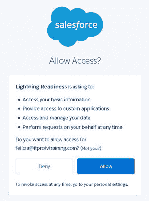
图 1-7：允许访问 Lightning 准备情况检查

单击 `Allow`（允许）（如图 1-7 所示）后，你必须选择要访问的 Salesforce 产品（见图 1-8）。

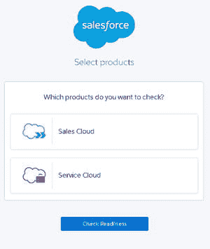
图 1-8：选择要检查 Lightning 准备情况的产品

选择适当的 Salesforce 产品并单击 `Check Readiness`（检查准备情况）。Salesforce 将分析你当前的设置，并通过电子邮件发送一份准备情况报告（见图 1-9）。新组织可以跳过此步骤。

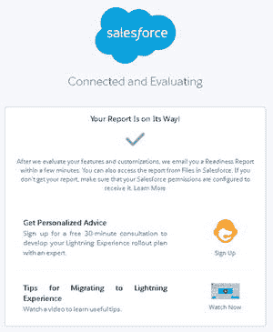
图 1-9：Lightning 迁移选项

#### 预览

你可以预览你的组织在 Lightning 环境中的运作方式。这是一个很好的功能，可以用来测试你的准备情况报告中可能提出的任何问题。如果在此切换过程中遇到任何问题，你可以当场进行更改。要进行测试，请导航至 `Preview`（预览）选项卡，然后单击 `Preview`（预览），如图 1-10 所示。

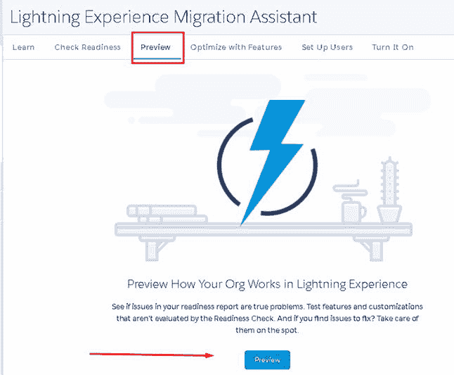
图 1-10：迁移助手中的“预览”选项卡

如图 1-11 所示，你将立即切换到预览模式下的 Lightning。

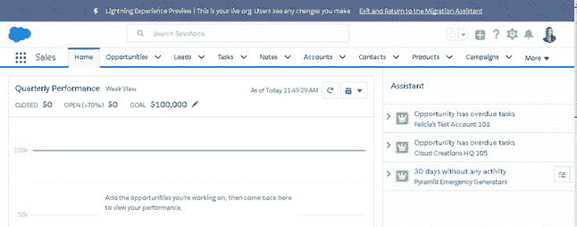
图 1-11：预览模式下的 Lightning Experience

#### 利用功能进行优化

为了获得 Lightning 的完整体验，请查看一些新增的可用功能。这包括用于新闻的新功能、启用活动和笔记的选项等等。导航到此选项卡，并单击 `Optimize with Features`（利用功能进行优化）来启用/禁用图 1-12 中的 Lightning 功能。

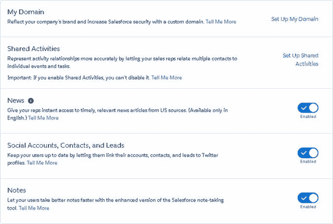
图 1-12：要启用的 Lightning 功能

你可以启用以下选项：

*   单击 `Set Up My Domain`（设置我的域）可以创建一个反映你公司品牌的 URL。这会将一个子域添加到你的 Salesforce 组织 URL。使用此功能来增强登录和身份验证过程。

*   单击 `Set Up Shared Activities`（设置共享活动）以允许用户将多个联系人关联到单个活动。

*   启用 `News`（新闻）以显示关于你的帐户及其行业的相关新闻文章。这些信息由你组织中列出的帐户拉取。

*   启用 `Social Accounts`（社交帐户）、`Contacts`（联系人）和 `Leads`（潜在客户），以允许用户通过同步社交媒体帐户更好地与你的帐户建立联系。

*   启用 `Notes`（笔记）以使用增强版笔记，该版本包括在编辑模式下自动保存、添加图像的选项以及共享功能。

#### 设置用户

你可以控制谁有权访问 Lightning Experience。你可以选择向用户组、单个用户或所有用户推出此功能。

> **注意：** 标准简档用户默认有权访问 Lightning，而自定义简档用户则没有。单击 `Learn How`（了解如何操作）以更改这些设置。

导航至图 1-13 中显示的 `Set up Users`（设置用户）选项卡，以微调此体验并选择要切换的用户。

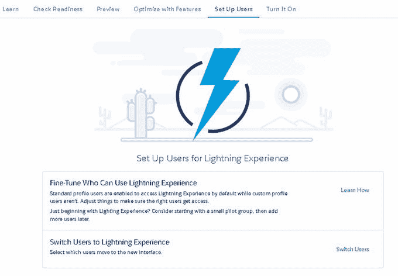
图 1-13：用户设置

请执行以下步骤来切换用户：

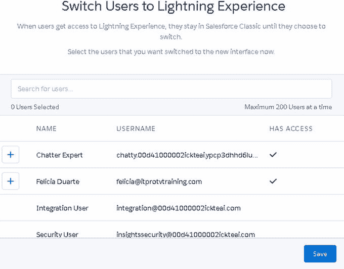
图 1-14：选择要迁移到 Lightning 的用户

1.  单击 `Switch Users`（切换用户）。

2.  通过单击用户名旁边的 `+` 来选择适当的用户（图 1-14）。

3.  单击 `Save`（保存）。

##### 推出方式

# 执行最适合你公司的推出策略

对于较大的组织，建议采用分阶段推出的方法。这种方法在迁移大型组织和复杂设置时非常有利。这种方法有几个好处，包括：

*   此方法允许你进行用户验收测试。用它来识别新体验中的任何挑战或问题。你可以在向整个组织推广之前收集用户的反馈并微调更改。

*   通过将实施工作分解成若干部分来取得进展。这确保了在紧跟新功能和变更的同时，能够取得进展。

建议的推出方式是从新用户开始，然后是试点用户组，最后是所有用户。

## 启用功能

太好了！终于到了最后一步！当你的组织准备好迁移到 Lightning 时，请选择图 1-15 中所示的 `Turn It On` 选项卡。将此选项卡切换为 `Enabled` 即可完成。

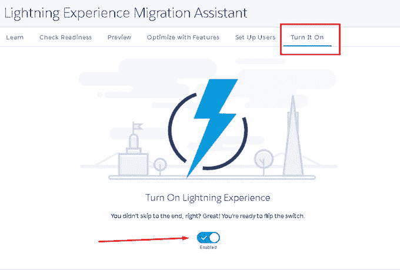

`图 1-15`

启用 Lightning 以完成操作

### 注意

拥有相应权限的用户可以选择在 `Classic` 和 `Lightning Experience` 之间切换。在 `Classic` 界面中，选择你的用户名并点击 `Switch to Lightning Experience`，如图 1-16 所示。在 `Lightning Experience` 界面中，点击 `Switch to Classic`，如图 1-17 所示。

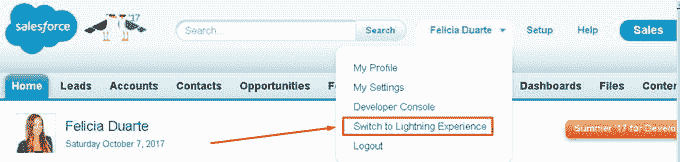

`图 1-16`

从 Classic 切换到 Lightning

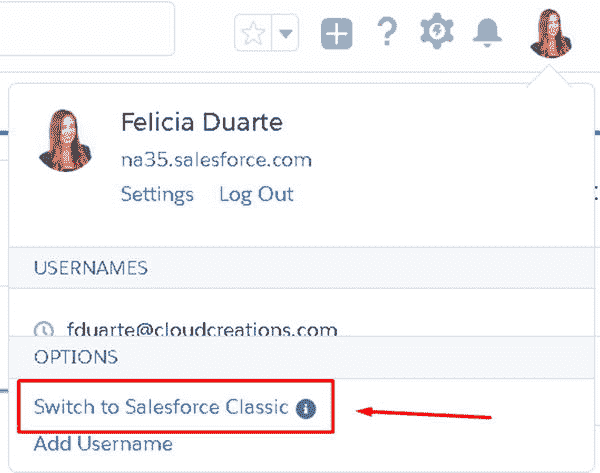

`图 1-17`

从 Lightning Experience 切换到 Salesforce Classic

# Lightning 主页

`Lightning Experience` 主页通过新功能得到了增强。主页可以根据用户需求进行定制，为他们提供在一个集中位置管理工作所需的一切。无需任何配置，`Salesforce` 会显示以下组件：`Quarterly Performance`（季度业绩）、`Assistant`（助手）、`News`（资讯）、`Today’s Tasks`（今日任务）、`Today’s Events`（今日活动）、`Recent Records`（最近记录）和 `Top Deals`（重点交易）。请参见图 1-18 和图 1-19。

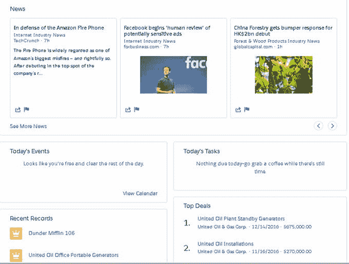

`图 1-19`

Lightning 主页的下半部分

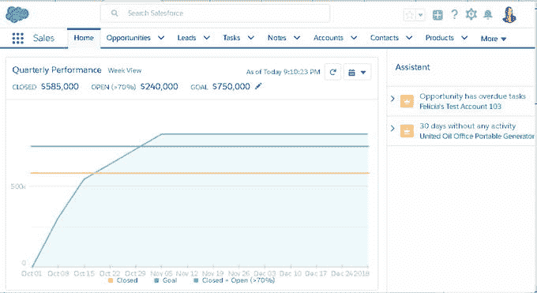

`图 1-18`

Lightning 主页的上半部分

## 导航栏

导航栏使用选项卡来存放对象，如图 1-20 所示。用数据库术语来说，*对象*（`object`）就是一个表。对象存储着可能相关的信息分组，包括其中的记录。记录可以看作是表中的行。你会在本书中反复听到这些术语。有关对象、记录和字段的更多信息，请导航到第 X 章。

在 Lightning 中，每个选项卡都是可操作的。

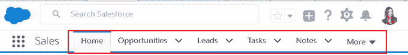

`图 1-20`

导航栏

在导航栏中，对象被分解为列表。这些列表存放与对象相关的 `Salesforce` 记录。其中一个很棒的功能是，可以直接从一个选项卡中创建记录。每个列表都能用来查看该对象最近的项目，这使得用户可以更轻松地即时创建新记录。

## 季度业绩（Quarterly Performance）

`Quarterly Performance`（季度业绩）摘要是一个强大的报告工具，用于根据销售漏斗展示销售用户的业绩（见图 1-21）。

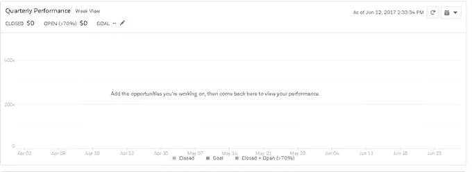

`图 1-21`

位于主页上的季度业绩组件

-   `Closed`（已关闭）记录显示用户已赢单的商机。

-   `Open (>70%)`（进行中，>70%）显示概率大于 70% 的所有记录的总和。

如果用户属于某个团队，则此报告将展示团队的商机总额。否则，所显示的数据将是该用户自己拥有的商机。

### 设定目标

要设定目标，请遵循以下步骤：

1.  点击铅笔图标并输入金额，如图 1-22 所示。

    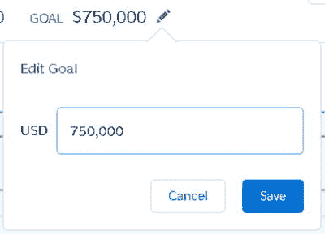

    `图 1-22`

    选择铅笔图标以编辑你的季度目标

2.  点击 `Save`（保存）。

图表会自动计算并更新。点击  可刷新数据。点击  可按周或日筛选数据（图 1-23）。

现在，你的销售用户就可以通过销售进度的数据可视化来开始新的一天了。

## 资讯（News）

这项新功能非常适合展示与你客户及其行业相关的新闻文章。一旦按照“增强功能”部分所述启用，新闻信息便可在主页上显示。当从主页访问新闻时，系统会根据最近查看的记录以及这些记录的任务和事件来显示信息。请参见图 1-23。

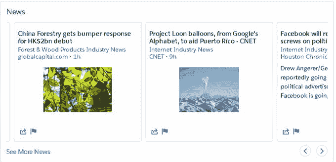

`图 1-23`

主页上的资讯组件

点击 `See More News`（查看更多资讯）以导航至 `News`（资讯）选项卡，如图 1-24 所示。

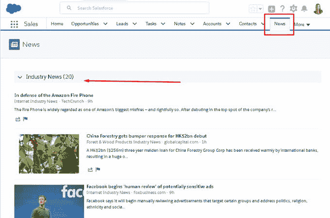

`图 1-24`

在资讯对象中找到的行业新闻

此选项卡显示一个标题为 `Industry News`（行业新闻）的新闻文章列表。此处填充的信息与你的客户及其行业相关。

## 助手（Assistant）

`Lightning Assistant`（Lightning 助手）有助于排列最终用户日常任务的优先级。逾期的任务会首先显示在页面右上角（见图 1-25）。紧接着是截止日期为今天的任务。

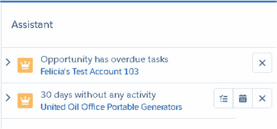

`图 1-25`

Lightning Assistant

### 全局搜索

Salesforce 的全局搜索栏出现在每个页面的顶部。使用此区域可以在 `Salesforce` 中的任何对象上进行搜索。最佳实践是在创建新记录之前先搜索记录，以避免重复数据。使用通配符和运算符可以获得更好的搜索结果。

使用星号（`*`）可以查找搜索词中间或末尾匹配的记录，使用问号（`?`）可以查找搜索词中间或末尾仅匹配一个字符的记录。

例如，在末尾搜索 `Ay*` 将找到并显示名为 `Ayden` 的联系人的结果，也会找到并显示 `Andy Young` 的结果（图 1-26）。

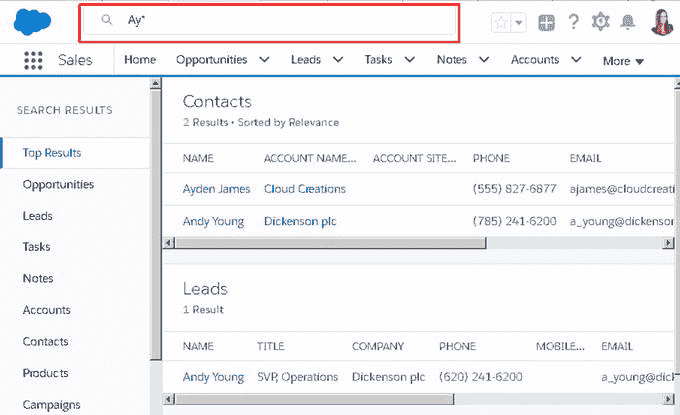

`图 1-26`

搜索 `Ay*` 的结果

### 收藏夹列表

`Favorites`（收藏夹）图标是 Lightning 平台中的一个新工具。收藏夹是针对最常访问的记录和项目（如单个收藏记录、列表视图、仪表板等）的自定义快捷方式。

要将某项设为收藏，请点击图 1-27 中的星形按钮。这个强大的工具使你可以轻松地从不同对象位置找到你收藏的记录，并集中在一个地方查看。

你可以将你的重点交易、最常访问的报告、最重要的潜在客户等设为收藏！

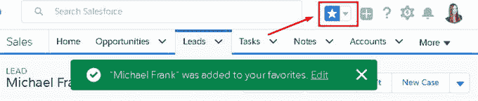

**图 1-27** 收藏夹图标

点击星形旁边的箭头以选择你的`Favorites`（收藏夹）列表中的项目，如图 1-28 所示。

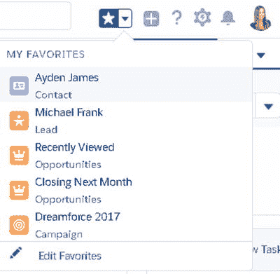

**图 1-28** 收藏夹列表

### Lightning 操作

如图 1-29 所示的 **+** 按钮可用于在`Salesforce`中快速创建记录。使用此快速创建功能，可直接从主页新建活动、潜在客户、联系人、商机、个案或电话。

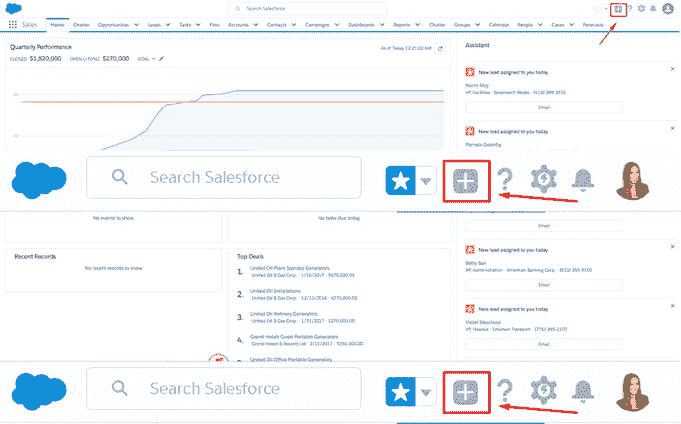

**图 1-29** Lightning 操作

点击任意可用选项，即可在屏幕右下角立即显示一个快速创建窗口。

在 Lightning Experience 中，可以从主页打开多个窗口，以提高用户的工作效率和速度。最多可同时显示三个窗口（见图 1-30）。

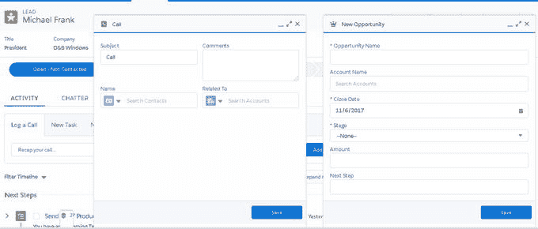

**图 1-30** *实用工具栏*

### 帮助与培训

`Salesforce`拥有许多出色的支持资源，包括视频、操作指南以及名为`Trailhead`的互动学习工具。从主页点击问号（如图 1-30 所示）即可访问这些资源。每个页面都有一个帮助菜单，其中包含指向实用资源的链接。使用此区域可以记录个案、获取支持、提供反馈以及查看版本说明。

`Salesforce`每年提供三个季度的版本更新：春季、夏季和冬季。每个版本提供超过 150 个新功能。此菜单右下角显示的图像（如图 1-31 所示）会告知您的组织当前处于哪个版本。

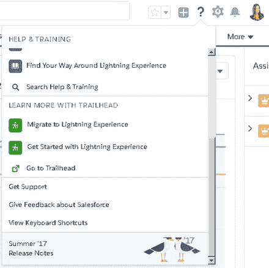

**图 1-31** 帮助与培训

### 设置

设置是`Salesforce`管理员最常使用的区域。在 Lightning 中，设置页面已得到改进！设置区域拥有更符合逻辑且更易于导航的布局。系统管理员和拥有适当权限设置的用户可以访问此区域。从工具栏中选择“设置”即可导航至此（见图 1-32）。

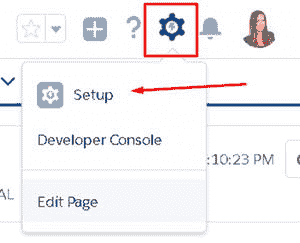

**图 1-32** Lightning 设置主页

设置包含以下类别：管理、平台工具和设置。查看设置中的“最近使用的位置”，以无缝地继续任何管理工作。使用“快速查找”可以轻松找到进行自定义工作所需的管理工具。

点击“创建”按钮可快速访问最常用的工具，包括新建对象、工作流、选项卡、模板和用户（见图 1-33）。

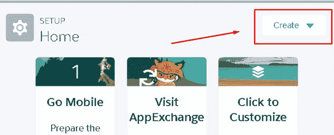

**图 1-33** 创建按钮

### 通知

在一个位置查看所有通知，包括批准请求和`Chatter`提及。点击铃铛图标可查看通知列表（见图 1-34）。

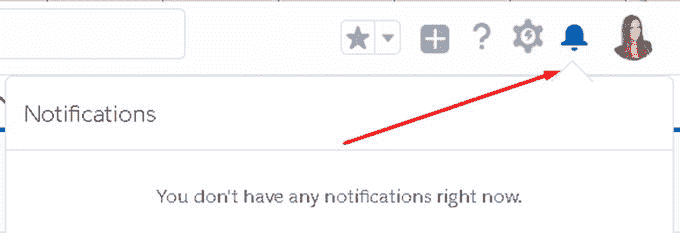

**图 1-34** 通知区域

### 查看个人资料

使用此部分可以更改个人设置、注销或切换到`Salesforce Classic`（见图 1-35）。

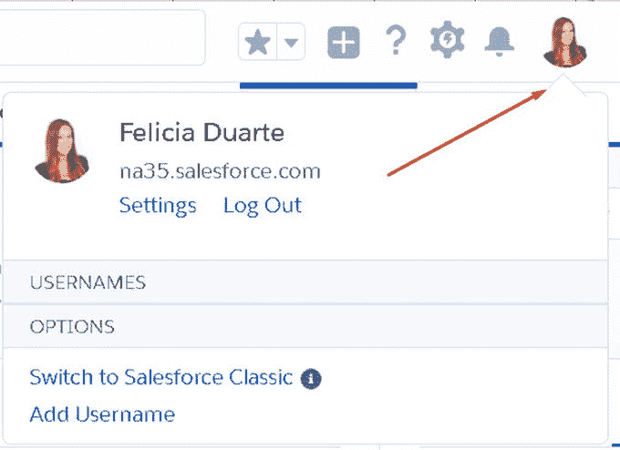

**图 1-35** 设置区域

### 用户

在 Lightning 中，您可以像在 Classic 中一样轻松地创建`Salesforce`用户。用户通过许可证、用户名和密码以及配置文件进行标识。在 Lightning 中，您可以创建新用户、停用用户、编辑用户设置等。

#### 创建新用户

要分配许可证和记录所有权，您必须首先创建一个用户。每个用户都必须分配一个许可证。要释放许可证，您可以停用某个用户并进行相应分配。在“快速查找”中，搜索并选择位于“管理”部分的“用户”。

导航到用户主页（见图 1-36）以创建单个用户、编辑现有用户的信息、添加多个用户以及重置密码。

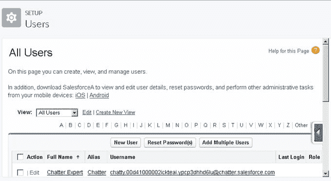

**图 1-36** 用户设置主页

#### 创建和编辑用户信息

请按照以下步骤创建新用户：

1.  单击“新建用户”。

2.  填写所有标红且为必填的字段。这包括姓氏、别名、电子邮件、用户名和昵称（见图 1-37）。

    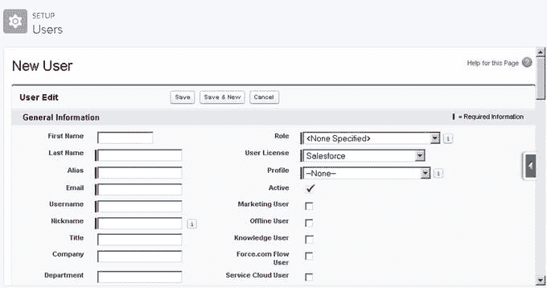

    **图 1-37** 添加新用户的必填字段

    **注意** 电子邮件地址必须是有效的电子邮件格式，但可用于多个组织。但是，用户名必须是唯一的，并且格式正确的电子邮件地址。

    例如，`felicia@cloudcreations.com` 就是一种正确的电子邮件格式。

3.  在“用户许可证”字段中分配适当的许可证。

4.  使用“配置文件”字段分配配置文件。

5.  选中“市场营销用户”以使分配的用户有权访问您组织的营销工具。

6.  选中“离线用户”以使分配的用户获得离线访问权限。

7.  选中“知识用户”以授予对知识库文章进行更改的权限。

8.  选中“Force.com Flow 用户”以授予`Force.com`许可用户运行 Flow 的能力。

9.  选中“Service Cloud 用户”以授予对`Service Cloud`的访问权限。

10.  选中“Site.com 贡献者用户”以允许访问`Site.com`。

11.  选中“Work.com 用户”以分配`work.com`用户功能许可证。

12.  选中“Salesforce Classic 用户”以启用对`Salesforce Mobile Classic`的访问。

13.  应用适当的区域设置，例如时区、区域设置和语言（图 1-30）。

14.  单击“保存”。

`Salesforce`会立即向用户发送通知电子邮件以生成新密码。要停止此操作，请取消选择屏幕底部的“生成新密码”。

#### 添加多个用户

您可以通过一次添加多个用户来节省时间。要在用户主页上添加多个用户，请单击“添加多个用户”，如图 1-38 所示。

**图 1-38** 添加多个用户按钮

下一页将列出每种许可证类型可用的许可证数量，如图 1-39 所示。

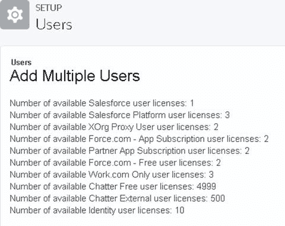

**图 1-39** 可用许可证的细分信息

滚动到页面底部，然后选择您要为所有用户添加的用户许可证，如图 1-40 所示。

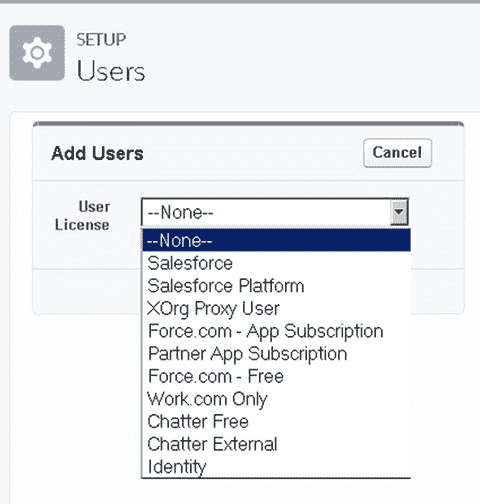

**图 1-40** 为批量用户组选择用户许可证

**注意** 添加多个用户时，这些用户必须具有相同的许可证类型。

一旦您选择了适当的许可证类型，请填写用户的详细信息并单击“保存”，如图 1-41 所示。并非所有用户字段在此过程中都可用。

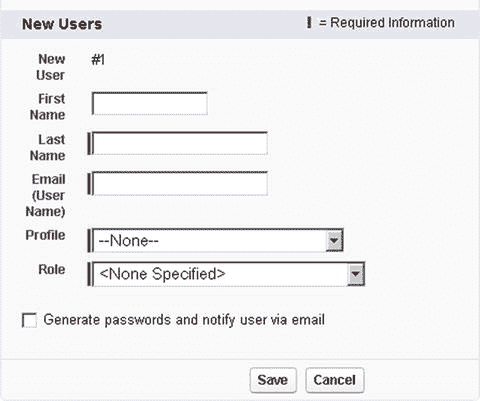

图 1-41

新用户的必填字段

## 停用用户

在 Salesforce 中，你不能删除用户，但可以停用用户以阻止其登录。停用用户会释放一个许可证，该许可证可分配给其他用户（参见图 1-42）。当你停用某个用户时，该用户将从所有共享权限和组中移除。

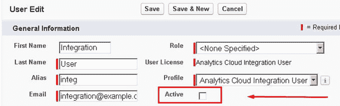

图 1-42 – 用户页面上的 `Active` 复选框

该用户拥有的记录仍可转移至活跃账户。以下是停用步骤：

1. 导航至 `Setup` 中的 `User` 部分。
2. 选择需要停用的用户名称。
3. 在用户记录页面点击 `Edit`。
4. 在用户配置文件中取消勾选 `Active`。
5. 点击 `Save`。

## Lightning 页面

Lightning 允许你创建自定义页面，为特定用户组显示和安排关键信息。你可以通过构建清晰易用的页面来提高采用率和用户接受度。通过创建应用程序，你可以最大限度地减少公开信息的类型，使 Salesforce 组织更易于使用。`App Builder` 是一个新的拖放工具，无需编写代码即可自定义界面（参见图 1-43）。

请按照以下步骤更改 Lightning 主页：

1. 在主页上，点击 `Edit Page`（此功能可在大多数 Lightning 页面上找到）。参见图 1-43。

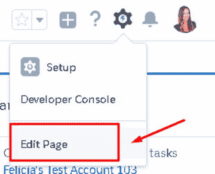

图 1-43 – `Setup` 下拉菜单中的 `Edit Page`

2. 安排你想要用户看到的可用组件。参见图 1-44。

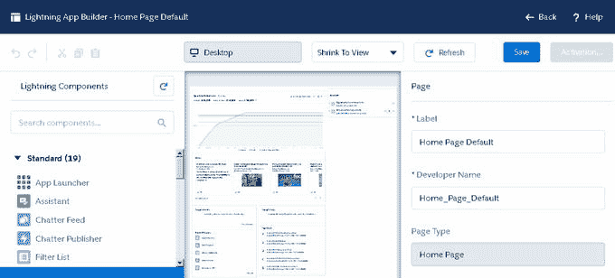

图 1-44 – `Lightning App Builder`

3. 在左侧面板中，从可用的 Lightning 组件中进行选择，并将其拖放到主页上的所需区域。右侧面板将提示所选组件的详细信息。

### 创建新的 Lightning 应用程序

从 `Setup` 中，搜索并选择 `App Manager` 以打开 `Lightning Experience App Manager`。点击 `New Lightning App` 以创建一个新应用程序（参见图 1-45）。

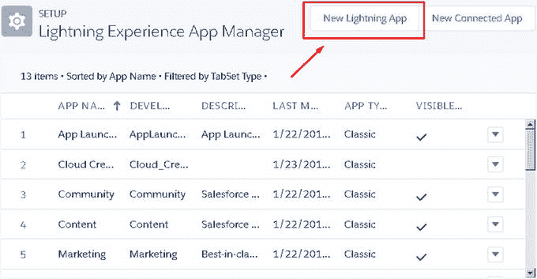

图 1-45 – 创建新的 Lightning 应用程序

要创建新应用程序，请遵循以下步骤：

1. 填写必填字段（标有星号的字段）。
   - 应用程序名称将显示在导航栏中。
   - 开发人员名称是 API 名称，必须在组织中的其他应用程序中保持唯一。
2. 对于 `App Branding`，上传一张图片（如公司徽标）来自定义页面（参见图 1-46）。

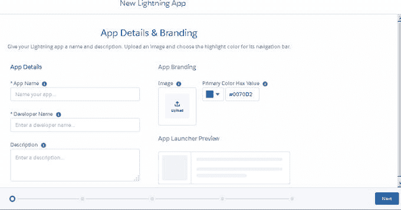

图 1-46 – 应用程序详细信息

3. 填写完相应字段后，点击 `Next`。
4. 选择导航样式。选择 `Standard` 在顶部显示导航栏，或选择 `Console` 在新工作区选项卡中打开记录（参见图 1-47）。

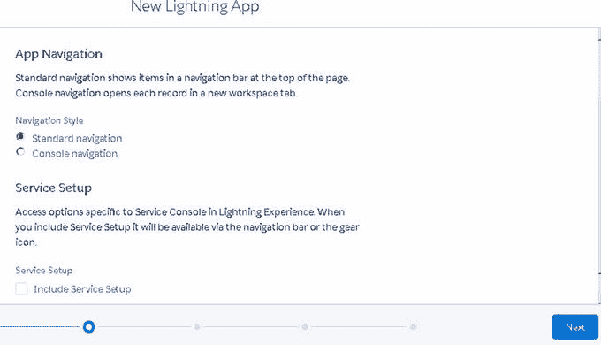

图 1-47 – 新的 Lightning 应用程序导航选项

5. 点击 `Next`。
6. 点击 `Add` 添加实用程序栏（参见图 1-48）。

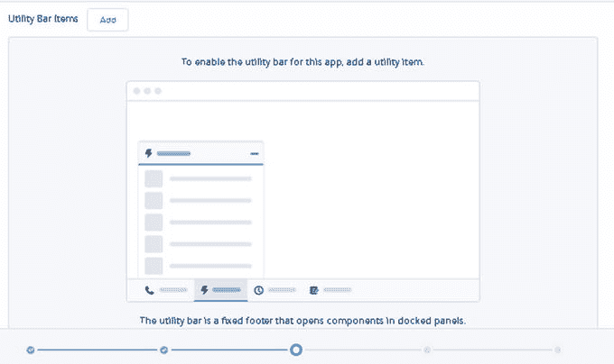

图 1-48 – 为应用程序启用实用程序栏的步骤

7. 选择应在新应用程序中显示的项目。所选项目的顺序将从左到右显示在页面顶部（参见图 1-49）。

> **注意：** 最佳实践是为不同的用户组创建不同的应用程序。创建这些应用程序时，建议只显示与这些用户组相关的项目。如果用户看到过多不必要的信息，可能会感到不知所措和沮丧。
>
> 例如，销售应用程序应仅显示与销售相关的项目，如潜在客户、客户、联系人和商机。对于服务代理，他们很可能不需要看到商机。为服务代理创建一个仅显示与服务相关项目（如联系人和案例）的应用程序。

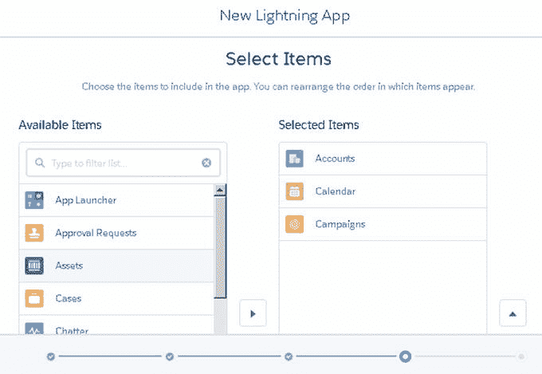

图 1-49 – 向新应用程序添加选项卡

8. 点击 `Next`。
9. 选择应有权访问此应用程序的配置文件（参见图 1-50）。

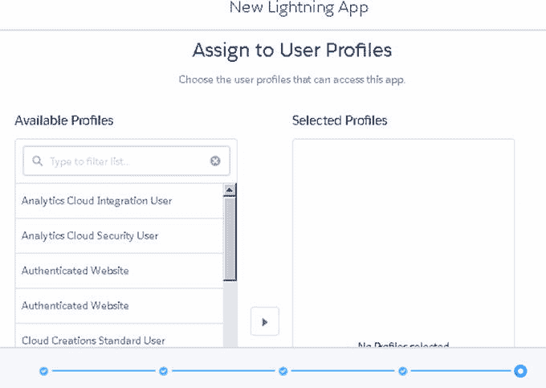

图 1-50 – 向应用程序分配用户

10. 点击 `Save and Finish Now`。你可以在 `App Launcher` 中找到新创建的应用程序。

## 公司设置

公司设置包括可以自定义的设置，例如会计年度、营业时间和节假日时间、语言设置以及其他重要信息。

### 公司信息

在 `Quick Find` 区域中搜索并选择 `Company Information`。`Company Information` 部分包含有关组织、许可证可用性和数据使用情况的重要信息。

#### 组织详细信息

组织详细信息显示公司的一般信息。编辑主要联系人以建立任何技术支持请求的联系点。在此处更改区域设置、货币和新闻通讯设置（参见图 1-51）。

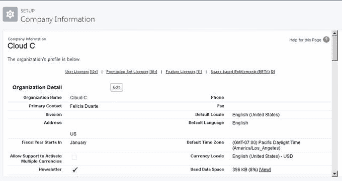

图 1-51 – 组织详细信息

#### 存储使用情况

每个组织都有存储限制。存储分为两类：数据存储和文件存储。要查看存储限制、存储使用情况和已使用百分比，请导航到公司设置。

点击 `Used Data Space` 或 `Used File Space` 旁边的 `View`，查看组织当前的存储使用情况。

存储使用情况会被细分，并显示两者之间的使用百分比。信息也按对象细分，如图 1-52 所示。使用此细分来确定哪些记录占用空间最多。

图 1-52 – `Storage Usage` 细分

#### 用户许可证

此部分显示每种许可证类型的可用许可证总数、已使用总数以及剩余可用许可证数量。这包括标准的 Salesforce 许可证，这是最常购买和分配的许可证（参见图 1-53）。

图 1-53 – 用户许可证

#### 权限集许可证

权限集许可证授权用户访问其用户许可证中未包含的功能和各种工具。这可能包括 `Service Cloud` 控制台用户、`CRM` 用户、`Analytics Cloud` 访问权限等。

##### 功能集许可证

功能集许可证在标准用户许可证的基础上增加了附加功能。这些功能可能包括 `Data.com`、知识用户、营销用户等。

## 基于使用量的授权（BETA 版）许可证

此功能允许组织在有限时间内使用。这些工具各不相同，但通常是临时提供。

### 会计年度

在 Salesforce 中，根据您现有的季度和年度会计期间设置会计年度。此信息对于报告和预测目的至关重要。

#### 修改会计年度：标准

要修改标准会计年度，请导航至`设置`中的`会计年度`区域，并按照以下步骤操作（见图 1-54）：

图 1-54

## 修改组织的会计年度
1. 如果贵公司遵循公历年度，请选择`标准自定义年度`。（如果不遵循标准会计年度，请选择`自定义`。）
2. 选择`会计年度起始月份`。
3. 设置输入的月份是基于月末还是月初。
4. 点击`保存`。
5. 选择`标准`或`自定义会计年度`。

## 营业时间
营业时间定义客户支持团队与 Salesforce 的交互方式。指定支持团队可用于解决案例的时间。Salesforce 将调整时间以与升级规则、里程碑、案例和授权流程同步。请按照以下步骤开始：
1. 在`快速查找`区域中选择`营业时间`。
2. 点击`新建营业时间`以导航至编辑页面（见图 1-55）。
   
   图 1-55
   修改组织的营业时间
3. 为其指定具体名称。
4. 选择时区。
5. 指定营业时间。
6. 点击`启用`以激活这些时间。
7. 点击`保存`以将这些营业时间设为默认值。

## 本章小结
本章介绍了 Salesforce Lightning 的新智能和复杂性。在本章中，我们涵盖了如何从 Classic 迁移到 Lightning，并通过设置让您的组织为成功做好准备。下一章将讨论如何在 Lightning 中充分利用 Sales Cloud。