# 2. Sales Cloud Lightning

Sales Cloud 使销售和营销专业人员能够以闪电般的速度提高销售效率和收入。通过记录潜在客户、客户、联系人、商机和市场活动，您可以查看从潜在客户到活跃客户的完整客户历程。在 Sales Cloud Lightning 中，潜在客户被捕获、培育，并无缝转换为活跃客户或潜在客户。销售主管随后可以通过商机跟踪来管理其销售管道，从而有效达成更多交易（图 2-1）。

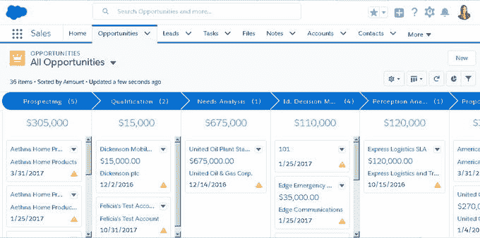

图 2-1

Sales Cloud 中`商机`对象上的新看板功能

## 潜在客户管理

在不同的业务模型中，Salesforce 中的潜在客户可以是个人、组织或实体。`潜在客户`对象可以充当存储在 Salesforce 中所有潜在客户的容器。潜在客户来源多样。因此，最好使用潜在客户区域来跟踪有关潜在客户的重要信息，包括联系信息及备注。

您的潜在客户可能来自多个切入点，并且可能是营销活动的结果。使用`潜在客户`对象来管理和培育正在经历资格认证流程的潜在客户。这包括通过`Web 到潜在客户`从您的网站获取的潜在客户、购买的列表、推荐、网络活动等。利用此信息来判断您的最佳潜在客户来自哪些渠道。

例如，为您在最新营销活动中遇到的潜在客户创建一条潜在客户记录。包括有关该潜在客户的重要联系信息、添加备注，并创建跟进任务，以防止潜在客户遗漏。生成报告以查看大部分合格潜在客户的来源。利用此信息将您的营销预算投入到最有效的地方。

## 潜在客户转换

一旦将潜在客户确认为可靠潜在客户，您就可以将其转换为客户、联系人和商机。在 Salesforce 中转换潜在客户时，标准潜在客户字段会填充到新的客户、联系人和商机记录中。

企业潜在客户会创建企业客户、企业联系人和商机。个人客户在转换时会创建个人客户和商机。

### 注意

并非所有业务模型都使用潜在客户。然而，Salesforce 中的潜在客户跟踪是一种有用的方法，用于将数据库中未接触的潜在客户与更有前景的潜在客户区分开来。请确定您的业务流程以决定转换的时机。

### 了解潜在客户页面

在 Lightning Experience 中，潜在客户记录包含关于该潜在客户的重要信息，包括联系详情、活动跟踪、营销活动历史、Chatter 和新闻。

借助`潜在客户工作区`工具栏，销售主管可以更快地处理最优质的潜在客户。该工具栏使销售代表能够轻松地引导其潜在客户完成潜在客户转化流程。

图 2-2 展示了 Lightning Experience 中的一条潜在客户记录。此页面布局通过一个高亮面板、一个活动区域和`潜在客户工作区`工具栏整合了关键信息。

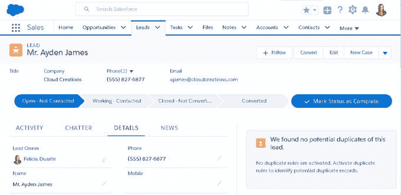
*图 2-2 — Lightning Experience 中的潜在客户记录页面*

如图 2-3 所示的高亮面板在页面顶部显示关键信息。默认情况下，这包括潜在客户的称呼、名、姓、职务、公司、所有电话字段和电子邮件。此功能使您的用户能够更快速地处理潜在客户。

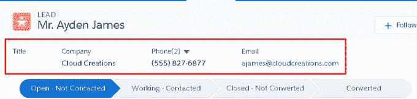
*图 2-3 — 潜在客户记录上的高亮面板*

如图 2-4 所示的交互式工具栏称为`潜在客户工作区`。此区域帮助用户遵循转化过程中的一系列可配置步骤，这些步骤被称为*销售路径*。鼓励用户在努力确认潜在客户资格时更新其状态。

*图 2-4 — 潜在客户工作区工具栏*

使用`活动`选项卡（如图 2-5 所示）来记录通话、创建新任务或事件以及发送电子邮件。创建任务以防止潜在客户从缝隙中溜走。任何需要完成的任务将填充在`后续步骤`区域。已完成的活动记录在`过往活动`部分。

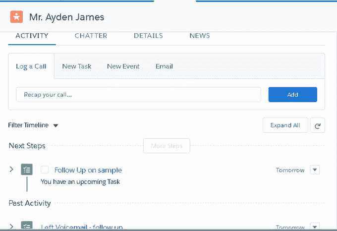
*图 2-5 — 潜在客户记录上的活动区域*

将潜在客户记录上的 Chatter 功能（如图 2-6 所示）用作协作工具。将其作为您在 Salesforce 内部的沟通载体，以便相互协作。发布更新、提出问题并创建投票。

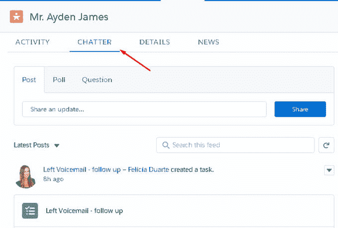
*图 2-6 — 潜在客户记录上的 Chatter 选项卡*

如图 2-7 所示的`详细信息`选项卡显示与潜在客户相关的信息。这包括向用户展示的所有标准和自定义字段。

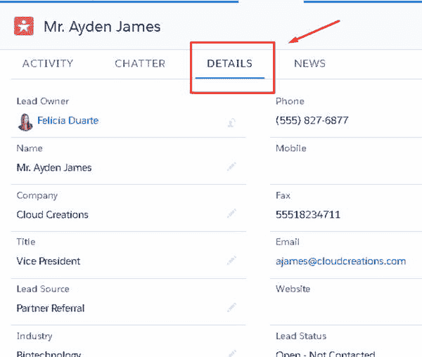
*图 2-7 — 潜在客户记录上的详细信息选项卡*

使用如图 2-8 所示的`新闻`选项卡查找与您的潜在客户相关的新闻文章。您还可以将您的组织与 Twitter 同步，以查看最新的 Twitter 信息流和相关连接。

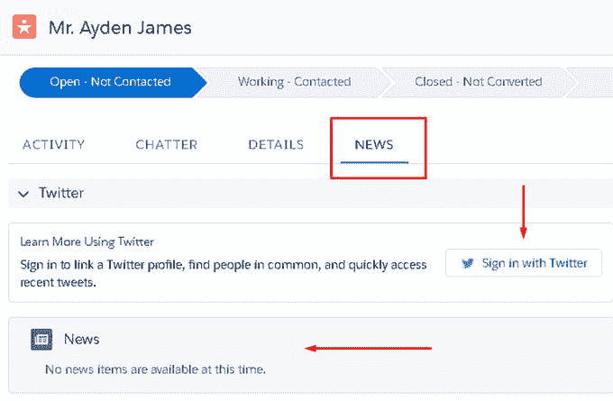
*图 2-8 — 潜在客户记录上的新闻区域*

在默认潜在客户页面布局的最右侧（如图 2-9 所示），您可以识别潜在的重复记录。如果发现任何重复项，该信息将填充到此区域。

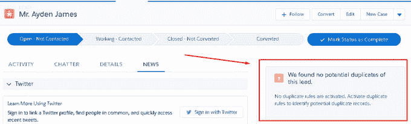
*图 2-9 — 潜在客户记录上的重复项区域*

### 注意

可以对高亮面板进行重新排列，以在页面顶部显示最重要的潜在客户详细信息。这使最终用户能够轻松利用关键信息。

### 创建潜在客户

请按照以下步骤学习如何从列表视图创建新的潜在客户记录：

1.  点击`潜在客户`选项卡旁边的``按钮，然后点击`新建潜在客户`。

    或者，您可以从`潜在客户`列表视图中点击`新建`来创建一个新的潜在客户（图 2-10）。

    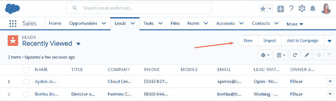
    *图 2-10 — 潜在客户列表视图中的新建按钮*

2.  如图 2-11 所示，在编辑页面上键入潜在客户的名。

    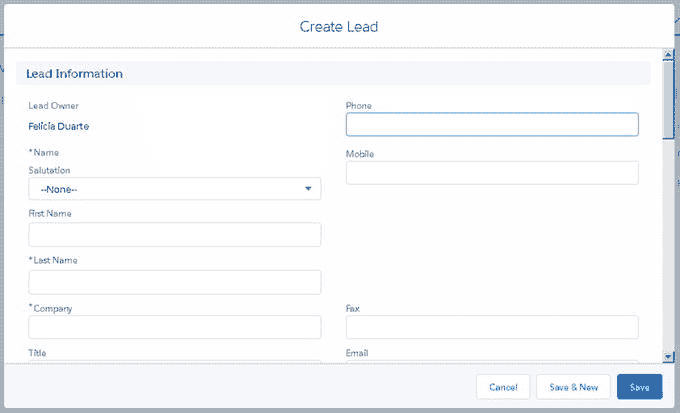
    *图 2-11 — 潜在客户记录的编辑页面。在此处填写适当的潜在客户详细信息。*

3.  键入潜在客户的姓，这是保存任何潜在客户记录所必需的。键入公司名称；这是潜在客户关联的企业名称。

    **注意** 转化时，名和姓将生成联系人的名和姓。公司名称用于创建客户记录，并映射到`客户名称`字段。

    `姓`和`公司名称`是必填的潜在客户字段。如果这些字段未填写数据，记录将无法保存。理想情况下，应在潜在客户记录中填写更多数据。您应考虑添加有关潜在客户的任何其他重要信息。

4.  点击`保存`以保存记录。点击`保存并新建`以保存当前记录并跳转创建新的潜在客户。

5.  成功创建潜在客户后，页面顶部将显示一条成功消息，如图 2-12 所示。

    
    *图 2-12 — 新建潜在客户记录成功消息*

如果记录未正确保存，将显示一条错误消息，如图 2-13 所示。错误消息显示在页面顶部。

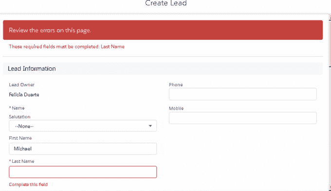
*图 2-13 — 尝试保存记录但未填写所有标记为红色的必填字段后收到的错误消息*

### 注意

必填字段用红色星号标记，如图 2-11 所示。这些字段必须填写信息才能保存记录。如果某个字段没有星号，则它不是必填字段，假设没有其他验证规则，则可以留空。

### 如何转化线索

请按照以下步骤了解如何在 Salesforce 中转化线索：

1.  打开一条现有的线索记录。
2.  在线索记录页面，点击如图 2-14 所示的 `Convert` 按钮。

   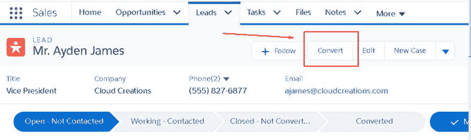

   **图 2-14** 线索记录上的 `Convert` 按钮

3.  在 `Convert Lead` 编辑页面填写相应的详细信息，如图 2-15 所示。

   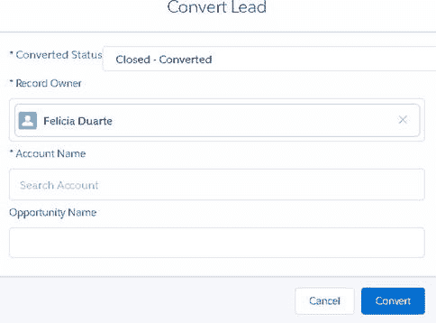

   **图 2-15** 转化页面包含转化状态、记录所有者、客户名称和商机名称

4.  输入转化后的状态。`Closed - Converted` 是默认的转化状态。

   **注意** 线索状态字段会捕获一个对应已转化或未转化状态的值。请选择适当的线索状态。默认情况下，`Converted` 是默认状态。

5.  指定记录所有者。可将其分配给任何 Salesforce 用户。
6.  输入客户名称。您可以搜索现有的客户，也可以新建一个。如果客户不存在，请点击 `New Account` 直接创建新的客户记录。如果线索为个人，请将 `Account Name` 字段留空。
7.  若要在转化时创建商机记录，请键入商机的名称。如果不存在商机，请将此字段留空。
8.  点击 `Convert` 并查看转化确认页面，如图 2-16 所示。

   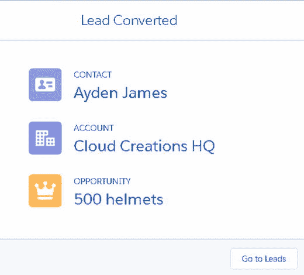

   **图 2-16** 转化确认页面

---

## 客户和联系人

Salesforce 中的客户可以是一个组织、公司或机构，而联系人则可以是与业务相关的个人。

例如，您可能即将与 Dunder Mifflin Paper Co. 的 Michael Scott 会面，商讨与您的产品或服务相关的潜在商机。在 Salesforce 中跟踪有关 Michael Scott 和 Dunder Mifflin Paper Co. 的信息。创建一个名为 Dunder Mifflin Paper Co. 的新客户。接着，为 Michael Scott 创建一条联系人记录以关联两者。

### 提示

在创建新记录之前最好先执行搜索，以避免重复。

### 客户

您可以按类型、状态或 Salesforce 中的任何其他标准或自定义字段对客户进行排序。跟踪处于活跃与非活跃状态的客户、特定行业或区域内的客户，等等。

从 `Account` 列表中，您可以识别关键联系人、商机、个案以及相关的备注和附件，以便快速浏览。

### 注意

您可以在客户级别创建汇总字段以汇总特定指标。例如，创建一个汇总字段来聚合所有 `Closed Won` 商机的总金额。有关汇总字段的更多信息，请参阅第 1 章中的“字段类型”部分。

客户和联系人具有主从关系。这是一种父子关系，其中主对象（`Account`）控制从对象（`Contact`）。请参阅第 1 章中的“字段类型”部分，了解有关主从关系的更多信息。

### 创建新客户

客户可以直接在 Salesforce 中创建或导入，无需经过转化。创建客户记录以在客户级别跟踪信息，例如员工数量、客户编号、网站等。

1.  在工具栏中，点击 `Account` 标签旁边的 。
2.  点击 `New Account`。
3.  填写所有标有星号的必填字段，包括客户名称（图 2-17）。

   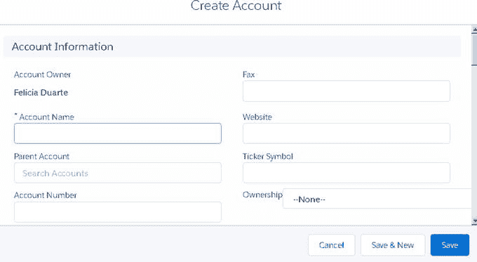

   **图 2-17** 编辑模式下的客户记录

4.  点击 `Save` 保存客户记录。保存成功后，将出现一条成功消息，如图 2-18 所示。

   

   **图 2-18** 客户成功消息

### 联系人

使用联系人记录来捕获个人信息，包括电子邮件地址、电话号码、出生日期等。利用这些信息增进客户关系。创建加密字段以在联系人级别存储安全信息，例如社会安全号码和信用卡信息。

如前所述，客户和联系人具有主从关系。要在两者之间建立关系，请确保在创建联系时输入客户名称。

### 提示

通过客户记录创建联系人，可以快速关联两者。

按照以下步骤从现有客户创建联系人：

1.  在客户记录上，点击如图 2-19 所示的 `New Contact` 按钮。

   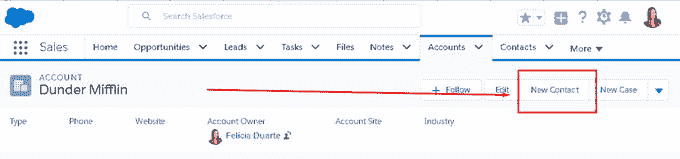

   **图 2-19** 客户记录上的 `New Contact` 按钮

2.  在编辑页面输入名字，如图 2-20 所示。

   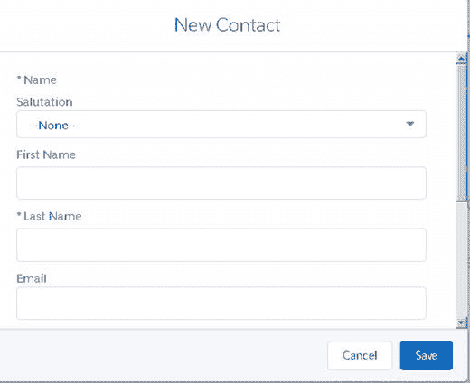

   **图 2-20** 新联系人的编辑页面

3.  输入姓氏（这是保存任何联系人记录所必需的）。
4.  客户名称字段会预填您开始操作的客户记录的名称。填写关于此联系人的任何其他信息。
5.  点击 `Save` 保存记录，并关联 Michael Scott 与 Dunder Mifflin。保存成功后，将出现一条成功消息，如图 2-21 所示。

   

   **图 2-21** 新联系人成功消息

现在，在客户记录中您可以看到新联系人记录，如图 2-22 所示。

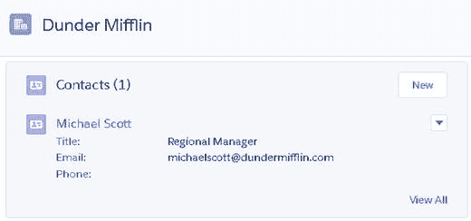

**图 2-22** 一个客户及其相关联系人。点击 `New` 以关联更多联系人。

---

## 列表视图

列表视图让您能够更轻松地排序每个对象中的 Salesforce 数据。利用列表视图可以调出特定的记录分组。例如，创建一个列表视图，仅查看活跃的客户、热门的线索以及处于谈判阶段的商机等。当满足条件时，记录会自动显示在任何列表视图中。利用 Salesforce 的导入和批量更新功能对这些列表执行操作。

Lightning 中的新用户界面 (UI) 使数据可视化更加容易。将图表添加到您的视图中，并使用新的拖放功能在不同阶段之间移动记录。

### 创建列表视图

请按以下步骤创建新的列表视图：

1.  要创建列表视图，请先选择所需对象的选项卡。例如，选择 `Accounts` 选项卡来创建 `Account List` 视图。
2.  选择图 2-23 中红色框出的列表视图控制器，然后点击 `New`。
   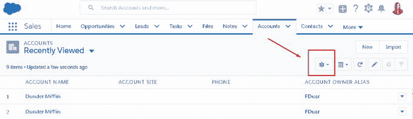
   图 2-23 – 列表视图控制器
3.  为你的列表视图命名。在本例中，你正在为你的黄金客户创建一个列表视图（图 2-24）。
   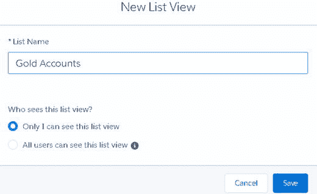
   图 2-24 – 新建列表视图编辑页面
4.  选择合适的访问级别。如果这个列表视图只希望你自己可见，请选择“只有我可以看到此列表视图”。
5.  点击 `Save`，然后在图 2-25 中查看新的列表。
   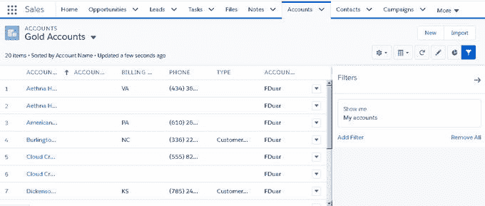
   图 2-25 – 选择保存后的列表视图
6.  对列表视图应用筛选器以细分 `Salesforce` 数据，如图 2-26 所示。
   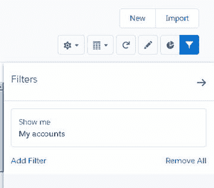
   图 2-26 – 列表视图中的筛选区域
7.  使用图 2-27 中的筛选部分对您的 `Salesforce` 数据应用筛选器。点击 `Add Filter`。
   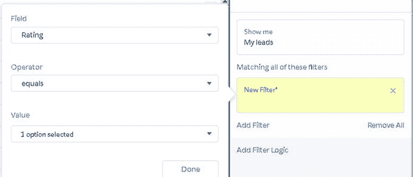
   图 2-27 – 使用此部分创建筛选逻辑
8.  设置筛选器的 `Field`、`Operator` 和 `Value` 选项，如图 2-14 所示。（更多关于操作符的信息，请参见报表区域。）
   **示例** 为了创建一个仅包含我拥有的热门线索的列表，我创建了一个筛选器。此筛选器的值包括“仅显示我是所有者的线索记录”，并且 `Rating` 字段值为 `Equal to Hot`。
9.  点击 `Done` 和 `Save`。

### 对列表视图执行操作

在列表视图中，可以通过点击铅笔图标或双击字段来内联编辑记录。要保存在列表视图中修改过的记录，请点击页面底部的 `Save`（图 2-28）。
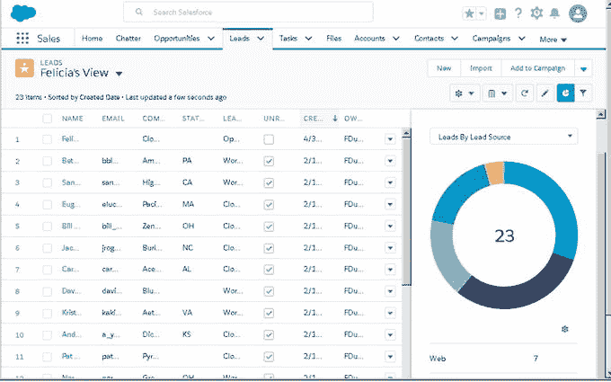
图 2-28 – 列表内的图表

体验 Lightning Experience 中对列表视图的增强更新。`Salesforce` 通过其报表图表和看板功能为列表视图引入了全新的用户界面。报表图表可以显示为条形图和环形图。

#### 看板功能

借助全新的看板功能，在 `Salesforce` 中进行闪电般快速的更改。通过使用图 2-29 中所示的新拖放功能，即时更新列表视图内多个记录的状态。在看板视图中，每个记录都显示为一个小组件，可以在线索状态流程中进行拖放。此增强功能使数据的可视化和组织更加容易。

1.  要将默认的列表视图从网格列表更改为看板，请点击  按钮。
2.  点击 `Kanban`。
3.  将记录拖放到相应的列以即时更新状态。

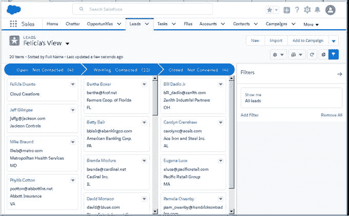
图 2-29 – 看板视图中的列表视图

#### 批量更改状态

要一次更改一组记录的状态，请为那组数据创建一个列表视图。

1.  选择需要更新的记录，可以逐个选择，也可以全选，如图 2-18 所示。
2.  在列表视图中，点击 。
3.  接着，点击 `Change Status`。需要注意的是，只有前三个操作会显示出来。任何额外的状态值都归在箭头下。
4.  在 `Change Status` 弹出窗口中，选择图 2-30 中所示的更新状态。在此处，您可以一键更改一组记录的状态。
   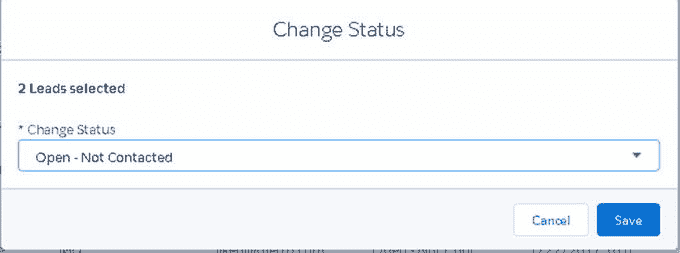
   图 2-30 – 批量更改一组记录状态的步骤
5.  点击 `Save` 并查看对所选记录的更新更改。

### 创建电子邮件模板

轻松在一个中心位置标准化公司电子邮件。使用合并字段，从给定的记录中将自定义值填充到模板中。直接从帐户、联系人或商机中创建并存储在即兴的电子邮件模板。

1.  在联系人记录中，选择 `Email`，如图 2-31 所示。
   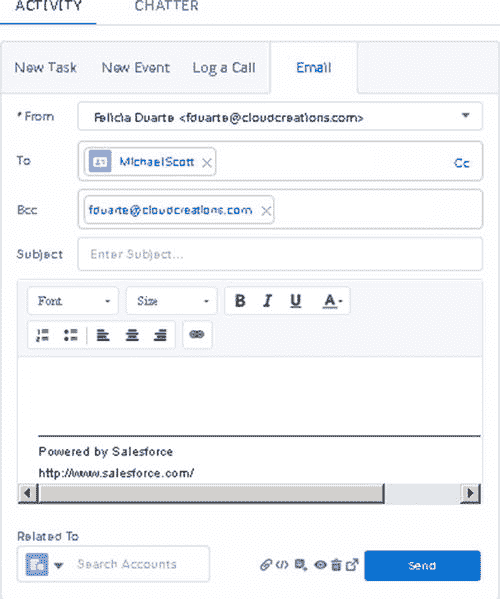
   图 2-31 – 如何创建并保存电子邮件模板
2.  输入收件人的电子邮件地址。
3.  输入电子邮件的主题。
4.  在邮件正文中撰写邮件内容。
5.  选择  以包含合并字段。
6.  点击  将其另存为新模板。

### 发送电子邮件

在 `Salesforce` 的 `Activity` 部分中，选择 `Email` 选项卡即可发送电子邮件。输入收件人的电子邮件地址和主题，如图 2-31 所示。

1.  从任意记录中点击 `Activity` 选项卡。
2.  输入电子邮件的主题。
3.  输入电子邮件的正文内容。
4.  要将此电子邮件与 `Salesforce` 中的另一个记录关联，请在 `Related To` 部分中搜索并输入该记录。
5.  点击 `Send`。

### 注意

要访问存储的模板，请点击  并选择 `Insert Template`。从可用模板列表中进行选择。

## 商机

商机使您能够保存关于任何潜在交易、订单或任何可能产生收入的**关键信息**（图 2-32）。交易追踪是任何业务不可或缺的一部分。通过跟踪所有进行中的交易，有效最大化并加速销售工作。使用这个强大的工具，防止交易从缝隙中溜走。

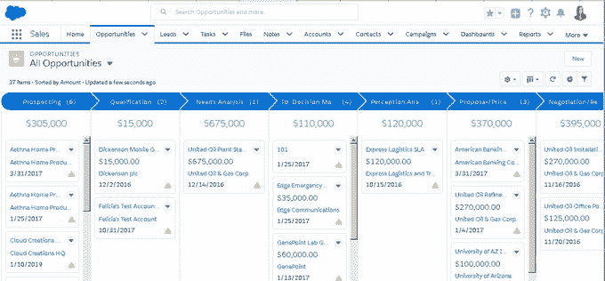
图 2-32 – 商机列表视图

好的，作为一名高级文档工程师和翻译员，我将严格遵循您提供的注意事项和示例，将给定的英文文本翻译成地道、专业的中文。

### 创建新的商机

跟踪关键信息以帮助达成进行中的交易。跟踪已发送的样品、最新的接触点以及后续步骤。利用或自定义`阶段`字段，以跟踪交易在销售渠道中的位置。使用结束日期来预测此交易的预期成交日期。

1.  点击`商机`菜单。
2.  点击`新建商机`，并填写图 2-33 所示的必填字段。

    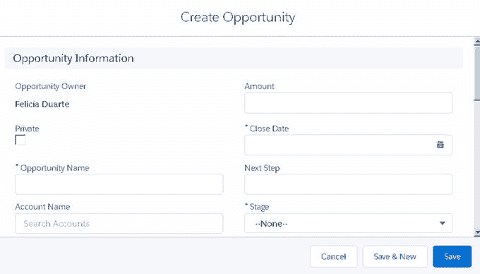

    图 2-33
    商机的编辑页面

3.  输入商机名称。
4.  输入预期的结束日期，并填写有关此商机的任何其他详细信息。建议填写更多关于商机的详细信息。
5.  选择商机记录的阶段。
6.  点击`保存`以保存商机记录。
7.  一旦保存，Salesforce 会将客户与商机关联起来。

### 提示

不确定如何命名商机？请尽量保持商机命名的一致性并使其具体化。例如，`数量 + 感兴趣的产品或服务`。

### 商机阶段历史记录

使用`阶段历史记录`区域来跟踪阶段的变更。对阶段、金额、可能性、预期收入或结束日期所做的任何更改都会显示在此处。选择`查看全部`以查看所有更改的列表视图，如图 2-34 所示。

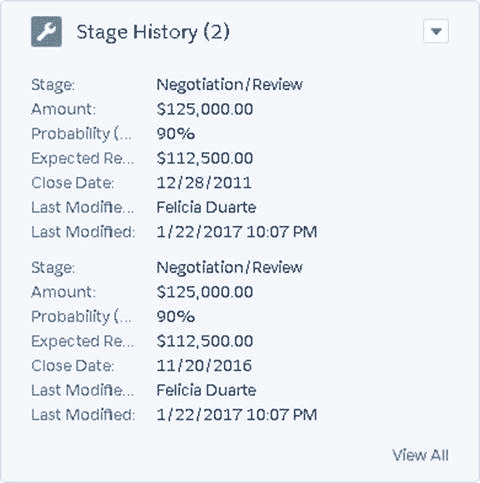

图 2-34
商机记录上的阶段历史记录列表

## 产品

`产品`代表您公司提供的产品或服务。在此对象中存储重要的产品信息，以便销售代表在销售过程中利用。产品描述和定价是销售代表在出差或通话时可以使用的有力信息。

使用产品来与商机或报价关联。无缝更新商机金额以预测潜在的即将到来的收入。利用此信息来报告畅销产品等。

### 创建产品

请按照以下步骤在 Salesforce 中创建产品：

1.  点击`产品`选项卡（如图 2-35 所示）。

    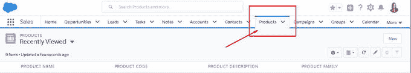

    图 2-35
    产品选项卡

2.  点击`新建`（图 2-36）。

    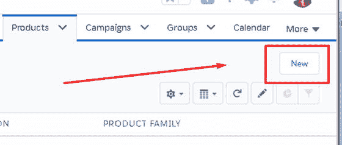

    图 2-36
    产品列表视图上的新建按钮

3.  输入产品详细信息。为产品输入一个描述性名称，并提供描述（图 2-37）。

    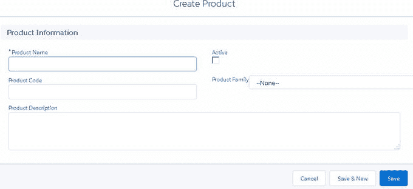

    图 2-37
    创建产品的编辑页面包括产品名称、产品代码、描述、产品系列和启用状态

4.  点击`启用`复选框以在 Salesforce 中激活该产品。
5.  点击`保存`。
6.  在产品记录的`相关`选项卡中，点击`添加标准价格`（如图 2-38 所示）。

    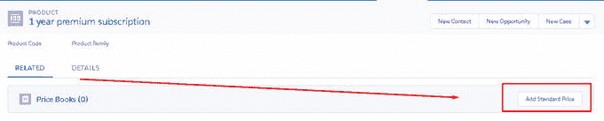

    图 2-38
    添加标准价格按钮

7.  输入产品的标价，如图 2-39 所示，如果未使用其他价目表，则将其与标准价目表关联。

    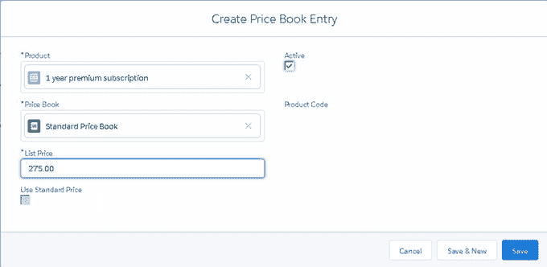

    图 2-39
    价目表条目页面

8.  点击`保存`。Salesforce 将创建新的价目表条目记录。

#### 说明

产品如何与价目表关联？必须先将产品添加到价目表，然后才能在商机中使用。价目表可用于记录单个产品的多个定价。使用价目表为批发商、分销商和其他客户定义价格。

### 商机产品

请按照以下步骤在 Salesforce 中创建商机产品：

1.  在商机记录中，点击图 2-40 所示的`产品`列表中的箭头。

    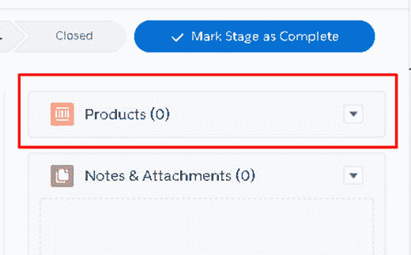

    图 2-40
    商机记录上的产品列表

2.  点击`添加产品`。
3.  选择每个应附加的产品旁边的`+`按钮。参见图 2-41。

    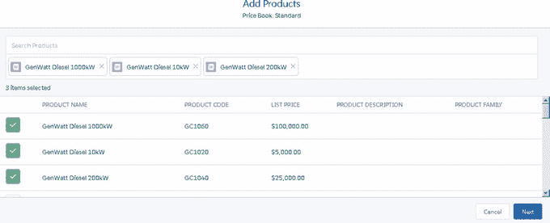

    图 2-41
    产品选择页面

4.  点击`下一步`。
5.  为此特定商机和每个产品选择数量，如图 2-42 所示。

    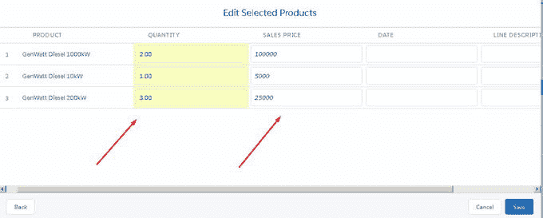

    图 2-42
    商机产品选择

6.  更新每个产品的销售价格。
7.  如果需要，输入日期或行描述。
8.  点击`保存`。
9.  查看成功附加到此商机的新的商机产品记录，如图 2-43 所示。

    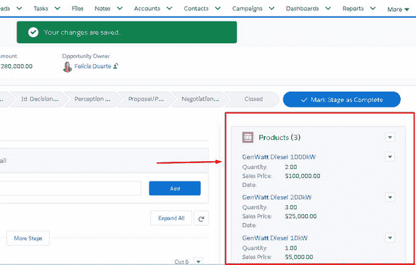

    图 2-43
    附加了新产品的商机主页

#### 商机记录页面

图 2-43 右侧的产品面板显示了与商机关联的产品。点击任何产品记录旁边的  可从商机中进行编辑或删除。

图 2-43 页面顶部的`阶段`工作区是一个交互式工具，可用于帮助销售代理推进其销售流程。

### 活动时间线

通过在 Salesforce 中设置提醒和分配任务来确定日常任务的优先级。使用活动来创建任务、创建事件或记录通话。在 Lightning Experience 中，`活动时间线`替代了经典的`活动历史记录`和`未完成活动`列表，如图 2-44 所示。

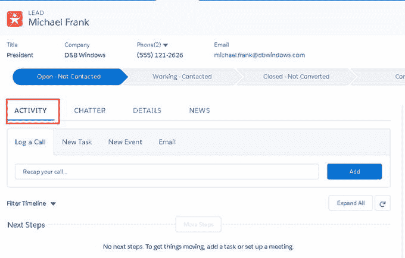

图 2-44
潜在客户记录中的活动部分

使用`记录通话`选项卡的评论部分来记录重要的通话详情。将联系人与其他客户或商机关联起来。

### 配置活动动态

您可以通过创建新任务和事件来配置您的活动动态。

### 创建新任务

按以下步骤创建新任务，如图 2-45 所示：

1. 输入任务的主题。
2. 输入任务截止日期。该截止日期用于在任务即将到期或逾期时发出通知。
3. 在`相关`部分将任务与`Salesforce`中的其他记录关联。默认情况下，创建任务的人即为`分配给`的人员。只需点击`x`并选择应分配任务的人员，即可更改此设置。
4. 选择状态。`未开始`、`进行中`、`已完成`、`等待他人`和`已推迟`是标准状态值。
5. 点击`保存`。成功创建任务记录后会显示一条消息，如图 2-46 所示。

   

   图 2-46 — 任务创建成功消息

6. 任务已保存并记录在`后续步骤`部分。已完成的任务会移至`过往活动`区域并显示，如图 2-47 所示。

   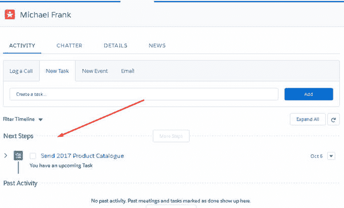

   图 2-47 — 后续步骤部分

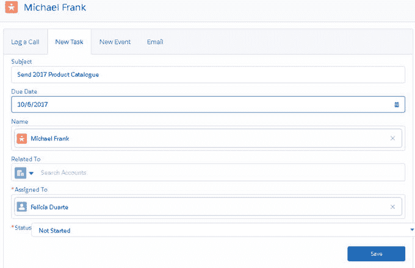

图 2-45 — 创建新任务的步骤

### 创建新事件

追踪与您的线索或联系人相关的任何事件。事件将包含开始日期和结束日期。

按照以下步骤为线索记录创建新事件，并参考图 2-48。

1. 选择`新建事件`选项卡，如图 2-46 所示。
2. 输入事件的主题。
3. `Salesforce`中的每个事件都必须有开始日期和结束日期。在此处输入这些详细信息。
4. 如果这是一个全天事件，请选中该复选框。
5. 如果事件有地点，请在`地点`中输入地点详细信息。此为可选操作。
6. 如果事件与某个客户相关联，请搜索相关客户以关联两者，如图 2-49 所示。

   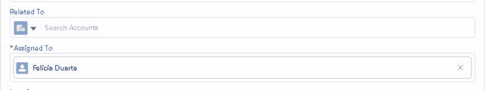

   图 2-49 — 事件页面上的“关联至”和“分配给”字段

7. 任务和事件可以分配给其他`Salesforce`用户。选择应将任务分配给谁，如图 2-49 所示。
8. 点击`保存`。

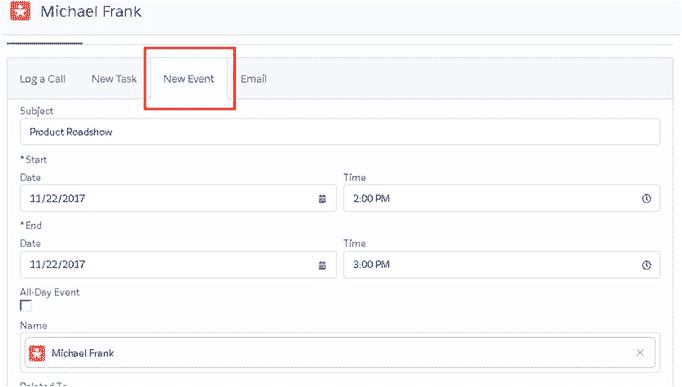

图 2-48 — 创建新事件的步骤

### 创建网络线索表单

借助网络线索表单，可以从您的网站即时生成`Salesforce`中的线索。例如，在您的网站上创建一个`联系我们`表单，用于在`Salesforce`中创建新的线索记录。创建自定义字段以跟踪来自您网站的特定信息并将其纳入`Salesforce`。

按以下步骤创建网络线索表单：

1. 点击`设置`。
2. 在`快速查找`部分搜索`web-to-lead`。
3. 点击`创建网络线索表单`。
4. 标准和自定义字段会显示在`可用字段`多选选择列表中，如图 2-50 所示。将字段添加到`已选择字段`列，以显示在您的网络线索表单上。

   **注意：** 公式字段不可选择。

5. 用户提交网络线索表单后，将被引导至指定的返回 URL。在此处输入返回 URL。请注意，这通常是一个感谢页面。
6. 选中此复选框以启用`reCaptcha`来防止垃圾邮件。建议启用。
7. 要使用此功能，请访问 Google `reCaptcha` 网站，点击`获取 reCaptcha` 注册域名。获取后，在此处输入 API 密钥对。
8. 如果 Google 服务器宕机，请选中此框，以允许所有流量和线索无需`reCaptcha`即可生成。

**注意：** 您可以在 24 小时内最多生成 500 个线索。超过此数量的任何额外线索将被放入队列。

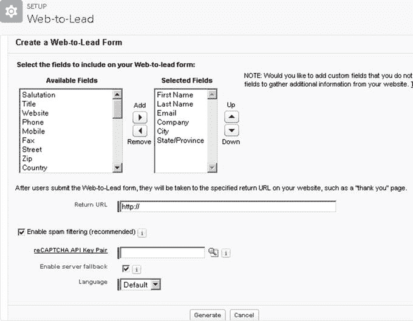

图 2-50 — 网络线索设置页面

### 创建网络线索自动回复规则

通过向从您的网站捕获的线索发送自动回复消息，改善您的客户沟通。例如，创建一个自动回复规则，通知客户您已收到他们的提交，并将在 24 小时内联系他们。

1. 点击图 2-51 中所示的`新建`按钮。

   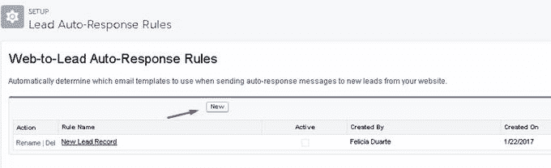

   图 2-51 — 创建新的网络线索自动回复规则

2. 为图 2-52 中所示的自动回复规则命名。

   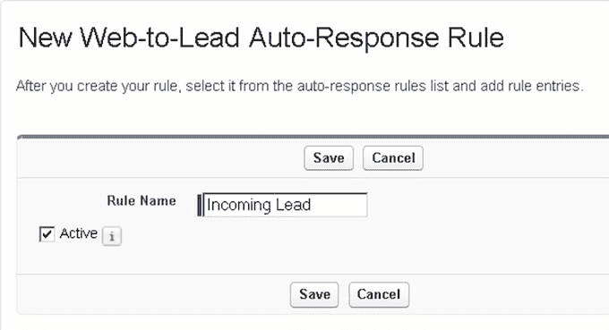

   图 2-52 — 命名自动回复规则

3. 选择`启用`以激活规则。
4. 点击`保存`。
5. 选择已创建的规则。
6. 点击`规则条目`部分的`新建`。
7. 确定排序顺序并设置所需条件。在此示例中，我为所有来自我网站的线索创建了一个自动回复规则，如图 2-53 所示。

   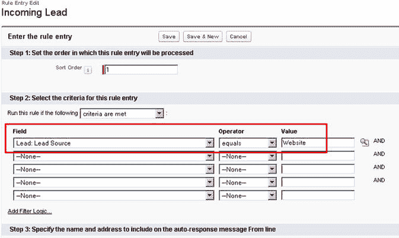

   图 2-53 — 设置自动回复规则的条件

8. 选择触发此规则的条件。当任何线索的来源为`Web`时，将触发此规则。
9. 输入发件人姓名。
10. 输入发件人电子邮件地址。
11. 选择要使用的电子邮件模板。
12. 点击`保存`。现在，任何符合您所设置条件的线索将自动收到一封使用您所选模板的电子邮件。

### 创建线索分配规则

通过创建线索分配规则来自动化您的线索路由流程。可以根据设置的条件将新线索自动分配给某个用户或队列。

1. 点击`设置`。
2. 在`快速查找`中搜索`线索分配规则`并选择它。
3. 点击`新建`按钮。
4. 为规则命名并在此处输入。
5. 选择`启用`以激活此规则；一次只能激活一个规则。
6. 点击`保存`。
7. 选择规则名称。
8. 点击`规则条目`部分的`新建`按钮，如图 2-54 所示。

   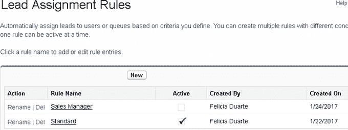

   图 2-54 — 线索分配规则列表

9. `Salesforce`将根据排序顺序评估每个条目。为此规则设置排序顺序。
10. 通过选择字段、适当的运算符和值来设置此规则的条件。在此示例中，我为所有来自加利福尼亚州的线索创建规则。
11. 确定符合此条件的线索应分配给用户还是队列。输入用户或队列的名称。
12. 点击`保存`。

#### 创建线索队列

通过控制线索分配方式来管理工作负载。线索会被分组到这些队列中，供团队成员查看和领取。线索记录在用户领取前会一直保留在队列中。

1. 在 `Setup`中，转到 `Queues`。
2. 点击如图 2-55 所示的 `New` 按钮。

   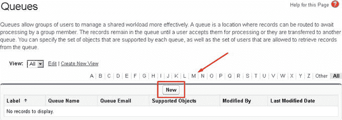

   图 2-55

   线索队列

3. 输入队列名称。
4. 若要在线索添加到队列时通知团队成员，请输入队列电子邮件并选择 `Send Email to Members`。
5. 选择 `Lead` 并将其移动到 `Selected Objects`。
6. 如图 2-56 所示，选择队列成员并将其移动到`Selected Members`。您可以通过用户、角色和组来定义选定的成员。

   

   图 2-56

   将成员添加到队列

7. 点击 `Save`。现在，符合条件的线索记录将被放入队列。队列成员将能够查看这些线索并从中获取。

## 创建营销活动

市场营销专业人员可以使用这个强大的工具来跟踪任何营销举措和努力。跟踪响应率和转化率，最终计算投资回报率 (ROI)。使用这些指标来确认营销工作的有效性。营销活动可以成为改进未来营销工作的有效工具。

按照以下步骤创建营销活动并添加营销活动成员：

1. 在 `Campaign` 选项卡中选择 `New Campaign`，如图 2-57 所示。

   

   图 2-57

   营销活动选项卡和列表视图

2. 输入您的营销活动的名称，如图 2-58 所示。

   

   图 2-58

   营销活动编辑页面

3. 填写营销活动的详细信息。包括活动类型、活动开始日期和结束日期，以及其他重要信息。
4. 选中 `Active` 复选框以使营销活动处于活动和当前状态。
5. 点击 `Save`。

   营销活动激活后，您需要添加营销活动成员。这将把一切联系起来。营销活动成员是与特定营销活动相关联的线索和联系人。

   请注意，线索和联系人与营销活动是多对一关系。这意味着它们可以与多个营销活动相关联。点击 `Add Leads` 关联线索记录，或点击 `Add Contacts` 关联联系人记录（图 2-59）。这些线索和联系人被视为营销活动的成员。

   

   图 2-59

   将线索和联系人作为营销活动成员添加到营销活动中

6. 选择应作为营销活动成员关联的记录，然后选择 `Add to Campaign`，如图 2-60 所示。

   

   图 2-60

   添加营销活动成员

   营销活动成员提供关于营销活动响应率的报告。Salesforce 使用以下标准值来跟踪这些工作：`Sent` 和 `Responded`。

7. 输入此记录应关联的营销活动。
8. 将成员状态定义为现有状态，或更新成员状态为 `Sent` 或 `Responded`（见图 2-61）。

   

   图 2-61

   关联营销活动和所选营销活动成员应具有的状态的步骤

9. 点击 `Submit`。Salesforce 将生成一条成功消息，如图 2-62 所示。

   

   图 2-62

   营销活动成员成功消息

## 总结

Sales Cloud 提供了有效的工具来连接您的销售和营销团队。Sales Cloud 为您的 CRM 需求奠定了基础，并为您的机会管道提供了有洞察力的信息。

