# 3. Salesforce Service Cloud

Salesforce Service Cloud 允许您的客户服务代表和支持代表（用户）管理、跟踪和解决客户的咨询和问题。Service Cloud 应用程序使用 `Case` 对象来捕获解决咨询和问题所需的所有详细信息。您的用户可以通过电话和亲自上门为请求手动创建个案，也可以接受来自多个渠道（例如，网络表单、电子邮件、实时网络聊天、在线社区和社交媒体渠道）的个案。您可以通过设置个案分配规则，让您的用户高效地管理这些渠道。Salesforce Service Cloud 应用程序还允许您在需要将问题上报给管理层时创建个案升级规则。跟踪公司收到的各种客户咨询甚至可以帮助您建立新的流程。它还将帮助您了解公司内部的任何薄弱点。图 3-1 展示了 Service Cloud 中可能发生的内部沟通。简而言之，该应用程序有助于更快地解决客户问题。

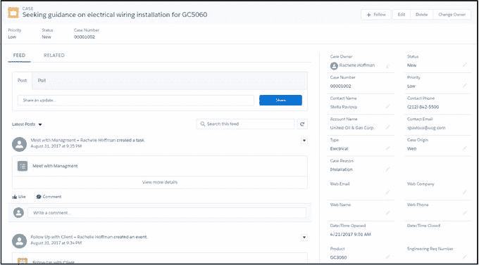

图 3-1

内部沟通

## Salesforce 个案管理概述

Salesforce 个案管理允许用户捕获 `Case` 对象的必要详细信息，以管理和成功解决他们的个案。用户可以在 29 个标准字段中查看重要的个案详细信息，也可以创建自己的自定义字段。用户可以通过包含 `New`、`Working`、`Escalated` 和 `Closed` 等值的下拉字段来跟踪个案的状态。用户还可以访问所有必要的关联对象，例如客户、联系人详细信息和产品信息。授予用户访问客户和联系人详细信息的权限，将使他们对提交个案的客户有全面的了解。他们可以根据提交的个案将优先级设置为 `High`、`Medium` 或 `Low`，也可以设置页面布局以最好地满足他们自己和公司的需求。

### 标准案例字段及相关列表简介

Salesforce 通过其`Case`对象提供了许多标准字段，如图 3-2 所示。在决定创建自定义字段之前，我们建议您优先使用现有的标准字段。大多数 Salesforce 标准字段都应用了后端自动化。由于每个企业的业务都不同，您很可能需要自定义字段，但既然非得已，何必重复造轮子呢？

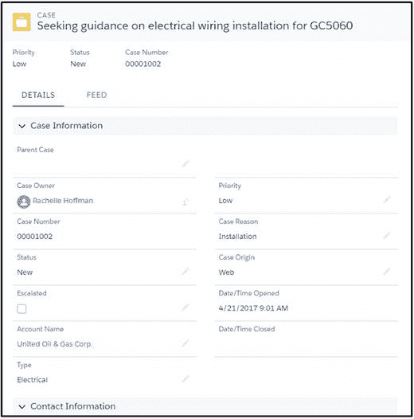

**图 3-2** 案例信息字段

您将在`案例信息`部分找到以下字段（如图 3-2 所示）：

- **父案例**：关联一个已存在且导致创建新案例的案例。

**注意** 如果您使用此功能，务必将相关列表“相关案例”添加到案例页面布局中，以便全面查看附属于父案例的所有案例。

- **案例负责人**：指派主要负责管理该案例的用户。

- **案例编号**：这是一个自动生成的编号，用于在内部和外部引用案例。

**提示** 使用此案例编号，让您的用户和客户在处理案例时能够引用它。可将其应用于自动发送的电子邮件中。

- **状态**：使用此字段跟踪案例的当前状态。可以利用现有值（`新建`、`已升级`和`已关闭`）或添加您自己的状态值。

- **联系人姓名**：关联提交案例的联系人。

- **已升级**：使用此复选框将工作流规则（本章稍后将讨论）应用于自动升级。此外，选中此框后，您会在案例编号旁边看到新添加的红色箭头，表示该案例已被升级。利用此字段在报表和仪表板中关注您最重要的案例。

- **客户名称**：关联联系人后，该字段会自动填充该联系人的客户详细信息。如果该案例属于与关联联系人不同的客户，请用相应的客户信息覆盖此字段。

- **优先级**：使用标准值`高`、`中`或`低`为案例分配必要的优先级。利用此字段在报表和仪表板中关注您最重要的案例。

- **类型**：使用此字段跟踪您的团队正在管理的案例类型。利用此字段来帮助确定应该开发或更新哪些常见问题解答。

- **案例原因**：使用此字段跟踪客户联系您的原因。您也可以使用此字段来帮助更新常见问题解答、内部流程等等。

- **案例来源**：使用此字段跟踪案例的来源，无论是来自在线表单、电子邮件、电话还是当面提交。

- **打开日期/时间**：此字段会自动填充案例创建的日期和时间。

- **关闭日期/时间**：此字段会自动填充案例关闭的日期和时间。案例可以通过将状态更改为已关闭状态，或通过许多其他方式（例如，`API`、导入更新、自动化规则等）来关闭。

**注意** Salesforce 报表附带一个`时长`字段，用于跟踪持续时间（以天为单位）。但是，此字段不是可以放在案例布局上的字段。如果您希望用户在案例页面布局上看到案例已打开（或曾打开）的持续时间，可以创建一个公式字段。

- **创建时已关闭**：用户可以创建一个新案例并立即关闭它。发生这种情况时，此字段的复选框将被标记为 true，并可在报表中使用。

在图 3-3 的`联系人信息`下，您将找到以下字段：

- **联系人电话**、**联系人手机**、**联系人传真**和**联系人电子邮件**：这些字段属于关联到该案例的联系人。它们都是用于将一个对象的字段映射到另一个对象的公式字段。由于这些是公式字段，因此它们是锁定字段，无法从`Case`对象更新。相反，您需要转到联系人记录并更新那里的信息。

在图 3-3 的`网络信息`下，您将找到以下字段：

- **网络电子邮件**、**网络公司**、**网络姓名**和**网络电话**：当配置了 Web 转案例功能（我们将在本章后面介绍）时，系统将在 Salesforce 中自动创建案例。这些字段将填充来自您 Web 表单的相应数据。

在图 3-3 的`描述信息`下，您将找到以下字段：

- **主题**：当配置了电子邮件转案例功能时，使用此字段作为传入电子邮件的主题行，或者作为案例内容的快速参考。请注意，此字段的数据也会在页面布局的顶部显示。

- **描述**：当配置了电子邮件转案例功能时，使用此字段作为传入电子邮件的正文，或者作为案例的详细描述。

- **内部备注**：在与客户通话时，使用此字段创建案例备注。

- **创建者**：此字段存在于 Salesforce 中的每一条记录上。它会记录谁在什么日期和时间创建了该案例。

- **最后修改者**：此字段也存在于 Salesforce 中的每一条记录上。它会记录谁在什么日期和时间最后更新或修改了该案例。

### 提示

如果这些字段不够用或不适合您的公司，请不要担心。其中某些字段的默认位置很容易修改。Salesforce 允许在`Case`对象上创建多达 500 个自定义字段。您可以创建用于文本、日期和时间、数字、货币、百分比、选择列表、多选选择列表、复选框、电子邮件、电话和 URL 的字段。

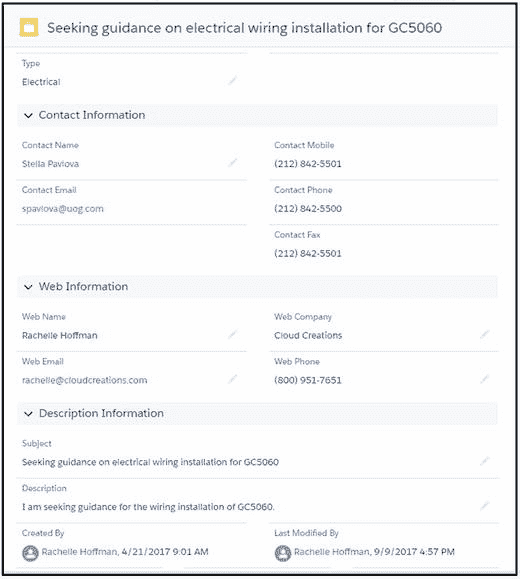

**图 3-3** 更多案例字段

接下来，我们将讨论在`Case`对象上找到的标准相关列表。

图 3-4 显示了标准的`Case`对象相关列表。*相关列表*是您 Salesforce 组织中与您当前正在查看的对象相连接的另一个对象。您将在`Case`对象上找到的相关列表包括：

- **解决方案**：此相关列表包含在名为`解决方案`的另一个 Salesforce 对象中创建的文章。解决方案用于存放那些可以帮助您的用户更快关闭案例，或向案例联系人提供信息的内容。此对象与另一个名为`知识`的 Salesforce 产品协同工作。解决方案和`知识`是重要的产品，因为它们为您的用户提供了推动案例处理的资源。

- **未完成活动**：这些记录是您的用户创建的未来或未完成的任务或事件。任何尚未完成的任务或事件都会显示在此处。

- **活动历史记录**：这些记录是您的用户已完成的任务、电子邮件、通话记录和事件。

- **案例评论**：这些记录提供与案例相关的信息。您的用户会将重要的案例评论添加到此区域。

- **附件**：这些记录反映与案例相关的外部文档。这可能是当前的客户合同，或者客户提供的关于他们遇到的错误的截图。

- **案例历史记录**：此内容包括对`Case`对象所做的所有字段级别的更改。您可以设置字段跟踪并选择哪些字段最重要（我们将在本书后面介绍）。

#### 说明

Salesforce 还提供其他相关列表。虽然不在标准页面布局上，但这些列表可以轻松添加到您的页面布局中。一个值得注意的列表是 `Contact Roles`（联系人角色），它允许您向一个案例记录添加多个联系人。另一个相关列表是 `Emails`（电子邮件），当您启用了“电子邮件转案例”功能时（本章后面会解释），就会用到它。如果在您的电子邮件帐户中正确设置，您的用户就可以留在 `Salesforce` 内，而无需在两个系统之间来回切换（后续也会介绍）。

### 提示

Salesforce 允许您将不同对象相互关联起来。如果您的 `Case` 对象需要关联另一个对象的多个记录，您可以创建一个中间对象。例如，如果您想关联一个案例中涉及的多个产品，就可以这样做。创建自定义对象比您想象的要简单。

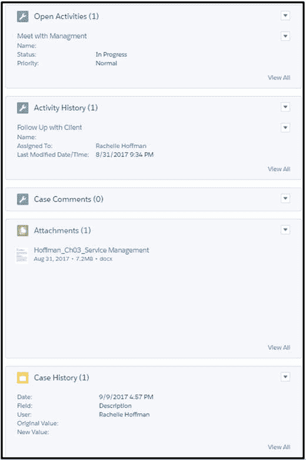
*图 3-4* 包含标准相关列表的案例布局

## 创建新案例记录

您可以手动输入一个案例，方法是先导航到 `Case` 对象（见图 3-5），然后单击 `New` 按钮。打开一条记录后，您就可以通过添加联系人姓名、客户名称、优先级、案例来源、类型和案例原因来开始填写案例详情（见图 3-6）。确保在 `Subject` 和 `Description` 字段中记录客户联系您的原因或解释（图 3-6）。在添加这些详细信息时，如有必要，请使用 `Internal Comments` 字段。如果您为 `Case` 对象创建了自定义字段，请务必培训您的用户如何填写这些详细信息。

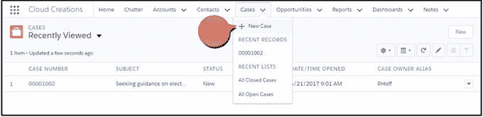
*图 3-5* 如果您尚未进入 `Cases` 选项卡，请使用对象标题旁边的向下箭头导航到 `Cases` 选项卡

建议按照以下步骤创建新的案例记录（图 3-6 和 3-7）：

1.  输入联系人姓名，然后单击字段旁的放大镜图标，将联系人关联到案例。

2.  客户名称将自动分配为您在联系人字段中关联的联系人所对应的客户。

### 提示

`Accounts` 和 `contacts` 可以禁用为必填字段。

1.  单击优先级字段，更改案例的优先级。从提供的值中选择合适的值。

2.  单击来源字段，选择案例的来源，再选择合适的值。请注意该字段旁的 `*` 符号。这表示它是必填字段。

3.  单击类型和案例原因字段，并选择合适的值。

4.  如有必要，此时适当地填写任何自定义字段。

    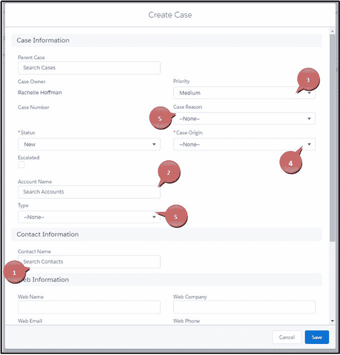
    *图 3-6* 创建案例（步骤 1 至 6）

5.  输入案例的主题。

6.  输入案例的描述。

    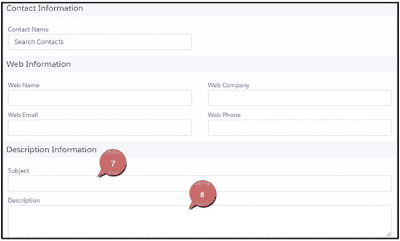
    *图 3-7* 创建案例（步骤 7 和 8）

    **注意** `Subject` 和 `Description` 字段用于“电子邮件转案例”功能。

7.  完成后，单击 `Save`。

### 提示

利用案例的 `Date/Time Opened` 和 `Date/Time Closed` 字段，生成关于案例处理时间的报告。此外，案例类型和原因字段有助于定义客户和内部常见问题解答。

## 与团队协作处理案例记录

管理和高效关闭案例可能需要您团队中的多人参与。用户可以使用其案例记录中的案例动态，与团队中的其他人快速沟通。他们还可以向有权访问该案例记录的任何 Salesforce 用户发送消息。

要向用户提及一条评论，您可以使用 `@` 符号后跟用户名，一旦名称出现在文本区域下方，就点击该超链接名称。您还会看到，每项操作都会记录在案例动态中，以便完整查看案例及其整个过程中的所有情况。案例记录左侧的动态筛选器可帮助您快速导航到案例的动态相关项目。动态详情将按照从底部最旧到顶部最新的顺序显示。这使您可以快速查看关于该案例的最新对话或已完成的工作。图 3-8 展示了案例动态的功能。

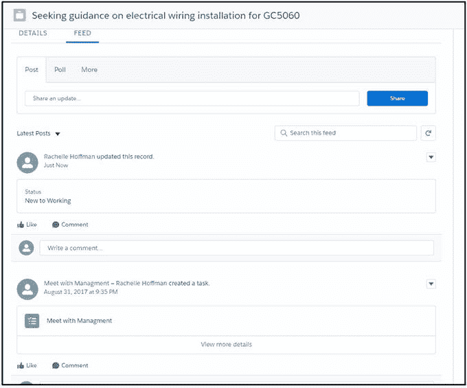
*图 3-8* 案例动态

要与您的团队协作，请遵循以下步骤：

1.  单击 `Feed` 选项卡访问案例动态。

2.  利用发布区域与您的团队就案例进行沟通。

3.  利用案例动态在整个案例处理期间跟踪所有对话。

4.  案例动态会捕获对案例状态所做的更改。

5.  案例动态还跟踪诸如 `Log a Call` 活动以及其他常规任务等活动（见图 3-9）。

    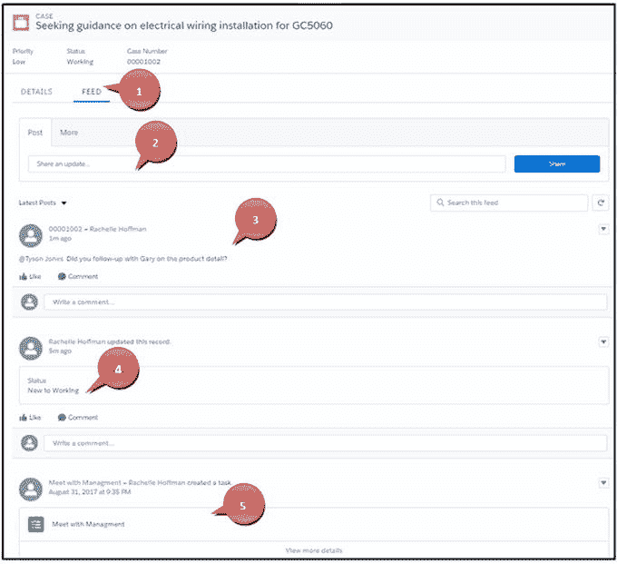
    *图 3-9* 利用动态筛选器快速导航至所有通话记录、案例备注、状态更改以及任务和事件

## 案例自动化

Salesforce 提供自动执行某些功能的能力，例如自动将案例分配给队列或特定用户。Salesforce 还允许您创建规则，根据特定条件自动回复与案例相关的客户。您还可以根据条件配置案例升级规则，这些规则将自动将案例分配给升级后的案例。伴随这种案例升级，您可以配置在满足此条件时发送的自动通知。您还可以从电子邮件或网络表单中路由案例。您还可以调整一些支持设置，以进一步自定义您的案例自动化。图 3-10 展示了一个案例队列。

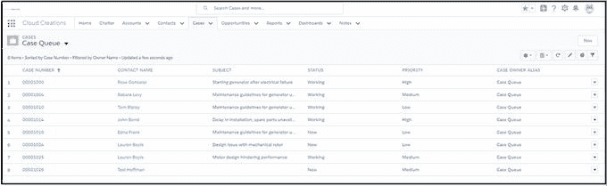
*图 3-10* 案例队列

### 创建案例队列

案例可通过多种方式发送到队列。您可以在创建案例时自动将其分配给队列，或在案例生命周期中，由于案例记录的变更而将其发送到队列。您可以将队列视为一个“暂存池”。这个暂存池允许您授予多个用户访问权限，并让他们选择接受新案例。您不必将案例分配给特定所有者，而是可以使用案例分配规则将其分配给队列。在图 `[3-11]` 到 `[3-14]` 中，您将学习如何在 `Salesforce` 中创建队列。具体步骤如下：

1.  单击 `Salesforce` 窗口右上角的设置齿轮图标，导航到 `Setup` 菜单。

2.  使用搜索区域，输入 `Queue`。点击 `Users` 下的 `Queues`。

3.  点击 `New` 按钮。

    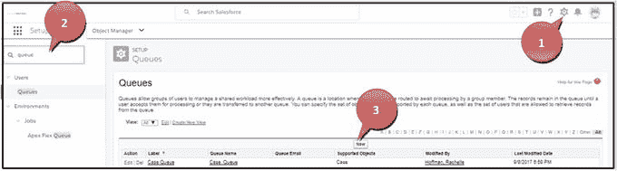
    图 3-11 创建案例队列

4.  为队列创建一个面向用户的标签，然后按 `Tab` 键。`Salesforce` 会自动创建队列名称。

5.  如果您希望在有新案例添加到队列时收到通知，请将电子邮件地址填入 `Queue Email` 字段。

6.  如果您希望分配给该队列的用户在队列中有新案例时收到电子邮件，请选中 `Send Email to Members` 复选框。

    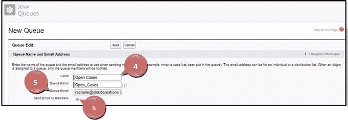
    图 3-12 为队列命名并设置通知选项

7.  选择 `Case` 对象，然后单击箭头将其移至 `Selected Objects` 区域。

    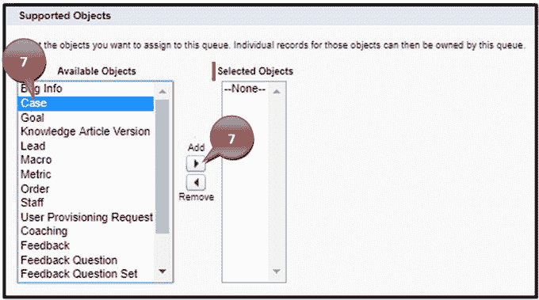
    图 3-13 为队列选择对象

8.  使用搜索区域，在下拉菜单中选择您是要搜索特定用户、公共组、角色，还是角色及其下属。

    **注意：** 选择 `Roles and Subordinates` 选项将授予特定角色及其所有下级角色对特定队列的访问权限。例如，如果您的 `CEO` 位于角色层次结构的顶层，并且您使用此功能授予 `CEO` 访问权限，那么 `CEO` 角色以下的所有人员也将获得访问权限。

9.  选择特定的用户、公共组、角色，或角色及其下属，然后使用向右箭头将其移至 `Selected Members` 区域。

10. 点击 `Save`。

    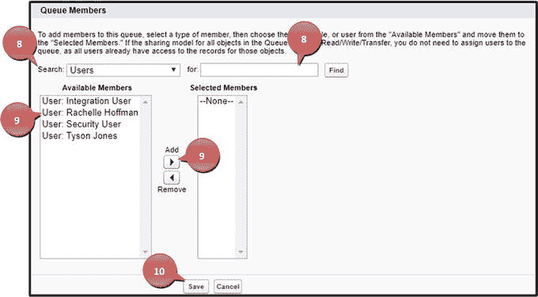
    图 3-14 选择需要访问此队列的用户、组、角色或角色层次

### 提示

`Queues` 不仅可用于案例。您可以像设置案例那样，设置线索队列和线索分配规则。

### 创建案例分配规则

现在您已经创建了第一个队列，接下来就可以自动将案例分配给该队列或特定所有者了。您可以根据案例中的特定条件以及与案例相关的记录来创建案例分配规则。例如，您可以创建一条分配规则，将针对特定客户或联系人的所有案例自动分配给特定用户。或者，您可以根据案例来源、案例原因、案例类型或案例记录中的任何其他字段，将案例分配到队列。有些公司会为 `VIP` 客户或白金客户创建队列，只允许最有经验的用户处理这些案例。图 `[3-15]` 到 `[3-20]` 展示了此过程。分步流程如下：

1.  单击 `Salesforce` 窗口右上角的设置齿轮图标，导航到 `Setup` 菜单。

2.  使用搜索区域，输入 `Case Assignment`。点击 `Service` 下的 `Case Assignment`。

3.  点击 `New` 开始创建案例分配规则。

    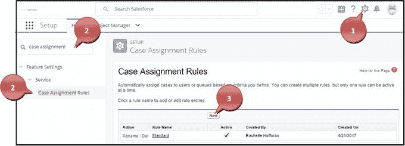

    图 3-15 访问案例分配规则

4.  为规则命名并点击 `Save`。您可以立即通过勾选 `Active` 复选框来激活此规则，或者暂缓，稍后再激活。

5.  点击 `Save`。

    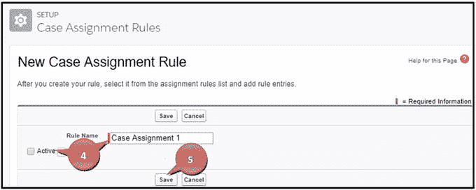

    图 3-16 创建案例分配名称并激活它

    保存规则名称后，页面将返回案例分配区域。点击您刚刚创建的规则名称。

    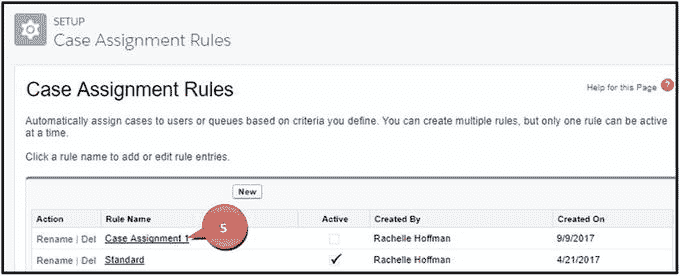

    图 3-17 检索您的案例分配规则

6.  点击 `New` 按钮。

    **注意：** 在图 `[3-18]` 中，请注意 `Modified By` 上方的 `Active` 复选框。这就是您在完成规则后，通过勾选 `Active` 复选框来激活规则的位置。

    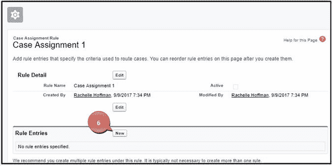

    图 3-18 为案例分配创建规则条件

7.  如果这是您首次创建案例规则分配，请在 `Sort Order` 字段中输入数字 `1`。如果您配置了多条规则，`Sort Order` 字段将告知 `Salesforce` 优先运行哪些规则。一旦某条规则运行并分配了案例，系统将不再对该案例运行其他规则。请根据重要性为所有规则设置排序。

8.  在步骤 2 中，您需要创建规则条件。规则条件告知 `Salesforce`：如果此处输入的条件为真，则将案例分配到指定位置（步骤 9 和 10）。

    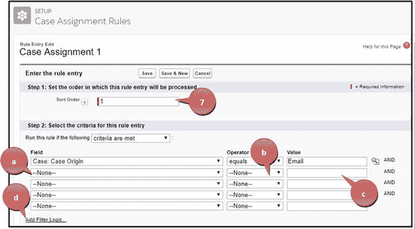

    图 3-19 为案例分配规则设置字段条件

    a.  首先，您需要点击字段列中的 `None`。在此处，您将选择 `Salesforce` 应评估该规则的字段。这可以是案例类型、案例原因、案例来源、客户、联系人信息，或案例、客户、联系人中的任何字段条件。

    b.  选择合适的运算符。例如，如果您希望每个等于特定值的案例类型都自动分配给特定用户，则应选择运算符 `equals` 并选择那些值。

    c.  选择或输入案例将自动分配到的适当值或结果。

    d.  您也可以通过点击 `Add Filter Logic` 配置筛选逻辑。这允许您将逻辑从“全部”字段条件（使用 `and`）更改为 `or`。例如，您可以说，如果案例类型是 `Problem` 或案例来源是 `Email`。标准设置会使该逻辑句子变为：“如果案例类型是 `Problem` 并且案例来源是 `Email`。”

9.  选择将案例分配给特定用户或您在前一部分中设置的队列。

10. 选择您希望自动发送给用户或队列的电子邮件模板。

11. 点击 `Save`，或者点击 `Save and New` 来设置另一条案例分配规则。

    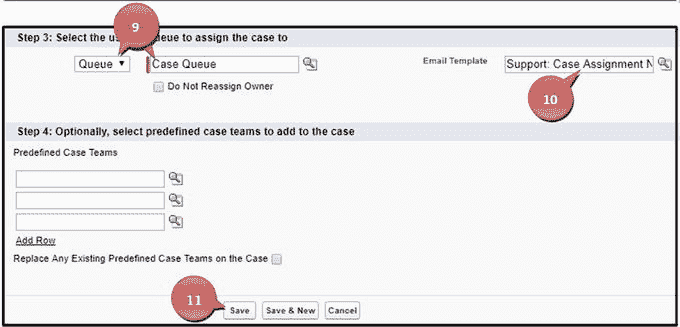

    图 3-20 分配特定用户或队列并向他们发送通知

### 注意

步骤 4 提供的功能不是 `Lightning` 组件，需要在 `Classic` 中进行设置。

### 创建案例自动回复规则

案例自动回复规则允许你基于字段级更改，自动与客户进行沟通。例如，如果你希望在案例状态从一个值变为另一个值时向客户发送电子邮件，你可以实现此操作。任何字段值的变化都可以触发此邮件发送或其他自动化操作。图 3-21 至 3-26 将引导你逐步创建案例自动回复规则。

1.  点击 Salesforce 窗口右上角的设置齿轮图标，导航至 `Setup` 菜单。

2.  使用搜索区域，输入 `Case Auto-Response`。点击 `Service` 下的 `Case Auto-Response Rules`。

3.  点击 `New` 开始创建案例自动回复规则。

    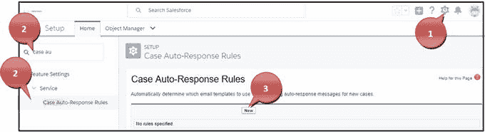

    图 3-21 访问案例自动回复规则

4.  为规则命名，然后点击 `Save`。你可以立即选中 `Active` 复选框来激活规则，或者暂不激活，稍后再进行操作。

5.  点击 `Save`。

    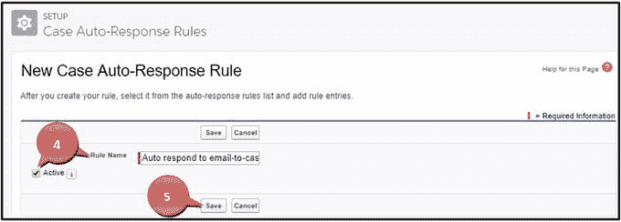

    图 3-22 为你的案例自动回复规则命名

6.  保存规则名称后，页面将返回到案例分配区域。点击你刚刚创建的规则名称。

    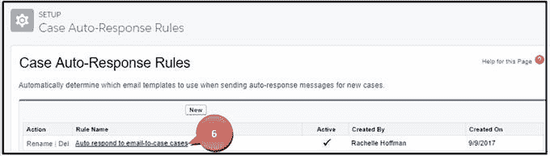

    图 3-23 检索你的案例自动回复规则

7.  点击 `New` 按钮。

    **注** 在图 3-24 中，请注意 `Modified By` 字段上方的 `Active` 复选框。在这里，你可以在完成规则创建后，通过 `Active` 复选框来激活该规则。

    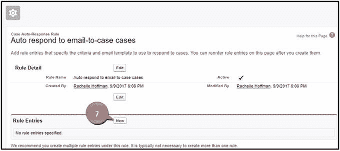

    图 3-24 为案例自动回复规则创建新的规则条件

8.  如果这是你的第一个案例自动回复规则，请在 `Sort Order` 字段中输入数字 `1`。

9.  在第二步中，你需要创建规则条件。规则条件告诉 Salesforce，如果在案例上满足你在此处输入的条件，则发送电子邮件（步骤 9 和 10）。

    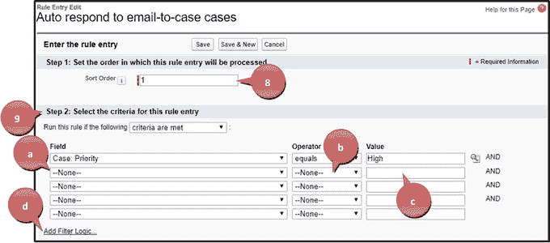

    图 3-25 为你的案例自动回复规则创建条件

    a.  要开始此过程，你首先需要点击字段列中的 `None`。在此处，你将选择 Salesforce 应为规则评估的字段。这可以是案例类型、案例原因、案例来源、客户、联系人信息，或案例、客户、联系人中的任何字段条件。

    b.  选择合适的运算符。例如，如果你希望每个等于特定值的案例类型都能自动发送邮件，你可以选择 `equals` 运算符并选择那些值。

    c.  选择或输入案例将自动发送邮件的适当值或结果。

    d.  你也可以通过点击 `Add Filter Logic` 来配置筛选逻辑。这允许你将逻辑从“满足所有”字段条件（使用 `and`）更改为 `or`。例如，你可以设置为如果案例类型为 `Problem` **或**案例来源为 `Email`。标准设置会使该逻辑语句变为“如果案例类型为 `Problem` **且**案例来源为 `Email`”。

10. 在第三步中，你需要提供邮件发件人的名称。

11. 在 `Email Address` 字段中输入发件人的电子邮件地址。

12. 提供一个回复地址，以便客户能够回复该邮件。

    **注** 你只能使用自己用户邮箱中的一个，或者设置为组织范围邮件的邮箱。

13. 分配你希望为此自动回复规则发送的电子邮件模板。

14. 完成第 1 步到第 4 步后，点击 `Save`。

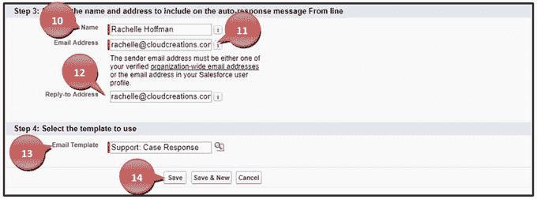

图 3-26 设置邮件发件人信息及电子邮件模板

### 创建案例升级规则

案例升级规则允许你创建自动化流程，用于决定案例何时会被升级以及升级后将执行哪些操作。与你上一节创建的其他规则类似，你可以根据案例的字段级条件来确定其升级时机。一旦满足字段级条件，你就可以设置相应操作，例如发送通知邮件、将案例重新分配给其他用户，以及通知该用户。图 3-27 到 3-34 展示了设置过程。具体步骤包括：

1. 点击 Salesforce 窗口右上角的设置齿轮图标，导航至设置菜单。
2. 在搜索区域输入`升级规则（Escalation Rules）`。在“服务（Service）”部分下点击`升级规则（Escalation Rules）`。
3. 点击`新建（New）`以创建升级规则。

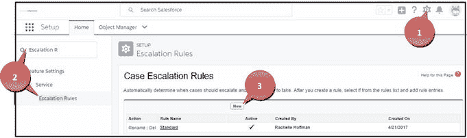

图 3-27 导航至案例升级规则

4. 为规则命名并点击`保存（Save）`。你可以通过选中`激活（Active）`复选框立即激活该规则，或者稍后再激活。
5. 点击`保存（Save）`。

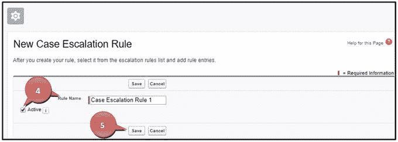

图 3-28 为你的案例升级规则命名

6. 保存规则名称后，页面将带你返回案例分配区域。点击你刚刚创建的规则名称。

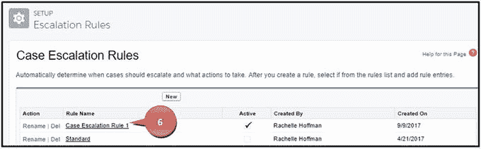

图 3-29 调取你的案例升级规则

7. 点击`新建（New）`按钮。

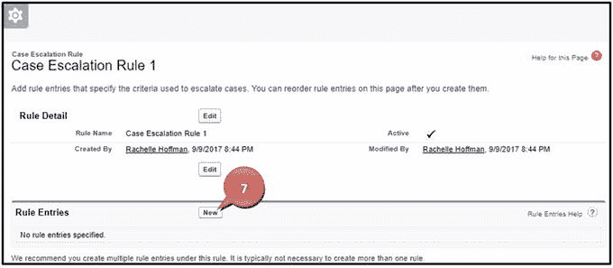

图 3-30 为你的案例升级规则创建条件

**注意** 在图 3-30 中，请注意`激活（Active）`复选框；你将在使用`激活（Active）`复选框完成规则后在此处激活它。

8. 如果这是你的第一个案例升级规则，请在`排序顺序（Sort Order）`字段中输入数字 `1`。如果你配置了许多规则，`排序顺序（Sort Order）`字段会告知 Salesforce 哪个规则应该先运行。一旦某个规则运行并执行了操作，它将不会对同一个案例运行其他规则。请根据重要程度为你所有的规则指定排序。
9. 在步骤 2 中，你创建规则条件。规则条件告知 Salesforce，如果你在此处输入的条件在案例上为真，那么它将发送邮件（步骤 9 和 10）。

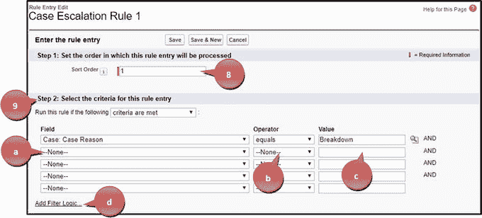

图 3-31 为案例升级规则创建规则条件

   1. 要开始此过程，你首先需要点击字段列中的`无（None）`。在这里，你将选择 Salesforce 应为该规则评估的字段。这可以是案例类型、案例原因、案例来源、客户、联系人信息，或者案例、客户或联系人的任何字段条件。
   2. 选择合适的运算符。例如，如果你希望每个等于特定值的案例类型自动触发邮件，你可以选择“等于（equals）”运算符并选择那些值。
   3. 选择或输入案例将自动发送邮件的相应值或结果。
   4. 你也可以通过点击`添加过滤逻辑（Add Filter Logic）`来配置你的过滤逻辑。这允许你将逻辑从“所有”字段条件（使用“且（and）”）更改为“或（or）”。例如，你可以设置如果案例类型是“问题（Problem）”或案例来源是“邮件（Email）”。标准设置会使该逻辑语句变成“如果案例类型是‘问题（Problem）’且案例来源是‘邮件（Email）’。”

10. 在步骤 3 中，你可以选择为此升级设置一个工作时间。

**注意** 要选择设置工作时间，你需要在 Salesforce 中已创建它。请在设置菜单中搜索 `business hours` 以获取更多信息。默认情况下，工作时间设置为每周 7 天，每天 24 小时。

11. 在步骤 4 中，你选择如何确定升级时间。

   1. 你可以选择在案例创建时评估，这只会在案例创建时评估一次条件。
   2. 你可以选择在案例创建时评估，并在案例首次修改后禁用。此选项将在案例首次被修改后（通常是在用户开始处理它之后）检查你的案例条件。
   3. 你可以选择案例的最后修改时间。这将在每次对案例进行更改时检查其条件。这将允许在案例被修改时应用升级规则。

12. 点击`保存（Save）`。

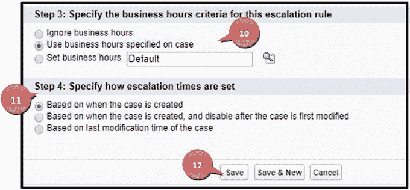

图 3-32 选择工作时间以及案例升级规则应何时运行

13. 点击`新建（New）`按钮以开始创建你的操作。

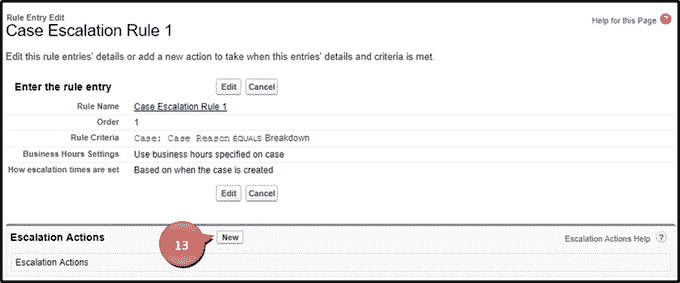

图 3-33 创建你的升级规则操作

14. 对于`时长超过（Age Over）`字段，你需要确定匹配条件的案例在升级前可以保持开启状态的小时数。你可以更改下拉菜单以显示单个分钟数，或调整为以 30 分钟为增量。
15. 在“选择以下一种或多种操作”下，你可以执行以下操作：
   1. 选择将案例重新分配给另一个用户或队列。在“自动将案例重新分配给（Auto-reassign cases to）”旁边的字段中，选择一个将发送给该用户或属于该队列的用户的邮件模板。
   2. 选择谁将收到案例已升级的通知，并选择应通知该用户的通知模板。通常，这是管理层中的某个人。
   3. 如果你不选择重新分配案例，此时可以通知案例的当前所有者其已升级。
   4. 在`附加电子邮件（Additional Emails）`字段中，除之前的设置外，选择是否还有其他人员应收到案例升级的通知。
16. 完成操作后，点击`保存（Save）`按钮。

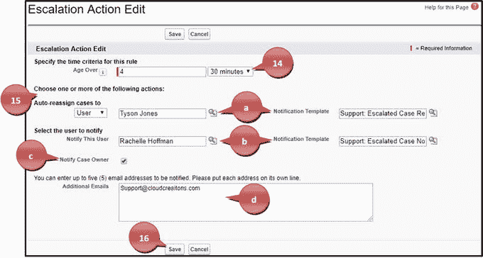

图 3-34 在你的案例升级规则上设置操作

### 提示

你可以创建一个包含多项操作的升级规则，例如，如果你希望某个特定案例在满足规则条件两小时后被升级。然后，如果四小时后该案例仍未关闭，并且你想再次升级它，你可以进行相应设置。你所需做的只是再创建一个操作。

### 设置电子邮件转案例

`电子邮件转案例`是一项功能，可让您根据发送到特定电子邮件地址的邮件自动创建案例。例如，如果您有一个负责管理产品技术问题的支持小组，您可以公布一个邮箱地址，让客户提交请求，这些请求将自动路由到 Salesforce 并为您创建案例。图 3-35 至 3-42 将引导您完成此设置过程。

1. 通过点击 Salesforce 窗口右上角的设置齿轮图标，导航至设置菜单。
2. 使用搜索区域，输入`电子邮件`。在服务下点击`电子邮件转案例`。
3. 点击`编辑`按钮。

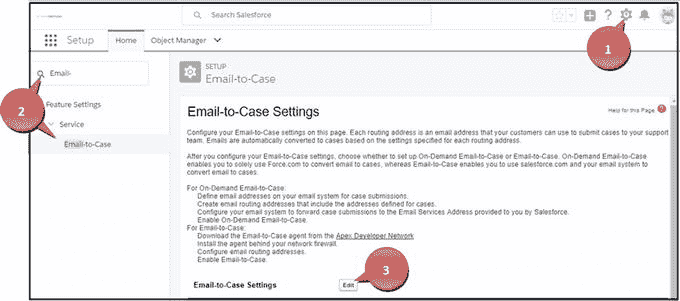

图 3-35：导航至电子邮件转案例设置

4. 选中`启用电子邮件转案例`和`启用 HTML 电子邮件`复选框。
5. 点击`保存`按钮。

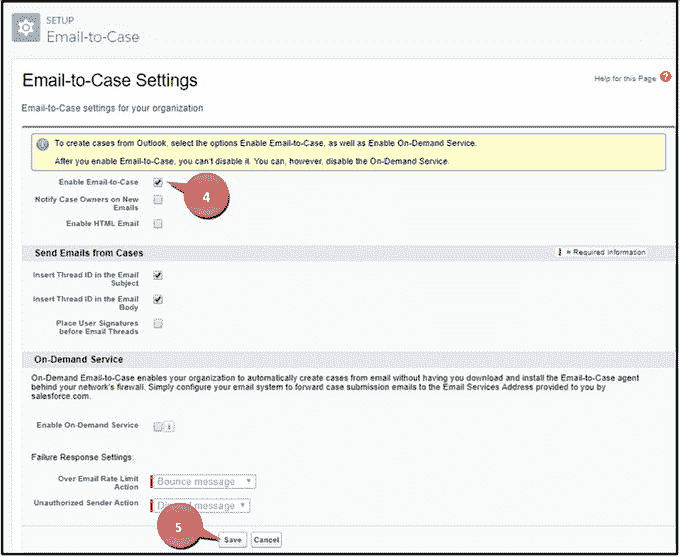

图 3-36：启用电子邮件转案例功能

6. 点击`新建`按钮。

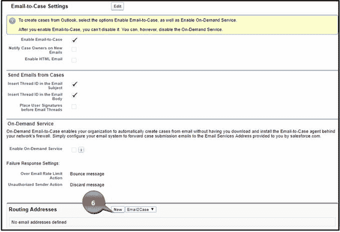

图 3-37：为电子邮件转案例设置创建新的路由地址

7. 输入电子邮件的路由名称。通常，这是电子邮件的名称。
8. 输入实际的路由电子邮件地址。

# 总结

借助 Salesforce Service Cloud，您可以根据组织的需求定制体验，或利用购买时附带的标准强大功能。无论选择哪条道路，您都可以确信，设置是最不需要您担心的问题。

## 设置 Web 到案例

Salesforce 中的 Web 到案例功能允许您将 HTML 代码嵌入到现有的网站或网页表单中。使用过此功能的大多数客户会将 HTML 代码嵌入到其网站支持相关页面上的“联系我们”表单中。此功能与电子邮件到案例功能类似，允许自动生成的案例进入 Salesforce。请按照图 3-43 至图 3-48 所示的步骤操作。

1. 点击 Salesforce 窗口右上角的设置齿轮图标，导航至设置菜单。
2. 在搜索区域输入 **Web-to-case**。在“服务”下点击“Web 到案例”。
3. 应勾选“启用 Web 到案例”复选框，如图 3-43 所示。
4. 将默认的“案例来源”选项设置为“Web”或任何其他描述此案例来源的选项。
5. 附加一个响应模板，希望客户在提交案例后收到。
6. “隐藏记录信息”将隐藏所发送电子邮件中的记录信息。

    **注意** 如果要为此创建电子邮件模板，请转到“设置”，搜索 `Email Template`，然后在“电子邮件”部分下找到 `Email Template`。

7. 添加电子邮件签名（如果您选择在电子邮件模板中创建）。
8. 点击“保存”。

    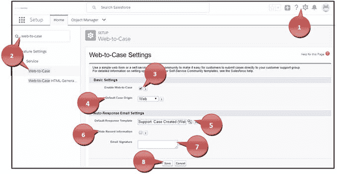
    图 3-43：创建 Web 到案例功能

现在您已启用该功能，就可以生成要嵌入到网站的 HTML 代码。图 3-44 至 3-45 向您展示如何操作。

1. 在“设置”菜单的左侧，您应该会看到“Web 到案例 HTML 生成器…”。如果没有，您可以搜索 `web-to-case HTML`。点击该短语。
2. 在“可用字段”区域中，选择要包含在网页表单中的字段。
3. 将字段从“可用字段”移动到“已选字段”。
4. 在“URL”字段中，输入希望客户在提交网页表单后返回的 URL。
5. “启用垃圾邮件过滤”选项需要创建 Captcha API 密钥（这需要开发人员操作，本书不做解释）。要进行设置，您需要导航到 Salesforce Classic。
6. 点击“生成”按钮。

    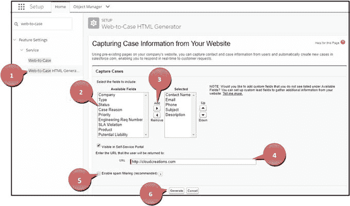
    图 3-44：设置 Web 到案例 HTML 生成器

7. 复制此 HTML 代码并将其发送给您的网站管理员。
8. 完成后点击“完成”。

    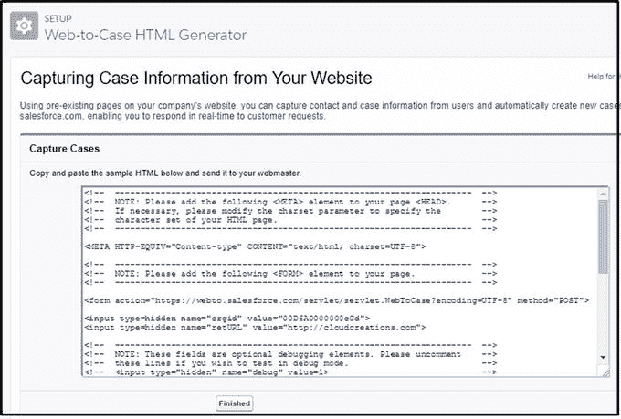
    图 3-45：生成的 HTML

### 注意

`电子邮件转案例`功能有一些限制。首先，您只能接收大小不超过 10MB 的附件。其次，此选项每天仅允许处理多达 5,000 封电子邮件。有关解决方法，请参阅设置区域，让 Salesforce 处理退回邮件。最后，如果邮件中不包含案例线索，则会创建一个新案例。

### 提示

如果您的案例查询通常超过 25MB，您可能需要使用`电子邮件转案例`选项。此外，`电子邮件转案例`设置会自动识别联系人和回复并关联到案例。按需功能提供了更自定义的解决方案。它允许进行自定义字段映射，并且其设置相当简单。

9. 您可以选择保存电子邮件的标头，并设置接受来自哪些发件人的邮件。但是，这些通常包含图片，会占用您组织 15KB 的存储空间。大多数用户不会启用此选项。
10. 在任务设置下，您可以在案例创建时同时创建一个任务。
11. 在案例设置下，设置案例的优先级和案例来源。
12. 点击`保存`或点击`保存并新建`以设置更多电子邮件路由地址。

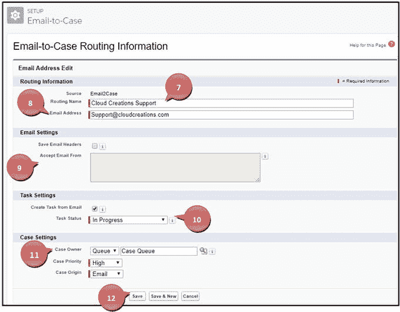
图 3-38：为电子邮件转案例功能设置路由地址

13. 系统会自动向您在步骤 8 中输入的路由地址发送一封电子邮件。如果您在几小时内没有收到邮件，请检查您的垃圾邮件文件夹或公司可能设置的防火墙，或者点击图 3-39 中显示的`重新发送`链接。

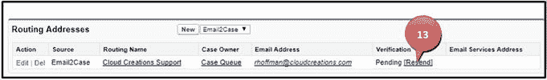
图 3-39：如果您没有收到验证邮件，可以使用此`重新发送`链接重新发送邮件

14. 您收到的邮件应类似于图 3-40 中的示例。您需要点击邮件中的链接来验证这是一个有效的电子邮件地址。点击链接后，您将进入另一个 Salesforce 屏幕；点击`继续`按钮，如图 3-41 所示。

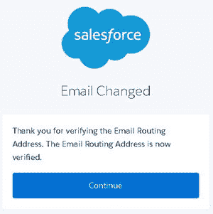
图 3-41：点击`继续`，您将进入 Salesforce 登录页面

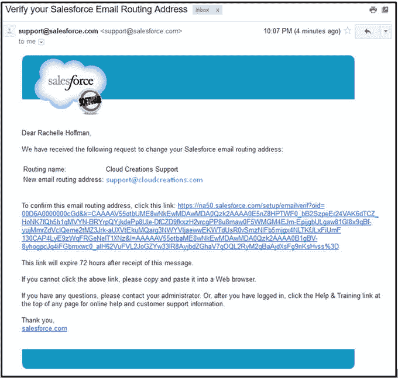
图 3-40：已发送电子邮件验证

15. 最后，您需要在您的电子邮件收件箱中应用一些电子邮件转发规则，将电子邮件转发到 Salesforce 提供的电子邮件服务地址。

    创建电子邮件转发规则是利用 Salesforce 支持的按需电子邮件转案例功能的关键。通过将所有电子邮件转发到 Salesforce 提供的电子邮件服务地址，您可以为用户提供与 Salesforce 的一站式应用体验。当电子邮件发送到 Salesforce 时，客户会收到一封回复，该回复的邮件正文和主题行中包含唯一的案例线索。此案例线索允许回复到同一邮箱的电子邮件根据您的转发规则被发送到 Salesforce，并关联到现有案例。这使得您的用户在处理支持案例查询时可以停留在 Salesforce 中。图 3-42 展示了一个案例线索。

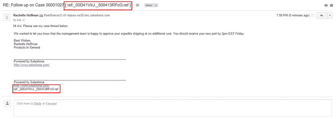
图 3-42：此案例线索允许您的客户邮件关联到相应的案例。