# 4. Lightning 应用程序

AppExchange 市场包含一系列应用程序、Lightning 组件和咨询资源。Salesforce 客户可以为其 Salesforce 组织安装附加应用程序。您可以在数千个应用中搜索，为业务需求寻找预建的解决方案。该市场也是搜索数千名注册 Salesforce 顾问的地方（如图 4-1 所示）。

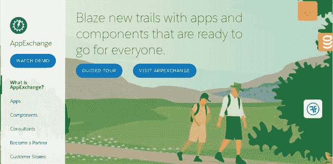

图 4-1

使用 AppExchange 开辟新道路

## 应用程序

通过安装名为*应用程序*的预建包来提高生产力，这些包为每个角色和行业提供定制解决方案。请访问 AppExchange 网站 [`appexchange.salesforce.com`](http://appexchange.salesforce.com)。您可以在此处通过多种方式进行排序和筛选，包括按热门度和评分。

要选择正确的应用程序，我们建议您明确自己的业务挑战、预算和时间框架。

### 发现 AppExchange 市场

您应该花时间探索 Salesforce 中的商业应用商店，也称为 AppExchange 市场。这里有超过 3,000 个应用和组件可用于扩展 Salesforce 的功能。请按以下步骤操作：

1.  从应用程序启动器中，点击“访问 AppExchange”，如图 4-2 所示。或者，从“设置”中，在“快速查找”区域搜索 `AppExchange marketplace`。

    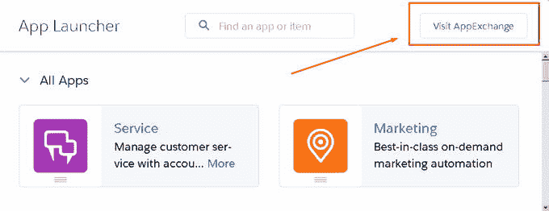

    图 4-2

    从应用程序启动器访问 AppExchange

2.  点击“AppExchange 网站”，如图 4-3 所示。

    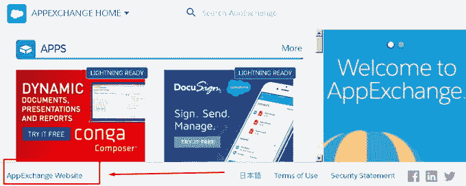

    图 4-3

    点击“AppExchange 网站”以导航到完整的应用程序和组件数据库

该市场包含供最终用户安装并下载到其 Salesforce 组织中的应用程序和组件。此外，您还可以访问关于这些应用程序、组件和顾问的数千条评论。透明度触手可及。

在您的主页上（如图 4-4 所示），可以根据各种类别搜索和筛选应用程序。您会发现各种各样的应用程序！它们范围从点式解决方案到全面的集成和自动化。既有免费的应用，也有付费的应用。好消息是，Salesforce 让您轻松找到所需内容。

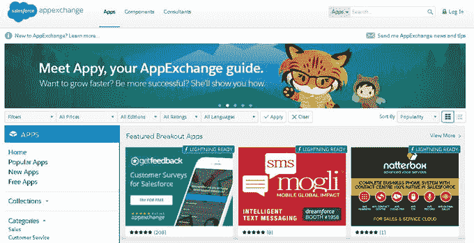

图 4-4

AppExchange 主页

#### 选择应用程序

面对众多可用的解决方案，选择正确的应用程序可能让人不知所措。因此，在此决策过程中有一个策略至关重要。

1.  首先，明确您的业务挑战。确定公司的目标和宗旨。一旦确定了这些，就在 Salesforce 市场中搜索并查看一些解决方案选项。
2.  一旦缩小范围锁定了一些潜在的解决方案，就评估这些解决方案和供应商。考虑易用性、支持选项、总成本、评价、管理便利性以及解决方案匹配度。利用这些信息来帮助做出决定。
3.  如果可行，请求演示或试用，或者将应用程序安装到您的沙盒环境中进行用户测试和验收。

### 价格

一个重要的因素是成本。Salesforce 中有免费的应用，但也有其他需要付费的应用。有些应用会显示总成本，而另一些则需要您联系他们以了解价格。其中一些付款方式可以是按月、按年、按用户或按组织付费。

### 兼容性

务必检查解决方案的兼容性。您可以在应用的“详细信息”部分的“要求”和“其他系统要求”下找到兼容性信息（如图 4-5 所示）。

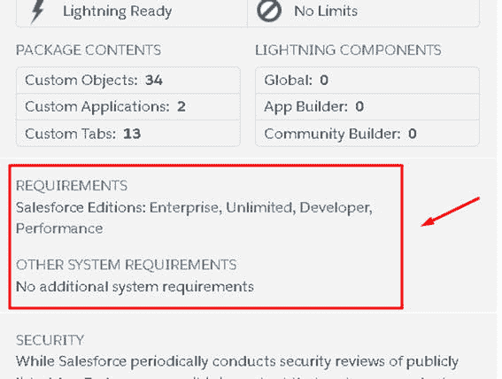

图 4-5

应用详细信息中的“要求”和“其他系统要求”部分

### 应用首页

应用的首页提供概览、详细信息、评论以及提供商信息（如图 4-6 所示）。

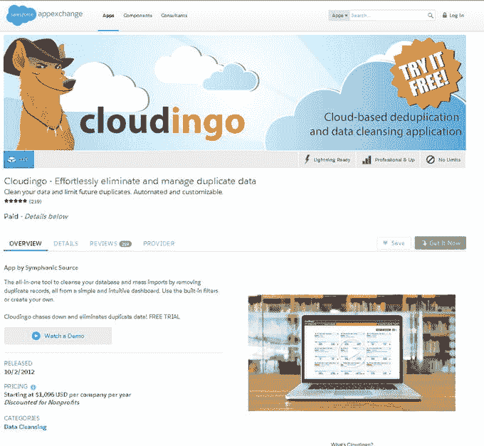

图 4-6
应用首页

该页面还包含以下信息：

-   **亮点**：位于应用页面顶部的亮点栏（如图 4-7 所示）展示了应用的关键组件。通常包括 Lightning 就绪性、组织兼容性和限制。

  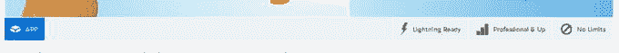

  图 4-7
  亮点栏

-   **费用**：费用位于首页左侧。如果应用是免费的，则会显示“免费”。如果应用需要收费，则会显示“付费”。

-   **概览**：点击“概览”选项卡（如图 4-8 所示）可查看应用的简要说明。某些应用会在此处提供其网站的链接或包含视频演示。建议您观看任何视频，以进一步了解应用的功能。您还可以在此区域找到详细的定价信息、发布日期和屏幕截图。

  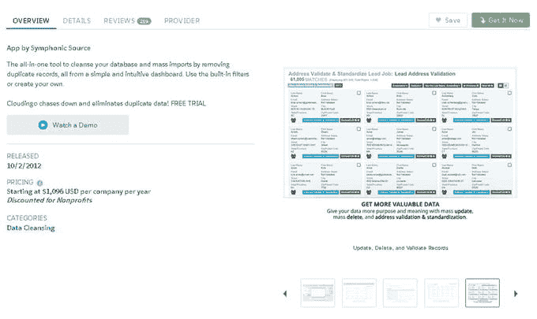

  图 4-8
  应用的“概览”选项卡

-   **详细信息**：点击“详细信息”选项卡（如图 4-9 所示）可获取更多有见地的细节。通常包括任何技术细节、软件要求、支持的功能列表、数据表和安全相关信息。

要直接联系应用提供商，请查阅页面右上角显示的联系信息。

### 提示

对于需要大量设置的应用，请考虑每个应用可用的支持选项。

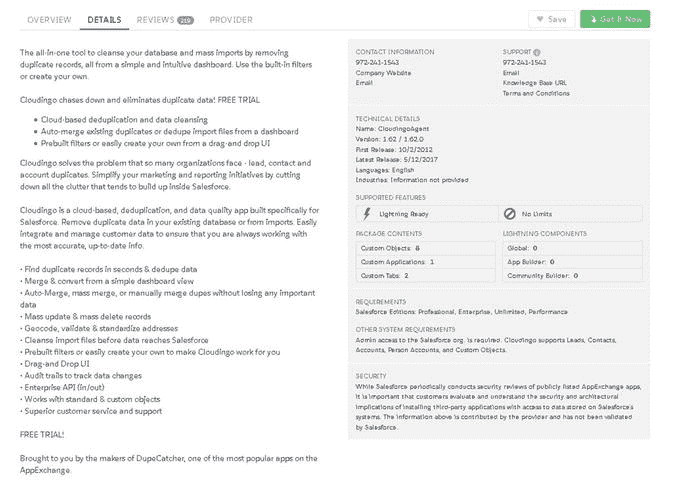

图 4-9
“详细信息”选项卡

“详细信息”选项卡底部包含应用公司提供的文档，包括数据表、自定义指南、案例研究和客户评价，如图 4-10 所示。

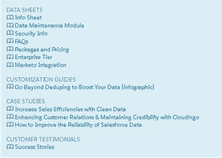

图 4-10
存储的有关应用的重要信息，包括数据表、指南、案例研究和评价

### 评论

每个应用都使用五星评分方法进行评级，并包含客户书面评论。这些评论也分为正面评论和关键评论。利用此信息帮助判断应用的成功程度。导航至“评论”选项卡的评论部分，阅读客户反馈（如图 4-11 所示）。

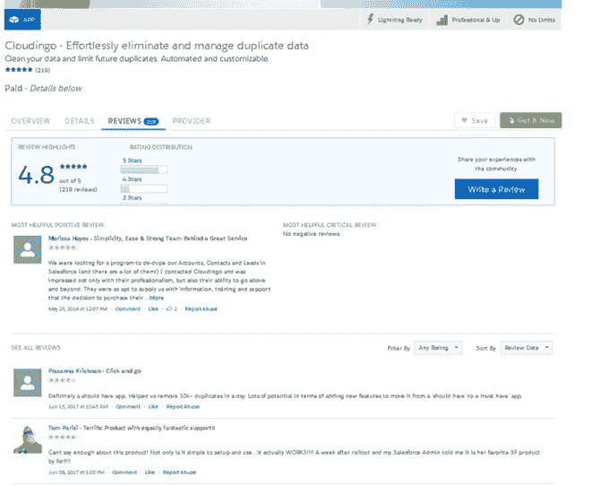

图 4-11
“评论”选项卡包含正面和关键评论

要撰写评论，用户必须经过身份验证。要撰写评论，请点击“评论亮点”部分中的“撰写评论”，如图 4-12 所示。

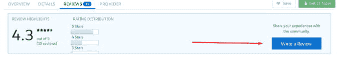

图 4-12
点击此按钮撰写评论

接下来，为您的评论添加标题。在“评论”部分（如图 4-13 所示）提供评论内容。滚动鼠标悬停在星星上以选择适当的评分。完成后点击“发布评论”。请注意，您的评论可能需要长达一小时才能发布。

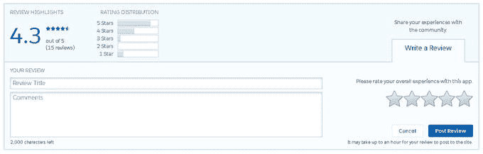

图 4-13
应用评论中需包含的信息

### 注意

请返回此页面为您已安装的应用撰写正面或关键评论。这将为 Salesforce 社区带来更多价值。

### 提供商

此选项卡包含关于应用提供商的更多详细信息。了解提供商创建的可能与您的业务需求相关的其他应用。其他详细信息包括总部所在地、网站、员工数量和成立年份，如图 4-14 所示。

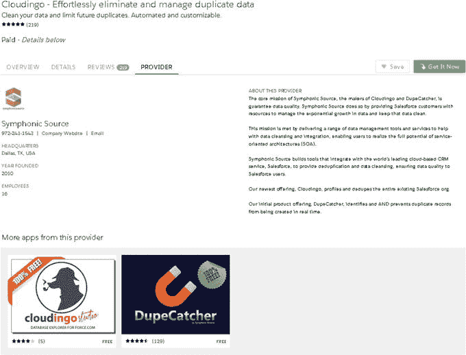

图 4-14
“提供商”选项卡

## 安装应用

应用可以直接安装到您的生产环境或沙盒环境中。生产环境是您的活跃用户使用 Salesforce 处理实时数据的地方。沙盒是您的测试环境。这些可以是用于测试应用程序的生产或开发环境。建议您先在此处安装，以查看它如何与您现有的设置交互。

应用也可以为特定用户组或所有用户安装。

要安装应用，请遵循以下步骤：

1.  做一些研究并选择要安装的应用。

2.  点击“立即获取”按钮，如图 4-15 所示。

    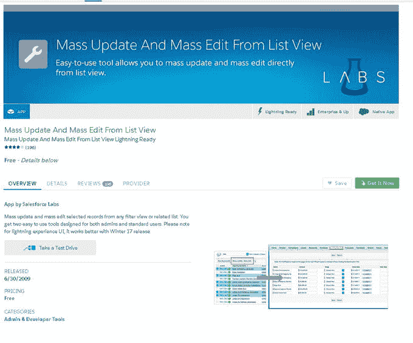

    图 4-15
    首页上的“立即获取”按钮

3.  使用您的 Salesforce 凭据登录。

4.  选择合适的安装方法，如图 4-16 所示。

    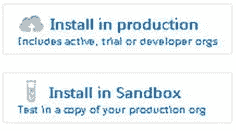

    图 4-16
    选择安装到生产环境还是沙盒

    -   点击“安装到生产环境”以安装到实时生产环境。
    -   点击“安装到沙盒”以安装到沙盒测试环境。

5.  查看将要安装的应用的包组件、版本、过期时间和订阅成本。查看条款和条件。

6.  选择“我已阅读并同意条款和条件”，如图 4-17 所示。点击“确认并安装”。

    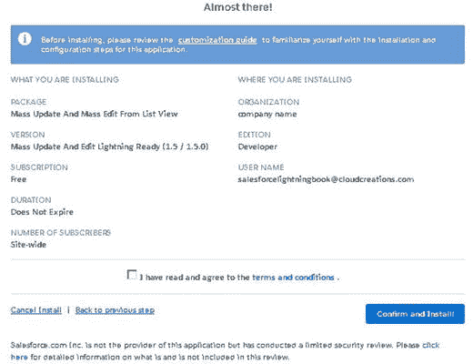

    图 4-17
    安装前的最后一步

7.  确定有权访问此应用的用户。从以下列表中选择适当的选项：仅安装给管理员、所有用户或特定简档。

    **注意**：安装后，您可以向其他用户开放此应用的访问权限。

8.  点击“安装”，如图 4-18 所示。

    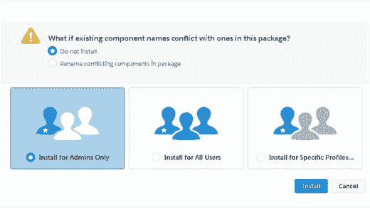

    图 4-18
    选择要安装给哪些用户

9.  点击“完成”，应用完成安装后，您将被重定向到“已安装的包”部分（见图 4-19）。

    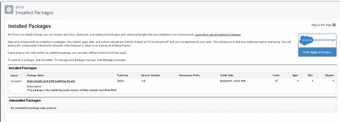

    图 4-19
    已安装和未安装包的详细信息

### 已安装的软件包

已安装的应用会创建一个包含组件和依赖项的软件包。这包括自定义对象、Visualforce 页面以及 Apex 类和代码。已安装的应用可以以受管软件包或非受管软件包的形式提供。

-   *受管软件包*对所安装的组件有限制。
-   *非受管软件包*则更加灵活，允许在已安装的任何组件之上进行开发。

要卸载应用，请导航至“设置”中的“已安装的软件包”区域，然后单击“卸载”。

要查找任何已安装应用的详细信息，包括所有组件和依赖项，请单击软件包名称，如图 4-20 所示。随后将显示详细信息，如图 4-21 所示。

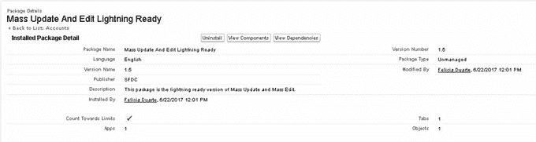

图 4-21 — 软件包详情

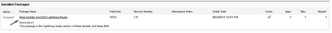

图 4-20 — 软件包名称

单击“查看组件”可获取所有已安装内容的完整分类（按类型），如图 4-22 所示。

-   *Visualforce 页面*：Visualforce 页面是由 Apex 类和代码构成的自定义页面，用于创建自定义的外观和体验。
-   *Apex 类*：Apex 类是 Salesforce 独有编程语言的一部分，它为开发者和应用构建者提供了创建业务逻辑的能力。
-   *自定义对象*：用于存储或构建自定义信息。自定义对象可用于将信息链接到标准对象。

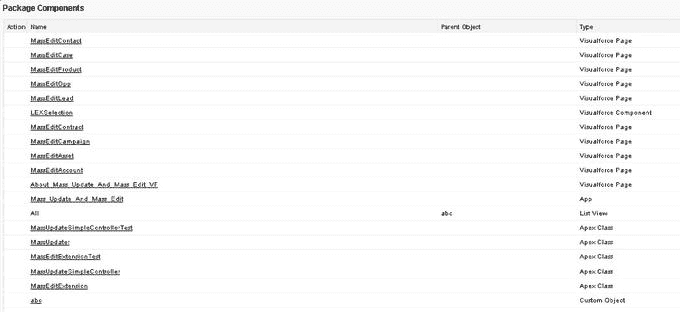

图 4-22 — 查看您的软件包组件

## Lightning 组件

Lightning 组件是可重复使用的预构建工具和元素容器。您可以将这些组件添加到页面中，以提高最终用户的生产力。如本书前面所述，组件可以轻松拖放到您想要的页面中。Salesforce 使得无需开发者和编写代码即可轻松完成此操作。通过在市场中搜索来发现这些工具，如图 4-23 所示。

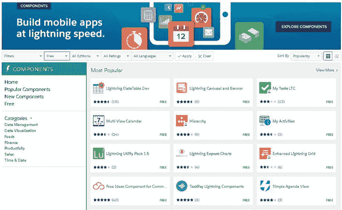

图 4-23 — Lightning 组件搜索页面

要下载组件，请遵循与应用相同的下载步骤。

## 寻找顾问

顾问是已注册且通常经过认证的 Salesforce 合作伙伴。他们通过提供自定义的 Salesforce 解决方案和实施来帮助构建 Salesforce 生态系统。顾问通常提供 Salesforce 培训、实施解决方案、快速入门包、数据迁移等服务。

您的 Salesforce 客户经理通常会推荐一个 Salesforce 咨询合作伙伴。之后通常会与顾问进行一次发现或范围界定电话会议，并提供包含时间表、可交付成果和成本的报价。

类似于浏览应用，您可以浏览顾问列表，并按服务类型、专长、等级、区域等进行排序。

1.  从页面顶部选择“顾问”选项卡，如图 4-24 所示。

   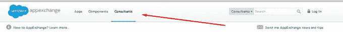

   图 4-24 — 顾问选项卡

2.  选择一个咨询页面（图 4-25）以查看更详细的信息（图 4-26）。

   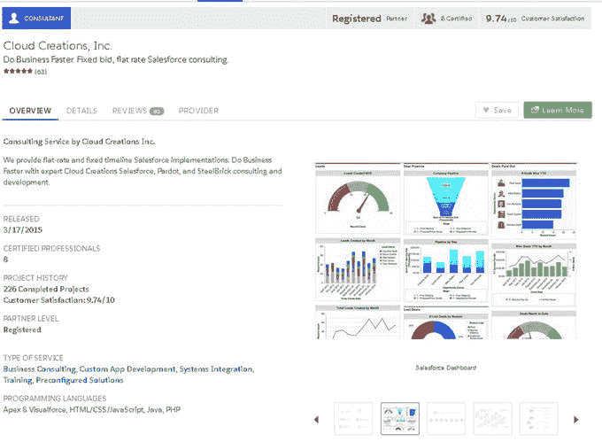

   图 4-26 — Cloud Creations 顾问详情页面

   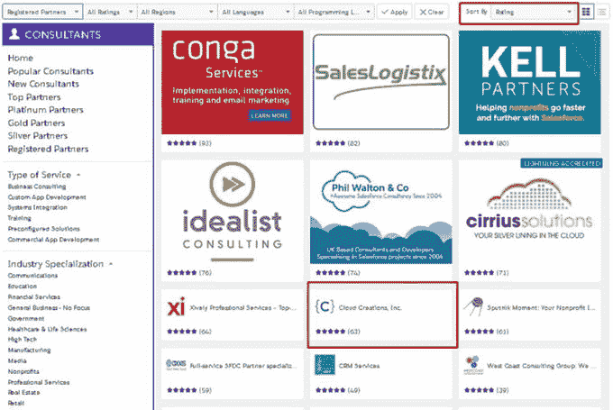

   图 4-25 — Cloud Creations 咨询公司

3.  在此页面上查找有关这位潜在顾问的更多详细信息，包括已完成的项目数量、满意度评级、地理重点等（如图 4-27 所示）。您还可以在此页面找到顾问的联系信息，以便联系他们获取服务。

4.  联系顾问并请求报价。

   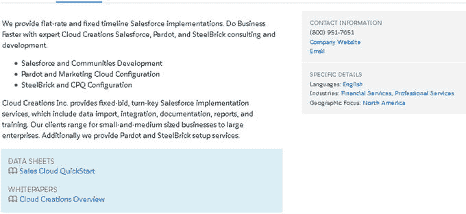

   图 4-27 — 顾问详细信息部分

### 提示

顾问通常会雇佣项目经理、业务分析师、开发人员和专家。按时计费差异很大，通常包括一次范围界定电话会议，以确定为您的企业提供合适的解决方案。您向潜在顾问提供的信息越详细，成本估算就越准确。

## 总结

AppExchange 市场由 Salesforce 生态系统中的应用合作伙伴和顾问组成。这是一个不断增长的市场，预计在不久的将来会发生重大变化。访问 AppExchange 市场，充分利用您的 Salesforce 设置。

