# 5. Lightning 报表和仪表板

Salesforce 报表和仪表板为您提供了对在 Salesforce 中收集的数据的必要洞察。任何 Salesforce 对象中的每个自定义字段和大多数标准字段都可以在 Salesforce 报表中使用。Salesforce 仪表板帮助您以 11 种不同的可视化图表和表格形式显示这些数据。一个报表可以用于多个仪表板组件；但是，一个仪表板组件只能使用一个报表。一个仪表板最多可以显示 20 个仪表板组件。图 5-1 显示了在 Lightning 中用户主页面上标配的报表。

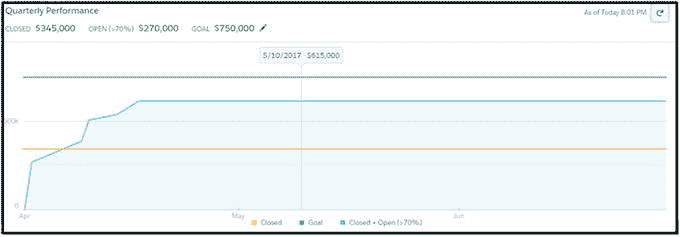

图 5-1 — Salesforce 中按季度划分商机绩效的主屏幕

## 了解报表与报表功能

报表允许您根据自己定义的特定条件查看数据。一旦定义了条件，您就可以对数据进行分组、创建图表以便于查看、进一步筛选数据，并将报表存储到报表文件夹中以备将来使用。在接下来的几个部分中，我们将介绍报表构建器中一些必须了解的功能，然后我们将开始构建您的报表。

### 报表类型

报表类型允许您定义在创建报表时可用的对象和字段。您可以根据对象与相关对象的关系来创建报表类型。这类关系的一个典型例子是客户及其相关的商机。您的商机将是主对象，而客户则是相关对象。别担心，您无需创建报表类型即可开始使用 Salesforce 报表，因为 Salesforce 开箱即用已为您设置了标准对象。但是，如果您发现报表中缺少某个字段，或者找不到与另一个对象关联的自定义对象，请继续阅读。或者，如果标准报表类型不适合您的业务，您可以自定义自己的报表类型！

### 创建报表类型

创建报表类型的步骤如下：

1.  点击浏览器右上角的设置齿轮图标，如图 5-2 所示。

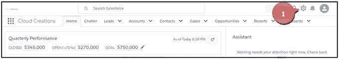

图 5-2：导航至“设置”菜单

2.  在快速查找框中，搜索 `report types`（不要按回车键），并选择黄色高亮的短语 `Report Types`，如图 5-3 所示。

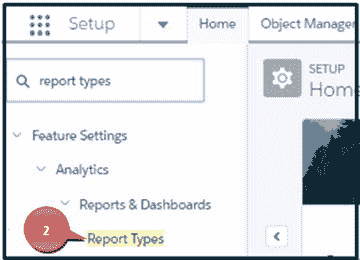

图 5-3：访问报表类型

**提示** Salesforce 对其大部分管理流程都提供了帮助。如果您看到的是“什么是自定义报表类型？”，也可以阅读此内容，然后点击“继续”。您也可以点击“不再显示此页面”来禁用该窗口，如图 5-4 所示。

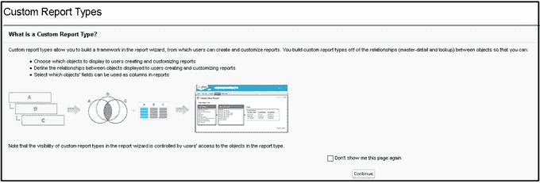

图 5-4：自定义报表类型帮助页面

3.  点击 `New Custom Report Type`，如图 5-5 所示。

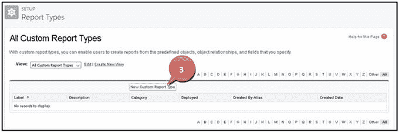

图 5-5：创建新的自定义报表类型

4.  从下拉字段中选择报表应包含的主对象，如图 5-6 所示。

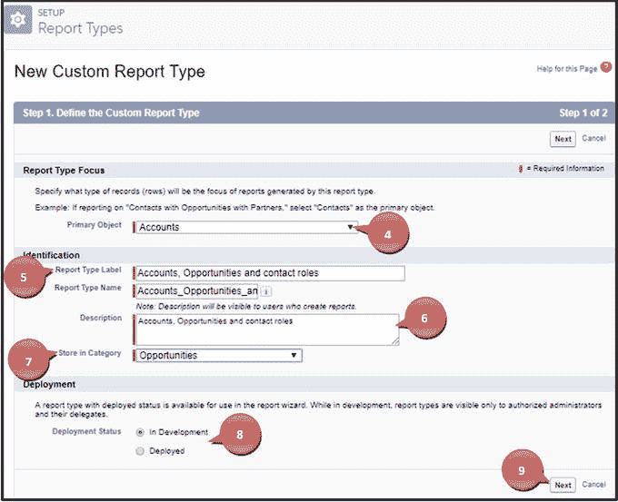

图 5-6：创建客户报表类型

5.  为您的报表类型命名。当用户在报表生成器中选择报表类型时，该标签将显示给他们。完成命名后，按 Tab 键，Salesforce 将自动创建报表类型名称。

6.  为报表类型输入描述。此描述将对使用该报表类型的用户可见。

7.  选择此报表类型应存储的类别。例如，如果创建的报表类型是机会和联系人报表，则应将其放入 `Opportunity` 文件夹。如果报表类型是多个对象的组合，您可以选择将其存储在其中一个对象的文件夹中。

8.  选择此报表类型应处于的状态。选择 `In Development` 单选按钮将向除管理员或拥有委派权限的用户之外的所有用户隐藏此报表类型。选择 `Deployed` 状态将使所有有权访问报表生成器的用户都能看到此报表类型。当您完成并测试了报表类型后，随时可以返回并选择 `Deployed` 选项。

9.  点击 `Next`。

10.  选择“点击关联另一个对象”，如图 5-7 所示。

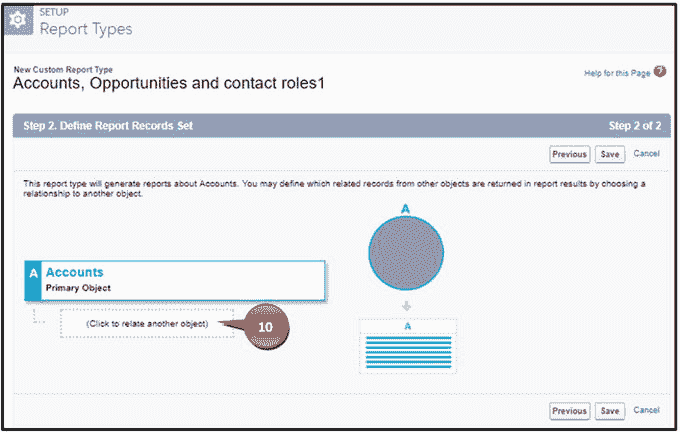

图 5-7：为您的自定义报表类型关联另一个对象

11.  点击 `Select Object` 下拉菜单，为此报表类型选择您的相关对象，如图 5-8 所示。

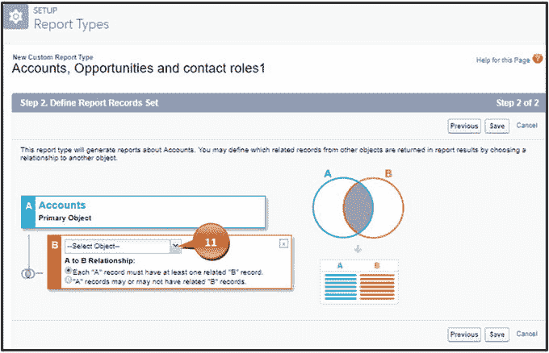

图 5-8：为您的客户报表类型关联另一个对象

**注意** 如果您没有看到要关联到此对象的对象，这意味着这些对象之间没有连接。要创建连接，您需要在相关对象上创建一个指向主对象的查找字段。在数据填充此报表之前，您记录中的该字段必须填写一个主对象记录。构建自定义对象和字段比您想象的要简单。本书不涉及如何执行此操作，但 Salesforce 提供了关于此主题的优秀“trailheads”。请访问 [`https://trailhead.salesforce.com`](https://trailhead.salesforce.com) 查找您的 trailhead 并进一步学习。

12.  在图 5-9 中，您将在 A 到 B 关系下看到两个选项。选项“每个 'A' 记录必须至少有一个相关的 'B' 记录”将仅显示至少有一个 A 与之相关的 B 记录。例如，将显示所有与帐户相关的联系人，但如果您有一个与任何帐户都没有关联的联系人，则不会显示。选项“'A' 记录可能有关联的 'B' 记录，也可能没有”将显示所有 B 记录，无论它们是否与您的 A 记录相关。

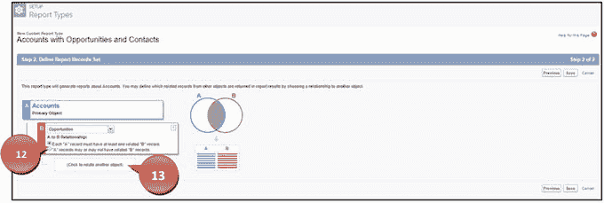

图 5-9：为此报表类型选择两个对象之间的关系类型。

13.  点击“点击关联另一个对象”以选择您的下一个对象。

14.  点击 `Select Object` 下拉菜单，为此报表类型选择您的下一个相关对象。

15.  在 A 到 B 关系下选择两个单选按钮之一。

16.  如有必要，重复步骤 13 到 15 以关联更多对象到此报表。

17.  点击 `Save`，如图 5-10 所示。

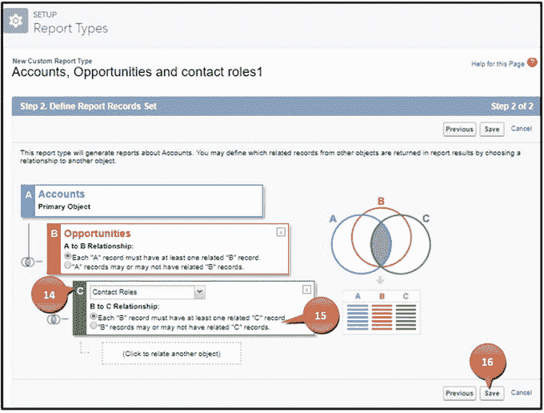

图 5-10：为您的自定义报表类型关联另一个对象

### 注意

如果在创建自定义报表类型后向对象添加了新字段，则必须将这些新字段添加到报表类型中。您可以通过转到“设置”，点击您的报表类型名称，然后在“报表可用字段”下点击 `Edit Layout` 来完成此操作。如图 5-11 所示。

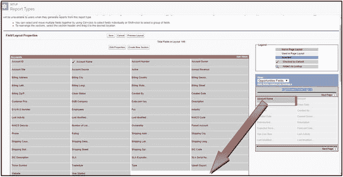

图 5-11：向现有客户报表类型添加新的自定义字段

### 报表格式

Lightning Experience 中的 Salesforce 提供三种报表格式。每种格式允许您以不同方式自定义报表。无论您是使用 `Tabular` 格式生成呼叫列表，使用 `Summary` 格式按水平分组显示数据，还是使用 `Matrix` 格式按行和列总结数据，Salesforce 都有适合您的格式。您还可以使用一个额外的报表格式 `Joined reports`；但是，您需要切换到 Salesforce Classic 才能构建和查看这些类型的报表。每种报表格式都有其优势；让我们进一步探讨。图 5-12 显示了您可以在何处对不同报表格式进行调整。

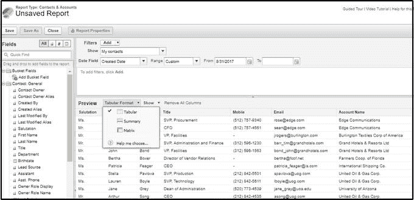

图 5-12：切换报表格式

#### 表格报表格式

表格格式报表易于与电子表格之类的平面文件进行比较。这种报表格式包含列作为不同的数据点，以及包含实际记录的行。这些报表最适用于创建记录列表，例如通话清单或列出带有总计的记录。这种报表格式无法进行分组，并且除非使用行限制过滤器（见图 5-33），否则您无法在图表中显示信息或在仪表板组件中使用它。大多数客户会使用表格报表格式，通过设定的特定条件查看销售总额。例如，如果您想快速生成一份关于团队在一个季度内所产生销售额的报告，可以使用表格报表。图 5-13 展示了一个通话清单表格报表的示例。

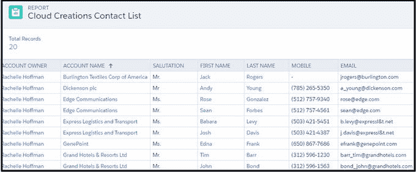

**图 5-13**

表格报表示例

#### 摘要报表格式

摘要报表格式是 Salesforce 中使用最广泛的报表格式。这种报表格式允许您对数据进行最多三个层级的分组和汇总。在这些分组内，您可以对列进行汇总，获取该特定分组的小计，并在报表末尾获得总计。您可以在此报表中使用公式来进一步定义报表。通过按商机所有者分组，您可以使用这种报表格式来展示销售人员之间的业绩对比。您也可以使用此报表，通过按记录的所有者分组，来确定公司中谁拥有的记录数量最多。或者，您可以构建一个报表，按职务对不同类型的联系人进行分组。这种格式也可以在仪表板和图表中使用和呈现。当您不对报表进行分组时，它将以表格格式显示。图 5-14 展示了一份客户用来查看新增业务与现有客户业务量对比的报表。您还可以看到它已按用户分组，以显示每位用户与其他用户的业绩对比情况。

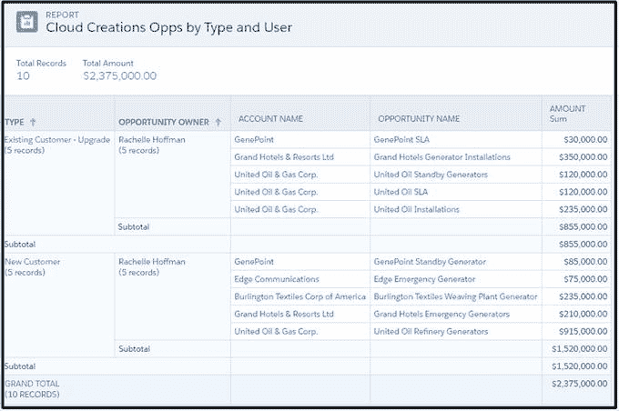

**图 5-14**

摘要报表示例

#### 矩阵报表格式

矩阵报表格式允许您同时按列和行对数据进行分组。这有助于对数据进行交叉分析。与摘要报表格式一样，在矩阵格式中创建的分组里，您可以查看小计、记录计数和总计，也可以按行或列查看，如图 5-15 所示。使用这种报表类型，通过按日期分组列、按商机产品分组行，可以展示产品在特定日期范围内的表现情况。或者使用此报表来确定您的用户在某一时间段内的表现。使用此报表来比较您收到的案例来源与案例原因。这种报表类型也可以在仪表板组件和图表中使用。此外，您还可以使用公式进一步计算数据。如果您的分组或条件没有显示任何结果，此格式的报表将降级为摘要格式。

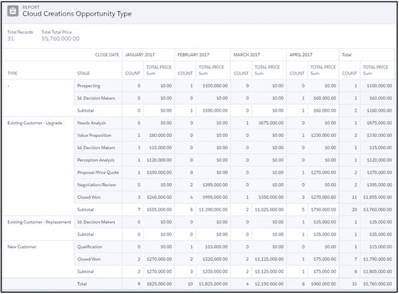

**图 5-15**

矩阵报表示例

## 报表过滤器

在报表生成器中，有必要了解 Salesforce 提供的报表过滤器的使用方法。您最多可以使用五种过滤器功能来进一步自定义报表。过滤器允许您更细致地查看数据，使其更符合您的报告需求。

### 标准过滤器

Salesforce 报表生成器中的标准过滤器会因某些对象而异。由于您在客户和联系人之间收集的数据与商机或案例不同，您会看到这些标准报表过滤器会根据报表类型而变化。让我们看看每种报表类型及其标准过滤器。

#### 客户、联系人和线索

客户、联系人和线索都共享相似的标准报表过滤器。就像在 Salesforce 中学习的大多数东西一样，如果您了解一个对象的组成部分，这些知识有时可以迁移到其他对象上。对于客户、联系人和线索，您会发现它们具有相似的属性。

*   *所有客户*：此报表过滤器允许您选择是查看所有客户（无论所有者是谁）、仅您拥有的联系人、仅您拥有的客户，还是您团队的客户，如图 5-16 所示。如果您通过角色层级或共享规则设置了安全策略，您的用户将只能看到他们被授权查看的客户、联系人和线索。

    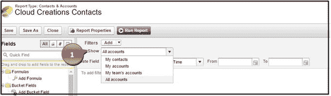

    **图 5-16**

    按记录所有权过滤客户

*   *所有线索*：此线索报表过滤器类似；您可以选择查看您拥有的线索、您团队的线索、用户拥有的线索（相对于队列拥有的线索）、队列拥有的线索以及所有线索，如图 5-17 所示。

    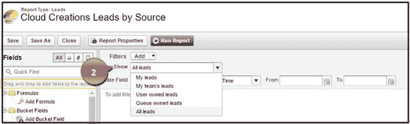

    **图 5-17**

    按记录所有权过滤线索

*   对于客户、联系人和线索，您可以从该报表类型中的任何日期字段中进行选择来过滤，也可以使用 Salesforce 智能日期。智能日期允许您选择每当运行报表时都会更新为相对时间的日期。例如，您可以从下拉菜单中选择“本周”或“当前日历年”，或在“从”和“至”字段中使用您自己的自定义日期范围，如图 5-18 所示。

    **注意** 如果这些智能日期不适用于您的报表，请参阅“字段过滤器”以获取更多思路。

    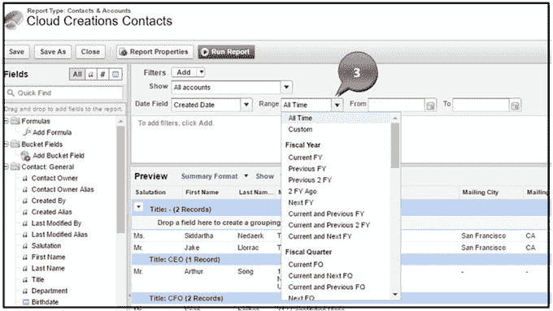

    **图 5-18**

    智能日期过滤器

#### 商机标准筛选字段

商机的标准筛选字段是其报表类型所特有的，下面我们来了解一下。

- 与客户、联系人和线索类似，商机也有一个标准报表筛选器，允许您选择所有商机（无论归属何人）、您团队的商机以及您个人的商机，如图 5-19 所示。如果您通过角色层级或共享规则设置了安全策略，那么您的用户将只能看到他们有权查看的商机。

  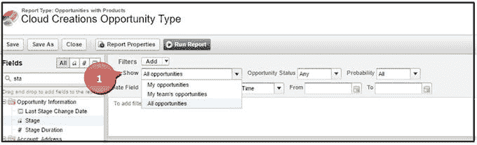

  图 5-19 — 商机归属筛选器

- `商机状态`筛选器允许您查看任何商机，无论其处于已关闭、进行中还是已赢得状态，以及所有状态的商机，如图 5-20 所示。

  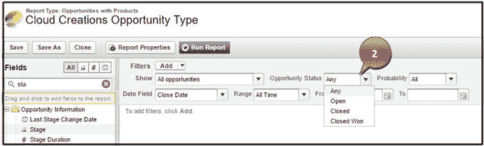

  图 5-20 — 商机状态筛选器

- `商机可能性`允许您根据`可能性`字段（与该阶段关联）进行筛选。您可以选择大于 90% 等选项，以便更清楚地了解您销售管道中最可能成交的商机，如图 5-21 所示。

  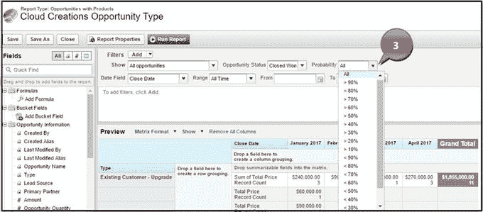

  图 5-21 — 商机可能性筛选器

- `商机日期字段`筛选器的工作原理与客户、联系人和线索的筛选器相同。您可以从该报表类型中选择任何日期字段进行筛选，还可以使用 Salesforce 智能日期。智能日期允许您选择每次运行报表时会更新为相对时间的日期。例如，您可以从下拉菜单中选择`本周`或`当前日历年`，或者在`从`和`到`字段中使用您自己的自定义日期范围，如图 5-22 所示。

  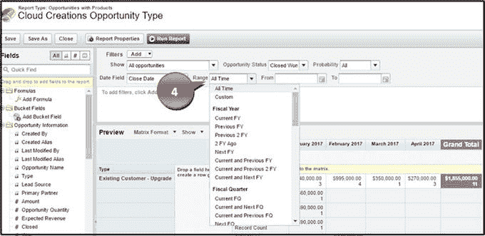

  图 5-22 — 商机智能日期筛选器

#### 个案筛选器

个案筛选器与其他对象的标准筛选器有一些相似之处，也有一些是该报表类型独有的。

- 个案的`显示`筛选器允许您查看所有个案、所有个案（无论归属何人）、用户拥有的个案（相对于队列拥有的个案）、队列拥有的个案、您个案团队的个案或基于角色的团队的个案，如图 5-23 所示。如果您通过角色层级或共享规则设置了安全策略，那么您的用户将只能看到他们有权查看的个案。

  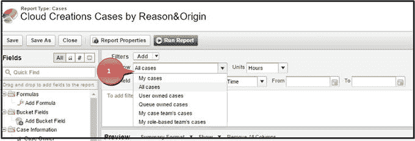

  图 5-23 — 个案归属筛选器

- `单位`筛选器允许您以分钟、小时或天为单位显示个案已开启的时长，如图 5-24 所示。

  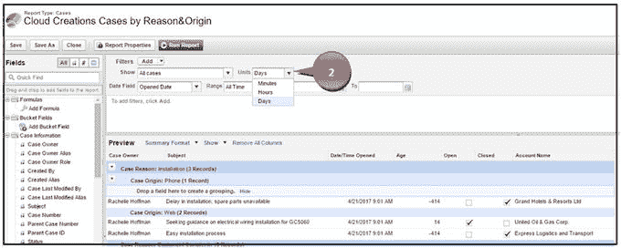

  图 5-24 — 个案单位筛选器

- 个案`日期字段`筛选器的工作原理与客户、联系人、线索和商机的筛选器相同。您可以从该报表类型中选择任何日期字段进行筛选，还可以使用 Salesforce 智能日期，如图 5-25 所示。智能日期允许您选择每次运行报表时会更新为相对时间的日期。例如，您可以从下拉菜单中选择`本周`或`当前日历年`，或者在`从`和`到`字段中使用您自己的自定义日期范围。

  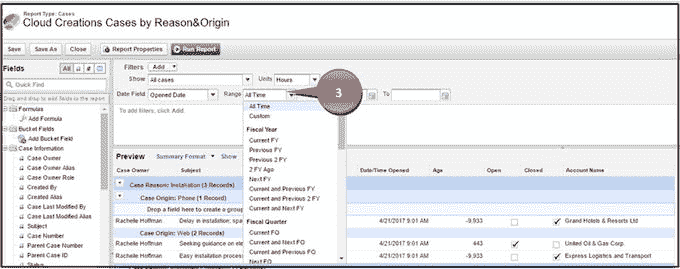

  图 5-25 — 个案智能日期筛选器

#### 营销活动

营销活动只有一个标准筛选选项。

- `显示`筛选器允许您按特定营销活动进行筛选，并提供一个查找字段来定位该活动，如图 5-26 所示。它还允许您查看所有有效的营销活动、您拥有的营销活动、所有有效的营销活动（无论归属何人）以及所有营销活动。

  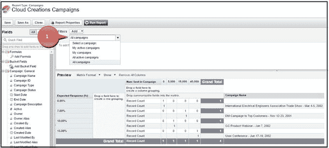

  图 5-26 — 营销活动归属筛选器

### 字段筛选器

报表生成器中的字段筛选器允许您拖放该报表类型中的任意字段，并使用运算符和值来筛选数据。理解这种字段筛选功能很重要，因为您会在 Salesforce 中广泛看到相同的功能。您可以在列表视图、工作流规则、流程构建器和 `Apex` 语言中找到它。您需要熟悉的一些运算符包括：`等于`、`不等于`、`小于`、`大于`、`小于或等于`、`大于或等于`、`包含`、`不包含`和`开头是`。如果标准的智能日期筛选器不适用，您也可以在此处进一步自定义智能日期。将您选择的日期字段拖放到筛选字段部分，将运算符设置为`"等于"`，并使用类似 `未来 N 天`（将 `N` 替换为您所需的数字）或 `过去 N 个月` 的短语。

1. 从左侧的`字段`部分取出您的字段，并将其拖到`筛选器`部分，如图 5-27 所示。

   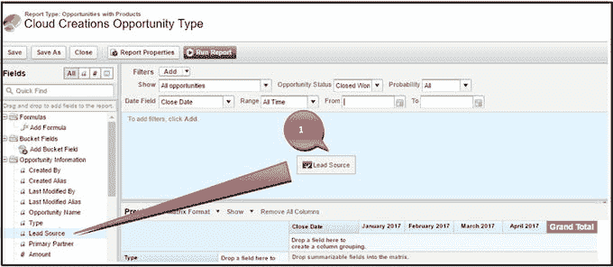

   图 5-27 — 将字段拖放到字段筛选器部分

2. 为您的筛选器选择合适的运算符，如图 5-28 所示。

   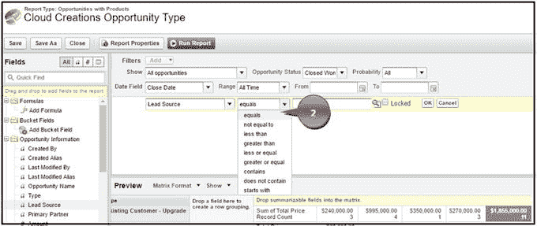

   图 5-28 — 为字段筛选器选择运算符

3. 如果选择的字段筛选器是选项列表字段，您可以点击查找图标。如果字段是其他数据类型，您可以输入所需的值。

4. 仅针对选项列表字段，您需要勾选筛选器应包含的值。

5. 仅针对选项列表字段，点击`插入所选`将这些值添加到您的筛选器中，如图 5-29 所示。

   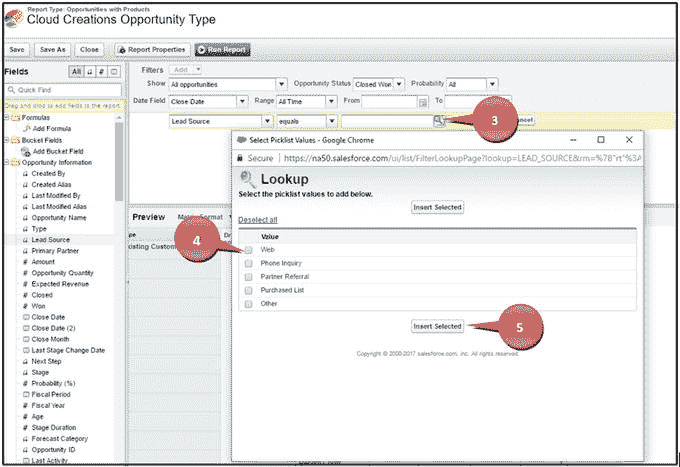

   图 5-29 — 选择选项列表字段的字段值

6. 点击`确定`完成您的字段筛选器，如图 5-30 所示。

   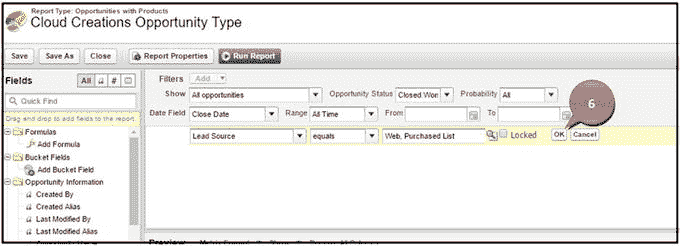

   图 5-30 — 完成您的字段筛选器

> **注意：** 请注意图 5-30 中`确定`按钮旁边的`已锁定`复选框。如果选中此复选框，您可以锁定报表上的筛选器，这样除非用户拥有修改报表的权限，否则无法更改。图 5-31 显示了锁定后的状态。

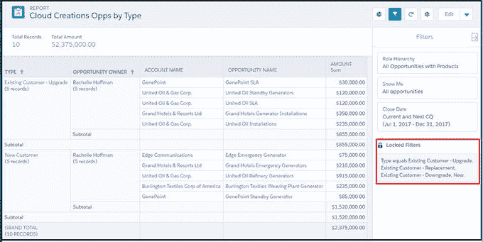

图 5-31 — 已锁定的字段筛选器

### 筛选逻辑

设置至少一个字段筛选器后，筛选逻辑将允许你对字段的评估方式应用“与”、“或”或“非”条件。你可以根据需要为报表创建包含任意数量字段筛选器的复杂条件。如果使用筛选逻辑，则必须在条件中包含所有字段筛选器。你可以使用括号将逻辑分组，以进一步定义报表。默认的筛选逻辑会在语句中放置`AND`，意味着“1 AND 2 AND 3”，以此类推。这指示报表仅包含满足你设置的所有三个（或任意数量）条件的记录。

1.  点击“筛选器”旁边的`添加`按钮，然后选择“筛选逻辑”。
2.  创建你的条件语句。你将使用字段筛选器旁边的数字来定义哪些字段筛选器需要与“与”或“或”语句组合。你使用的语句看起来像“`(1 OR 2) AND 3 AND 4`”。另一个例子是“`1 AND 2 AND 3 AND 4 AND (5 OR 6 OR 7)`”。
3.  点击`确定`完成筛选逻辑，如图 5-32 所示。

    **注意** 每次添加新的字段筛选器时，你都应该调整筛选逻辑并确保其正确无误。

    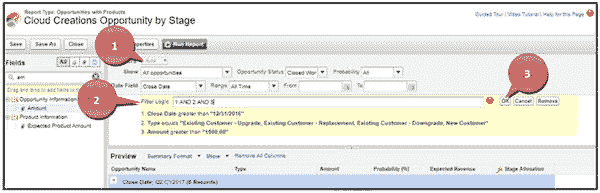

    *图 5-32*  
    *更改筛选逻辑*

### 交叉筛选

Salesforce 中的交叉筛选允许你对与当前报表对象相关的对象应用条件。你可以通过对相关对象应用“包含”或“不包含”条件来使用交叉筛选。使用交叉筛选后，通过该相关交叉筛选进一步定义字段筛选器。一个例子是筛选所有没有跟进活动的商机。或者使用交叉筛选来设置对没有产品的商机进行筛选，以确定哪些商机仍需要完成。使用交叉筛选的另一个例子是确定某个客户或联系人是否与你的销售团队有过任何互动。你可以通过创建一个客户或联系人报表并添加“不包含”活动的交叉筛选逻辑来设置。这将为你提供一份所有需要联系或跟进核查的客户或联系人列表。要进行设置，请先创建至少一个字段筛选器，然后按照以下步骤操作：

1.  点击“筛选器”旁边的`添加`按钮，然后选择“交叉筛选”。
2.  选择你想要用来关联其他对象的主要对象。
3.  定义是否希望使用“包含”或选择“不包含”来查看这些相关对象。
4.  选择你想要查看或不查看的相关对象。
5.  点击`添加相关对象筛选器`，选择运算符和值，然后点击`确定`，如图 5-33 所示。

    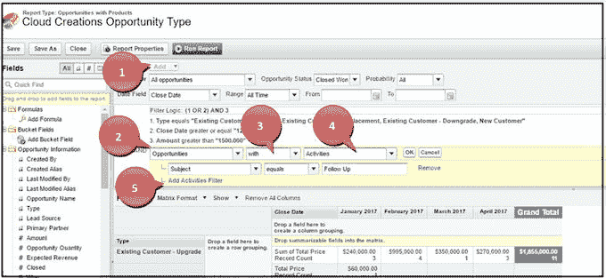

    *图 5-33*  
    *设置交叉筛选*

### 行数限制

行数限制筛选器用于表格报表，允许你在限制返回行数并按字段排序后，在仪表板上以表格或图表形式显示报表。要进行创建，请按以下步骤操作：

1.  点击`添加`按钮并选择“行数限制”，如图 5-34 所示。
2.  定义行数限制。
3.  选择按特定字段排序，并选择升序或降序，然后点击`确定`。

    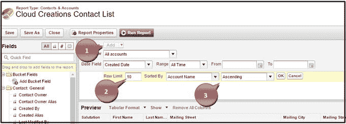

    *图 5-34*  
    *设置行数限制*

## 使用报表生成器

在 Salesforce 中创建报表可以让你分析你和用户正在收集的数据。对于 Salesforce 报表的新手来说，最好的事情莫过于你无法破坏或损坏你的数据。使用报表所做的只是以更易读的格式显示你当前拥有的数据，而不是显示在单个记录中。所以，不要害怕，大胆开始点击操作吧！

### 创建潜在客户报表

你可以使用潜在客户报表来查看有关潜在客户的部分或全部关键信息。你可以看到有多少潜在客户，哪些潜在客户来源在你的市场团队中有效，正在由用户处理的潜在客户数量与队列中的数量对比，以及更多信息！通过生成潜在客户报表可以解决的众多业务问题之一是，评估哪些潜在客户来源有效，哪些效果不佳。你可以创建一个关于已转化潜在客户的报表，并按潜在客户来源进行分组，如图 5-35 所示。

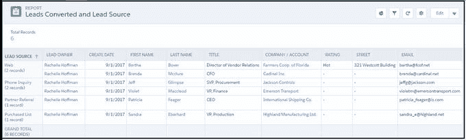

*图 5-35*  
*潜在客户报表示例*

要创建潜在客户报表，请按以下步骤操作：

1.  导航到“报表”选项卡并点击`报表`，如图 5-36 所示。

    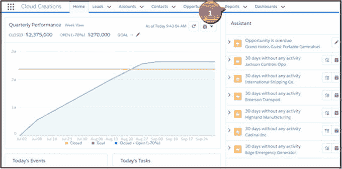

    *图 5-36*  
    *导航到报表选项卡*

2.  点击`新建报表`，如图 5-37 所示。

    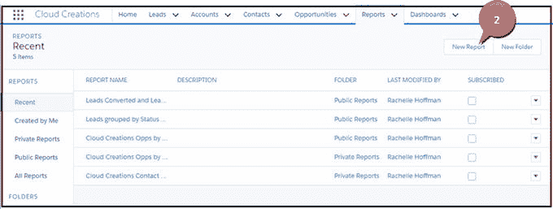

    *图 5-37*  
    *点击新建报表按钮以创建新报表*

3.  在`快速查找`中，输入**潜在客户**或点击`潜在客户`，然后点击`创建`，如图 5-38 所示。

    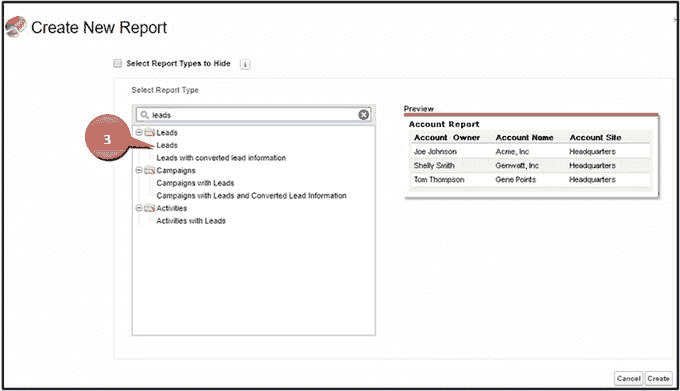

    *图 5-38*  
    *查找要使用的报表类型*

4.  点击并按住你想要移入报表的字段名称，将其拖放到目标列中。继续拖放报表所需的任意多个字段。完成后，点击`保存`，如图 5-39 所示。

    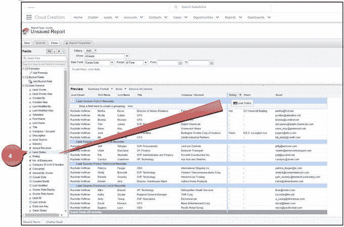

    *图 5-39*  
    *将新字段拖放到报表中*

5.  为报表命名，然后按`Tab`键，Salesforce 会自动在`报表唯一名称`字段中输入一个值。
6.  输入将显示给用户的描述。
7.  选择报表应存储的报表文件夹。
8.  点击`保存`，如图 5-40 所示。

    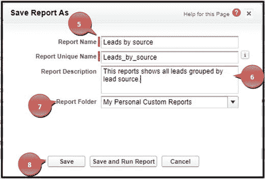

    *图 5-40*  
    *保存报表*

9.  点击`运行报表`查看数据结果，如图 5-41 所示。

    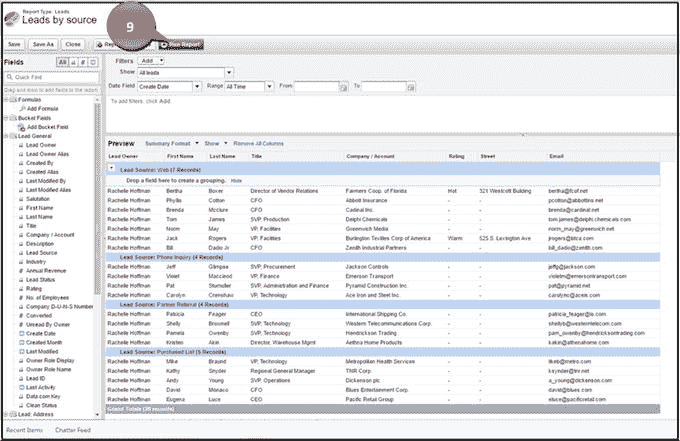

    *图 5-41*  
    *运行报表以查看结果*

### 创建联系人与客户报告

您可以创建一份联系人与客户报告，以显示所有联系人详细信息。使用此报告可生成呼叫列表、进行邮件合并、查看新创建的联系人与客户，或满足其他业务需求。企业对企业（B2B）组织若想确定其合作的行业类型，可从客户报告中获益。您可以生成一份报告，显示在每個行业中您所接触的企业数量。这将有助于您确定营销工作的重点方向。图 5-42 展示了此报告的外观。

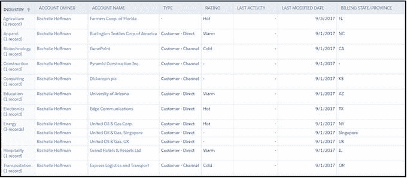

图 5-42 — 客户与联系人报告示例

要创建联系人与客户报告，请执行以下操作：

1.  导航至 `Reports` 选项卡并单击 `Reports`；看到报告文件夹后，单击右上角的 `New Reports`。

2.  在 `Quick Find` 区域中，输入 `Contact`。或者，单击 `Accounts`，然后单击 `Contacts & Accounts`，再单击 `Create`，如图 5-43 所示。

    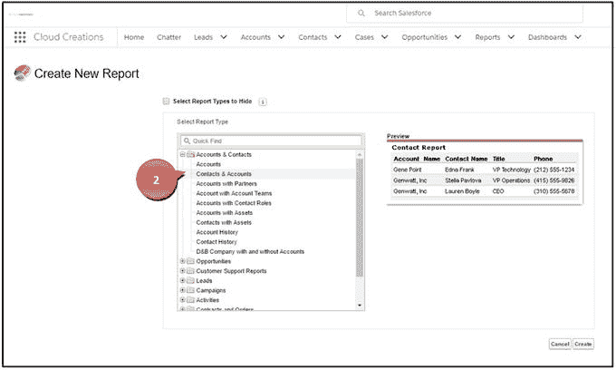

    图 5-43 — 为报告选择报告类型

3.  按住要移入报告的字段名称，将其拖到目标列。根据需要继续拖放其他字段。完成后，单击 `Save`，如图 5-44 所示。

    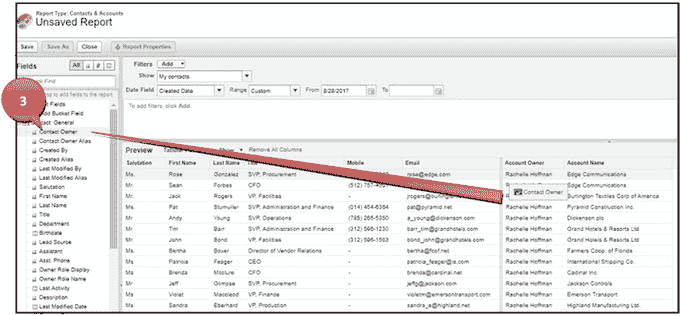

    图 5-44 — 将字段拖放到报告中

4.  为报告命名，然后按 `Tab` 键，Salesforce 将自动在 `Report Unique Name` 字段中输入一个值。

5.  输入将向用户显示的描述。

6.  选择用于存储报告的文件夹。

7.  单击 `Save`，如图 5-45 所示。

    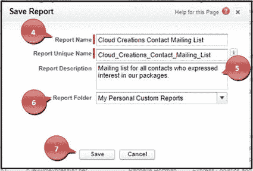

    图 5-45 — 保存报告

8.  单击 `Run Report` 查看数据结果，如图 5-46 所示。

    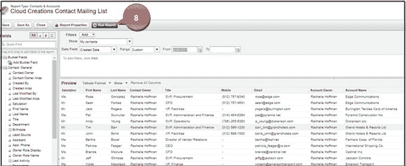

    图 5-46 — 运行报告以查看结果

### 创建商机报告

您可以创建商机报告以及含产品的商机报告，以显示贵公司产生的销售额。使用这些报告类型可显示销售管道中的内容、已从管道中移除的内容，以及团队成功赢得的全部销售业绩。大多数企业会生成商机报告，以帮助预测未来可能需要付出的努力。例如，项目管理公司需要预估目前有多少项目，以及未来可能关闭或启动多少项目。能够进行这种预估对于业务运营至关重要。项目管理公司需要能夠预估未来几个月需要多少项目经理或内部支持人员。为此，项目管理公司将查看所有成功概率为 90% 或更高的销售商机。图 5-47 展示了此报告的外观。

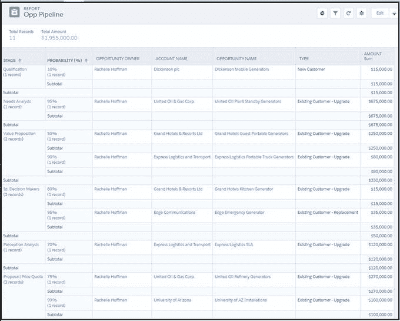

图 5-47 — 商机报告示例

要创建商机报告，请遵循以下步骤：

1.  导航至 `Reports` 选项卡并单击 `Reports`；看到报告文件夹后，单击右上角的 `New Reports`。

2.  在 `Quick Find` 区域中，输入 `Opportunity`。或者，单击 `Opportunity`，再单击 `Create`，如图 5-48 所示。

    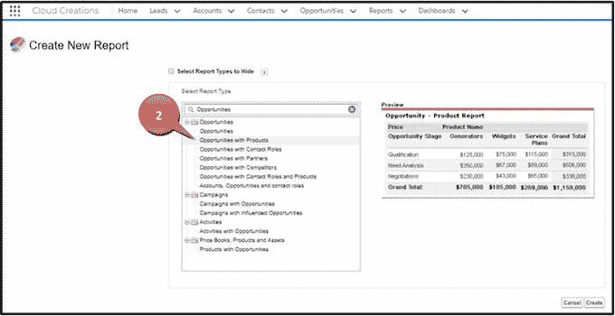

    图 5-48 — 为报告选择报告类型

3.  单击 `Show` 并选择 `Details`，如图 5-49 所示。

    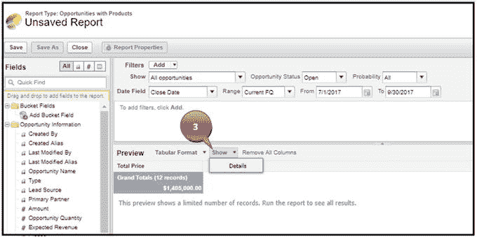

    图 5-49 — 显示报告详细信息

4.  为报告选择适当的筛选条件以显示所需数据，如图 5-50 所示。

    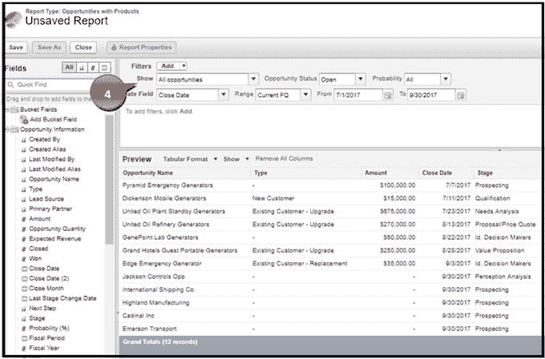

    图 5-50 — 为报告设置报告字段筛选条件

5.  按住要移入报告的字段名称，将其拖到目标列。根据需要继续拖放其他字段。完成后，单击 `Save`，如图 5-51 所示。

    

    图 5-51 — 将字段拖放到报告中

6.  为报告命名，然后按 `Tab` 键，Salesforce 将自动在 `Report Unique Name` 字段中输入一个值。

7.  输入将向用户显示的描述。

8.  选择用于存储报告的文件夹。

9.  单击 `Save`，如图 5-52 所示。

    

    图 5-52 — 保存报告

10.  单击 `Run Report` 查看数据结果。

### 创建表格、摘要和矩阵报告

表格报告是创建新报告时的默认报告格式。选择报告类型并进入报告生成器后，您可以在所有三种报告格式之间切换。如果从摘要或矩阵报告格式切换到表格格式，建议将已分组的字段移动到某列中；否则，这些字段将会丢失，切换到表格格式后必须重新将它们添加到报告中。从矩阵报告切换到摘要报告时，请注意，如果在矩阵报告中设置了四个分组，也可能会丢失一些分组；摘要报告最多只能处理三个分组。下面我们来看看如何创建表格、摘要和矩阵报告。

1.  导航至 `Reports` 选项卡并单击 `Reports`；看到报告文件夹后，单击右上角的 `New Reports`。

2.  选择您想要的报告类型，然后单击 `Create`，如图 5-53 所示。

    

    图 5-53 — 为报告选择报告类型

3.  在报告生成器的 `Preview` 窗格中，选择下拉菜单中显示的 `Tabular Format`，并切换到您想要的报告格式，如图 5-54 所示。

    

    图 5-54 — 更改报告格式

### 构建表格报表

请按照以下步骤操作：

1.  要构建表格报表，无需更改`Format`下拉菜单。只需根据需要将字段拖放到报表中即可。完成后，点击`Save`，命名报表，然后点击`Run`查看结果，如图 5-55 所示。

    

    图 5-55

    将字段拖放到报表中

2.  您也可以通过点击字段来选择表格报表的排序依据字段。请注意，当您点击字段时，该字段上会添加一个向上或向下的箭头。这表示该字段是按升序还是降序排列，如图 5-56 所示。

    **注意** 您可以像这样对所有报表类型进行排序。

    

    图 5-56

    在报表中按字段排序

### 构建摘要报表

请按照以下步骤操作：

1.  进入报表构建器后，将`Format`更改为 Summary 格式，如图 5-57 所示。

    

    图 5-57

    将报表格式更改为摘要报表格式

2.  通过将字段拖放到`"Drop a field here to create a grouping"`区域来为报表添加分组，如图 5-58 所示。

    **注意** 此处最多可添加三个分组，此功能在矩阵报表格式中也可用。

    

    图 5-58

    将字段拖放到报表的分组区域

3.  使用字段对报表进行分组后，您可以进一步定义日期数据类型字段的分组方式。例如，如果您按`Close Date`字段分组，则可以更改为按`Calendar Month`分组，如图 5-59 所示。

    

    图 5-59

    定义报表的分组方式

4.  继续构建报表，将字段拖放到您选择的位置。保存并命名报表，然后运行。

### 构建矩阵格式报表

请按照以下步骤操作：

1.  进入报表构建器后，将`Tabular Format`下拉菜单更改为`Matrix`，如图 5-60 所示。

    

    图 5-60

    将报表格式切换为矩阵报表格式

2.  请注意，此报表类型有两个分组区域：列级别和行级别。将您选择的字段拖放到任一分组区域中。您可以在列分组级别和行分组级别上各添加两个分组，如图 5-61 所示。

    

    图 5-61

    将字段拖放到报表的分组区域中

3.  继续构建报表，将字段拖放到您想要的位置。保存并命名报表，然后运行。

### 汇总数据

您可以在报表构建器中对数字、货币或百分比字段数据类型使用汇总功能。汇总功能允许您对行中的数据求和、求行中数据的平均值、求行中数据的最小值或求行中数据的最大值。在机会报表中使用此功能可以查找机会或案例的平均天数。或者使用此功能简单地获取机会中金额字段的总和。在摘要或矩阵报表中使用此功能时，它将在所有分组级别上进行汇总，并给出总计。

1.  进入报表构建器后，点击要汇总的字段旁边的向下箭头，如图 5-62 所示。

    

    图 5-62

    汇总一个字段

2.  选择求和、求平均值、求最大值或求最小值，然后点击`Apply`，如图 5-63 所示。

    

    图 5-63

    选择汇总字段的方式

3.  不要忘记保存并运行您的报表。

### 向报表添加公式

您可以向报表添加公式，以计算对象中的货币、数字或百分比字段。公式功能允许您利用字段格式、汇总字段数据、使用基本运算符、使用复杂函数以及使用逻辑语句。

公式的运算符包括加法、减法、乘法、除法和幂运算。可用的函数包括逻辑语句、数学语句或汇总语句。

1.  在左侧窗格中，将`Add Formula`拖入报表，并将其放置在您选择的列位置，如图 5-64 所示。

    

    图 5-64

    向报表添加公式字段

2.  为您的公式命名。

3.  添加描述。

4.  如有必要，调整格式或小数位数。

5.  选择在哪个级别上运行此公式。

6.  使用必要的运算符或函数创建公式。

    **注意** 公式面向高级用户。本书不会涵盖要使用哪些公式的各个方面。但是，Salesforce 提供免费支持，并且有很棒的论坛也可以提供帮助。

7.  对于复杂公式，点击`Check Syntax`以确保没有错误。

8.  点击`OK`添加公式，如图 5-65 所示。

    

    图 5-65

    在报表上创建公式字段

9.  公式字段作为报表中的一列出现，如图 5-66 所示。

    

    图 5-66

    公式字段作为一列显示在您的报表中

### 导出报告

您可以将 Salesforce 中创建的任何报告数据导出到电子表格，以便在 Excel 中进行进一步分析。Salesforce 提供两种可导出的格式：Excel 格式 `.xls` 和逗号分隔的 `.csv`。`.xls` 兼容 Excel 和大多数电子表格软件。`.csv` 兼容性更广，但格式有限。

1.  打开您要导出的报告；在右侧角落点击 *编辑* 一词旁边的向下箭头，然后选择“导出”，如图 5-67 所示。

    

    图 5-67

    导出报告

2.  选择支持您公司软件的格式，然后选择“导出”，如图 5-68 所示。

    

    图 5-68

    选择导出格式并导出数据

### 创建报告图表

您可以在 Salesforce 中为报告创建图表。报告图表允许您以图形格式查看数据，便于快速查看。报告和报告图表是一一对应的：一份报告只能使用一个图表。如果您希望查看报告的多种变体，可以克隆报告，或者更好的方法是将它们放入仪表板（如图 5-79 所示）。报告图表只能用于摘要或矩阵格式的报告。您可以创建水平柱状图和垂直柱状图、堆叠水平柱状图和垂直柱状图、折线图、环形图、漏斗图和散点图。

1.  转到“报告”选项卡，选择您想要的报告，如图 5-69 所示。

    

    图 5-69

    检索报告

2.  点击筛选符号旁边的图表符号，如图 5-70 所示。

    

    图 5-70

    点击图表图标

3.  根据您的报告和数据组合方式，Salesforce 会显示一个推荐图表。如果需要，您可以更改此设置；点击设置齿轮图标，如图 5-71 所示。

    

    图 5-71

    选择图表的设置图标

4.  更改“显示为”部分，以反映您想要查看的报告图表类型，如图 5-72 所示。

    

    图 5-72

    选择图表类型

5.  在图表编辑器中调整图表属性；添加图表标题，将 *x* 轴更改为另一个字段，添加维度或第二轴等项目，选择是否在报告图表上显示数值，并选择图例应显示在图表右侧还是底部，如图 5-73 所示。

    **注意** 某些功能仅适用于特定的报告图表。

    

    图 5-73

    自定义报告图表属性

配置完成后，不要忘记保存您的工作并查看结果，如图 5-74 所示。

图 5-74

报告图表的最终结果

## 了解仪表板

仪表板是您已创建报告的可视化呈现。仪表板可以表示多个仪表板组件（单个图表和图形）。您可以在多个仪表板组件中显示一份报告；但不能将一个报告信息拆分到多个仪表板组件中。例如，如果您有一份显示每个用户销售额的报告，您可以将这同一份报告显示在两个仪表板组件中，例如饼图和柱状图。您可以创建水平柱状图和垂直柱状图、堆叠水平柱状图和垂直柱状图、折线图、环形图、漏斗图、指标图、仪表图、表格图和散点图。

### 创建仪表板、添加仪表板组件以及修改仪表板

请按照以下步骤操作：

1.  点击“仪表板”选项卡，然后点击“新建仪表板”，如图 5-75 所示。

    

    图 5-75

    创建新仪表板

2.  为您的仪表板命名。

3.  添加描述。

4.  选择您的仪表板是公共还是私有。

5.  点击“创建”，如图 5-76 所示。

    

    图 5-76

    命名并创建仪表板

6.  点击右上角的“组件”将您已创建的报告添加到仪表板，如图 5-77 所示。

    

    图 5-77

    向仪表板添加新报告和图表组件

7.  搜索您想要添加到仪表板的报告，如图 5-78 所示。

    

    图 5-78

    查找仪表板组件的报告

8.  选择您要用来显示数据的图表，并修改任何属性以更好地展示数据。完成后，点击“添加”，如图 5-79 所示。

    **注意** 在修改这些属性时，请注意预览报告的变化。

    

    图 5-79

    在仪表板上为报告创建配套图表

9.  点击仪表板报告并拖拽边角以放大报告，或者点击仪表板并将报告移动到仪表板上的其他位置，如图 5-80 所示。

    

    图 5-80

    修改报告和图表的大小

10. 重复步骤 6 到 9，直到对仪表板满意为止。

11. 完成后点击“保存”以保存您的工作，如图 5-81 所示。

    

    图 5-81

    保存仪表板

#### 使用动态仪表板

动态仪表板允许每位用户根据其安全性和共享设置，查看自己有权访问的数据。这样，你只需创建一个仪表板，每位用户就都能访问。创建仪表板后，你可以访问其属性进行此项修改，或为其他用户使用另外两种访问方式。你可以将仪表板设置为以“我”的视角查看，这样仪表板读者就能根据你对数据的访问权限，看到仪表板中的数据。你可以选择“指定用户”选项，让用户根据所选用户的访问权限查看数据。最后，你还可以使用“当前登录用户”选项，让用户根据自己的访问权限查看数据。此外，通过取消选中“允许更改仪表板视图（动态仪表板）”，你可以防止用户更改仪表板的查看方式。

当企业希望防止用户看到不应看到的数据时，会选择动态仪表板而非非动态仪表板。例如，一家公司可能有很多销售用户，这些销售用户负责不同的区域。如果你不希望负责加利福尼亚州的销售人员看到纽约州的销售数据，可以使用“当前登录用户”选项。（当然，你必须已设置好安全措施以防止这种情况发生，这部分内容将在第 9 章中介绍。）如果你的公司不需要限制用户数据，则可以保持默认设置。

让我们看看如何进行修改：

1.  点击仪表板右上角的设置齿轮图标，如图 5-82 所示。

    

    图 5-82
    创建动态仪表板

2.  选择你要将仪表板设置为哪种视图。

3.  选择或取消选择用户是否能够更改此设置。

4.  点击“保存”，如图 5-83 所示。

    

    图 5-83
    选择仪表板的视图

## 总结

将 Salesforce 作为客户关系管理工具的最大好处之一，就是可以根据收集的数据生成报表。能够计算投资回报率（ROI）或了解销售团队的表现，将对您未来数月乃至数年的业务大有裨益。关于报表和仪表板，最大的优点是您不会因使用它们而弄乱数据。不要害怕随意点击和尝试。您只是在翻译数据，不会搞砸的！

