# 6. 协作

Salesforce 提供了许多协作工具。其中一项有价值的协作工具叫做 `Chatter`。这个工具及其功能可以在 Salesforce 中大量标准对象和所有自定义对象上找到。它允许您的用户通过内部消息相互沟通。您甚至可以让用户通过内容交付，与彼此及客户共享 Word 和 PowerPoint 等文件。您需要将 Salesforce 记录共享给另一个 Salesforce 组织吗？您可以使用 `Lightning Connect` 将数据同步到另一个 Salesforce 组织。您可以启用 `主题`，让用户就特定主题进行互动。我们也不能忘记 Salesforce 移动应用 Salesforce，它允许 iPhone 和 Android 用户随时随地使用。图 6-1 展示了 `Chatter` 对象。

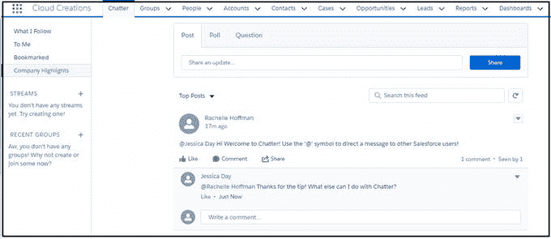

图 6-1 `Chatter` 工具

## 理解 `Chatter`

Salesforce `Chatter` 是一个基本工具，可用于帮助您与同事进行内部协作以及与客户进行外部协作。您可以使用 `Chatter` 的“帖子”功能，向其他用户发布消息，或者在记录本身上发布与该记录相关的消息。让您的员工能够向管理团队提出需要回答的问题。或者通过匿名投票收集员工的信息。`Chatter` 内置了许多出色的工具，可以以多种方式使用。让我们进一步了解其中一些工具。

## 侧边栏

`Chatter` 选项卡上的侧边栏让您可以快速访问 `Chatter` 功能（图 6-2）。使用 `我关注的` 链接，可以快速查看与用户在 Salesforce 中关注的所有记录对应的所有 `Chatter` 帖子（稍后将详细介绍此功能）。使用 `发送给我的` 链接，可以查看用户使用 `@` 符号发给您的任何帖子，或另一位用户在您的个人资料上留下的任何帖子。使用 `已添加书签` 查看您已添加书签的任何帖子。`公司动态` 快速访问链接使用 Einstein 的人工智能（AI）为您呈现组织中的所有热门主题。`动态流` 快速访问链接允许您创建指向记录的快速访问链接。使用此部分可以查看您关注的所有账户、案例、联系人等。`最近群组` 允许您创建并查看您最近关注的群组。

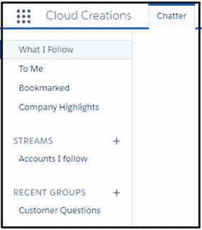

图 6-2 `Chatter` 侧边栏

### 在 `Chatter` 中关注

关注是 Salesforce 中一个强大的工具。您可以关注从人员到群组再到记录的任何内容。关注可以让您看到您所关注记录的所有相关内容和互动。在 `Chatter` 中关注类似于在 Twitter 上关注某人。想看到您的培训讲师在 Salesforce 上发布的所有内容吗？请转到他们的个人资料并点击 `+ 关注` 按钮。如果您已为该对象设置了动态流，则可以选择将此记录添加到该动态流，或者只使用 `我关注的`。如果您正在查看 `Chatter` 信息流，请将鼠标悬停在另一位用户的姓名上，然后使用此处的 `关注` 按钮。在任何记录的顶部都可以找到 `关注` 按钮，如图 6-3 所示。关注会将内容和帖子带入您的 `Chatter` 信息流，并允许您直接在自己的信息流中进行互动。

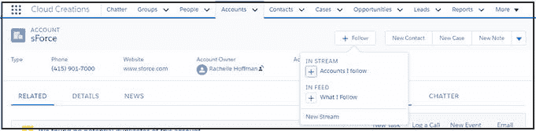

图 6-3 在 `Chatter` 中关注

### 为帖子添加书签

您可以像为网站添加书签一样为帖子添加书签。如果您想保存此帖子以备后用，并让它出现在 `Chatter` 的 `已添加书签` 快速访问列表中，您只需点击帖子右侧向下的箭头，然后点击 `添加书签`（图 6-4）。注意，箭头旁边会出现一个带星标的黄色三角形。移除书签的方法相同，只是在下拉菜单中选择 `移除书签` 即可。

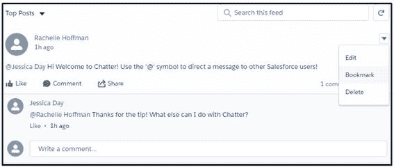

图 6-4 为帖子添加书签

### 创建流

`Streams`（流）允许您创建可能想要关注的特定记录分组（图 6-5）。当您想要创建一个自定义动态，将来自不同对象的记录分组到一个动态中时，`Chatter` 中的 `Streams` 是最佳选择。

例如，如果您有一个新的营销活动，并且想要创建一个动态来关注受该营销活动影响的记录，则可以创建一个流，显示这些不同对象上的所有 `Chatter` 帖子。要创建新流，请单击 `Chatter` 侧边栏中 `Streams` 旁边的加号。首先，您需要为流命名。接下来，通过先选择对象，再使用搜索栏搜索特定记录，来选择要包含在该流中的对象和记录。`Streams` 允许您查看以下标准对象以及所有自定义对象的记录：`Accounts`（客户）、`Cases`（个案）、`Contacts`（联系人）、`Files`（文件）、`Groups`（组）、`Leads`（线索）、`Opportunities`（商机）、`People`（人员）和 `Topics`（主题）。如果您正在查看一条记录并希望将该特定记录包含到流中，请使用 `+ Follow`（关注）按钮并选择该流。

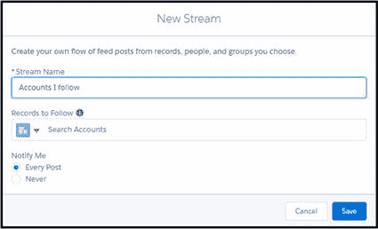

图 6-5 创建新流

### 创建组

Salesforce 中的 `Chatter` 用户组为组内用户提供了一个进行协作的中心位置（图 6-6）。大多数组织会为其部门创建组。您可以将组设置为公开、私有或未列出的。公共组动态对客户或 `Chatter` 免费用户可见（稍后将详细介绍此功能）。私有组是仅限成员组，要求用户请求加入并在与组交互之前获得批准。未列出的组提供了比私有组更高的隐私性。未列出的组不允许用户请求加入；只能通过邀请加入。此外，未列出的组不会显示在列表视图、动态、用户资料或任何其他地方，除非您是该组的成员或具有修改未列出组的权限（即使具有 `Modify All Data`（修改所有数据）权限的用户，如果他们不是成员，也无法看到这些组）。

要创建组，请单击 `Chatter` 侧边栏上 `Groups`（组）旁边的加号。接下来，您需要为组命名。您可以为组添加描述、添加组的相关信息、在“所有者”字段中选择谁管理该组、确定访问类型（公开、私有或未列出）、选择是否考虑让客户加入该组、如果您希望帖子仅来自组的管理员或所有者，则选择 `Broadcast Only`（仅广播），然后单击 `Save & Next`（保存并下一步）按钮。在下一页上，为您的组上传一张组照片。

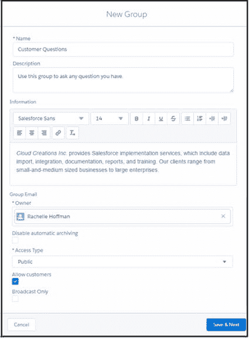

图 6-6 创建 `Chatter` 组

### `Chatter` 动态

通过导航到 `Chatter` 选项卡，或转到屏幕右上角的用户资料并单击您的姓名，来访问您的 `Chatter` 动态（图 6-7）。

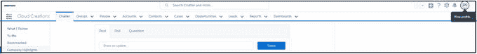

图 6-7 导航到 `Chatter`

您的 `Chatter` 动态包含您关注的所有项目、使用 `@` 符号直接发给您的帖子，或您创建的帖子。在您的 `Chatter` 动态中，您可以通过使用侧边栏来控制您看到的内容。

### 在您的动态上创建帖子

要创建帖子，请确保您位于 `Chatter` 的 `Post`（帖子）选项卡上（图 6-8）。您可以在提供的框中开始输入，并使用其提供的任何样式，例如为文本加粗、斜体、下划线、删除线，以及项目符号或编号。您还可以添加图像、标记其他组或用户，以及附加文件。帖子完成后，单击 `Share`（分享）。帖子有错误？没关系，使用向下箭头（与书签使用的箭头相同）并单击 `Edit`（编辑）或 `Delete`（删除）。

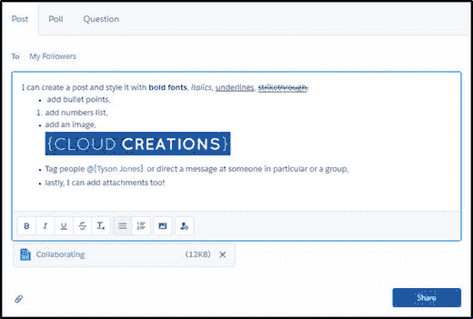

图 6-8 在动态上创建帖子

分享您的帖子后，可以看到其他用户点赞、评论和分享您的帖子（图 6-9）。

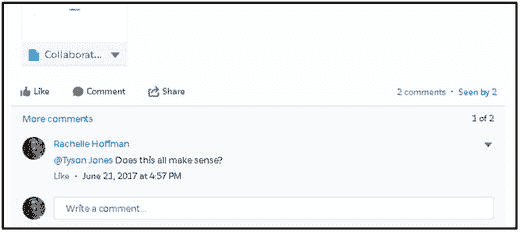

图 6-9 其他用户评论和点赞您的帖子

### 在记录的动态上创建帖子

# Chatter

首先，您需要搜索或找到要发布帖子的记录。接下来，单击该记录的 `Related`（相关）选项卡时右侧出现的 `Chatter` 一词。单击 `Chatter` 后，您可以在提供的框中开始输入，并使用其提供的任何样式，例如为文本加粗、斜体、下划线、删除线，或项目符号或编号。您还可以添加图像、标记其他组或用户，以及附加文件，如图 6-10 所示。帖子完成后，单击 `Share`（分享）。您还可以使用 `Poll`（投票）和 `Questions`（问题）选项（本章后面会介绍）。

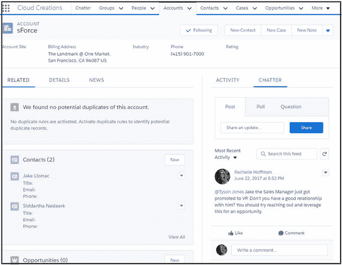
图 6-10 在记录上创建 Chatter 帖子

## 在帖子中创建主题

您可以像在 Twitter 和 Instagram 上一样使用话题标签，在 Salesforce 中创建热门话题。只需在评论或帖子中任何单词前添加 `#` 符号（中间无空格）。例如，使用 `#learning`（学习）（图 6-11）。

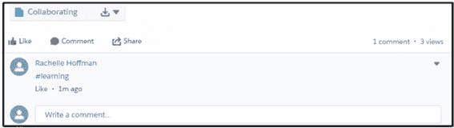
图 6-11 使用话题标签创建主题

## 创建 Chatter 投票

你可以在自己的动态或群组动态中创建最多包含十个选项的 Chatter 投票，如图 6-12 所示。观察其他 Chatter 用户对他们的选择进行投票。Salesforce 将统计票数并显示结果。投票用户在提交投票前，不会看到谁投了哪个选项，也不会看到投票结果。继续阅读以了解如何创建 Chatter 投票。

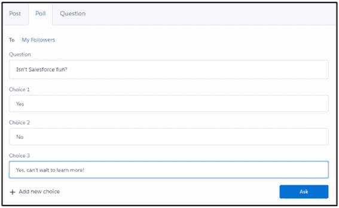
图 6-12 Chatter 投票

要创建 Chatter 投票，请按照以下步骤操作：

1.  导航到 Chatter 对象，或通过导航到 Chatter 选项卡从记录内创建投票。
2.  点击记录 Chatter 部分中的 `Poll` 选项卡。图 6-13 显示了如何从记录访问此功能，图 6-14 显示了如何从 Chatter 对象访问此功能。
    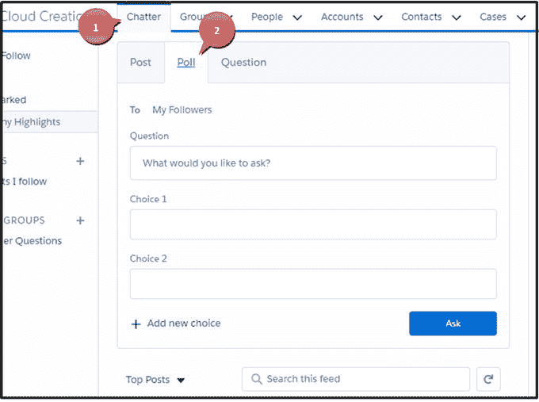
    图 6-14 从 Chatter 对象访问 Chatter 投票
    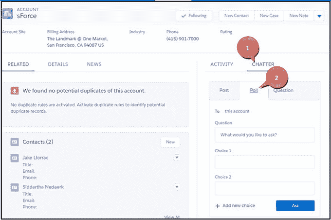
    图 6-13 从记录访问 Chatter 投票
3.  输入您为 Chatter 用户准备的投票问题。
4.  输入您为 Chatter 用户提供的投票选项。
5.  如果您需要更多选项，请点击 `Add new choice` 链接。
6.  完成选项设置后，点击 `Ask`，如图 6-15 所示。
    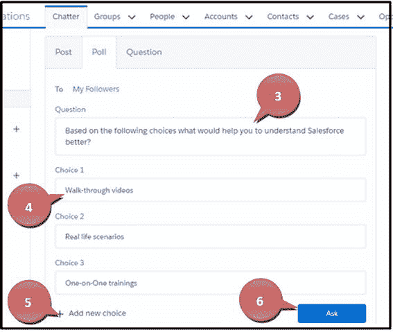
    图 6-15 创建 Chatter 投票
7.  发布投票后，您可以点击 `View results` 链接查看结果，如图 6-16 所示。
    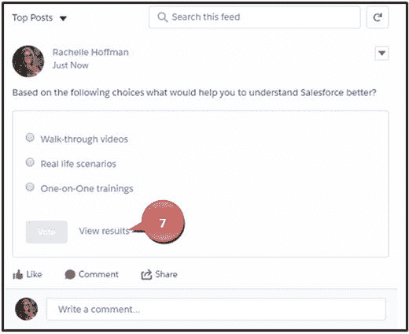
    图 6-16 查看 Chatter 投票结果

## 创建 Chatter 问题

您可以使用 Chatter 提问功能提出对其他用户有益或可能由其他用户解答的问题，如图 6-17 所示。确保您处于 Chatter 动态的 `Question` 选项卡，然后发布您的问题。只需等待其他用户回答您的帖子。找到最佳答案后，点击评论中 `Like` 链接旁边的 `Select as Best` 链接，该答案便会移至您问题下方的帖子顶部，供其他用户查看。

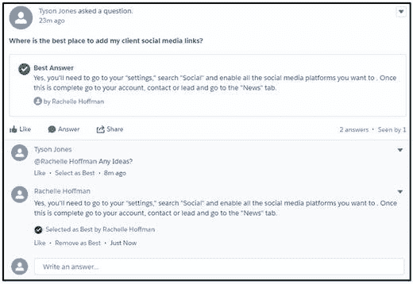
图 6-17 创建 Chatter 问题

## Chatter 通知

Chatter 通知可以多种形式呈现。当有人@您时，您可以通过浏览器右上角的铃铛图标立即看到，如图 6-18 所示。您可以点击铃铛图标查看最新的@您的帖子或留下的评论。在此处，您可以点击 `Mark all as read` 链接来清除通知窗口，或者点击评论本身以跳转到 Chatter 中的帖子。

图 6-18 接收 Chatter 通知

您还可以选择接收每日、每周或即时的电子邮件通知。如果您是 Salesforce 移动端（iPhone 或 Android）用户，您可以启用通知并将其发送到您的手机上，如图 6-19 所示。

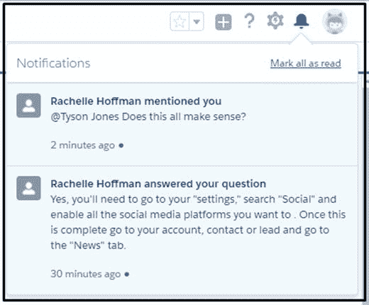
图 6-19 Chatter 通知

### 启用 Chatter 电子邮件通知

您可以通过以下步骤为所有用户启用 Chatter 电子邮件通知：

1.  点击右上角的设置齿轮图标，然后从下拉菜单中选择 `Setup`，如图 6-20 所示。
    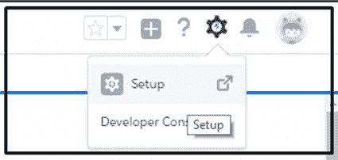
    图 6-20 导航到设置菜单
2.  在 `Quick Find` 框中输入 `Email Setting`，然后点击 Chatter 下的 `Email Settings`，如图 6-21 所示。
    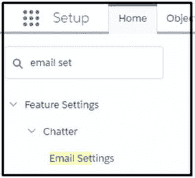
    图 6-21 点击电子邮件设置
3.  选择您想要的电子邮件设置，如图 6-22 所示。
    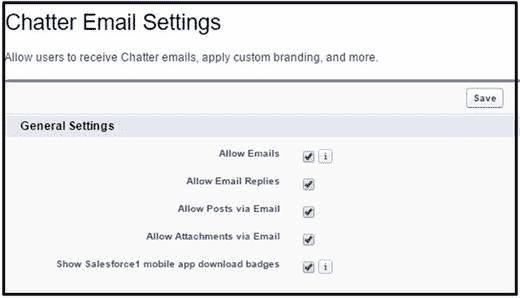
    图 6-22 通用电子邮件设置
    *   `Allow Emails`：为用户启用 Chatter 电子邮件通知。
    *   `Allow Email Replies`：允许用户通过回复电子邮件来回应 Chatter 通知。
    *   `Allow Posts via Email`：允许用户使用电子邮件向群组发帖。
    *   `Allow Attachments via Email`：允许用户在回复和通过电子邮件发帖时使用附件。
    *   `Show Salesforce mobile app download badges`：为组织中所有的 Chatter 电子邮件通知添加下载 Salesforce 移动应用的徽章。
    **注意** Salesforce 中的徽章是一种内部 Chatter 认可技巧，用户可以获取并授予他人。这有助于提高用户接受度，允许用户通过 `Thanks` 徽章给予认可。`Thanks` 徽章会显示在用户的个人资料中，供所有人查看。
4.  点击 `Save`。

### 用户的 Chatter 通知配置

之前的设置将允许您的用户使用 Chatter。现在我们来介绍用户如何选择接收 Chatter 通知。

1.  点击浏览器右上角的个人资料图片，然后点击“设置”，如图 6-23 所示。
    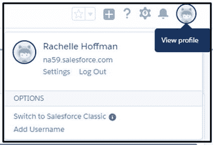
    图 6-23 访问个人资料

2. 在“快速查找”区域，输入`电子邮件通知`，然后在 Chatter 下选择“电子邮件通知”。

3. 选择最符合您需求的选项。

   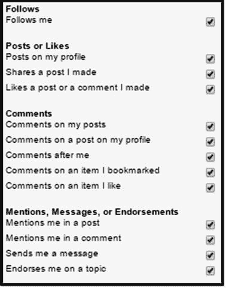
   *图 6-25 配置您要接收的 Chatter 电子邮件*

   - 在“常规”部分，您必须选择`接收电子邮件`才能接收 Chatter 电子邮件，如图 6-24 所示。

     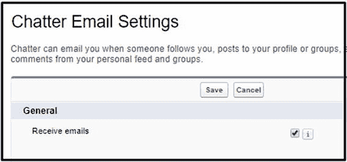
     *图 6-24 开启`接收电子邮件`*

   - 在“个人”部分，对于“当有人……时给我发邮件”，我们建议选择以下选项，因为如果选中所有选项，用户可能会被过多的电子邮件通知淹没：
     - `在我的个人资料上发布内容`：此选项将使您随时了解您个人资料上发布的任何内容。
     - `对我个人资料上的帖子发表评论`：此选项将在您的帖子收到任何评论时通知您。
     - `对我收藏的项目发表评论`：这会让您随时了解任何收藏帖子的最新动态。
     - `在帖子中提及我`：这将通知您用户何时使用 `@` 符号将帖子指向您或在帖子中提及您。
     - `在评论中提及我`：这将通知您用户何时使用 `@` 符号将评论指向您或在评论中提及您。

4. 选择个人摘要的频率。您的个人摘要是 Chatter 中近期活动的摘要，会显示在您自己的信息流中。您可以选择每天、每周接收或从不接收，如图 6-26 所示。

   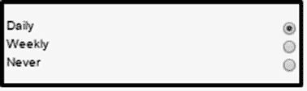
   *图 6-26 选择每天、每周或从不接收电子邮件*

5. 您还可以设置接收群组 Chatter 通知的频率。我们建议对新群组选择“有限”；如果您想要更高频率，可以为每个单独的群组更改设置，如图 6-27 所示。

   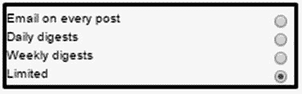
   *图 6-27 选择要从 Chatter 接收的内容*

6. 您还可以选择接收群组客户问题的频率，如图 6-28 所示。我们也建议这里选择“有限”。如果您选择其他选项，可能会收到超出预期的电子邮件，这可能会导致更多的干扰而非帮助。

   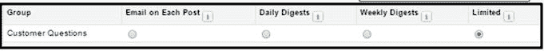
   *图 6-28 选择要接收哪些客户问题的通知*

## 信息流跟踪

与 Chatter 集成的 Salesforce 信息流跟踪允许您查看在 Chatter 信息流中记录的对记录所做的更改。在对象上启用此选项后，用户可以在 Chatter 信息流中关注对该记录所做的更改。您可以选择哪些对象以及在信息流中跟踪哪些字段。您可以跟踪以下对象上的字段：`User`、`Group`、自定义和外部标准对象、`Account`、`Article Type`、`Asset`、`Campaign`、`Case`、`Contact`、`Contract`、`Dashboard`、`Event`、`Lead`、`Opportunity`、`Product`、`Report`、`Solution` 和 `Task`。

### 注意

Chatter 信息流中也使用了字段级安全性和共享设置来确定用户在信息流中可以看到什么。

### 启用和自定义信息流跟踪

请执行以下步骤：

1. 点击浏览器右上角的设置齿轮图标，然后选择“设置”，如图 6-29 所示。

   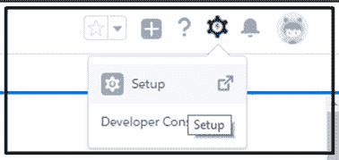
   *图 6-29 导航到“设置”菜单*

2. 在“快速查找”区域，输入 `Feed Tracking`，然后选择 Chatter 下的“Feed Tracking”，如图 6-30 所示。

   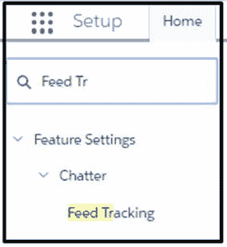
   *图 6-30 导航到信息流跟踪*

3. 在左侧，点击您要为信息流跟踪配置的对象，如图 6-31 所示。

   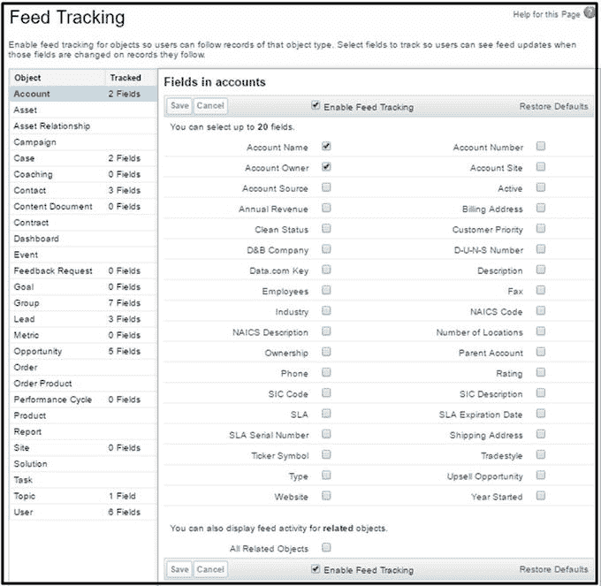
   *图 6-31 设置信息流跟踪*

4. 在顶部，确保选中“启用信息流跟踪”。

5. 每个对象最多选择 20 个要跟踪的字段。如果您不想在 Chatter 中跟踪特定字段的更改，则无需在此处选择任何字段。通过选择要跟踪的单个字段，这将捕获在 Chatter 中所做的更改。信息流跟踪的示例请参见图 6-32。

   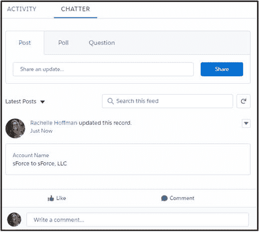
   *图 6-32 信息流跟踪在 Chatter 中的显示方式*

   **注意** 您选择的字段越多，Chatter 记录信息流就会变得越混乱。对所选字段的任何更改都会为该记录信息流添加一个新帖子，并将较旧的帖子推至下方。

6. 所有对象都设置完成后，点击“保存”按钮。

## Chatter 个人资料

Salesforce Chatter 个人资料允许您的用户自定义其 Salesforce 个人资料，这些资料可供其他 Salesforce 用户和 Chatter 免费用户（通常是客户）查看。他们可以添加个人资料图片、编写“关于我”部分、添加联系信息以及添加横幅照片。个人资料是您的用户查看其 Chatter 信息流、所属群组、在帖子中上传的文件、正在关注的人以及关注他们的人的另一种方式。他们甚至可以从自己的个人资料添加新帖子或对现有帖子发表评论。

要访问您的个人资料，请点击右上角的个人资料图片，然后点击您的姓名，如图 6-33 所示。

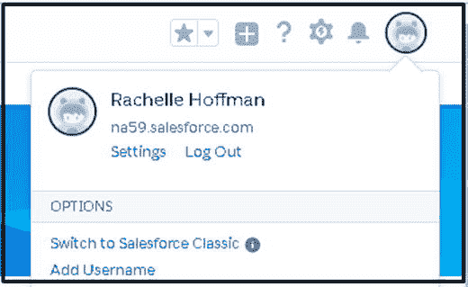
*图 6-33 导航到您的个人资料*

其他用户可以通过点击您在记录、Chatter 帖子或其他任何地方看到的超链接姓名来访问您的个人资料，如图 6-34 所示。

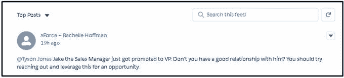
*图 6-34 访问其他用户的个人资料*

### 上传个人资料照片

要上传个人资料照片，请按以下步骤操作：

1. 进入个人资料页面后，点击相机图标，然后点击 `Update Photo`（更新照片），如图 6-35 所示。

   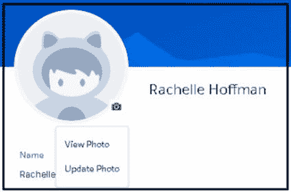
   *图 6-35 上传个人资料照片*

   **注意：** 您的照片必须存储在计算机上。照片格式须为 JPEG、GIF 或 PNG，文件大小不得超过 16MB。

2. 点击 `Upload Image`（上传图片）按钮，从计算机中选择图片，如图 6-36 所示。

   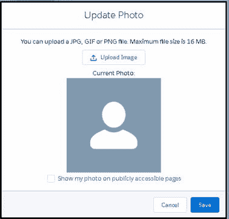
   *图 6-36 从计算机上传个人资料照片*

3. 使用滑块调整照片大小。如果您希望照片在 Salesforce 外部不可见，请勾选“在可公开访问的页面上显示我的照片”复选框，如图 6-37 所示。

   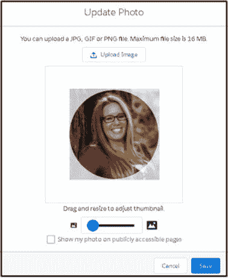

图 6-37：修改图片尺寸

4. 完成后，点击`Save`（保存）。

### 编辑个人资料

要编辑个人资料，请按以下步骤操作：

1. 点击浏览器右上角的个人资料照片进入个人资料页面，如图 6-38 所示。

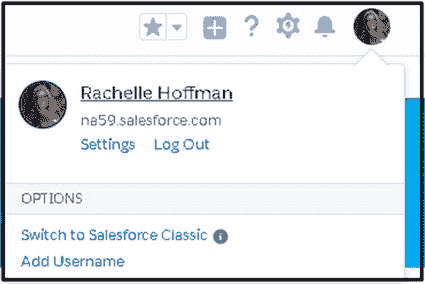

图 6-38：编辑个人资料

2. 点击浏览器右侧标签下方的`Edit`（编辑）按钮，如图 6-39 所示。

图 6-39：编辑按钮

3. 您可以像在 Salesforce 中编辑任何字段一样，在此处编辑个人资料中的任意字段。让他人了解您的上级是谁，添加您在公司的职位名称，添加电话号码和手机号码，添加您的办公地点，当然，别忘了在`About Me`（关于我）部分向其他用户简单介绍一下自己，如图 6-40 所示。

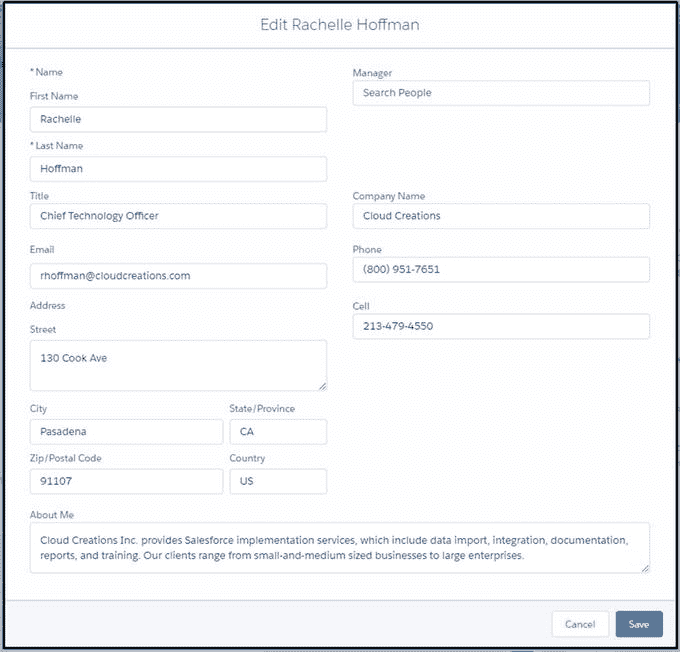

图 6-40：编辑个人资料

4. 完成后，点击`Save`（保存）。

### 更新封面照片

要更新封面照片，请按以下步骤操作：

1. 点击`Edit`（编辑）按钮右上方的相机图标，点击“Select an image”（选择图片）按钮，在计算机上找到您的图片，然后点击`Open`（打开），如图 6-41 所示。

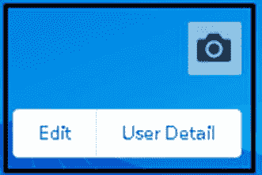

图 6-41：上传横幅

**注意：** 您的照片必须存储在计算机上。照片格式须为 JPEG、GIF 或 PNG。为获得最佳效果，请使用至少 1280×300 像素的全景图片。

2. 调整照片以适配指定区域。如果发现照片不合适，可点击“Choose a different photo”（选择其他照片）上传新图片，如图 6-42 所示。

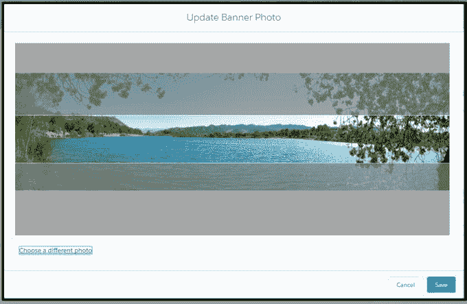

图 6-42：修改横幅尺寸

3. 完成后点击`Save`（保存）。

用户完成个人资料设置后，页面应如图 6-43 所示。

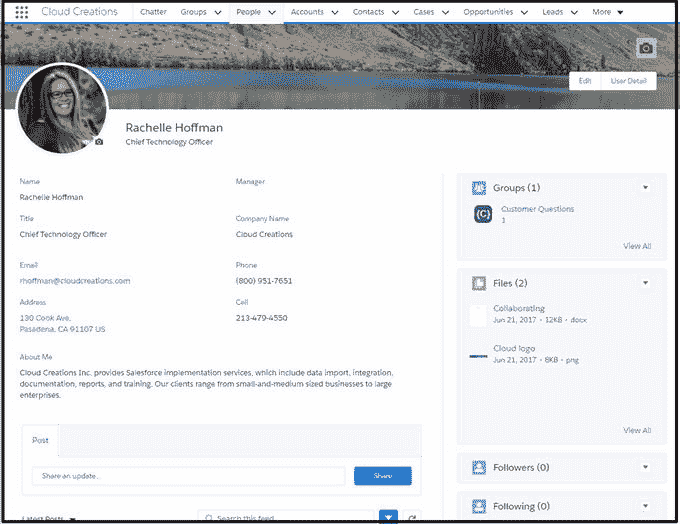

图 6-43：完整的用户个人资料

## 适用于 iPhone 和 Android 用户的 Salesforce 移动应用

适用于 iPhone 和 Android 用户的 Salesforce 移动应用包含在每个 Salesforce 许可证中，在大多数情况下，可以立即下载并使用，如图 6-44 所示。

用户可从 `App Store` 或 `Google Play` 下载该应用并立即开始使用！Salesforce 可以开箱即用，因为它利用元数据来识别您在桌面环境中构建和配置的内容。但尽管如此，并非所有您自定义的内容都能在移动应用中轻松使用。

您可能需要配置的一些更改是“快捷操作”项目，例如创建任务、记录通话、创建新潜在客户或联系人。或者您可能需要配置紧凑型布局，使用户能够看到记录的最重要细节，而非整个页面布局的字段。最后，移动导航功能允许您按用户友好的顺序放置操作和对象。确保 Salesforce 应用已配置并可供用户使用，这将有助于提高用户的工作效率。

如果您的用户经常出差或在办公室外会见客户，Salesforce 移动应用可提供他们在办公室或通话时需要处理的记录。让您的用户能够使用移动应用，将帮助他们在离开办公桌时捕捉必要信息。此外，如果用户不在办公室，需要快速查找客户号码或地址，他们也可以使用移动应用来完成。

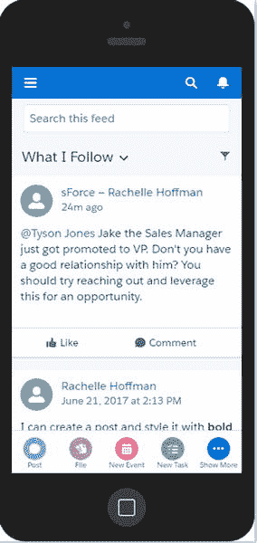

图 6-44：Salesforce 移动应用

### 移动应用设置快速入门指南

Salesforce 提供了一份关于设置移动应用的快速入门指南。

1.  点击浏览器右上角的设置齿轮图标，然后点击 `Setup`。

2.  在 `Quick Find` 框中输入 `Salesforce Mobile`，然后选择 `Salesforce mobile Quick Start` 选项，如图 6-45 所示。

3.  点击 `Launch Quick Start Wizard` 按钮。

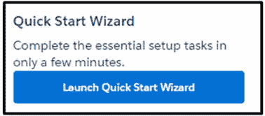

图 6-45：启动 Salesforce 移动配置快速入门向导

4.  点击 `Let’s Get Started` 按钮，如图 6-46 所示。

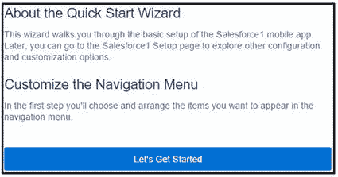

图 6-46：开始快速入门

5.  您可以通过点击导航菜单上的项目，然后使用中间的箭头，或者通过拖放将其移动到新位置，来移除或重新排列这些项目，如图 6-47 所示。

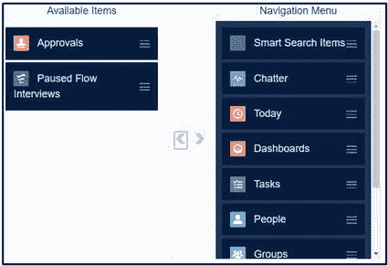

图 6-47：修改导航菜单

6.  导航菜单设置完成后，点击屏幕右下角的 `Save & Next`。

7.  点击 `Arrange Global Actions` 按钮，如图 6-48 所示。

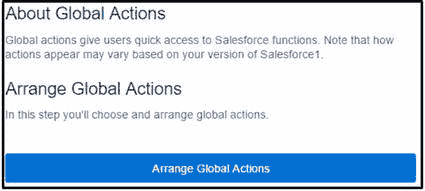

图 6-48：排列全局操作

8.  使用两个区域之间的箭头，将必要的操作移动到 `Selected Global Actions` 区域，将不需要的操作移动到 `Available Items` 区域。通过拖放来调整操作显示的先后顺序，如图 6-49 所示。

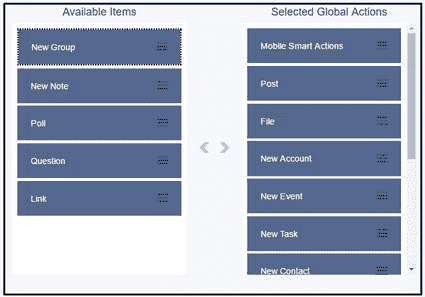

图 6-49：修改操作顺序

9.  完成后点击 `Save & Next`。

10. 点击 `Create Compact Layout` 按钮，如图 6-50 所示。

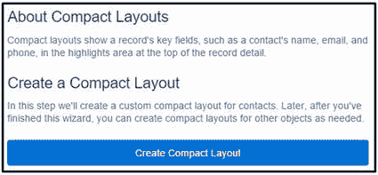

图 6-50：配置联系人紧凑布局

**注意：** 通过快速入门，您只能为联系人记录创建紧凑布局。我们将在下一页介绍如何为其他对象创建紧凑布局。

11. 将您希望在移动应用中显示的字段移动到 `Compact Layout for Contacts` 区域，将不希望包含的字段移动到 `Available Fields` 部分。通过拖放来重新排列字段的顺序，如图 6-51 所示。

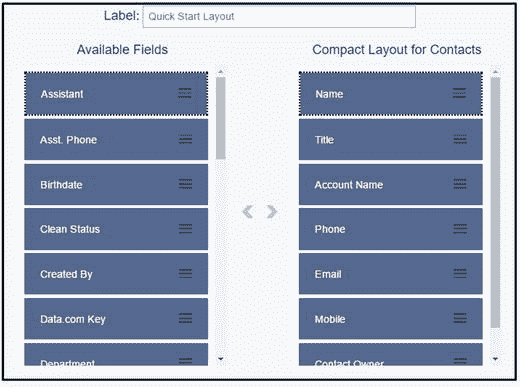

图 6-51：修改联系人紧凑布局的字段顺序

12. 完成后点击 `Save & Next`。

13. 在步骤 4 中，您可以通过依次点击 `Navigation Menu`、`Global Actions` 和 `Contact Compact Layout` 来回顾您在此快速入门中已配置的内容，查看您创建的项目。是否发现需要修改的地方？点击 `Edit` 按钮即可进入相应的编辑屏幕进行修改，如图 6-52 所示。

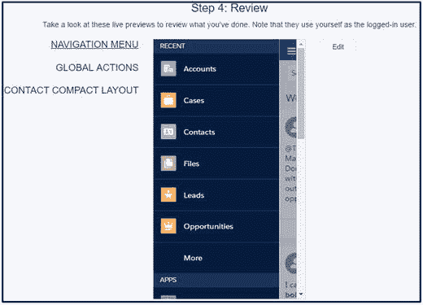

图 6-52：核查您已完成设置

14. 完成后点击 `Next`。

## 创建紧凑布局

在前面的步骤10中，我们提到您也可以为其他对象创建紧凑布局。操作方法如下：

1. 点击浏览器右上角的设置齿轮图标，然后点击`Setup`。

2. 选择主页选项卡旁边顶部的`Object Manager`选项卡。

3. 选择您想要为其配置紧凑布局的对象，然后点击该对象的超链接名称，如图6-54所示。

*图 6-54：导航到某个对象的紧凑布局*

4. 在左侧，您将看到该对象内的各种选项和操作。选择`Compact Layouts`，如图6-55所示。

*图 6-55：选择紧凑布局*

5. 点击`New`创建一个新的紧凑布局，如图6-56所示。

*图 6-56：点击`New`按钮*

6. 为您的紧凑布局创建一个标签，然后按`Tab`键自动生成名称。使用中间的箭头将字段从`Available Fields`区域移动到`Selected Fields`区域。使用`Selected Fields`旁边的箭头上下移动字段，以调整用户查看详细信息的顺序，如图6-57所示。

*图 6-57：创建紧凑布局*

7. 完成后，点击`Save`。

8. 点击`Compact Layout Assignment`按钮，如图6-58所示。

*图 6-58：完成紧凑布局*

9. 点击`Edit Assignment`按钮，如图6-59所示。

*图 6-59：`Edit Assignment`按钮*

10. 从下拉菜单中选择您创建的紧凑布局，如图6-60所示。

*图 6-60：选择紧凑布局*

11. 点击`Save`。

如果您已准备好邀请用户，请在`To`字段中输入用户姓名，并自定义主题和消息。然后点击`Send`，如图6-53所示。

*图 6-53：邀请用户下载 Salesforce 移动应用*

完成后依次点击`Next`和`Finish`。

## 总结

如您所见，在Salesforce中，用户有多种方式可以相互协作以及与外部客户互动。企业中的协作是促成销售成交或推动项目/任务前进的关键。通过使用Chatter和Salesforce移动应用，用户便拥有了全天候工作所需的所有工具。