# 7. 闪电流程生成器

`闪电流程生成器` 是一款功能极为强大的业务流程自动化工具，能够解决众多现实中的业务问题。`流程生成器` 通过其增强的点击式界面，使得在一个地方构建逻辑变得简单。借助 `流程生成器`，你可以减少或消除为简单流程编写 `Apex` 代码的需求。你可以创建自动化逻辑来更新相关记录、更新字段、创建任务、发送电子邮件等等。点击 `新建` 开始操作，如图 7-1 所示。

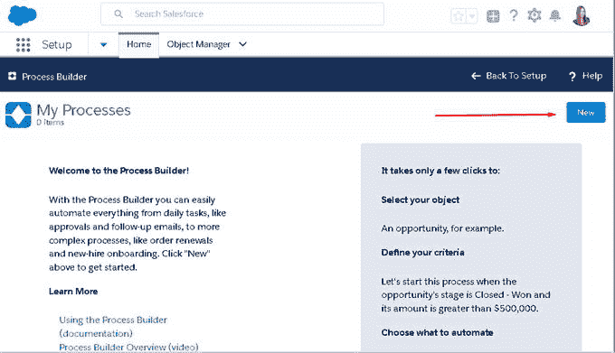

图 7-1 `流程生成器` 主页。点击 `新建` 开始操作。

## Salesforce 工作流规则与流程生成器

Salesforce 提供了多种解决方案来自动化你的业务流程，包括工作流规则和 `流程生成器`。

工作流规则是在记录满足特定条件并被保存时自动执行的操作。通过建立一个系统化的流程，你可以最大限度地减少手动数据录入和处理过程。

`流程生成器` 在 `Salesforce Lightning` 中得到支持，并且能完成工作流规则所能做的一切，甚至更多（出站消息除外）。`流程生成器` 的操作可以在记录发生更改或被另一个进程调用时启动。两种自动化类型都支持基于时间的操作。

如果你有一个简单的单一 `if/then` 语句，建议使用工作流规则来自动化你的流程。换句话说，如果你的自动化标准包含简单的逻辑，请使用工作流规则。如果你的自动化需求具有一定的复杂性，那么 `流程生成器` 是最佳选择。请阅读“操作”部分，以了解每种操作类型的具体功能。

表 7-1 列出了工作流规则与 `流程生成器` 工具之间的差异。

表 7-1 工作流规则和流程生成器中可用的操作

## 流程生成器：操作类型

`流程生成器` 使创建自动化操作变得更加容易，因为它是一个可视化设计器，如图 7-2 所示。

以下是可以通过工作流规则或 `流程生成器` 完成的操作：

*   `调用 Apex 类`：`Apex` 是一种用于在 Salesforce 中开发复杂流程的编程语言。你可以使用 `流程生成器` 来调用现有的 `Apex` 类。
*   `创建记录`：使用此操作可以从任何标准或自定义对象创建新记录。可以设置字段值来适当地构建记录。
    > **提示** 通过流程创建记录时，必填字段仍然有效。确保在 `设置字段值` 部分为所有必填字段赋值，以便成功创建记录。
*   `电子邮件警报`：选择现有电子邮件警报，自动向指定收件人发送电子邮件。
*   `流程`：选择此操作以启动现有的可视化工作流。
*   `发布到 Chatter`：创建一条消息，并选择更新用户、`Chatter` 群组，或向相关记录发布新的 `Chatter` 帖子。
    > **注意** 可以使用合并字段来生成 `Chatter` 帖子。
*   `进程`：使用此操作类型来触发另一个进程。
    > **注意** 只能启动已激活的进程。
*   `快速操作`：使用此操作类型来启动一个快速操作。选择“全局操作”来创建记录或记录通话。选择对象来为所选对象定义一个操作。
*   `提交以进行审批`：选择为给定记录激活默认审批流程或特定审批流程，如图 7-2 所示。通过选择适当的值来控制提交者是谁：`当前用户`、`来自记录的用户字段` 或 `特定用户`。可以输入提交备注。
    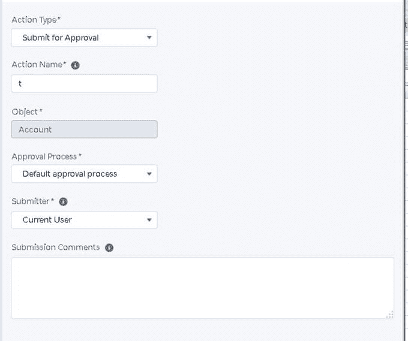
    图 7-2 `提交以进行审批` 操作类型
*   `更新记录`：选择更新现有记录或与对应对象相关的记录（如图 7-3 所示）。
    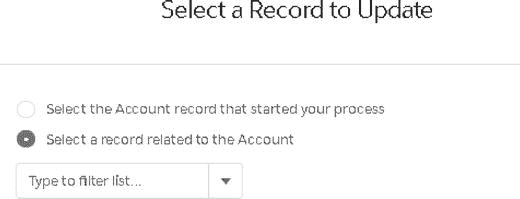
    图 7-3 在 `流程生成器` 中选择要更新的记录

### 基于时间的操作

当记录满足条件时，操作可以立即执行，也可以按照指定的时间表执行。

为了控制操作何时执行，可以向流程添加时间间隔，如图 7-4 所示。操作可以被触发在指定日期之前或之后运行。

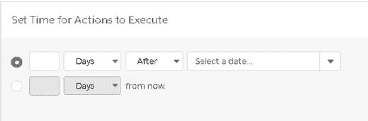

图 7-4 为基于时间的操作设置时间

#### 示例

举例来说，我们创建一个自动化操作，在客户生日的前一天向所有活跃客户发送一张“生日快乐”贺卡。`计划操作` 选项仅在流程的第一个节点以“仅当创建记录时” *或* “当记录被创建或编辑时”启动 *并且* 在标准节点的 `高级` 部分选中了 `是` 复选框时才可用，如图 7-5 所示。

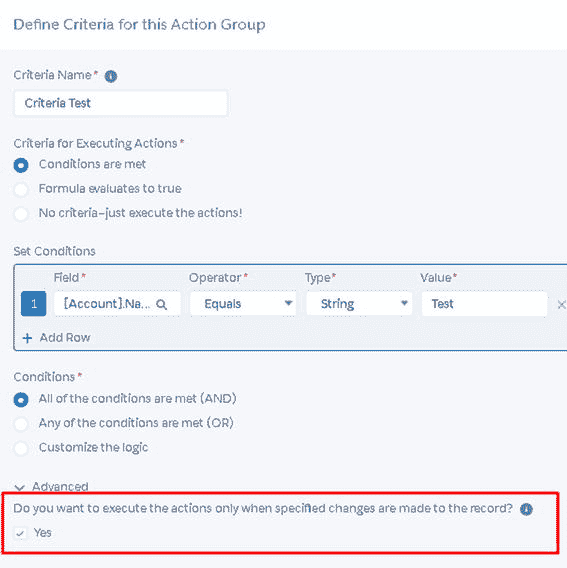

图 7-5 为操作组设置条件

## 使用流程生成器创建流程

按照本节中的步骤创建自动化业务流程。

在这个场景中，你将遇到一个现实中的业务问题。假设销售用户必须手动创建一个项目记录，该记录包含存储在商机级别相同的详细信息。与其创建新记录并复制粘贴详细信息，不如让他们使用工具自动创建新的项目记录。同时，自动将存储在商机记录中的详细信息提取到新项目记录中也很有帮助。

### 注意

在此用例中，项目记录是存储在名为 `项目` 的自定义对象中的记录。

对于所有设置为 `已结束并赢得` 的商机，你希望创建一个新的项目记录，并将 `项目` 字段 `下一步` 更新为 `安排项目启动会`。

### 注意

这是你在 Salesforce 中管理项目时可以使用的一个用例。这些步骤也可以稍作调整，用于创建保险公司最常用的新保单记录。金融服务行业的人也会在商机结束时，利用这个概念创建新的财务账户记录。这些只是几个例子。在 Salesforce 中使用自动化的机会是无限的！

请按照以下步骤创建此流程：

1. 在 `设置` 中，选择 `平台工具` 部分的 `流程自动化`，如图 7-6 所示。
   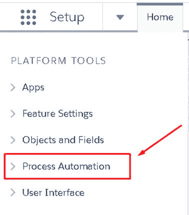
   **图 7-6** – 设置中的流程自动化
2. 接着，选择 `流程生成器` 以访问 `流程生成器` 主页。该页面会列出所有 `激活` 和 `未激活` 的流程，如图 7-7 所示，同时显示流程描述、相关对象、流程类型、最后修改日期、状态和操作。
   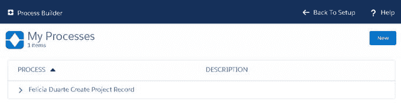
   **图 7-7** – 流程生成器主页及流程列表
3. 点击 `新建` 按钮以启动新流程。
4. 输入流程名称并按 `Tab` 键生成 API 名称，如图 7-8 所示。
   > **注意** 并非必须，但建议为每个流程输入描述。对于自动化流程众多的组织来说，若没有描述，可能很难找到正确的流程。
   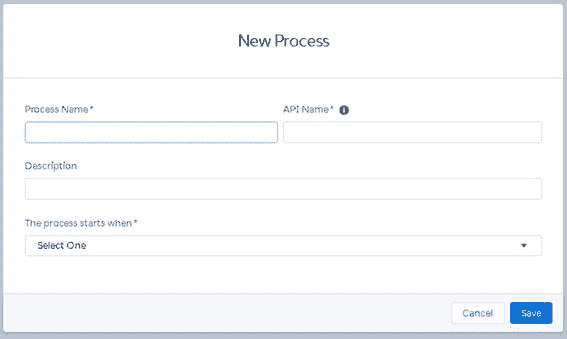
   **图 7-8** – 为流程命名
5. 确定流程应在何时启动。选项包括“当记录更改时”和“当被其他流程调用时”。
   > **注意** 你可以将更复杂的流程分解为更简单的流程。如前所述，这些流程可以被其他流程重复使用和调用。
   在当前场景中，你将在“当记录更改时”启动流程。点击 `保存`，如图 7-9 所示。
   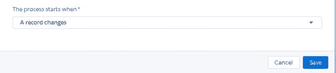
   **图 7-9** – 当记录更改时启动流程
6. 首次启动流程时，必须选择其启动的对象。选择 `添加对象`，如图 7-10 高亮所示。
   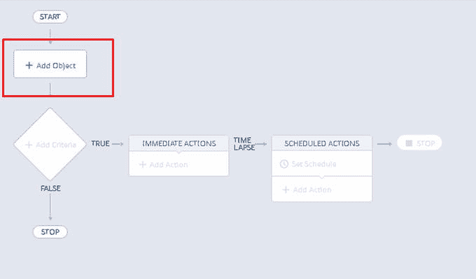
   **图 7-10** – 在流程生成器中选择对象
7. 选择流程应评估的对象，如图 7-11 所示。在此示例中，你将选择 `商机`。
   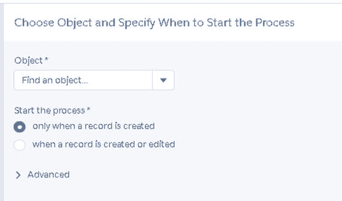
   **图 7-11** – 选择何时启动流程

## 设置条件

请按照以下步骤为流程设置条件：

1. 为你的条件命名，如图 7-14 所示。

   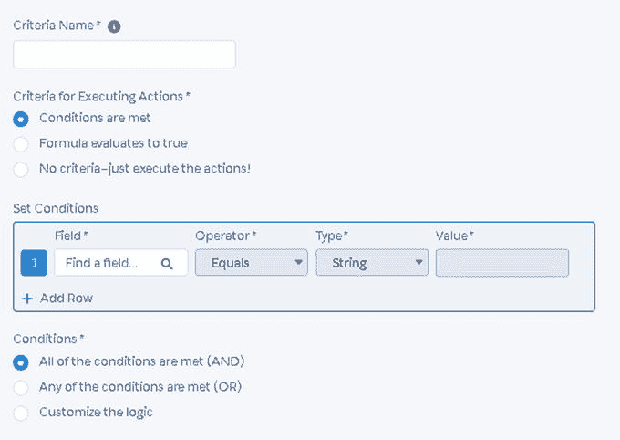

   **图 7-14** – 设置条件的步骤

2. 查找一个字段并选择合适的运算符来设置条件。

3. 选择执行操作的条件（如图 7-15 所示）。你可以选择：仅在满足条件时执行操作、当公式计算结果为真时执行操作，或无条件执行操作。在此示例中，选择“无条件 – 直接执行操作！”以便对所有商机记录执行操作。

   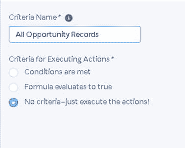

   **图 7-15** – 设置执行操作的条件

4. 设置条件。使用字段和运算符值来设置这些条件，如图 7-16 所示。

   

   **图 7-16** – 设置调用流程的条件

5. 所有条件设置完毕后，点击`保存`。

6. 选择满足此条件后的操作。点击`添加操作`，如图 7-17 所示。

   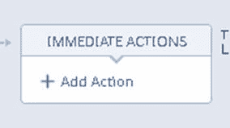

   **图 7-17** – 向流程添加即时操作

7. 定义操作类型。

8. 在此场景中，你想要创建一个新的项目记录。点击`创建记录`。

9. 命名操作并选择应创建的记录类型，如图 7-18 所示。

   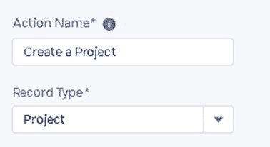

   **图 7-18** – 命名操作并选择记录类型

10. 设置新记录的字段值，如图 7-19 所示。在我们的示例中，我们设置了所有想要带入新项目记录的字段值。

    **注意** 选择此操作时，必须填写所有必填字段。如果未输入必填字段的值，将不会创建记录。

    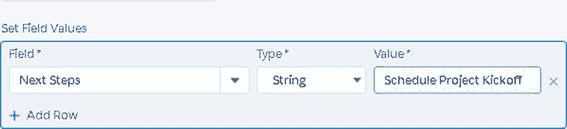

    **图 7-19** – 创建新记录时设置字段值

11. 确认条件和操作正确后，点击`保存` 。

12. 要使此流程生效，请点击`激活`，如图 7-20 所示。

    **注意** 同一时间只能有一个版本的流程处于激活状态。

    

    **图 7-20** – 激活流程

13. 最佳实践是测试该流程。创建一个测试记录来测试这个新的自动化流程。

## 总结

在本章中，我们回顾了流程生成器可以完成的高级功能详情。它能实现的自动化远超仅靠工作流规则所能做到的。重要的是要知道，你有无数种方法可以在现有设置中构建自动化功能。请将本章作为指南，了解流程生成器的实际能力。