# 8. 数据管理

Salesforce 提供了一系列数据管理工具。Lightning Salesforce 提供了一个数据导入向导，允许你更新现有记录或创建新记录（图 8-1）。数据导入向导支持使用逗号分隔值（CSV）文件、Outlook CSV、ACT! CSV 和 Gmail CSV 执行导入、更新和插入操作。Salesforce 不仅提供了导入工具，还提供了帮助你将数据导出为 CSV 文件的工具、根据记录条件将记录从一位所有者批量转移给另一位所有者的工具，以及根据记录条件批量删除记录的工具。Salesforce 还提供了数据控制工具，帮助你控制用户向系统中添加的数据类型。你可以创建重复规则，以防止用户添加重复记录。数据管理对组织来说极为重要；事实上，你的 Salesforce 组织的价值完全取决于你用它收集的数据质量。如果数据是“脏数据”，那么你的报告也同样是脏数据。拥有准确且有用的数据，你才能恰当地分析信息，这反过来又能让你改善用户和客户的体验。

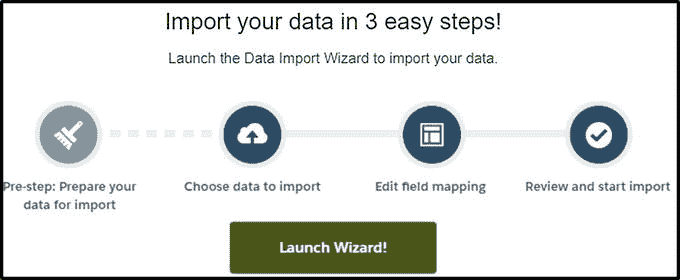

图 8-1

导入可以很简单！

## 使用数据导入向导

Salesforce 提供的数据导入向导允许你导入新记录和更新现有记录。你只需要一个 CSV 文件，其列标题与你现有的 Salesforce 字段匹配，并且数据位于电子表格的行中即可（图 8-2）。

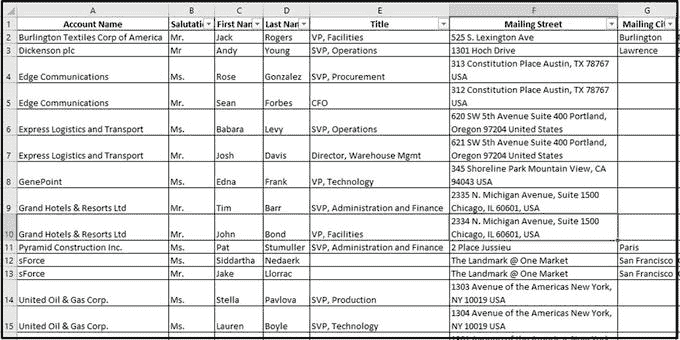

图 8-2

准备导入到 Salesforce 组织的 CSV 文件

你可以轻松地用 Excel 电子表格创建 CSV 文件。保存文件后，你会在文件名下方看到创建了一个“另存为”类型。选择下拉菜单并将其更改为“CSV（逗号分隔）”。根据你的 Excel 版本，措辞可能会有所不同。示例如图 8-3 所示。

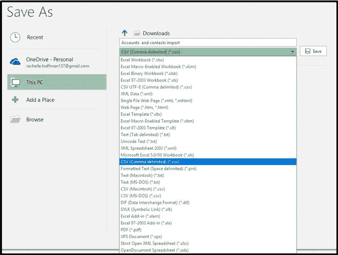

图 8-3

如何将 Excel 文件保存为 CSV 文件格式

## 准备导入的数据

为了准备导入联系人和帐户的数据，你必须确保在你的 CSV 文件中，为你可能已设置的所有必填字段或 Salesforce 自带的字段都各有一列。你可以通过编辑记录并查找旁边带有红色线条的字段来确定哪些字段是必填项。你可以将目标对象上找到的任何字段作为 CSV 文件中的一列包含进来。另一个重要的准备步骤是确保导入的数据与字段的数据类型匹配。准备好数据非常重要，因为如果数据不正确，系统会报错并且不会导入该记录。为了避免在导入上花费数小时，请遵循以下提示：

*   日期数据类型只能接受以下格式：`MM/DD/YYYY`。
*   日期和时间数据类型可以接受以下格式：`MM/DD/YYYY hh:mm:ss`。也可以接受其他格式。
*   数字和货币数据类型只接受数字（不接受字母）。
*   复选框数据类型接受 `TRUE` 和 `FALSE` 值（`TRUE` = 已选中，`FALSE` = 未选中）。
*   电子邮件数据类型字段要求包含 `@` 符号，并且包含一个点号（`.`）及合适的后缀（`.com`， `.org`， `.gov` 等）。Salesforce 不检查特定的后缀类型，但如果点号后面没有后缀，通常会产生错误。
*   选择列表数据类型字段必须与该选择列表值中已有的内容完全匹配，或者你可以在字段级别取消选中“将选项列表限制为值集中定义的选项”复选框，以便任何值都能被包含并导入。
*   多选选择列表值必须用分号分隔（例如，`blue; red; green`）。
*   URL 数据类型字段需要包含一个带有后缀的点号（`.com`， `.org`， `.gov` 等）。

### 注意

在此导入向导中，如果帐户名称与 CSV 文件中的另一个名称相同，Salesforce 不会创建重复项。如果帐户名称多了一个字母，Salesforce 会将其视为新帐户并创建重复项。

此外，如果你将列标题标记为 Salesforce 字段标签，Salesforce 导入向导会自动将你的列映射到 Salesforce 字段（我们将在第 9 步中讨论这一点）。

*   尝试将所有列标题与你导入的字段名称匹配。大多数导入工具会将你的列标题“自动映射”到相应的字段。

### 使用数据导入向导导入客户和联系人

Salesforce 数据导入向导是一款出色且易于使用的工具。它提供视频来引导您完成导入过程，并设有完善的常见问题解答部分。甚至还为您提供了设置导入的分步流程。保持 Salesforce 数据的准确性和时效性非常重要。无论您是首次导入客户和联系人，还是向系统中添加新的客户和联系人，都需要了解如何操作以确保数据的完整性。

1. **准备要导入的数据**。标准 Salesforce 设置中的客户需要客户名称。除了客户，您还可以导入联系人。标准 Salesforce 设置中的联系需要客户名称和姓氏。由于联系人的导入需要客户名称，您可以在 CSV 文件中将客户和客户详细信息放在一行，对于与该客户相关的其他联系人，只需使用该客户名称即可。如果您在每个联系人的客户字段中填写了不同的客户字段详细信息，则导入过程中该客户的最后一行数据将反映在 Salesforce 中。如图 8-4 所示，第 5 行的 Cloud Creations 是导入后在 Salesforce 中看到的信息。

   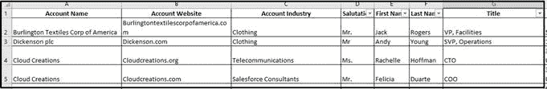  
   *图 8-4 – 准备导入的数据*

2. **导航至“设置”菜单**，如图 8-5 所示。

     
   *图 8-5 – 导航至“设置”菜单*

3. 在“快速查找”框中，输入 `Data import`（不要按 `Enter` 键；选项会随您的输入自动填充）。点击 `Data Import Wizard`，如图 8-6 所示。

     
   *图 8-6 – 搜索数据导入向导*

4. 点击绿色的 `Launch Wizard!` 按钮，如图 8-7 所示。

   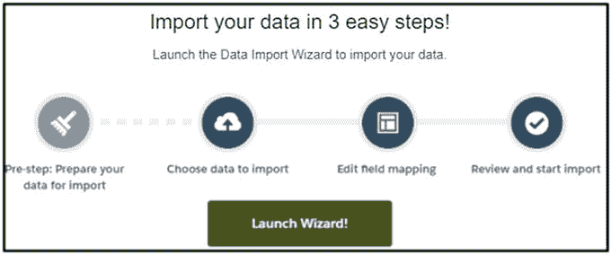  
   *图 8-7 – 访问数据导入向导*

5. 在“您要导入哪种类型的数据？”问题下，点击“标准对象”选项卡上的 `Accounts and Contacts`，如图 8-8 所示。

   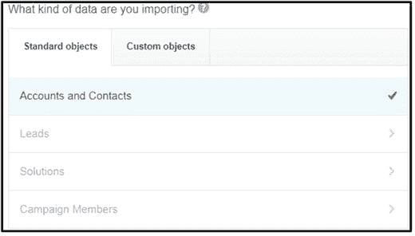  
   *图 8-8 – 您要导入哪种类型的数据？*

6. 在“您想要做什么？”问题下，点击“添加新记录”，将显示以下信息：
   - **按以下方式匹配联系人**：此选项允许您根据联系人的全名、电子邮件或您已创建并设为唯一 ID 或外部 ID 的任何字段，将您的 CSV 数据与 Salesforce 中可能已存在的联系人进行匹配。这有助于防止导入时产生重复记录。您需要选择您认为最佳匹配的字段。通常使用电子邮件进行匹配。

   > **注意**  
   > 唯一 ID 或外部 ID 是仅与该记录相关的标识符。当将数据从其他 CRM 迁移到 Salesforce 时，您的其他 CRM 会包含其自身的唯一 ID。您应该创建一个字段并将其标记为外部 ID，然后将此字段导入到您的 Salesforce 实例中。这样，如果您在初始导入时忘记包含某些内容，将来可以对其进行更新。或者，对于与其他系统集成的业务用途，外部 ID 对于关联两个组织并确保只更新一条记录至关重要。Salesforce 也会为创建的每条记录生成唯一的 ID；它是一个 15 到 18 个字符的字母数字 ID。您可以在报表中找到记录的此 ID；只需搜索 `ID` 字段，如图 8-9 所示，或者在浏览器的 URL 中找到它，如图 8-10 所示。

   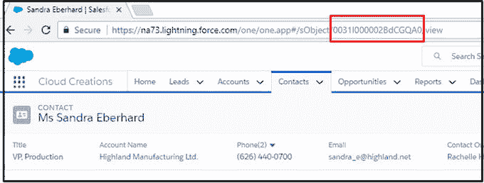  
   *图 8-10 – 在浏览器 URL 中找到您的记录 ID*

   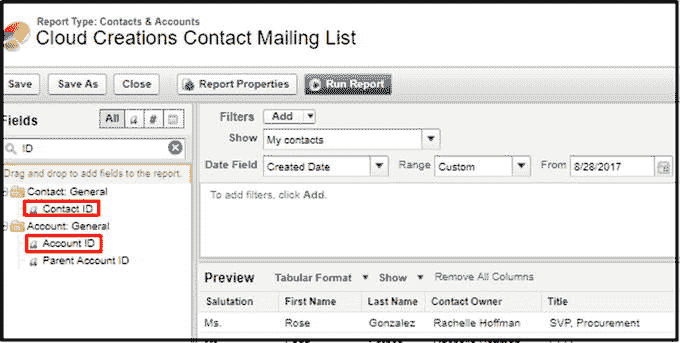  
   *图 8-9 – 如何在报表中搜索记录的 ID*

7. **按以下方式匹配客户**：此选项允许您根据客户名称和站点（客户上的标准网站字段）或您已创建并设为唯一 ID 或外部 ID 的任何字段，将您的 CSV 数据与 Salesforce 中可能已存在的客户进行匹配，如图 8-11 所示。

   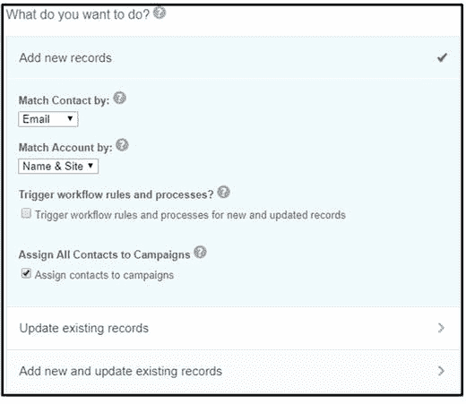  
   *图 8-11 – 您想要做什么？*

   > **注意**  
   > 您可以通过创建或编辑字段并选中“唯一”或“外部 ID”复选框，将以下任一数据类型字段设为唯一 ID 或外部 ID：`auto-number`、`email`、`number` 或 `text`。

8. Salesforce 允许启用或禁用通过工作流规则或流程生成器创建的自动化流程。通过选中此框，您可以在此导入期间启用这些流程。如果您创建的自动操作包含电子邮件和任务，这一点很重要，因为这可能会对您的客户或用户造成困扰。例如，您可能有一个工作流规则，每次创建联系人时都会向该联系人发送欢迎邮件。如果您保持此选项处于选中状态，则所有导入的联系人都将收到此电子邮件。

9. 您还可以将所有导入的联系人分配到一个现有的营销活动。如果您选择此选项，则需要在导入文件中包含一列，其中包含该营销活动的 Salesforce ID。

10. 在“您的数据位于何处？”问题下，您可以将 CSV 文件拖放到“将 CSV 文件拖到此处以上传”区域，如图 8-12 所示。您也可以单击 CSV、Outlook CSV、ACT! CSV 或 Gmail CSV，然后单击“选择文件”。在您的计算机上找到该文件，然后单击“打开”。

    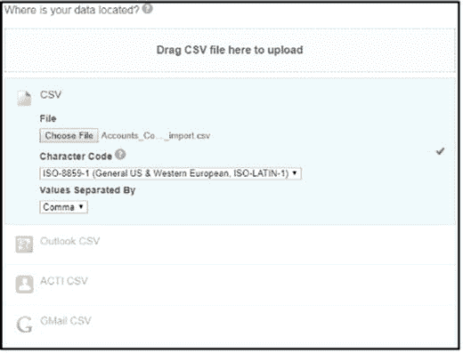  
    *图 8-12 – 您的数据位于何处？*

11. 完成这些步骤后，单击屏幕右下角的 `Next` 按钮，如图 8-13 所示。

      
    *图 8-13 – 单击屏幕上的“下一步”按钮*

12. 在 `Edit Mapping`（编辑映射）字段中，你可以在此处选择将哪个列标题映射到账户或联系人的哪个 Salesforce 字段。如果正确设置了列标题，你会看到 Salesforce 会将所有列与 Salesforce 中的字段匹配起来，如图 8-14 所示。在图 8-15 中，你会看到标题与字段名称不匹配。如果你的列标题没有与它们所映射的字段名称匹配，则可以按照步骤 13 和 14 中的附加步骤进行操作。

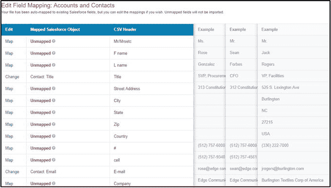

图 8-15：当列标题未与 Salesforce 中的字段名称匹配时的字段映射

图 8-14：当列标题与 Salesforce 中的字段名称正确匹配时的字段映射

13. 如果看到一个带有感叹号的三角形，这意味着映射存在错误，如图 8-16 所示。将鼠标悬停在该图标上即可显示错误消息。大多数情况下，这是因为您将一个列映射到了多个字段。

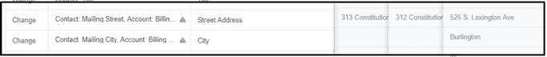

图 8-16：显示小三角形符号

**注意** 如果您的导入需要两个字段同时更新相同的信息，则您需要创建两个列，每个列中包含相同的数据，并将这些列分别映射到各自的字段。导入工具一次只能链接到一个数据点。

14. 如果看到某个字段以红色粗体显示，如图 8-15 所示，则表示该字段仍需要映射。要映射一个字段或更改已映射的字段，请单击 `Map`（映射）或 `Change`（更改）超链接。您可以输入字段名称，也可以使用滚动条查找字段。选择合适的字段后，单击 `Map`（映射），如图 8-17 所示。

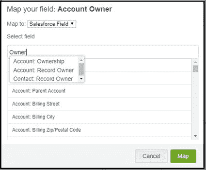

图 8-17：使用数据导入向导映射字段

**注意** 如果您在导入时没有创建记录所有者字段，则创建的记录将自动分配给执行导入的用户。如果您的安全设置阻止用户查看数据，这可能会影响您的组织。例如，如果设置了角色层级，而您位于层级顶端并作为导入用户，那么层级低于您的用户可能无法看到您导入的记录。这最终意味着他们无法完成工作。

15. 确认所有列都已映射到相应的字段后，单击右下角的 `Next`（下一步）按钮，如图 8-18 所示。

图 8-18：单击“下一步”按钮继续

16. `Review & Start Import`（审阅并开始导入）屏幕会汇总您要导入的对象、导入类型（插入、更新、更新插入）、导入所使用的 CSV 文件、已映射的字段数以及未映射的字段数，如图 8-19 所示。

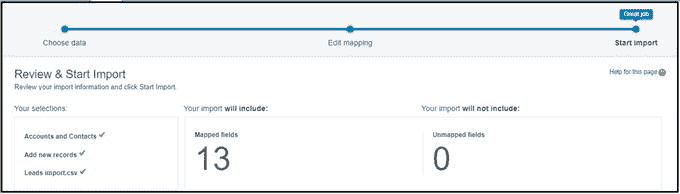

图 8-19：单击“开始导入”前的导入审阅

17. 审阅完这些信息并确认无误后，单击 `Start Import`（开始导入）按钮，如图 8-20 所示。

图 8-20：开始导入按钮

18. 在祝贺页面上，单击 `OK`（确定）按钮，您将跳转到批量数据加载请求和状态页面，如图 8-21 所示。

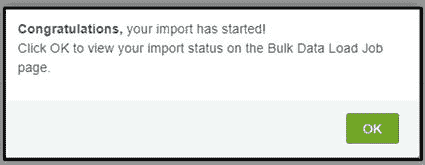

图 8-21：确定按钮

19. 如果导入的数据量很大（数万行），则处理作业可能需要长达数小时。如果是小规模导入，您可能会发现单击 `OK`（确定）后作业即完成，如图 8-22 所示。

图 8-22：导入摘要

20. 当作业完成时，Salesforce 会向您发送一封电子邮件，并附上一个错误文件以供您查看导入中的任何错误。某些错误可能包括数据类型不匹配。另一种可能的情况是 Salesforce 检测到一个空行，如图 8-23 所示。

图 8-23：导入完成时收到的电子邮件

#### 导入潜在客户

理想情况下，您会发现需要不断导入新的潜在客户！无论是从参加的会议中获取的新线索，还是从购买的列表中获得，您都希望立即导入它们，以便您的销售团队能够跟进处理！以下步骤将向您展示如何快速完成此操作：

1.  准备要导入的数据。确保导入文件中的所有必填字段都已作为列填充。标准的`Salesforce`设置要求包含姓氏、公司名称和潜在客户状态。

2.  导航至`Setup`菜单，如图 8-24 所示。

图 8-24  
导航至`Salesforce`中的“设置”区域

3.  在`Quick Find`区域，输入`Data import`（不要按`Enter`键；选项会随您的输入自动填充）。点击`Data Import Wizard`，如图 8-25 所示。

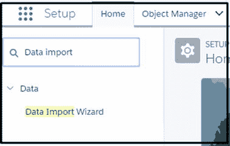

图 8-25  
搜索`Data Import Wizard`

4.  点击绿色的`Launch Wizard!`按钮，如图 8-26 所示。

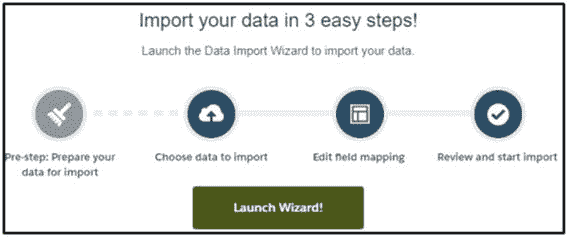

图 8-26  
启动`Salesforce`向导

5.  在“您要导入哪种类型的数据？”问题下，点击`Standard objects`选项卡上的`Leads`，如图 8-27 所示。

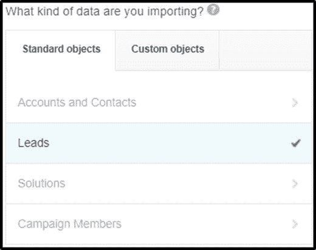

图 8-27  
您要导入哪种类型的数据？

6.  在“您想要做什么？”问题下，点击“添加新记录”，将显示以下信息：
    *   `Match Lead by`（匹配依据）：这允许您根据潜在客户的**全名**、**电子邮件**或您创建并设置为唯一 ID 或外部 ID 的任何字段，将 CSV 数据与`Salesforce`中已有的潜在客户或联系人进行匹配。这有助于防止导入重复数据。您应选择您认为最匹配的选项。最常用的是电子邮件。
    *   `Assign New Leads to this Source`（将此来源分配给新潜在客户）：这允许您选择所有潜在客户应分配到的**潜在客户来源**。如果您的导入数据来源单一，可以使用此功能。例如，如果您刚参加完一个会议，并希望显示所有这些潜在客户都来自该会议，您可以在此列表中全局分配所有导入的潜在客户到该来源。如果您的潜在客户来源混杂，则应忽略此选项。
    *   `Assign all leads using Assignment rules`（使用分配规则分配所有潜在客户）：这允许您利用已创建的潜在客户分配规则来自动分配**所有者**。下拉菜单应包含您在潜在客户分配中创建的所有选项。如果您导入的所有潜在客户都需要分配给特定用户，则可以忽略此功能。但是，如果您购买了列表，这些线索对任何人开放，您可能希望让自动分配规则来处理谁获得哪些线索。
    *   `Assign leads to campaigns`（将潜在客户分配给营销活动）：这允许您将所有导入的潜在客户添加到一个**营销活动**中。您只需确保在电子表格中包含一列，其中含有该营销活动的 ID。如果您希望将所有导入的潜在客户与某个活动或邮件群发营销活动关联起来，可以使用此功能。

7.  `Salesforce`允许启用或禁用通过工作流规则或`Process Builder`创建的自动化流程。通过勾选复选框，您可在本次导入期间启用这些自动化流程。如果您创建了包含电子邮件和任务的操作，这一点很重要，因为可能会对您的客户或用户造成干扰。

8.  在“您的数据位于何处？”问题下，您可以将 CSV 文件拖放到“将 CSV 文件拖放到此处以上传”区域，如图 8-28 和 8-29 所示。您也可以点击`CSV`、`Outlook CSV`、`ACT! CSV`或`Gmail CSV`。然后点击`Choose File`，在您的计算机上找到该文件，并点击`Open`。

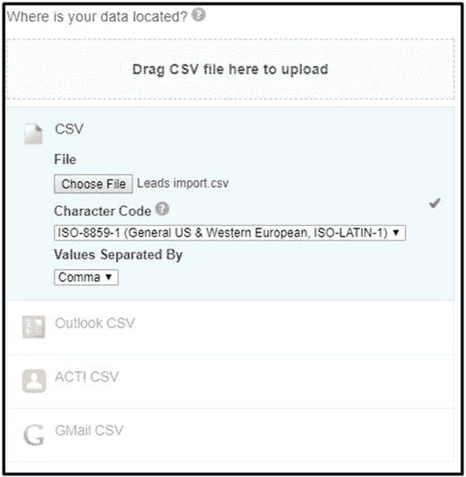

图 8-29  
您的数据位于何处？

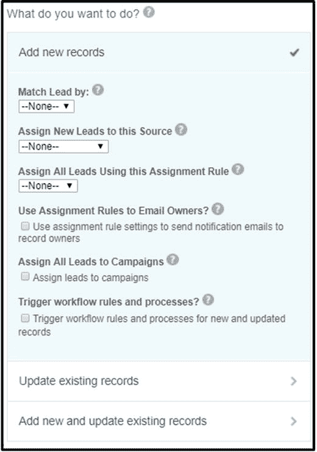

图 8-28  
您想要做什么？

9.  完成这些步骤后，点击屏幕右下角的`Next`按钮，如图 8-30 所示。

图 8-30  
`Next`按钮

10. 在`Edit Mapping`字段中，您可以选择将哪个列标题映射到潜在客户的哪个`Salesforce`字段。如果您的列标题设置正确，您会看到`Salesforce`会将您的所有列与`Salesforce`中的字段自动匹配，如图 8-31 所示。在图 8-32 中，您会看到标题与字段名称不匹配。如果您未将列标题与它们映射到的字段名称匹配，则需要执行步骤 11 和 12。

图 8-32  
当您未将列标题与`Salesforce`中的字段名称匹配时的字段映射

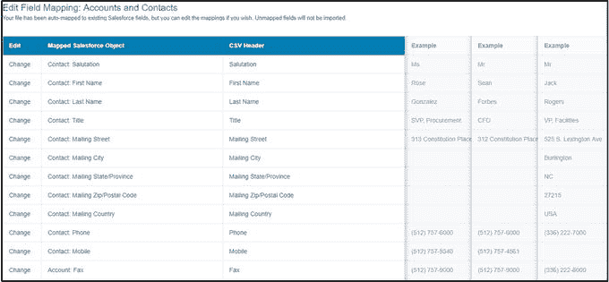

图 8-31  
当您正确地将列标题与`Salesforce`中的字段名称匹配时的字段映射

11. 如果您看到某个字段以粗体红色显示，这意味着该字段仍需映射，如图 8-33 所示。要映射字段或更改已映射的字段，请点击`Map`或`Change`超链接。您可以直接输入字段名称，或使用滚动条查找字段。选择合适的字段并点击`Map`，如图 8-34 所示。

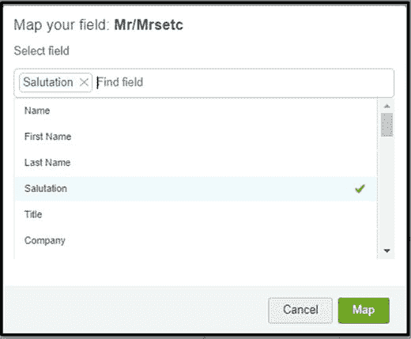

图 8-34  
选择字段

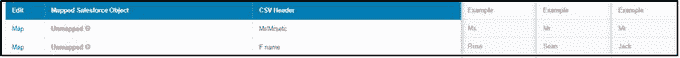

图 8-33  
显示为未映射的字段

**注** 如果您没有创建记录所有者字段，并且没有选择在导入中使用潜在客户分配规则，则创建的记录将自动分配给执行导入的用户。如果您设置了限制用户查看数据的安全权限，这可能会影响您的组织。例如，如果您设置了角色层级，且您位于层级顶部并执行导入，则层级低于您的用户可能无法看到您导入的记录。这最终意味着他们无法正常工作。

12. 在您确认所有列都已映射到适当字段后，点击右下角的`Next`按钮，如图 8-35 所示。

图 8-35  
`Next`按钮

13. `Review & Start Import`屏幕会汇总您要导入的对象、导入类型（`插入`、`更新`、`更新或插入`）、用于导入的 CSV 文件、已映射的字段数以及未映射的字段数，如图 8-36 所示。

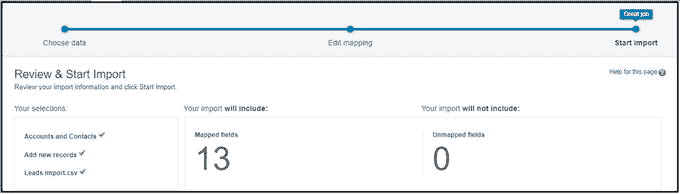

**图 8-36** – 导入审核

14. 审核完此信息并确认无误后，点击`开始导入`按钮，如图 8-37 所示。

**图 8-37** – `开始导入`按钮

15. 在祝贺页面上点击`确定`按钮，即可进入批量数据加载作业请求和状态页面，如图 8-38 所示。

**图 8-38** – `确定`按钮

16. 如果导入的数据量很大（数万行），正在处理的作业可能需要几个小时才能完成。如果导入的数据量较小，您可能会发现点击`确定`后作业就会立即完成，如图 8-39 所示。

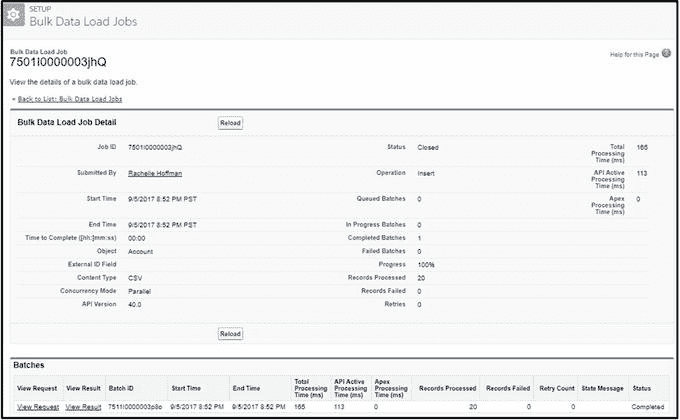

**图 8-39** – 批量数据加载作业审核

17. 作业完成后，Salesforce 还会向您发送一封电子邮件，并附上一个错误文件，供您查看导入过程中的任何错误。某些错误可能包括数据类型不匹配。另一种可能是 Salesforce 检测到了空行，如图 8-40 所示。

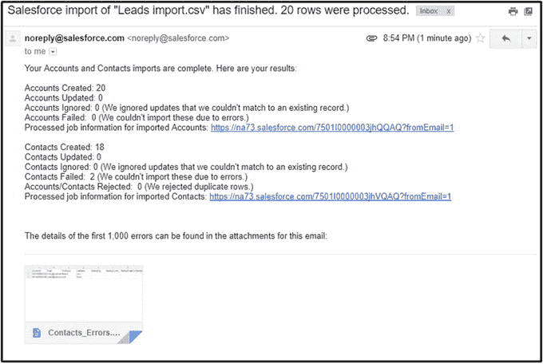

**图 8-40** – 电子邮件确认

## 排定数据导出

Salesforce 是一款基于云的 CRM 和开发平台，只要您能连接到互联网，就可以随时随地访问它。如果您的互联网服务中断，或者您需要暂时离线工作，Salesforce 允许您将数据导出到`CSV`文件中。或者，如果您和我们一样，希望保留数据备份，也可以这样做。您可以安排每月（对所有 Salesforce 版本免费）、每周或每天（根据 Salesforce 版本可能收费）的定期导出，并让系统通过电子邮件将数据发送给您。或者，您也可以执行一次性导出。

1. 导航到`设置`菜单，如图 8-41 所示。

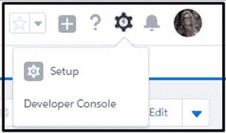

**图 8-41** – 导航到`设置`区域

2. 在`快速查找`区域，输入`数据导出`（无需按`回车`键；选项会随着您的输入自动出现）。点击`数据导出`，如图 8-42 所示。

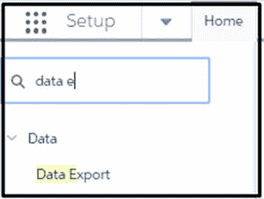

**图 8-42** – 搜索`数据导出`

3. 要排定导出，请点击`排定导出`按钮；要创建一次性导出，请点击`立即导出`，如图 8-43 所示。

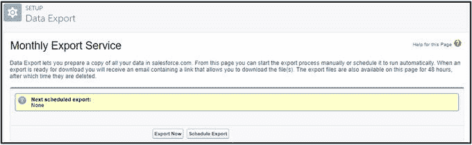

**图 8-43** – 每月导出服务选项

4. 要排定导出，请选择导出应执行的频率。对于每月导出，您可以选择应在每月的哪一天执行，或者选择每周的第几天（如第一个、第二个、第三个、第四个或最后一个特定工作日）。您还可以选择排程的开始日期、结束日期以及应开始的时间，如图 8-44 所示。

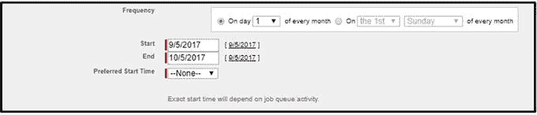

**图 8-44** – 频率

> **注意：** 开始时间并不能保证数据会在那个时间送达。根据您的数据量，完成整个过程可能需要几个小时。

5. 您可以通过勾选页面顶部的复选框，选择将图像、文档、附件、Salesforce 文件和 CRM 内容文档版本包含在导出中，如图 8-45 所示。

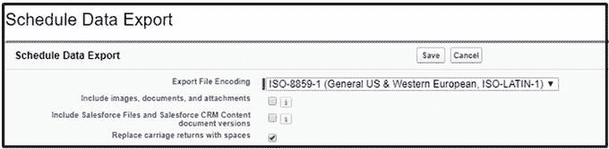

**图 8-45** – 选择要包含的内容

6. 您还可以仅选择要导出的特定对象，或者您可以选择右上角的选项以包含所有数据，如图 8-46 所示。

**图 8-46** – 要导出的对象

7. 导出设置完成后，点击`保存`按钮。

8. 如果您已排定导出，则会看到一个黄色框，其中显示下次排定导出的运行时间，如图 8-47 所示。如果导出已排定执行，则会有备注说明由谁排定、排定时间以及将以何种格式接收信息，如图 8-48 所示。

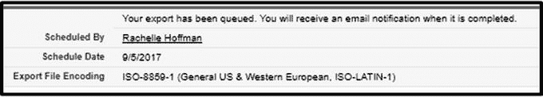

**图 8-48** – 导出排定响应

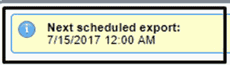

**图 8-47** – 立即导出响应

9. 导出准备就绪后，Salesforce 会通过电子邮件向您发送一个链接，指向`设置`菜单中的数据导出，如图 8-49 所示。

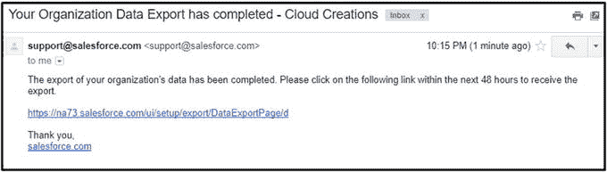

**图 8-49** – Salesforce 发送的电子邮件，告知您的数据导出已接收

10. 此处需要点击下载超链接来下载文件，随后需要将该文件存储到一台机器上，如图 8-50 所示。

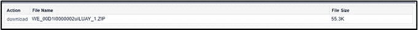

**图 8-50** – 在收到的电子邮件中，会有一个链接将您引导回 Salesforce 以下载您的文件

11. 文件将下载为一个 zip 压缩包，您需要解压缩后才能使用。所有对象都将被拆分成独立的`CSV`文件，如图 8-51 所示。

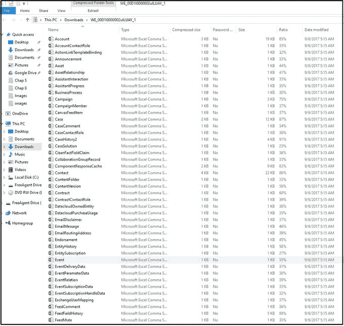

**图 8-51** – 显示所有对象被拆分为单独的`CSV`文件

## 重复数据管理

Salesforce 中的另一个出色功能是设置重复规则。重复规则允许您创建规则，系统将针对任何新客户、联系人或潜在客户检查这些规则，从而防止用户创建重复记录。Salesforce 默认提供以下重复规则：

- **标准客户重复规则**：将验证新创建的客户是否与现有客户的以下任意客户字段组合相匹配：
    1. `Account Name` 和 `Billing Street`
    2. `Account Name` 和 `City` 和 `State`
    3. `Account Name` 和 `Zip Code`
    4. `Account Name` 和 `Phone`
    5. `Account Website` 和 `Phone`
    6. `Account Website` 和 `Billing Street`

- **标准联系人重复规则**：将验证新创建的联系人是否与现有联系人的以下任意联系人字段组合相匹配：
    1. `First Name` 和 `Last Name` 和 `Title` 和 `Account Name`
    2. `First Name` 和 `Last Name` 和 `Email`
    3. `First Name` 和 `Last Name` 和 `Phone` 和 `Company Name`
    4. `First Name` 和 `Last Name` 和 `Mailing Street` 和 (`City` 或 `Zip Code` 或 `Phone`)
    5. `First Name` 和 `Last Name` 和 `Mailing Street` 和 `Title`
    6. `First Name` 和 `Last Name` 和 `Title` 和 `Email`
    7. `First Name` 和 `Last Name` 和 `Phone`

- **标准潜在客户重复规则**：将验证新创建的潜在客户是否与现有潜在客户的以下任意潜在客户字段组合相匹配：
    1. `First Name` 和 `Last Name` 和 `Title` 和 `Account Name`
    2. `First Name` 和 `Last Name` 和 `Email`
    3. `First Name` 和 `Last Name` 和 `Phone` 和 `Company Name`
    4. `First Name` 和 `Last Name` 和 `Mailing Street` 和 (`City` 或 `Zip Code` 或 `Phone`)
    5. `First Name` 和 `Last Name` 和 `Mailing Street` 和 `Title`
    6. `First Name` 和 `Last Name` 和 `Title` 和 `Email`
    7. `First Name` 和 `Last Name` 和 `Phone`

如果标准规则不适用于贵公司，您也可以创建自己的规则。例如，也许您有另一组更适合客户重复规则的字段组合。您的企业或许可以根据`Account Name`和您收集的一个自定义字段来匹配客户。要创建新规则，请按照以下步骤操作：

1.  转到设置菜单，搜索**重复规则**。单击**重复规则**，如图 8-52 所示。

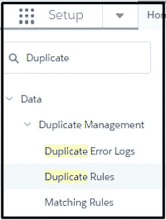

图 8-52 – 选择重复规则

2.  从**新规则**下拉菜单中，选择对象，在此示例中为`Account`，如图 8-53 所示。

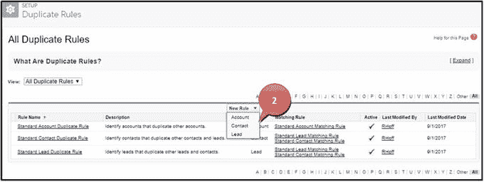

图 8-53 – 新客户规则

3.  为您的重复规则命名。

4.  添加描述。

5.  设置记录级安全性。此选项仅影响具有共享规则的用户。
    - **启用共享规则**意味着，如果您的用户对并非其拥有的客户可见性有限，他们将无法看到与这个新创建客户匹配的其他客户。
    - **绕过共享规则**意味着，如果匹配规则已激活，您允许用户查看他们不拥有的客户。

6.  在**操作**部分，您可以选择允许用户在重复规则检查被激活的情况下创建或编辑客户。另一个选项是**阻止**，这将阻止用户保存记录。您也可以选择通过提醒框中的消息来提醒他们。报表选项会将重复的客户/联系人/潜在客户包含在列表视图中，如图 8-54 所示。

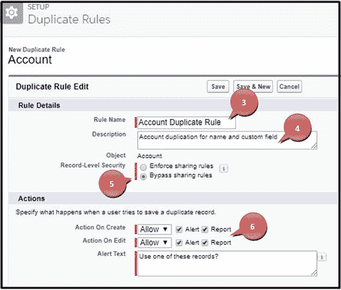

图 8-54 – 重复规则，步骤 3 至 6

7.  您可以选择一个已创建的现有匹配规则，或者从下拉菜单中选择**创建新的匹配规则**，如图 8-55 所示。

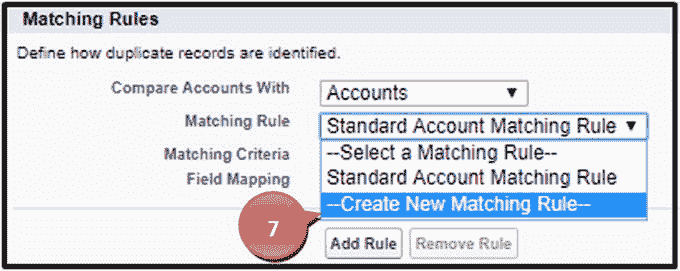

图 8-55 – 创建新的匹配规则

8.  单击**保存重复规则**，如图 8-56 所示。

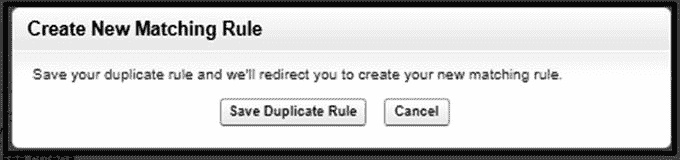

图 8-56 – 保存您的重复规则

9.  为您的匹配规则命名，然后按`Tab`键，让 Salesforce 生成唯一名称。

10. 为您的匹配规则添加描述。

11. 匹配条件部分即您创建规则本身的地方。从字段列中，选择您将用作匹配规则一部分的字段。在此示例中，您有`Account Name`。在**匹配方法**中，您可以选择`Exact`，或者对于某些字段，可以选择`Fuzzy`。`Fuzzy`方法会剔除客户名称中的 *Inc* 或 *Corporation* 等字样，并查看是否能匹配两个名称中不含这些字样的客户。`Fuzzy`方法因字段而异；要查看这些方法的完整列表，请访问[`help.salesforce.com/`](https://help.salesforce.com/)并搜索*与匹配规则一起使用的匹配方法*。

12. 选择**匹配空白字段**，以允许您的条件在字段为空时进行匹配。例如，如果记录中的客户名称相同，并且两者的自定义字段均为空且这两项均已勾选，则条件将匹配，并且您的用户将收到提醒。我建议使用精确值并同时匹配空白字段。

13. 您还可以选择筛选逻辑是应使用`AND`包含所有上述字段，还是应使用`OR`包含部分而非全部字段。

14. 单击**保存**，如图 8-57 所示。

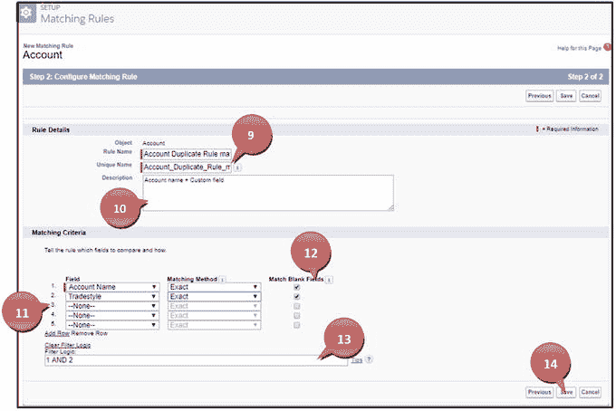

图 8-57 – 创建匹配规则

15. 务必通过单击**激活**按钮来激活您的匹配规则，如图 8-58 所示。

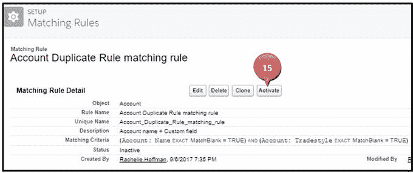

图 8-58 – 激活您的匹配规则

16. 返回重复规则区域（参见步骤 1），单击所创建规则的名称，然后激活该重复规则，如图 8-59 所示。

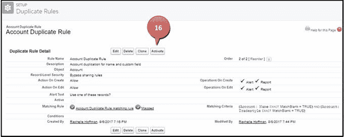

图 8-59 – 激活您的重复规则

### 批量删除记录

Salesforce 为帐户、潜在客户、活动、联系人、个案、解决方案、产品和报告提供了`批量删除记录`选项。该选项尤为重要，因为它能让你清理数据库。如果你允许或不维护 Salesforce CRM，并将对你或员工毫无意义的记录留在其中，最终就会产生“脏数据”。含有脏数据的 CRM 几乎与没有 CRM 一样无用。请记住，CRM 的价值完全取决于其中的数据质量。因此，Salesforce 为你提供了批量删除的工具。例如，假设你刚参加完一场会议，捕获了所有新的潜在客户，于是你直接导入了它们。然而，在审查导入结果后，你发现导入的是错误的列表，而且还是一个旧列表。你需要删除这些记录！接下来的几个步骤将帮你清理数据库：

1.  进入“设置”菜单，搜索 `批量删除记录`。点击 `批量删除记录`，如图 8-60 所示。

    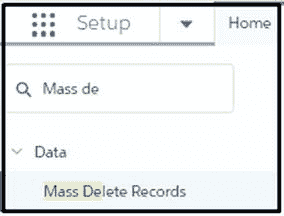

    图 8-60 找到“批量删除记录”功能

2.  点击你想要删除记录的对象选项。在前面的例子中，是潜在客户，如图 8-61 所示。

    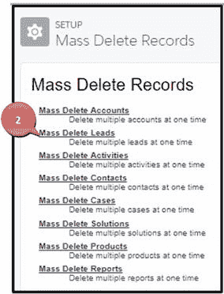

    图 8-61 批量删除记录的选择

3.  确定需要删除数据的具体条件。在这个例子中，我们知道创建日期是昨天。或者潜在客户来源是某次特定的会议。对象上的几乎任何字段都可以用作查找需要删除记录的条件。

4.  在第一列中，选择字段。

5.  在第二列中，选择匹配方式。

6.  在第三列中，输入你的值。

7.  点击“搜索”按钮，如图 8-62 所示。

    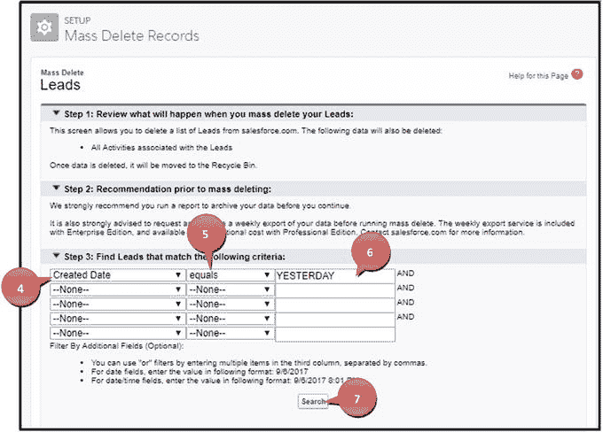

    图 8-62 设置条件以查找需要删除的记录

8.  选择你想要删除的记录，或勾选顶部的复选框以选择所有记录。

9.  如果你确定之后不再需要找回这些记录，请勾选“永久删除”复选框。

    **注意** 已删除的记录会进入回收站，并在 15 天后自动删除，或者如果回收站已满，则删除最早的记录。

10. 准备好删除记录时，点击“删除”按钮，如图 8-63 所示。

    **注意** 每次只能批量删除 250 条记录。

    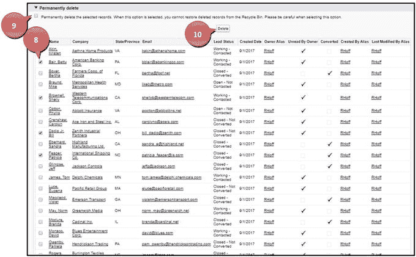

    图 8-63 批量删除你的记录

### 批量转移记录

Salesforce 提供了一个工具，可以帮助你将帐户、潜在客户、宏或流媒体频道记录的所有权转移给另一个用户。这允许你将一个用户拥有的所有记录转移给另一个用户，并且可以基于记录的条件进行转移。如果你有员工离职或晋升，这将是一个重要的工具！例如，如果一名员工即将离职，并且他拥有许多需要由另一名员工管理的帐户，你可以使用此工具将这些帐户转移给新用户。

1.  进入“设置”菜单，搜索 `批量转移记录`，然后点击该短语，如图 8-64 所示。

    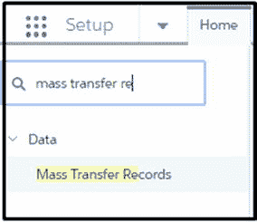

    图 8-64 在“设置”菜单中搜索“批量转移记录”

2.  在本节引言部分的例子中，你需要将帐户从一个离职用户转移给另一个用户。为此，请点击“转出帐户”链接，如图 8-65 所示。

    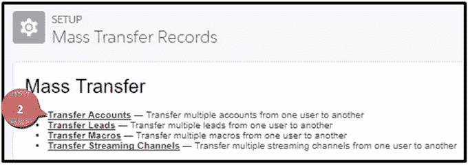

    图 8-65 “转出帐户记录”界面

3.  使用放大镜图标，搜索你要从其转出记录所有权的用户。

4.  使用放大镜图标，搜索你要向其转入记录所有权的用户。

5.  通常，你不应将已关闭或已完成的记录从一个用户转移给另一个用户。我们建议你以此方式保留业务历史记录。因此，在图 8-66 中，你将看到我们只选择了“转移未结机会”和“转移未结个案”。

6.  如果你希望一个用户拥有的所有记录都转移给另一个用户，你可以将此部分留空。否则，如果你只想根据记录的条件转移特定记录，则需使用此部分。请注意，你只能使用“并且 (AND)”逻辑。这意味着你在此处设置的每组条件都将用于搜索记录。例如，如果你将“类型”字段设置为“客户-渠道”，并将“帐单所在州”设置为“加利福尼亚”，那么记录必须同时满足这两个值，才可被转移。
    -   找到你要筛选的字段。例如，如果你在帐户上使用“类型”字段，并且只想将特定类型的帐户转移给新用户。
    -   使用适当的匹配方式：等于、包含、小于、大于等等。在此例中，我们只想要特定类型的帐户，因此使用“等于”。
    -   输入条件应满足的值。在此例中，是“类型”等于“客户-渠道”的帐户。

7.  完成条件设置后，点击“查找”按钮以查找符合条件的记录，如图 8-66 所示。

    

    图 8-66 设置批量转移记录

8.  使用表头中的复选框选择所有要转移的记录，或使用帐户名称旁的复选框单个选择用户。

9.  选择所有记录后，点击“转移”按钮，如图 8-67 所示。

    

    图 8-67 选择要转移的记录

完成后，你应该会看到已转移记录的计数，如图 8-68 所示。

图 8-68 已转移记录的计数

## 总结

Salesforce 提供了众多触手可及的工具。有了上述所有数据工具，你应该不会再遇到脏数据的问题。如果你任由脏数据失控，它将成为你和用户的负担。只要手头有合适的工具，你就永远没有理由让其发展到那一步。

