# 9. 安全概览

Salesforce 致力于运营最安全的云平台。保护数据完整性和隐私是 Salesforce 商业模式的核心。Salesforce 采用多层架构来保障安全，支持更高的灵活性和保护性。系统管理员可以完全控制授予最终用户的访问级别。您可以使用 `profiles`、`permission sets`、字段级安全性、共享规则等来保护敏感信息并管理最终用户的可访问性。请访问 Salesforce Trust 网站 [`http://trust.salesforce.com`](http://trust.salesforce.com)（图 9-1），以透明地获取安全威胁和建议。

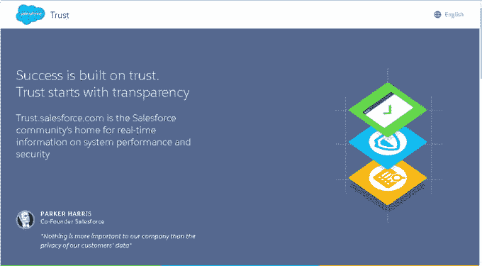

图 9-1 Salesforce Trust 网站

## Salesforce 安全模型

控制对您 Salesforce 组织的访问级别对于确保客户和数据保护至关重要。虽然 Salesforce 致力于最高级别的数据保护，但您的系统管理员应配置安全设置，以使系统尽可能安全。通过考虑数据的主要风险来设计安全计划，然后了解 Salesforce 共享架构及其组件，以正确配置您的安全设置。

基础知识 数据可以在 Salesforce 中的不同级别进行保护和分层。访问权限通过三种方式保护：对象级别、字段级别和记录级别。用数据库术语来说，对象就是一张表。`Objects` 保存可能相关的信息分组。这包括存在于其中的记录。`Records` 是表中包含的信息行。

`Accounts`、`contacts` 和 `opportunities` 只是标准 Salesforce 对象的几个示例。图 9-2 显示了 `Account` 对象中账户记录的列表视图。Cloud Creations HQ 是 `Account` 对象中账户记录的一个示例，如图 9-2 所示。

每条记录都存储关键信息片段。这些被称为 `fields`。用数据库术语来说，字段是表中的列。在图 9-2 中，账户名称、账户站点和电话都是账户记录中字段的示例。请参阅图 9-2 来识别对象、记录和字段之间的区别。

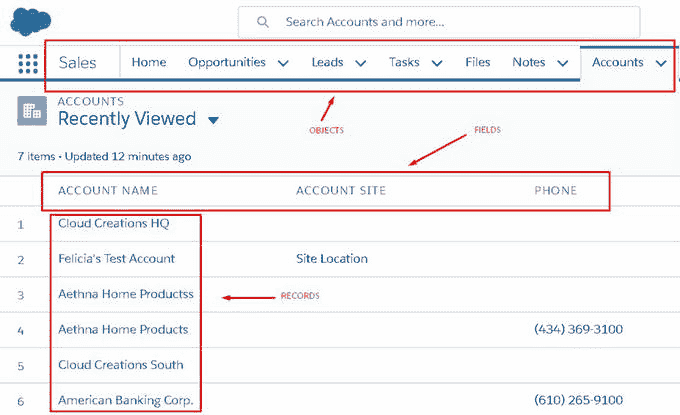

图 9-2 识别对象、记录和字段

## 简档和权限集

`Profiles` 包含一组设置，用于确定用户或用户组在 Salesforce 中可以看到和执行的操作。`permission set` 包含相同的管理设置集合，但可以作为额外的权限层分配给单个用户或用户组。

### 注意

最佳实践是为单个用户分配 `permission set`，而不是创建无数个简档来分配适当的设置和权限。

### 简档

所有用户都必须分配一个 `profile`，并且一个简档可以分配给多个用户。但是，一个用户只能被分配一个简档。通常，简档根据用户的工作职能进行分配。这通常是因为具有相同工作描述的用户通常需要相似的访问级别。

例如，您可能为营销用户、客服人员、销售代表和开发人员设置不同的安全要求。建议您创建或修改简档以满足他们的特定要求。

### 简档主页

我们建议您熟悉简档主页上的不同简档设置。此页面分为以下权限和设置。

#### 控制台设置

点击 `Edit` 以控制每个简档的控制台设置（如图 9-3 所示）。

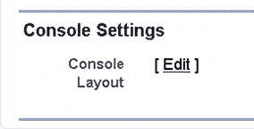

图 9-3 控制台设置

#### 页面布局

可以为每个简档配置页面布局。点击所需对象旁边的 `View Assignment`，为简档配置不同的页面布局（如图 9-4 所示）。

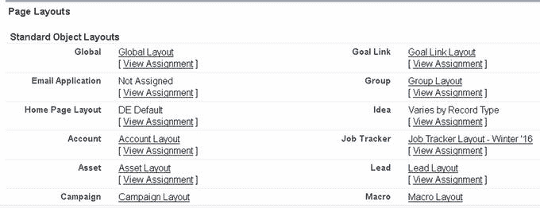

图 9-4 您可以在简档级别控制每个对象的页面布局。

#### 字段级安全性

一旦授予了对象级访问权限和记录级访问权限，您就可以控制在简档级别哪些字段可见。导航到字段级别，点击所需对象旁边的 `View`，以控制简档应对某个字段拥有的访问级别。点击 `View` 后，您将看到与该对象相关的所有字段列表以及当前的字段级权限。点击 `Edit` 以更改相应字段（如图 9-5 所示）。

点击 `Read Access` 可使字段可见。选择 `Edit Access` 以允许用户查看和编辑字段。取消选择 `Read Access` 和 `Edit Access` 可使字段隐藏。

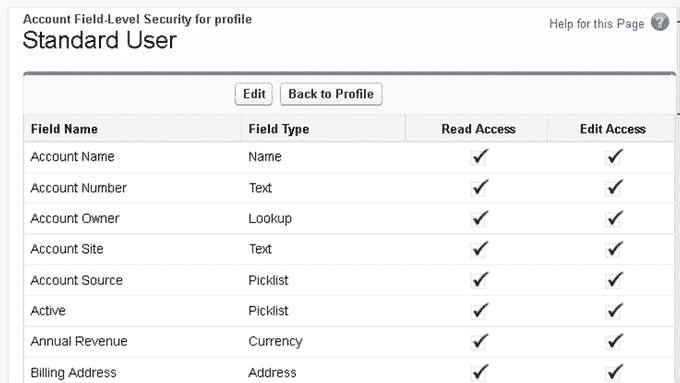

图 9-5 账户级别的字段级安全性

让我们看一个例子。假设 Michael Scott Paper Co. 使用 Salesforce 来跟踪销售和会计信息。但是，CEO Michael Scott 不希望销售代表看到敏感的财务信息，如信用卡号和社会安全号码。

为了解决这个问题，为销售代表创建一个简档，为会计部门创建另一个简档。对于每个简档，点击账户旁边的 `View Assignment` 并编辑字段安全性。对于销售代表简档，取消选择信用卡和社会安全号码字段中的 `Read Access` 和 `Edit Access`。这将从分配给销售代表简档的用户那里隐藏这两个字段。以分配给销售代表简档的用户身份登录以测试您的操作。

#### 应用程序和选项卡设置

在简档的 `Custom App Settings` 部分指定哪些应用程序可见并设置默认值（如图 9-6 所示）。

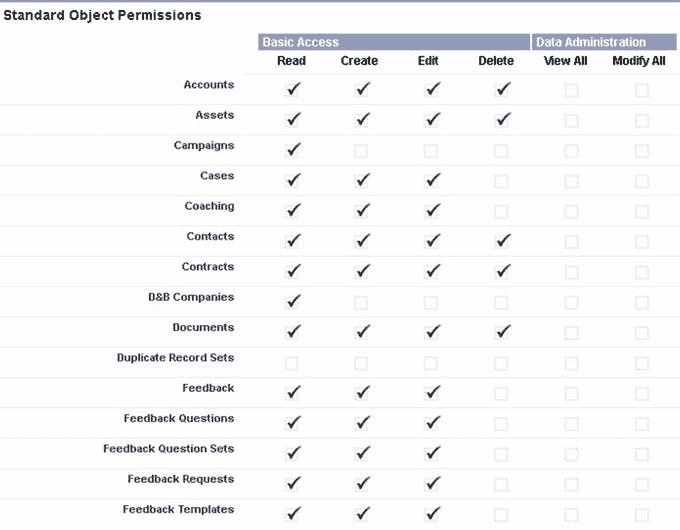

图 9-6 简档中的自定义应用程序设置区域

#### 记录类型设置

记录类型可以在简档级别分配。对于有记录类型的对象，请在相应对象旁边添加记录类型。

#### 管理权限和常规用户权限

简档有两种权限类型：管理权限和常规权限，如图 9-7 和 9-8 所示。熟悉这些精细的权限类型，以便您能更好地管理一个安全的组织。

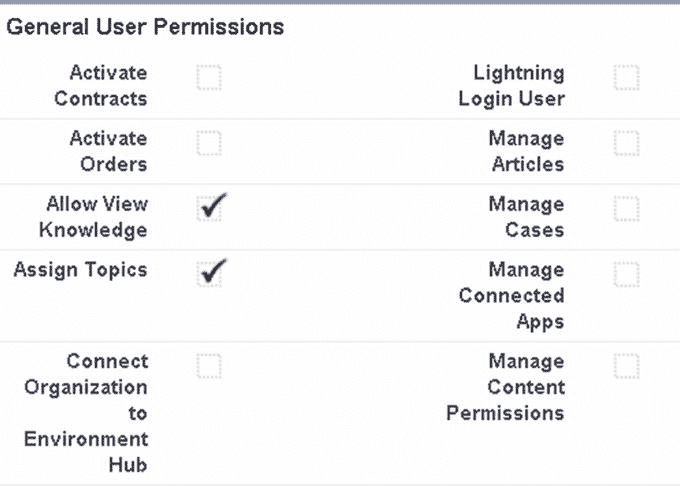

图 9-8 简档级别的常规用户权限部分

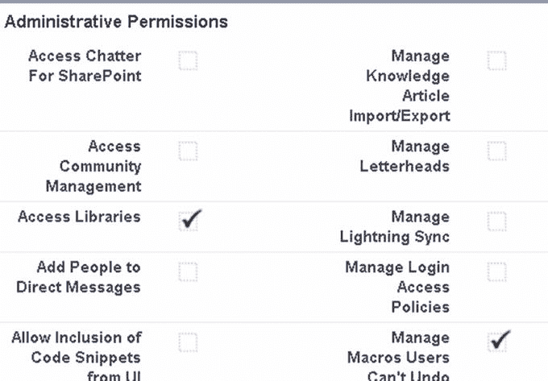

图 9-7 位于简档中的管理权限部分

## 对象级安全

对象级安全存储在配置文件的 `对象权限` 部分。作为起点，用户必须对某个对象拥有适当的访问级别，才能查看该对象及其中的记录。您可以在配置文件中控制对象级安全，如图 9-3 所示。

以下是用于设置用户对每个对象访问级别的不同权限类型：

- `读取`：用户可以查看记录。
- `创建`：用户可以创建记录。
- `编辑`：用户可以读取和编辑此对象中存储的记录。
- `删除`：用户有权读取、编辑和删除记录。
- `查看全部`：用户可以查看此对象中存储的所有记录。
- `修改全部`：用户可以修改此对象中存储的所有记录。

为标准对象和自定义对象设置 `对象级安全`。定义配置文件应具有 `读取`、`创建`、`编辑`、`删除`、`查看全部` 或 `修改全部` 权限，如图 9-9 所示。

图 9-9 — 设置对象级安全

## 密码策略、登录时段和 IP 范围

您可以指定密码过期时间、密码要求、会话超时等。您还可以控制每个配置文件的登录时段和可接受的 IP 范围。

## 分配配置文件

共有六种不同类型的标准配置文件：

- `系统管理员`：将此配置文件分配给需要访问许可证内所有功能的用户。此配置文件拥有查看和修改所有数据的权限。
- `标准用户`：此配置文件具有核心平台功能。他们可以查看、编辑和删除其有权访问的记录。
- `解决方案经理`：此配置文件拥有与 `标准用户` 相同的功能，并增加了管理已发布解决方案的权限。
- `营销用户`：此配置文件拥有与 `标准用户` 相同的功能，并增加了导入潜在客户、管理营销活动和管理沟通模板的权限。

# 配置文件

- **`合同经理`**：此配置文件拥有与`标准用户`相同的功能，并增加了管理和审批合同的权限。

- **`只读`**：此配置文件只能查看其有权访问的记录，并运行报告和导出数据。

## 创建自定义配置文件

创建自定义配置文件，为不同的用户组构建一套独特的权限集。请按照以下步骤创建自定义配置文件：

1. 从`设置`菜单中搜索并选择`配置文件`（如图 9-10 所示）。

   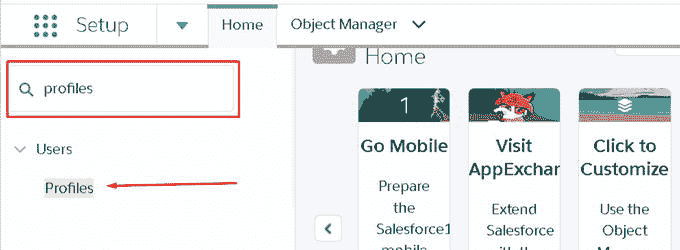

   **图 9-10** — 在 Salesforce 中导航到`配置文件`

2. 要创建新配置文件，请单击`新建配置文件`，如图 9-11 所示。

   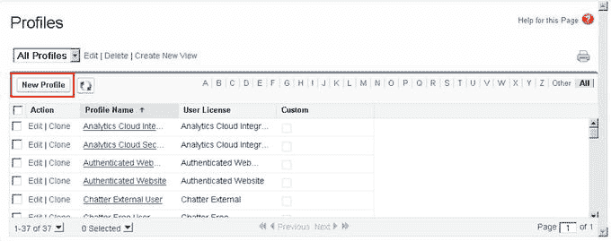

   **图 9-11** — 配置文件主页上的`新建配置文件`按钮

3. 要创建自定义配置文件，您必须从现有的标准配置文件克隆一个。选择一个要克隆的标准配置文件，然后单击`克隆`。

4. 输入新配置文件的名称，然后单击`保存`，如图 9-12 所示。

   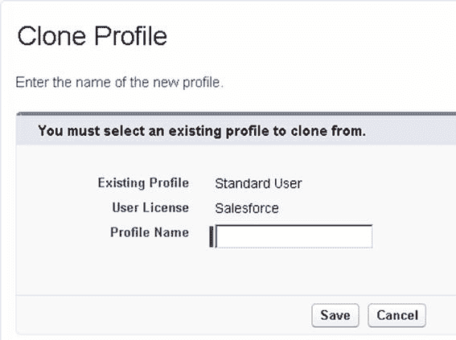

   **图 9-12** — 命名您的自定义配置文件

要完成对此配置文件查看和操作权限的更改，请单击配置文件名称旁边的`编辑`。根据您的新配置文件修改相应的权限，如图 9-13 所示。

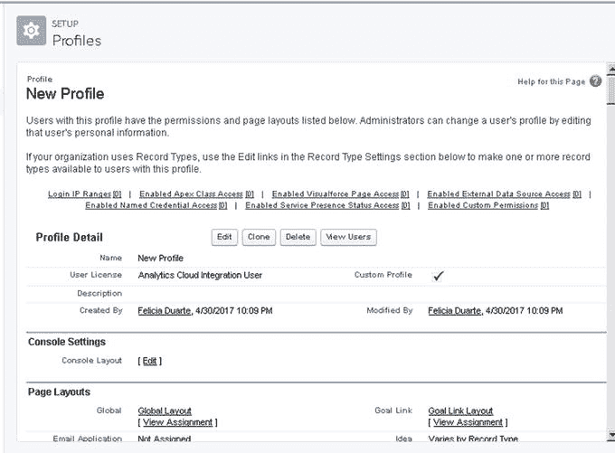

**图 9-13** — 配置文件主页

> **注意**：所有用户都必须有一个分配的配置文件，并且配置文件可以分配给多个用户。但是，每个用户只能分配一个配置文件。
>
> 那么，当您需要向单个用户授予额外权限时，该怎么办？
>
> 例如，假设您想将`创建报告`权限扩展到单个用户。我们建议创建权限集，而不是创建新配置文件或编辑现有配置文件上的权限。

# 权限集

权限集是一组权限和设置，可以分配给需要的用户。

请按照以下步骤创建权限集：

1. 在`设置`中搜索`权限`，然后单击`权限集`。

2. 单击`新建`按钮创建新的权限集，如图 9-14 所示。

   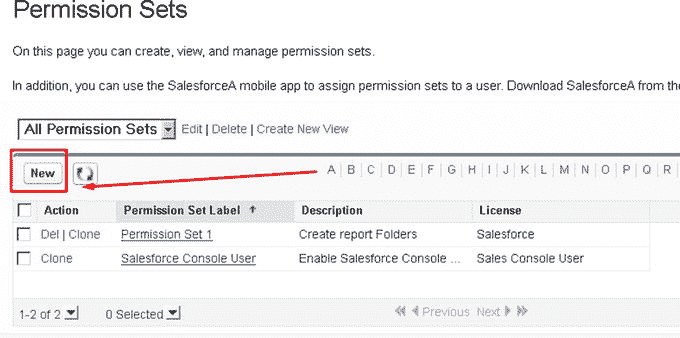

   **图 9-14** — 权限集主页

3. 在`标签`字段中输入权限集名称，并提供详细描述，如图 9-15 所示。

   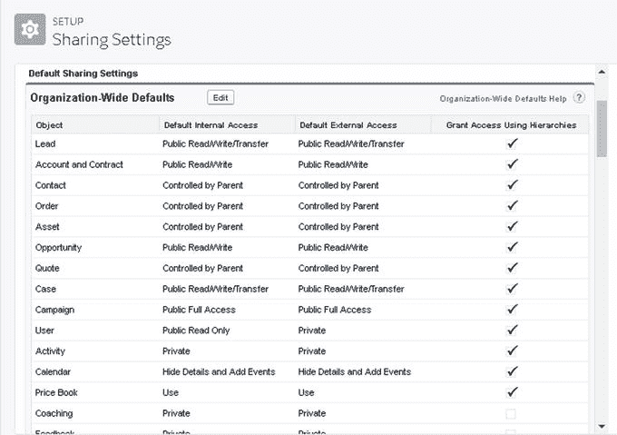

   **图 9-15** — 创建权限集的步骤

4. 选择将使用此权限集的用户类型。

> **提示**：最佳实践是为您的权限集添加描述。当存在多个权限集时，这使其更易于查找。

# 记录级安全

记录级安全指定用户在每个对象中可以查看和编辑哪些记录。

## 记录所有权

Salesforce 中的每条记录都必须有一个所有者。所有者可以是用户或队列。默认情况下，记录所有者拥有完全访问权限。这意味着他们可以查看、编辑、删除、转移和共享记录。

## 组织范围默认值

默认情况下，您的 Salesforce 组织以公共共享模型运行。我们称之为*组织范围默认值*（`OWD`）。这意味着，只要用户具有适当的对象级安全，他们就可以按对象查看和编辑所有数据。要限制某些记录的可见性，请考虑对该对象使用私有共享模型。

### 私有还是公共？

在考虑对某个对象使用私有还是公共模式时，请思考：您的数据中是否有任何部分应限制给特定用户？

如果答案是肯定的，那么您应该对该对象使用私有共享模型。

如前文图 9-2 所示，组织范围默认值具有最高级别的限制。这是唯一限制访问的安全组件。

所有其他安全组件都旨在共享访问权限。通过角色、手动共享和共享规则，可以将记录访问权限开放给特定用户或用户组。

### 更改共享设置

如需修改组织的默认设置，请导航至`设置`中的`共享设置`。

要控制外部用户的共享设置，必须首先启用外部共享。在`设置`区域的`快速查找`中选择`共享设置`，然后点击`启用外部共享`。

此处可按对象查看内外部用户的访问级别，如图 9-16 所示。

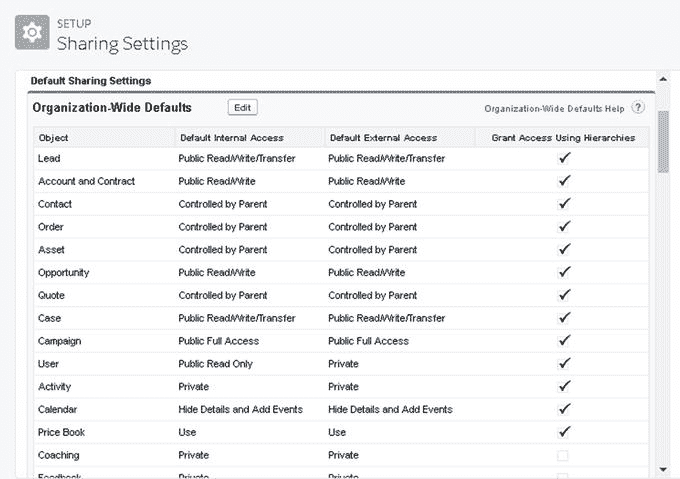

图 9-16 默认组织范围设置

外部用户包括社区用户、访客用户、网站用户、`Chatter`外部用户和门户用户。您可以为内部和外部用户分别设置每个对象的共享设置。

选择`编辑`可将设置更改为以下任一选项：

*   `私有`：此对象中的所有记录均为私有，仅记录所有者、角色或共享规则可见。

*   `公开只读`：此对象中的所有记录以只读形式可见。

*   `公开读写`：此对象中的所有记录对所有用户可见且可修改。

*   `公开读/写/转让`：此对象中的所有记录对所有用户可见、可修改且可转让。

*   `由父对象控制`：用户在主从关系的明细对象上拥有相同级别的访问权限。

选择`标准报表可见性`可启用对报表中数据的可见性，这些数据可能因组织范围默认设置而无法访问。

选择`手动用户记录共享`可允许用户手动将记录共享给其他用户。

选择`经理组`可允许用户与其经理组共享记录，如图 9-17 所示。

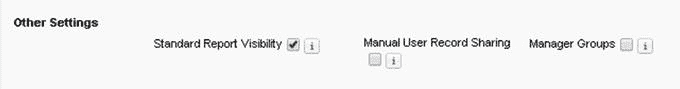

图 9-17 其他安全设置

# 角色层次结构

一旦通过 `OWD` 限制了数据，您就可以使用角色层次结构来开放可见性并共享记录访问权限。角色定义了用户或用户组自上而下拥有的访问级别。记录访问权限会沿层次结构向上汇总。

例如，在`销售经理`下创建一个名为`销售代表`的分支，以便销售经理可以访问其下属销售代表的记录，如图 9-18 所示。

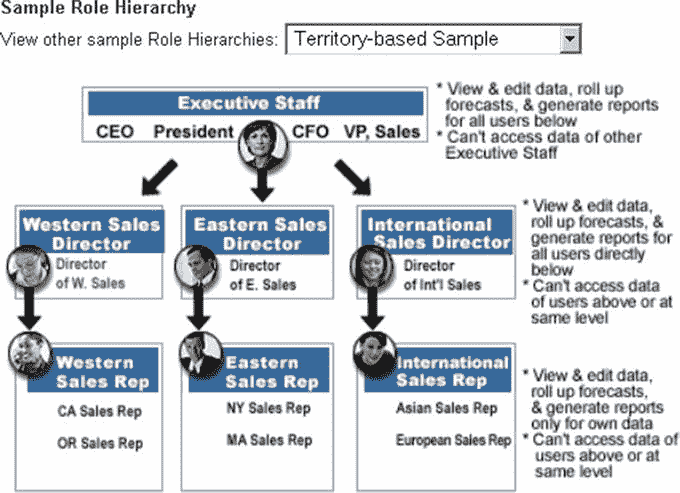

图 9-18 理解角色首页

### 备注

在设计角色结构图时，请记住角色层次结构不一定与您的执行组织架构图相同。通常，您是为层级结构中的每一级创建角色，而不是为每个职位创建。

如果某个角色在角色层次结构中位于其他角色之上，则该角色将被授予对该分支下所有记录的相同访问级别。因此，如果访问权限是只读的，则授予相同的记录访问级别。

### 创建新角色

使用角色来定义用户如何查看和共享记录。正确的角色结构取决于组织的文化。

要创建角色，请遵循以下步骤：

1.  在`快速查找`框中搜索`角色`，然后点击导航。

2.  选择`设置角色`。

3.  选择`展开全部`以查看`Salesforce`的默认设置。

4.  在相应分支下点击`添加角色`以在其下方添加一个分支（参见图 9-19）。

    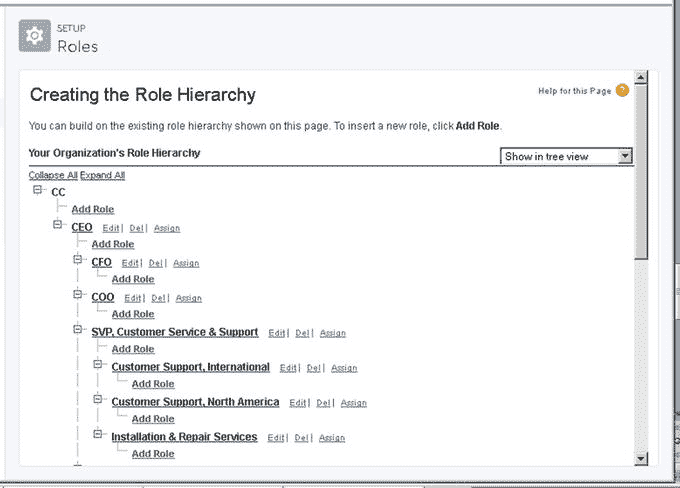

    图 9-19 展开的树形分支视图

5.  填写以下详细信息以成功保存新角色，如图 9-20 所示：

    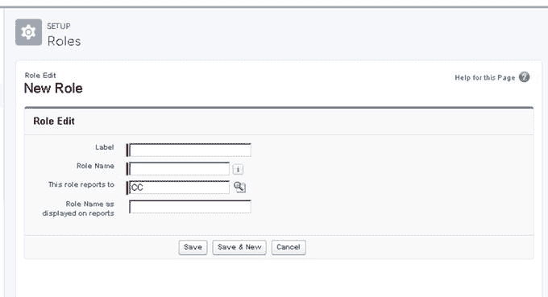

    图 9-20 创建新角色的步骤

    1.  `标签`：这是用于命名角色的名称。示例可包括销售副总裁、区域经理等。按`Tab`键可自动填充角色名称。

    2.  `角色名称`：这是唯一的 API 名称。此角色需向上级角色汇报。

6.  将用户分配到指定的角色。

通过选择分配，您可以搜索未分配的用户并将其连接到适当的角色。您也可以导航到用户的个人资料并选择`编辑`来分配角色。

### 共享规则

您可以使用共享规则来向可能被排除在数据访问之外的特定角色、组或个人用户授予数据访问权限。共享规则可用于覆盖现有的安全限制。

### 公共组

可以创建组以简化共享和安全性。这可以包括个人、具有特定角色的用户或其他公共组的成员的组合。

### 创建公共组

在创建共享规则之前，您必须创建一个公共组。请遵循以下步骤创建一个公共组：

1.  在`快速查找`框中搜索`公共组`。

2.  点击`新建`或将`视图`设置为`全部`以查看现有组的列表（图 9-21）。

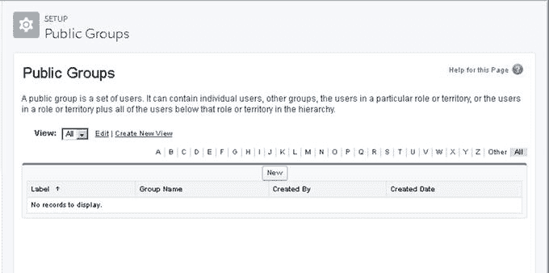

图 9-21

设置公共组

3.  填写以下详细信息，如图 9-22 所示。

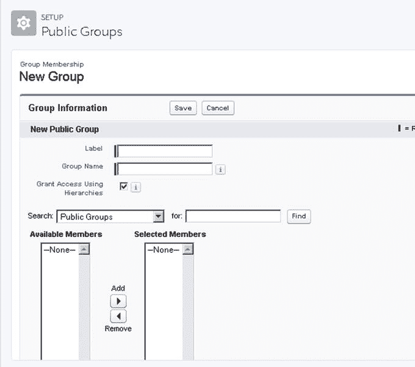

图 9-22

向公共组添加成员

*   在`标签`中输入公共组的名称。
*   在`组名称`中输入唯一的 API 名称。
*   要将成员添加到公共组，请将其从`可用成员`移动到`已选成员`。

4.  点击`保存`。现在您已拥有一个包含成员的新公共组。

#### 手动共享

手动共享可用于通过共享按钮向个人提供对记录的访问权限。

给予对其他记录的访问权限需要满足四个前提条件。这些前提条件要求：

*   您是记录所有者。
*   您的角色高于记录所有者。
*   您对该记录拥有“完全访问”权限。
*   您是系统管理员。

## 总结

在本章中，您学习了 `Salesforce` 如何在多层架构中处理安全问题，该架构支持更高的灵活性和保护性。请务必访问[`trust.salesforce.com`](http://trust.salesforce.com)，以透明地了解安全威胁和建议。

### 索引

#### A, B

`AppExchange` 市场 应用程序，lightning `AppExchange` 市场 `AppExchange` 网站 应用程序启动器 选择正确的应用程序 主页面 兼容性 顾问列表 主页 详细信息选项卡 亮点栏 信息 概览选项卡 安装详细信息，已安装和未安装的包 主页面 生产环境/沙盒，选择用户 应用程序选择 lightning 组件 包组件 价格 提供商 评论

#### C

案例自动分配规则：访问、创建、名称和激活字段条件设置、检索规则条件、向用户发送通知。
案例自动回复规则：访问、命名、检索规则条件、创建、设置电子邮件。
案例升级规则：操作设置、营业时间选择、创建、名称创建、导航、检索规则条件、创建。
案例队列：创建、命名和设置通知选项、对象选择、用户、组和角色选择。
电子邮件转案例设置：案例线程电子邮件验证导航、重新发送链接、电子邮件路由地址创建、Salesforce 登录页面设置、路由地址。
Web 转案例设置：Chatter 动态跟踪（请参见“动态跟踪”）。
通知：电子邮件通知、接收消息用户配置窗口。
对象概述：配置文件编辑、流程、头像修改导航、图片更新、用户配置文件侧边栏。
协作工具（请参见“Chatter”）。
逗号分隔值（CSV）文件。
公司设置：营业时间、公司信息、功能集许可证、组织详细信息、权限集许可证、存储使用量、用户许可证、会计年度。
联系人和账户报告：创建、拖放示例、报告选择、运行报告、保存选项。
客户关系管理（CRM）。

#### D, E

仪表板：图表创建、动态仪表板修改、命名和创建、报告和图表组件、报告查找、保存选项、选项卡创建。
数据库术语：字段、对象、记录。
数据控制工具。
数据导出：选择、包含图片、电子邮件频率、导航、设置菜单、对象、搜索、服务选项。
数据导入向导：访问账户和联系人、CSV 文件、编辑映射、字段错误消息、导入、映射字段、唯一/外部 ID、CSV 文件、导入数据、潜在客户分配规则、自动化流程、营销活动、CSV 文件、电子邮件字段映射、导入、启动、匹配、导航、设置菜单、搜索、源数据准备、快捷方式、搜索“设置”菜单。
重复规则：账户、联系人、创建新规则、“操作”部分、添加账户匹配规则、选择、设置记录级安全、潜在客户。

#### F, G, H, I, J, K

功能集许可证。
动态跟踪：Chatter 导航、设置菜单、步骤、跟踪设置。
字段级安全。

#### L

潜在客户分配规则。
潜在客户管理：转换按钮、确认页面、状态创建、编辑页面、错误消息、潜在客户记录、成功消息、列表视图、潜在客户记录活动部分、Chatter 选项卡、详细信息选项卡、重复区域、亮点面板、Lightning 体验、新闻选项卡、工作区工具栏。
潜在客户队列。
潜在客户报告：拖放、新报告、报告选项卡、运行选项、保存选项、源步骤、类型查找。
Lightning 助手：Lightning 体验主页、助手、收藏夹图标、全局搜索栏、帮助和培训、Lightning 操作、通知设置、查看配置文件、导航栏、新闻。
季度绩效：用户添加、多个用户按钮创建、停用、编辑用户信息、必填字段、添加新用户设置。
Lightning 体验迁移：启用/禁用、Lightning 功能迁移助手、预览选项卡、迁移助手就绪状态、开启用户设置。
Lightning 页面：App Builder、编辑页面、设置下拉菜单、Lightning 应用创建、添加选项卡、应用详情、分配用户、启用实用栏、导航选项、Salesforce 账户记录、Lightning 体验、Salesforce Classic。
Lightning Process Builder：操作类型、审批操作类型、计划操作选项、时间相关操作、更新记录、可视化设计、主页流程（请参见“流程自动化”）。
列表视图：创建、控制器、编辑页面、过滤器区域、过滤器逻辑、电子邮件模板创建、看板功能、批量更改状态、发送邮件。

#### M

批量删除记录：清理数据库、CRM 选项。
批量转移记录：条件、放大镜图标、已转移记录数、选择、设置菜单、转移账户。
矩阵格式报告。
移动应用（iPhone 和 Android 用户）：紧凑布局完成、创建、编辑分配按钮、导航、新建按钮选择、概述、快速入门指南、操作修改、联系人紧凑布局、全局操作、邀请用户、修改、导航菜单、审核、向导配置。

#### N

导航栏。

#### O

对象级安全。
机会：标准过滤器、所有权、概率、智能日期、状态。
机会报告：创建、详情、拖放、示例、字段过滤器、报告类型选择、保存选项。
组织范围内默认值（OWD）：更改共享设置、私有/公开对象。

#### P, Q

权限集许可证。
流程自动化：添加条件节点、创建条件步骤、操作名称和记录类型、条件、执行操作、字段值、立即操作、命名流程、流程激活、保存选项、主页和流程列表、命名流程、对象选择、记录更改、记录多次、保存选项、设置菜单。
产品：活动动态配置、自动回复规则、事件创建、任务创建、活动时间线创建、机会创建、Web 转潜在客户自动回复规则、Web 转潜在客户表单。
配置文件：管理权限、控制台设置、创建自定义应用设置、字段级安全、常规用户权限、主页、对象级安全、页面布局、记录类型设置、标准。
公共组。

#### R

记录级安全。
记录所有权。
报表构建器：图表、联系人和账户报告、数据汇总、导出数据、公式、潜在客户、机会报告、表格、摘要和矩阵报告、格式调整、矩阵、摘要、表格、主页、类型、自定义报告定义、字段、帮助页面、对象创建、与对象的关系、报告类型、设置菜单。
角色层次结构：创建新角色、主页、手动共享、公共组、共享规则。
推广方法。

#### S

Sales Cloud Lightning：账户、活动时间线、联系人、潜在客户分配规则、潜在客户队列、营销活动创建、列表视图（请参见“列表视图”）、管理（请参见“潜在客户管理”）、机会创建、阶段历史、产品（请参见“产品”）。
Salesforce 案例管理。
Salesforce 全局搜索栏。
Salesforce Lightning 体验。
Salesforce Service Cloud：案例自动化（请参见“案例自动化”）、案例记录创建、协作、案例记录、案例动态、动态过滤器、标准案例字段和列表、案例信息字段、案例布局、案例对象、联系人信息、描述信息、网络信息。
侧边栏：人工智能（AI）、Chatter 动态、投票创建、对象问题、记录访问、查看结果、动态创建、群组创建、帖子、书签记录的动态流创建、主题创建。
标准过滤器：账户、营销活动、案例过滤器、所有权、智能日期、单位、交叉过滤器、字段过滤器、完成、拖放、锁定字段过滤器、操作符选择、选择列表字段、潜在客户、逻辑语句、机会行限制、智能日期过滤器。
摘要格式报告。

#### T, U, V

表格报告：拖放字段、格式、报告类型选择、排序选项、步骤。

#### W, X, Y, Z

工作流规则 与 流程构建器。