# 第一部分 人

# 1. 团队与分工

当我告诉我当时所在公司的 CEO 我将创办自己的公司时，他对我说了这样一番话：“你招聘并培养过人，但从未解雇过任何人。不要急于创业，你需要学习人员管理，并理解如何建立和培养一个技术团队。”

我听取他的建议了吗？没有！如果我当时听从了建议，就不会在实际操作中获得学习团队管理艺术的速成课程。那样的话，这个过程将会持续更长时间。

本章的出发点在于：人员管理并非可教授之物。我试图总结自己在人员管理方面的经验，以便当你经历类似情况时，能帮助你更好地应对。你需要通过亲身经验来学习，并且要牢记一点：同理心。就我而言，随着团队壮大，我在团队较小时建立的文化，会随着新成员的加入而传播开来。

## 为什么要划分团队？

在更传统的旧式工作方式中，业务需求来自组织的多个部门，汇总到一个单一的技术团队。技术团队会列出这些需求，然后遵循冲刺流程逐一实现。那时的团队是整体式的，工作方式往往是顺序进行的。在 2010 年左右敏捷方法论出现之前，为了解放团队使其能自主决策而无需等待层级审批，公司一直依赖层级审批。这不仅体现在技术领域，也贯穿于业务的每一个职能。在敏捷时代之前，当我们预期某个项目需要在一定天数内完成时，我们按照顺序方式工作，如图 1-1 所示。

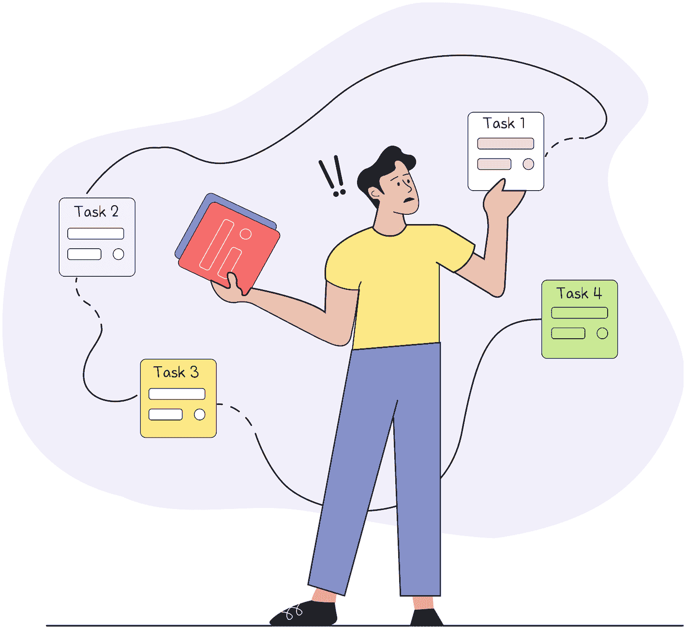

按顺序执行工作的流程图，任务 1 完成后才进入任务 2。

**图 1-1** 任务的顺序执行

这让我们陷入了孤岛。我们开始变得目光短浅，无法预见项目后期可能出现的障碍。更好的方法是并行开发。但如何实现并行开发呢？

你可以尽可能细化地将团队划分为原子化的部门。如果有一个大项目即将启动，就在项目开始前规划好该项目的模块。

让我们看一个例子：一个允许用户创建自己的工作流并自动化一系列重复任务的网站。我们称这个网站为“超棒自动化平台”。图 1-2 展示了该网站的登录后视图可能的样子。

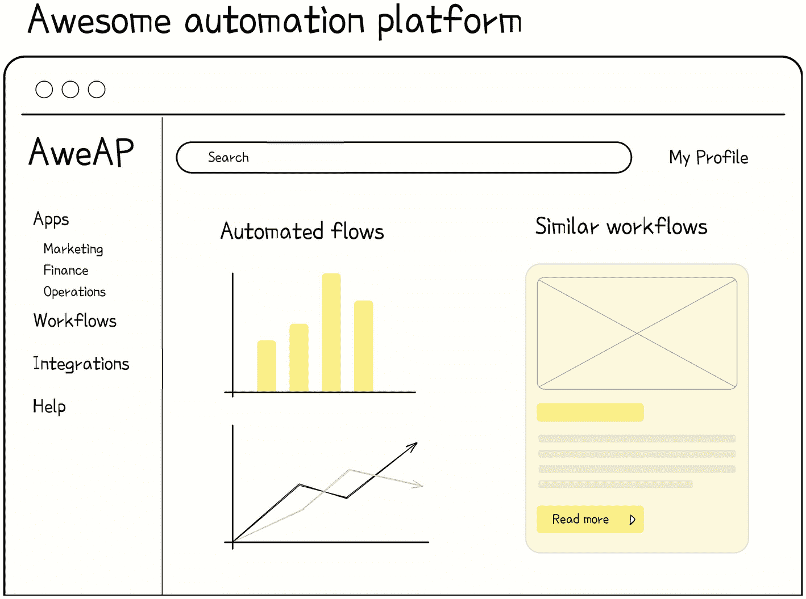

为公司工作流创建的“超棒自动化平台”网站页面概览。此窗口显示网站的登录后视图。

**图 1-2** “超棒自动化平台”网站线框图

开始处理平台登录后视图的最佳方式是，首先识别出网站中互斥的区域（图 1-3），并将其划分为以下模块：

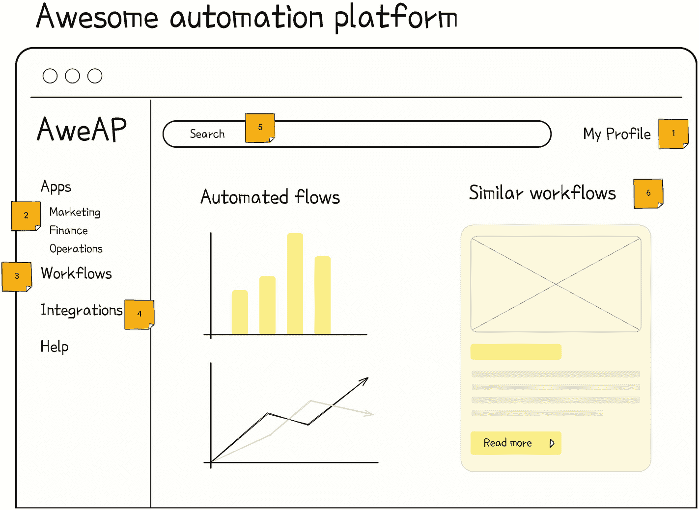

网站上显示的 6 个互斥区域分别是：个人资料、应用、工作流、集成、搜索和仪表盘。

**图 1-3** 识别可独立工作的互斥区域

1. `个人资料`：包括登录/注销/注册。
2. `应用`：此部分包含平台上可用于创建自动化的所有应用。
3. `工作流`：这是平台的核心，将是驱动其运行的“大脑”。
4. `集成`：此处提供不同的第三方集成。
5. `搜索`：一个快速易用的搜索栏。
6. `仪表盘`：此区域显示当前使用情况的图表和分析，并展示推荐的工作流。

## 并行优于顺序工作

根据上述网站模块的定义，我们可以提出一个团队结构，然后启动该项目，并并行开展工作（图 1-4）。

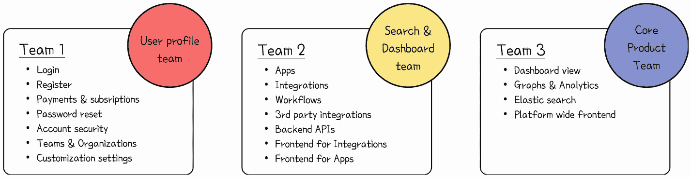

并行执行工作的示意图，涉及 3 个团队：用户个人资料团队、核心产品团队以及搜索与仪表盘团队。个人资料团队执行登录、注册和个性化设置等任务。核心团队负责应用、第三方集成、后端 API、前端工作流或应用。服务团队处理图表和分析。

**图 1-4** 工作的并行执行

这将确保工作开始时，团队能并行交付，而非顺序进行。并行开发能保障每个团队的自主权，使其交付价值并创新（图 1-5）。

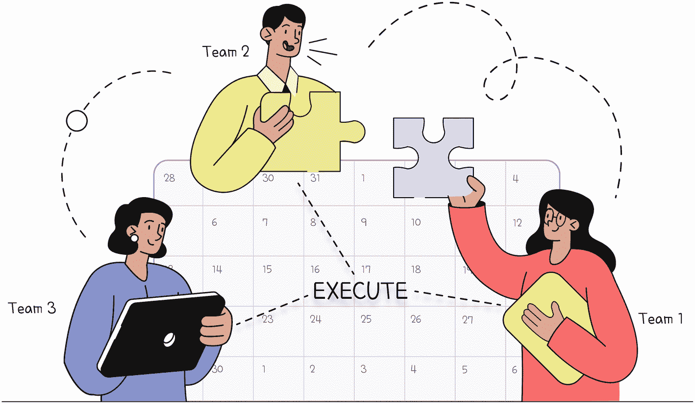

一幅草图展示了 3 个团队，每个团队一人。团队 3 的人员在记笔记。其他人在拼接拼图碎片。它们之间用虚线连接，表示执行。团队 2 和团队 3 之间由一条中间带圆圈的虚线曲线连接。团队 1 和团队 2 之间由一条扭曲的丝带形曲线连接。

**图 1-5** 任务的并行开发

如你所见，以每个团队能够并行执行的方式创建组织或子组织的部门/分工至关重要。

## 总结

当团队拥有身份和目标时，他们才能蓬勃发展。为每个组建的团队创建并维护一个愿景至关重要。例如，一个 `Scrum` 团队可以由七到八人组成，包括开发人员、质量保证分析师和自动化工程师，并可能配备一个专职或共享的项目经理。如果不这样做，将导致项目失去焦点，并与公司目标脱节。愿景将是让团队独立运作、快速高效执行策略的关键。

# 2. 招聘

招聘很难。技术招聘难上加难。在技术领域招聘优秀人才更是难如登天。而招聘那些真正能留下并为核心产品做出重大贡献的优秀技术人才，则难上百倍。至于招聘那些不仅能留下、做出重大贡献，还能帮助招聘其他优秀人才、从而建立起人才网络的精英，简直是难到极致。

本章将展示我如何尝试、失败、成功、试验，并混合搭配不同方法来打造我的技术团队。

## 内部推荐

你认识一个人，他认识另一个人，而这个人又认识另一个人（图 2-1）。内部推荐在大多数情况下都有效。但切勿仅凭推荐就录用某人。在我的初创公司，我始终坚持一定流程：我的推荐人由架构师面试，架构师的推荐人由我面试，以此类推。

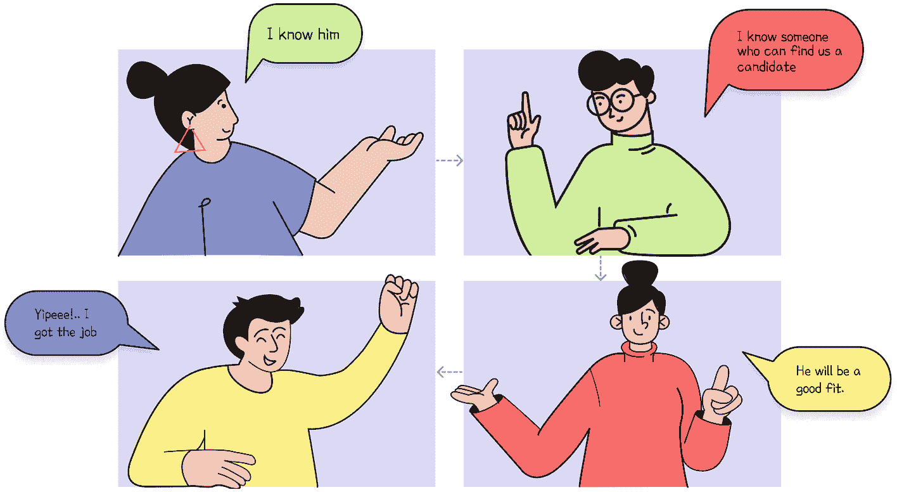

一张三个火柴人的图，描绘了内部推荐招聘。第一个人认识中间的人，中间的人又认识面试官。

图 2-1

内部推荐

无论谁向你的公司推荐职位候选人，始终要进行编程测试。他们有多少经验并不重要。那些在以前公司做出过重大贡献的人，也未必总能胜任。当前环境的文化至关重要。这个人能否适应新环境？这是你在他入职后也必须始终追问的问题。如果你决定录用一个明知不合适或无法适应新环境的人，最大的输家将是你自己。

话说回来，我确实也成功通过内部推荐招到了人才。当他们被赋予比以往更重的责任时，他们超越预期，比任何人都更加耀眼。有些人总能给我惊喜。

归根结底，内部推荐没有标准答案。有些推荐奏效，有些则不然。一个人能否成功取决于多个因素，因此在你评判新员工是成功还是失败之前，先问自己这些问题：

-   你是否让他们适应了新环境？

-   你是否给了他们足够的调整时间？

-   你是直接把他们抛入深海任其自生自灭，还是全程手把手指导？这能看出他们应对逆境的能力。

-   他们是否足够灵活，能够适应？

-   他们是否愿意付出额外努力来完成工作？

正如我所说，盲目信任内部推荐时，我既犯过错误，也取得过成功。经过多次讨论，我意识到盲目信任本身并非坏事，但需要平衡。你的同事会帮助你找到这种平衡，这就是为什么每个团队都需要多元化的成员。在决定录用某位推荐候选人时，他们可以为你提供建议，甚至直接向候选人本人给出恰当的反馈。

### 人力资源寻源

当你持续为开放职位招聘时，人力资源寻源非常有效。它能填补因团队扩张和接受更广泛、更多样化需求而产生的许多缺口。

我发现当急需用人时这种方法往往失灵，主要是因为人们匆忙时容易出错，最终为了填补特定数量的职位而面试了大量候选人。最好是与 HR 部门长期合作，帮助他们理解职位要求，从而能明智地筛选候选人。

## 顾问

对于架构师这类角色定义明确的专业职位，交给顾问来处理效果很好。当你清楚知道自己需要什么角色时，使用顾问很有帮助。与内部推荐和 HR 寻源中存在大量不确定因素（比如：我们能否录用这个人担任与招聘职位不同的角色？）不同，这里不存在这个问题。我们向顾问清晰说明所需角色，而他们恰好拥有所需的技能集。

通过使用高效的招聘工具（例如`Hirect`、`Recruitee`、`Intervue`等），可以优化招聘流程。此外，你可以让每个团队的负责人自主承担招聘责任和所有权，这能赋予团队极大的独立性。由于工作性质不同，每个团队的工作描述可能有所差异，而给予适当的自主权，让他们能从顾问人才库中招聘到优秀人才。

## 招聘活动

招聘活动是我个人亲身实践并深有体会的一种方式。尤其是在新冠疫情期间，招聘变得困难，因为人们正在适应完全远程的工作文化。在我的初创公司，我们制定了一个计划：首先梳理每个团队额外的人力需求。由于我们对即将开展的工作有全局把握，我们进行了推断并制定了增补资源的策略。人员需求如图 2-2 所示进行记录。

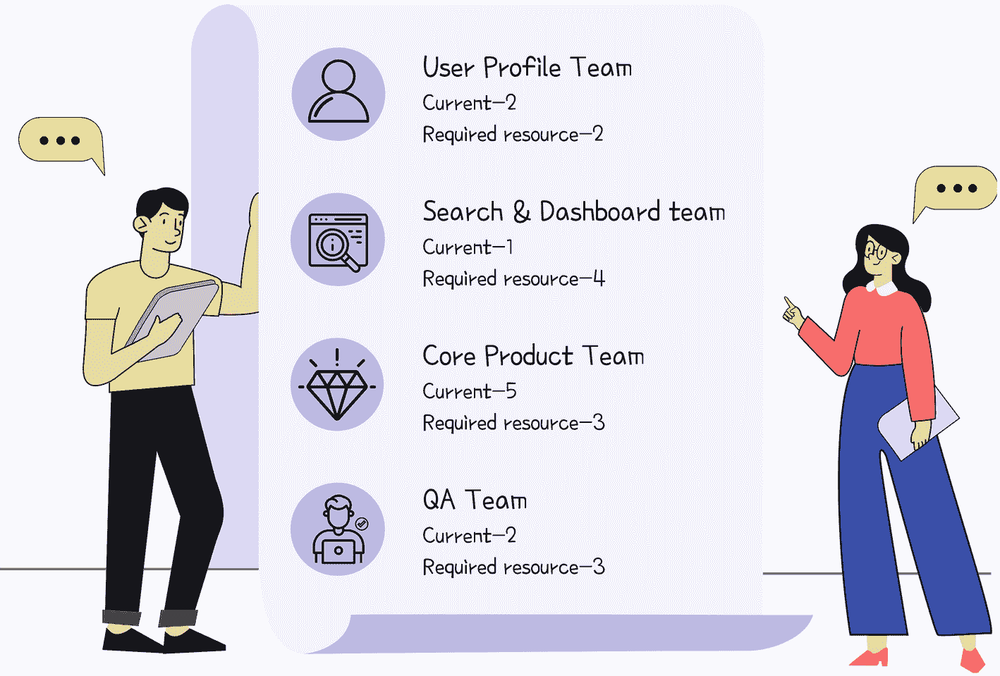

一份关于人员需求的示例计划，展示了各种职位角色，如用户资料团队、搜索与面板团队、核心产品团队和 QA 团队，总计额外资源需求约 12 人。

图 2-2

人员需求

一旦明确了这些需求，就该推断我们预计邀请多少候选人参加面试了。如果需要 12 名资源，那么图 2-3 显示了我们必须经过招聘流程筛选的人数。

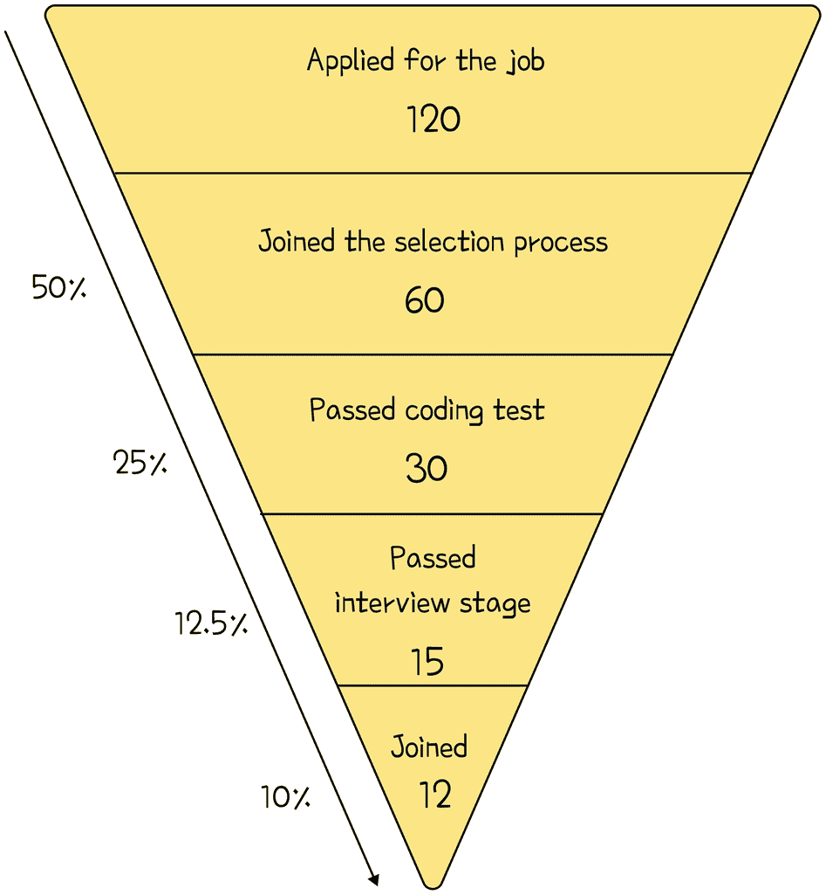

面试流程从应聘人数开始，分为 5 个阶段：120 名候选人应聘，经过选拔后仅 60 人入选；30 人通过编程测试，然后 15 人通过第 2、3、4 轮面试；最后，120 人中只有 12 人加入公司。

图 2-3

面试流程

每次进行招聘活动时，我们都遵循这一结构，这有助于了解我们预计会收到多少份申请。实际数字可能因团队、公司、流程而异，但准备好这些基准数字，将有助于增补资源和规划招聘活动。

招聘活动包含以下主要步骤：

1.  寻源

2.  筛选

3.  评估

4.  入职

由于本章已涵盖筛选和评估部分，我们来谈谈寻源。

在我的初创公司，除了使用社交渠道和自发传播外，我并没有固定的方法。我们制作了可以在`LinkedIn`上发布的宣传页。我们向母校发送邮件，由就业协调员邀请应届毕业生申请。

我在招聘活动中发现，尽管你招到的是新人，但你可以提升他们的技能，并按照公司需求进行塑形。他们的适应能力和学习速度远超你的想象。往往正是这些人，最终会成为你可以信赖的未来领导者。

## 总结

当初我在初创公司管理一个 12 人的团队时，我给予他们充分的自主权，让他们按自己的方式行事，但流程依然得以遵循。无需我刻意制定流程，冲刺规划、回顾会议以及所有敏捷仪式都得以执行。这是因为最初的招聘是经过谨慎把关的。塑造整个公司文化的，正是你最初招聘的那 10 个人。如果最初的人选出现失误，其影响将极为深远。最初的员工必须精挑细选。有了优秀人才作为根基，就可以奠定文化基础，确保后续招聘在态度上能效仿前人。

# 3. 技能提升

有两类人群需要进行技能提升和培训。

-   刚加入团队的应届毕业生

-   团队中需要提升技能的现有成员

那些持续学习的员工才能脱颖而出。他们往往能做出卓越成就，并激励他人共同学习。

学习应当是一个持续的过程。如果每天无法学习新事物、掌握新技能，那么我们就与昨日毫无二致。人类之所以能进步，正是因为人类勇于学习、体验新事物，并且敢于踏上未知的旅程。平淡重复的事情无法带来任何突破。因此，技能提升应当成为任何公司有效的技术驱动计划的一部分。

## 培训计划

团队成员最初在技术和功能方面的知识储备并不总是相等的。可能只有一个人（通常是项目负责人）了解大部分流程，而团队中往往既有技术专家，也有功能专家。一个典型的新项目初创团队可能如图 3-1 所示。

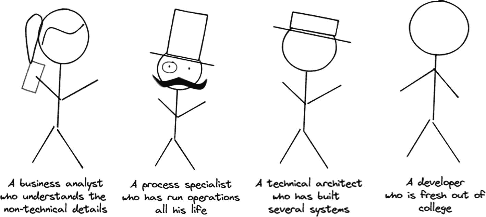

四个小人简笔画。1. 一位理解非技术细节的业务分析师。2. 一位一生从事运营的流程专家。3. 一位构建过多个系统的技术架构师。4. 一位刚毕业的开发者。

图 3-1 新项目团队工作图

假设这个团队正计划开发一个新的应用。现在，假如公司内部同时有多个类似项目并行开展，我们该如何确保那位刚毕业的开发者能够理解业务分析师、流程专家和技术架构师所说的话呢？

这只能通过有效的培训计划来实现。

-   第 1 天：简介

-   第 2 天：`IT` 与 `HTML`

-   第 3 天：`Bootstrap` 与编程

-   第 4 天：`Javascript`

-   第 5 天：前端技术

-   第 6 天和第 7 天：后端技术

-   第 8 天和第 9 天：数据库技术

-   第 10 天：开发运维

-   第 11 天：`Github`/代码提交软件

-   第 12 天：全栈开发

-   第 13 天：敏捷与测试

-   第 13-16 天：项目规划与开发

确保每一位应届毕业生都参加一次完整的培训，并且培训结束时有一个类似真实工作的项目。这能给他们带来信心，然后引导他们完成在实际项目中通常会遇到的实际任务。

## 在职培训

如果当初招聘候选人的同一批人来准备在职培训的教材，那么新员工就能更容易地进行有效学习，因为培训计划会契合已招聘人员的资质。培训计划的准备会因公司和项目而异，但一个典型的计划如图 3-2 所示。

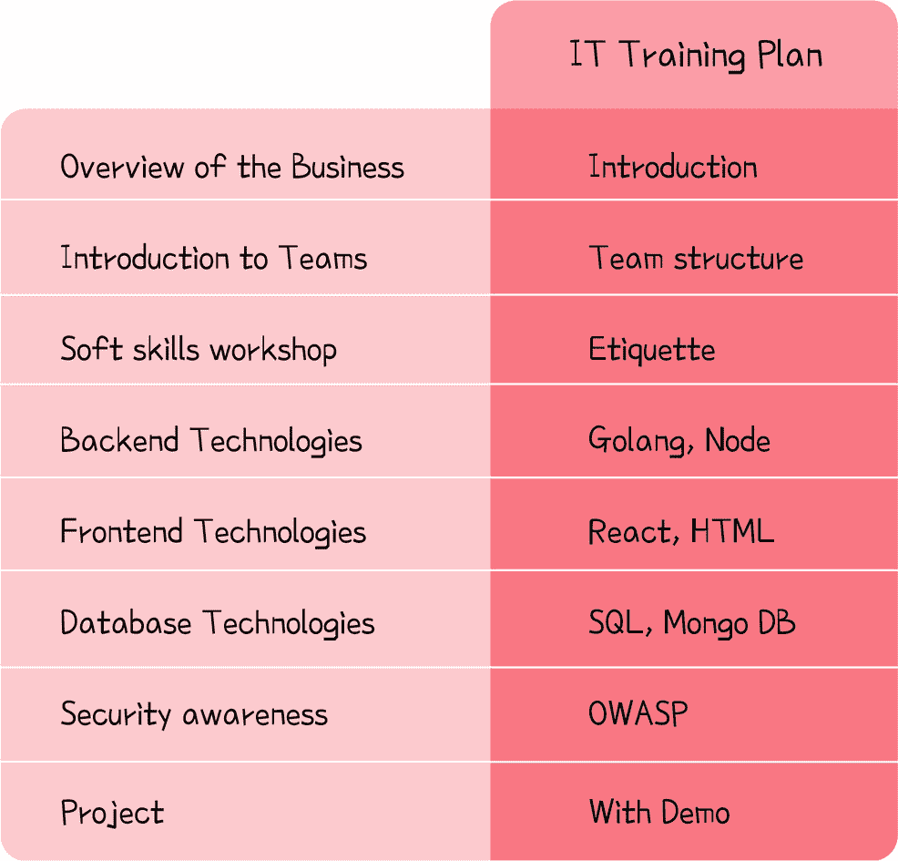

一个典型的技术培训计划包括业务概述、团队介绍、软技能研讨会，以及各种后端、前端和数据库技术。还包括安全意识、项目管理、团队结构、礼仪、`node`、`HTML`、`MongoDB`、`SQL` 和 `OWASP` 的信息，以及整个策略的演示。

图 3-2 一个典型的技术培训计划

在职培训有两种方法。假设要完成的任务是横跨大洋；培训计划可以是以下两种之一：

-   陪学员游到一半路程，让学员自己游完剩下的距离。

-   陪学员游到一半路程，让学员自己游完剩下的距离，但向他们保证你会在那里支持他们，如果他们游累了，你会带着他们游。

我曾经采用第一种方法，但失败了，现在改用第二种方法。但有时，比如当你确实需要测试一个人的真实能力时，第一种方法可能会派上用场。不过，不要在关键任务项目中使用第一种方法；相反，可以在那些你或其他人有能力在项目中途出现问题时挽救的项目中使用它。

如果你过去有过不愉快的培训员工经历，你可能会犹豫是否要花时间指导他们。例如，我曾多次培训某人好几个月，但最终他们却因各种我无法控制的原因而辞职了。这些事情令人沮丧，尤其是当你为他们培训过的项目又重新落到了你头上时。这可能会让你倒退好几个月，你不得不再次经历招聘和培训的过程。

## 总结

团队中总会遇到各种困难。例如，会有人离开。这确实无法避免，所以时刻做好准备总归是好的。如果可能的话，你可以为一个职位培训更多人，而不仅仅是培训一个人。保持开放的沟通渠道，捕捉那些能预示即将发生之事的早期警告或迹象。

# 4. 人员管理

人员管理被定义为一套实践，涵盖人才招聘、人才优化和人才保留的端到端流程，同时为业务提供持续支持，并为组织员工提供指导。人员管理需要耐心，并且必须以积极的态度和真诚的心来进行。有效的人员管理没有单一的公式，但有一些框架和工具可以帮助我们为与我们共事的人创造一个良好的环境。

有效的人员管理不仅要在团队内部营造良好氛围，也要惠及团队之外；如果做得好，它能够产生广泛影响，并以积极的方式影响整个公司。

我们需要帮助同事找到他们的节奏，这将有助于他们发挥最佳工作效率。这对于不同的人来说是不同的。仅凭你作为领导者一人之力无法完成；因此，应该建立一些流程来帮助你实现有效的人员管理。

## 一对一会议

一张素描画，描绘了两人隔桌而坐，一边喝咖啡一边交谈。其中一人面前有一台笔记本电脑，另一人面前放着一部手机和一个记事本。

**图 4-1** 一对一会议

当我们感到疲惫时，总会做些活动来补充精力和动力。但有时，无论做什么，精力也无法恢复。这种情况我们称之为*倦怠*。当员工面临倦怠时，怨气便会滋生。即使是最优秀的人，也可能遭遇此境。这可能是由于持续长时间工作，或在工作不顺心的一天所导致。

`一对一`会议是了解同事当前状态、防止倦怠的有效工具。它可以帮助人们找回失去的节奏。我们无法拥有一切，但在`一对一`会议中，我们可以提出对自己最重要的事情。

`一对一`会议最好定期举行，而非仅此一次。具体来说，每月与你的直接下属进行一次`一对一`会议，并指导你的直接下属也对他们的下属这样做，是很有益处的。为了确保`一对一`会议卓有成效，需要注意以下几点：

-   安排会议时间。
-   设定会议预期。
-   `一对一`会议切勿迟到。

在`一对一`会议期间，务必记得询问士气状况，然后尝试理解员工当前的心态。设定卓越的期望也很重要。设定期望有助于提升士气。永远不要回避认可成就，无论其大小。最后，做好记录有助于你在下一次`一对一`会议时思路更加清晰。会议结束时，请执行以下操作：

-   列出待办事项清单。
-   务必给出指导意见。
-   安排后续会议。

要使`一对一`会议更有效，提出一些开放式问题至关重要。这些问题能够打开团队成员的心扉，让他们畅所欲言。管理者应专注倾听，记录团队成员所说的每一句话。

想象一下，你问某人：“如果让你设计自己的工作，你会怎么设计？” 这样一个开放式问题能让人自由想象并分享他们的感受。显然，在第一次会议上达不到这种效果。人们需要时间来敞开心扉。这时，管理者可以通过先回答自己的问题、允许对方问任何问题、甚至重复自己的问题来让对方感到自在。

## 评审与绩效管理

为什么我们需要绩效衡量流程？“如果我们不知道要去哪里，走哪条路都一样。”

我们工作并生活在一个绩效导向的环境中。然而，尽管对绩效的期望很多，但客观衡量绩效的机会却很有限。一个流程将使管理者和个人能够实时衡量他们各自和团队的绩效并进行纠正。此流程的高层目标可能是：

-   为绩效衡量带来清晰度和客观性。
-   为个人创建一个定期反馈的循环。
-   为个人创造机会，评估自身的优势和改进领域。
-   使奖励和认可成为客观的活动。

这个流程中有哪些不同的角色？

### 个人

个人是被衡量绩效的那个人。你的职责包括：

-   严格遵守流程的时间表。
-   准备好与你的经理进行月度核对。
-   用相关任务更新你的绩效衡量表。
-   向你的经理申请月度核对和定期的季度评审。
-   保持开放的态度，寻求反馈以改进工作。

### 汇报经理

汇报经理是被衡量绩效个人的上级。你的职责包括：

-   严格遵守流程的时间表。
-   认真安排并执行与团队成员的月度核对和季度评审。
-   为你的团队成员提供关于绩效评级的完全清晰说明。
-   突出团队成员的优点和发展领域。
-   提前为你的会议做好准备。在相应的表格中为你的团队成员填写反馈。

### 团队绩效衡量官

这是团队成员中指定负责无缝执行该流程的人。

-   帮助个人和经理遵守既定的时间表。确保团队和经理遵循时间表。
-   帮助他们理解流程或绩效衡量表。
-   回答他们的问题，消除他们的疑虑。
-   为团队的高级成员准备季度绩效报告。

## 组织结构

建立一个成功团队的核心原则之一是建立合适的组织结构。这些结构不是为了束缚人们，而是为了提供指导原则，使他们能够发挥自身优势、改进弱点，从而高效工作。

为了实现这一点，团队需要拥有一批合适的人员管理者，他们能够赋能个人贡献者高效工作。

本质上，经理的工作是确保团队及时获得正确的信息、及时获得正确的资源、消除干扰和障碍，并完全明确目标和期望。在某些情况下，经理也需要亲力亲为，但经理做得越多，团队就越变得无效且依赖经理。这通常会滑向微观管理的领域。

因此，可以将团队的正确结构设想为由多个小组（pods）组成，每个小组负责特定的任务和项目，且每个小组都有自己的相关性和目的。显然，这种相关性和目的应与团队或公司的更大相关性和目的一致。更多内容将在第 18 章 Scrum 团队中讨论。

为了实现这种结构，经理需要非常清楚自己在团队中的角色。管理多个垂直领域的横向领导者，帮助垂直领域的经理创建具有合适管理人员来管理这些小组的正确结构。他们与合适的经理一起创建正确的结构来管理这些小组，并为经理们提供合适的工具和自由，让他们在各自或大或小的小组中工作。

一旦经理学会了管理多个小组的技能，他们就可以培养周围和下属人员也这样做。随着团队的发展，创建这些小组并赋能经理管理它们的文化便会扎根。

然后，只需不断地复制这个模式即可。

结构经常被误认为是等级制度和控制机制。恰恰相反，结构是灵活的组织形式，它将人们连接在一起，并为共同的目标保持同步。

为了使这些结构以正确的精神运作，领导者必须进行开放且充分的沟通，无论是口头形式还是书面形式。

## 总结

会议、评审和组织结构与流程是相辅相成的。流程涵盖技术与非技术两方面。技术流程确保公司的技术方面得到妥善处理，而非技术流程，如会议和评审，则确保人员方面得到良好管理。任何一方被忽视，都会导致组织结构薄弱。

# 5\. 奖励与认可

在专业环境中与同事保持良好关系的关键，在于赞扬他们付出的额外努力。这将促进他们成长，进而影响整个团队的发展。这也意味着，公司因获得鼓励学习和成长的人员的支持而走向成熟。以一致的方式认可员工，将大大有助于改善和维持与员工的良好关系。本章将解释如何做到这一点，并将其培养成整个团队的习惯。

## 季度奖励

在我的初创公司，我们最初并没有季度颁奖会议。取而代之的是，我们会在全员会议上以更灵活的方式表彰最佳表现者。但缺乏既定标准可能导致两个问题：

*   奖励存在偏见
*   奖励不被认真对待，因为可能只选择近期表现出色的候选人，而非表现更稳定的人

这促使我们推出了季度颁奖典礼。最初，我们合并所有团队，并在以下类别中颁发奖励：

*   季度最佳表现者
*   季度最佳新人（针对应届毕业生）
*   季度明星表现者
*   季度最佳领导者

过了一段时间，我们意识到增加更多类别、使奖励更具针对性是合适的，因为这样人们会努力争取赢得某个特定奖项类别。因此，我们设定了以下类别：

*   季度最佳导师
*   季度最佳新人（针对应届毕业生）
*   季度代码忍者
*   季度代码评审员
*   最佳领导者（按时交付）
*   最佳领导者（客户至上）
*   自动化能手

具体化有助于识别和奖励核心能力。这也消除了关于某人为何应获得认可的模糊性。我们还确保为那些指导新员工和乐于提供帮助的人给予特别认可。正是这些人推动着团队前进。因此，我们始终强调团队导师而非团队经理。尤其是在技术领域，当你担任领导者时，人员管理只占工作的5%到10%，而指导他人则占90%到95%。

选择谁获奖可以基于投票，同时给予领导者或团队资深成员的投票更高的权重。奖励颁发后，有必要提供证书；图5-1展示了一个示例。

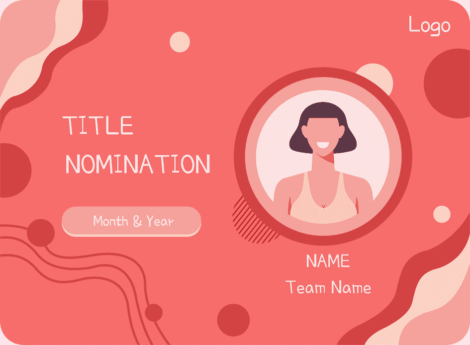

一份包含组织标志、标有“最以客户为中心的领导者”以及获奖者姓名的样本感谢证书。

**图5-1** 证书样本

这些证书可能因公司或团队而异，但基本要素保持不变。你可以使用在线工具根据公司主题创建证书，或者让内部设计团队快速为你制作一个模板。

## 即时奖励与认可

当我们使用有助于沟通和协作的技术工具时，很容易找到能够帮助进行现场奖励的集成工具。我们使用一个与`Slack`集成的工具，可以“拍拍某人的背”或给予赞扬。这类功能有助于同事认可那些在需要时提供帮助的人。

然后，公布获得“拍背”次数最多的人，以及给予“拍背”次数最多的人，这一点很重要。当然，“拍背”这个词也可以换成任何其他酷炫的名称。但这种即时认可能够赋能同事，并鼓励他们赞美彼此。

然后，你可以每月在排行榜上汇总所获得的奖励，这可以激励人们为目标奖项而努力。图5-2展示了一个示例排行榜。

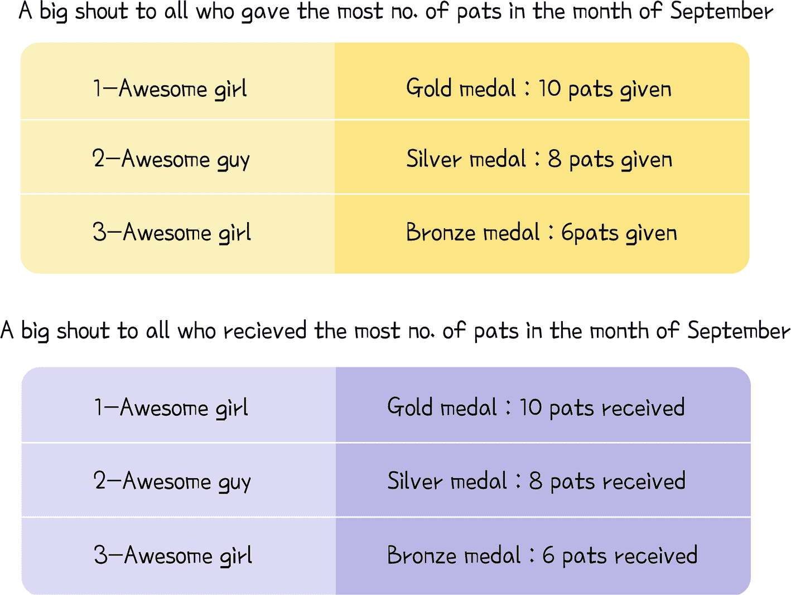

通过使用带有“拍背”口号的示例认可排行榜，可以提升员工积极性。

**图5-2** “拍背”或赞扬排行榜样本

## 总结

我的公司已经持续举办了多个季度的颁奖典礼。其积极影响不仅限于我们自己的团队，也波及了其他团队。员工将这些奖项视为他们想要争取的目标，因为他们看到获奖者在各种社交媒体平台上发布自己的证书。获得奖项的团队成员则被看作是那些付出了超越本职努力的人。

# 6. 人员流程

对于像我这样的技术人员来说，编写代码和管理技术工具是工作中最简单的部分。而我的人员管理是在无数次犯错和学习中进行的。技术人员与纯粹的人员管理者之间的一个区别在于实际情况。归根结底，只有技术型管理者能够衡量员工的生产力，同时，通过流程可以改善员工的福祉。

## 管理者与下属的员工关系

在处理员工关系时，始终采用数据驱动的方法。选择能够帮助你及时获取员工匿名反馈的工具。并且要向员工公开说明反馈是匿名的。创造良好的员工体验是困难的。在远程和混合工作模式下，这甚至更加困难。此外，年度敬业度调查关注的是过去一年，会留下许多未解答的问题。等到管理者能够对反馈做出反应时，数据已经过时了。

借助员工体验工具或平台，可以以积极的方式推动文化变革。Agnya 是一个员工体验平台，它让员工能够有趣地提供可操作反馈，并且管理者可以据此实施。此类工具可以帮助你实现以下目标：
*   通过挑战，使你的员工成为终身学习者
*   将你的管理者培养成能力出众的人员领导者
*   使你的员工队伍朝着共同的价值观对齐
*   通过基于数据和洞察的个性化干预，驱动有意义的员工体验

在远程工作时期，你需要赞扬跨团队和跨部门的员工。这能建立积极价值，并有助于提高生产力。你需要确保以下几点：
*   通过在日常工作中引入乐趣来赞扬你的团队
*   无论大小行为，都应给予赞赏
*   通过同事间的认可来强化你自己的价值观
*   设计和执行奖励与认可策略，以驱动关键行为和成果

为确保收集到及时、可操作且匿名的反馈，你可以部署工具并持续收集反馈。具体来说，你可以做到以下几点：
*   消除导致员工停止反馈的痛点
*   以员工的自然体验形式收集反馈，而非使用 1 到 5 分的量表
*   在团队使用的平台上（例如 Slack、MS Teams、Google 或电子邮件）启用反馈收集功能
*   让整个组织都参与到变革过程中

## 晋升与薪酬

本节详细分析了员工评估体系可能呈现的形式。理想情况下，公司每位员工都将经历这一流程。

晋升何时发生？以下是一个人可能获得晋升的三种情形：

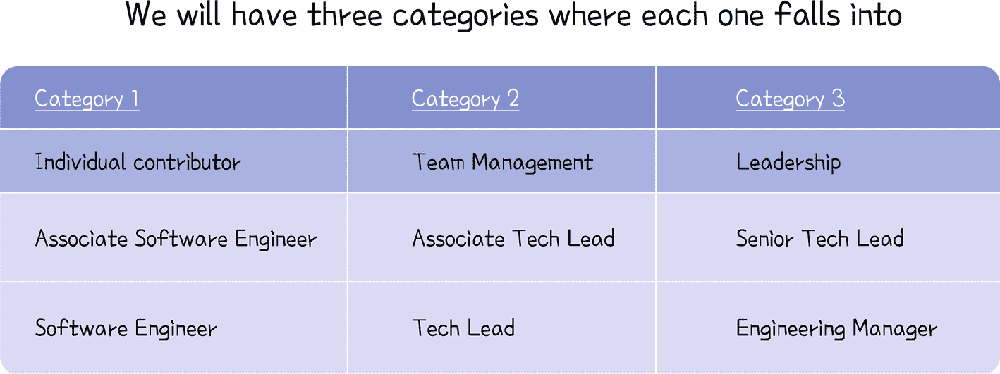

一个文本框，标题为“我们将有三个类别”，每个类别分别对应类别 1、2、3。类别 1 列出：个人贡献者、助理软件工程师、软件工程师。类别 2 列出：团队管理、助理技术主管、技术主管。类别 3 列出：领导层、高级技术主管、工程经理。

*图 6-1* 类别示例

*   **相同职位**：员工将继续担任相同职务。评估标准为：
    *   绩效（基于评审流程）
*   **相同类别但不同职位**：员工获得不同职务，但仍属于同一类别。评估标准为：
    *   绩效（基于评审流程）
    *   职位变动增幅（+x%）
*   **跨类别**：员工有机会在不同类别中工作，职务和角色均发生变化。评估标准与图 6-1 所示类似：
    *   绩效（基于评审流程）
    *   类别变更增幅（+x%）

拥有这样的架构有助于员工向更高类别努力。同时，它也能确保那些倾向于做个人贡献者而非进入管理或领导角色的员工获得公平的晋升机会。晋升与薪酬的透明化，始终有助于构建健康的工作环境。

## 总结

后疫情时代的工作体验一直在不断演变。只有通过建立适当的流程，以高效的方式与员工建立联系，才能实现有效的员工关系。我们必须确保给予员工及时的认可、晋升和评估。高效的员工对工作环境感到满意，这不仅是因为他们所做的工作，还因为他们感受到了关怀。这种关怀将通过我们建立的流程得以有效体现。而如果我们建立的流程对员工公开透明，这种关怀会成倍增加。

# 7. 仪式

每个团队都有其特定的工作节奏，而通过建立仪式来维持这种节奏是可行的。仪式是有助于建立关系的周期性事件或活动。

有些仪式是正式的活动，有助于跟踪多个项目的进展；有些则是非正式的聚会。每个仪式都应有一个议程，以确保其高效。在一个冲刺团队中，每日站会、冲刺规划和冲刺回顾对于保持团队节奏是强制性的。这些都是仪式。

## 每日站会

每日站会不是一次状态汇报会议。在这次会议上，每位团队成员要讲三件事。

- 他们过去一天做了什么
- 他们接下来一天打算做什么
- 他们遇到了什么阻碍，是否需要他人帮助

最后一点是站立会议的核心思想。它有助于解决团队成员可能遇到的任何困难。由于参加本次会议的是同一小组的同事，这有助于大家了解是否存在需要解决的依赖关系。

在我的初创公司，我们通常为组织内的所有团队举办多个站会。

- 在同一个项目和冲刺中工作的团队，由项目经理担任 Scrum 主管
- 在不同项目上工作的团队负责人，由高级负责人担任 Scrum 主管
- 在多个项目上工作的工程负责人，会单独会面提出阻碍，由架构师或工程副总裁担任 Scrum 主管
- 负责跨多个团队项目的特别小组，由业务团队的项目经理担任 Scrum 主管

举办多个站会有助于确保每个团队既能独立运作，又能协作，因为每个团队的代表也参与更高级别的站会。

Scrum 主管确保会议举行，但由成员负责主持每日站会。Scrum 主管教导团队成员将每日站会控制在 15 分钟的时间盒内。每日站会是 Scrum 团队的内部会议。如果有其他人出席，Scrum 主管要确保他们不会干扰会议。

## 回顾会议

冲刺回顾会议是在每次冲刺结束时举行的周期性会议，用于讨论上一个冲刺周期中哪些做得好，以及下一个冲刺可以改进哪些方面。图 7-1 展示了一个冲刺回顾看板。

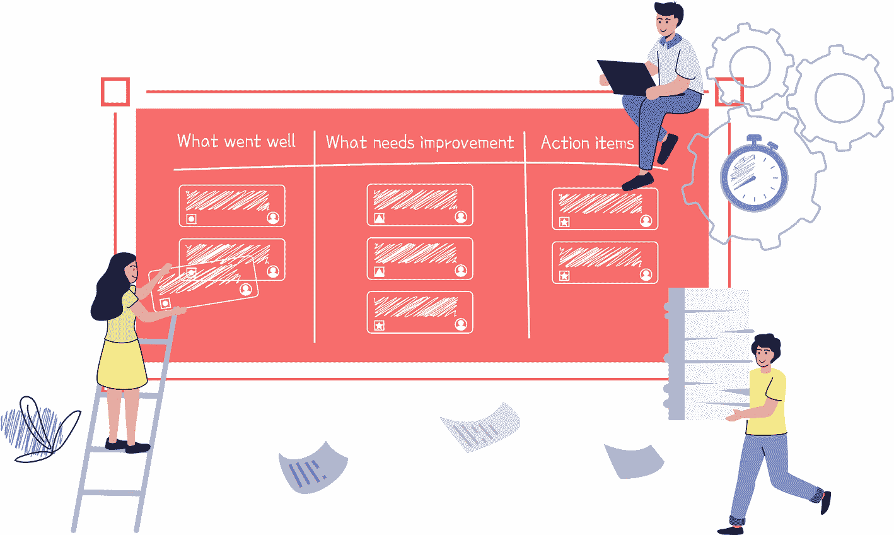

*图 7-1* 一个典型的回顾看板

运行冲刺回顾的方式有很多种。最常见的一种是使用“开始-停止-继续”方法。要求每位团队成员指出团队应该开始做的事情、应该停止做的事情以及应该继续做的事情。

以下是冲刺回顾中常见的问题：

- 本次冲刺中哪些方面做得好？可以通过分析哪些做法不同以往、谁做出了贡献、如何贡献的，以及哪些技能、培训或知识起到了作用，来分析一次迭代的成功。
- 本次冲刺中哪里出了问题？重点不是惩罚团队或个人成员，而是审视那些未按计划进行的事情，以期在未来提高绩效。
- 我们学到了什么？团队在冲刺中学到了什么，以便改进工作方式？
- 下一个冲刺应该如何进行？这将决定下一个冲刺需要采取的纠正措施，防止再次出现同样的错误，并使成功的做法成为可重复的成果。

## 全员大会

这个会议要尽可能具有互动性。使其具有互动性的最佳方式是在会议期间组织多次投票和调查。

- 始终从明确的议程和会议计划开始。
- 开展投票活动，让大家通过猜测公司已实现的各项里程碑来参与。可以是猜测收入或利润的同比增长。
- 安排多个有趣的会议活动，例如“结对分享”分组讨论室。
- 组织像虚拟密室逃脱这样的游戏，在参与者中营造最初的活跃氛围。
- 允许员工提问。留出足够的时间倾听这些问题。当很多人知道还有其他人在倾听时，他们会提出重要的问题，而这些听众可能也有类似问题，却没有主动提问。

随着公司发展，全员大会非常有用，因为公司里的每个人都能同时获得相同的信息。全员大会可以让你的员工就公司目标和战略达成共识。将团队中的每个成员都想象成一个向量。全员大会有助于你引导他们朝着正确的方向前进。

谈谈公司的愿景和使命，强调你们的价值观，并审视公司在实现目标方面的表现。尤其是在事情变得令人应接不暇时，没有什么比谈论亮点并向帮助实现这些亮点的人大声喝彩更能提振士气的了。

## 摘要

养成节奏并不容易，尤其当团队习惯于不遵循这些仪式时。你应在冲刺团队组建之初就开始这些仪式。最终，当团队进入节奏后，仪式的频率可以降低。仪式有助于保持沟通顺畅。每位团队成员在每次仪式中应至少通过轮流发言或投票方式进行一次沟通，从而使整个过程民主化。这将树立信心，并培养对团队的归属感。这些无形收益是长远的，并能极大地影响团队文化。

