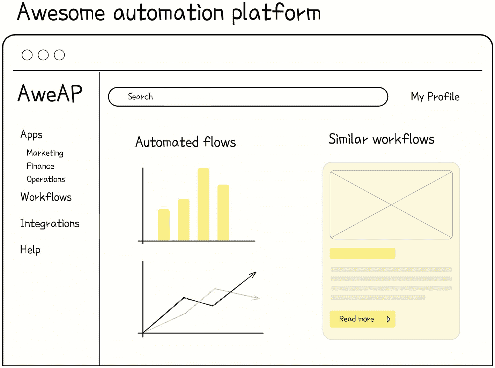
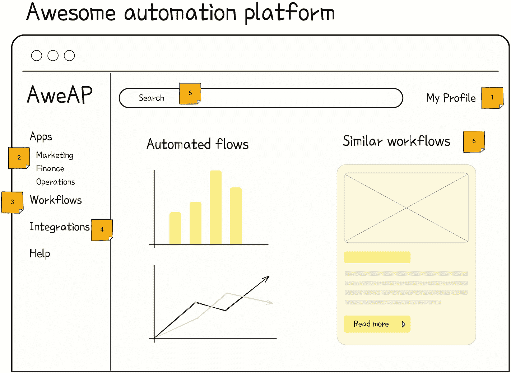
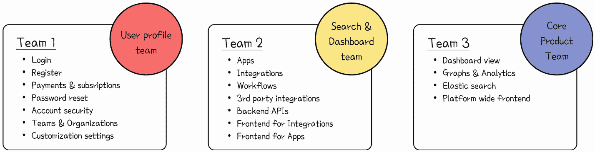
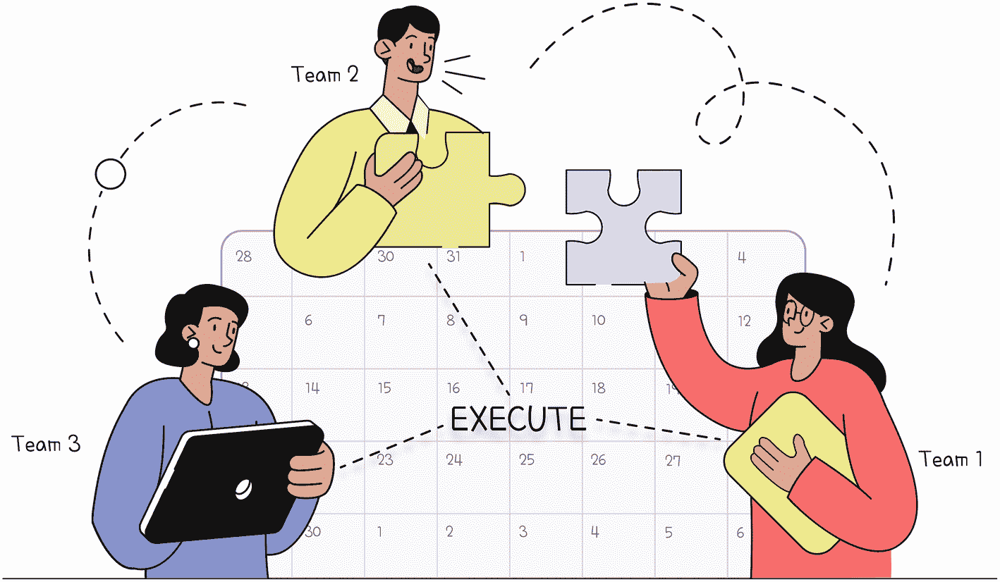

# 1. 团队与分工

当我告诉我当时所在公司的 CEO 我将创办自己的公司时，他对我说了这样一番话：“你招聘并培养过人，但从未解雇过任何人。不要急于创业，你需要学习人员管理，并理解如何建立和培养一个技术团队。”

我听取他的建议了吗？没有！如果我当时听从了建议，就不会在实际操作中获得学习团队管理艺术的速成课程。那样的话，这个过程将会持续更长时间。

本章的出发点在于：人员管理并非可教授之物。我试图总结自己在人员管理方面的经验，以便当你经历类似情况时，能帮助你更好地应对。你需要通过亲身经验来学习，并且要牢记一点：同理心。就我而言，随着团队壮大，我在团队较小时建立的文化，会随着新成员的加入而传播开来。

## 为什么要划分团队？

在更传统的旧式工作方式中，业务需求来自组织的多个部门，汇总到一个单一的技术团队。技术团队会列出这些需求，然后遵循冲刺流程逐一实现。那时的团队是整体式的，工作方式往往是顺序进行的。在 2010 年左右敏捷方法论出现之前，为了解放团队使其能自主决策而无需等待层级审批，公司一直依赖层级审批。这不仅体现在技术领域，也贯穿于业务的每一个职能。在敏捷时代之前，当我们预期某个项目需要在一定天数内完成时，我们按照顺序方式工作，如图 1-1 所示。

按顺序执行工作的流程图，任务 1 完成后才进入任务 2。

**图 1-1** 任务的顺序执行

这让我们陷入了孤岛。我们开始变得目光短浅，无法预见项目后期可能出现的障碍。更好的方法是并行开发。但如何实现并行开发呢？

你可以尽可能细化地将团队划分为原子化的部门。如果有一个大项目即将启动，就在项目开始前规划好该项目的模块。

让我们看一个例子：一个允许用户创建自己的工作流并自动化一系列重复任务的网站。我们称这个网站为“超棒自动化平台”。图 1-2 展示了该网站的登录后视图可能的样子。

为公司工作流创建的“超棒自动化平台”网站页面概览。此窗口显示网站的登录后视图。

**图 1-2** “超棒自动化平台”网站线框图

开始处理平台登录后视图的最佳方式是，首先识别出网站中互斥的区域（图 1-3），并将其划分为以下模块：

网站上显示的 6 个互斥区域分别是：个人资料、应用、工作流、集成、搜索和仪表盘。

**图 1-3** 识别可独立工作的互斥区域

1. `个人资料`：包括登录/注销/注册。
2. `应用`：此部分包含平台上可用于创建自动化的所有应用。
3. `工作流`：这是平台的核心，将是驱动其运行的“大脑”。
4. `集成`：此处提供不同的第三方集成。
5. `搜索`：一个快速易用的搜索栏。
6. `仪表盘`：此区域显示当前使用情况的图表和分析，并展示推荐的工作流。

## 并行优于顺序工作

根据上述网站模块的定义，我们可以提出一个团队结构，然后启动该项目，并并行开展工作（图 1-4）。

并行执行工作的示意图，涉及 3 个团队：用户个人资料团队、核心产品团队以及搜索与仪表盘团队。个人资料团队执行登录、注册和个性化设置等任务。核心团队负责应用、第三方集成、后端 API、前端工作流或应用。服务团队处理图表和分析。

**图 1-4** 工作的并行执行

这将确保工作开始时，团队能并行交付，而非顺序进行。并行开发能保障每个团队的自主权，使其交付价值并创新（图 1-5）。

一幅草图展示了 3 个团队，每个团队一人。团队 3 的人员在记笔记。其他人在拼接拼图碎片。它们之间用虚线连接，表示执行。团队 2 和团队 3 之间由一条中间带圆圈的虚线曲线连接。团队 1 和团队 2 之间由一条扭曲的丝带形曲线连接。

**图 1-5** 任务的并行开发

如你所见，以每个团队能够并行执行的方式创建组织或子组织的部门/分工至关重要。

## 总结

当团队拥有身份和目标时，他们才能蓬勃发展。为每个组建的团队创建并维护一个愿景至关重要。例如，一个 `Scrum` 团队可以由七到八人组成，包括开发人员、质量保证分析师和自动化工程师，并可能配备一个专职或共享的项目经理。如果不这样做，将导致项目失去焦点，并与公司目标脱节。愿景将是让团队独立运作、快速高效执行策略的关键。
