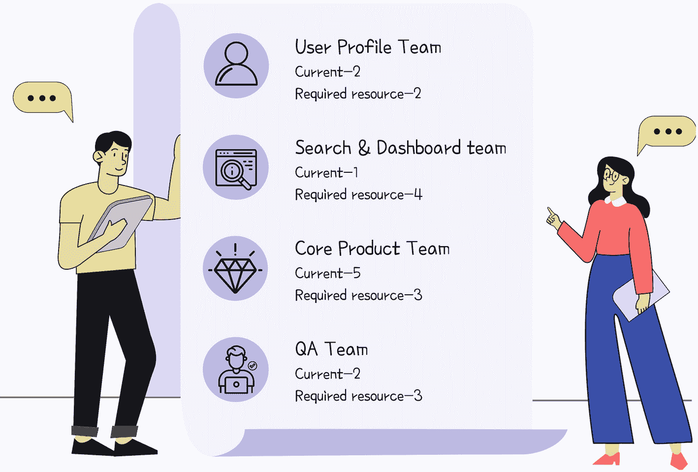
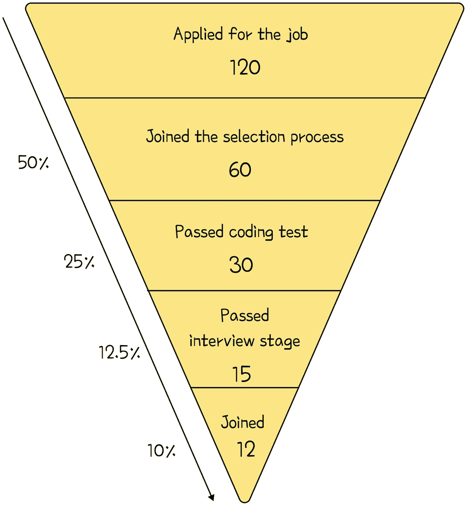

# 2. 招聘

招聘很难。技术招聘难上加难。在技术领域招聘优秀人才更是难如登天。而招聘那些真正能留下并为核心产品做出重大贡献的优秀技术人才，则难上百倍。至于招聘那些不仅能留下、做出重大贡献，还能帮助招聘其他优秀人才、从而建立起人才网络的精英，简直是难到极致。

本章将展示我如何尝试、失败、成功、试验，并混合搭配不同方法来打造我的技术团队。

## 内部推荐

你认识一个人，他认识另一个人，而这个人又认识另一个人（图 2-1）。内部推荐在大多数情况下都有效。但切勿仅凭推荐就录用某人。在我的初创公司，我始终坚持一定流程：我的推荐人由架构师面试，架构师的推荐人由我面试，以此类推。

一张三个火柴人的图，描绘了内部推荐招聘。第一个人认识中间的人，中间的人又认识面试官。

图 2-1

内部推荐

无论谁向你的公司推荐职位候选人，始终要进行编程测试。他们有多少经验并不重要。那些在以前公司做出过重大贡献的人，也未必总能胜任。当前环境的文化至关重要。这个人能否适应新环境？这是你在他入职后也必须始终追问的问题。如果你决定录用一个明知不合适或无法适应新环境的人，最大的输家将是你自己。

话说回来，我确实也成功通过内部推荐招到了人才。当他们被赋予比以往更重的责任时，他们超越预期，比任何人都更加耀眼。有些人总能给我惊喜。

归根结底，内部推荐没有标准答案。有些推荐奏效，有些则不然。一个人能否成功取决于多个因素，因此在你评判新员工是成功还是失败之前，先问自己这些问题：

-   你是否让他们适应了新环境？
-   你是否给了他们足够的调整时间？
-   你是直接把他们抛入深海任其自生自灭，还是全程手把手指导？这能看出他们应对逆境的能力。
-   他们是否足够灵活，能够适应？
-   他们是否愿意付出额外努力来完成工作？

正如我所说，盲目信任内部推荐时，我既犯过错误，也取得过成功。经过多次讨论，我意识到盲目信任本身并非坏事，但需要平衡。你的同事会帮助你找到这种平衡，这就是为什么每个团队都需要多元化的成员。在决定录用某位推荐候选人时，他们可以为你提供建议，甚至直接向候选人本人给出恰当的反馈。

### 人力资源寻源

当你持续为开放职位招聘时，人力资源寻源非常有效。它能填补因团队扩张和接受更广泛、更多样化需求而产生的许多缺口。

我发现当急需用人时这种方法往往失灵，主要是因为人们匆忙时容易出错，最终为了填补特定数量的职位而面试了大量候选人。最好是与 HR 部门长期合作，帮助他们理解职位要求，从而能明智地筛选候选人。

## 顾问

对于架构师这类角色定义明确的专业职位，交给顾问来处理效果很好。当你清楚知道自己需要什么角色时，使用顾问很有帮助。与内部推荐和 HR 寻源中存在大量不确定因素（比如：我们能否录用这个人担任与招聘职位不同的角色？）不同，这里不存在这个问题。我们向顾问清晰说明所需角色，而他们恰好拥有所需的技能集。

通过使用高效的招聘工具（例如`Hirect`、`Recruitee`、`Intervue`等），可以优化招聘流程。此外，你可以让每个团队的负责人自主承担招聘责任和所有权，这能赋予团队极大的独立性。由于工作性质不同，每个团队的工作描述可能有所差异，而给予适当的自主权，让他们能从顾问人才库中招聘到优秀人才。

## 招聘活动

招聘活动是我个人亲身实践并深有体会的一种方式。尤其是在新冠疫情期间，招聘变得困难，因为人们正在适应完全远程的工作文化。在我的初创公司，我们制定了一个计划：首先梳理每个团队额外的人力需求。由于我们对即将开展的工作有全局把握，我们进行了推断并制定了增补资源的策略。人员需求如图 2-2 所示进行记录。

一份关于人员需求的示例计划，展示了各种职位角色，如用户资料团队、搜索与面板团队、核心产品团队和 QA 团队，总计额外资源需求约 12 人。

图 2-2

人员需求

一旦明确了这些需求，就该推断我们预计邀请多少候选人参加面试了。如果需要 12 名资源，那么图 2-3 显示了我们必须经过招聘流程筛选的人数。

面试流程从应聘人数开始，分为 5 个阶段：120 名候选人应聘，经过选拔后仅 60 人入选；30 人通过编程测试，然后 15 人通过第 2、3、4 轮面试；最后，120 人中只有 12 人加入公司。

图 2-3

面试流程

每次进行招聘活动时，我们都遵循这一结构，这有助于了解我们预计会收到多少份申请。实际数字可能因团队、公司、流程而异，但准备好这些基准数字，将有助于增补资源和规划招聘活动。

招聘活动包含以下主要步骤：

1.  寻源
2.  筛选
3.  评估
4.  入职

由于本章已涵盖筛选和评估部分，我们来谈谈寻源。

在我的初创公司，除了使用社交渠道和自发传播外，我并没有固定的方法。我们制作了可以在`LinkedIn`上发布的宣传页。我们向母校发送邮件，由就业协调员邀请应届毕业生申请。

我在招聘活动中发现，尽管你招到的是新人，但你可以提升他们的技能，并按照公司需求进行塑形。他们的适应能力和学习速度远超你的想象。往往正是这些人，最终会成为你可以信赖的未来领导者。

## 总结

当初我在初创公司管理一个 12 人的团队时，我给予他们充分的自主权，让他们按自己的方式行事，但流程依然得以遵循。无需我刻意制定流程，冲刺规划、回顾会议以及所有敏捷仪式都得以执行。这是因为最初的招聘是经过谨慎把关的。塑造整个公司文化的，正是你最初招聘的那 10 个人。如果最初的人选出现失误，其影响将极为深远。最初的员工必须精挑细选。有了优秀人才作为根基，就可以奠定文化基础，确保后续招聘在态度上能效仿前人。

