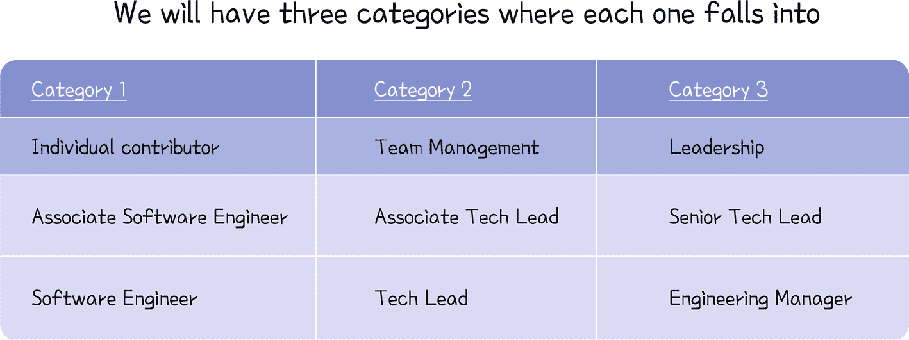

# 6. 人员流程

对于像我这样的技术人员来说，编写代码和管理技术工具是工作中最简单的部分。而我的人员管理是在无数次犯错和学习中进行的。技术人员与纯粹的人员管理者之间的一个区别在于实际情况。归根结底，只有技术型管理者能够衡量员工的生产力，同时，通过流程可以改善员工的福祉。

## 管理者与下属的员工关系

在处理员工关系时，始终采用数据驱动的方法。选择能够帮助你及时获取员工匿名反馈的工具。并且要向员工公开说明反馈是匿名的。创造良好的员工体验是困难的。在远程和混合工作模式下，这甚至更加困难。此外，年度敬业度调查关注的是过去一年，会留下许多未解答的问题。等到管理者能够对反馈做出反应时，数据已经过时了。

借助员工体验工具或平台，可以以积极的方式推动文化变革。Agnya 是一个员工体验平台，它让员工能够有趣地提供可操作反馈，并且管理者可以据此实施。此类工具可以帮助你实现以下目标：
*   通过挑战，使你的员工成为终身学习者
*   将你的管理者培养成能力出众的人员领导者
*   使你的员工队伍朝着共同的价值观对齐
*   通过基于数据和洞察的个性化干预，驱动有意义的员工体验

在远程工作时期，你需要赞扬跨团队和跨部门的员工。这能建立积极价值，并有助于提高生产力。你需要确保以下几点：
*   通过在日常工作中引入乐趣来赞扬你的团队
*   无论大小行为，都应给予赞赏
*   通过同事间的认可来强化你自己的价值观
*   设计和执行奖励与认可策略，以驱动关键行为和成果

为确保收集到及时、可操作且匿名的反馈，你可以部署工具并持续收集反馈。具体来说，你可以做到以下几点：
*   消除导致员工停止反馈的痛点
*   以员工的自然体验形式收集反馈，而非使用 1 到 5 分的量表
*   在团队使用的平台上（例如 Slack、MS Teams、Google 或电子邮件）启用反馈收集功能
*   让整个组织都参与到变革过程中

## 晋升与薪酬

本节详细分析了员工评估体系可能呈现的形式。理想情况下，公司每位员工都将经历这一流程。

晋升何时发生？以下是一个人可能获得晋升的三种情形：

一个文本框，标题为“我们将有三个类别”，每个类别分别对应类别 1、2、3。类别 1 列出：个人贡献者、助理软件工程师、软件工程师。类别 2 列出：团队管理、助理技术主管、技术主管。类别 3 列出：领导层、高级技术主管、工程经理。

*图 6-1* 类别示例

*   **相同职位**：员工将继续担任相同职务。评估标准为：
    *   绩效（基于评审流程）
*   **相同类别但不同职位**：员工获得不同职务，但仍属于同一类别。评估标准为：
    *   绩效（基于评审流程）
    *   职位变动增幅（+x%）
*   **跨类别**：员工有机会在不同类别中工作，职务和角色均发生变化。评估标准与图 6-1 所示类似：
    *   绩效（基于评审流程）
    *   类别变更增幅（+x%）

拥有这样的架构有助于员工向更高类别努力。同时，它也能确保那些倾向于做个人贡献者而非进入管理或领导角色的员工获得公平的晋升机会。晋升与薪酬的透明化，始终有助于构建健康的工作环境。

## 总结

后疫情时代的工作体验一直在不断演变。只有通过建立适当的流程，以高效的方式与员工建立联系，才能实现有效的员工关系。我们必须确保给予员工及时的认可、晋升和评估。高效的员工对工作环境感到满意，这不仅是因为他们所做的工作，还因为他们感受到了关怀。这种关怀将通过我们建立的流程得以有效体现。而如果我们建立的流程对员工公开透明，这种关怀会成倍增加。
