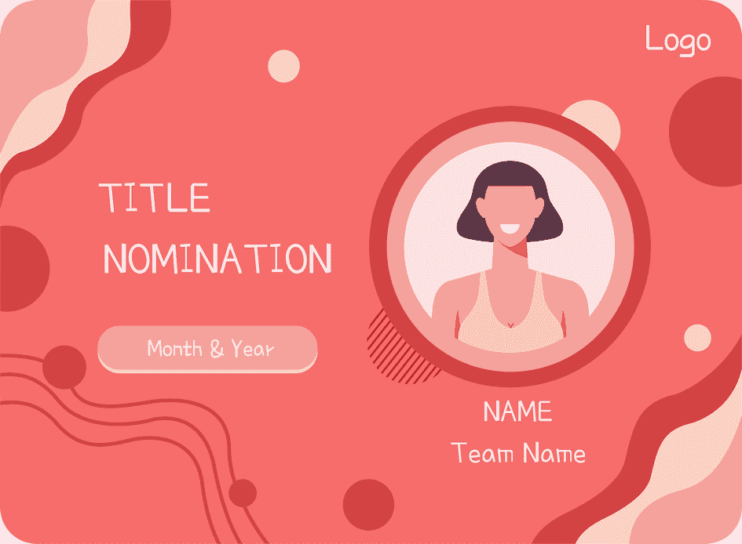
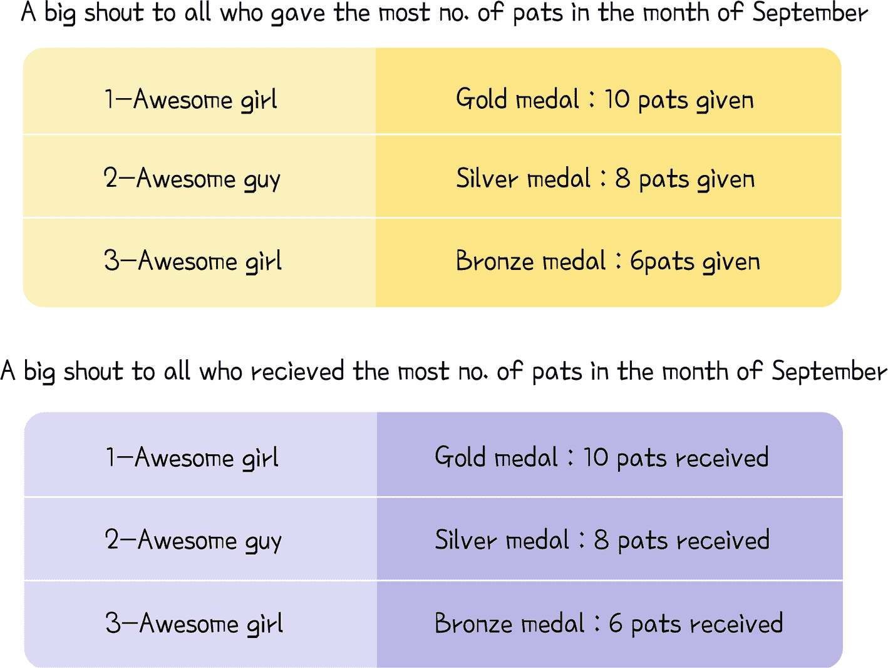

# 5\. 奖励与认可

在专业环境中与同事保持良好关系的关键，在于赞扬他们付出的额外努力。这将促进他们成长，进而影响整个团队的发展。这也意味着，公司因获得鼓励学习和成长的人员的支持而走向成熟。以一致的方式认可员工，将大大有助于改善和维持与员工的良好关系。本章将解释如何做到这一点，并将其培养成整个团队的习惯。

## 季度奖励

在我的初创公司，我们最初并没有季度颁奖会议。取而代之的是，我们会在全员会议上以更灵活的方式表彰最佳表现者。但缺乏既定标准可能导致两个问题：

*   奖励存在偏见
*   奖励不被认真对待，因为可能只选择近期表现出色的候选人，而非表现更稳定的人

这促使我们推出了季度颁奖典礼。最初，我们合并所有团队，并在以下类别中颁发奖励：

*   季度最佳表现者
*   季度最佳新人（针对应届毕业生）
*   季度明星表现者
*   季度最佳领导者

过了一段时间，我们意识到增加更多类别、使奖励更具针对性是合适的，因为这样人们会努力争取赢得某个特定奖项类别。因此，我们设定了以下类别：

*   季度最佳导师
*   季度最佳新人（针对应届毕业生）
*   季度代码忍者
*   季度代码评审员
*   最佳领导者（按时交付）
*   最佳领导者（客户至上）
*   自动化能手

具体化有助于识别和奖励核心能力。这也消除了关于某人为何应获得认可的模糊性。我们还确保为那些指导新员工和乐于提供帮助的人给予特别认可。正是这些人推动着团队前进。因此，我们始终强调团队导师而非团队经理。尤其是在技术领域，当你担任领导者时，人员管理只占工作的5%到10%，而指导他人则占90%到95%。

选择谁获奖可以基于投票，同时给予领导者或团队资深成员的投票更高的权重。奖励颁发后，有必要提供证书；图5-1展示了一个示例。

一份包含组织标志、标有“最以客户为中心的领导者”以及获奖者姓名的样本感谢证书。

**图5-1** 证书样本

这些证书可能因公司或团队而异，但基本要素保持不变。你可以使用在线工具根据公司主题创建证书，或者让内部设计团队快速为你制作一个模板。

## 即时奖励与认可

当我们使用有助于沟通和协作的技术工具时，很容易找到能够帮助进行现场奖励的集成工具。我们使用一个与`Slack`集成的工具，可以“拍拍某人的背”或给予赞扬。这类功能有助于同事认可那些在需要时提供帮助的人。

然后，公布获得“拍背”次数最多的人，以及给予“拍背”次数最多的人，这一点很重要。当然，“拍背”这个词也可以换成任何其他酷炫的名称。但这种即时认可能够赋能同事，并鼓励他们赞美彼此。

然后，你可以每月在排行榜上汇总所获得的奖励，这可以激励人们为目标奖项而努力。图5-2展示了一个示例排行榜。

通过使用带有“拍背”口号的示例认可排行榜，可以提升员工积极性。

**图5-2** “拍背”或赞扬排行榜样本

## 总结

我的公司已经持续举办了多个季度的颁奖典礼。其积极影响不仅限于我们自己的团队，也波及了其他团队。员工将这些奖项视为他们想要争取的目标，因为他们看到获奖者在各种社交媒体平台上发布自己的证书。获得奖项的团队成员则被看作是那些付出了超越本职努力的人。