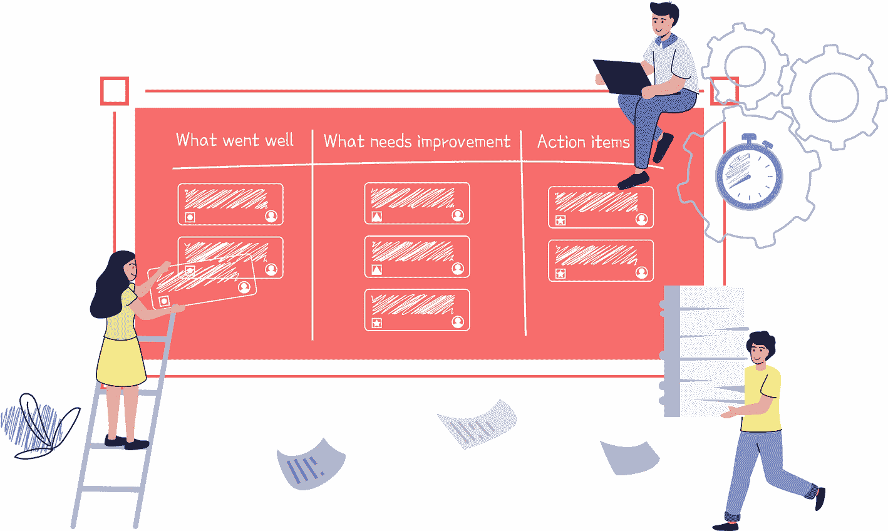

# 7. 仪式

每个团队都有其特定的工作节奏，而通过建立仪式来维持这种节奏是可行的。仪式是有助于建立关系的周期性事件或活动。

有些仪式是正式的活动，有助于跟踪多个项目的进展；有些则是非正式的聚会。每个仪式都应有一个议程，以确保其高效。在一个冲刺团队中，每日站会、冲刺规划和冲刺回顾对于保持团队节奏是强制性的。这些都是仪式。

#### 每日站会

每日站会不是一次状态汇报会议。在这次会议上，每位团队成员要讲三件事。

- 他们过去一天做了什么
- 他们接下来一天打算做什么
- 他们遇到了什么阻碍，是否需要他人帮助

最后一点是站立会议的核心思想。它有助于解决团队成员可能遇到的任何困难。由于参加本次会议的是同一小组的同事，这有助于大家了解是否存在需要解决的依赖关系。

在我的初创公司，我们通常为组织内的所有团队举办多个站会。

- 在同一个项目和冲刺中工作的团队，由项目经理担任 Scrum 主管
- 在不同项目上工作的团队负责人，由高级负责人担任 Scrum 主管
- 在多个项目上工作的工程负责人，会单独会面提出阻碍，由架构师或工程副总裁担任 Scrum 主管
- 负责跨多个团队项目的特别小组，由业务团队的项目经理担任 Scrum 主管

举办多个站会有助于确保每个团队既能独立运作，又能协作，因为每个团队的代表也参与更高级别的站会。

Scrum 主管确保会议举行，但由成员负责主持每日站会。Scrum 主管教导团队成员将每日站会控制在 15 分钟的时间盒内。每日站会是 Scrum 团队的内部会议。如果有其他人出席，Scrum 主管要确保他们不会干扰会议。

## 回顾会议

冲刺回顾会议是在每次冲刺结束时举行的周期性会议，用于讨论上一个冲刺周期中哪些做得好，以及下一个冲刺可以改进哪些方面。图 7-1 展示了一个冲刺回顾看板。

一幅素描画：一位女士站在梯子上，旁边是一块看板；一位男士坐在上面，面前放着一台笔记本电脑；另一位男士抱着一叠纸走过。看板上列出了做得好、需要改进以及待办事项。

*图 7-1* 一个典型的回顾看板

运行冲刺回顾的方式有很多种。最常见的一种是使用“开始-停止-继续”方法。要求每位团队成员指出团队应该开始做的事情、应该停止做的事情以及应该继续做的事情。

以下是冲刺回顾中常见的问题：

- 本次冲刺中哪些方面做得好？可以通过分析哪些做法不同以往、谁做出了贡献、如何贡献的，以及哪些技能、培训或知识起到了作用，来分析一次迭代的成功。
- 本次冲刺中哪里出了问题？重点不是惩罚团队或个人成员，而是审视那些未按计划进行的事情，以期在未来提高绩效。
- 我们学到了什么？团队在冲刺中学到了什么，以便改进工作方式？
- 下一个冲刺应该如何进行？这将决定下一个冲刺需要采取的纠正措施，防止再次出现同样的错误，并使成功的做法成为可重复的成果。

## 全员大会

这个会议要尽可能具有互动性。使其具有互动性的最佳方式是在会议期间组织多次投票和调查。

- 始终从明确的议程和会议计划开始。
- 开展投票活动，让大家通过猜测公司已实现的各项里程碑来参与。可以是猜测收入或利润的同比增长。
- 安排多个有趣的会议活动，例如“结对分享”分组讨论室。
- 组织像虚拟密室逃脱这样的游戏，在参与者中营造最初的活跃氛围。
- 允许员工提问。留出足够的时间倾听这些问题。当很多人知道还有其他人在倾听时，他们会提出重要的问题，而这些听众可能也有类似问题，却没有主动提问。

随着公司发展，全员大会非常有用，因为公司里的每个人都能同时获得相同的信息。全员大会可以让你的员工就公司目标和战略达成共识。将团队中的每个成员都想象成一个向量。全员大会有助于你引导他们朝着正确的方向前进。

谈谈公司的愿景和使命，强调你们的价值观，并审视公司在实现目标方面的表现。尤其是在事情变得令人应接不暇时，没有什么比谈论亮点并向帮助实现这些亮点的人大声喝彩更能提振士气的了。

## 摘要

养成节奏并不容易，尤其当团队习惯于不遵循这些仪式时。你应在冲刺团队组建之初就开始这些仪式。最终，当团队进入节奏后，仪式的频率可以降低。仪式有助于保持沟通顺畅。每位团队成员在每次仪式中应至少通过轮流发言或投票方式进行一次沟通，从而使整个过程民主化。这将树立信心，并培养对团队的归属感。这些无形收益是长远的，并能极大地影响团队文化。

