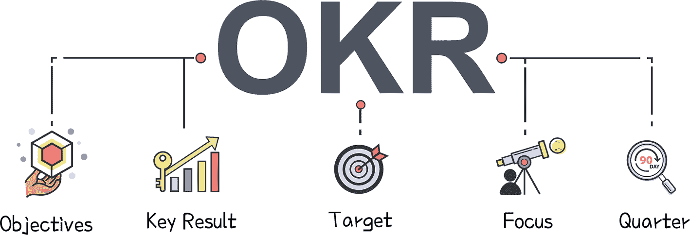

# 8. 目标与关键成果

*目标与关键成果*是一种企业规划/战略执行框架，正被全球公司迅速采用，以提升业务速度。

"*战略*"这个词可能难以理解，尤其对于一线团队或职业初期的成员而言。通常情况下，公司战略由领导团队制定。在无数小时的辩论和幻灯片演示结束后，领导团队理解了战略，但下层团队可能很少或完全不了解他们的角色如何影响组织。

弥补使命与指标之间的差距，正是目标与关键成果（OKR）的作用所在，它帮助团队（不仅是领导或管理者，也包括我们的一线团队）专注于对业务最重要的成果。

在本章中，我们将快速回顾 OKR 在工作场所中的基础知识及其必要性。

## 什么是 OKR？

你可以把 OKR 想象成鱼叉捕鱼，而不是撒网。当实践 OKR 时，团队专注于少数能够推动组织前进的成果指标，而不是众多"常规业务"指标（见图 8-1）。与过去的做法不同，OKR 是由团队编写，尤其是跨职能团队（例如技术团队与业务团队共同编写 OKR！）。

OKR（一种目标设定方法论）这一缩写代表目标与关键成果，并与五个概念对应：目标、关键成果、目标值、聚焦点、季度。

**图 8-1** OKR 关键参数

在过去传统的公司绩效管理实践中，目标设定往往很少经过深思熟虑。方法通常是临时的、被动推行的，有时甚至模板化。过去，团队会复制粘贴毫不相关的 OKR，然后在年度绩效评估时将其作为事后勾选的检查项。

OKR 不应仅仅是个人评估工具。作为一种组织与团队绩效框架，OKR 激励团队设定对业务影响最大的雄心勃勃的目标。OKR 也关乎推动一致性；当你开始编写 OKR 时，详细阐述并写出高质量的内容至关重要。

- *目标*：目标是定性陈述；有趣的是，它们由文字构成，不含数字（这与你可能过去学到的大不相同）。目标陈述必须具有业务价值，并需要回答这个问题："我们在接下来的 90 天内究竟要达成什么？"
- *关键成果*：关键成果是高速度指标。这些*不是*"常规业务"活动，而是能够带来变革的成果。你可以将关键成果想象成 GPS，将你从 A 点带到 B 点。因此，在设定关键成果时，它们必须包含你想要衡量的指标，从而推动从 A 点到 B 点再到 X 点、Y 点的改进。
- *活动*：OKR 明确区分了成果与活动。活动是要做的事，有时是日常琐事。其中大部分是必要的，但可能不会为业务增加价值。当你考虑与 OKR 关联的活动时，它们是团队试图推动成果指标前进的实验。

## 为什么要用 OKR？

是什么让成千上万的初创公司、成长型公司和企业采用 OKR？似乎整个世界在 COVID-19 疫情后都进入了混合工作模式。随着分布式团队和虚拟协作的需求，管理扑面而来的海量任务变得异常困难。

随着规模扩大，需要招聘新成员，而仅通过全体大会或领导演讲，很难让他们感受到与公司目标的联系。公司的目标必须将员工的工作与成果之间的点连接起来。

此外，CEO 们采用 OKR 是因为他们被迫进行商业模式转型，尤其是在消费者或客户行为发生重大转变的情况下。

还有许多人寻求 OKR 来推动问责制和主人翁意识。有些人则通过 OKR 来重拾敏捷性和创新力，这是公司保持相关性的必要条件。

最后，组织希望重新建立亲密感，无论是与人还是与客户，并利用 OKR 来为"如何做"带来所需的清晰度。

现实情况是，随着商业模式颠覆以及高管面临交付压力，OKR 正在弥合战略与执行之间的鸿沟。

## 摘要

OKR 由约翰·杜尔首创，该框架将你想要实现的目标与用以衡量进展的关键成果配对。这样，目标最终会与日常工作挂钩。本章所述的概念知识足以让你开始使用 OKR。

