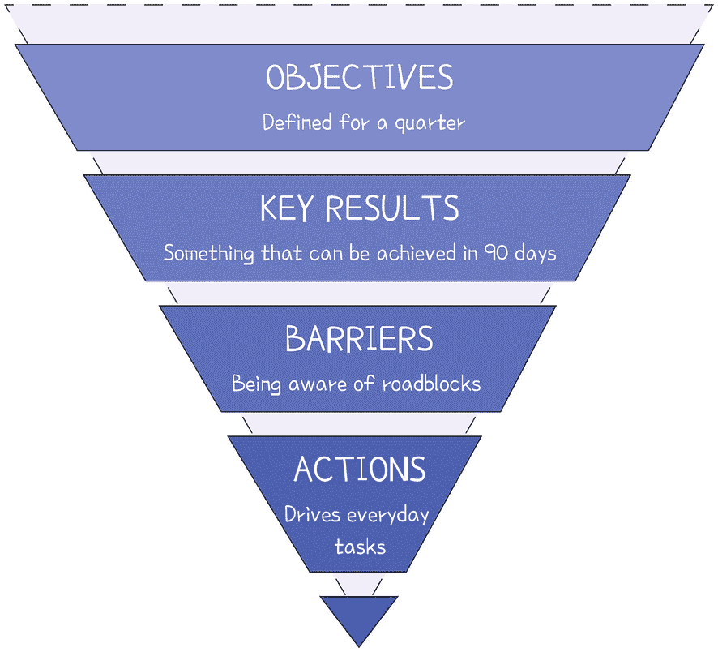
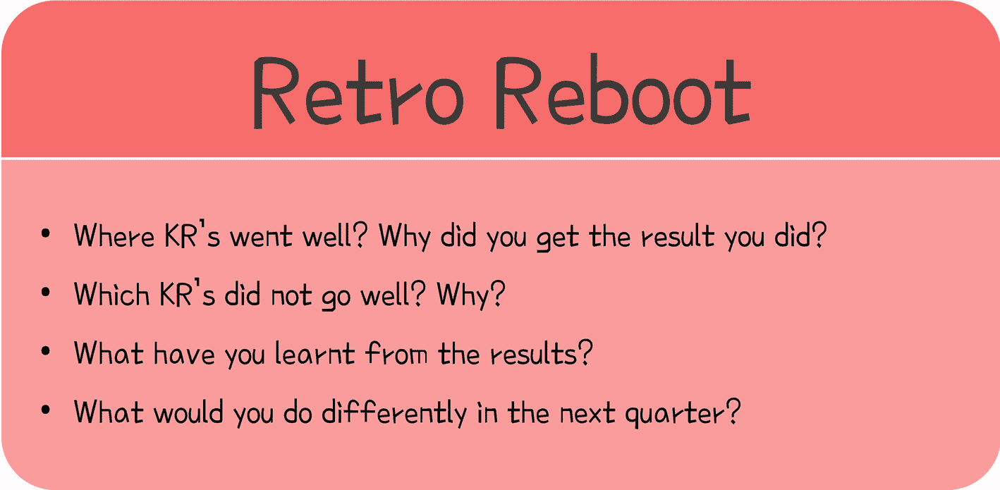
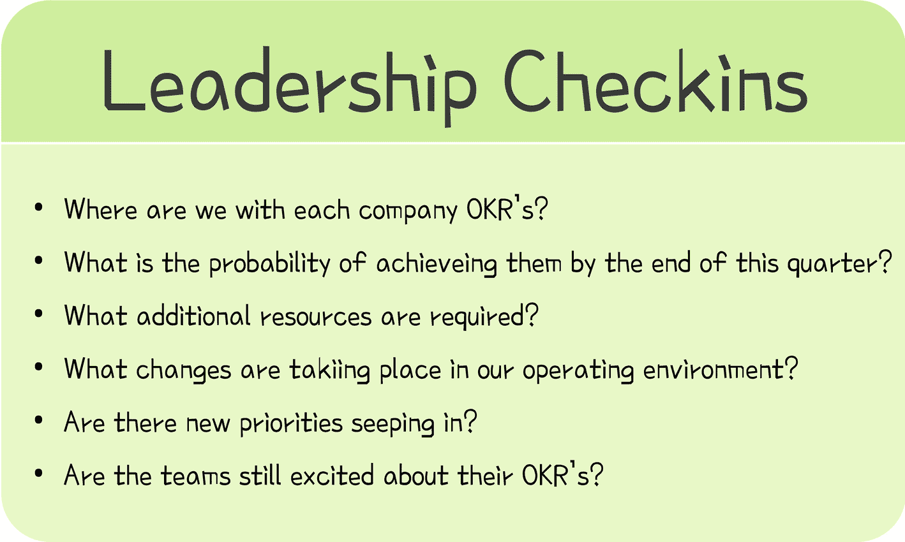
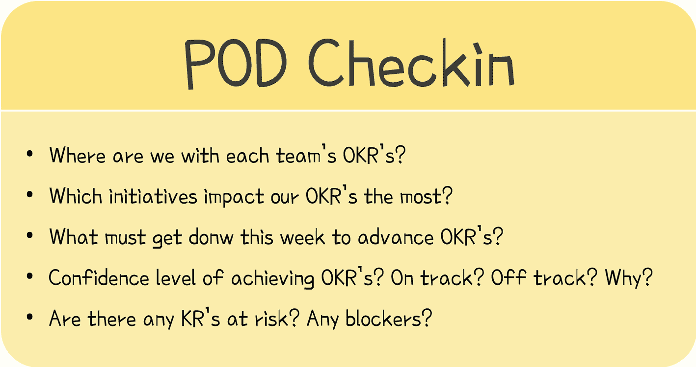

# 9. 设定 OKR

在将 OKR 引入你的业务之前，理解如何引导整个团队运作方式的变革至关重要。OKR 思维需要一种有机的转变，并应逐步渗透到与你共事的每一个人。一旦这种思维成为内在流程，编写和执行 OKR 就会变得容易。从而，实现业务目标将变成流程驱动，而非机械重复。

## 定义 OKR

以下步骤展示了如何转变团队的思维模式，开始使用 OKR：

1. 每次 OKR 推行都必须有一位发起人。发起人通常是 CEO 或部门负责人，具体取决于你在哪个层级引入 OKR。有些组织喜欢在全公司范围内进行大规模推行，而其余 OKR 则针对特定业务群或职能部门。发起人必须将 OKR 置于领导层会议、全员大会和复盘讨论中。发起人必须参与设定 OKR，因为它们是*最重要的增长指标*。
2. 使用 OKR 关乎建立一致性。使用 OKR 的团队必须理解它们是什么、OKR 与个人绩效评估有何不同，以及团队如何撰写和追踪 OKR。教授 OKR 基础知识可以由内部教练或经过认证、受过赋能团队培训的外部 OKR 教练来完成。
3. 发起人及其团队必须参与设定“北极星”OKR，以便其他团队与之对齐。如果部门在使用 OKR，则由部门主管、领导者和下一级团队负责人设定“北极星”OKR。请记住，在 OKR 中，少即是多。因此，每个团队定义的目标不超过三个，每个目标的关键结果不超过三到五个。
4. 跨职能团队成员共同协作，以推动“北极星”指标的达成。

这四个步骤将使团队能够有效协作，从而实现组织目标。

例如，假设你的“北极星”指标是降低浏览你网站潜在客户的流失率。为什么？目的当然是为了让尽可能多的潜在客户选择一个套餐并点击“开始使用”，或联系你的销售团队以启动入门流程。我们都知道这对创收有多么重要。

但业务团队无法独自完成这项工作；它需要与技术团队协作。让我们给这个跨职能团队起个炫酷的名字：增长尖兵。

### 增长尖兵

增长尖兵由来自销售、市场营销、产品和工程部门的代表组成。他们需要解决一个核心问题，即“如何在接下来的 90 天内将流失率从 70% 降低到 40%？”

增长尖兵首先列举现存挑战，这些挑战阻碍了 OKR 的达成。以下是几个例子：

- “我们无法清晰知晓谁在访问我们的网站。”
- “内容或其布局吸引力不足。”
- “我们没有追踪那些在聊天窗口提出询问的响应时间。”
- “我们带宽不足，而且技术团队接到的请求似乎过多。”

经过深思熟虑，增长尖兵们设定了他们的目标陈述：

*为网站访客提供极致体验，以降低流失率。*

明确的商业价值是降低流失率。下一步是衡量标准。这就引出了以下四个关键结果。它们是帮助判断这个鼓舞人心的目标是否达成的指标。

- *关键结果 1*：将对潜在客户询问的响应时间从两天缩短到十分钟。
- *关键结果 2*：将用户在网站上的平均停留时间从一分钟增加到三分钟。
- *关键结果 3*：将页面加载时间从三秒减少到一秒。
- *关键结果 4*：将流失率从 70% 降低到 40%。

每个团队作为特定关键结果的责任人，开始各自的工作。无论团队做什么，目标都是通过围绕这四个关键结果开展工作来确保客户满意度。每个团队成员通过关键结果聚焦于自己的目标，这将确保目标的达成是以客户为中心来驱动的。

### OKR 打磨

如果你问一位谷歌员工关于 OKR 的问题，你通常会得到这样的回答：“这就是我们在这里开展业务的方式。”由此可见 OKR 在谷歌文化中根深蒂固的程度。

OKR 要求训练团队接受以成果为导向的管理，而非以活动为中心的管理。当然，活动很重要，但勾选功能构建、致电潜在客户、会面合作伙伴并不会推动业务向前发展。这些都是投入，而目标是推动成果指标的进展。这类似于增长尖兵衡量周转时间的缩短，或让潜在客户在他们的数字商铺中停留更久。

团队需要理解，OKR 要求选择*正确*的指标，而非*容易达成*的指标。这种思维方式要求人们拓展自己的能力。

OKR 需要一种跨职能协作的思维模式。团队共同撰写 OKR，而不是孤立地撰写，或陷入至今仍困扰许多公司的、职能权责划分过于僵化的组织结构。

打磨也适用于领导团队成员。命令与控制式的管理风格是引入 OKR 的绊脚石。在这里，你要求团队选择能够影响业务的指标。命令式风格应该被教练式的探索性风格所取代，这种风格鼓励团队选择 OKR 并尝试。

最终，你期望每个季度从 OKR 实践中得到的是成果。作为基于成果的工具，OKR 框架将有助于驱动团队每日行动（图 9-1）。

OKR 框架是一种基于成果的工具，包含四个核心思想：定义季度目标，在 90 天内达成目标的关键结果，克服众多干扰的障碍，以及激励日常行动的执行措施。

**图 9-1**

OKR 作为基于成果的工具

## 总结

由于 OKR 框架的灵活性，你可以用多种方式撰写 OKR。像任何目标一样，OKR 应该是可验证且可衡量的。你应该将 OKR 视为未来一段时间内战略的支柱。然而，要设定好的 OKR，你还需要将它们与日常工作联系起来。

# 将 OKR 与战略联系起来

团队对齐很可能是成功推行 OKR 的秘诀。虽然这看起来简单，但想象一下，当你有 5000 名员工，或者在一家拥有十万甚至更多员工的企业中，要在如此大规模下对齐团队！这正是使用 OKR 的根本原因——为了更好地对齐团队。团队在设定 OKR 时，不能脱离组织战略。

## 团队对齐与目标链接至长期战略

在确定 OKR 之前，公司必须拥有战略。什么是战略？理解这个问题最简单的方式，就是看大卫如何击败歌利亚。大卫自然不是巨人歌利亚力量的对手，他需要一套战略来战胜他。如今，大卫与歌利亚的故事已成为弱小对抗强大的代名词。熟悉故事的人都知道，大卫是个牧羊少年，他拒绝穿戴盔甲；他仅有的武器，便是平日里用来驱赶羊群野兽的投石索。歌利亚则全副武装，手持刀剑和标枪。但大卫的战略很清晰：他不穿盔甲以减轻重量、保持敏捷，最终仅用一发投石索击中歌利亚未被盔甲保护的额头，便将其击倒。

在我曾任职的一家公司，我们在 2020 年疫情令世界措手不及之后，立即采用了 OKR。那是一个前所未有的时代，没有任何现成剧本可供参考。一夜之间全面转向远程办公，要求各团队首先争分夺秒地打好基础。我们问自己许多问题：我们的网络连接足够稳定吗？技术团队需要高带宽来确保流畅的 VPN 连接和远程基础设施。同时，安全始终是重中之重。当我们从两到四个办公地点突然变成成千上万个“居家办公”工作站时，如何确保数据完整性？那时，我们不再对技术团队进行微观管理、不再随意派发任务，而是帮助他们看清我们做这些事的目的是什么。例如，员工会提出这类问题：
- “为什么要自动化报告？”
- “为什么我们用 Kafka 来做队列管理？”
- “我们的数据迁移项目怎么样了？这些工作对业务产生了什么影响？”

工程思维的核心是解决问题，然而我们常常发现，工程团队在稳定性、功能性、安全性、架构和代码审查方面做得很好，却忘记了要看到全局。

让我以当时我团队的一个例子来说明。当时我们团队负责业务技术方面的工作。供应链团队和数字借贷团队是我们团队的两个关键利益相关者。这些团队确保组织对最终客户的承诺能够兑现。

这一切发生在诸多复杂挑战的背景下，包括管理库存、履行订单、确保物流顺畅，以及确保信贷等支持性元素以有吸引力的方案提供给客户，使其能够负担产品。每个业务部门都有一套应用程序，需要一支庞大的工程师队伍来交付。

正是在这里，我们看到了 OKR 的亮点。我们能否加强协作，减少临时性工作，并让工程团队看到其对业务的影响？

最好的起步方式是先进行试点。我们引入了一个名为 `Fitbots` 的工具，它是一个集成了 OKR 的合作伙伴，提供 OKR 辅导和平台支持。辅导顾问首先向我们这些赞助人介绍了 OKR 的概况。业务供应链负责人和我本人在将 OKR 框架介绍给我们的团队之前，必须先接受它。在我们心中确立了 OKR 的明确价值之后，我们挑选了一个由 15 名成员组成的团队来开始推行 OKR。

我们一起制定了第一组 OKR。

试点团队接受了 OKR 基础知识的培训，并由 OKR 教练指导如何选择合适的 OKR。我们最初仅从工程团队中挑选人员来测试流程。

接下来的一周，团队提出了他们的 OKR。这些 OKR 大多是从工程角度出发，缺少业务对齐的“味道”。我们的意图是让大家感受一下流程，而不是追求完美的 OKR（此外，世上本无完美的 OKR）。

### 维持 OKR：设定每周节奏

对于 OKR 实践者来说，你们都知道这意味着什么。OKR 大量借鉴了敏捷方法，它们需要一种节奏。每周为你的 OKR 检查会议投入 30 分钟，就能让你的 OKR 推广取得成功。

每周在同一天、同一时间，团队向彼此汇报他们在成果指标上的进展。在会议中，风险过大的 KR 开始浮出水面，同时，将我们这些赞助人标记出来，也促使我们肩负起尽早清除障碍的责任。

凭借检查会议“周而复始”的特性，在 90 天后，我们得出结论：业务团队需要参与到 OKR 的重启过程中。这包括为接下来的 90 天重置（字面意义上的重置 OKR 或优先级）。这次，我们以业务和技术团队组成的“小组”形式进行。

随着团队不断实践检查会议，他们开始变得更高效，会议时间也可以从 30 分钟缩短到 15 分钟。

## 总结

OKR 最大的好处，在于你能将日常工作与团队的战略目标联系起来。OKR 通过将目标与促成目标的关键结果相连接，已经实现了这一点。为了最大限度地发挥 OKR 的作用，请更进一步：使用一个能将你的日常工作、常规项目与公司和业务目标相连接的 OKR 工具。

## 确保战略的执行

当你在战略规划会议上花更多时间创建针对所有业务问题的解决方案时，找到一个能帮助你执行这些战略的平台就变得至关重要。OKR 工具可以促进此类战略的顺利执行，因为通过定期检查和回顾过去的目标，团队和领导层的目标得到了一致对齐。

### OKR 工具

过去几年中，OKR 工具作为 SaaS 平台的重要性日益凸显。虽然大约有 10 名成员的初创公司可以通过电子表格来管理 OKR，但在使不同团队保持一致，并以易于理解和实时响应的格式进行汇报方面，其复杂性更适合由 OKR 平台（例如 `fitbots.com`）来管理。

在选择帮助您管理 OKR 的平台之前，请先考量以下几个重要方面：
- 该平台是否简单直观，易于团队采用？
- 您能否追踪目标、关键结果以及包含各项举措的里程碑？
- 该工具是否能够培育一种鼓励对话、反馈和赞赏的文化？
- 团队能否通过该平台或通过互相标记寻求帮助和支持来进行协作？
- 领导层审阅能否在高质量的对齐看板上进行？
- 该工具是否具备报告功能？例如，可以查看与某个人关联了多少个 OKR，或者能否一键完成团队 OKR 审阅？

有些 OKR 工具集成了按需辅导功能，以帮助您的团队持续实践和管理 OKR。我们使用的工具是 `Fitbots`，可通过 `https://fitbots.com/` 获取。（免责声明：本书战略章节的内容主要由 `Fitbots` 的 CEO 贡献。）

### 签到会议

维持 OKR 的运转需要在不同层级设置检查点。
- **团队级小组签到**：小组是从不同团队中抽调出来，共同推动特定项目的一群人。
- **领导层签到**：包括审阅多个跨小组团队的目标准确进度，以查看是否存在障碍并加以解决。
- **重新对齐**：这是每个季度末举行的重要 OKR 仪式。团队和领导层聚在一起，讨论整个季度的进展和所学到的经验教训，以便为下个季度制定更好的战略。

在签到会议、领导层审阅和季度末审阅中，实际会发生什么？图 11-1、图 11-2 和图 11-3 更详细地说明了这一过程。

**图 11-3** 九十天复盘重启问题
一个标题为“复盘重启”的文本框。问题包括：哪些 KR 进展顺利？你为什么得到了这个结果？哪些 KR 进展不顺利，原因是什么？你从这些结果中学到了什么？在接下来的章节中，你会采取什么不同的做法？

**图 11-2** 双周领导层会议问题
一个示例性的双周领导层会议问卷包括：我们的各个公司 OKR 进展如何？这些 OKR 在季度末完成的可能性有多大？是否需要额外的资源？工作环境中将会发生哪些变化？是否有关于新优先级事项的信息？

**图 11-1** 每周小组签到问题
一个方框内包含的某些每周小组签到问题包括：我们每个团队的 OKR 进展如何？哪些举措对 OKR 影响最大？为了推进 OKR，下周必须完成什么？是否存在任何障碍或有风险的 KR？实现 OKR 的信心水平如何？处于正常还是偏离轨道状态？

## 总结

OKR 平台有助于简化跨团队对齐的复杂性，并向相关利益相关者实时提供项目/目标状态更新。小组和领导层的每周签到可以帮助员工了解整体进度，并找出在实现公司业务目标过程中的任何差距/障碍。

## 作为持续流程的 OKR

一旦您的组织采用了 OKR 框架，为了组织的成长，在特定时间范围内完成 OKR 就变得至关重要。由于 OKR 流程涉及众多利益相关者，因此推动该流程跨不同团队运行的任务由 OKR *推动者* 负责。OKR 不仅仅是设定目标，它们更关乎 *拓展性目标* 的设定。通过发掘隐藏的优势并带来新的机遇，拓展性目标为承诺、努力和表现水平提供了新的维度。

### 推动者

当团队采用 OKR 后，它就不再仅仅是一个框架，而是更深入地融入“我们作为团队或企业如何运作”之中。事实上，它成为了组织文化的一部分。这就是 OKR 推动者发挥作用的地方。推动者可以是负责监督整个 OKR 部署的内部 OKR 推动者，也可以是负责确保团队或小组 OKR 按计划进行的团队推动者/观察员。

在为您团队选择推动者之前，以下是应具备的一些特质：
- 推动者必须对 OKR 充满热情。
- 推动者应该对产品有深入的了解，并进行额外阅读，以确保他们能及时了解当前可以帮助他们改进所负责产品的技术和栈。
- 推动者应负责团队新成员的入职，并确保他们接受 OKR 基础培训。
- 推动者主持所有 OKR 团队会议，通过提出有力的问题来确保团队方向正确。

推动者很像教练，他们会询问团队的 `OKR` 是否足够有挑战性，以及如果存在任何障碍，是否应该解决。推动者在领导层会议和进度报告中代表他们的团队。理想情况下，团队中的推动者不是资历最深的成员/经理，而是一位潜力巨大、热情高涨的未来领导者。

### 拓展性目标

你的 `OKR` 是否真的具有挑战性？这是我们经常问自己和团队的问题。看待 `OKR` 的方式是，它们不是那种 *恰到好处* 的目标。记住那个想要吃掉“刚刚好”的粥的卷发小女孩 *金发姑娘* 的故事。`OKR` 讲的不是“刚刚好”的目标；它们关乎那些具有挑战性和雄心壮志的目标。

在选择 `OKR` 时，问问自己这些问题：这是我们能做的最好程度吗？这真的能推动业务发展吗？如果我们不实行 `OKR`，我们还会做这件事吗？

用 `OKR` 的术语来说，*拓展性目标* 是指在经过计算后追求 10 倍机遇的高投入、高风险的目标准。正如《这就是 `OKR`》一书中所写，“保守的目标设定会扼杀创新。而创新就像氧气：没有它，你就无法取胜。”

在 21 世纪初，谷歌曾通过使用 `Gmail` 来克服电子邮件数据存储限制，从而运用了拓展性目标。然而，拓展性目标并不总是关于无限的电子邮件数据存储。它们也可能是关于将普通工作提升到非凡水平。为了改进，团队必须重新思考问题并提出更困难的问题。任何低于此标准的事情都无法提供足够的竞争优势。

如果实施得当，拓展性目标可以激发团队的巅峰表现，并鼓励承担经过计算的风险，而非抑制它们。通过发掘有时是隐藏的优势，拓展性目标可以激发新的承诺、努力和表现水平。发掘这些优势会带来新的机遇。

## 总结

角色和目标是成功推动 `OKR` 流程的先决条件。目标需要“拉伸”到能够发掘团队新水平的承诺和表现的程度，从而带来更多创新和机遇。一旦目标确定，就需要确定合适的团队来跨团队推动 `OKR`。`OKR` 推动者有助于完成向团队宣讲团队和公司目标的任务，并确保团队方向正确。

