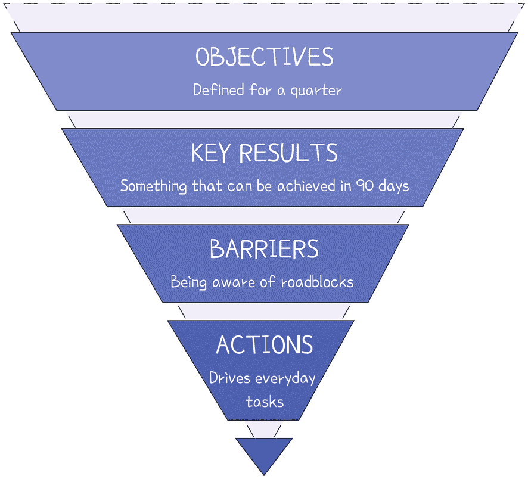

# 9. 设定 OKR

在将 OKR 引入你的业务之前，理解如何引导整个团队运作方式的变革至关重要。OKR 思维需要一种有机的转变，并应逐步渗透到与你共事的每一个人。一旦这种思维成为内在流程，编写和执行 OKR 就会变得容易。从而，实现业务目标将变成流程驱动，而非机械重复。

## 定义 OKR

以下步骤展示了如何转变团队的思维模式，开始使用 OKR：

1. 每次 OKR 推行都必须有一位发起人。发起人通常是 CEO 或部门负责人，具体取决于你在哪个层级引入 OKR。有些组织喜欢在全公司范围内进行大规模推行，而其余 OKR 则针对特定业务群或职能部门。发起人必须将 OKR 置于领导层会议、全员大会和复盘讨论中。发起人必须参与设定 OKR，因为它们是*最重要的增长指标*。
2. 使用 OKR 关乎建立一致性。使用 OKR 的团队必须理解它们是什么、OKR 与个人绩效评估有何不同，以及团队如何撰写和追踪 OKR。教授 OKR 基础知识可以由内部教练或经过认证、受过赋能团队培训的外部 OKR 教练来完成。
3. 发起人及其团队必须参与设定“北极星”OKR，以便其他团队与之对齐。如果部门在使用 OKR，则由部门主管、领导者和下一级团队负责人设定“北极星”OKR。请记住，在 OKR 中，少即是多。因此，每个团队定义的目标不超过三个，每个目标的关键结果不超过三到五个。
4. 跨职能团队成员共同协作，以推动“北极星”指标的达成。

这四个步骤将使团队能够有效协作，从而实现组织目标。

例如，假设你的“北极星”指标是降低浏览你网站潜在客户的流失率。为什么？目的当然是为了让尽可能多的潜在客户选择一个套餐并点击“开始使用”，或联系你的销售团队以启动入门流程。我们都知道这对创收有多么重要。

但业务团队无法独自完成这项工作；它需要与技术团队协作。让我们给这个跨职能团队起个炫酷的名字：增长尖兵。

### 增长尖兵

增长尖兵由来自销售、市场营销、产品和工程部门的代表组成。他们需要解决一个核心问题，即“如何在接下来的 90 天内将流失率从 70% 降低到 40%？”

增长尖兵首先列举现存挑战，这些挑战阻碍了 OKR 的达成。以下是几个例子：

- “我们无法清晰知晓谁在访问我们的网站。”
- “内容或其布局吸引力不足。”
- “我们没有追踪那些在聊天窗口提出询问的响应时间。”
- “我们带宽不足，而且技术团队接到的请求似乎过多。”

经过深思熟虑，增长尖兵们设定了他们的目标陈述：

*为网站访客提供极致体验，以降低流失率。*

明确的商业价值是降低流失率。下一步是衡量标准。这就引出了以下四个关键结果。它们是帮助判断这个鼓舞人心的目标是否达成的指标。

- *关键结果 1*：将对潜在客户询问的响应时间从两天缩短到十分钟。
- *关键结果 2*：将用户在网站上的平均停留时间从一分钟增加到三分钟。
- *关键结果 3*：将页面加载时间从三秒减少到一秒。
- *关键结果 4*：将流失率从 70% 降低到 40%。

每个团队作为特定关键结果的责任人，开始各自的工作。无论团队做什么，目标都是通过围绕这四个关键结果开展工作来确保客户满意度。每个团队成员通过关键结果聚焦于自己的目标，这将确保目标的达成是以客户为中心来驱动的。

### OKR 打磨

如果你问一位谷歌员工关于 OKR 的问题，你通常会得到这样的回答：“这就是我们在这里开展业务的方式。”由此可见 OKR 在谷歌文化中根深蒂固的程度。

OKR 要求训练团队接受以成果为导向的管理，而非以活动为中心的管理。当然，活动很重要，但勾选功能构建、致电潜在客户、会面合作伙伴并不会推动业务向前发展。这些都是投入，而目标是推动成果指标的进展。这类似于增长尖兵衡量周转时间的缩短，或让潜在客户在他们的数字商铺中停留更久。

团队需要理解，OKR 要求选择*正确*的指标，而非*容易达成*的指标。这种思维方式要求人们拓展自己的能力。

OKR 需要一种跨职能协作的思维模式。团队共同撰写 OKR，而不是孤立地撰写，或陷入至今仍困扰许多公司的、职能权责划分过于僵化的组织结构。

打磨也适用于领导团队成员。命令与控制式的管理风格是引入 OKR 的绊脚石。在这里，你要求团队选择能够影响业务的指标。命令式风格应该被教练式的探索性风格所取代，这种风格鼓励团队选择 OKR 并尝试。

最终，你期望每个季度从 OKR 实践中得到的是成果。作为基于成果的工具，OKR 框架将有助于驱动团队每日行动（图 9-1）。

OKR 框架是一种基于成果的工具，包含四个核心思想：定义季度目标，在 90 天内达成目标的关键结果，克服众多干扰的障碍，以及激励日常行动的执行措施。

**图 9-1**

OKR 作为基于成果的工具

## 总结

由于 OKR 框架的灵活性，你可以用多种方式撰写 OKR。像任何目标一样，OKR 应该是可验证且可衡量的。你应该将 OKR 视为未来一段时间内战略的支柱。然而，要设定好的 OKR，你还需要将它们与日常工作联系起来。