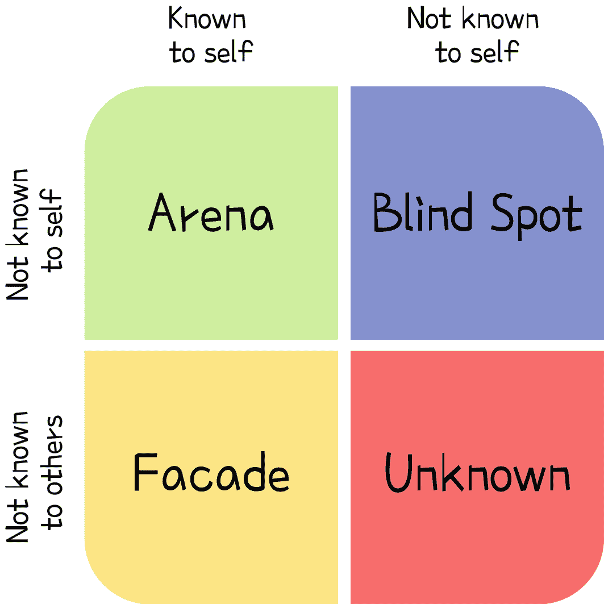
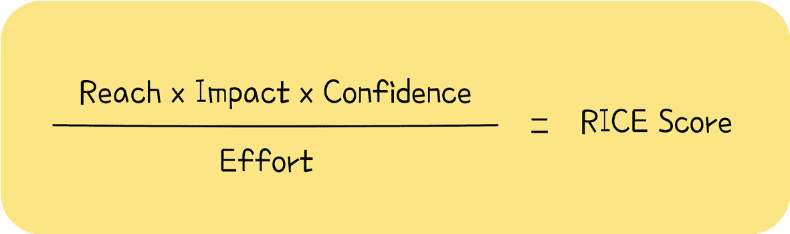
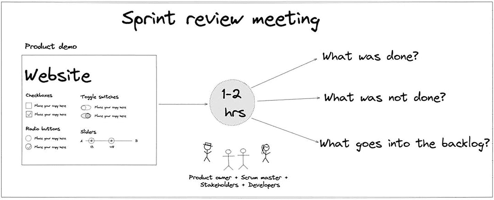

# 13. 人与流程

许多公司起步时执行方式混乱、缺乏结构，但随后会转向顺畅的流程驱动型执行。在这两个极端的中间地带，你会看到流程在逐步演化。这种演化是由内部人员推动的。要引入流程，必须有此前体验过这些流程益处的人。这些人随后会带领其他人踏上设置每个流程的漫长而艰巨的旅程。新流程常常会遇到阻力，但最终流程会占据上风。

技术驱动型公司的“项目管理”流程需要公司全体员工的认可。管理层、中层经理、运营团队、销售团队、市场营销团队和产品团队都必须遵守并尊重这些流程。在本章中，我们将讨论需求与优先级排序流程。

## 需求

约哈里窗口是一种帮助人们更好地理解自己与自身及他人关系的技巧（图 13-1）。它由心理学家约瑟夫·勒夫特（1916–2014）和哈林顿·英格拉姆（1916–1995）于 1955 年创立，主要作为启发式练习应用于自助团体和企业环境中。

一个 2x2 矩阵。第一行标题为“自己不知道”，第二行标题为“他人不知道”。第一列标题为“自己知道”，第二列标题为“自己不知道”。从左到右，从上到下，单元格依次为：公开区、盲点区、隐藏区、未知区。

图 13-1

约哈里窗口

约哈里窗口解释了为什么有效的需求收集能够解决我们正在开发产品的盲点。

如果你仔细观察约哈里窗口，你会看到这四个区域（公开区是众所周知的，因此无需讨论）：

*   *公开区*：这些是需求提出者和需求执行者都熟知的特性。
*   *盲点区*：这些代表了需求提出者感知到，但需求执行者未感知到的内容。
*   *隐藏区*：这些是需求提出者要么未意识到，要么不真实，但需求执行者却知道的事情。
*   *未知区*：它们代表了所有参与者都未认识到的行为或动机——要么是因为它们不适用，要么是因为对这些特性的集体无知。

在着手任何项目之前，这些区域都需要进行讨论、辩论和理解。盲点区、隐藏区和未知区构成了项目理解的 75%。这意味着只有 25%的产品特性是需求提出者和需求执行者都清楚的。

需求优先级排序使得业务团队无需为每条需求单独寻求开会时间，就能独立构想需求。优先级排序允许对每条需求的业务优先级进行列举和讨论。

*   业务团队可以提出并发布新功能，用时更少，因为沟通将更加结构化和文档化。
*   业务团队可以理解其他业务团队的不同优先级，并帮助重新排列需要立即关注的任务的优先级。
*   需求优先级排序会议将确保在邮件/群组/频道中不会丢失任何沟通信息，因为所有排好优先级的需求都可以在需求优先级排序会议上看到，并且可以在一次会议中进行讨论和理解。

在撰写本文时，大多数利益相关者提出的需求都是原始格式的，侧重于需求本身的结果，而非讨论这些需求所驱动的整体公司指标。以原始格式编写的需求要求执行这些需求的人员理解执行这些需求所带来的指标。

如表 13-1 所示，需求文档由一位利益相关者负责，他记录了某个特定功能或产品的需求，以及执行计划的细节。每份需求文档应包含多个参与者，各自发挥作用，如表 13-1 所述。

表 13-1

典型需求文档中的元数据

| 目标发布版本 | 1975-02-01 |
| --- | --- |
| 史诗 | 驱动客户访问量 |
| 文档状态 | 草稿 |
| 文档负责人 | 业务分析师 1 |
| 设计师 | 设计师 1 |
| 技术负责人 | 负责人 1 |
| 技术文档工程师 | 业务分析师 1，产品经理 1 |
| 质量保证 | 质量保证专员 1 |
| 目标 | 更改横幅颜色，以推动安装量增加 x% |

需求文档还需要包含以下要素：

*   明确撰写的目标，并附带该需求旨在驱动的指标
*   驱动目标的成功指标
*   利益相关者所做的假设
*   里程碑
*   分解为更小单元的需求
*   利益相关者可能提出的、并带到优先级排序讨论中来的开放性问题
*   需求范围之外的任何内容
*   作为额外奖励的需求延伸目标
*   用户交互与设计

通常，在编写需求时，我们倾向于只用一句话，例如“将横幅颜色从绿色改为红色，以便让更多人注意到它。”

通过引用一个写得不好的需求，下面的段落试图对其进行纠正。下面是我们如何根据这个需求来编写需求文档的方法：

*   *需求范围之外的内容*：这仅应在已确定的其中一个页面上执行，而非所有页面。
*   *作为额外奖励的需求延伸目标*：有一种简单的方法可以开启/关闭实验，而无需在生产环境中进行代码更改。
*   *用户交互与设计*：使用网页的线框图。
*   *开放性问题*：
    1.  这种颜色会被视为错误提示吗？我们如何获取用户反馈？
    2.  在实验进行期间，我们如何为此收集分析数据？
*   *目标*：通过将颜色从绿色改为红色，将横幅的点击次数增加 5%。
*   *成功指标*：将每日付费用户增加 2.5%。
*   *假设*：红色更醒目；因此，人们更有可能点击它。
*   *里程碑*：首先在 5%的用户身上将此作为 A/B 测试运行，一旦成功，再对 100%的用户启用。因此，这个项目有两个里程碑：实验阶段和发布阶段。
*   *需求*：
    1.  将横幅颜色从绿色改为红色，并将其作为实验面向 5%的用户发布，并分享结果。
    2.  根据两个标准衡量实验结果。实验的测试版本是否将点击次数增加了 5%，并将每日付费用户数量增加了 2.5%？
    3.  基于前一点（b）的结果，继续将其实施至 100%的用户。如果前一点（b）在统计上不显著，则搁置该实验。

如果你通读以上需求，会发现其中没有任何模棱两可的地方。这些需求涵盖了所有方面，使团队能够无需更多疑问即可实施需求。需求是清晰的，当实施它们的团队遇到不确定的事情时，他们会将其添加到评论中，并在优先级排序会议上提问。

在需求文档方面，过度沟通总比沟通不足、任由团队自行摸索要好。

有多种工具可以帮助轻松收集和记录需求流程，我们将在下一节中讨论。

## 工具

业务团队有多种工具可用于整合需求。你可以根据当前组织所处的实际情况，选择其中一种合适的工具。

我曾在大型企业环境中使用过 `Confluence` 作为工具。但也用过许多其他工具，比如 `Trello`、`Asana`、`Notion`，这些工具对小型团队来说更为轻量。每种工具都有其自身的优缺点。你需要根据团队的规模和项目的复杂度来精准选择工具。毕竟，工具的好坏取决于使用它们的人。

选择工具后的流程如下：

1.  在工具中编写需求。
2.  所有后续跟进工作都在工具中完成。邮件跟进将转为工具内进行。
3.  每两周召开一次冲刺前会议。为每个团队选定具体日期。这意味着无需与开发人员和其他利益相关者安排多次会议；只需一次会议来讨论并确定优先级。
4.  工程负责人将在指定日期前审阅编写好的文档，并提出任何修改建议，这些修改建议将在优先级讨论会议前冻结。

## 优先级排序

优先级排序的主要目的是让利益相关者整理出一份按顺序排列的任务清单，供实施团队参考。组织中的每个职能部门通过派遣代表来陈述理由。然后，在优先级排序会议上，该代表有机会与其他团队的代表就此任务的优先级及其原因进行辩论。这是传统的优先级排序方式。

但近期开发出的方法使得确定任务的优先级变得更加容易。你可以使用`RICE`评分来进行优先级排序。

`RICE`是我们用来评估每个项目创意的四个因素的英文首字母缩写。

-   `覆盖度 (Reach)`
-   `影响力 (Impact)`
-   `信心指数 (Confidence)`
-   `工作量 (Effort)`

以下是每个因素的详细含义：

-   `覆盖度 (Reach)`：覆盖度是指该功能可能影响的客户数量。这是相对于时间来衡量的。可能是一个季度内影响的“x”名客户，也可能是一个月内影响的交易笔数，等等。需要使用数字来量化项目的潜在影响，以得出覆盖度。
-   `影响力 (Impact)`：这个因素无法精确衡量，但有一些模型，例如“正负效应模型”可以辅助我们。当我们说某个功能非常出色，将极大地影响客户体验时，我们可以将其评级为 3。对于影响力较低的功能，可以设为 0.5，以此类推。
-   `信心指数 (Confidence)`：这是利益相关者对这项功能需求能够被完成所抱有的信心。一个“登月”般宏大的功能，其信心指数可能低于 50%。一个微小的调整，比如横幅的颜色更改，信心指数可能是 100%。但要得出一个好的`RICE`评分，诚实地评估信心指数是必要的。
-   `工作量 (Effort)`：实施所请求功能所需的时间即为工作量评分。时间以“人月”为单位计算。如果一个任务可以由一个人在半个月内完成，那么工作量就是 0.5。

图 13-2 描述了计算`RICE`评分的公式。如果你将多个需求排成一列，并为每个需求添加一个`RICE`评分，最终结果将帮助你对你所提出的需求进行优先级排序。

一个数学公式形式的表达式。`覆盖度 (Reach)`乘以`影响力 (Impact)`乘以`信心指数 (Confidence)`，整体除以`工作量 (Effort)`等于`RICE`评分。

**图 13-2** RICE 计算器

得出的评分衡量了“所投入时间带来的总影响力”，我们需要最大化这个值。你可以使用我设置好的电子表格来自动计算 `RICE` 评分：[`bit.ly/rice-calculator`](https://bit.ly/rice-calculator)。

## 评审

评审会议是利益相关者通过查看演示来评估冲刺阶段开发完成的任务的会议；该会议由 Scrum Master 与开发团队共同主持。这个演示可以是一个面向用户的完整演示，也可以是一个可模拟的演示，目的是确保会议简短且切中要点。

图 13-3 解释了一个典型的冲刺评审会议如何进行，以及在评审会议上需要回答哪些问题。每个人都有发言权，并且必须回答图 13-3 中的三个问题。完成后，团队成员对答案进行投票。获得一定数量投票的答案会被共享，并由管理层采取行动。

一次冲刺评审会议，用于产品演示，时长 1 到 2 小时，会上简要讨论诸如“完成了什么？”、“什么没完成？”以及“什么需要加入待办事项清单？”等问题。该会议应邀请产品负责人、Scrum Master、利益相关者和开发人员参加。网站包含复选框、切换开关、单选按钮和滑块。

**图 13-3** 一次典型的冲刺评审会议

在冲刺过程中，如果存在准备就绪的任务，可能还会安排其他临时的评审会议。例如，如果某些成员来自多个团队，他们可能会几乎每天都审查演示，并且比典型的冲刺团队更频繁地进行评审。

但定期的评审可能会对项目构成威胁。原因在于，如果需求没有以客观的方式连同范围内的和范围外的部分一起良好地记录下来，那么评审会议总是有可能偏离正轨，去讨论为什么某个特定功能在当前时间点是绝对必要的。

这时，Scrum Master 的角色就显得至关重要，他需要提请会议注意，当前的会议目标正在因讨论范围外的话题而偏离。因此，选择合适的 Scrum Master 是必要的。这个人应该代表产品发言，而不是代表利益相关者或项目实施团队中的任何一方。

在演示会议上，Scrum Master 会要求利益相关者批准当前状态下的产品，以判断其是否适合发布，以及是否达到了当前的“完成定义”。如果利益相关者认为某些功能应该剔除或不必要地添加，这些都应该被明确指出。因此，会议是透明的，它让双方都能就产品是否被视为就绪给出坦诚的反馈。会议的目标是进行透明地评审，并确定冲刺中所实施工作的状态。会议试图从产品角度审视四个方面。

-   完成了什么？
-   什么未完成，原因是什么？
-   自项目开始以来新增的工作，以及目前的情况
-   从冲刺中移出的工作及其原因

会议结束后，会得出一个修订后的产品待办事项列表，这将成为实施团队在下一个冲刺中将要处理的条目集。如果在产品演示过程中发现了新的需求集，这些需求也会被加入到待办事项列表中。

冲刺评审旨在展示整个团队（设计师、开发人员和产品负责人）的辛勤工作成果。

## 摘要

建立流程在初期是困难的。要将流程推广到整个公司，需要说服、纪律、时间和精力。一旦这些流程建立起来，公司整体将拥有一个标准模板，从而在执行任务和项目时，比流程建立之前快得多。执行临时项目会给人一种公司快节奏的假象，但这实际上只是一次性的事情。一个具有韧性的公司总是遵循并尊重流程。一个志在长存百年的公司，会建立能够持续那么久的流程，并适应能够助其一臂之力的新时代流程和技术。

