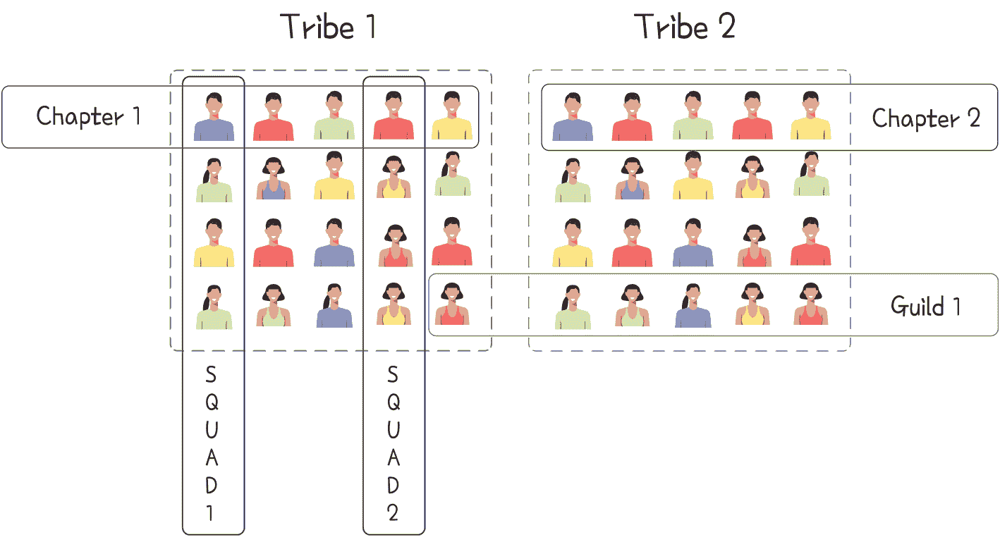
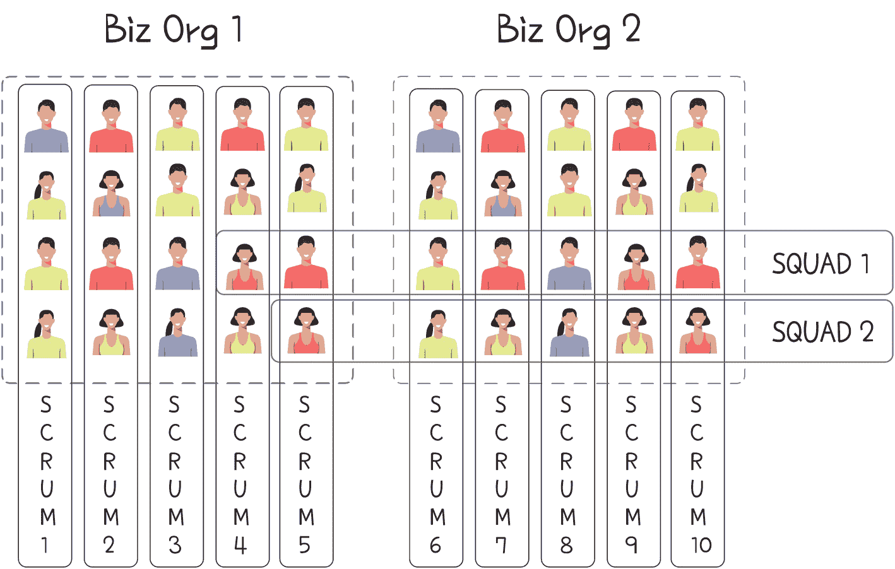
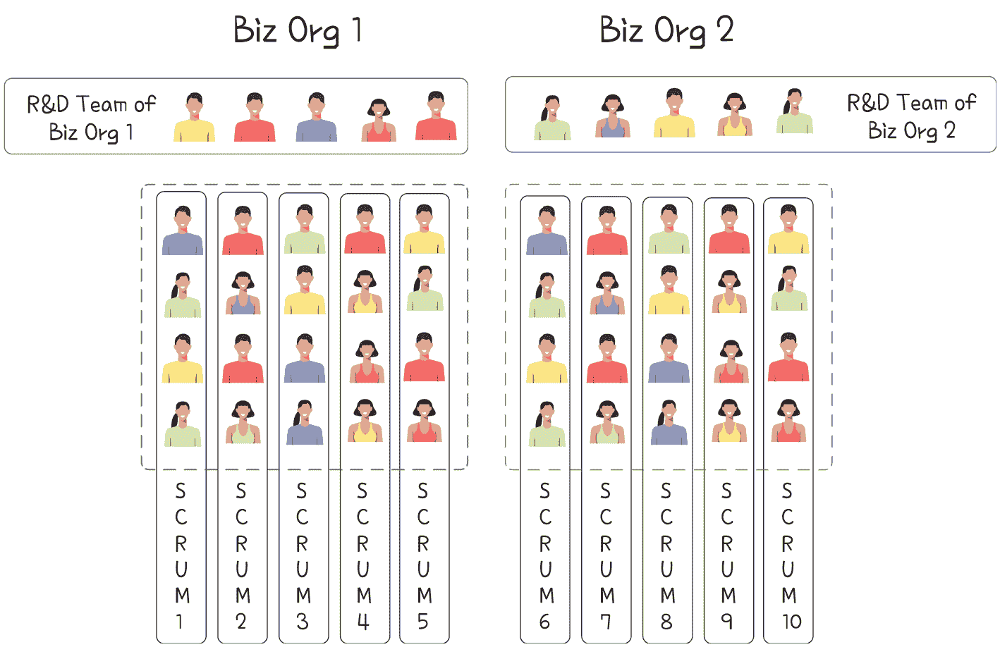
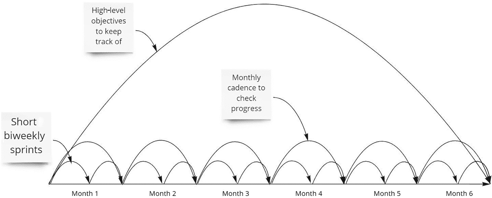

# 14. 原型设计

现代公司依靠快节奏的战略以及这些战略的成功执行而蓬勃发展。但这种速度不应以牺牲已建立的流程为代价。快速原型设计应该有其特定的执行方式。建立有助于开发和部署这些快速原型的内在结构非常重要。公司和员工的思维模式应与执行此类快节奏项目保持一致。这需要灵活性、勇气以及以数据驱动的方式快速推进的意愿。在执行原型项目时，每个数据点都至关重要。数据点使团队能够判断执行和战略是成功还是有缺陷。随后可以快速进行调整，使战略成为成熟的方案，从而实现快速原型设计。

## 创新项目

一个企业要想保持竞争力，就需要创新，而且需要快速创新。这意味着它需要具备快速失败的能力，并找到比竞争对手更快解决问题的办法。为此，团队和流程必须具有敏捷性——比任何其他人都更敏捷。

为了快速行动，公司已经采用了敏捷原则。在此过程中，运营团队经历了一场巨大的数字化转型之旅。新冠疫情以前所未有的速度加速了数字化进程。随着如此多的公司完全转向远程办公模式，世界已被永远改变。但敏捷本身并不能保证规模化；公司在转向数字化时需要意识到规模问题。

审视敏捷团队的传统方式也随着时间的推移而演变。出现了诸如`squads`、`pods`、`cells`、`prides`和`tribes`等描述团队的新结构。甚至在组织内部还形成了`villages`和`guilds`。

这些团队可能有自称传统经理和 Scrum 大师的领导者，也可能有诸如`shepherds`之类富有创意的名称。我们喜欢称他们为`mentors`。

但无论这些新名称是什么，它们只是组织内部创建新结构的一种方式，这种结构有助于超快速地交付项目，同时还能处理规模问题。这些名称背后的核心思想是确保人们作为一个紧密的团队一起工作，完成手头的任务。这些小队的运作效率远高于传统团队。

小队模式也被称为“Spotify 模式”，因为它最初是由音乐流媒体服务公司 Spotify 开发的。Spotify 开发了自己版本的 Scrum。图 14-1 解释了 Spotify 的部落、小队和公会模型。请注意，一个小队可能来自同一个部落但跨越不同团队，而一个公会可能来自不同部落。

部落 1 和部落 2 由按 4 行 4 列排列的人员组成。每个部落的第一行分别表示章节 1 和章节 2。部落 1 的第一列和第三列表示小队 1 和小队 2。部落 1 的最后一个人和部落 2 的最后一行属于公会 1。

**图 14-1** Spotify 的部落、公会、章节和小队

Spotify 使用 Scrum，但将`team`重新命名为`squad`，因为公司希望为团队成员创造一种主人翁意识。

在我的创业公司，我们为自身的用途提出了小队模型的修改版本，并对典型的 Scrum 系统进行了改进。在我们的模型中，我们采用现有的 Scrum 模型，假设有两个业务组织分布着十个 Scrum 团队。那么，如果有一个项目需要这些团队相互协调，我们就会让每个 Scrum 团队的负责人组成一个小队。一个典型的小队由每个 Scrum 团队的多位负责人、负责项目交付的项目经理、QA 人员以及其他可能需要临时加入的成员组成。

在小队成立后，我们确保这个小队在常规的 Scrum 会议之外另行会面，以确保项目顺利进行。如果小队遇到任何困难，他们会在各自的 Scrum 会议上与常规团队成员沟通，以澄清并排除障碍。

图 14-2 展示了我们小队的样子。黑头火柴人代表团队负责人。请注意，Scrum 5 的负责人足以代表整个 Scrum 5 团队参与小队 2。

业务组织 1 和业务组织 2 由按 4 行 5 列排列的人员组成。从左到右，各列分别表示 Scrum 1、2、3、4、5、6、7、8、9 和 10。业务组织 1 第四行的最后两人和业务组织 2 的第四行表示小队 1。业务组织 1 的最后一个人和业务组织 2 的第五行表示小队 2。

**图 14-2** 为适应 Scrum 团队而改进的小队模型

对于新的创新项目，快速响应市场需求并转型为数字化组织的需求，在我们这里推动了这些自治、自组织工作组的兴起，并带来了深远的好处。根据我的经验，小队模型是有效的。它带来了常规团队之外的协作，以及单个团队无法实现的效率。

## 快速周转

将团队组织成具有特定目标导向的创新项目的小队，可以带来快速的周转。但代价是什么？有些正在进行的项目对日常业务的运作极其重要，这些项目不能被打扰，其成员也不能。因此，最好是创建与现有团队并行运作的研发团队。这些团队将拥有灵活性，并能够承担新的挑战。这个团队的成员可以从现有团队中那些总是乐于学习新事物的成员中挑选。

研发团队需要有自己每日的节奏，以帮助自身解决可能遇到的任何新问题。通常，任何新项目首先会交给研发团队，以便他们能够快速制作原型，然后将其传递给特定的小队或 Scrum 团队，如图 14-3 所示。

业务组织 1 和业务组织 2 由按 4 行 5 列排列的人员组成。从左到右，各列分别表示 Scrum 1、2、3、4、5、6、7、8、9 和 10。两者都有额外的 5 名成员组成研发团队。

**图 14-3** 为了提高效率，每个组织应拥有独立的研发团队

要实现任何项目的快速周转，请执行以下操作：

- 在项目开始时设定清晰的里程碑，以确保一切按计划进行。
- 使用正确的技术。选择当前团队熟悉且精通的技术是绝对必要的。
- 保持每日例会的节奏，以确保你不会落后于进度。

## 长期项目

规划和管理长期项目会带来特殊挑战。长期项目可能持续数月、一年甚至更久，其成果取决于你在此期间开展的工作。即便我们能准确预测六个月后想要达成的目标，也很难确保五个月后的情形与预期一致。

更好的做法是采用短周期规划，这样每月末都能灵活调整计划。图 14-4 展示了一种典型的滚动计划如何通过多个中间节点运作。

典型滚动波计划示意图。该计划周期为 6 个月，其中包含每两周一次的短周期冲刺，逐月推进；同时设有月度检查进度的节奏。更大的跨度则从计划起点跨越至第 6 个月末，涵盖用于追踪的高层级目标。

**图 14-4**  
*一个典型的滚动波计划*

要将滚动波方法应用于长期项目，你需要遵循以下步骤：

1. 根据两个月目标拆解组件，其余部分暂放一边。务必以较低详细度规划剩余部分。
2. 详细规划两个月目标，并进一步分解为月度目标。
3. 取第一个月目标，将其进一步分解为双周冲刺目标。
4. 启动双周冲刺，随着进度推进，重新审视月度目标，然后调整后续目标：基于新理解添加新需求，或删除不必要需求。
5. 在整个项目中持续以这种方式修订计划。

不要推迟与长期项目相关的发布。如果某些功能已达到最小可行产品（`MVP`）的标准，则可以通过向特定用户群发布来测试产品。通过发布`MVP`获得的经验，将为后续全面产品发布增加价值。

市场进入策略有多种方式。

- **软发布**：确定可向其发布新功能的用户群，并仅对这部分用户启用该功能。同时确保设置适当的反馈机制来记录反馈，这些反馈可作为现有功能集的评价依据。根据反馈，你可能决定保留或删除某些功能。决策达成一致后，即可向所有用户发布。
- **暗发布**：在此类发布中，用户并不知道自己正被用于测试。不会主动收集用户反馈，但可通过分析工具了解用户行为。
- **硬发布**：仅在拥有足够基础设施，能够支撑海量用户突然使用新功能的情况下，才采用硬发布。

这些发布类型并无优劣之分。根据具体情境和用户群体选择最适合的方式，才能发挥效用。

此外，针对新产品发布需注意以下几点：

- 不要浪费时间添加过多功能。一个`MVP`足以帮助理解市场；因此先发布，再迭代。
- 发布新产品时不应排斥创新，因为微小的调整就能让你在竞争中占据优势。
- `MVP`应保持轻量，避免消耗过多资源。确保它不会造成资金压力。你需要快速测试市场需求，并尝试用最节俭的方式构建`MVP`。不要为打造完美产品投入过多。
- 加快开发速度有助于更早进入市场。快速犯小错误，以便更快学习和改进产品。早期犯下的错误能为你带来宝贵的经验，当产品日渐成熟时这些经验将发挥重要作用。
- 迭代周期应控制在一到两周。持续删减耗时过长的内容。不必担心你钟爱的功能未能纳入`MVP`，产品发布后总有机会添加。

## 总结

发布最小可行产品并不意味着成功。我们将在第 23 章详细讨论如何识别并认定某个`MVP`为成功案例。但快速开发`MVP`能确保比竞争对手更快进入市场。在这个所有商业行为都被审视、每种策略都受评判的数字世界中，最小可行产品能让企业以较小规模测试产品、快速获取反馈，然后尝试规模化推广。这将催生迭代优化后的优秀产品。

