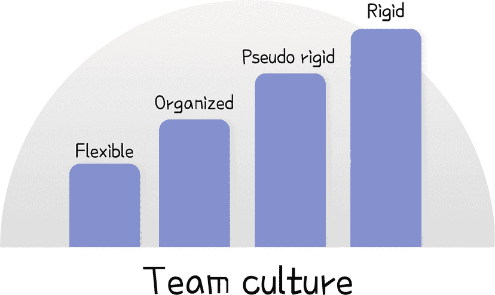
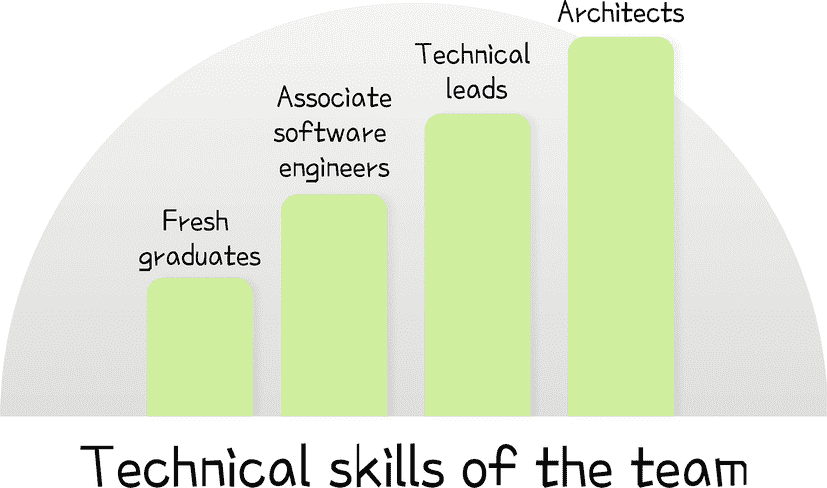
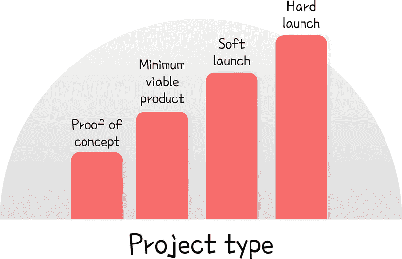
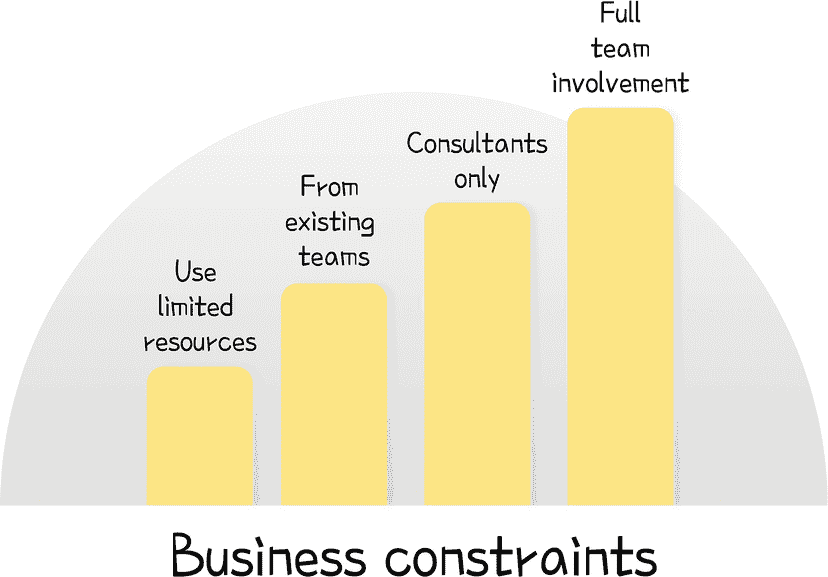

# 敏捷性与规模化

我们不应将敏捷性与规模化视为对立面，而应将其看作一枚硬币的两面。如果一个团队里有两个人，一个人注重“敏捷”，另一个人则始终倡导并致力于“规模化”，这将是绝佳的组合。让他们携手合作，在最短时间内打造出最优秀的产品。

`敏捷`团队如今在各行各业正成为主流。如果在追求敏捷时忽视了规模化，项目很快就会面临失败。最初，敏捷在开发领域被引入时，其目标是实现高度灵活，并助力快速决策，重点聚焦于集中办公的团队。

回顾诸如弗雷德里克·泰勒的“劳动分工”等早期流程，我们发现它们关注的是运营的规模化，而非敏捷性。如今，是时候将这两种方法融合，并提出一种混合模式了。规模化下的人员可以驱动与机器替代后称为“敏捷”的相同数量的运营操作。并非所有事情都能以敏捷起步；框架始于人员。运营团队首先需要大量人员来扩展业务；一旦流程建立起来，技术才会介入。

我们曾一直认为，在组建业务流程技术团队时，即使没有该技术团队，公司也能以相同的规模完成同样多的业务。所有效率都纯粹依赖于人员及其流程，而非数据和系统。

让我们首先通过审视敏捷宣言的原则，来理解如何将敏捷性与规模化相融合。

-   敏捷强调个体和互动高于流程和工具。
-   可工作的、能自我解释的软件比堆积如山的文档化流程更有价值。
-   倾向于与客户携手合作，而非纠缠于合同义务的谈判。
-   计划也应是敏捷的，即能够快速响应变化，而非遵循一套既定的行动路线。

当我们在团队层面应用敏捷和精益策略时，我们是在进行战略性的前瞻思考，因为这正是驱动已具备规模的团队以敏捷方式运作的关键。通常，当我们想到规模化时，往往会联想到庞大的人员数量和众多的团队。但如果我们足够讲究战术，那么凭借一个精简的团队也能实现规模化。

当我们审视不同的工作方式（WoW）时，应用那些考虑了当前背景和情境的策略有助于得出正确的解决方案。照搬教科书上的策略并非明智之举。这将帮助我们在当前时间为当前项目实现所需目标。在应用策略时具备这种情境意识，将有助于制定量身定制的策略，使其契合项目情境和项目本身的目的。如果我们在项目初期选择了某种工作方式，并不意味着我们会一直固守不变。但它就像一盏指路明灯，而滚动式计划最终将帮助我们适应后续情况的需求。通常，如果后期情况变得复杂，那么就需要改变相应情境下的工作方式。

在项目开始时选择一种具备情境感知的策略时，我们需要识别出一些有助于设定工作方式的特定参数。

-   **团队是如何构成的？** 团队是由业务分析师、用户体验设计师、开发人员、质量保证人员或数据科学家组成，还是主要由销售、运营和市场人员构成？这些人员是从外部招聘，还是从现有不同团队中抽调人员组成新团队？他们是集中办公、在家远程办公，还是采用混合模式？他们是全部合并在一个大型团队中，还是会有专门的团队处理特定模块？这些问题都需要回答，而答案可能根据你所处的情境而有所不同。

-   **团队构成确定后，你们将如何协同工作？** 哪种工作方式最适合当前情境？敏捷式？传统式？还是两者结合？你们是能够制定出前瞻性的目标，还是能够采用以周为单位的、目标驱动的模式？在选择这些方法中的任何一种时，可能会遇到哪些障碍？

-   **你们将使用哪些协作工具？** 关于这一点，有多种选择。身处技术领域，我们可能已经使用过有助于协作的应用程序。在我之前的团队中，当我们转向居家办公模式时，我们使用了一款名为“Gather”的工具来促进协作。在办公室工作时，我们可以直接和邻座的同事沟通，提出任何疑问。这种交流跨越了团队，每个人都能认识身边的人，因此大家都能毫无顾虑地寻求帮助。但一旦转向远程工作，这就变得困难了，尤其是对于团队中不太敢向他人求助的初级成员。我们使用了一个名为 `Gather Town` 的工具；这个网站让我们团队的所有成员都能处于同一个虚拟工作空间，每个人都有一个虚拟角色。我们可以利用这个角色四处走动，与他人会面，进入“泡泡”与他们进行私密对话。其他的沟通渠道还包括传统的电子邮件、`Slack` 等。

随着学习的深入，我们在项目初期做出的选择会随着时间的推移而改变，但值得注意的关键点是，我们首先会做出一些宏观的选择来启动项目。

我们所做的选择取决于以下因素：

-   团队文化
-   团队的技术技能
-   问题的性质
-   业务约束

现在我们来审视这些因素。

## 团队文化

拥有敏捷团队需要人们有效协作以实现目标。如果将具有传统背景文化的人员放到敏捷团队中，那将导致两人“语言不通”，缺乏凝聚力和团队感。特定团队的文化也会因组织文化而异。如果组织文化是传统的，但组织内部的特定团队是敏捷的，那也会带来麻烦，因为团队之间需要协作；当每个团队都无法理解其他团队的 `WoW` 时，应对未知情况就会变得困难。人员的灵活性在敏捷团队中也扮演着重要角色。敏捷团队要求成员在方法上保持灵活和包容。固守僵化只会延长交付周期，并成为团队间的障碍。在图 15-1 中，展示了产品规模扩大如何影响人员的心理状态。如果产品需要敏捷性，团队就会灵活；随着敏捷性的降低，团队文化会变得僵化。

纵向柱状图按递增顺序表示以下团队文化：灵活、有序、伪僵化、僵化。

*图 15-1* 解释规模化如何影响人员的心理状态

好的，作为高级文档工程师和翻译员，我将严格遵循您的格式要求，将以下英文文本翻译成中文。

## 团队的技术技能

团队的成员必须具备（或通过学习获得）与其在团队中扮演的角色相称的技能。例如，敏捷软件团队中的开发人员可能需要具备测试驱动开发（`TDD`）技能、以人为本的协作/沟通技能、持续集成（`CI`）技能、模型风暴技能、基于团队的规划技能等等。串行/传统团队中的开发人员可能更专注于特定技术平台的编程技能。图 15-2 描绘了软件工程师在团队中的职业发展路径，因为他们看到产品从原型走向可扩展的版本。

垂直条表示团队以下技术技能的递增顺序。从左到右依次为：应届毕业生、助理软件工程师、技术主管和架构师。

图 15-2

向上的箭头表示职业发展路径。

### 问题的性质

尽管有些人倾向于认为特定类型的问题只能以某种特定方式解决，但实际情况似乎并非如此。例如，可以对数据仓库项目、营销项目以及从外部合作伙伴采购服务采用敏捷或传统方法。我们的经验是，真正的问题在于潜在解决方案的可分解性。例如，如果你愿意，可以将数据仓库分解成许多小型发布版。营销活动的开发和执行也是如此。但是，将一架飞机分解成几个可工作的部件并不容易。飞机要么是完整的，要么就不是。是的，仍然可以将敏捷技术应用于飞机制造，甚至很可能应用于其设计，但由于面临物理和监管方面的限制，飞机团队永远无法像软件开发团队那样敏捷。

图 15-3 描绘了如何通过产品解决问题，首先进行原型设计，然后随着时间的推移进行完整发布。

垂直条表示以下项目类型的递增顺序。从左到右依次为：概念验证、最小可行产品、软启动和硬启动。

图 15-3

产品和不同发布的进展

### 业务约束

业务对工作的约束方式，例如坚持某个特定的（通常很激进的）交付日期、管理预算的方法（通常是固定价格/投标），以及业务人员在整个项目中的可用性，这些无疑都会影响你采用的流程以及你纳入团队的人员类型。它甚至可能影响你使用的工具，特别是用于沟通和协作的工具。

图 15-4 展示了团队如何从有限的资源开始，最终走向公司所有部门相互合作以启动旗舰项目。

垂直条表示以下业务约束的递增顺序。从左到右依次为：使用有限资源、来自现有团队、仅限顾问、全员参与。

图 15-4

产品发布的典型路径

### 警报与标记

在扩展运营规模时，总有可能出现情况恶化，这主要是因为在团队超级敏捷时未能处理未知因素。这意味着当前正在运行的运营可能面临突然缩减规模的风险。为了规避这些风险，我们需要从技术驱动的角度设置标记和警报，以帮助团队预先应对任何不利情况。

可能的不利情况如下：

-   安全事件
-   数据丢失
-   因规模扩大导致的系统崩溃

在团队使用的应用或系统完全构建和部署之前，就应该仔细考虑警报和标记。警报可以简单地是通过不同渠道发送的通知，例如：

-   像 Slack 这样的沟通渠道
-   电子邮件
-   向特定人员发送短信

## 规模化的技术驱动运营

一种关于如何在整个公司及任何行业中整合并利用先进技术的清晰方法论正在形成。

贵公司如何利用先进技术创造价值？这已成为我们这个时代定义性的业务挑战。如果你忽视它或做错了，那么从你的工作到整个组织，都可能变得容易受到那些做对了的竞争对手的攻击。这些新技术有许多标签——数字化、分析、自动化、物联网、工业互联网、工业 4.0、机器学习、人工智能（`AI`）等等。有助于扩展业务规模的技术支持创建全新的、数字化驱动的业务模式，同时，它们在改善客户体验和提高传统运营生产力方面也承载着至关重要的承诺。先进技术对现代企业至关重要，可以说，每个大型公司都在一定程度上运用着它们。

-   制定技术路线图，策略性地聚焦于改造传统业务和创建新数字业务所需的投资。
-   培训管理人员识别新的机遇，并建立内部能力以交付技术。
-   建立现代化的技术环境，以支持新解决方案的快速开发。
-   全面改革数据战略和治理，确保数据可靠、可访问且持续丰富，以使其更具价值。
-   通过快速推动运营模式变革，坚持不懈地专注于从技术中获取战略价值。

对于大约 25 年前经历过精益革命的读者来说，对大量技术解决方案的需求以及“最后一公里”挑战可能是熟悉的障碍。从精益计划中获取价值需要将每个流程的变革贯穿到企业的运营模式中。没有哪一个单独的精益项目能带来显著的绩效提升，但一个丰富的精益项目组合可以。

为了使转型可控，公司分批次实施精益项目，每次处理大约 200 人的流程或单元。他们首先为每个流程或单元如何转型制定愿景。然后，他们组建一个精益专家团队（通常称为`黑带`）来管理变革并确保新的运营实践得到采纳。尽管精益方法从未是专有的，但像丰田这样的公司利用它们不断追求微小的绩效改进，从而建立并保护相对于竞争对手的优势。

在技术驱动的转型中实现规模化的重要组成部分，是拥有足够的内部技术专长和人才。一个经过验证的构建技术人才库的模型是`技术工厂`。这样的工厂完全服务于业务，并由业务部门管理。它提供了吸引技术人才和实现高速开发所必需的工作环境。

## 总结

出现的问题是何时用技术来增强运营。一些公司意识到这一点时已经晚了，通过人力维持运营的成本已经飙升至任何进一步的扩展都变得不可行的地步。其他公司则采用技术优先的方法。这两种方法都不能保证成功。时机必须根据具体情况和市场条件来决定。虽然技术肯定能够赋能运营，但如果没有合适的产品而仅仅投资于技术，则可能导致失败。

