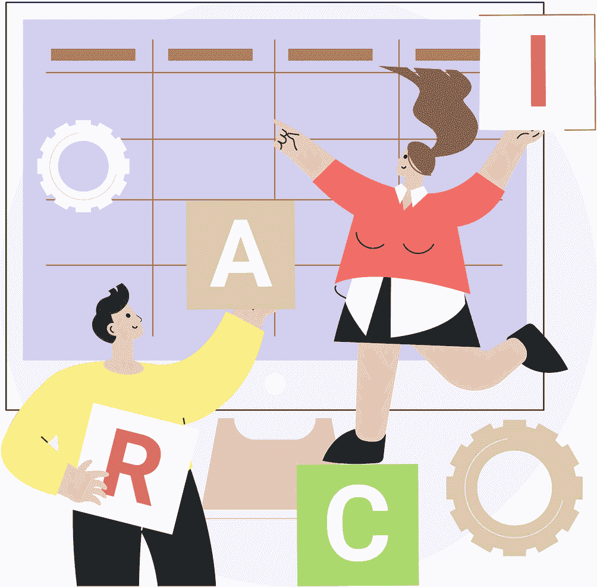
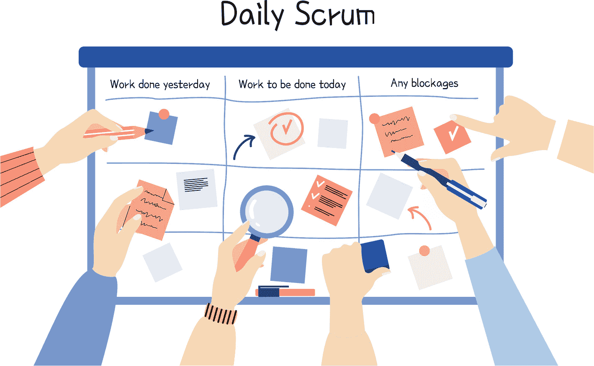
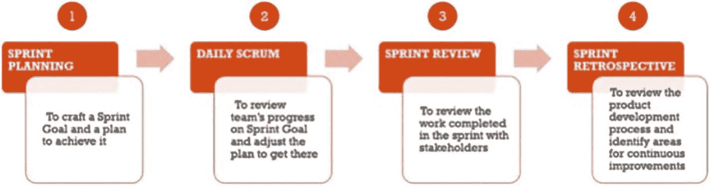
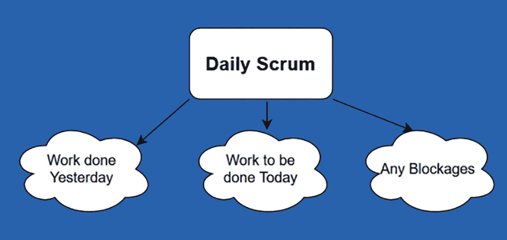

# 21. 企业为何会失败？

纵观历史，企业失败的典型原因包括战争、经济衰退、高税收、高利率、过度监管、管理决策失误、营销不足、无法与其他类似企业竞争，或者公众对企业提供的产品/服务缺乏兴趣。

但也可能存在企业自身固有的、导致失败的原因。在本章中，我们将探讨可能导致企业失败的流程相关问题，以及如何通过构建具有自愈和自纠能力的强大流程来避免这些问题，从而帮助企业蓬勃发展。

## 解决流程问题

有多种框架试图通过创新的追踪器来解决流程问题。一个清晰的项目管理框架有助于减少这些失败。
每项计划都需要在`RACI`或`DACI`模型中定义相应角色。

### RACI

一幅草图：一名男子手持卡片，卡片下方标有 R，上方标有 A。一名女子站在标有 C 的卡片旁，并手持标有 I 的卡片。左上角和右下角有两个设置图标。

**图 21-1** `RACI`模型

`RACI`模型提出的问题是：谁负责完成特定任务？

`RACI`矩阵是定义和记录项目角色与职责最简单、最有效的方法。确切知道每一步谁负责（Responsible）、谁问责（Accountable）、需要咨询谁（Consulted）、以及必须告知谁（Informed），将显著提高项目成功的几率。

`RACI`代表以下含义：

- **负责者（Responsible）**：谁负责参与完成某项行动？
- **问责者（Accountable）**：谁负责确保某项行动完成？
- **咨询者（Consulted）**：在完成某项行动的过程中，需要咨询谁的意见？
- **告知者（Informed）**：谁需要被告知某项行动的进展状态？

### DACI

几只手拿着便利贴、铅笔、钢笔、掸子、放大镜，在一块板子上方比划。另一只手则指向一个区域。板子上列出了昨天完成的工作、今天要完成的工作以及任何阻碍。

**图 21-2** `DACI`模型

`DACI`模型提出的问题是：谁来决定特定任务或功能的行动方案？

`DACI`决策框架通过在团队决策时为成员分配特定角色与职责，提升了团队在项目中的效能与速度。

`DACI`代表以下含义：

- **推动者（Driver）**：推动决策的人
- **审批者（Approver）**：做出决策的人
- **贡献者（Contributors）**：其工作或知识为项目提供帮助的个人或团队
- **告知者（Informed）**：其工作可能受这些决策影响，因此需要了解情况的人

### 切勿临时应付

始终让多个小组（pods）或小队（squads）运行冲刺（sprints），正如第 4 章所述。这有助于即使项目一小部分失败，整个项目仍能继续运行。为此，必须始终有例会和流程来跟踪进展。
企业之所以失败，是因为维持流程运作所必需的例会未被遵守。我们在第 1 章已详述了公司一般性的所有例会，在第 18 章则专门为技术团队进行了说明。这里我们将讨论，如果正确执行哪些例会，可以防止企业失败。

#### 需求收集

所有来自利益相关者的需求将被分类，并根据职责分配到特定团队。这些需求随后会在每个团队的项目管理工具中，归集到待办事项列表（`backlog`）部分。根据优先级，这些任务会被分类并分配给开发团队。这一基本例会是帮助企业培养对所有关键任务进行优先级排序文化的必要条件，否则公司目标将无法实现。

#### 史诗、用户故事与任务

所有来自利益相关者的请求（新功能、变更请求以及新技术的迁移请求）都通过表单或软件进行记录，并通过冲刺流程推进到逻辑终点。

- **史诗（Epic）**：驱动新旗舰功能或产品的一个较大故事。
- **用户故事（User story）**：将较大故事分解为较小的故事。
- **任务/子任务（Tasks/subtasks）**：将较大故事分解为更小的模块。

如果不能以有条理且可重复的方式创建史诗、用户故事和任务，最初会导致项目层面的失败，而当问题累积并成为普遍常态时，则会导致业务层面的失败。

### 遵循冲刺

对于较小的团队，必须优先处理待办事项列表中的所有问题并将其付诸行动。这将通过`Scrum`模型中的不同阶段来实现。图 21-3 展示了敏捷方法论中事件是如何发生的。

- **冲刺时间线**：2 周
- **任务优先级排序**：交替的周五
- **新冲刺开始**：每隔一个周二
- **冲刺结束**：每隔一个周一

图 21-3 描述了一个可用于交付较大史诗或项目的典型冲刺框架。

流程图。步骤 1：冲刺规划。制定冲刺目标及实现该目标的计划。2：每日站会。检视团队进展并调整目标。3：冲刺评审。与利益相关者一起评审已完成的工作。4：冲刺回顾。检视产品开发流程，识别持续改进的领域。

**图 21-3** 冲刺流程

以下步骤详述了冲刺过程：

1.  待办事项列表中的所有问题由各自的开发团队进行优先级排序。这些问题随后被添加到冲刺规划中的“创建冲刺（`Create Sprint`）”任务中，并启动冲刺以跟踪进度。
2.  冲刺启动后，每日站会随即开始，以检视团队在冲刺目标上的进展。图 21-4 展示了每日站会中的检视方式。
3.  在优先级排序时进行冲刺评审，与利益相关者一起评审本冲刺中已完成的工作，并讨论即将开始的冲刺任务。
4.  冲刺结束后，团队开会回顾上一个冲刺，并识别改进领域，这被称为*回顾*。

#### 每日站会

正如`Scrum`指南（`https://scrumguides.org/`）所述，每日站会的目的是检查朝向冲刺目标的进展，并根据需要调整冲刺待办事项列表，调整接下来的计划工作。每日站会是`Scrum`团队开发人员的一项 15 分钟事件。为降低复杂性，它在冲刺的每个工作日于同一时间和同一地点举行。如果产品负责人或`Scrum Master`正在积极处理冲刺待办事项列表中的条目，他们将作为开发人员参与。开发人员可以选择他们想要的任何结构和技巧，只要他们的每日站会聚焦于朝向冲刺目标的进展，并为第二天的工作制定可行的计划。这创造了专注力并改进了自我管理。每日站会改善了沟通，识别了阻碍，促进了快速决策，从而消除了对其他会议的需求。每日站会并不是开发人员唯一可以调整计划的时间。他们经常在一天中会面，以进行关于调整或重新规划剩余冲刺工作的更详细讨论。

图 21-4 描绘了每日参加`Scrum`会议的每个人需要汇报的内容。

流程图。每日站会分为：昨天完成的工作，今天要完成的工作，以及任何阻碍。

**图 21-4** 每日站会中需要回答的问题

如果这些流程被忽视，那么整个公司的问题就会悄然出现并波及所有领域。这些问题会导致：

- 缺乏清晰度
- 沟通不畅
- 变更管理失效
- 由于重复的任务和计划而缺乏创新

## 摘要

企业为何会失败，这个问题没有放之四海而皆准的答案。仅仅不遵循冲刺流程并不能保证企业失败。如果说，只要企业的所有其他基本功都扎实，并且冲刺流程及其他所有惯例都得到遵循，企业就一定会成功，这无异于在说：它不会失败。
