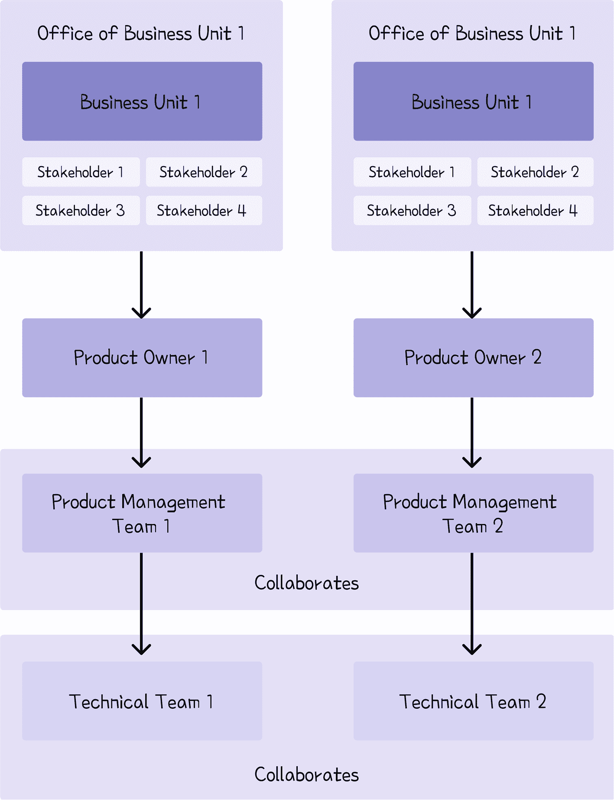
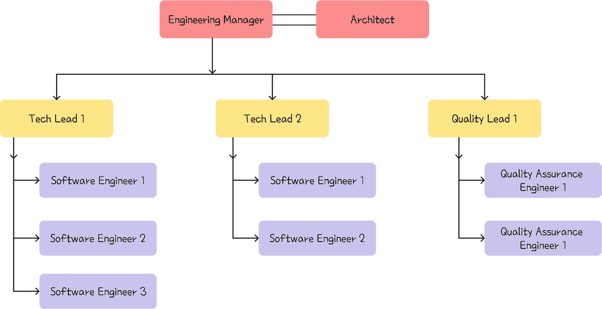

# 技术在满足业务需求中的作用

技术团队的划分应基于业务团队的需求。当公司规模较小，需要快速原型开发和产品上市时，团队可以保持整体化。但随着公司成长为中型市场公司，技术团队需要经历转型，按照业务垂直领域进行拆分。而当中型市场公司发展为企业级时，则需要进一步拆分并在宏观层面进行整合。目标是在保持流程协调的同时，亦能保持敏捷性。技术领导者需要不断应对平衡这两者的挑战。

## 与业务单元相关的技术组织

图 16-1 展示了一个典型的技术团队组织结构。组织成立之初，可能只有一个业务单元和一位业务负责人，他会将新开发或新计划的信息传达给一位技术负责人和一位产品负责人。当公司发展壮大后，业务单元（BU）的数量会增加，每个业务单元都会有一位业务单元负责人，他将与业务分析师和项目经组成的管理办公室合作，这些人成为利益相关者。

这些利益相关者随后会组成一个自己的单元，在将这些计划传递给产品负责人团队之前，先评估这些计划的影响。影响分析可以遵循多种方法或框架。通常采用的是 RICE（触达、影响、信心、努力）框架。我将在本书的第五部分对此进行更多讨论。

利益相关者完成分析并将计划文件传递给产品负责人后，产品负责人会通过评估完成该计划所需的不同集成点，来制定他们的产品需求文档。如有必要，会进行跨团队协作以评估对整个团队的影响。

然后，这些需求被传递给技术团队。技术团队内部的技术结构将在本章中进行讨论。

业务单元 1 的两个办公室共有 4 位利益相关者。他们进行分析并将计划文件传递给产品负责人 1 和 2。产品负责人将其传递给项目管理团队 1 和 2，这两个团队进行协作。然后他们再传递给技术团队 1 和 2，这两个团队进行协作。

**图 16-1** 业务单元与技术团队的关系

## 技术团队结构

图 16-2 说明了如何组织技术团队来执行每个业务需求。

一个流程图。工程经理和架构师进行协作。经理分出技术主管 1、2 和质量主管 1。技术主管 1 下辖软件工程师 1、2 和 3。技术主管 2 下辖软件工程师 1 和 2。质量主管 1 下辖质量保证工程师 1 和 2。

**图 16-2** 技术团队的组织结构

一个技术团队的成功取决于其敏捷性，以及团队能够多轻松、多自主地执行项目。

有时，项目经理会协助加强与产品经理等利益相关者的协调，这减轻了工程经理的负担。为简化起见，此处我们忽略项目经理的角色，因为将在第五部分中详细讨论。

### 工程经理与架构师的职责

工程经理和架构师的职责在很多方面是可以互换的。有些工程经理可能是 80%的技术工作加 20%的人员管理，而另一些则相反。根据工程经理的技术能力，他们可以自己设计系统架构，或者从专门的架构师那里获得帮助来设计系统架构。

工程经理和架构师的职责如下：

*   负责整个团队所拥有所有模块的稳定性、增长和管理。
*   负责增长策略。
*   提出关于扩展和维护的创新想法。
*   确保团队遵循所有编码标准和文档规范。
*   主持由利益相关者提出的、影响业务的新功能的相关会议。
*   在决定功能截止日期时，充当利益相关者与技术主管之间的桥梁。
*   负责建立团队结构/模块结构。

### 技术主管的职责

以下是技术主管的职责：

*   负责多个模块
    *   模块示例：
        *   用户档案管理
        *   用户创建模块
        *   追加销售模块
*   负责正常运行时间/停机时间。
*   负责与运维团队沟通并管理基础设施。
*   负责团队所拥有模块的安全性。
*   确保冲刺（`Sprint`）的优先级排序、规划和执行顺利进行。
*   当出现跨团队依赖时，应介入协调。
*   管理线上事故升级处理。
*   负责审批向其汇报的软件工程师的绩效评估。

### 软件工程师的职责

以下是软件工程师的职责：

*   应具备技术背景。
*   应愿意学习新技术。
*   应不局限于特定的编码语言或技术。
*   应至少精通一门编程语言。

### 质量保证主管的职责

以下是质量保证主管的职责：

*   参与业务团队的需求收集工作。
*   参与团队关于冲刺任务的技术讨论。
*   与团队成员一起评估测试任务。
*   与质量保证工程师一起从质量保证的角度分析需求，并记录高级场景。
*   评审测试用例并提供反馈。
*   与相应团队成员一起对即将上线的任何功能进行端到端测试。
*   审查团队成员的每日状态报告。
*   在 `Zephyr` 等工具中跟踪测试用例的执行情况。
*   根据上线日期确定任务优先级，并每日分配给团队。
*   帮助团队准备测试所需的数据。
*   参与从现有测试用例文档中识别和选择用于自动化的测试用例。
*   评审团队成员实现的自动化脚本（`GitHub`）。
*   每日审查测试用例报告和自动化脚本报告。
*   每月与团队成员进行一对一沟通。

### 质量保证工程师的职责

以下是质量保证工程师的职责：

*   参与从现有测试用例文档中识别和选择用于自动化的测试用例。
*   应用设计和测试自动化策略文档。
*   创建自动化测试计划并获得批准。
*   配置用于自动化的测试环境。
*   为需要自动化的测试用例编写测试脚本。
*   将代码更改提交到 `GitHub` 并请主管评审。
*   在 `CI/CD` 流水线中调度测试脚本。
*   生成测试脚本报告并进行分析。
*   帮助团队编写脚本和进行调试。
*   参与代码评审。
*   定期规划脚本的改进。

## 总结

搭建好技术团队只是执行的第一步。虽然初始项目和计划可能进展顺利，但为了维持增长，遵循正确的流程至关重要。人才和技术是成功的必要因素，同时，坚持正确的团队组合、团队划分和职责分配也有助于实现这种持续的成长。