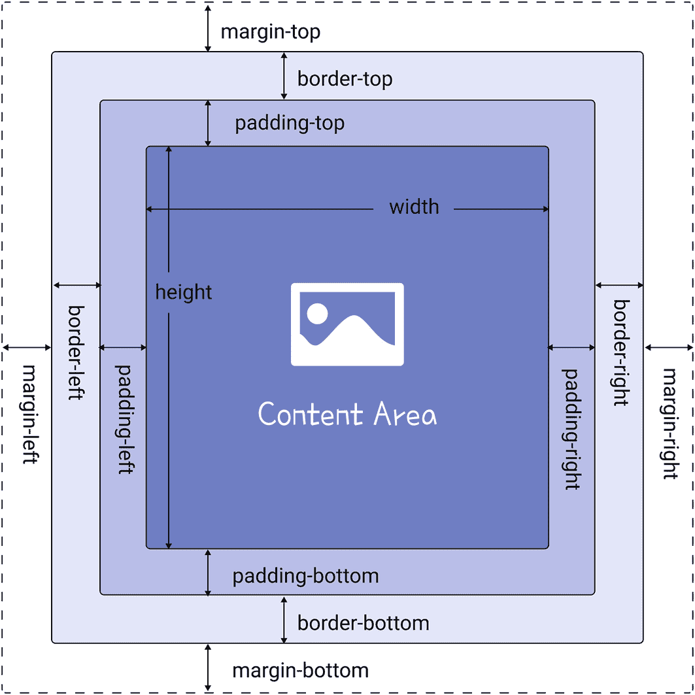
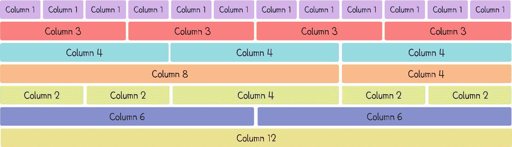
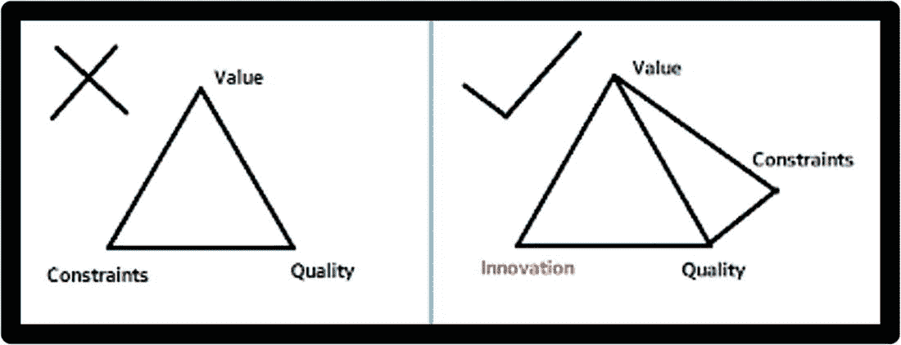
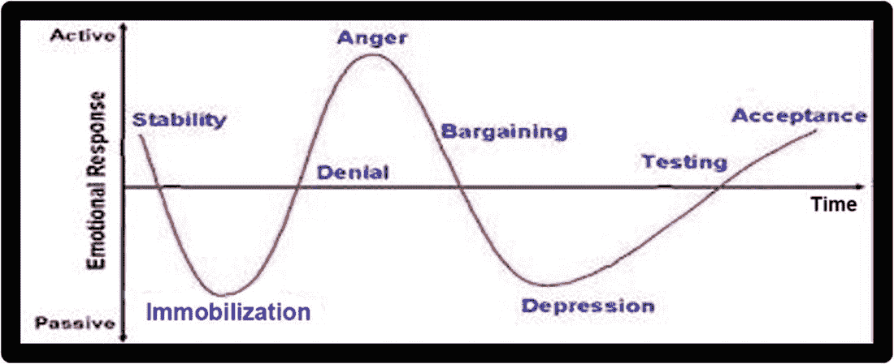
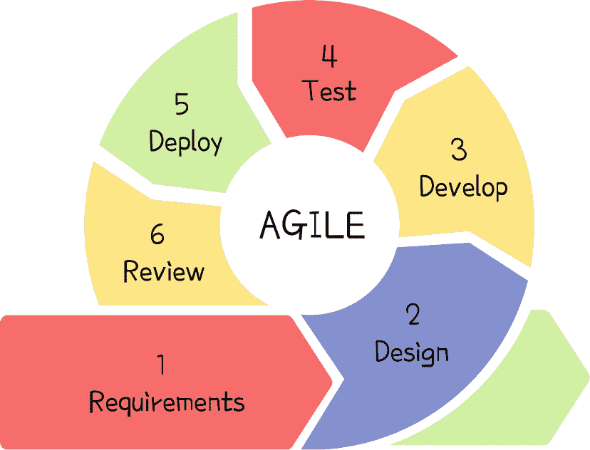

# 17. 技术栈

本章介绍一种用于创建网站和应用程序的技术栈。这只是一个当前示例，因为大多数技术栈都在不断变化。在高速增长中，最重要的是你能以多快的速度更新技术栈，以跟上最新的技术趋势。本章将介绍当前正在使用的工具和技术。

## 前端栈

选择一个不局限于前端或后端的技术栈非常重要。`JavaScript` 已被证明是一种能融合这两个世界的技术。只要开发者精通 `JavaScript`，我们就不再需要将他们视为前端或后端开发者了。

此外，`HTML`、`CSS` 和 `Bootstrap` 在前端扮演着关键角色。我们将简要介绍前端和后端技术，只是为了让您理解这些技术在创业时意味着什么，而了解您将构建的是网站还是应用程序则至关重要。

### 什么是 HTML？

超文本标记语言（HTML）不是一种编程语言。它是一种*标记语言*，用于告诉网络浏览器如何构建您访问的网页。`HTML` 由一系列元素组成，您可以使用这些元素来*包裹*、*封装*或*标记*不同部分的内容，使它们以特定方式显示或运作。

#### HTML 中的“头部”或元数据（Metadata）是什么？

`HTML` 文档的头部是页面加载时*不*在网页浏览器中显示的部分。它包含诸如页面标题、到 `CSS` 的链接（如果您想用 `CSS` 设计 HTML 内容的样式）、自定义网站图标链接以及元数据（关于 HTML 的数据，例如作者和描述文档的重要关键字）等信息。

#### HTML 的元素有哪些？

使用 `HTML` 文本内容元素来组织位于开头的 `<body>` 和结束的 `</body>` 标签之间的内容块或区域。这些元素对于可访问性和 SEO 很重要，它们标识了该内容的目的或结构。

*   `<h1>`、`<h2>`、`<h3>`、`<h4>`、`<h5>`、`<h6>`：`HTML` 的 `<h1>`–`<h6>` 元素代表六个级别的章节标题。`<h1>` 是最高级别，`<h6>` 是最低级别。
*   `
`：`HTML` 内容分区元素（`
`）是流式内容的通用容器。在使用 `CSS` 设置样式之前，它对内容或布局没有影响。
*   `
`：`HTML` 的 `
` 元素代表一个段落。
*   `<li>`：`HTML` 的 `<li>` 元素用于表示列表中的一项。
*   `<ol>`：`HTML` 的 `<ol>` 元素表示有序列表项——通常呈现为编号列表。
*   `<ul>`：`HTML` 的 `<ul>` 元素表示无序列表项，通常呈现为带项目符号的列表。

### CSS 属性

层叠样式表（CSS）是一种标准样式表语言，用于描述网页的呈现（即布局和格式）。

*   在 CSS 出现之前，`HTML` 文档的几乎所有呈现属性都包含在 `HTML` 标记中（特别是在 `HTML` 标签内）；所有字体颜色、背景样式、元素对齐、边框和大小都必须显式地在 `HTML` 中描述。
*   CSS 既可以作为单独的文件附加，也可以嵌入到 `HTML` 文档本身中。在 `HTML` 文档中包含 CSS 有三种方法。
    *   *内联样式*：在 `HTML` 开始标签中使用 `style` 属性
    *   *嵌入样式*：在文档 head 部分使用 `<style>` 元素
    *   *外部样式表*：使用 `<link>` 元素，指向一个外部的 `CSS` 文件

#### 什么是盒模型？

可以在网页上显示的每个元素都由一个或多个矩形框组成。CSS *盒模型* 通常描述了这些矩形框在网页上的布局方式。这些框可以具有不同的属性，并且可以以不同的方式相互交互，但每个框都有一个内容区域和可选的周围内边距、边框和外边距区域。图 17-1 展示了如何使用 CSS 盒模型居中内容。

一个草图显示了 3 个同心框和一个虚线框。从上到下，标签依次为上外边距、上边框、上内边距、左内边距、左边框、左外边距、右外边距、右边框、右内边距、下内边距、下边框和下外边距。

图 17-1

CSS 中的盒模型

### 什么是 Bootstrap？

`Bootstrap` 可以轻松快速设计和自定义响应式移动优先的网站。它是世界上最流行的前端开源工具包，具有 `Sass` 变量和 mixins、响应式网格系统、大量预构建组件和强大的 `JavaScript` 插件。

`Bootstrap` 的网格系统使用一系列容器、行和列来布局和对齐内容。它使用 flexbox 构建，并且完全响应式。图 17-2 是一个示例，深入展示了网格是如何组合在一起的。

排列成 7 行的框。第 1 行有 12 个列 1 的框。第 2 行有 4 个列 3 的框。第 3 行有 3 个列 4 的框。第 4 行有列 8 和 4 个框。第 5 行有 2 个列 2 的框，1 个列 4 的框和 2 个列 2 的框。第 6 行有 2 个列 6 的框。第 7 行有 1 个列 12 的框。

图 17-2

Bootstrap 中的列结构

#### 为什么要使用 Bootstrap？

`Bootstrap` 是用于创建布局的最流行的框架，`Bootstrap` 的响应式 CSS 可以自动适应手机、平板电脑和台式机。它易于设置，并且可以在不到一小时内创建一个可用的布局。

它为大多数 `HTML` 元素提供了基础样式，例如：

*   排版
*   代码
*   表格
*   表单
*   按钮
*   图片
*   图标

它还拥有广泛的组件列表，例如：

*   下拉菜单
*   按钮组
*   导航栏
*   面包屑导航
*   标签和徽章
*   警告框
*   进度条
*   以及许多其他组件

它附带了捆绑的 `JavaScript` 插件，例如：

*   滑块
*   标签页
*   手风琴

### 为什么要使用 JavaScript？

您可以使用 `JavaScript` 构建交互式网页、桌面应用程序、Web 应用程序和移动应用程序。您可以在浏览器或 `Node` 中运行 `JavaScript`。

### 什么是 React.js？

`React.js` 是由 Facebook 创建的一个 `JavaScript` 库，用于构建基于组件并可动态更新的用户界面，其更新取决于应用程序的状态。

#### ECMAScript

`ECMAScript` 是由 Ecma 国际标准化的一种语言。`JavaScript` 仅仅是标准化语言 `ECMAScript` 的一种实现。`ECMAScript 5`（ES5）于 2009 年标准化，大多数现代浏览器都能处理它。`ECMAScript 6`（ES6）则是在较近的 2015 年标准化的。因此，浏览器尚未完全跟上以处理它。

要使用 `React` 编写代码，您需要 `ES6` 的最新特性。

`Babel` 是一个 `JavaScript` 预处理器。简而言之，`Babel` 将 `ES6` 代码转换为 `ES5`，以便浏览器能够处理它。

使用 `React`，您可以通过为应用程序中的每个状态（如主页、登录页面等）创建视图，并根据状态动态切换视图的显示和隐藏，来创建单页应用程序。

由于应用程序在开始时只需要加载一个页面，因此在 `React` Web 应用程序中导航不同的视图非常快速，并且无需加载页面。

## 后端技术

当今世界，JavaScript 在拉近前端与后端的距离方面扮演着关键角色。如果公司同样在后端使用 JavaScript 技术栈，那么便无需再学习两种不同的技术栈。

`Node.js` 是一个基于 Chrome V8 JavaScript 引擎的 JavaScript 运行时环境。它由 Ryan Dahl 于 2009 年创建，是一个开源项目。`Node.js` 运行在 `V8`（它是对 Chrome V8 引擎的一个封装）之上。`V8` 是由 Google 开发的开源 JavaScript 引擎，与浏览器无关。它是一个轻量级的异步系统，运行在单线程非阻塞架构上。`Node.js` 拥有一个非常庞大的社区，提供支持和辅助包（`NPM`）。`Node.js` 包含一些 API/模块，可以帮助编写能够在 Web 浏览器之外运行的 JavaScript 代码。

`Node.js` 是一个平台，允许你在服务器端使用 JavaScript 构建可扩展的网络应用程序。它具有以下特点：

* *JavaScript 运行时*：在运行时执行 JavaScript 代码。
* *服务器端*：在服务器上运行并执行 I/O 任务，帮助处理客户端请求。
* *事件驱动*：执行流程由事件决定，例如按钮点击、鼠标悬停等。
* *异步*：两个或更多事件可以同时发生，并且彼此之间不协调。

### 什么是 ExpressJS？

`Express.js`，或简称为 Express，是一个基于 `Node.js` 的后端 Web 应用程序框架。它根据 MIT 许可证作为免费开源软件发布。它专为构建 Web 应用程序和 API 而设计。

`Express.js` 基于 `Node.js` 的中间件模块 `connect`，后者又使用了 `http` 模块。因此，任何基于 `connect` 的中间件也可以与 `Express.js` 配合使用。

### 什么是 REST？

REST 是“表征状态转移”的缩写。简单来说，它是一种应用程序编程接口（API），利用 HTTP 请求在 Web 上对数据进行 GET、PUT、POST 和 DELETE 操作。任何基于 REST 的架构中使用的主要函数如下：

* *GET*：提供对资源的只读访问
* *PUT*：创建新资源
* *DELETE*：移除资源
* *POST*：更新现有资源或创建新资源

## 数据库

我们将研究两个数据库（MongoDB 和 Postgres SQL）的关键方面。总的来说，MongoDB 和 PostgreSQL 之间的主要区别在于它们的系统、架构和语法。MongoDB 是一个文档数据库，而 Postgres 是一个关系型数据库管理系统。MongoDB 具有分布式架构，而 PostgreSQL 具有单体架构。MongoDB 使用 BSON，而 Postgres 使用 SQL。

### MongoDB

MongoDB 建立在分布式、可横向扩展的架构之上，并已发展成为一个全面的基于云的平台，用于管理和向应用程序交付数据。MongoDB 能够大规模处理事务性、操作性和分析性工作负载。如果你关心的是上市时间、开发人员生产力、支持 DevOps 和敏捷方法论，以及构建无需复杂运维即可扩展的产品，那么 MongoDB 是理想之选。

它具有以下特点：

* 无模式数据库
* 单个对象的结构定义良好
* 数据以 JSON 文档形式存储
* 支持索引

### Postgres SQL

PostgreSQL 是一个坚如磐石、开源、企业级的 SQL 数据库，已持续扩展其能力长达 30 年之久。PostgreSQL 拥有你期望从关系型数据库中获得的一切，它依赖于纵向扩展架构。如果你关心的是兼容性、处理来自数百张表的数千个查询、利用现有的 SQL 技能，以及将 SQL 推向极限，那么 PostgreSQL 将表现出色。

它具有以下特点：

* 它是一个传统的关系型数据库管理系统（RDBMS）。
* 它是一个类似于 Oracle 或 MySQL 的 SQL 数据库。
* Postgres 是免费的。

对于已经对 JavaScript 有基本了解的人来说，MongoDB 的学习曲线较平缓；而对于在 SQL 数据库方面有丰富经验的人来说，适应 Postgres 可能更容易。两者作为适用于各种行业的综合性数据库解决方案，其受欢迎程度都在增长。然而，公司在处理来自任一数据库的数据时面临的最大问题是所需的时间和复杂性。

## 总结

你应该根据自身情况、团队成员以及他们的优势和劣势来选择技术栈的语言或框架。长期来看，你所选工具能否获得支持也同样重要。

## 技术团队的关键流程与仪式

软件工程这个名称对于编程而言并不恰当。软件工程只是纯粹的自动化，而编程是一门艺术。我们编写的任何代码都会不断演进。目标是首先让它运行起来，然后通过修改或重构来演进它。

对我来说，驱动一个成功组织或个人的主要动力如下：

* 沟通
* 解决问题
* 创新
* 变更管理

每个敏捷流程都应包含这些关键驱动因素。在讨论敏捷仪式之前，我们先来谈谈这些驱动因素的重要性。

敏捷流程将每个项目分解成可由较小且分布的团队管理的若干块。

### 沟通

项目的成功不仅在于我们遵循何种方法，例如敏捷、瀑布或螺旋模型。关键在于项目成员是否对目标达成共识。他们是否理解其他每个人在项目中的工作？如果不理解，那么项目注定失败。但在这些失败中，我们过去学到了如何演进这些方法以适应项目的需求。每一次这样的演进发生，组织的目标便得以实现，从而惠及更多人。

所有这些与惠及更多人有什么关系呢？个体为个人目标而工作，并共同推动组织实现更大利益。无论我们是为服务公司还是产品公司工作，最终两家公司都会生产出被客户（无论是内部客户还是外部客户）使用的产品。我们的最终产品帮助这些客户，但团队在制作产品的过程中通常会遇到问题。这些问题可能从混乱到简单不等。

### 解决问题

生活中或工作中的所有问题都会经历这些阶段：混乱、复杂、棘手和简单。驾驭这些阶段需要技能和风险管理。关键在于管理风险并避免不确定性。例如，假设我们正在构建一个新网站，并且有截止日期需要满足，但团队中没有可用的软件开发人员来执行此任务。解决这个问题的第一个想法可能是雇佣新的软件开发人员。但由于这很耗时，我们就会面临一个不确定性：任务可能无法按时完成。因此，为了避免这种情况，我们转而寻找能够快速且确定地完成此任务的顾问或自由职业者。

### 创新

创新可以发生在组织中的任何层级。在软件开发人员层面，通过额外投入并创新性地思考运行时间，将代码运行时间从 1 秒缩短到 100 毫秒就是一种创新。在产品管理层面，通过整理团队收到的所有客户服务电话，并通过正确的产品干预来解决关键客户痛点，这是一种能带来长期成果的创新。在个人层面培养创新精神，将促使团队为产品改进进行创新思考，从而推动业务增长。

因此，在失败时，我们需要确保尽可能多地失败，并且快速失败，这样我们才有足够的时间以不同的方式再次失败。

推动任何组织或个人的因素并非传统的“约束、质量和价值”三角模型；相反，这个三角形是一个棱镜。在标准三角形的基础上增加一个创新的维度，就构成了完整的棱镜，如图 18-1 所示。

创新技术团队的说明图。一个二维三角形，三个顶点分别标注为价值、约束和质量，标记为错误表示。一个三维棱锥，四个顶点分别标注为价值、约束、质量和创新，标记为正确表示。

图 18-1

创新作为组织驱动力的另一个方面

一旦你的团队组建完成、开始创新并感到舒适，团队往往会松懈下来。然后，突然之间，变化就来了。

### 变更管理

所有公司都需要为变更管理制定一套流程。图 18-2 展示了面对变化或发生在我们身上的坏事时，典型的情绪反应。

一个波浪形的图表。Y 轴表示情绪反应，正 Y 轴表示主动，负 Y 轴表示被动。X 轴表示时间。从左到右，波峰和波谷分别代表稳定、麻木、否认、愤怒、讨价还价、沮丧、接受事实和接纳。

图 18-2

变革的不同阶段

各个阶段如下：

1. *震惊*：这是听到坏消息时的初始麻木状态。
2. *否认*：试图逃避不可避免的事实。
3. *愤怒*：压抑情绪的沮丧爆发。
4. *讨价还价*：徒劳地寻找出路。
5. *沮丧*：最终意识到事情不可避免。
6. *接受事实*：寻找现实的解决方案。
7. *接纳*：最终，找到了前进的道路。

在曲线每个点上停留的时间可能不同。如果我们自己被困在正弦曲线的某个点上，就必须快速适应变化；否则，我们会陷入一个难以摆脱的循环。如果我们能尽快渡过这条曲线，我们就安全了。

任何个人/组织的改变都需要时间来适应，但我们不应抗拒改变。改变总是为我们提供学习新事物的机会。我们需要接受改变；适应性是关键。

既然我们已经确立了这些因素各自的重要性，那么接下来让我们了解是什么推动了组织中的敏捷流程。

## 面向技术团队的 Scrum

Scrum 是一种敏捷开发方法，特别关注如何在基于团队的开发生成环境中管理任务。

### 从技术团队角度看什么是 Scrum

以下是 Scrum 的特点：

* Scrum 的每次迭代都是一个冲刺（Sprint）。
* 产品待办事项列表（Product Backlog）是一个记录了获取最终产品所需所有细节的列表。
* 在每个冲刺期间，会选择产品待办事项列表中优先级最高的用户故事，并将其转化为冲刺待办事项列表（Sprint Backlog）。
* 团队按照确定的冲刺待办事项列表进行工作。
* 团队检查日常工作。
* 在冲刺结束时，团队交付产品功能。

图 18-3 说明了 Scrum 流程及其各个阶段。

敏捷 Scrum 循环的丝带形状示意图。从底部开始逆时针，步骤分别是需求、设计、开发、测试、部署和评审。

图 18-3

一个敏捷 Scrum 循环

### Scrum Master

Scrum Master 是团队领导者。他们为产品经理和开发团队提供服务。以下部分列出了 Scrum Master 的职责。

#### Scrum Master 对产品负责人的职责与服务

以下是对产品负责人的职责：

* Scrum Master 帮助产品负责人有效地管理产品待办事项列表，并设计相应的技巧。
* 他们帮助产品负责人向开发团队清晰地传达产品需求。
* 他们确保产品负责人理解如何管理产品待办事项列表并最大化其价值。
* 他们负责促进行动事件。

#### Scrum Master 对开发团队的职责

以下是对开发团队的职责：

* Scrum Master 指导和辅导团队遵循 Scrum 规则。
* 他们帮助消除障碍和阻碍，以促进团队的进展。
* 他们帮助团队交付高价值的成果并维持团队活力。
* 他们负责促进行动事件并安排行动会议。
* 他们辅导团队采用行动框架，特别是当团队初次接触行动规则时。
* 此外，Scrum Master 还负责规划在组织中实施行动，并帮助那些正在进入敏捷环境或采用行动的人们。

### 产品负责人

产品负责人创建产品待办事项列表，对列表进行优先级排序，并负责在每次迭代中交付功能。

### Scrum 团队

团队管理自己的工作，并组织工作以完成冲刺或周期。

### 沟通节奏

理想情况下，我们应该有一个定期向利益相关者发送电子邮件的工作流程。以下是我的建议：

* *第 1 天*：发送包含冲刺细节的邮件
* *第 5 天*：向利益相关者发送关于更新、进展、问题以及需要采取的任何行动的邮件
* *第 10 天*：发送关于发布内容、发布说明、推送内容及原因的邮件，并预留一个用于回顾会议的日历时间块

### 升级流程

对于企业承诺的服务交付出现的升级问题，需要遵循标准操作规程（SOP）。以下段落是技术性服务交付失败相关升级的典型 SOP。

这是升级流程：

1. 冲刺负责人是处理功能优先级问题的主要联系人。
2. 工程或设计主管或其他任何主管是第一联系点。请求随后会提交给他们的经理。
3. 如果问题仍需调查，则会涉及经理的上级经理。
4. 最后，将引入职能主管。问题发生的次数越多，你就越需要改进你的流程。

### 总体回顾流程

每个季度应该对所有冲刺进行一次回顾。应基于以下参数进行评估：

* 功能被移出的频率
* 升级问题被提出的频率
* 错过时间线和/或范围的频率
* 文档不充分的频率
* 未遵守流程和沟通的频率
* 环比的关键项目指标

## 摘要

当流程得到遵守时，技术团队才能蓬勃发展。在敏捷环境中，尤其在当前的远程工作环境下，技术团队的常规仪式已更多地转向个人成长和团队效率，同时仍关注眼前的实际业务目标。组织变革、对这些变革的管理、驱动个人乃至整个团队的创新，以及如何利用这些创新，现已成为流程的关键焦点。敏捷团队的 Scrum 流程及其相关仪式，正驱动着团队在共同推动公司目标的同时，朝着各自的团队目标努力。

