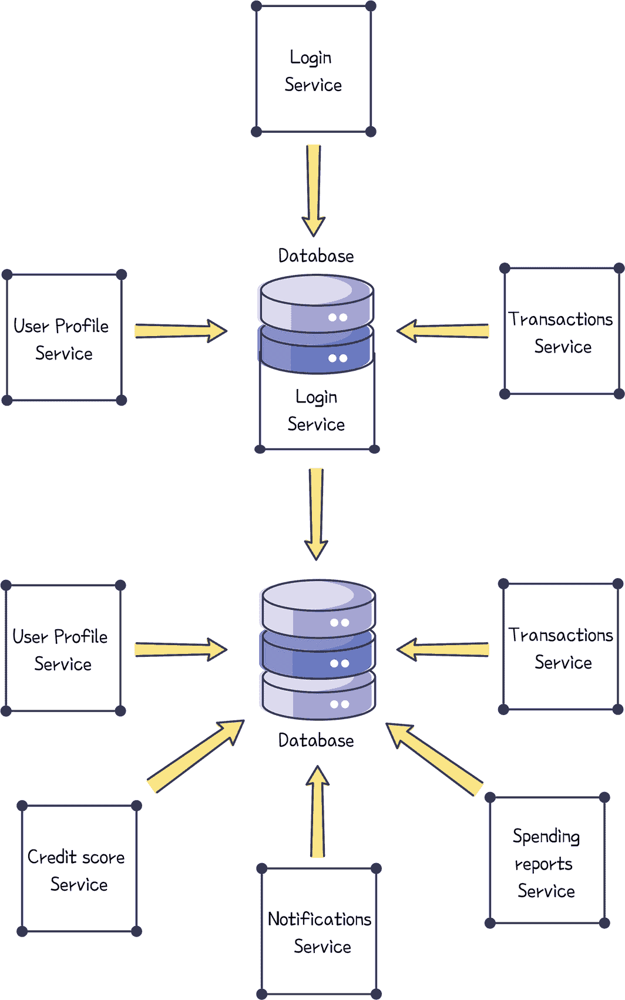
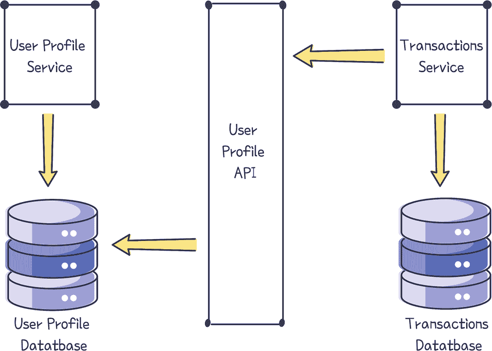
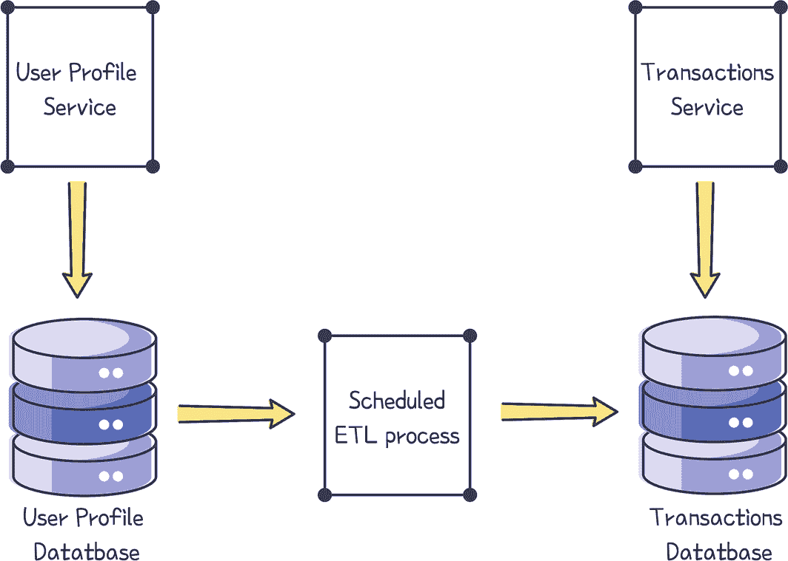

# 19. 业务分析及其在规模化与执行中的重要性

业务分析（或称商业智能技术）是指营销人员、销售团队、产品团队和客户成功团队用于执行洞察与增长活动的任何软件或流程。这些应用程序具有以下功能：

- 帮助营销人员规划和执行营销活动，收集并分析这些活动的结果，衡量和跟踪营销绩效，并将洞察应用于未来的活动中。这一切都在多触点、全渠道、以数字环境为主的规模化场景中发生。

- 帮助销售团队更好地了解客户和潜在客户，以便他们能够构建更优流程、缩短销售周期、将潜在客户匹配给相应的销售人员、增加收入智能并促成后续交易等。

- 赋能产品团队，使其更好地理解支持产品变现和采用等不同目标的用户群体，从而持续打造更佳的客户体验。

- 允许客户成功团队提升净推荐值（`NPS`），并在追加销售和交叉销售机会中发挥更大作用，使其成为一个增长职能，支持净收入留存率（`NRR`）等业务目标。

## 策略

本节重点介绍在组织内规模化实施业务分析的策略。如何使各部门协同一致，共同实现将所有数据整合至一处，以便从中提取有价值的洞察与分析，将在以下段落中详细阐述。

### 确定业务目标

设计数据仓库是一项涉及整个企业的旅程。数据仓库触及业务的方方面面，因此每个部门都需要参与设计。由于数据仓库的强大程度取决于其所包含的数据，因此将部门需求与目标同整个项目保持一致，对您的成功至关重要。

如果缺少销售和营销数据，整体查询结果将缺失一些关键组成部分。了解哪些潜在客户有价值，与营销数据息息相关。

每个部门都需要理解数据仓库的目的、它将如何惠及自身，以及他们可以从数据仓库解决方案中获得何种结果。

这一需求收集阶段应聚焦于以下目标：

- 使部门目标与整个项目保持一致

- 根据业务目标确定项目范围

- 通过深入挖掘数据（找出哪些数据对分析有用）和您当前的技术栈，发现未来的需求和当前的需求

### 收集并分析信息

分析师、主管、行政助理等人员经常会创建分析报告和汇总报告。这些报告可以是现有报告的简单关联，也可以包含人们使用现有软件或存储在电子表格和备忘录中的信息时所忽略的内容。这类被忽略的信息可能包括：某人手动记录的电话日志、一个用于追踪发货日期的小型桌面数据库，或主管通过电子邮件发给经理的每日报告。数据仓库设计师面临的一个巨大挑战是如何找到收集这些信息的方法。人们常常认为这种偶然发现的信息不重要或不准确。

此收集和分析阶段的另一部分是理解人们如何收集和处理信息。数据仓库可以自动化许多报告任务，但您无法自动化那些尚未识别和理解的任务。该过程需要与相关人员进行广泛互动。仔细倾听，并复述您所听到的内容。您需要清晰地理解该流程及其存在的理由。然后，您就可以开始设计数据仓库了。

### 确定核心业务流程

至此，您必须对需要关联哪些业务流程有一个清晰的认识。确定关键绩效指标，例如单位销售额、生产单位和总收入。然后，识别出与创建这些关键绩效指标相关的实体。数据仓库是相互关联的数据结构的集合。每个结构都为特定业务流程存储关键绩效指标，并将这些指标与生成它们的因素相关联。为了设计一个追踪业务流程的结构，需要识别哪些实体共同作用以生成该关键绩效指标。每个关键绩效指标都与生成它的实体相关联。

### 构建概念数据模型

确定业务流程后，创建一个数据的概念模型。确定哪些主题将表示为事实表，以及哪些维度将关联到这些事实。清晰地识别每个业务流程的关键绩效指标，并决定存储事实的格式。由于这些事实最终将被聚合在一起形成联机分析处理（`OLAP`）多维数据集，因此数据需要采用一致的计量单位。事实表中的每一行都由特定实体的交互生成。要添加一个事实，需要填充所有维度并关联它们的活动。

许多数据系统，尤其是较旧的遗留数据系统，其数据不完整。在将事实用于数据仓库之前，需要纠正这一缺陷。完成更正后，构建维表和事实表。事实表的主键是由每个维度表的外键组成的复合键。

#### 定位数据源并规划数据转换

识别关键信息的所在位置，以及如何将其移动到数据仓库结构中。将数据移入一个统一、一致的数据结构中。一个艰巨的任务是关联内部客户关系管理（`CRM`）软件和时间报告数据库之间的信息。在将数据从一个数据结构移动到另一个数据结构时，需要进行转换。某些转换只是简单地映射到名称不同的数据库列。决策主要基于成本，包括培训或雇佣人员使用工具的成本，以及维护工具的成本。

同时，还需规划数据移动的时间。当系统访问数据源时，这些数据库的性能将急剧下降。应安排数据提取时间，以尽量减少对系统用户的影响（例如，安排在周末）。

### 实施 MVP 计划并部署到生产环境

该计划为评估工作量和安排项目进度提供了可行依据。数据仓库项目范围庞大，因此分阶段交付对于保持项目按计划进行至关重要。一个有效的策略是先规划整个仓库，然后将其一部分作为数据集市实施，以展示系统的能力。当各部分完成时，它们会像拼图碎片一样拼接在一起。每一组新的数据结构都会为之前的结构增添能力，从而为系统带来价值。

数据仓库系统为决策者提供关于其组织活动的、经过整合且一致的历史数据。通过周密的规划，该系统可以提供关于各因素如何相互关联以帮助或损害组织的重要信息。一个坚实的计划可以控制成本，并使这一强大工具成为现实。

### 主要优势

通过集中式系统驱动的数据聚合和数据分析，其关键优势在于它赋予了团队自主执行核心任务的能力，同时分析工作实现自动化。在这种自动化流程出现之前，团队必须在每个项目开始前首先制定数据收集和存储的策略。而一旦项目结束，他们又必须整理数据，并从其是否产生影响力的角度进行分析。如果存在数据管道和集中式系统，他们就能实时查看和分析数据。

#### 独立性

产品、销售和市场团队尽可能保持独立。常规重复性任务可由查询团队执行，这样商业智能团队就可以专注于处理数据建模和机器学习等复杂问题。

#### 技能提升

应定期进行培训，帮助团队学习数据分析工具，因为大多数此类工具都带有在线手册，易于使用。例如，`Tableau`在线学习版本简单易学，可用于数据分析。安排定期研讨会将有助于解放数据工程和数据分析团队的带宽，使其专注于核心技能，而业务团队则可以自行获取必要的洞察。

#### 跨职能协作

跨不同工具整合数据的能力有助于每个人协作进行决策并解决当前问题，而不是仅仅质疑数据的可靠性。这有助于减少冲突，并培养坚实的团队环境。

#### 数据民主化

应形成一种实践，赋能团队，使其能够访问数据、洞察和可操作的最佳实践，从而让每个人都能更好地完成自己的工作。

### 策略与阶段

为使项目可操作化，可以将其分解为三个阶段。这些阶段将与公司的目标和关键结果保持一致：

- 构建营销技术栈，涉及将所有营销平台整合到一个系统中。
- 构建数据栈并实施最佳实践。
- 将销售技术栈与营销技术栈集成，并利用整合后的洞察。
- 利用营销技术栈来改进产品洞察。

### 数据栈架构

数据栈架构涵盖了如何将从源系统发起的数据摄取到集中式系统中进行分析。集中式存储随后用于分析和提取洞察。数据栈是一个管道，将数据从源头一直传递到终点。根据所使用的应用程序不同，不同组织的架构可能有所不同。通常，源系统是广告平台、客户关系管理系统，而目标平台是像`MongoDB`、`Redshift`等中央数据仓库数据库。

#### 数据流

有多种工具可以帮助实现数据从源头到目的地的流动。按顺序排列，以下工具从源系统开始，到最终帮助业务分析数据的可视化工具：

- **摄取工具**：将来自不同来源的数据集中到数据存储中的工具（例如`Appsflyer`、`CRM`等）。
- **存储**：数据湖和数据仓库。不过，如今湖仓一体的概念正日益流行（例如`Google Cloud Storage`、`Amazon Web Services`等）。
- **转换工具**：用于清洗、聚合和反规范化数据以便分析的工具。我们还将为机器学习构建特征以及机器学习模型构建纳入转换工具类别（例如`Google Big Query`）。
- **可视化工具**：将清洗或聚合后的数据可视化以生成洞察的工具（例如`Tableau`）。
- **发布/服务工具**：用于发布报告、聚合数据或模型，以便应用程序使用的工具（例如`Confluence`）。

#### 元数据层

元数据包括数据结构、创建数据的管道配置、不同数据之间的关系以及其他属性（如新鲜度、谁有访问权限等）。元数据层由运行系统使用和生成的数据及数据流的若干方面组成。

元数据层可以包含以下内容：

- **模式/血缘关系**：这包括任何数据系统的核心元数据。在最简单的层面上，模式由表和列定义组成。还可以存在表之间的关系，例如外键。血缘关系是一种捕捉不同数据之间如何关联以及理解一条数据是如何生成的方法。

- **统计信息**：这是运行时元数据。这些是关于不同数据及数据流的指标，例如不同的表大小、计算答案所需的时间、将数据从一个系统传输到另一个系统所需的时间等。这些统计信息可以优化数据流，了解系统中的瓶颈，了解数据量随时间的变化情况等。收集的关键统计信息之一是数据质量指标，它提供关于分析是否基于完整且准确的数据进行的信息。

- **编排**：这是元数据层中最关键的部分。它至关重要，并且应该包含在元数据层中，因为编排必须是元数据驱动的。元数据不仅仅是收集和展示，其洞察力对数据流本身也变得至关重要。这有六个主要优势：

# 元数据的核心价值

*   **元数据始终是干净的**：如果元数据出错，系统就会出错，必须有人修复它。
*   **开箱即用的可观察性/可审计性**：无需特殊的工具埋点，因为元数据始终是最新的。
*   **质量检查**：数据质量检查可以直接整合到编排中，无需额外集成。
*   **易于调试**：血缘关系和统计信息驱动数据流，因此会被自动捕获。这使得通过单一视图以易于消费的方式展示元数据，从而轻松调试数据流中的问题变得容易。
*   **避免重复**：诸如重新处理或执行全量刷新（历史同步）等需要在整个数据流中传播的常规操作，管理起来会容易得多。
*   **工具**：编写工具可以访问静态和动态元数据，帮助数据团队找出如何更改其业务逻辑而不破坏数据管道的方法。
*   **访问控制**：由于元数据是干净的，人们可以在细粒度级别上指定谁可以访问哪些模式和表。基于角色的访问控制和基于策略的访问控制都依赖于模式/血缘关系来提供灵活性。
*   **审计**：跟踪任何数据或数据流发生了哪些变化。如果编排是元数据驱动的，编排日志提供了一种自动审计这些变化的方式。访问控制的日志将提供关于谁在系统上执行了何种操作的审计记录。
*   **可观察性**：使用元数据来观察数据如何流经不同的系统。

## 故事的主角：微服务

微服务架构是一种云原生架构方法，它将单个应用程序分解为许多松散耦合且可独立部署的较小组件或服务。这些服务通常具有以下特征：
- 拥有自己的技术栈，包括数据库和数据管理模型
- 通过 `API`、事件流和消息代理的组合相互通信
- 按业务能力进行组织，划分服务的界限通常被称为*有界上下文*

尽管关于微服务的讨论大多围绕其架构定义和特征展开，但其价值可以通过相当简单的业务和组织优势来更普遍地理解：
- 代码可以更轻松地更新。无需触及整个应用程序即可添加新功能或特性。
- 团队可以为不同的组件使用不同的技术栈和不同的编程语言。
- 组件可以彼此独立地进行扩展，这减少了因单个功能面临过多负载而需要扩展整个应用程序所带来的浪费和成本。

微服务也可以通过理解它们*不是什么*来认识。与微服务架构最常被拿来比较的两种架构是单体架构和面向服务架构（`SOA`）。

微服务与单体架构之间的区别在于，微服务是由许多更小、松散耦合的服务组成单个应用程序，而单体架构则是构建一个大型、紧密耦合的应用程序。

### 微服务的优势

以下是微服务的优势。

#### 精确扩展

使用微服务，单个服务可以单独部署，也可以单独进行扩展。由此带来的好处显而易见：如果操作得当，微服务所需的底层基础设施比单体应用更少，因为它们只对需要扩展的组件进行精确扩展，而不是像单体应用那样扩展整个应用程序。

#### 支持实验与降低风险

在微服务模型中，组件独立部署，并通过 `REST`、事件流和消息代理的某种组合进行通信——因此每个服务的堆栈都有可能针对该服务进行优化。技术在不断变化，由多个较小的服务组成的应用程序，在出现更理想的技术时，更容易也更经济地随之演进。

#### 可独立部署

也许微服务最重要的单一特征是，由于服务更小且可独立部署，在应用程序中更改一行代码或添加一个新功能不再需要“惊动整个国会”。

### 微服务架构选项

以下是您可选择的架构。

#### 数据库集成

在此模式中，两个或多个服务从一个中央数据存储中读写数据。所有服务都访问这个中央数据存储。这可以用我们上一篇文章中的银行应用程序示例来说明，该示例将登录、用户资料、交易、通知、信用评分和支出报告作为按业务功能定义的独立服务。图 19-1 描绘了如何将数据库集成用于不同类型的微服务。

一个中央数据库接收来自登录服务、交易服务和用户资料服务的输入。来自数据库的登录服务输入到另一个数据库。其他输入包括用户资料服务、交易服务、支出报告服务、通知服务和信用评分服务。

**图 19-1** 使用不同微服务的数据库

数据库集成的显著优势之一是简单性。与其他模式相比，事务管理更为直接。这可能是使用最广泛的集成模式——但也是最容易被滥用的。

这种模式不理想地将服务耦合在一起，使得微服务架构更难更改，扩展成本更高。定义数据所有权和更新模式可能变成一个混乱的过程——每次更改都需要重新编译和部署所有服务。它倾向于高度编排的、“大爆炸”式的部署。这种集成类型会给维护微服务的自主性带来重大障碍。

在高扩展需求下，唯一的办法是向数据库投入更多硬件，即便如此，也很难避免数据库中的死锁和行级争用。

#### 同步 API 调用

图 19-2 解释了不同微服务之间如何通过同步 API 调用进行通信。它提供了一种与每个服务对话的方式。

交易服务输入到交易数据库和用户资料 `API`。`API` 与用户资料服务一起输入到用户资料数据库。

**图 19-2** 管理微服务的 `API` 方式

在此集成模式中，服务通过 `API` 进行同步通信。所有对彼此数据的访问都通过 `API` 以请求-响应的方式进行协调，服务等待 `API` 返回数据以执行其操作。在前一个例子中，如果交易服务需要读取用户资料数据，它会调用用户资料 `API` 并获取所需信息。

这为直接数据库调用提供了一个不错的抽象层，并在技术选择方面提供了极佳的灵活性。这样做的好处是隐藏了许多实现细节：这种抽象让我们可以自由地更换技术而不影响我们的客户端。例如，用户资料服务可以使用 Java 和 MySQL，而交易服务可以使用 SQL Server 和 .NET，它们仍然可以通过 `API` 轻松地相互通信。

然而，这与直接的数据库集成模式差别不大。在数据库调用之上增加另一个网络跳转也会抑制扩展：随着工作负载增加，性能会下降——这与大多数分布式系统的谬误明显相悖。这种集成模式也使事务管理变得困难，并抑制了自主性，因为服务依赖于彼此的可用性。在微服务中，如果您必须在系统边界之外同步读取数据，那就有面向服务架构的坏味道了。

#### 优胜方案：提取、转换与加载

图 19-3 描绘了提取、转换与加载（`ETL`）模型的样子。这种模型消除了对同步 `API` 调用的依赖以及数据库的负载。

`用户画像服务` 输入至 `用户画像数据库`。输出是 `定时 ETL` 流程。`事务服务` 连同 `定时 ETL` 一起输入至 `事务数据库`。

**图 19-3** `ETL` 模型

`ETL` 需要按照预定义的时间表通过后台进程同步数据。这些数据可以被推送或拉取。只有后台 `ETL` 进程才需要数据库访问权限。它是异步的，这意味着服务无需等待“回调”即可执行。

这种集成模式还很好地隐藏了实现细节。它提供了合理的解耦，因为服务之间不依赖彼此的正常运行时间。在线用户不会受到运行时间或处理时间的影响。

`ETL` 流程必须随着源数据库和目标数据库的变化而变化。在 `ETL` 集成中，数据一致性取决于时间表和持续时间。计算变更增量可能会变得过于复杂。在这些情况下，团队会退而求其次，将整个数据集推送出去。这会使流程非常耗时，大大削弱其实用性。

报表服务非常适合这种类型的集成。这些流程有其用武之地，但通常会随着时间推移变得非常复杂。仅当系统中可以接受陈旧数据时，才应使用它们。

## 总结

无论公司规模大小，都依赖数据来了解自身潜力。一个小店主会查看每日利润，然后了解何时是淡季。他们随后利用这些数据做出相关决策。同样，大型公司必须投资于良好的数据驱动架构，以理解其数据。实时和历史数据分析对于了解公司的兴衰都至关重要。