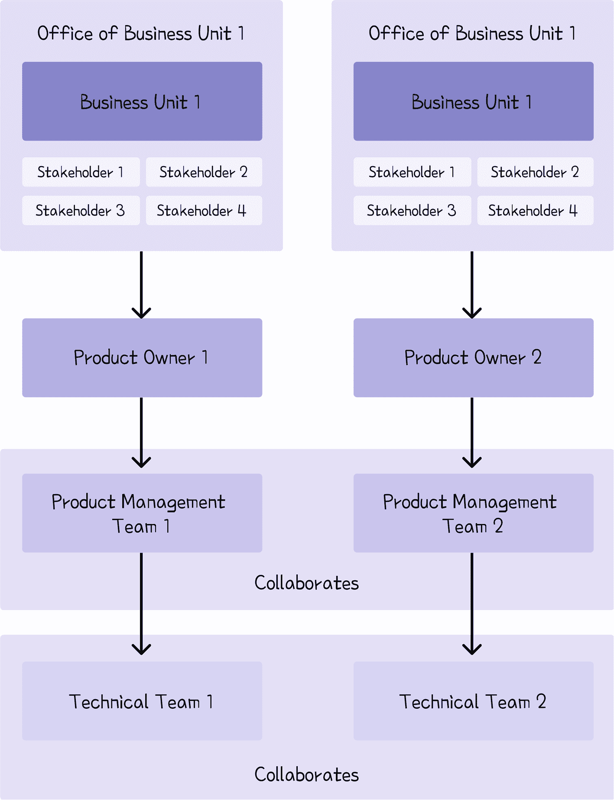
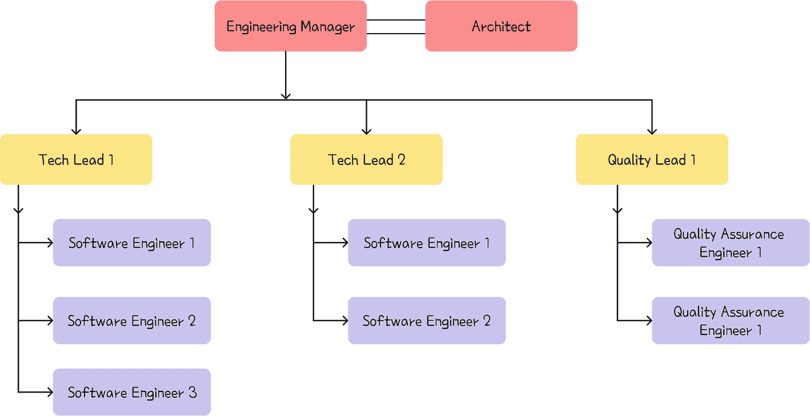
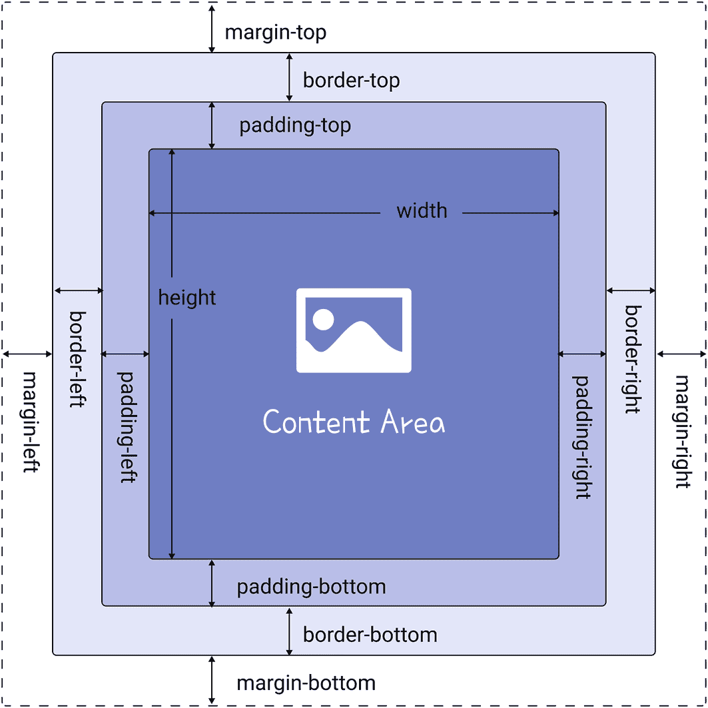
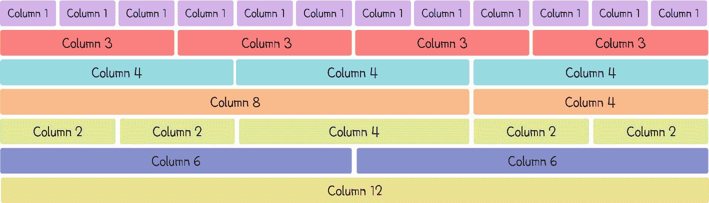
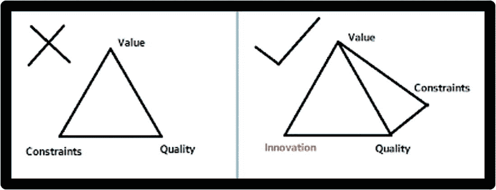
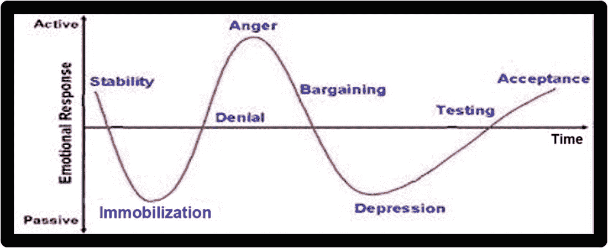
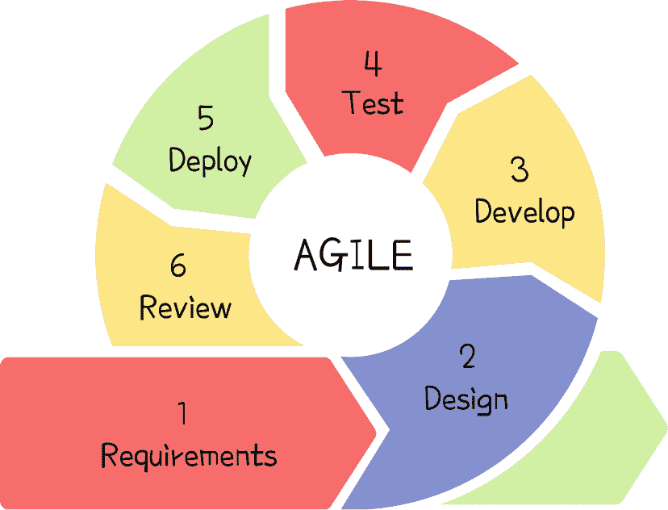
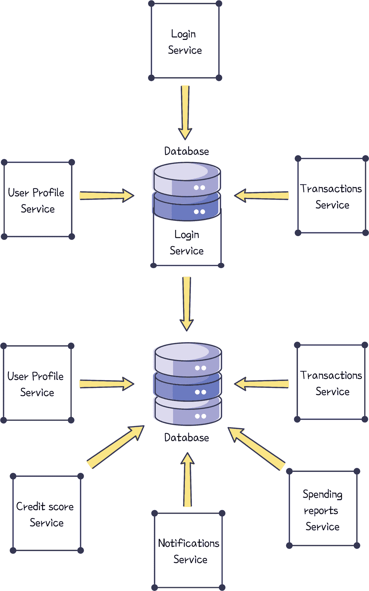
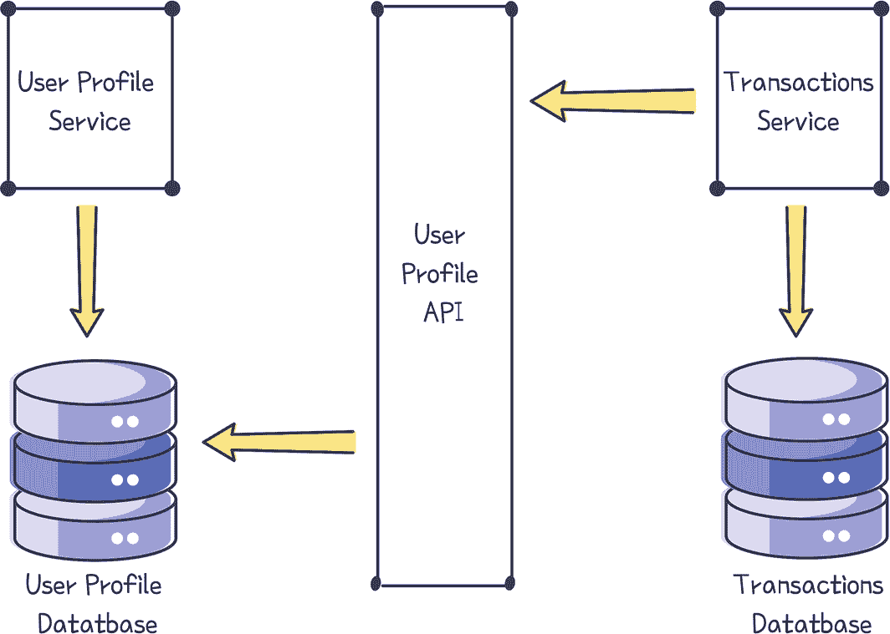
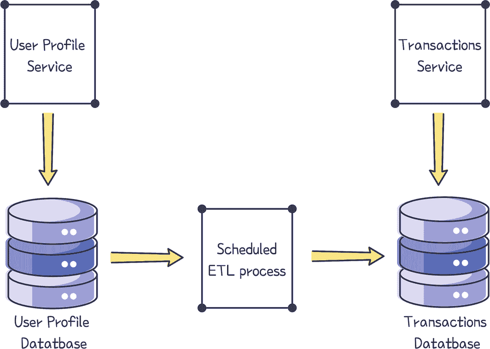

# 第四部分 技术

# 技术在满足业务需求中的作用

技术团队的划分应基于业务团队的需求。当公司规模较小，需要快速原型开发和产品上市时，团队可以保持整体化。但随着公司成长为中型市场公司，技术团队需要经历转型，按照业务垂直领域进行拆分。而当中型市场公司发展为企业级时，则需要进一步拆分并在宏观层面进行整合。目标是在保持流程协调的同时，亦能保持敏捷性。技术领导者需要不断应对平衡这两者的挑战。

## 与业务单元相关的技术组织

图 16-1 展示了一个典型的技术团队组织结构。组织成立之初，可能只有一个业务单元和一位业务负责人，他会将新开发或新计划的信息传达给一位技术负责人和一位产品负责人。当公司发展壮大后，业务单元（BU）的数量会增加，每个业务单元都会有一位业务单元负责人，他将与业务分析师和项目经组成的管理办公室合作，这些人成为利益相关者。

这些利益相关者随后会组成一个自己的单元，在将这些计划传递给产品负责人团队之前，先评估这些计划的影响。影响分析可以遵循多种方法或框架。通常采用的是 RICE（触达、影响、信心、努力）框架。我将在本书的第五部分对此进行更多讨论。

利益相关者完成分析并将计划文件传递给产品负责人后，产品负责人会通过评估完成该计划所需的不同集成点，来制定他们的产品需求文档。如有必要，会进行跨团队协作以评估对整个团队的影响。

然后，这些需求被传递给技术团队。技术团队内部的技术结构将在本章中进行讨论。

业务单元 1 的两个办公室共有 4 位利益相关者。他们进行分析并将计划文件传递给产品负责人 1 和 2。产品负责人将其传递给项目管理团队 1 和 2，这两个团队进行协作。然后他们再传递给技术团队 1 和 2，这两个团队进行协作。

**图 16-1** 业务单元与技术团队的关系

## 技术团队结构

图 16-2 说明了如何组织技术团队来执行每个业务需求。

一个流程图。工程经理和架构师进行协作。经理分出技术主管 1、2 和质量主管 1。技术主管 1 下辖软件工程师 1、2 和 3。技术主管 2 下辖软件工程师 1 和 2。质量主管 1 下辖质量保证工程师 1 和 2。

**图 16-2** 技术团队的组织结构

一个技术团队的成功取决于其敏捷性，以及团队能够多轻松、多自主地执行项目。

有时，项目经理会协助加强与产品经理等利益相关者的协调，这减轻了工程经理的负担。为简化起见，此处我们忽略项目经理的角色，因为将在第五部分中详细讨论。

### 工程经理与架构师的职责

工程经理和架构师的职责在很多方面是可以互换的。有些工程经理可能是 80%的技术工作加 20%的人员管理，而另一些则相反。根据工程经理的技术能力，他们可以自己设计系统架构，或者从专门的架构师那里获得帮助来设计系统架构。

工程经理和架构师的职责如下：

*   负责整个团队所拥有所有模块的稳定性、增长和管理。
*   负责增长策略。
*   提出关于扩展和维护的创新想法。
*   确保团队遵循所有编码标准和文档规范。
*   主持由利益相关者提出的、影响业务的新功能的相关会议。
*   在决定功能截止日期时，充当利益相关者与技术主管之间的桥梁。
*   负责建立团队结构/模块结构。

### 技术主管的职责

以下是技术主管的职责：

*   负责多个模块
    *   模块示例：
        *   用户档案管理
        *   用户创建模块
        *   追加销售模块
*   负责正常运行时间/停机时间。
*   负责与运维团队沟通并管理基础设施。
*   负责团队所拥有模块的安全性。
*   确保冲刺（`Sprint`）的优先级排序、规划和执行顺利进行。
*   当出现跨团队依赖时，应介入协调。
*   管理线上事故升级处理。
*   负责审批向其汇报的软件工程师的绩效评估。

### 软件工程师的职责

以下是软件工程师的职责：

*   应具备技术背景。
*   应愿意学习新技术。
*   应不局限于特定的编码语言或技术。
*   应至少精通一门编程语言。

### 质量保证主管的职责

以下是质量保证主管的职责：

*   参与业务团队的需求收集工作。
*   参与团队关于冲刺任务的技术讨论。
*   与团队成员一起评估测试任务。
*   与质量保证工程师一起从质量保证的角度分析需求，并记录高级场景。
*   评审测试用例并提供反馈。
*   与相应团队成员一起对即将上线的任何功能进行端到端测试。
*   审查团队成员的每日状态报告。
*   在 `Zephyr` 等工具中跟踪测试用例的执行情况。
*   根据上线日期确定任务优先级，并每日分配给团队。
*   帮助团队准备测试所需的数据。
*   参与从现有测试用例文档中识别和选择用于自动化的测试用例。
*   评审团队成员实现的自动化脚本（`GitHub`）。
*   每日审查测试用例报告和自动化脚本报告。
*   每月与团队成员进行一对一沟通。

### 质量保证工程师的职责

以下是质量保证工程师的职责：

*   参与从现有测试用例文档中识别和选择用于自动化的测试用例。
*   应用设计和测试自动化策略文档。
*   创建自动化测试计划并获得批准。
*   配置用于自动化的测试环境。
*   为需要自动化的测试用例编写测试脚本。
*   将代码更改提交到 `GitHub` 并请主管评审。
*   在 `CI/CD` 流水线中调度测试脚本。
*   生成测试脚本报告并进行分析。
*   帮助团队编写脚本和进行调试。
*   参与代码评审。
*   定期规划脚本的改进。

## 总结

搭建好技术团队只是执行的第一步。虽然初始项目和计划可能进展顺利，但为了维持增长，遵循正确的流程至关重要。人才和技术是成功的必要因素，同时，坚持正确的团队组合、团队划分和职责分配也有助于实现这种持续的成长。

# 17. 技术栈

本章介绍一种用于创建网站和应用程序的技术栈。这只是一个当前示例，因为大多数技术栈都在不断变化。在高速增长中，最重要的是你能以多快的速度更新技术栈，以跟上最新的技术趋势。本章将介绍当前正在使用的工具和技术。

## 前端栈

选择一个不局限于前端或后端的技术栈非常重要。`JavaScript` 已被证明是一种能融合这两个世界的技术。只要开发者精通 `JavaScript`，我们就不再需要将他们视为前端或后端开发者了。

此外，`HTML`、`CSS` 和 `Bootstrap` 在前端扮演着关键角色。我们将简要介绍前端和后端技术，只是为了让您理解这些技术在创业时意味着什么，而了解您将构建的是网站还是应用程序则至关重要。

### 什么是 HTML？

超文本标记语言（`HTML`）不是一种编程语言。它是一种*标记语言*，用于告诉网络浏览器如何构建您访问的网页。`HTML` 由一系列元素组成，您可以使用这些元素来*包裹*、*封装*或*标记*不同部分的内容，使它们以特定方式显示或运作。

#### HTML 中的“头部”或元数据（Metadata）是什么？

`HTML` 文档的头部是页面加载时*不*在网页浏览器中显示的部分。它包含诸如页面标题、到 `CSS` 的链接（如果您想用 `CSS` 设计 `HTML` 内容的样式）、自定义网站图标链接以及元数据（关于 `HTML` 的数据，例如作者和描述文档的重要关键字）等信息。

#### HTML 的元素有哪些？

使用 `HTML` 文本内容元素来组织位于开头的 `<body>` 和结束的 `</body>` 标签之间的内容块或区域。这些元素对于可访问性和 SEO 很重要，它们标识了该内容的目的或结构。

*   `<h1>`、`<h2>`、`<h3>`、`<h4>`、`<h5>`、`<h6>`：`HTML` 的 `<h1>`–`<h6>` 元素代表六个级别的章节标题。`<h1>` 是最高级别，`<h6>` 是最低级别。

*   `
`：`HTML` 内容分区元素（`
`）是流式内容的通用容器。在使用 `CSS` 设置样式之前，它对内容或布局没有影响。

*   `
`：`HTML` 的 `
` 元素代表一个段落。

*   `<li>`：`HTML` 的 `<li>` 元素用于表示列表中的一项。

*   `<ol>`：`HTML` 的 `<ol>` 元素表示有序列表项——通常呈现为编号列表。

*   `<ul>`：`HTML` 的 `<ul>` 元素表示无序列表项，通常呈现为带项目符号的列表。

### CSS 属性

层叠样式表（`CSS`）是一种标准样式表语言，用于描述网页的呈现（即布局和格式）。

*   在 `CSS` 出现之前，`HTML` 文档的几乎所有呈现属性都包含在 `HTML` 标记中（特别是在 `HTML` 标签内）；所有字体颜色、背景样式、元素对齐、边框和大小都必须显式地在 `HTML` 中描述。

*   `CSS` 既可以作为单独的文件附加，也可以嵌入到 `HTML` 文档本身中。在 `HTML` 文档中包含 `CSS` 有三种方法。

    *   *内联样式*：在 `HTML` 开始标签中使用 `style` 属性

    *   *嵌入样式*：在文档 head 部分使用 `<style>` 元素

    *   *外部样式表*：使用 `<link>` 元素，指向一个外部的 `CSS` 文件

#### 什么是盒模型？

可以在网页上显示的每个元素都由一个或多个矩形框组成。`CSS` *盒模型* 通常描述了这些矩形框在网页上的布局方式。这些框可以具有不同的属性，并且可以以不同的方式相互交互，但每个框都有一个内容区域和可选的周围内边距、边框和外边距区域。图 17-1 展示了如何使用 `CSS` 盒模型居中内容。

一个草图显示了 3 个同心框和一个虚线框。从上到下，标签依次为上外边距、上边框、上内边距、左内边距、左边框、左外边距、右外边距、右边框、右内边距、下内边距、下边框和下外边距。

图 17-1

`CSS` 中的盒模型

### 什么是 Bootstrap？

`Bootstrap` 可以轻松快速设计和自定义响应式移动优先的网站。它是世界上最流行的前端开源工具包，具有 `Sass` 变量和 mixins、响应式网格系统、大量预构建组件和强大的 `JavaScript` 插件。

`Bootstrap` 的网格系统使用一系列容器、行和列来布局和对齐内容。它使用 flexbox 构建，并且完全响应式。图 17-2 是一个示例，深入展示了网格是如何组合在一起的。

排列成 7 行的框。第 1 行有 12 个列 1 的框。第 2 行有 4 个列 3 的框。第 3 行有 3 个列 4 的框。第 4 行有列 8 和 4 个框。第 5 行有 2 个列 2 的框，1 个列 4 的框和 2 个列 2 的框。第 6 行有 2 个列 6 的框。第 7 行有 1 个列 12 的框。

图 17-2

`Bootstrap` 中的列结构

#### 为什么要使用 Bootstrap？

`Bootstrap` 是用于创建布局的最流行的框架，`Bootstrap` 的响应式 `CSS` 可以自动适应手机、平板电脑和台式机。它易于设置，并且可以在不到一小时内创建一个可用的布局。

它为大多数 `HTML` 元素提供了基础样式，例如：

*   排版

*   代码

*   表格

*   表单

*   按钮

*   图片

*   图标

它还拥有广泛的组件列表，例如：

*   下拉菜单

*   按钮组

*   导航栏

*   面包屑导航

*   标签和徽章

*   警告框

*   进度条

*   以及许多其他组件

它附带了捆绑的 `JavaScript` 插件，例如：

*   滑块

*   标签页

*   手风琴

### 为什么要使用 JavaScript？

您可以使用 `JavaScript` 构建交互式网页、桌面应用程序、Web 应用程序和移动应用程序。您可以在浏览器或 `Node` 中运行 `JavaScript`。

### 什么是 React.js？

`React.js` 是由 Facebook 创建的一个 `JavaScript` 库，用于构建基于组件并可动态更新的用户界面，其更新取决于应用程序的状态。

#### ECMAScript

`ECMAScript` 是由 Ecma 国际标准化的一种语言。`JavaScript` 仅仅是标准化语言 `ECMAScript` 的一种实现。`ECMAScript 5`（ES5）于 2009 年标准化，大多数现代浏览器都能处理它。`ECMAScript 6`（ES6）则是在较近的 2015 年标准化的。因此，浏览器尚未完全跟上以处理它。

要使用 `React` 编写代码，您需要 `ES6` 的最新特性。

`Babel` 是一个 `JavaScript` 预处理器。简而言之，`Babel` 将 `ES6` 代码转换为 `ES5`，以便浏览器能够处理它。

使用 `React`，您可以通过为应用程序中的每个状态（如主页、登录页面等）创建视图，并根据状态动态切换视图的显示和隐藏，来创建单页应用程序。

由于应用程序在开始时只需要加载一个页面，因此在 `React` Web 应用程序中导航不同的视图非常快速，并且无需加载页面。

## 后端技术

当今世界，`JavaScript` 在拉近前端与后端的距离方面扮演着关键角色。如果公司同样在后端使用 `JavaScript` 技术栈，那么便无需再学习两种不同的技术栈。

`Node.js` 是一个基于 Chrome V8 `JavaScript` 引擎的 `JavaScript` 运行时环境。它由 Ryan Dahl 于 2009 年创建，是一个开源项目。`Node.js` 运行在 `V8`（它是对 Chrome V8 引擎的一个封装）之上。`V8` 是由 Google 开发的开源 `JavaScript` 引擎，与浏览器无关。它是一个轻量级的异步系统，运行在单线程非阻塞架构上。`Node.js` 拥有一个非常庞大的社区，提供支持和辅助包（`NPM`）。`Node.js` 包含一些 API/模块，可以帮助编写能够在 Web 浏览器之外运行的 `JavaScript` 代码。

`Node.js` 是一个平台，允许你在服务器端使用 `JavaScript` 构建可扩展的网络应用程序。它具有以下特点：

* *JavaScript 运行时*：在运行时执行 `JavaScript` 代码。

* *服务器端*：在服务器上运行并执行 I/O 任务，帮助处理客户端请求。

* *事件驱动*：执行流程由事件决定，例如按钮点击、鼠标悬停等。

* *异步*：两个或更多事件可以同时发生，并且彼此之间不协调。

### 什么是 ExpressJS？

`Express.js`，或简称为 Express，是一个基于 `Node.js` 的后端 Web 应用程序框架。它根据 MIT 许可证作为免费开源软件发布。它专为构建 Web 应用程序和 API 而设计。

`Express.js` 基于 `Node.js` 的中间件模块 `connect`，后者又使用了 `http` 模块。因此，任何基于 `connect` 的中间件也可以与 `Express.js` 配合使用。

### 什么是 REST？

REST 是“表征状态转移”的缩写。简单来说，它是一种应用程序编程接口（API），利用 HTTP 请求在 Web 上对数据进行 GET、PUT、POST 和 DELETE 操作。任何基于 REST 的架构中使用的主要函数如下：

* `GET`：提供对资源的只读访问
* `PUT`：创建新资源
* `DELETE`：移除资源
* `POST`：更新现有资源或创建新资源

## 数据库

我们将研究两个数据库（MongoDB 和 Postgres SQL）的关键方面。总的来说，MongoDB 和 PostgreSQL 之间的主要区别在于它们的系统、架构和语法。MongoDB 是一个文档数据库，而 Postgres 是一个关系型数据库管理系统。MongoDB 具有分布式架构，而 PostgreSQL 具有单体架构。MongoDB 使用 BSON，而 Postgres 使用 SQL。

### MongoDB

MongoDB 建立在分布式、可横向扩展的架构之上，并已发展成为一个全面的基于云的平台，用于管理和向应用程序交付数据。MongoDB 能够大规模处理事务性、操作性和分析性工作负载。如果你关心的是上市时间、开发人员生产力、支持 DevOps 和敏捷方法论，以及构建无需复杂运维即可扩展的产品，那么 MongoDB 是理想之选。

它具有以下特点：

* 无模式数据库
* 单个对象的结构定义良好
* 数据以 JSON 文档形式存储
* 支持索引

### Postgres SQL

PostgreSQL 是一个坚如磐石、开源、企业级的 SQL 数据库，已持续扩展其能力长达 30 年之久。PostgreSQL 拥有你期望从关系型数据库中获得的一切，它依赖于纵向扩展架构。如果你关心的是兼容性、处理来自数百张表的数千个查询、利用现有的 SQL 技能，以及将 SQL 推向极限，那么 PostgreSQL 将表现出色。

它具有以下特点：

* 它是一个传统的关系型数据库管理系统（RDBMS）。
* 它是一个类似于 Oracle 或 MySQL 的 SQL 数据库。
* Postgres 是免费的。

对于已经对 JavaScript 有基本了解的人来说，MongoDB 的学习曲线较平缓；而对于在 SQL 数据库方面有丰富经验的人来说，适应 Postgres 可能更容易。两者作为适用于各种行业的综合性数据库解决方案，其受欢迎程度都在增长。然而，公司在处理来自任一数据库的数据时面临的最大问题是所需的时间和复杂性。

## 总结

你应该根据自身情况、团队成员以及他们的优势和劣势来选择技术栈的语言或框架。长期来看，你所选工具能否获得支持也同样重要。

## 技术团队的关键流程与仪式

软件工程这个名称对于编程而言并不恰当。软件工程只是纯粹的自动化，而编程是一门艺术。我们编写的任何代码都会不断演进。目标是首先让它运行起来，然后通过修改或重构来演进它。

对我来说，驱动一个成功组织或个人的主要动力如下：

* 沟通
* 解决问题
* 创新
* 变更管理

每个敏捷流程都应包含这些关键驱动因素。在讨论敏捷仪式之前，我们先来谈谈这些驱动因素的重要性。

敏捷流程将每个项目分解成可由较小且分布的团队管理的若干块。

### 沟通

项目的成功不仅在于我们遵循何种方法，例如敏捷、瀑布或螺旋模型。关键在于项目成员是否对目标达成共识。他们是否理解其他每个人在项目中的工作？如果不理解，那么项目注定失败。但在这些失败中，我们过去学到了如何演进这些方法以适应项目的需求。每一次这样的演进发生，组织的目标便得以实现，从而惠及更多人。

所有这些与惠及更多人有什么关系呢？个体为个人目标而工作，并共同推动组织实现更大利益。无论我们是为服务公司还是产品公司工作，最终两家公司都会生产出被客户（无论是内部客户还是外部客户）使用的产品。我们的最终产品帮助这些客户，但团队在制作产品的过程中通常会遇到问题。这些问题可能从混乱到简单不等。

### 解决问题

生活中或工作中的所有问题都会经历这些阶段：混乱、复杂、棘手和简单。驾驭这些阶段需要技能和风险管理。关键在于管理风险并避免不确定性。例如，假设我们正在构建一个新网站，并且有截止日期需要满足，但团队中没有可用的软件开发人员来执行此任务。解决这个问题的第一个想法可能是雇佣新的软件开发人员。但由于这很耗时，我们就会面临一个不确定性：任务可能无法按时完成。因此，为了避免这种情况，我们转而寻找能够快速且确定地完成此任务的顾问或自由职业者。

### 创新

创新可以发生在组织中的任何层级。在软件开发人员层面，通过额外投入并创新性地思考运行时间，将代码运行时间从 1 秒缩短到 100 毫秒就是一种创新。在产品管理层面，通过整理团队收到的所有客户服务电话，并通过正确的产品干预来解决关键客户痛点，这是一种能带来长期成果的创新。在个人层面培养创新精神，将促使团队为产品改进进行创新思考，从而推动业务增长。

因此，在失败时，我们需要确保尽可能多地失败，并且快速失败，这样我们才有足够的时间以不同的方式再次失败。

推动任何组织或个人的因素并非传统的“约束、质量和价值”三角模型；相反，这个三角形是一个棱镜。在标准三角形的基础上增加一个创新的维度，就构成了完整的棱镜，如图 18-1 所示。

图 18-1 创新作为组织驱动力的另一个方面

一旦你的团队组建完成、开始创新并感到舒适，团队往往会松懈下来。然后，突然之间，变化就来了。

### 变更管理

所有公司都需要为变更管理制定一套流程。图 18-2 展示了面对变化或发生在我们身上的坏事时，典型的情绪反应。

图 18-2 变革的不同阶段

各个阶段如下：

1. *震惊*：这是听到坏消息时的初始麻木状态。
2. *否认*：试图逃避不可避免的事实。
3. *愤怒*：压抑情绪的沮丧爆发。
4. *讨价还价*：徒劳地寻找出路。
5. *沮丧*：最终意识到事情不可避免。
6. *接受事实*：寻找现实的解决方案。
7. *接纳*：最终，找到了前进的道路。

在曲线每个点上停留的时间可能不同。如果我们自己被困在正弦曲线的某个点上，就必须快速适应变化；否则，我们会陷入一个难以摆脱的循环。如果我们能尽快渡过这条曲线，我们就安全了。

任何个人/组织的改变都需要时间来适应，但我们不应抗拒改变。改变总是为我们提供学习新事物的机会。我们需要接受改变；适应性是关键。

既然我们已经确立了这些因素各自的重要性，那么接下来让我们了解是什么推动了组织中的敏捷流程。

## 面向技术团队的 Scrum

Scrum 是一种敏捷开发方法，特别关注如何在基于团队的开发生成环境中管理任务。

### 从技术团队角度看什么是 Scrum

以下是 Scrum 的特点：

* Scrum 的每次迭代都是一个冲刺（Sprint）。
* 产品待办事项列表（Product Backlog）是一个记录了获取最终产品所需所有细节的列表。
* 在每个冲刺期间，会选择产品待办事项列表中优先级最高的用户故事，并将其转化为冲刺待办事项列表（Sprint Backlog）。
* 团队按照确定的冲刺待办事项列表进行工作。
* 团队检查日常工作。
* 在冲刺结束时，团队交付产品功能。

图 18-3 说明了 Scrum 流程及其各个阶段。

图 18-3 一个敏捷 Scrum 循环

### Scrum Master

Scrum Master 是团队领导者。他们为产品经理和开发团队提供服务。以下部分列出了 Scrum Master 的职责。

#### Scrum Master 对产品负责人的职责与服务

以下是对产品负责人的职责：

* Scrum Master 帮助产品负责人有效地管理产品待办事项列表，并设计相应的技巧。
* 他们帮助产品负责人向开发团队清晰地传达产品需求。
* 他们确保产品负责人理解如何管理产品待办事项列表并最大化其价值。
* 他们负责促进行动事件。

#### Scrum Master 对开发团队的职责

以下是对开发团队的职责：

* Scrum Master 指导和辅导团队遵循 Scrum 规则。
* 他们帮助消除障碍和阻碍，以促进团队的进展。
* 他们帮助团队交付高价值的成果并维持团队活力。
* 他们负责促进行动事件并安排行动会议。

## 行动框架

他们辅导团队采用行动框架，特别是当团队初次接触行动规则时。

此外，`Scrum Master` 还负责规划在组织中实施行动，并帮助那些正在进入敏捷环境或采用行动的人们。

### 产品负责人

产品负责人创建产品待办事项列表，对列表进行优先级排序，并负责在每次迭代中交付功能。

### Scrum 团队

团队管理自己的工作，并组织工作以完成冲刺或周期。

### 沟通节奏

理想情况下，我们应该有一个定期向利益相关者发送电子邮件的工作流程。以下是我的建议：

*   `第 1 天`：发送包含冲刺细节的邮件
*   `第 5 天`：向利益相关者发送关于更新、进展、问题以及需要采取的任何行动的邮件
*   `第 10 天`：发送关于发布内容、发布说明、推送内容及原因的邮件，并预留一个用于回顾会议的日历时间块

### 升级流程

对于企业承诺的服务交付出现的升级问题，需要遵循标准操作规程（SOP）。以下段落是技术性服务交付失败相关升级的典型 SOP。

这是升级流程：

1.  冲刺负责人是处理功能优先级问题的主要联系人。
2.  工程或设计主管或其他任何主管是第一联系点。请求随后会提交给他们的经理。
3.  如果问题仍需调查，则会涉及经理的上级经理。
4.  最后，将引入职能主管。问题发生的次数越多，你就越需要改进你的流程。

### 总体回顾流程

每个季度应该对所有冲刺进行一次回顾。应基于以下参数进行评估：

*   功能被移出的频率
*   升级问题被提出的频率
*   错过时间线和/或范围的频率
*   文档不充分的频率
*   未遵守流程和沟通的频率
*   环比的关键项目指标

## 摘要

当流程得到遵守时，技术团队才能蓬勃发展。在敏捷环境中，尤其在当前的远程工作环境下，技术团队的常规仪式已更多地转向个人成长和团队效率，同时仍关注眼前的实际业务目标。组织变革、对这些变革的管理、驱动个人乃至整个团队的创新，以及如何利用这些创新，现已成为流程的关键焦点。敏捷团队的 `Scrum` 流程及其相关仪式，正驱动着团队在共同推动公司目标的同时，朝着各自的团队目标努力。

# 19. 业务分析及其在规模化与执行中的重要性

业务分析（或称商业智能技术）是指营销人员、销售团队、产品团队和客户成功团队用于执行洞察与增长活动的任何软件或流程。这些应用程序具有以下功能：

- 帮助营销人员规划和执行营销活动，收集并分析这些活动的结果，衡量和跟踪营销绩效，并将洞察应用于未来的活动中。这一切都在多触点、全渠道、以数字环境为主的规模化场景中发生。

- 帮助销售团队更好地了解客户和潜在客户，以便他们能够构建更优流程、缩短销售周期、将潜在客户匹配给相应的销售人员、增加收入智能并促成后续交易等。

- 赋能产品团队，使其更好地理解支持产品变现和采用等不同目标的用户群体，从而持续打造更佳的客户体验。

- 允许客户成功团队提升净推荐值（`NPS`），并在追加销售和交叉销售机会中发挥更大作用，使其成为一个增长职能，支持净收入留存率（`NRR`）等业务目标。

## 策略

本节重点介绍在组织内规模化实施业务分析的策略。如何使各部门协同一致，共同实现将所有数据整合至一处，以便从中提取有价值的洞察与分析，将在以下段落中详细阐述。

### 确定业务目标

设计数据仓库是一项涉及整个企业的旅程。数据仓库触及业务的方方面面，因此每个部门都需要参与设计。由于数据仓库的强大程度取决于其所包含的数据，因此将部门需求与目标同整个项目保持一致，对您的成功至关重要。

如果缺少销售和营销数据，整体查询结果将缺失一些关键组成部分。了解哪些潜在客户有价值，与营销数据息息相关。

每个部门都需要理解数据仓库的目的、它将如何惠及自身，以及他们可以从数据仓库解决方案中获得何种结果。

这一需求收集阶段应聚焦于以下目标：

- 使部门目标与整个项目保持一致

- 根据业务目标确定项目范围

- 通过深入挖掘数据（找出哪些数据对分析有用）和您当前的技术栈，发现未来的需求和当前的需求

### 收集并分析信息

分析师、主管、行政助理等人员经常会创建分析报告和汇总报告。这些报告可以是现有报告的简单关联，也可以包含人们使用现有软件或存储在电子表格和备忘录中的信息时所忽略的内容。这类被忽略的信息可能包括：某人手动记录的电话日志、一个用于追踪发货日期的小型桌面数据库，或主管通过电子邮件发给经理的每日报告。数据仓库设计师面临的一个巨大挑战是如何找到收集这些信息的方法。人们常常认为这种偶然发现的信息不重要或不准确。

此收集和分析阶段的另一部分是理解人们如何收集和处理信息。数据仓库可以自动化许多报告任务，但您无法自动化那些尚未识别和理解的任务。该过程需要与相关人员进行广泛互动。仔细倾听，并复述您所听到的内容。您需要清晰地理解该流程及其存在的理由。然后，您就可以开始设计数据仓库了。

### 确定核心业务流程

至此，您必须对需要关联哪些业务流程有一个清晰的认识。确定关键绩效指标，例如单位销售额、生产单位和总收入。然后，识别出与创建这些关键绩效指标相关的实体。数据仓库是相互关联的数据结构的集合。每个结构都为特定业务流程存储关键绩效指标，并将这些指标与生成它们的因素相关联。为了设计一个追踪业务流程的结构，需要识别哪些实体共同作用以生成该关键绩效指标。每个关键绩效指标都与生成它的实体相关联。

### 构建概念数据模型

确定业务流程后，创建一个数据的概念模型。确定哪些主题将表示为事实表，以及哪些维度将关联到这些事实。清晰地识别每个业务流程的关键绩效指标，并决定存储事实的格式。由于这些事实最终将被聚合在一起形成联机分析处理（`OLAP`）多维数据集，因此数据需要采用一致的计量单位。事实表中的每一行都由特定实体的交互生成。要添加一个事实，需要填充所有维度并关联它们的活动。

许多数据系统，尤其是较旧的遗留数据系统，其数据不完整。在将事实用于数据仓库之前，需要纠正这一缺陷。完成更正后，构建维表和事实表。事实表的主键是由每个维度表的外键组成的复合键。

#### 定位数据源并规划数据转换

识别关键信息的所在位置，以及如何将其移动到数据仓库结构中。将数据移入一个统一、一致的数据结构中。一个艰巨的任务是关联内部客户关系管理（`CRM`）软件和时间报告数据库之间的信息。在将数据从一个数据结构移动到另一个数据结构时，需要进行转换。某些转换只是简单地映射到名称不同的数据库列。决策主要基于成本，包括培训或雇佣人员使用工具的成本，以及维护工具的成本。

同时，还需规划数据移动的时间。当系统访问数据源时，这些数据库的性能将急剧下降。应安排数据提取时间，以尽量减少对系统用户的影响（例如，安排在周末）。

### 实施 MVP 计划并部署到生产环境

该计划为评估工作量和安排项目进度提供了可行依据。数据仓库项目范围庞大，因此分阶段交付对于保持项目按计划进行至关重要。一个有效的策略是先规划整个仓库，然后将其一部分作为数据集市实施，以展示系统的能力。当各部分完成时，它们会像拼图碎片一样拼接在一起。每一组新的数据结构都会为之前的结构增添能力，从而为系统带来价值。

数据仓库系统为决策者提供关于其组织活动的、经过整合且一致的历史数据。通过周密的规划，该系统可以提供关于各因素如何相互关联以帮助或损害组织的重要信息。一个坚实的计划可以控制成本，并使这一强大工具成为现实。

### 主要优势

通过集中式系统驱动的数据聚合和数据分析，其关键优势在于它赋予了团队自主执行核心任务的能力，同时分析工作实现自动化。在这种自动化流程出现之前，团队必须在每个项目开始前首先制定数据收集和存储的策略。而一旦项目结束，他们又必须整理数据，并从其是否产生影响力的角度进行分析。如果存在数据管道和集中式系统，他们就能实时查看和分析数据。

#### 独立性

产品、销售和市场团队尽可能保持独立。常规重复性任务可由查询团队执行，这样商业智能团队就可以专注于处理数据建模和机器学习等复杂问题。

#### 技能提升

应定期进行培训，帮助团队学习数据分析工具，因为大多数此类工具都带有在线手册，易于使用。例如，`Tableau`在线学习版本简单易学，可用于数据分析。安排定期研讨会将有助于解放数据工程和数据分析团队的带宽，使其专注于核心技能，而业务团队则可以自行获取必要的洞察。

#### 跨职能协作

跨不同工具整合数据的能力有助于每个人协作进行决策并解决当前问题，而不是仅仅质疑数据的可靠性。这有助于减少冲突，并培养坚实的团队环境。

#### 数据民主化

应形成一种实践，赋能团队，使其能够访问数据、洞察和可操作的最佳实践，从而让每个人都能更好地完成自己的工作。

### 策略与阶段

为使项目可操作化，可以将其分解为三个阶段。这些阶段将与公司的目标和关键结果保持一致：

- 构建营销技术栈，涉及将所有营销平台整合到一个系统中。
- 构建数据栈并实施最佳实践。
- 将销售技术栈与营销技术栈集成，并利用整合后的洞察。
- 利用营销技术栈来改进产品洞察。

### 数据栈架构

数据栈架构涵盖了如何将从源系统发起的数据摄取到集中式系统中进行分析。集中式存储随后用于分析和提取洞察。数据栈是一个管道，将数据从源头一直传递到终点。根据所使用的应用程序不同，不同组织的架构可能有所不同。通常，源系统是广告平台、客户关系管理系统，而目标平台是像`MongoDB`、`Redshift`等中央数据仓库数据库。

#### 数据流

有多种工具可以帮助实现数据从源头到目的地的流动。按顺序排列，以下工具从源系统开始，到最终帮助业务分析数据的可视化工具：

- **摄取工具**：将来自不同来源的数据集中到数据存储中的工具（例如`Appsflyer`、`CRM`等）。
- **存储**：数据湖和数据仓库。不过，如今湖仓一体的概念正日益流行（例如`Google Cloud Storage`、`Amazon Web Services`等）。
- **转换工具**：用于清洗、聚合和反规范化数据以便分析的工具。我们还将为机器学习构建特征以及机器学习模型构建纳入转换工具类别（例如`Google Big Query`）。
- **可视化工具**：将清洗或聚合后的数据可视化以生成洞察的工具（例如`Tableau`）。
- **发布/服务工具**：用于发布报告、聚合数据或模型，以便应用程序使用的工具（例如`Confluence`）。

#### 元数据层

元数据包括数据结构、创建数据的管道配置、不同数据之间的关系以及其他属性（如新鲜度、谁有访问权限等）。元数据层由运行系统使用和生成的数据及数据流的若干方面组成。

元数据层可以包含以下内容：

- **模式/血缘关系**：这包括任何数据系统的核心元数据。在最简单的层面上，模式由表和列定义组成。还可以存在表之间的关系，例如外键。血缘关系是一种捕捉不同数据之间如何关联以及理解一条数据是如何生成的方法。

- **统计信息**：这是运行时元数据。这些是关于不同数据及数据流的指标，例如不同的表大小、计算答案所需的时间、将数据从一个系统传输到另一个系统所需的时间等。这些统计信息可以优化数据流，了解系统中的瓶颈，了解数据量随时间的变化情况等。收集的关键统计信息之一是数据质量指标，它提供关于分析是否基于完整且准确的数据进行的信息。

- **编排**：这是元数据层中最关键的部分。它至关重要，并且应该包含在元数据层中，因为编排必须是元数据驱动的。元数据不仅仅是收集和展示，其洞察力对数据流本身也变得至关重要。这有六个主要优势：

# 元数据的核心价值

*   **元数据始终是干净的**：如果元数据出错，系统就会出错，必须有人修复它。
*   **开箱即用的可观察性/可审计性**：无需特殊的工具埋点，因为元数据始终是最新的。
*   **质量检查**：数据质量检查可以直接整合到编排中，无需额外集成。
*   **易于调试**：血缘关系和统计信息驱动数据流，因此会被自动捕获。这使得通过单一视图以易于消费的方式展示元数据，从而轻松调试数据流中的问题变得容易。
*   **避免重复**：诸如重新处理或执行全量刷新（历史同步）等需要在整个数据流中传播的常规操作，管理起来会容易得多。
*   **工具**：编写工具可以访问静态和动态元数据，帮助数据团队找出如何更改其业务逻辑而不破坏数据管道的方法。
*   **访问控制**：由于元数据是干净的，人们可以在细粒度级别上指定谁可以访问哪些模式和表。基于角色的访问控制和基于策略的访问控制都依赖于模式/血缘关系来提供灵活性。
*   **审计**：跟踪任何数据或数据流发生了哪些变化。如果编排是元数据驱动的，编排日志提供了一种自动审计这些变化的方式。访问控制的日志将提供关于谁在系统上执行了何种操作的审计记录。
*   **可观察性**：使用元数据来观察数据如何流经不同的系统。

## 故事的主角：微服务

微服务架构是一种云原生架构方法，它将单个应用程序分解为许多松散耦合且可独立部署的较小组件或服务。这些服务通常具有以下特征：
- 拥有自己的技术栈，包括数据库和数据管理模型
- 通过 `API`、事件流和消息代理的组合相互通信
- 按业务能力进行组织，划分服务的界限通常被称为*有界上下文*

尽管关于微服务的讨论大多围绕其架构定义和特征展开，但其价值可以通过相当简单的业务和组织优势来更普遍地理解：
- 代码可以更轻松地更新。无需触及整个应用程序即可添加新功能或特性。
- 团队可以为不同的组件使用不同的技术栈和不同的编程语言。
- 组件可以彼此独立地进行扩展，这减少了因单个功能面临过多负载而需要扩展整个应用程序所带来的浪费和成本。

微服务也可以通过理解它们*不是什么*来认识。与微服务架构最常被拿来比较的两种架构是单体架构和面向服务架构（`SOA`）。

微服务与单体架构之间的区别在于，微服务是由许多更小、松散耦合的服务组成单个应用程序，而单体架构则是构建一个大型、紧密耦合的应用程序。

### 微服务的优势

以下是微服务的优势。

#### 精确扩展

使用微服务，单个服务可以单独部署，也可以单独进行扩展。由此带来的好处显而易见：如果操作得当，微服务所需的底层基础设施比单体应用更少，因为它们只对需要扩展的组件进行精确扩展，而不是像单体应用那样扩展整个应用程序。

#### 支持实验与降低风险

在微服务模型中，组件独立部署，并通过 `REST`、事件流和消息代理的某种组合进行通信——因此每个服务的堆栈都有可能针对该服务进行优化。技术在不断变化，由多个较小的服务组成的应用程序，在出现更理想的技术时，更容易也更经济地随之演进。

#### 可独立部署

也许微服务最重要的单一特征是，由于服务更小且可独立部署，在应用程序中更改一行代码或添加一个新功能不再需要“惊动整个国会”。

### 微服务架构选项

以下是您可选择的架构。

#### 数据库集成

在此模式中，两个或多个服务从一个中央数据存储中读写数据。所有服务都访问这个中央数据存储。这可以用我们上一篇文章中的银行应用程序示例来说明，该示例将登录、用户资料、交易、通知、信用评分和支出报告作为按业务功能定义的独立服务。图 19-1 描绘了如何将数据库集成用于不同类型的微服务。

一个中央数据库接收来自登录服务、交易服务和用户资料服务的输入。来自数据库的登录服务输入到另一个数据库。其他输入包括用户资料服务、交易服务、支出报告服务、通知服务和信用评分服务。

**图 19-1** 使用不同微服务的数据库

数据库集成的显著优势之一是简单性。与其他模式相比，事务管理更为直接。这可能是使用最广泛的集成模式——但也是最容易被滥用的。

这种模式不理想地将服务耦合在一起，使得微服务架构更难更改，扩展成本更高。定义数据所有权和更新模式可能变成一个混乱的过程——每次更改都需要重新编译和部署所有服务。它倾向于高度编排的、“大爆炸”式的部署。这种集成类型会给维护微服务的自主性带来重大障碍。

在高扩展需求下，唯一的办法是向数据库投入更多硬件，即便如此，也很难避免数据库中的死锁和行级争用。

#### 同步 API 调用

图 19-2 解释了不同微服务之间如何通过同步 API 调用进行通信。它提供了一种与每个服务对话的方式。

交易服务输入到交易数据库和用户资料 `API`。`API` 与用户资料服务一起输入到用户资料数据库。

**图 19-2** 管理微服务的 `API` 方式

在此集成模式中，服务通过 `API` 进行同步通信。所有对彼此数据的访问都通过 `API` 以请求-响应的方式进行协调，服务等待 `API` 返回数据以执行其操作。在前一个例子中，如果交易服务需要读取用户资料数据，它会调用用户资料 `API` 并获取所需信息。

这为直接数据库调用提供了一个不错的抽象层，并在技术选择方面提供了极佳的灵活性。这样做的好处是隐藏了许多实现细节：这种抽象让我们可以自由地更换技术而不影响我们的客户端。例如，用户资料服务可以使用 Java 和 MySQL，而交易服务可以使用 SQL Server 和 .NET，它们仍然可以通过 `API` 轻松地相互通信。

然而，这与直接的数据库集成模式差别不大。在数据库调用之上增加另一个网络跳转也会抑制扩展：随着工作负载增加，性能会下降——这与大多数分布式系统的谬误明显相悖。这种集成模式也使事务管理变得困难，并抑制了自主性，因为服务依赖于彼此的可用性。在微服务中，如果您必须在系统边界之外同步读取数据，那就有面向服务架构的坏味道了。

#### 优胜方案：提取、转换与加载

图 19-3 描绘了提取、转换与加载（`ETL`）模型的样子。这种模型消除了对同步 `API` 调用的依赖以及数据库的负载。

`用户画像服务` 输入至 `用户画像数据库`。输出是 `定时 ETL` 流程。`事务服务` 连同 `定时 ETL` 一起输入至 `事务数据库`。

**图 19-3** `ETL` 模型

`ETL` 需要按照预定义的时间表通过后台进程同步数据。这些数据可以被推送或拉取。只有后台 `ETL` 进程才需要数据库访问权限。它是异步的，这意味着服务无需等待“回调”即可执行。

这种集成模式还很好地隐藏了实现细节。它提供了合理的解耦，因为服务之间不依赖彼此的正常运行时间。在线用户不会受到运行时间或处理时间的影响。

`ETL` 流程必须随着源数据库和目标数据库的变化而变化。在 `ETL` 集成中，数据一致性取决于时间表和持续时间。计算变更增量可能会变得过于复杂。在这些情况下，团队会退而求其次，将整个数据集推送出去。这会使流程非常耗时，大大削弱其实用性。

报表服务非常适合这种类型的集成。这些流程有其用武之地，但通常会随着时间推移变得非常复杂。仅当系统中可以接受陈旧数据时，才应使用它们。

## 总结

无论公司规模大小，都依赖数据来了解自身潜力。一个小店主会查看每日利润，然后了解何时是淡季。他们随后利用这些数据做出相关决策。同样，大型公司必须投资于良好的数据驱动架构，以理解其数据。实时和历史数据分析对于了解公司的兴衰都至关重要。

