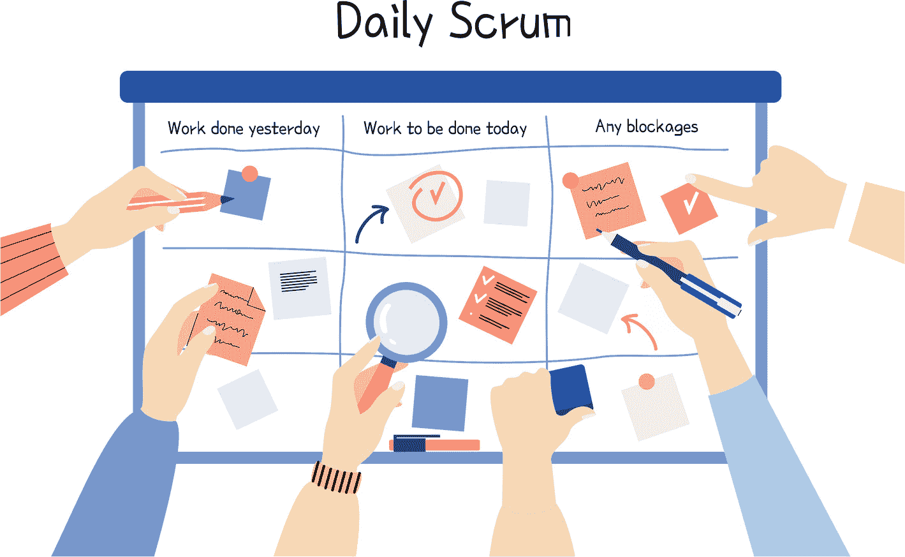
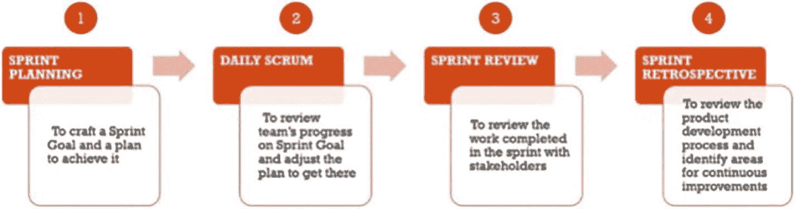
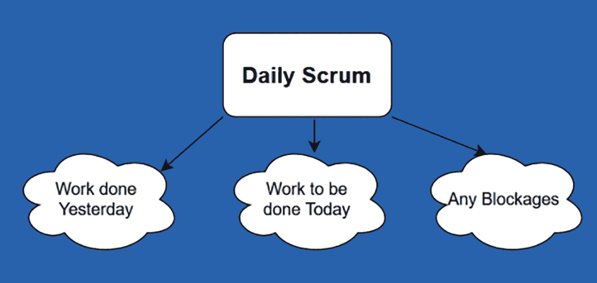

# 第五部分 流程

# 20. 数据安全

在当今世界，无论是在平台层面还是基础设施层面，我们都已经转向云和云原生架构。因此，数据安全以及持续的应用程序安全都将聚焦于云原生安全。安全必须内建于你正在努力保护的各种资产中。集成的安全还使你的工作负载能够从云端进行迁移。

## 业务挑战

近期工业领域的数字化转型已深刻改变了当今企业运营和竞争的方方面面。企业创建、处理和存储的数据量正不断增长，这驱动了对数据治理的更大需求。此外，计算环境比以往更加复杂，通常横跨公共云、企业数据中心以及从物联网传感器到机器人和远程服务器的众多边缘设备。这种复杂性创造了更大的攻击面，使得监控和安全防护更具挑战性。

与此同时，消费者对数据隐私重要性的认识正在提高。在公众对数据保护计划日益增长的需求推动下，最近颁布了多项新的隐私法规，包括欧洲的《通用数据保护条例》。这些规则与长期存在的数据安全条款，如保护电子健康记录的《健康保险流通与责任法案》和保护上市公司股东免受会计错误和财务欺诈的《萨班斯-奥克斯利法案》一起发挥作用。由于最高罚款可达数百万美元，每家企业都有强烈的财务动机来确保其合规性。

数据从未像今天这样具有如此巨大的商业价值。商业秘密或知识产权的损失可能会影响未来的创新和盈利能力。因此，可信赖性对消费者来说越来越重要，多达 75%的消费者表示，他们不会从不信任其能保护数据的公司购买产品。

## 数据安全策略

一个全面的数据安全策略整合了人员、流程和技术。建立适当的控制措施和政策，既是部署正确工具集的问题，也是组织文化的问题。这意味着要使信息安全成为企业所有领域的优先事项。

### 服务器和用户设备的物理安全

无论你的数据是存储在本地、企业数据中心还是公共云中，都需要确保设施能够防范入侵者，并配备足够的防火措施和气候控制系统。云提供商将代表你承担这些保护措施的责任。

### 访问管理与控制

应在整个 IT 环境中遵循“最小权限访问”原则。这意味着将数据库、网络和管理员账户的访问权限授予尽可能少的人，并且只授予那些绝对需要这些权限才能完成工作的人。

### 应用程序安全与补丁管理

所有软件都应在补丁或新版本发布后尽快更新至最新版本。

### 备份

维护所有关键数据的可用且经过彻底测试的备份副本，是任何强健数据安全策略的核心组成部分。此外，所有备份都应受到与主数据库和核心系统访问控制相同的物理和逻辑安全控制。

### 员工教育

对员工进行良好安全实践和密码卫生重要性的培训，并教会他们识别社会工程攻击，可以将他们转变为能够发挥关键作用保护数据的“人肉防火墙”。

### 网络与端点安全监控及控制

在你的本地环境和云平台上部署一套全面的威胁管理、检测和响应工具及平台，可以降低风险并减少数据泄露的可能性。

## 安全计划

基础设施安全意味着保护在诸如 `Google Gsuite`、`Amazon Web Services` 等服务上拥有云资产的公司云基础设施。它包含对散布在云基础设施中的云账户提供可见性。它还设立了数据安全所有权、警报和自动修复的流程。

- **云账户可见性**：云可见性是指能够详细查看云中的所有活动，通过它你可以识别安全威胁和低效性能。
- **数据安全**：该计划包括谁负责数据安全以及事件响应准备。
- **安全流程**：你应该为安全的三个重要角色制定详细流程，即人员、流程（静态）和技术。
- **托管式检测与响应**：检测和响应流程应有文档记录，并应进行演练，以确保团队准备好能够在威胁发生时立即做出有效的响应。

## 安全团队的职责

以下是安全团队的职责：

- 协助维护安全意识计划，并确保工程师每年都能了解最重要的安全风险和最佳实践
- 创建可供工程团队使用的安全策略、标准、程序和指南
- 对产品和服务进行安全审查
- 衡量并提升工程团队的安全成熟度
- 对安全问题进行分类并提供建议的修复方案
- 协助进行独立的安全评估和渗透测试
- 评估新的工具、流程和框架；推动最佳方案的应用
- 提供基础设施和应用程序安全防护

## 漏洞报告服务等级协议

服务等级协议（`SLA`）是两家不同公司、公司与顾问之间，甚至公司内部（如两个部门之间）达成的协议。在此背景下，`SLA` 将包含安全团队对通过任何渠道（无论是电子邮件、社交媒体、电话等）收到的关于公司基础设施的漏洞报告作出回应的义务。以下将引导您了解漏洞报告流程：

1.  每天对收到的所有邮件进行一次回复。（设定一个阈值：每天未读的漏洞相关邮件少于 20 封。如果连续 3 天邮件数量超过 20 封，则需引起关注。这意味着已达到阈值，我们必须勤勉地处理漏洞报告邮件，查明是否存在导致此问题的系统性入侵。不同规模的公司阈值可能有所不同。）
2.  云原生安全团队（CNST）的指定人员在收到邮件后，应在内部安全管理系统中创建一个包含所有提及信息的发现项，并将其转发给安全供应商或内部安全专家。
3.  如果有安全供应商，则该供应商或专家需在发现项被提交后的下一个工作日内，验证漏洞是否有效。
4.  如果有效，CNST 指定人员需在验证后的四到八小时内，按照专家指示的优先级和严重程度，向开发团队提交一个漏洞/问题。时间框架因公司而异。但一个高严重性的漏洞可能会给企业带来不良声誉，因此越早处理，对企业越有利。
5.  如果无效，应根据专家提供的说明，向漏洞报告者发送适当的回复。请使用标准模板。
6.  一旦漏洞被修复，开发团队会根据漏洞的严重程度提供更新。

## 安全审计

IT 安全审计是对组织安全态势和 IT 基础设施的全面评估。进行 IT 安全审计有助于组织发现并评估其 IT 网络、连接设备及应用程序中存在的漏洞。这为您提供了修复安全漏洞并实现合规的机会。

这包括诸如漏洞扫描以发现 IT 系统中的安全漏洞，或渗透测试以尝试对系统、应用程序和网络进行未授权访问等事项。最后，执行所有必要程序后生成的渗透测试报告将被提交给组织，以供进一步分析和采取行动。IT 安全审计还包含物理部分，其中审计员会验证物理硬件访问的安全性及其他管理问题。然而，本节仅涵盖 IT 安全审计的非物理部分。

### IT 安全审计的优势

IT 安全审计能够揭示组织 IT 资产中潜在的漏洞和安全风险。然而，识别风险会对组织的整体安全产生积极的连锁效应。如何体现？答案如下：

- 评估您当前的安全结构和协议，并帮助您根据审计结果为组织定义标准
- 通过提前发现潜在的黑客入口点和安全缺陷，降低黑客入侵风险
- 验证您的 IT 基础设施与主要监管机构的合规程度，并帮助您实现合规
- 发现组织安全培训与意识方面的滞后，并帮助您做出明智的改进决策

### 被请求的证据及其关联性

审计员将要求提供与安全、基础设施和业务连续性相关的证据。通常，根据审计类型的不同，审计周期可持续一周至一个月。审计类型可能包括 IT 通用安全审计、国际标准化组织（ISO）审计等。

### 将被要求提供的关键文档和证据

以下是您需要向审计员提供的关键文档：

- 人力资源相关文件，包括在审计期间入职、被解雇和离职的员工信息
- 资产清单
- 所有政策相关文件
- 防病毒相关证据、备份和 `CloudWatch` 告警
- 漏洞评估与渗透测试（`VAPT`）报告
- 数据库和生产环境的访问控制
- 防火墙和配置审查证据

## 总结

如果实施得当，强大的数据安全策略不仅能保护组织的信息资产免受网络犯罪活动侵害，还能防范内部威胁和人为错误——这些仍然是当今数据泄露的主要原因之一。数据安全涉及部署能够增强组织对其关键数据存储位置及使用方式可见性的工具和技术。理想情况下，这些工具应能应用加密、数据脱敏和敏感文件隔离等保护措施，并应能够自动化报告以简化审计流程并满足监管要求。

# 21. 企业为何会失败？

纵观历史，企业失败的典型原因包括战争、经济衰退、高税收、高利率、过度监管、管理决策失误、营销不足、无法与其他类似企业竞争，或者公众对企业提供的产品/服务缺乏兴趣。

但也可能存在企业自身固有的、导致失败的原因。在本章中，我们将探讨可能导致企业失败的流程相关问题，以及如何通过构建具有自愈和自纠能力的强大流程来避免这些问题，从而帮助企业蓬勃发展。

## 解决流程问题

有多种框架试图通过创新的追踪器来解决流程问题。一个清晰的项目管理框架有助于减少这些失败。
每项计划都需要在`RACI`或`DACI`模型中定义相应角色。

### RACI

一幅草图：一名男子手持卡片，卡片下方标有 R，上方标有 A。一名女子站在标有 C 的卡片旁，并手持标有 I 的卡片。左上角和右下角有两个设置图标。

**图 21-1** `RACI`模型

`RACI`模型提出的问题是：谁负责完成特定任务？

`RACI`矩阵是定义和记录项目角色与职责最简单、最有效的方法。确切知道每一步谁负责（Responsible）、谁问责（Accountable）、需要咨询谁（Consulted）、以及必须告知谁（Informed），将显著提高项目成功的几率。

`RACI`代表以下含义：

- **负责者（Responsible）**：谁负责参与完成某项行动？
- **问责者（Accountable）**：谁负责确保某项行动完成？
- **咨询者（Consulted）**：在完成某项行动的过程中，需要咨询谁的意见？
- **告知者（Informed）**：谁需要被告知某项行动的进展状态？

### DACI

几只手拿着便利贴、铅笔、钢笔、掸子、放大镜，在一块板子上方比划。另一只手则指向一个区域。板子上列出了昨天完成的工作、今天要完成的工作以及任何阻碍。

**图 21-2** `DACI`模型

`DACI`模型提出的问题是：谁来决定特定任务或功能的行动方案？

`DACI`决策框架通过在团队决策时为成员分配特定角色与职责，提升了团队在项目中的效能与速度。

`DACI`代表以下含义：

- **推动者（Driver）**：推动决策的人
- **审批者（Approver）**：做出决策的人
- **贡献者（Contributors）**：其工作或知识为项目提供帮助的个人或团队
- **告知者（Informed）**：其工作可能受这些决策影响，因此需要了解情况的人

### 切勿临时应付

始终让多个小组（pods）或小队（squads）运行冲刺（sprints），正如第 4 章所述。这有助于即使项目一小部分失败，整个项目仍能继续运行。为此，必须始终有例会和流程来跟踪进展。
企业之所以失败，是因为维持流程运作所必需的例会未被遵守。我们在第 1 章已详述了公司一般性的所有例会，在第 18 章则专门为技术团队进行了说明。这里我们将讨论，如果正确执行哪些例会，可以防止企业失败。

#### 需求收集

所有来自利益相关者的需求将被分类，并根据职责分配到特定团队。这些需求随后会在每个团队的项目管理工具中，归集到待办事项列表（`backlog`）部分。根据优先级，这些任务会被分类并分配给开发团队。这一基本例会是帮助企业培养对所有关键任务进行优先级排序文化的必要条件，否则公司目标将无法实现。

#### 史诗、用户故事与任务

所有来自利益相关者的请求（新功能、变更请求以及新技术的迁移请求）都通过表单或软件进行记录，并通过冲刺流程推进到逻辑终点。

- **史诗（Epic）**：驱动新旗舰功能或产品的一个较大故事。
- **用户故事（User story）**：将较大故事分解为较小的故事。
- **任务/子任务（Tasks/subtasks）**：将较大故事分解为更小的模块。

如果不能以有条理且可重复的方式创建史诗、用户故事和任务，最初会导致项目层面的失败，而当问题累积并成为普遍常态时，则会导致业务层面的失败。

### 遵循冲刺

对于较小的团队，必须优先处理待办事项列表中的所有问题并将其付诸行动。这将通过`Scrum`模型中的不同阶段来实现。图 21-3 展示了敏捷方法论中事件是如何发生的。

- **冲刺时间线**：2 周
- **任务优先级排序**：交替的周五
- **新冲刺开始**：每隔一个周二
- **冲刺结束**：每隔一个周一

图 21-3 描述了一个可用于交付较大史诗或项目的典型冲刺框架。

流程图。步骤 1：冲刺规划。制定冲刺目标及实现该目标的计划。2：每日站会。检视团队进展并调整目标。3：冲刺评审。与利益相关者一起评审已完成的工作。4：冲刺回顾。检视产品开发流程，识别持续改进的领域。

**图 21-3** 冲刺流程

以下步骤详述了冲刺过程：

1.  待办事项列表中的所有问题由各自的开发团队进行优先级排序。这些问题随后被添加到冲刺规划中的“创建冲刺（`Create Sprint`）”任务中，并启动冲刺以跟踪进度。
2.  冲刺启动后，每日站会随即开始，以检视团队在冲刺目标上的进展。图 21-4 展示了每日站会中的检视方式。
3.  在优先级排序时进行冲刺评审，与利益相关者一起评审本冲刺中已完成的工作，并讨论即将开始的冲刺任务。
4.  冲刺结束后，团队开会回顾上一个冲刺，并识别改进领域，这被称为*回顾*。

#### 每日站会

正如`Scrum`指南（`https://scrumguides.org/`）所述，每日站会的目的是检查朝向冲刺目标的进展，并根据需要调整冲刺待办事项列表，调整接下来的计划工作。每日站会是`Scrum`团队开发人员的一项 15 分钟事件。为降低复杂性，它在冲刺的每个工作日于同一时间和同一地点举行。如果产品负责人或`Scrum Master`正在积极处理冲刺待办事项列表中的条目，他们将作为开发人员参与。开发人员可以选择他们想要的任何结构和技巧，只要他们的每日站会聚焦于朝向冲刺目标的进展，并为第二天的工作制定可行的计划。这创造了专注力并改进了自我管理。每日站会改善了沟通，识别了阻碍，促进了快速决策，从而消除了对其他会议的需求。每日站会并不是开发人员唯一可以调整计划的时间。他们经常在一天中会面，以进行关于调整或重新规划剩余冲刺工作的更详细讨论。

图 21-4 描绘了每日参加`Scrum`会议的每个人需要汇报的内容。

流程图。每日站会分为：昨天完成的工作，今天要完成的工作，以及任何阻碍。

**图 21-4** 每日站会中需要回答的问题

如果这些流程被忽视，那么整个公司的问题就会悄然出现并波及所有领域。这些问题会导致：

- 缺乏清晰度
- 沟通不畅
- 变更管理失效
- 由于重复的任务和计划而缺乏创新

## 摘要

企业为何会失败，这个问题没有放之四海而皆准的答案。仅仅不遵循冲刺流程并不能保证企业失败。如果说，只要企业的所有其他基本功都扎实，并且冲刺流程及其他所有惯例都得到遵循，企业就一定会成功，这无异于在说：它不会失败。

# 22. 流程的例外情况：好还是坏？

在任何领域，而不仅仅是技术领域，都需要通过例外情况来运作。1969 年的登月任务就出现了多次例外。人们是如何克服这些例外，仍然成功完成了如此重大的任务？我们从中能学到什么，以及在出现例外时如何应对，这些都是本章涵盖的问题。通常，在任何项目中，我们都会先处理例外情况，然后再处理简单的用例。这会让我们有信心应对任何挑战。

## 登月中的例外情况

一幅素描，描绘了两名宇航员坐在从地球飞向月球的卫星上。靠近月球的那颗卫星标有“重启”字样。它旁边的那颗标有“1202 错误”。另一颗卫星已降落在月球上，插着一面旗帜。

图 22-1

描绘宇航员登陆月球时面临错误的示意图

1969 年，正在被引导飞向月球表面的登月舱，在距离着陆仅剩七分半钟时开始报告错误。

涉及两个晦涩的错误代码，每个代码由四位数字组成，表明航天器出现了问题或故障。在为登月着陆器设计系统时，开发人员设计了一系列错误代码，如果计算机检测到航天器出现异常，就会显示这些代码。

当宇航员进行无数次模拟着陆时，并非所有可能的错误代码都经过测试，因此有些错误代码是宇航员从未见过的。

“这是一个`1202`错误。”

在任务控制中心内，人们面面相觑，因为基本上没人知道`1202`是什么。

但程序员们已经预料到这个错误有朝一日可能会发生，因此建立了一个系统内部机制，可以自动执行快速重启，然后进行内存恢复，试图让计算机重新正常工作。理论上，计算机能够自行解决这个错误，无需任何人工干预。

## 无人驾驶汽车能从首次登月中学到什么？

如今，无人驾驶汽车可以从首次登月中吸取经验。你需要预测并为不听话的传感器编写代码。你不能假设无人驾驶汽车上的传感器会完美无瑕地工作。除了传感器可能被泥土或碎屑遮挡的明显问题外，传感器也可能因某些内部缺陷或问题而出现故障。请确保为这种可能性编写代码，并制定好在问题出现时的应对措施。

不要忽略边缘情况。目前大多数无人驾驶汽车研发工作的重点是在正常的日常条件下行驶，而不是处理不寻常或罕见的驾驶情况（所谓的“边缘”情况）。这掩盖了驾驶的真实情况，其中可能包括恶劣天气、糟糕的路况等。在我们的公共道路上进行测试的自动驾驶汽车需要准备好处理边缘或极端情况。

从软件角度来看，同样类型的问题也可能发生，包括隐藏的漏洞或突然出现的故障，这些问题在 1969 年就可能已经发生。让我们确保吸取过去的教训，在设计、编码、测试和部署自动驾驶汽车时保持极高的警惕性。

## 并非所有故事都有圆满结局

1962 年 7 月 22 日，一枚阿特拉斯火箭成功发射，其整流罩内封装着 NASA 的水手 1 号航天器。NASA 曾希望成为第一个成功飞越金星的国家，以扭转苏联在太空竞赛中的领先地位。飞行不到五分钟，水手 1 号显然连地球轨道都无法到达。一名跟踪火箭飞行的靶场安全官探测到了一个意外的偏航-升力（东北方向）机动，这意味着其制导系统出现了问题。火箭无法按预定方向飞行，正朝着坠毁的方向前进，要么坠入北大西洋航道，要么更糟，坠入有人居住的地区。该官员别无选择，只能下令进行破坏性中止。火箭连同水手 1 号一起爆炸，损失了 8000 万美元（2021 年价值 7.2 亿美元）。

结果发现，一名程序员在将手写转录的代码输入火箭计算机时，漏掉了一个方程中的连字符。这给制导系统提供了错误信息，最终只剩下残骸。这个人为错误在水手 2 号任务中得到了修正，该任务在不久后发射，并成功完成了首次飞越金星的任务。

这些例外情况的出现是由于人为错误，或是对系统的不理解或认知不足。在太空任务中，有时我们不得不匆忙发布，因为受到来自媒体、其他国家或政治家的压力。这些例外情况无论如何都会引发问题。

为什么我们在研究例外情况时要关注太空任务？因为它们的规模容易理解。

当一个太空任务因为缺少一个分号而失败时，它会受到关注；但是，当一家公司推出新网站时发生类似的错误，导致网站宕机，其规模虽然不像太空任务那样巨大，但对业务造成的冲击却是同样灾难性的。

## 企业为何寻求例外？

为什么企业的不同部门明知例外不好，却还要请求例外？原因如下：

- 为了宣传而做出承诺，却没有咨询技术团队某个网站能否在那时准备就绪

- 对投资者的承诺

- 电视上的黄金时段广告位可以带来宣传效果

- 对底层技术的误解，认为一个复杂的模块很容易复制到新版本中，并且可以在没有太多测试的情况下发布，因此讨价还价要求在更短的时间内完成

所有这些都是例外情况，如果管理不善，就会导致灾难。其中一些是真正有充分理由可以利用的情况，特别是为了快速宣传。因此，在这些情况下，可以免除所遵循的流程，而遵循这些流程的团队必须确保有办法很好地管理这些例外情况。

## 例外管理

例外管理包括四个步骤：

1. 设定目标，确定正常标准是什么

2. 评估绩效，看绩效是否按计划进行

3. 分析工作或记录，找出绩效偏离目标的地方

4. 调查并解决偏离标准的例外情况

### 设定目标

例外管理流程的第一步是设定切实可行的基准目标。关键领域可能包括销售、生产和支出。遗憾的是，你不能只说“这个月我要卖掉价值一百万美元的产品”。如果你经营的是小企业，这个目标可能无法实现。如果企业规模很大，你可能又低估了其潜力。

企业通常通过查看历史记录来确定合理的标准。如果你想设定一个小幅增长的目标，当然可以，但必须切合实际。预算是很好的起点。毕竟，如果你已经为成本设定了限额，并为营业额和利润设定了目标，那么你就可以利用这些来监控进展。

但你不希望反应太迟。如果你只在月底才发现偏差，即便只有一个月的偏差也可能让你付出高昂代价。考虑将目标和监控分解成更小的部分，以便管理层能够快速响应。

既然有了目标，你就可以开始定义什么算偏差。例如，比目标多或少 0.1%并不算大问题。那么，什么程度的偏差才需要管理层采取行动呢？

在复杂的业务中，会绘制统计控制图来确定偏差的影响。但如果你的业务相对简单，运用常识和一点数字运算就能找到答案。

### 评估绩效

在评估绩效之前，你需要准确、实时的绩效记录。你将收集哪些数据？如何收集？多久评估一次？前两个问题取决于你和你的业务，但最后一个问题有一个通用答案：评估绩效数据的频率越高，你就能越快发现偏差、进行调查并加以解决。

由于手动收集大量数据所花费的时间，可能比例外管理想要节省的时间还要多，因此最好采用自动化的记录和分析方式。因此，监控、报告和分析工作流的软件，以及生成财务分析报告的会计软件，都是你会觉得有用的工具。

### 分析偏差

你的结果几乎不可能与目标完全吻合。然而，调查不重要的偏差毫无意义，因此分析是基于重要性进行的。在分析你的报告时，你会得出以下两种结论之一。

- `没有重大偏差`：在这种情况下，无需采取进一步行动。

- `一个或多个偏差很重大`：如果你得出这个结论，就该采取行动了。如果数据是由员工或初级经理分析的，他们必须知道该由谁来执行必要的行动，以及向上级报告什么。

如果你在处理一个偏差，第一步是查明原因。可能仅仅是数据中的错误。或者，偏差背后可能有非常合理的原因。例如，如果你在卖冰淇淋，天气寒冷会导致销量骤降。偏差也可能是一件好事。也许是你的员工在尝试更高效的流程，或者预期成本有了显著节省。

### 解决例外情况

既然你已经知道哪些绩效标准未达标或超标，以及原因，那么作为管理者，你需要决定采取何种纠正措施。此外，你需要判断这个例外情况是否可能再次发生，以及它是否会影响其他目标。内外部商业环境的多变性意味着你需要不断重新审视和修订你的基准。

假设业务支出上涨了 3%。你需要修改销售目标吗？这样做现实吗？有没有可以节省成本的地方来抵消价格上涨的影响？这些变化将如何影响你的基准？

例外管理的优势体现在以下几个方面：

- `最佳管理层时间利用`：例外管理最显著的优势在于它如何影响管理者对时间的使用。为什么要去监控、分析和微观管理那些运行顺利的事情呢？当一切顺利时，员工可以自行决策，让管理者腾出精力专注于与问题领域相关的决策。

- `快速响应`：如果你的监控系统反应灵敏且与时俱进，例外管理就能及时发现任何问题。如果自动化系统能立即向你发出问题警报，那就更好了。这样偏差就没有时间产生叠加效应。

- `激励员工表现`：大多数人都喜欢能在最少的管理干预下完成自己的工作。这允许他们做出决策，尝试能带来更好结果的新事物，并“拥有”自己的工作领域。

## 总结

如果例外情况不会导致可能对企业不利的不可逆转的后果，那么它们是可以接受的。当服务器宕机时，我们会全力以赴使其恢复运行，有时会采取非常规的途径来避免长时间停机。但应将例外作为驱动业务所有需求的手段则应该避免。随着业务增长，做出周密计划且目标明确的决策，比为了快速周转而仓促做出例外决策更为重要。

# 23. 流程：是加速器，而非减速器

优化流程是实现业务目标的关键，而这正是业务流程管理发挥作用的地方。

## 什么是业务流程管理？

一幅四个人的草图。第一个人正在演示文稿的图表上书写，第二个人在观看。另外两个人正在讨论一些相互连接的圆点，其中一人拿着一个写字板。

**图 23-1** 说明业务流程管理各部分内容的图示

业务流程管理 (BPM) 是一门学科或实践，企业可以通过它来改进其流程。它不是想当然地接受现状，而是分析、衡量和监控现有流程。优化由此开始。这可以通过精简现有流程、外包某些业务活动或自动化重复性的子流程来实现。

### 流程映射如何提供帮助？

没有高效的流程，你会变得效率低下、平庸且缺乏竞争力。有了有效的流程，你就可以一次又一次地复制你的成功。流程映射通常通过流程图完成，详细描述从开始到完成的每一个步骤。这是发现现有流程中的瓶颈或其他问题，以及建立新流程的绝佳方法。但要开始进行流程映射，你需要了解你的企业目前有哪些流程以及需要哪些流程。

## 流程改进的领域

每个企业都需要一些核心流程，每一个流程都可以被精炼，以使你成为所在领域的佼佼者。我们为你整理了一份清单，以便你可以在以下章节中将你当前的运营流程与我们的清单进行对比，看看哪些地方可能需要重新设计、精简和优化。此外，清单中的大部分流程都附有示例模板流程。这有助于标准化，并使流程映射更加快捷。这些流程旨在提供一个起点，你可以根据自身业务需求对其进行调整。

### 客户成功

以下部分阐述了如何确保客户对我们企业提供的产品或服务感到满意。定义客户成功指标的三个关键点是：客户引导、客户账户管理和客户终止服务。

-   **客户引导**：通过扎实的引导流程，给新客户留下最佳印象。设定预期，并证明他们选择与贵公司合作是正确决定。心中要有一套清晰的活动安排——例如，一次介绍性电话沟通并附上一封跟进邮件——并确保所有团队成员都清楚自己的职责。我们认为，这是每个企业都必备的前三大流程之一。
-   **客户账户管理**：该流程定义了您如何与客户进行持续沟通。安排定期的检查点，可以让您挖掘向上销售或扩展所提供服务的商机。您的信息技术系统应为此提供支持，为您提供最新的客户信息，以实现个性化 outreach。
-   **客户终止服务**：尽管不受欢迎，但当您停止与客户合作时，也能确保他们获得最佳体验。这个过程是否顺畅，将决定未来客户是会向他人推荐您的公司，还是会建议他人避开您的公司。同样，请确保您的信息系统是最新的，以便您能个性化处理此事——并收集相关信息，以降低未来客户流失的可能性。

# 财务

**图 23-2** 说明金融交易的插图

财务流程是每家公司的支柱。除了维持企业的其他业务运转之外，它们还必须符合所在国家的法规。企业必须完成纳税申报和年终账目归档，而为这些活动制定全面的流程意味着可以降低违规风险。

-   **预算**：如何计算和监控公司的预算至关重要。一个确保支出保持在合理范围内，并在整个财年跟踪预算的流程，将让您确信企业是在其承受范围内运营的。
-   **年终账目和年度申报**：该流程描述了如何编制财年末的账目和年度申报。虽然具体程序因国家/地区而异，但一个稳健的流程能确保信息准确、及时地提交。
-   **薪资管理**：建立一个管理薪资发放的流程，无论是每月、每周两次还是每周一次，都意味着不会遗漏任何事项。确保完成所有相关的加减项，并考虑到任何特殊情况。
-   **税务**：该流程涉及国家的税收法律。企业能从税收减免中获益，因此一个用于准备和提交文件的流程将意味着您可以收回应得的款项。

## 人力资源

没有最重要的资产——员工，您的企业就无法运转。保障员工的安全和幸福应是公司的首要任务之一。这不仅关乎改进他们的工作流程，更关乎他们在公司的整体体验。因此，这部分包含了每个企业所需的最多流程也就不足为奇了。请注意，虽然以下模板主要针对英国雇佣法而定，但其原则具有更广泛的适用性。

-   **纪律处分和申诉**：与纪律处分和申诉程序相关的有四个主要流程：回应正式申诉、纪律调查、纪律听证会和纪律上诉。这些流程中存在多个决策点，在每一个决策点都有明确的预期至关重要。虽然这些流程（理想情况下）可能很少被用到，但在需要时，遵守雇佣法非常重要。您进行的任何业务流程建模都需考虑到这一点。
-   **员工休假**：除了明确员工如何申请假期和通知雇主需要病假的流程外，还需要考虑育儿假。为员工申请产假或陪产假制定流程，有助于管理好过渡期。先进的软件可以让这变得更容易——例如，自动将请求日期与全球日历进行核对，并通知人力资源部门有多少员工休假。
-   **员工入职**：企业常常低估员工入职流程对于留住员工和员工持续成功的重要性。一个全面的入职流程会让员工确信，他们加入了一家重视支持员工的公司。
-   **员工离职**：与良好的客户终止服务流程能带来积极评价和推荐类似，一个顺畅的员工离职流程能确保不遗漏任何事项，并让前团队成员对您的公司留下良好印象。
-   **弹性工作申请**：对于某些员工来说，申请常规弹性工作或远程工作是一种权利。人力资源部门有责任以正确的方式处理这些请求。这可能是一个持续的过程，因为您可能会将其与完成某些指标挂钩，所以重要的是不要将其视为一次性事件。
-   **绩效与评估**：透明化的绩效评估与考核流程，有助于员工理解如何才能胜任其职位。让他们了解哪些指标被监控、以及管理者记录了哪些内容，可以帮助他们做出适当的反应。此外，有效的流程应阐明哪些表现需要改进。
-   **招聘**：招聘是与尚未成为员工的候选人互动的主要人力资源流程。因此，拥有一个确保决策公平透明的流程就显得尤为重要。如果候选人从一开始就了解招聘流程，他们更有可能与您的招聘团队有积极的体验。
-   **裁员**：虽然每个企业都希望永远不必启用裁员流程，但一旦需要，该流程在执行时有着严格的规定。根据您所在运营国家的雇佣法，裁员可能需要经过多次审查，并可能涉及外部方以确保其合规性。

## 运营管理

**图 23-3** 展示组织运营系统多个齿轮相互咬合的示意图。

运营流程涵盖了企业日常运转所涉及的一切事务。运营部门负责让其他团队能够各展所长，同时在幕后提升公司的整体运作效能。其关键职责包括流程审查、持续改进，以及企业如何制定和调整自身战略。

运营部门理解业务流程管理（BPM）方法论至关重要，因为他们主要负责组织可能进行的任何业务流程再造。若非如此，企业将在流程分析、监控和优化方面举步维艰。

-   **合作伙伴关系**：与相似或互补行业的企业建立并发展合作伙伴关系，可能是拓展业务的关键途径。请务必遵循一套流程来充分利用这些联系，该流程旨在让合作伙伴和利益相关者及时了解情况，并在相关机会出现时，让他们首先想到你。
-   **政策审查**：一旦某个流程停止审查和更新，它便失去了价值。定期进行政策审查不仅意味着减少错误、确保业务合规，还能让你主动寻找能够进行改进和提升效率的环节。这是成功的业务流程改进策略的关键所在。
-   **采购/招标**：每个企业都需要工具或软件来维持运营。将采购或招标流程的管理方法文档化，意味着你能将所有因素纳入考量，从而为企业实现最佳成果。
-   **战略**：你的业务战略决定了你如何决定做什么（以及不做什么），并塑造了公司的整体方向。理解你的核心业务目标、定期审查你的目标，并拥有一个清晰制定和界定这些目标的流程，至关重要。

## 销售与市场营销

销售和市场营销流程常常被忽视，但正是这些流程能够吸引潜在客户并将其转化为你的实际客户。一旦你找到了行之有效的策略，就该将其标准化了。你需要确保每次都能按照既定流程，以相同的方式执行你的活动。

-   **竞争对手分析**：尤其是在竞争激烈的行业中，密切关注竞争对手至关重要。建立一个可供参考的流程，让你能够进行彻底的竞争对手分析，将有助于你发现实现差异化定位和提供差异化产品的机会。
-   **客户获取**：你获取客户的方式将是你的企业所独有的。策略可能大同小异，但让你企业脱颖而出的，是你在这个过程中积累的知识和专业技能。你的团队成员应该清楚了解如何进行数字营销、如何进行销售电话沟通，以及如何策划活动。拥有一份文档化的客户获取流程至关重要。
-   **宣传推广**：无论你身处哪个行业，你都需要向潜在客户推广你的公司。这可以通过活动、媒体报道，或更传统的广告形式来实现。无论采用何种方式，制定一个优化过的流程都能确保你不会错失任何机会。如果你将某些环节外包，请确保有一个流程来与第三方进行沟通确认。
-   **新闻简报**：在客户购买之前，收集并培育潜在客户的一个常见策略，是建立一个制作新闻简报的流程。你的新闻简报应反映你的业务以及你想要传达的形象。不要害怕加入一些关于公司幕后动态的信息——人们往往喜欢这些个性化的细节。
-   **营销活动**：无论是数字广告活动还是以印刷材料为中心的推广活动，你执行的每一次活动都有其共通之处。目标或预期结果需要一开始就确定，同时还需明确预算和受众等标准。拥有清晰可追踪的指标是监控活动成功与否的关键。
-   **网站**：企业网站是现代的商业橱窗。确保它保持最新状态并能准确反映你的目标受众，是一项持续性的工作。你绝不想遇到整个内容和销售团队都等着一个网页开发人员来更新所有内容的瓶颈情况！确保你的网站更新流程能避免这些潜在问题。

## 总结

经营一家企业并让所有事务井然有序地运转绝非易事。但仅仅拥有一份每家都需要的 25 个业务流程的清单，就是确保你掌控全局的第一步。下一步则是通过根据自身需求和情况定制这些流程，使它们真正为你的企业或公共部门组织服务。

# 24. 流程是神圣不可侵犯的吗？

任何企业的最终目标都是取得最大程度的成功。无论你是独自运营一家遛狗业务的所有者，经营一家小型企业，领导一家中小型企业，还是为一家拥有众多董事会成员的大型制造企业工作，情况皆是如此。

如果你想取得成功，就必须遵循几个步骤，这些步骤被特别称为**业务流程**。

在本章中，我们将深入探讨业务流程。你将了解其不同类型、哪些类型最具有价值，以及业务流程为何重要。我们还将分享一些业务流程的示例，以便你更好地理解它们是如何运作的。

## 什么是业务流程？

业务流程包含一系列相互关联的步骤。可以把它看作是运营企业的一套最佳实践和方法清单。

每个步骤都会被分配给一个特定的人，最终目标是为客户交付一项服务或产品。

为了达到最高效率，任务应分配给最有能力的人。这些步骤可以由多个人以经过优化和标准化的方式一遍又一遍地重复执行。

## 为什么业务流程很重要

业务流程之所以重要，是因为它们是一份循序渐进的指南，描述了以最佳方式完成工作的步骤，从而让你更容易专注于改进业务流程。

业务流程在组织的有效运作和结构优化中扮演着至关重要的角色。为什么业务流程很重要？如果一个业务流程规划周密且具有战略性，它将通过以下方式发挥作用：
- **降低风险与开支**：业务流程规划出完成工作的最高效方式，并考虑到未来的潜在问题，从而降低风险和费用。
- **减少人为错误**：任务被分配给更有能力的人，从而降低了人为失误的风险。
- **提高效率**：相关步骤和操作被清晰地规划出来，从而提升了生产力。
- **促进协作**：这意味着在流程中团队协同工作，并优化企业的运作方式。
- **提升客户关注度**：业务流程持续向你的公司更新与客户需求相关的信息，以及关于他们收到的服务或产品的反馈。
- **实现有效沟通**：利用市场调研和客户评价，你可以与客户进行更好的沟通。
- **改进时间管理**：得益于策略和流程图的发展，某些活动可以更高效地完成。
- **适应新技术的能力**：通过利用最新技术，业务流程可以得到改进。

## 不同类型的业务流程设计

基本上有三种不同类型的业务流程设计。
- **核心流程**：这是最基本的流程类型，是公司如何向客户交付最终产品的方式。每一步都为最终产品增加价值。
- **支持流程**：这些流程本身不直接增加价值，但它们确保核心流程能够有效且高效地运作。它们也支持组织的日常运营。
- **管理流程**：这些流程负责公司治理、战略管理和运营。它们设定标准和目标，以确保另外两种业务流程的有效和高效运作。这些流程还包括对业务中不同流程进行控制和监控的环节。

## 业务流程示例

不同公司和组织普遍使用的业务流程示例有很多。其中包括以下十个常见类型：
- 客户成功流程（客户关系与策略）
- 人力资源流程（员工满意度与发展）
- 管理职责
- 变更管理、质量与流程改进
- 资本管理、报告与财务分析
- 产品开发流程
- 客户获取与销售渠道
- 销售与营销流程
- 客户成功流程
- 财务流程（会计管理）
- 服务/产品交付
- IT 流程（技术管理）

所有这些对于运营你的企业都至关重要，但为什么业务流程很重要呢？

## 最重要的业务流程是什么？

无论企业的规模、地点或行业如何，有几个业务流程对于其高效运营是必不可少的。不幸的是，这使得确定哪一个是最重要的业务流程变得难以回答，但所有企业都需要一些核心业务流程。
- **销售和营销流程**：你如何获取新客户/顾客？
- **质量控制和交付流程**：你如何确保最佳的服务水平或高标准的生产质量？
- **IT 和技术流程**：你依赖哪些技术来运营业务？
- **行政和人力资源流程**：你如何组织人员和调配资源？
- **财务和会计流程**：你如何收款（开具发票）并支付账单，例如供应商款项或税款？
- **客户成功流程**：你如何让你的客户保持满意？

## 什么是好的流程？

既然你了解了为什么业务流程很重要，那么理解什么构成了一个好的业务流程也同样重要。

如果你想让你的团队走上成功之路，最关键的是拥有设计良好的业务流程。

这些流程，当根据组织的需求制定时，将被员工视为神圣的准则。
- **简单的流程**：尽可能使其简单，有助于避免执行中的错误。流程的复杂性会使其难以遵循，也难以检查、分析和控制。
- **文档化的流程**：文档记录了完成事情的最佳方式，是流程控制的标尺。没有文档，流程将沦为经验知识或隐性知识。
- **受控的流程**：引入流程控制，确保每个流程都能以受控的方式执行。缺乏制衡机制的失控流程最终会消亡。受控流程有助于在周围人员变动的情况下维持流程的稳定。
- **协作与沟通**：流程中的每个参与者都应了解流程如何运行以及自己在其中的角色。
- **防错流程**：杜绝错误和失误的发生。识别是否需要实施指示、标志或防错技术（例如，如果你使用精益方法论或六西格玛，则可以应用防呆法）。

## 业务流程管理

既然我们已经解释了为什么业务流程很重要，那么我们来谈谈如何管理业务流程。

这可以通过纸笔、Word 文档、电子表格来实现，或者利用技术的力量。

业务流程管理是一种利用技术来管理业务流程的方法，它使你能够在办公室时使用台式机，在外出时通过手机上的业务流程管理应用程序进行操作。

## 总结

业务流程之所以重要，是因为它们是一份循序渐进的指南，描述了以最佳方式完成工作的步骤，从而让你更容易专注于改进业务流程。

# 25. 结论

**图 25-1** 技术与商业的伙伴关系

技术可以帮助企业主以更智能、更有效的方式利用有限的资金。在某些情况下，使用技术能带来更高的效率和灵活性，使其成为你业务中可能已有的流程的自然演进。而在其他情况下，你可能需要做出一些调整，才能从技术友好的替代方案中获益。

好消息是，一旦新系统就位，其带来的益处往往远超转型过程中短暂面临的挑战。本章涵盖了一些在你准备在业务中提升技术应用时可以探索的领域。

在业务中使用技术并非要消除业务中的人为因素，而是要强化它。如果运用得当，技术介入更像是一种伙伴关系。机器做它们擅长的事，从而解放你的员工，让他们能够发挥才智，在业务的其他领域进行创新。

关于引入技术的一个常见误解是，它需要数周甚至数月才能实施。我希望，如果你已经读到这里，你能看到有大量流程已经成熟到可以自动化的程度，其实现时间表仅需一天。本章总结了可用于改进业务流程的技术工具。

## 生产力

有多种生产力工具能提升企业效率，这意味着你能完成更多工作，并有望因此获得更高收益。

- `Time tracking software`（时间跟踪软件）是绘制时间分配图、明确时间花费者，从而帮你发现时间浪费环节、识别更高效利用时间机会的绝佳工具。若能恰当运用，这类分析在责任落实、流程改进和提升生产力方面效果显著。

- `Digital dictation`（数字听写）能帮你简化工作流程，尤其当你的业务包含大量耗时的转录工作时。

- 使用项目管理和任务管理工具，掌控日常业务职责。

- 创建数字归档系统，让文档的分类、保存、共享和查找更便捷。

- 开发高效的邮件管理流程，更轻松地跟进邮件流。

## 财务

管理公司财务状况的工具能帮你发现浪费性支出，并增加利润。

- 使用在线开票服务，降低向客户收款的成本。
- 使用在线预算跟踪，掌控并减少开支。
- 更高效地在线报税。
- 通过在线销售产品，创造新的收入来源。
- 使用全面的会计软件，简化企业财务管理。
- 与簿记员或会计师共享数字文件，改善持续的记账流程。
- 探索开源应用，取代部分成本较高的“名牌”替代品。

## 营销

软件能通过简化工作流程、加强不同营销渠道间的协作，帮助你更好地推广业务。

- 使用软件创建可编辑、更新并与团队共享的营销计划。
- 使用社交媒体网站如 `Facebook`、`Twitter`、`Google+`、`Pinterest`、`YouTube` 等推广你的业务、产品和服务。
- 创建与你业务和目标受众相关的博客。
- 通过选择加入表单收集电子邮件地址，并开始利用邮件营销的力量。
- 运用视频营销。
- 通过网站或在线广告推广业务。

## 协作与学习

当今技术有助于协调团队并对其进行培训，以提高生产力。

- 举行电话会议，确保不同地点的团队成员信息同步。
- 网络研讨会或网络会议是极佳的选择，无需差旅即可面对面交流，让所有人随时跟进。
- 通过在线商业培训扩展知识，赋能团队。
- 在云端共享文件和数据。
- 建立内网用于本地文件共享。
- 通过团队消息传递工具与团队快速清晰地沟通。

## 客户服务

软件工具也能帮助你改善与客户的关系。

- 使用社交媒体进行客户服务。
- 建立在线帮助台或工单系统来处理客户问题。
- 允许客户在方便时在线预约。
- 使用在线调查和问卷获取客户反馈。
- 支持移动办公和远程办公。
- 软件让人们在家工作更便捷，从而节省办公空间和水电费。

# 索引

## A

- 临时奖励/认可
- 敏捷
  - 协作工具
  - 描述
  - 驱动因素
  - 敏捷宣言
  - 原则
  - 工作方式

## B

- 黑带
- `Bootstrap`
  - 基础样式
  - 列结构
  - 组件
  - 网格系统
  - 插件
  - 工作布局
- 业务分析/智能
  - 应用场景
  - 优势
  - 跨职能协作
  - 数据民主化
  - 自主技能提升
- 业务数据栈架构
  - 访问控制/审计
  - 数据流
  - 元数据层
  - 可观测性
  - 编排
  - 模式/血缘关系
  - 统计
  - 微服务（参见微服务架构）
- 业务目标/阶段
  - 策略
    - 收集/分析信息
    - 概念模型
    - 核心业务流程
    - 数据源/转换
    - 数据仓库最小可行产品计划
    - 实施
- 业务失败情况
  - 敏捷方法论
  - `DACI` 模型
  - 每日站会
  - 史诗/用户故事/任务
  - 小组/小队
  - `RACI` 模型
  - 需求收集
  - 解决流程问题
  - 冲刺流程
- 业务流程
  - 协作/沟通
  - 协作/学习
  - 公司/组织
  - 核心流程
  - 客户服务
  - 描述
  - 设计
  - 类型
    - 防错流程
    - 财务
    - 管理
    - 营销渠道
    - 流程控制
    - 生产力工具
    - 简易流程/文档化
    - 分步指南
    - 技术流程
    - 过渡性流程
    - 设计良好的流程
- 业务流程管理
  - 客户管理
  - 业务战略
  - 竞争对手分析
  - 客户获取
  - 高效流程
  - 财务流程
  - 人力资源
  - 简报
  - 离职流程
  - 运营流程
  - 合作伙伴关系
  - 采购/招标
  - 宣传推广
  - 招聘
  - 冗余流程
  - 销售与营销流程
  - 扎实的入职流程
  - 标准化

## C

- 层叠样式表
- 云原生安全团队
- 持续集成技能
- 持续流程
  - 承诺/绩效
  - 金发姑娘原则
  - 挑战性目标
  - 特征
- 持续流程团队
  - 倡导者/探索者
- 客户关系管理

## D

- `DACI` 模型
- 数据安全
  - 应用/补丁
  - 审计
  - 优势
  - 关键文档
  - 请求证据/关联分析
  - 漏洞扫描
  - 备份
  - 缺陷报告流程
  - 业务挑战
  - 数据安全/告警/自动修复
  - 员工教育
  - 最小权限访问
  - 降低风险与削减
  - 物理安全
  - 角色/职责
  - 策略
- 团队划分
  - 业务需求识别
  - 模块
  - 并行执行
  - 串行执行
  - 线框图

## E, F, G

- `ECMAScript` 语言
- 异常处理
  - 优势
  - 业务探索
  - 无人驾驶汽车
  - 登月舱
  - 管理偏差
  - 目标
  - 绩效记录
  - 解决异常
  - 步骤
  - 登月
- `Express.js`
- 提取、转换、加载模型

## H

- 招聘
  - 顾问
  - 招聘活动
  - 面试流程
  - 人员需求
  - 步骤
  - 内推描述
  - 人力资源寻源
  - 成功/失败
- 超文本标记语言
  - 描述
  - 元素
  - 头部/元数据

## I

- 知识产权
- 物联网传感器

## J, K, L

- `JavaScript`

## M

- 微服务架构
  - 架构选项
  - 优势
  - 业务/组织优势
  - 特征
  - 数据库集成
  - `ETL` 模型
  - 实验与降低风险
  - 独立部署
  - 混乱流程
  - 精准扩展
  - 同步 `API` 调用
  - `MongoDB`
- `Node.js`

## O

- 目标与关键成果
  - 检查会议
  - 跨职能团队
  - 定义
  - 描述
  - 梳理
  - 增长战士
  - 关键参数
  - 长期战略
  - 目标
  - 基于结果的工具
  - 参数
  - 流程（参见持续流程）
  - 战略规划（参见战略规划）
  - 团队对齐/目标关联
  - 虚拟协作

## P, Q

- 并行开发
- 人员管理
  - 匿名类别
  - 员工关系
  - 一对一会议
  - 绩效评估流程
  - 高层目标
  - 个人职责
  - 汇报经理
  - 团队主管
  - 晋升/薪酬结构
  - `PostgreSQL`
- 优先级设定
- 原型设计
  - 创新项目
  - 长期项目方法
  - 最小可行产品
  - 产品发布
  - 滚动波计划
  - 快速迭代
  - 研发团队
  - 小队/`Spotify` 模式

## R

- `RACI` 模型
- `React.js`
- 关系型数据库管理系统
- 表述性状态传递
- 需求文档
  - 要素
  - 收集流程
  - 乔哈里窗
  - 元数据
  - 优先级排序
  - 评审会议
  - 冲刺评审
  - 工具
- 奖励/认可
  - 临时工作者
  - 类别
  - 证书
  - 标准
  - 排行榜
- 仪式
  - 全体会议
  - 每日站会
  - 描述
  - 冲刺回顾看板

## S

- 规模化运营
  - 影响人员心态
  - 敏捷（参见敏捷）
  - 告警/标志
  - 业务约束
  - 问题
  - 产品发布原型设计
  - 团队文化
  - 技术驱动型运营
  - 技术技能
  - 上升箭头
- `Scrum`
  - 特征
  - 沟通节奏
  - 周期
  - 升级流程
  - 负责人
  - 开发团队负责人
  - 参数
  - 产品负责人
  - 职责
  - 团队管理
- 服务级别协议
- 面向服务的架构
- 战略规划
  - 方面
  - 检查会议
  - 领导力会议
  - 回顾重启
  - 工具

## T

- 技术驱动型运营
- 技术驱动型公司
- 技术栈
  - 后端技术
  - 特征
  - `ExpressJS`
  - `Node.js`
  - `REST`
  - 数据库
  - 前端/后端
  - `Bootstrap`
  - 盒模型
  - 层叠样式表
  - 描述
  - `ECMAScript`
  - `HTML`
  - `JavaScript`
- 技术团队
  - 变更管理
  - 沟通
  - 驱动力
  - 创新
  - 问题解决
  - `Scrum`（参见 `Scrum`）
  - 软件工程
- 技术团队划分
  - 业务部门
  - 工程经理/架构师
  - 领导角色
  - 组织结构
  - 质量保证工程师
  - 质量保证主管
  - 需求
  - 软件工程师
- 测试驱动开发

## U, V, W, X, Y, Z

- 技能提升/培训计划
  - 持续流程
  - 描述
  - 在职培训
  - 工作流程