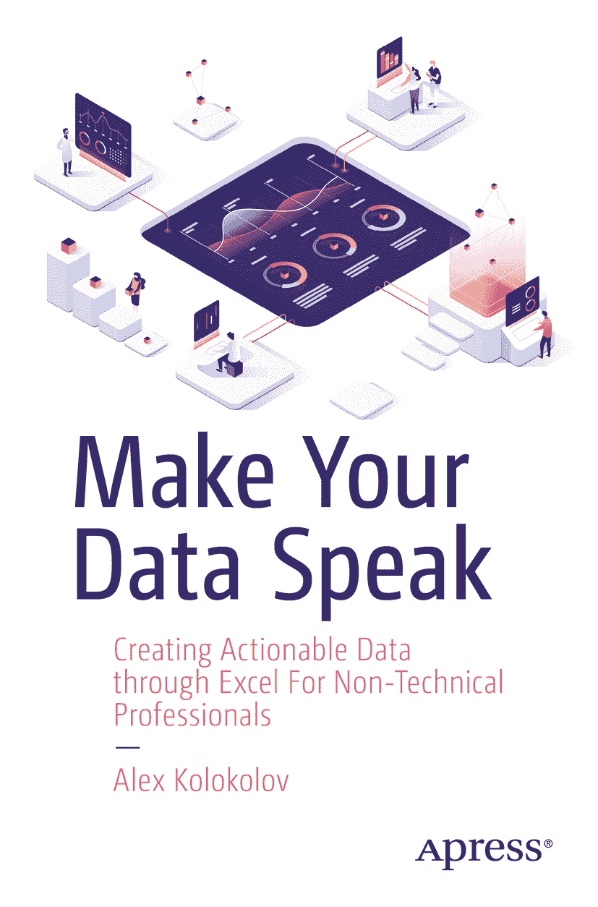

ISBN 978-1-4842-8941-9 e-ISBN 978-1-4842-8942-6 [`doi.org/10.1007/978-1-4842-8942-6`](https://doi.org/10.1007/978-1-4842-8942-6) © Alex Kolokolov 2023 本作品受版权保护。所有权利均独家授权给出版商，涉及材料的全部或部分内容，特别是重印、插图再利用、朗诵、广播、微缩胶片复制或其他任何物理形式的复制，以及传输或信息存储与检索、电子改编、计算机软件，或现在已知或未来开发的类似或不同方法。本出版物中使用的一般描述性名称、注册商标名称、商标、服务标志等，即使在没有具体声明的情况下，也不意味着这些名称免于相关保护法律和法规的约束，因此可自由使用。出版商、作者和编辑谨慎认为，本书中的建议和信息在出版之日是真实准确的。出版商、作者或编辑均不对本文所含材料或可能存在的任何错误或遗漏提供明示或暗示的担保。出版商在已出版地图和机构附属关系方面的管辖权主张保持中立。

本 Apress 印记由隶属于 Springer Nature 的注册公司 APress Media, LLC 出版。

注册公司地址为：1 New York Plaza, New York, NY 10004, U.S.A.

## 作者寄语

我叫亚历克斯·科洛科洛夫。自 2009 年以来，我一直参与企业报告自动化项目。我的公司名为商业智能研究所，专注于两个领域：(1) 商业智能系统的实施，(2) 数据处理与可视化培训。

在过去几年中，我曾与工业控股公司、冶金厂、银行、国有企业和国际快消品公司合作过。它们面临一个共同的问题：数据很多，但可理解的信息却很少。每年都有新的 IT 系统和分析部门出现，但在战略层面，公司并未从中看到任何益处。

企业需要数据可视化，将数字流转化为视觉信息，这有助于快速把握本质并做出明智决策。它看起来像一份精美的演示文稿，但允许你点击所需指标，一直追溯到原始数据以了解细节。这被称为交互式仪表盘。

事实证明，要获得这样的仪表盘，仅仅购买一套 BI 系统是不够的。所有这些程序都只是构建器，你需要从零开始构思一切。

这里可以类比一下演讲艺术。在会议上，赢得同事关注的是那些拥有漂亮且易懂演示文稿的演讲者，而不是那些堆砌大量笨重表格（即使包含有用的计算）的人。

我希望你的报告能够清晰且富有说服力，让数据用商业语言说话。这项技能必将帮助你清晰、有说服力地向客户、同事或管理者传达信息。这正是我写本书的原因。

## 本书适合谁？

每份报告都有两类受众。第一类是收集数据并进行计算的分析师。第二类则是这些信息的消费者，即根据收集的数据做出决策的管理者。

本书适合这两类人群，但其写作方式确保即使是商业用户，即使没有技术知识，也能完全理解。我用简单的“人类”语言来呈现材料——就像我在培训课程和商学院 MBA 项目中讲解的那样。

我的目标是向不同专业背景的管理者展示如何“驾驭”数据可视化，如何为开发仪表盘设定任务，以及如何控制质量，从而让企业获得一个决策工具。

## 如何阅读本书

前五章是关于基于工资基金费用数据逐步构建仪表盘。实际上，为此写 200 页并不难。只是在这个分步案例中，我包含了在 Excel 中工作时遇到的所有常见错误和困难。我还分享了如何通过几次点击解决或预防这些问题的小技巧，从而节省时间和精力。

我努力使实践部分成为一份可视化的速查表，而不仅仅是 Excel 中的按钮操作指南。因此，行动被分解为带有插图的步骤，有些内容则以简短检查清单的形式设计。某些部分末尾的二维码将引导你进入相关的视频教程，以便你获取更多信息。有人喜欢阅读更多内容，另一些人则觉得观看更方便——你得到的是二合一的内容。

本书的最后一部分是关于可视化的规则。我在这里并非试图提出新观点。更确切地说，我试图梳理出对初学者关于如何选择图表的永恒问题的答案。

为此，我以最流行的视觉元素为例，并将它们与数据分析类型进行比较。这种方案被称为图表选择器，已经有很多人发明过。我不喜欢任何现有的方案——它们相当复杂且难以记忆。我在本书这一部分的“发明”只是“可视化指南针”：我希望它能帮助你为你的任务选择正确的图表。

通常，在培训材料中，理论先行，实践随后。我采用了不同的做法，侧重于我的教练经验。经验表明，当你先动手做，然后再借助理论将所获知识系统化时，你掌握技能的效果会更好。

## 这本书并非关于 Excel

无论人工智能、机器人技术和其他最新技术被讨论得多么热烈，商业决策仍然是由人做出的。这通常必须在信息不足的条件下进行，即数据很多，但从数据中得出的有用结论却很少。而 Excel，作为大多数人使用的基础工具，至少应该被掌握以解决这个问题。

我不是 Excel 的狂热粉丝，但即使在大型企业中它也仍在使用，你无法忽视这一点。事情就是这样：我们都爱它，恨它，却又离不开它。

就我个人而言，Excel 的价值在于，你可以直接在源数据文件中测试一个假设，并在半小时内勾勒出未来仪表盘或演示文稿的草稿。对于管理者来说，它是一个方便的工具；对于高层管理者来说，它是数字技能的基础。

我会这样说：不，这本书不是关于 Excel 的。所有原则、规则和技巧都适用于在任何 BI 系统中工作。如果你了解它们，那么即使你在 BI 中的第一个仪表盘，也会比初学者通常做的要好。

## 促使我写这本书的三个故事

我的客户中有几十家公司和数百名员工。我的学生中有数千名背景各异的人。他们都带着问题和任务来找我，许多人讲述着有趣的故事。

多年来，关于处理数据和可视化复杂性的故事积累了很多，以至于它们构成了本书的基础。我将讲述三个这样的故事。它们关乎许多高管、分析师和管理者。如果这本书能让他们中的至少一位工作变得轻松些，我就知道我的时间和精力没有白费。

