# 1. 数据准备

用常规表格手动准备的报告不适合构建仪表盘。其中的信息排列方式便于人类感知和理解，但不适合机器处理。因此，处理数据是开发仪表盘之前的第一步。

在本书的这一部分，我将告诉你在分析初始数据时需要注意什么，并向你展示如何正确准备数据，以便交互式仪表盘能够自动更新。

## 1.1 初始数据存在什么问题

一个常见的问题：员工在制作报告时，只考虑自己方便，而不考虑其他人之后如何处理这些数据。结果我们得到的表格难以理解：充满了辅助计算列、备注和颜色高亮。有时这来自企业资源规划会计系统的现成报告，之后又“堆砌”了备注和分组。

对于表格的作者来说，操作这样的表格很方便：在新列中输入数据，向下拖动公式，在下一个工作表中检查计算结果。但问题不仅在于其他人难以理解——这类数据无法加载到数据透视表中，而数据透视表正是我们制作仪表板的基础。

我们来看一个不算最糟糕的例子：一张关于员工成本数据的表格。

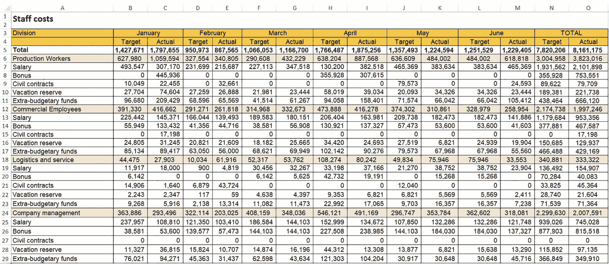

一张表格列出了 1 月至 6 月的员工成本，以及以卢比计的目标值和实际值总和。最高的实际总成本为 3,823,016，出现在生产工人一项。

- 在表格的行中，有费用项目和部门，以及它们的小计。这些条目用颜色标出，但从技术上讲，在 A 列内部，这些类别是无法区分的。
- 在右侧的列中，有合并单元格中的月份，下面是“目标/实际”分组。也就是说，我们有一个两级“表头”。

在这种矩阵结构中输入数据确实很方便。特别是当你只需要在单元格里加个数字然后就不管了的时候。但我们要考虑得更长远：如何设置一个能在添加新数据时自动更新的报告模板。

**解决方案：** 需要将原始的矩阵表格转换为所谓的“扁平”格式。

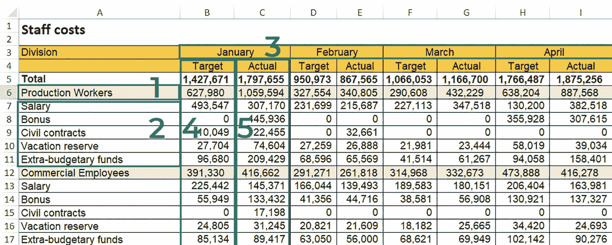

一张表格列出了 1 月至 4 月的员工成本，以及目标值和实际值总和。从实际成本最高（887,568）的生产工人行，到预算外基金行，都被高亮显示。

| “人类可读”格式 | “机器可读”格式 |
| --- | --- |
| 行和列中包含五类数据： • 列中 – 月份、目标值和实际值 • 行中 – 部门名称和费用项目 | 每个类别都在单独的列中： 1. 部门名称 2. 员工成本项目 3. 月份 4. 目标值 5. 实际值 |

如果你手动输入数据，这会增加事务性工作：对于每一行包含数字指标的记录，都需要重复填写类别（部门、项目、月份）。紧凑的矩阵会变成成百上千行。

好消息是，如果你从数据库下载初始数据，那么任何信息系统都能让你以同样的“扁平格式”来导出。

### 1.1.1 如何将数据转换为扁平表格

包含初始数据的扁平表格应包含：

- 一行包含类别名称的标题行
- 按类别数量划分的五列
- 行中不重复的数据

行中不应有空单元格：每一行都应指定部门、费用项目和月份。

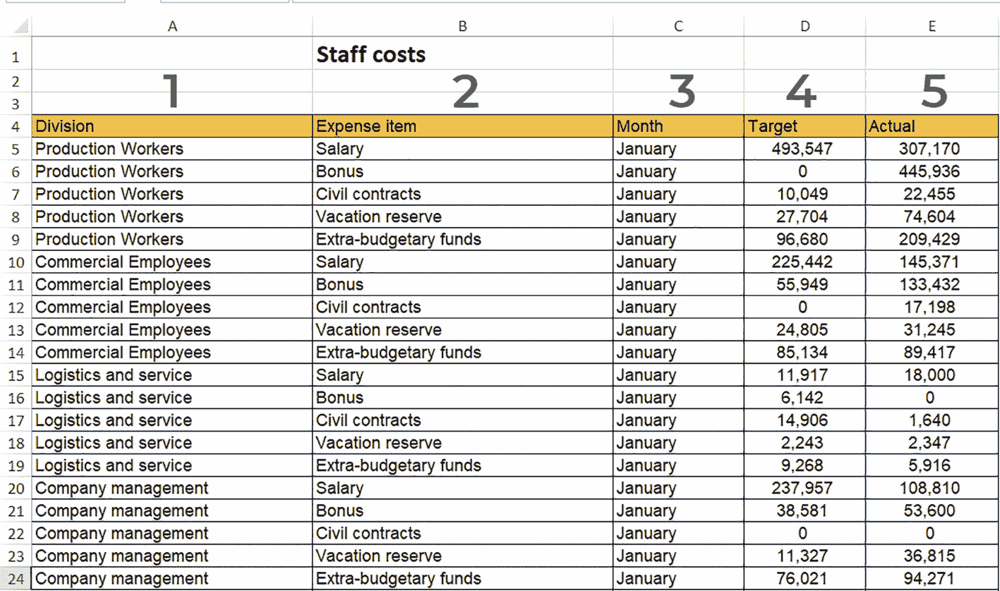

一张表格列出了 1 月份的员工成本，包含部门、费用项目、月份、目标值和实际值。生产工人的工资目标值最高，为 493,547。

有几种方法可以将初始数据转换为扁平表格：手动将数据复制到所需单元格、使用宏或使用 Power Pivot 技术。

我们从手动复制数据开始：这个方法会花一点时间，但对于新用户来说，比其他方法更容易。

**提示！** *如果你是 Excel 新手，那么在开始工作前，请先复制一份包含数据的工作表，以便随时核对原始信息。*

**步骤 1.** 初始表格中的 A 列包含两类数据：“部门”和“费用项目”。在扁平表格中，它们应该在不同的列中。以下是分离它们的方法。

a) 在 A 列的左侧添加一个新列。方法 1，最简单：选中 A 列，右键单击打开上下文菜单，选择“插入”。方法 2：将光标放在 A 列的任意单元格上，在“开始”选项卡的菜单中，选择“单元格”部分下的“插入...”按钮，然后在其子菜单中选择“插入工作表列”按钮。

b) 将包含部门名称的单元格的值拖拽到新列中。为此，选中这些单元格，将光标移至该单元格块的边框，然后将其移动到新位置。

c) 在新列中，向下填充空单元格，为那些费用项目所在的行补上部门名称。

d) 在数据上方的一行中，为 A 列和 B 列赋予正确的名称：分别是“部门”和“费用项目”。在同一行中，我们将指定其余列的标题。

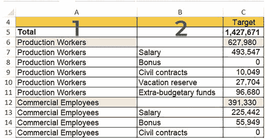

一张 Excel 工作表，总值为 1,427,671。生产工人和商业员工被高亮显示为行标题。

**步骤 2.** 然后需要从表格中删除包含按部门划分的合计和小计的行。否则，数据会被多次汇总，导致结果不正确。

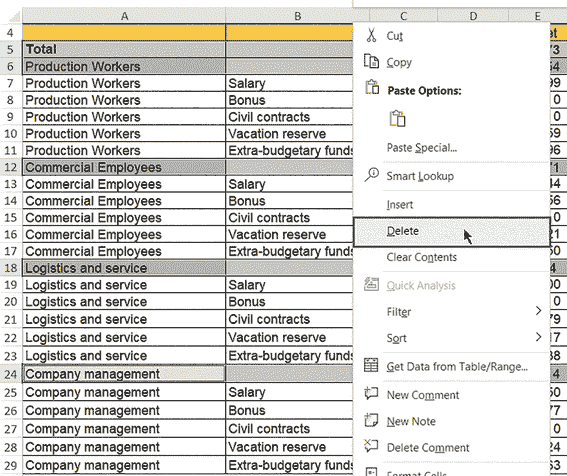

一张 Excel 工作表显示了生产工人、商业员工、物流与服务以及公司管理层。页面重叠显示了一个删除选项。

**步骤 3.** 下一步是添加一个包含月份数据的列。

a) 在包含费用项目的 C 列左侧插入一个新列。

b) 将月份名称复制到新列的第一个空单元格中。

c) 选中该单元格，并按住右下角向下拖动 – 该列将自动按顺序填充月份（对于日期或数字序列也是如此）。

d) 更改这个序列，因为我们需要先收集一月的数据。在选中块右下角出现的“自动填充选项”菜单图标上单击，并选择“复制单元格”。

完成这些步骤后，我们得到了一个扁平表格，在 A 到 E 列中包含了 1 月份数据所需的类别信息。

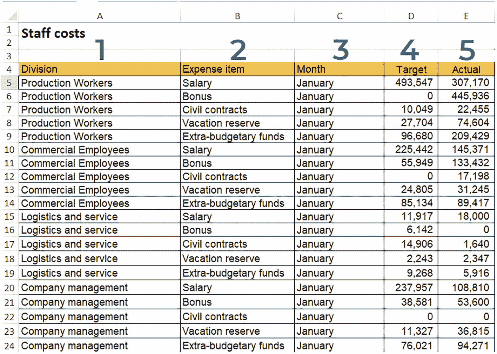

一张表格列出了 1 月份的员工成本，包含部门、费用项目、月份、目标值和实际值。生产工人的工资目标值最高，为 493,547。列出了 24 条数据。

**步骤 4.** 将 2 月份的目标值和实际值数据移动到 1 月份数值下方的 D 列和 E 列。在 C 列中将这些单元格对应的“二月”值向下拖拽。

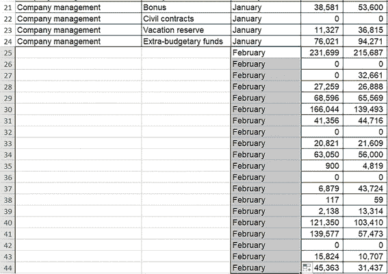

一张 Excel 工作表显示了公司管理层的奖金、民事合同、休假准备金和预算外基金及其 1 月和 2 月的数值。

**步骤 5.** 对剩余月份的数据重复步骤 4。所有月份的名称都移到了 C 列，计划指标在 D 列，实际指标在 E 列。

**步骤 6.** A 列和 B 列的内容通过复制或向下拖拽进行重复，从而填充空单元格。

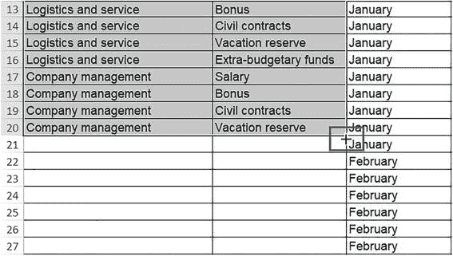

一张 Excel 工作表显示了公司管理层的奖金、民事合同、休假准备金和预算外基金 1 月和 2 月的数据。

这样就完成了。剩下的工作是清理包含扁平表格的工作表：删除多余的（包含小计的）行，以及类别标题上方的行。

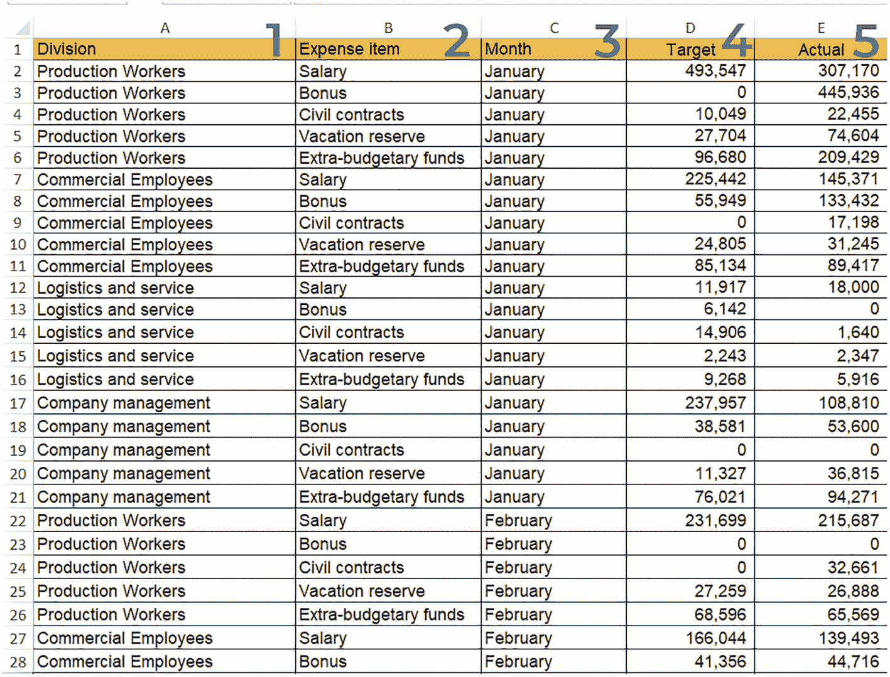

一张表格列出了 1 月份的员工成本，包含部门、费用项目、月份、目标值和实际值。生产工人的工资目标值最高，为 493,547。列出了 28 条数据。

### 1.1.2 如何简化复制单元格的过程

*“`Ctrl`”适用于 Windows 系统。对于 MacBook，则应使用“`cmd`”。*

如果你选中单元格，按下 `Ctrl+C`（复制），将光标放在正确的位置，再按下 `Ctrl+V`（粘贴），这将花费很长时间。有几种方法可以加快此过程。

**解决方案 1.** 选中单元格，将光标移至选中区域的边框，然后按下 `Ctrl` 键——光标附近会出现一个“`+`”号。按住 `Ctrl` 键，用鼠标将数据副本拖拽至所需位置。

**解决方案 2.** 选中所需单元格，然后双击选中区域的右下角：单元格将向下填充。

结果相同，但我更喜欢第二种方法——它更快。

### 1.1.3 总结

对原始交叉表的分析表明，它不适合创建交互式仪表板。

我们确定了五类数据并对表格进行了转换。

1. 将五类数据分布在五列中
2. 删除包含小计的行
3. 用相应数据填充行

通过以上步骤，我们得到了一个适合“机器”处理的平面表，并已准备好创建数据透视表——这是交互式仪表板的基础。

**重要！** 我并不鼓励你手动将值从列移动到行。在我们的实际项目中，我们有数万行甚至数百万行数据。重要的是，通过我们的训练示例，你能“手到擒来”地感受到平面表的逻辑，并能向技术专家解释如何正确地从数据库卸载数据。

**下载源表**

一张条形码的照片。

## 1.2 为仪表板准备基础

MS Excel 中交互式仪表板的基础是数据透视表。在本部分中，你将学习如何创建此类表格、更新其中的数据，以及为未来的可视化元素准备数据子集。

### 1.2.1 创建数据透视表

要创建数据透视表，无需选中整个平面表——只需将光标放在任意单元格上，然后在“插入”选项卡上选择“数据透视表”按钮。

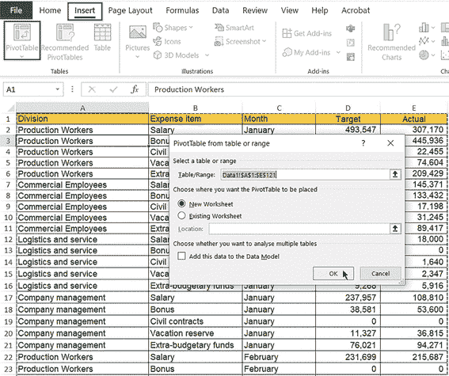

一个 Excel 工作表显示了部门、费用项目、月份、目标和实际值。其上方叠加了数据透视表范围菜单。“插入数据透视表”选项已启用。

# 1.2 数据透视表

在弹出的对话框中，确保包含了所需的所有数据范围。数据透视表必须放置在新工作表中（这是默认选项，因此你可以直接点击“确定”）。

在新工作表的右侧，你将看到一个面板（默认视图）：
- 筛选器
- 列
- 行
- 值

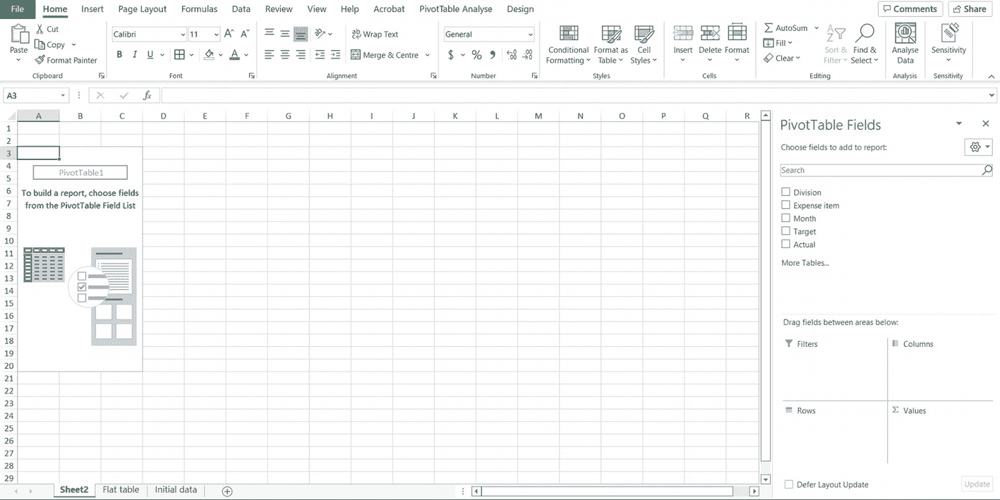

一个 Excel 工作表中新文件的截图。数据透视表字段位于右侧。

### 1.2.1 工作原理

数值数据落入“值”区域（勾选“目标”和“实际”复选框）。

数据类别落入行区域（勾选“月份”复选框）。

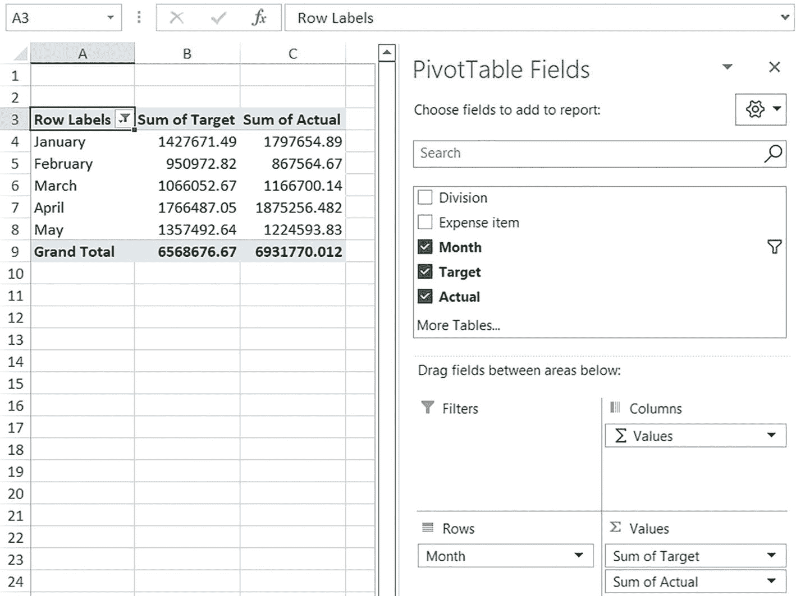

一个 Excel 工作表展示了三列：行标签、目标总和以及实际总和，并显示了已启用月份、目标和实际选项的数据透视表字段。

如果我们添加另一个包含部门的字段，它们的名称将落入行区域。通过拖放，可以将它们移动到列区域。

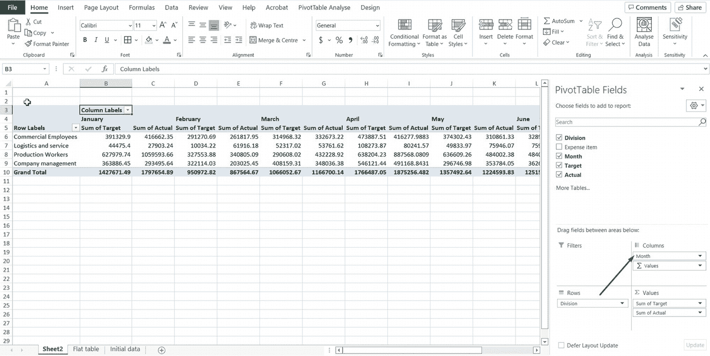

一个 Excel 工作表展示了 2 列：行标签和列标签，列标签下又细分了月份一月至六月的目标总和与实总和子列，并显示了已启用部门、月份、目标和实际选项的数据透视表字段。

但对于构建仪表板，我们不需要这样——我们首先为每个图表创建单独的简单表格。如果出现问题，“数据透视表分析”选项卡上有一个“清除”按钮——使用它并重试。

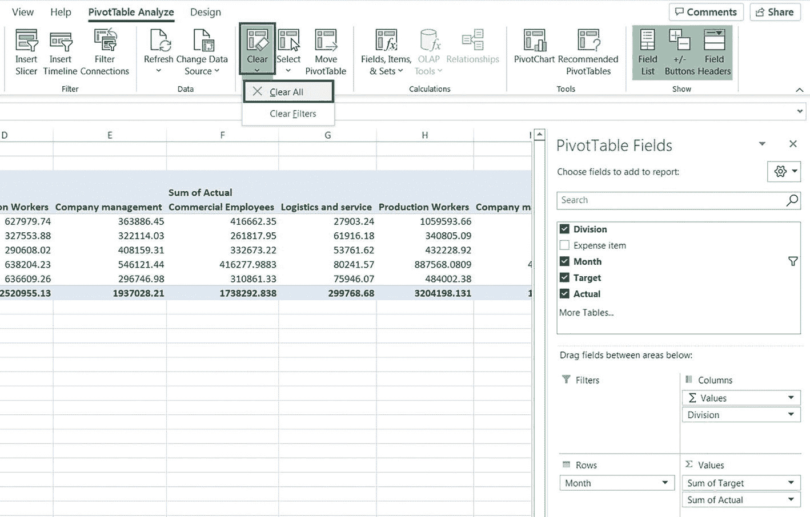

一个 Excel 工作表展示了行和列标签，并显示了已启用部门、月份、目标和实际选项的数据透视表字段。“全部清除”选项已被选中。

## 1.2.2 如何正确更新数据

商业仪表盘的重点在于，一次性地设置好美观的输出报告格式，之后只需上传新数据，图表就会自动更新。但在 Excel 中，这并非易事。

上一步，我们得到了一个数据透视表，其中显示了 1 月至 5 月各月员工成本的`实际`值。现在我们来做个测试：在原始平面表中增加一行，指定为 6 月的数据（你可以直接复制表格的最后一行，然后修改月份）。

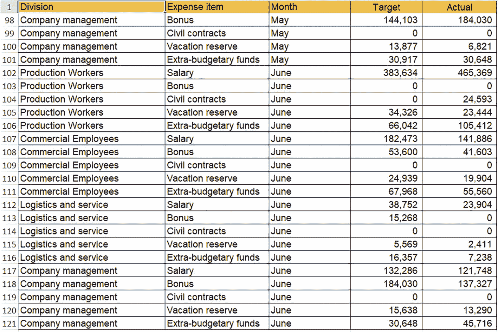

一张 Excel 表格显示了部门、费用项目、月份、目标和实际值。

然后返回数据透视表，此时我们并没有看到 6 月的数据。似乎合乎逻辑的做法是点击“数据”选项卡中的“全部刷新”按钮。但即便如此，也没有结果。

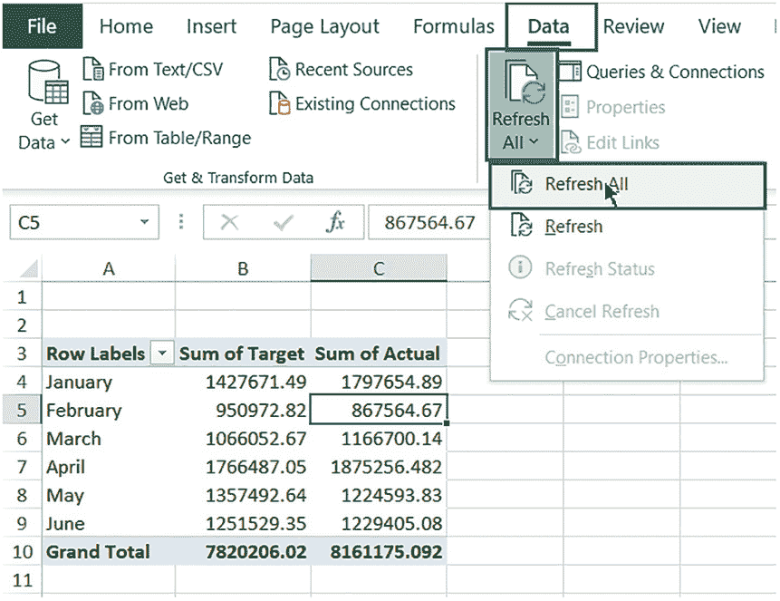

一张 Excel 表格显示了行标签和列标签。`数据`菜单下的`全部刷新`选项已启用。

许多人会跳过这一步，之后在向数据透视表添加新数据时就会遇到很多麻烦。我们来弄清楚如何设置这个过程。

### 解决方案 1：更改区域

创建数据透视表时，Excel 会用虚线高亮显示一个固定的单元格区域。如果你更改该区域内的值，报表中的数据将会更新。但我们包含 6 月的新行位于此区域之外。要添加它，请转到菜单选项卡“数据透视表分析”，然后点击“数据源”。

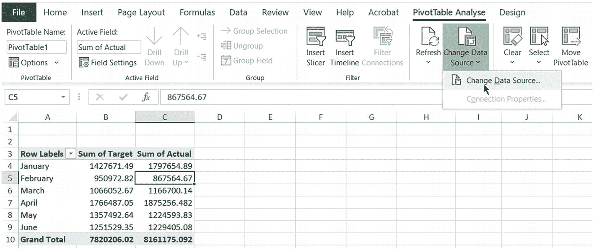

一张 Excel 表格显示了行标签（目标求和项与实际求和项），`数据透视表分析`菜单下的`更改数据源`已启用。

在打开的对话框中，你需要更改单元格区域：为此，请点击向上箭头按钮，然后用鼠标在平面表工作表上选择要分析的区域。之后，数据透视表中的数据将会发生变化。

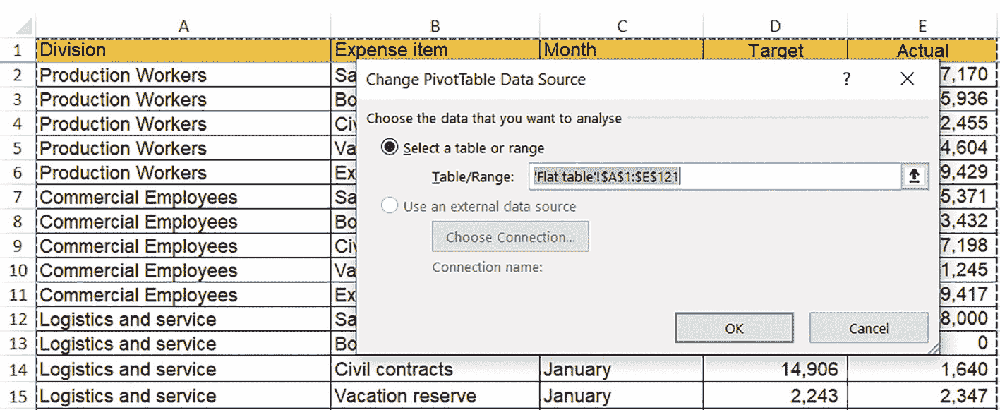

一张 Excel 表格显示了部门、费用项目、月份、目标和实际值。其上覆盖着“更改数据透视表数据源”对话框。

这个解决方案能正确工作，但也是最不方便的。每次添加新行时，你都需要手动更改区域。而且当平面表中数据很多时，很容易出错，可能会遗漏某些列或行。

### 解决方案 2：选择整列

我观察过不少 Excel 用户是如何“自动化”数据更新的。在构建数据透视表时，他们高亮选中的不是数据表本身，而是所有列，包括下方的空行。也就是说，他们选取了直到工作表末尾的最大行数区域。

使用这种方法，只需点击“全部更新”，新行就会添加到数据透视表中。但缺点是每个表中都会出现一个“(空)”行。

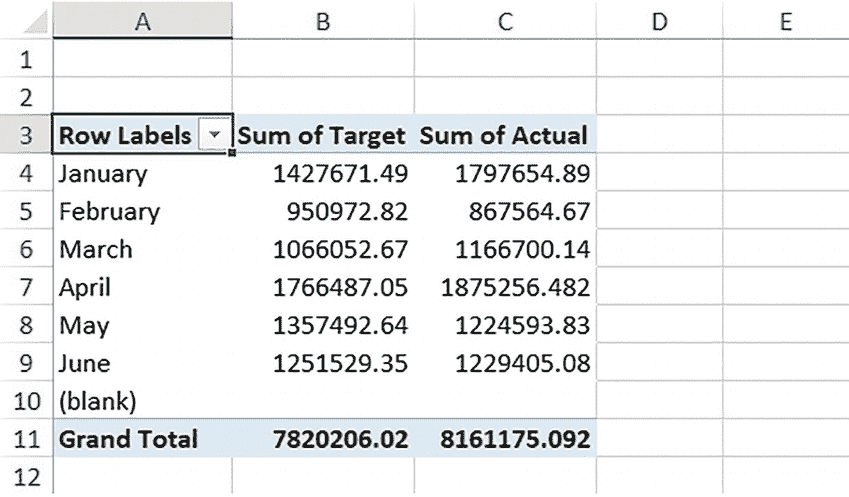

一张 Excel 表格显示了行标签、目标求和项和实际求和项及其对应的值。

当然，可以使用筛选器隐藏空值。这并不难，但在真实的企业报表中，这个“(空)”会不断出现在图表或筛选器中，让老板们很恼火。

总的来说，这种配置数据透视表更新的方式并非最优，它需要额外的操作来隐藏空值。

### 解决方案 3：格式化为表格

在插入数据透视表之前，让我们先把原始平面表转换为所谓的“智能表格”。

为此，选择单元格或表格区域，然后在“开始”选项卡上，点击“套用表格格式”，并从推荐的格式中选择任意一种。这里的格式不仅仅是设置单元格格式的模板，而是将这个区域作为 Excel 内部的一个独立对象进行存储。

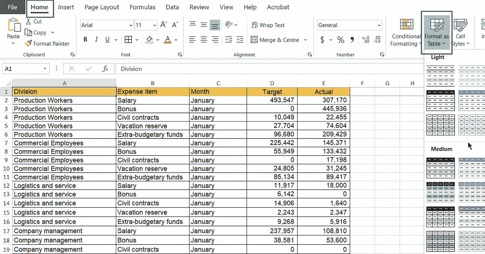

一张 Excel 表格显示了部门、费用项目、月份、目标和实际值，`套用表格格式`选项已启用。

然后，在出现的窗口中，务必确认已勾选“表包含标题”，然后点击“确定”。

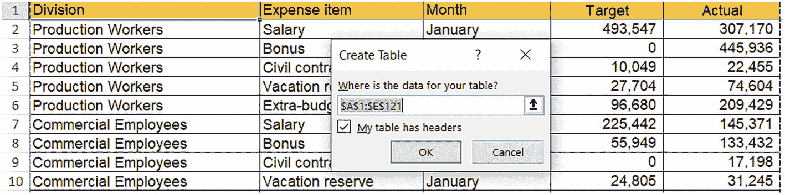

一张 Excel 表格显示了部门、费用项目、月份、目标和实际值，并覆盖着“创建表”页面，其中勾选了“表包含标题”。

智能表格的列标题始终带有筛选器。此外，还可以使用“表格设计”选项卡，在其中可以设置表格名称（默认名称是`表 1`），并直接基于它点击“数据透视表”按钮创建数据透视表。

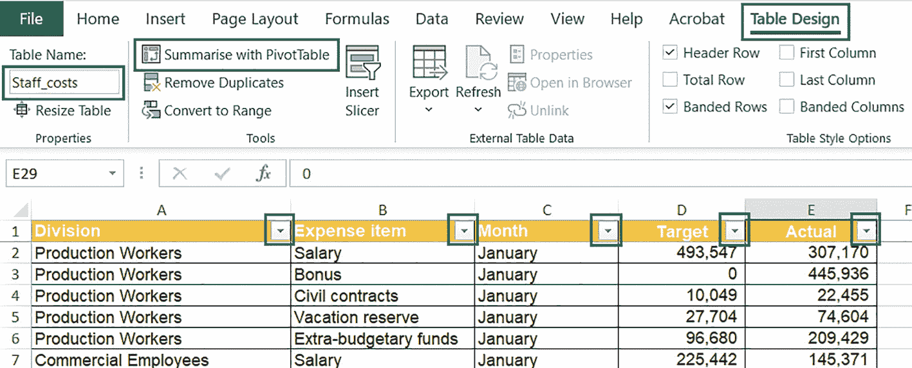

一张 Excel 表格显示了部门、费用项目、月份、目标和实际值。`员工成本`及数据透视表汇总已启用。

创建数据透视表时，指定的将不是单元格区域，而是智能表格的名称。

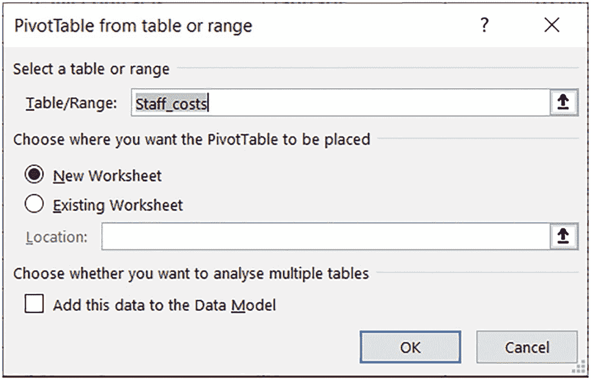

页面显示了“从表格或区域创建数据透视表”对话框，其中选择了`员工成本`和`新工作表`选项。

**提示！**

养成给表格命名的习惯：这样你就能始终清楚自己正在处理哪些数据。例如，我们的智能表格可以命名为`工资基金`。

将来，当向初始表格添加数据时，Excel 会自动扩展智能表格的区域，你无需执行任何额外操作，只需点击“数据”选项卡上的`刷新`按钮即可。而且不会出现空行。

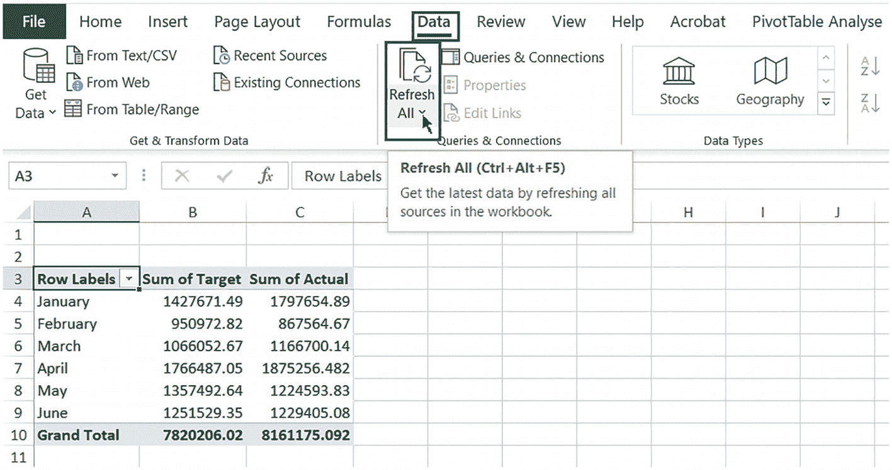

一张包含 3 列（行标签、目标求和项和实际求和项）的 Excel 表格。`数据`选项下的`全部刷新`选项已选中。

### 1.2.3 小结

在创建数据透视表的阶段，记住它们将来需要更新是很重要的——这是仪表盘数据保持相关性的唯一方式。但在 Excel 中，这并不会自动发生。

一个能省时省力的小窍门是——将准备好的平面表格式化为“智能表格”。

- 智能表格可以被命名。这很方便，因为在后续创建数据透视表时，总能清楚它们包含什么数据。
- 这种方法节省时间。更改平面表时，无需进行额外的操作：要更新数据透视表，只需点击`全部刷新`按钮即可。

# 1.3 准备用于可视化的数据样本

仪表盘上每个可视化元素的背后，都是一个独立的数据透视表报表。总的来说，“报表”这个词在我的理解中，是一种由多个表格和图表组成的复杂数据表现形式。因此，我将把每个独立的数据透视表称为数据样本。

对于“工资基金分析”仪表盘，我们需要三个样本：
1.  付款动态
2.  按部门划分的费用
3.  按项目划分的费用

让我们基于准备好的数据创建它们，并为每种情况选择合适的图表和图形。我们暂时不会讨论如何选择正确的可视化元素——这个主题我们将在后面详细探讨。

### 1.3.1 数据透视表报告的工作原理

所有进一步配置的可能性都位于右侧窗格`PivotTable Fields`中。顶部默认显示所有可用字段的列表，即来自平面表的列。下方是一个由四个区域组成的配置区：
- `Values`
- `Rows`
- `Columns`
- `Filters`

通过点击`齿轮`图标并选择选项`Fields Section and Areas Section Side-By-Side`，可以更改窗格的显示方式——这样长字段列表将可见。

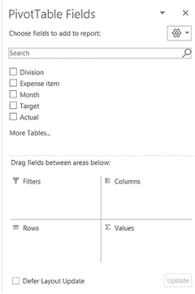 一页展示了包含部门、费用项目、月份、目标和实际值的数据透视表字段。

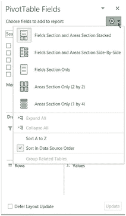 一页展示了数据透视表字段，其上覆盖了设置菜单下的字段区域和区域部分堆叠视图。

要将字段添加到样本中，请勾选字段列表中其名称旁的复选框，或将鼠标从那里拖到所需区域：`Filters`、`Columns`、`Rows`或`Values`。您也可以从样本中删除字段：取消勾选其名称旁的复选框，或将鼠标从特定区域拖回字段列表。

数据透视表会自动聚合列中的数据，即根据某个属性进行组合。如果所选字段中的所有数据均为数字格式，Excel 将默认使用求和。如果其中至少包含一个文本或空单元格，则将计算单元格数量而非总和。

样本单元格中可使用其他计算方法：平均值、最小值、分数等。更改计算方法有几种方式。

**解决方案 1.** 右键点击数据透视表中所需字段的任意单元格，选择其他聚合方法。

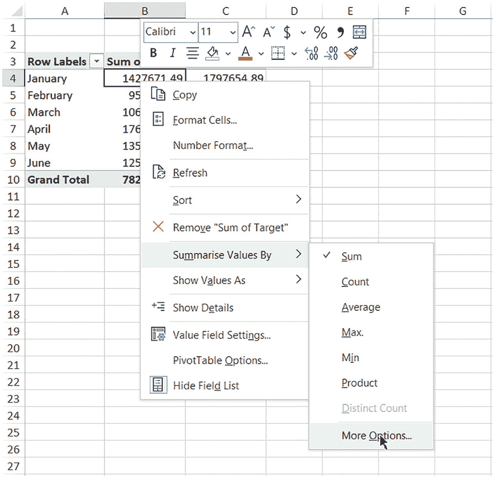 一个 Excel 表格显示了三个列：行标签、目标总和和实际总和。第二列第一个单元格上覆盖了右键点击选项。

**解决方案 2.** 通过菜单选择所需的聚合类型：`PivotTable Analyse` ➤ `Active field` ➤ `Field Settings` ➤ 在打开的窗口中选择`Summarise Values By`选项卡。

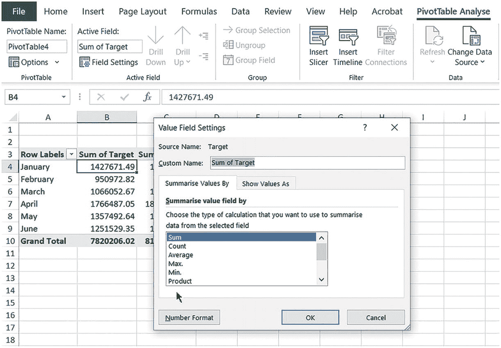 一个 Excel 表格显示了三个列：行标签、目标总和和实际总和。其上覆盖了已启用目标总和选项的“值字段设置”对话框。

当样本创建并配置完成后，我们基于它制作可视化元素的空白模板。

## 准备第一个样本

从可视化支付动态的样本开始。在数据透视表所在工作表的`PivotTable Fields`窗格中，勾选所需字段：`Month`、`Actual`和`Target`。就是这样——第一个样本就准备好了。

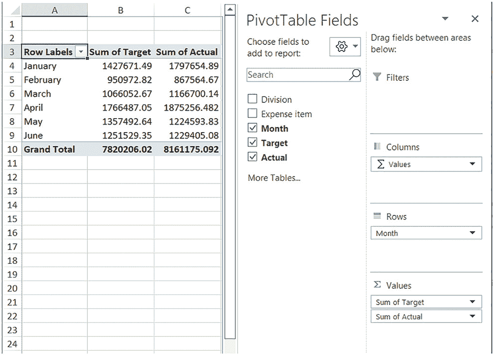 一个 Excel 表格显示了三个列：行标签、目标总和和实际总和。其上覆盖了已启用月份、目标和实际选项的数据透视表字段。

在已创建样本的任意单元格中，转到`Insert`选项卡，点击`Insert line or area chart`按钮，选择`带数据标记的折线图`表现形式。

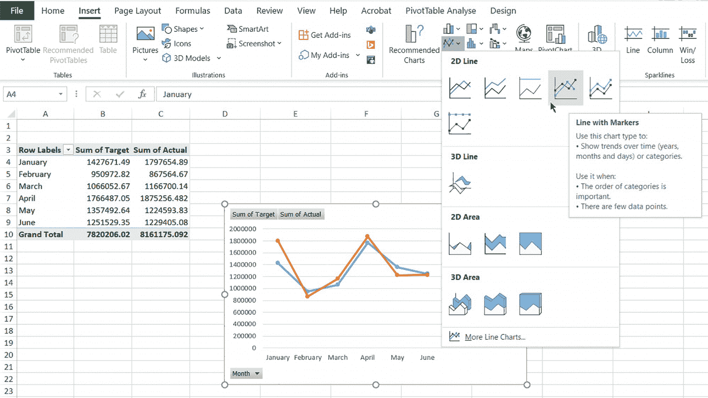 一个 Excel 表格显示了三个列：行标签、目标总和和实际总和。其上覆盖了目标与实际总和的波形图。

**提示！**

*如果在创建样本过程中出现问题，您始终可以通过点击`PivotTable Analyse`选项卡上的`Clear Pivot Table`按钮恢复到原始状态。*

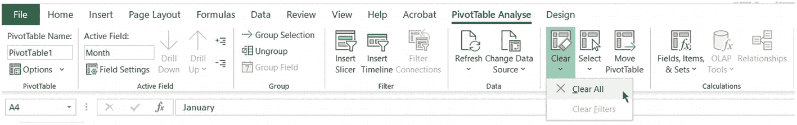 一个 Excel 菜单栏截图。已选中“数据透视表分析”。启用了“全部清除”选项。

为了避免混淆，请为样本命名。

**方法 1.** 转到`PivotTable Analyse`菜单，点击左侧的`Options`按钮，在打开的窗口中输入表格名称：`Payments dynamics`。

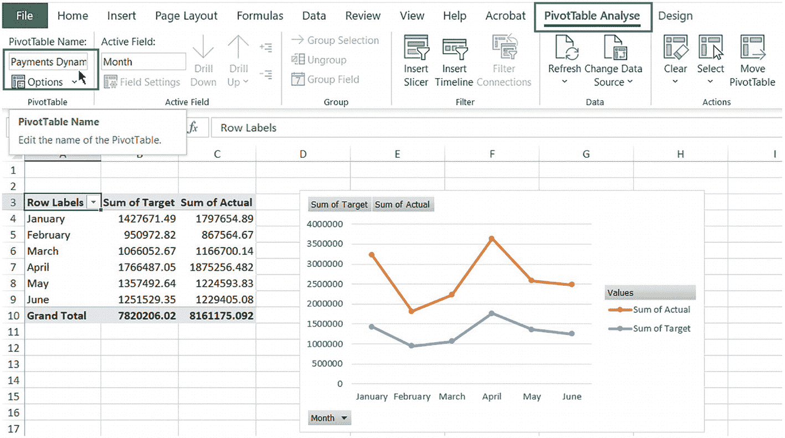 一个 Excel 表格显示了三个列：行标签、目标总和和实际总和。其上覆盖了实际与目标总和的图表。已启用数据透视表分析选项。

**方法 2.** 右键点击表头行的第一个单元格，从上下文菜单中选择`PivotTable Options...`。在打开的对话框中的`PivotTable Name`字段中，输入能体现该样本数据本质的名称。在后续工作中，您将始终知道您正在处理哪个样本。此对话框也可以通过菜单选项卡`PivotTable Analyse` ➤ `Options`调用。

## 1.3.2 从数据透视表复制数据

每个图表都需要单独的数据透视表报告。但要做到这一点，您无需返回平面表所在的工作表并创建新的数据透视表。只需复制现有样本并将其粘贴到同一工作表下方的空行中即可。我称之为复制。

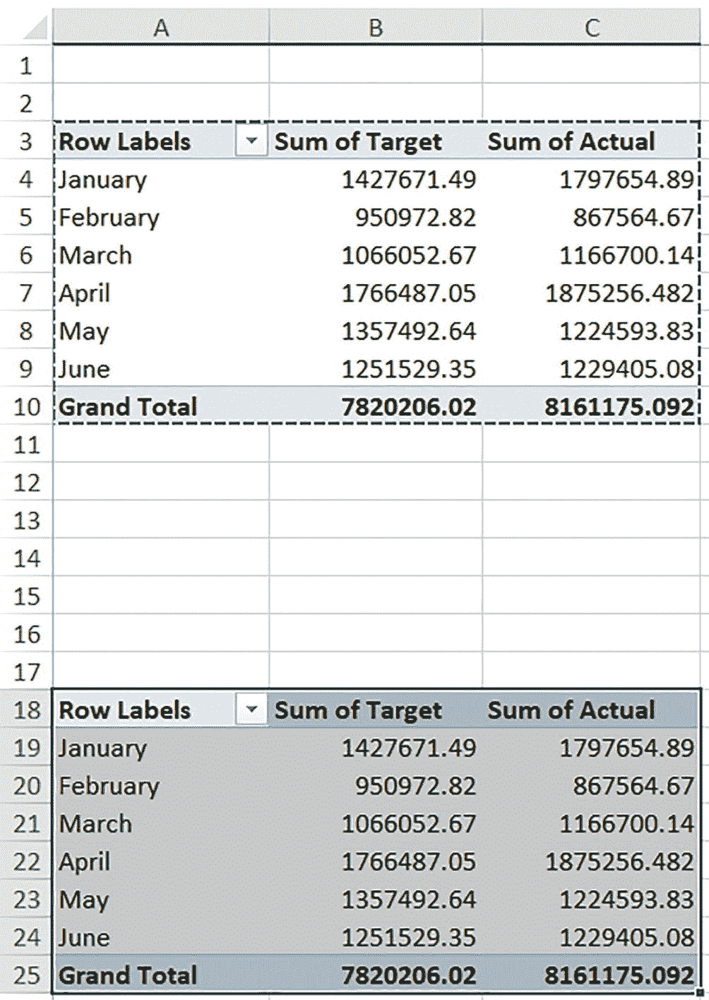 一个 Excel 表格显示了三个列：行标签、目标总和和实际总和及其值和总计。

**提示！**

*请确保您已选中并复制了所有单元格：否则您将得不到数据透视表，而只是一个不适合后续工作的单元格区域。当用户忘记选中总计或未放入屏幕可视区域的列时，这种情况经常发生。*

要将复制的样本转换为新样本，请执行以下操作：
- 将光标放在复制样本的任意单元格上。
- 在`PivotTable Fields`窗格中，取消勾选`Month`字段。
- 在同一位置，勾选`Division`字段。

结果，我们得到了可视化元素`按部门支出`的空白模板。将空白模板添加到工作表：在`Insert`选项卡上，点击`Insert column or bar chart`并选择`簇状柱形图`表现形式。

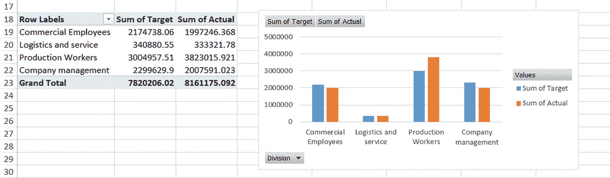 一个 Excel 表格显示了三个列：行标签、目标总和和实际总和。绘制了目标与实际总和的柱状图。

同样地，我们重复复制样本的过程以可视化`按项目支出`：
- 将第二个已完成的样本副本转移到新行，然后将光标放在其任意单元格上。
- 在`PivotTable Fields`窗格中取消勾选`Division`字段。
- 勾选`Expense item`字段。

样本已准备好，只需进行编辑。在`Insert`选项卡上，点击`Insert column or bar chart`并选择`簇状条形图`表现形式。

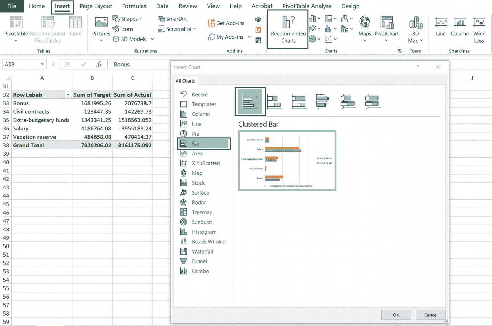 一个 Excel 表格显示了三个列：行标签、目标总和和实际总和。其上覆盖了插入图表选项并启用了簇状条形图选项。

### 错误：“数据透视表报告不能重叠另一个数据透视表报告。”该怎么办？

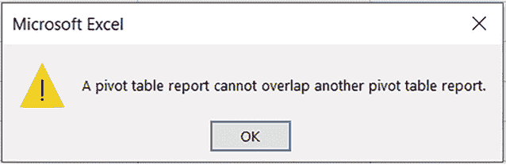 一页显示了带有警告消息的 Microsoft Excel：数据透视表报告不能重叠另一个数据透视表报告。

如果更新数据时出现了新类别，而它们缺少行（因为下一个选择被放置在那里），则会出现该错误。

**解决方案：** 在有错误的样本之后添加所需数量的空行（最好留有余量），然后再次更新数据。

**提示！** 将样本上下放置时，在它们之间留出空行，以便在添加数据时有足够的空间自动向下扩展。或者将它们水平放置，间隔 1-2 列。

## 1.3.3 总结

交互式仪表盘上的所有可视化元素都基于数据透视表中的数据样本。每个元素就是一个样本。复制有助于节省创建新样本的时间：如果新样本与已创建的样本仅在类别上有所不同，则无需从头创建。

1.  选中表格（确保选中所有单元格，否则选择将不起作用）。
2.  要进行复制，请将新样本复制并粘贴到包含数据透视表的工作表上。
3.  在`数据透视表字段`窗格中，选择新样本所需的字段。为新样本命名。
4.  选中样本中的任意一个单元格，选择并添加一个图表占位符：你将在之后设计它。
5.  对其他样本和可视化元素的占位符重复相同操作。

在样本之间留出距离，以避免在数据更新后它们相互重叠。提前确定如何最好地放置样本：向下排列还是向右排列。

## 1.4 设置交互功能

仪表盘与幻灯片的关键区别在于其数据筛选能力。得益于此，我们可以在一个屏幕上从公司总览深入到每个部门，并逐月钻取成本项目。这需要数十张幻灯片才能实现。

仪表盘的交互性可以通过筛选器或切片器来调整。筛选器为许多人所熟悉，但它们存在一些缺点，使得与仪表盘的交互不够便捷。让我们来研究一下这两种工具，以适应任何客户的需求。

### 1.4.1 经典筛选器

`筛选器`块位于数据透视表的字段区域。我们可以将一个数据类别（例如部门）拖入其中，表格上方就会出现一个包含筛选器的行。

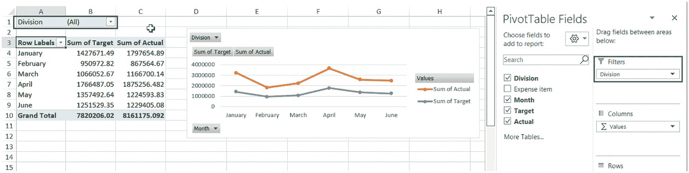

一张 Excel 工作表，显示了三个列：行标签、目标总和以及实际总和。它被数据透视表字段覆盖，其中启用了月份、目标和实际值选项，以及一个柱状图。

我不喜欢标准筛选器，原因如下：
- 无法立即看出列表中有多少项：可能是四项，也可能是四十项。你需要展开列表才能选择一项。
- 要选择多个元素，需要单独勾选复选框。
- 每个样本都需要添加自己的筛选器，即使已经为另一个样本配置过。
- 它们会占用工作表上额外的空间。

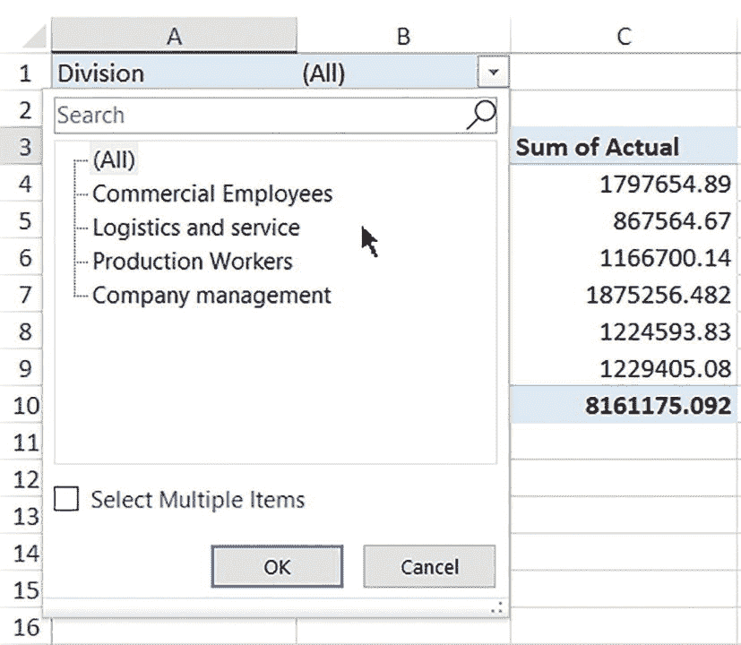

一页图片显示了下拉菜单中的部门分类：商业员工、物流与服务、生产工人。同时，“确定”按钮处于启用状态。

许多人仍然会添加大量筛选器并勾选长长的列表。尽管早在 2010 年，就出现了一个现代替代方案 —— 切片器。主要归功于它们，仪表盘才拥有了直观的界面。

### 1.4.2 神奇的切片器

如何创建切片器：
- 将光标放在数据透视表内的一个单元格上。
- 在`插入`选项卡中，单击`切片器`。
- 勾选所需数据类别旁的复选框。
- 我们就得到了一个交互式切片器。

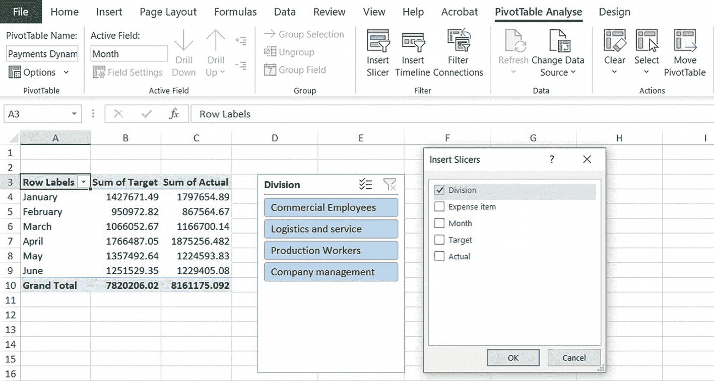

一张 Excel 工作表，包含三列：行标签、目标总和和实际总和。部门被分类为：商业员工、物流与服务、生产工人、公司管理层。

如果出现这样的窗口而不是字段列表，则说明你跳过了步骤 1 —— 需要将光标放在数据透视表内，使单元格被高亮显示。否则，Excel 会提示：`未找到连接。`

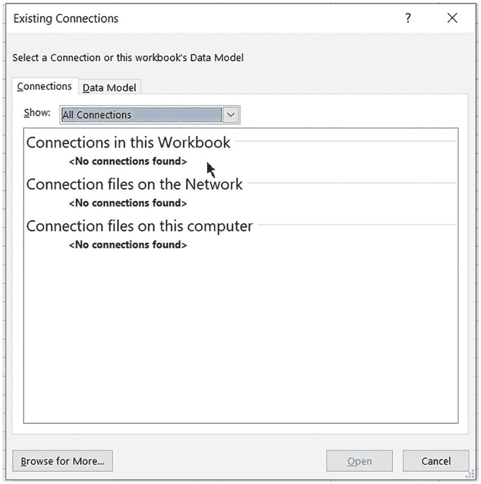

一页图片显示了现有连接，其中“连接”选项已开启，状态为“所有连接”。

单击切片器按钮 —— 表格和图表将根据所选部门动态筛选。

如果你想选择多个部门，请按住`Ctrl`（或`cmd`键）进行选择。如果你觉得这样不方便，可以切换到多选模式，然后依次选择。

要重置筛选器，请单击右上角的常用按钮。

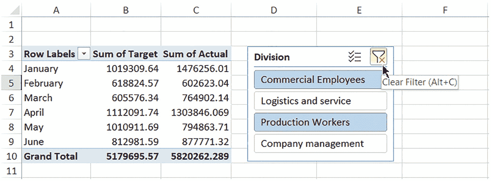

一张 Excel 工作表，显示了三个列：行标签、目标总和以及实际总和。它被部门筛选器覆盖，其中选中了商业员工和生产工人。

### 1.4.3 将切片器连接到报表

默认情况下，创建的切片器仅筛选它所基于的样本。要影响其他样本，我们需要设置交互。

**解决方案 1：使用菜单栏上的按钮**

在`切片器`选项卡上，选择`报表连接`按钮。如果你看不到该选项卡，说明你的光标在某个单元格上，请将其放置在切片器上。

Excel 工作表中的一个菜单栏。它显示了切片器菜单，其中“报表连接”选项卡已启用。

**解决方案 2：使用右键菜单**

右键单击切片器，然后从上下文菜单中选择`报表连接...`。

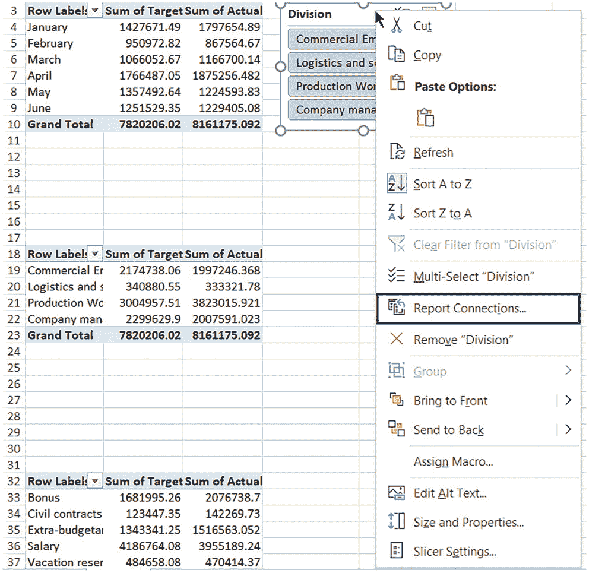

一张 Excel 工作表，显示了三个列：行标签、目标总和和实际总和。它被右键菜单覆盖，菜单中包含“部门”和“报表连接”选项。

我没有偏好，根据情况两种方法都会使用。最终，会打开`报表连接（部门）`窗口，我们在其中勾选所有其他表格。

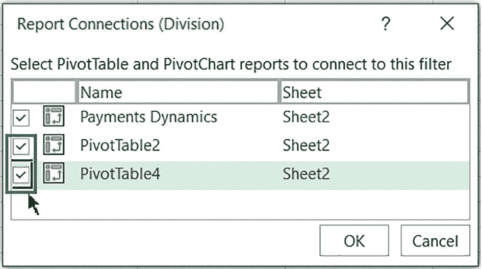

一页图片显示了报表连接，包含“付款动态”、“数据透视表 2”和“数据透视表 4（工作表 2）”的复选框。最后两项已启用。

现在，`部门`切片器与工作表上的所有样本和占位符进行交互。

如果在`插入切片器`窗口中，在列名旁边勾选多个复选框，就可以一次添加多个切片器。

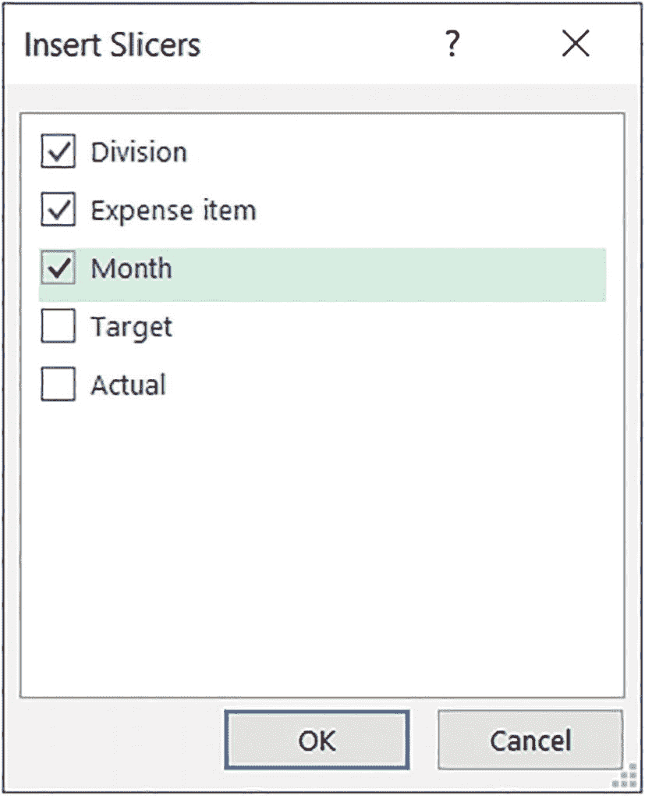

一个菜单栏“插入切片器”，包含复选框：部门、费用项目、月份、目标和实际，前三个选项已启用。“确定”按钮被高亮显示。

对于每个切片器，都需要配置其与现有样本的交互。根据仪表盘的场景，切片器可能不会影响所有可视化元素，而只影响其中一部分。

**提示！**

不要为包含实际值数据的字段创建切片器 —— 请将它们用于包含类别的字段。

现在，`部门`切片器与工作表上的所有数据透视表进行交互。

`报表连接`按钮不仅可以通过`切片器`选项卡找到，还可以在右键单击切片器时出现的上下文菜单中找到。

如果在`插入切片器`窗口中，在列名旁边勾选多个复选框，就可以一次添加多个切片器。

### 1.4.4 五步搞定数据样本与切片器

对样本进行操作可以通过优化来简化可视化元素的创建。为此，我们首先对基础样本进行完整配置，然后复制它，即可获得一个几乎已经完成的新的样本。

**步骤 1.** 在新工作表中创建第一个包含数据透视表字段“月份”、“目标”和“实际”的样本。

**步骤 2.** 在`数据透视表分析`选项卡 ➤ `选项`中，或通过右键快捷菜单打开数据透视表参数。

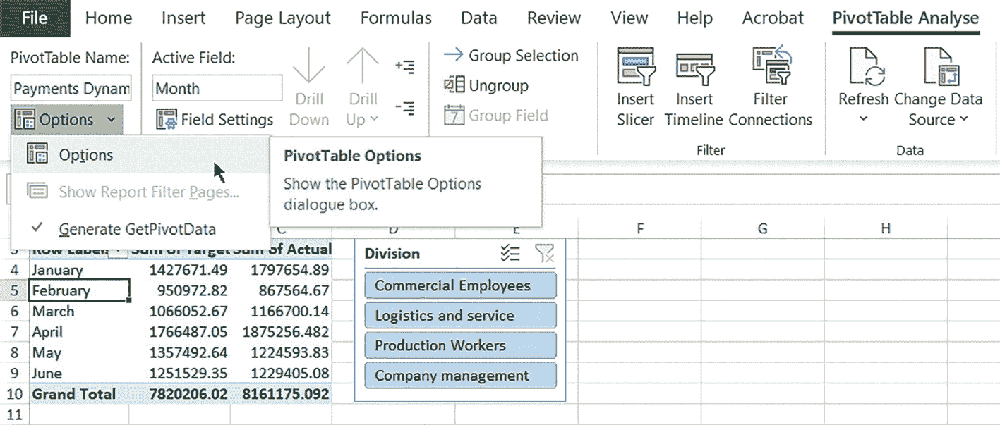

一个 Excel 工作表，显示三列，分别为行标签、目标总和与实际总和。该表被“分段”和“数据透视表选项”覆盖。

**步骤 3.** 在打开的设置窗口中，取消勾选“更新时自动调整列宽”选项。如果不这样做，每次使用切片器后都需要重新调整列宽。

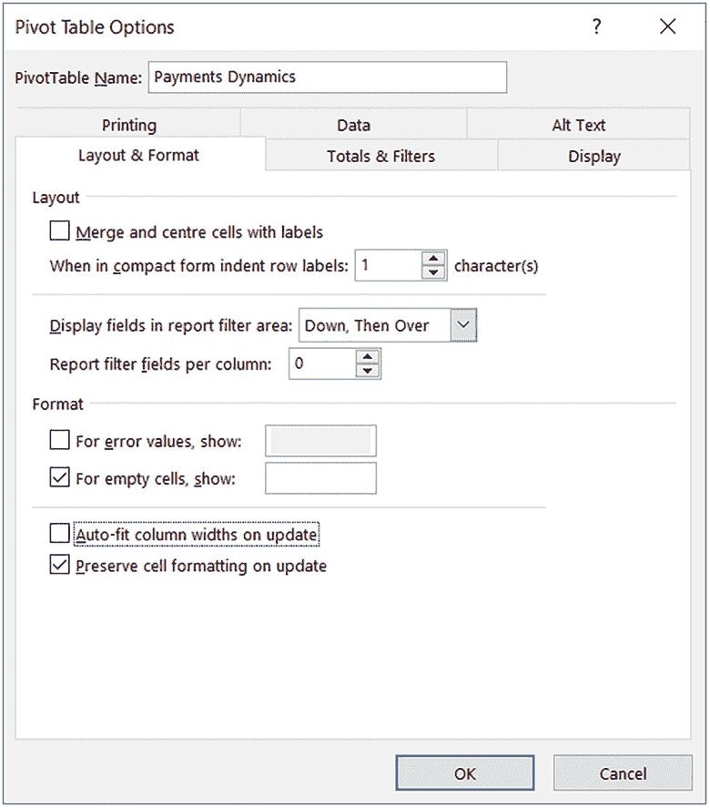

数据透视表选项菜单页面。数据透视表名称为“付款动态”。针对显示的空单元格，已启用“更新时保留单元格格式”。

**步骤 4.** 从基础样本中添加所需的切片器。在`插入`选项卡上，单击`切片器`，并在弹出的窗口中勾选所需字段。

要在切片器上选择多个类别，请单击其标题附近的“多选”按钮，并取消选中不需要的位置。另一种方法是按住键盘上的`Ctrl`（或`cmd`）键，然后用鼠标选择所需位置。

**步骤 5.** 剩下的工作是复制已自定义的基础样本，并添加所有必要的可视化元素占位符。

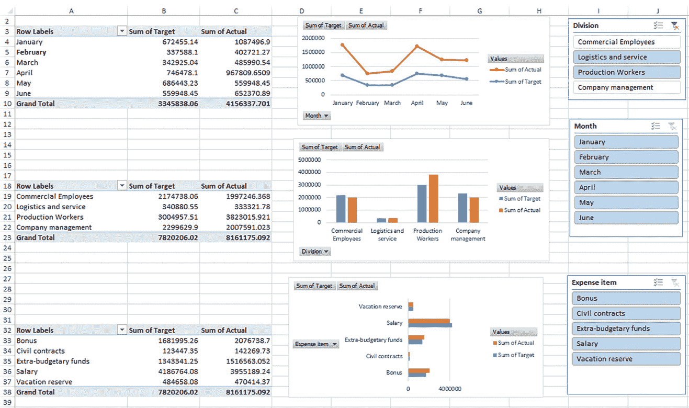

Excel 工作表截图，包含一个折线图（显示 1 月至 6 月每月实际值均高于目标值，4 月达到峰值）、一个垂直条形图（在 4 种类型中，“生产工人”的实际值和目标值最高）和一个水平条形图（在 5 种类型中，“薪资”最高）。表格包含相同的数据。

`数据透视表字段`窗格可以随时隐藏，需要时再次调出：右键单击数据透视表的任意单元格，然后使用`显示字段列表`按钮。

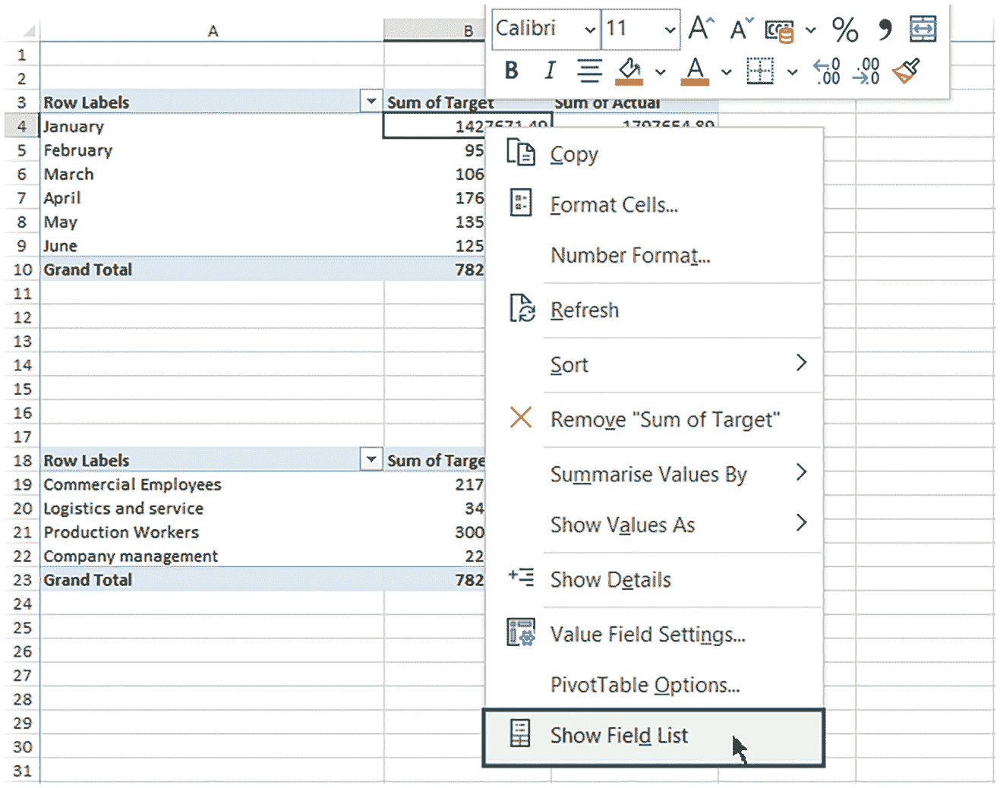

Excel 工作表，带有位于 2 个表格之上的右键菜单。已选择“显示字段列表”选项。所选字体样式和大小为 Calibri 11。

### 1.4.5 总结

切片器是仪表盘交互的核心。它们像按钮一样工作，点击每个按钮都会更新屏幕上的所有数据。方便、易懂、易于分析。

1.  在工作表上添加并配置包含数据透视表的基础样本：在右侧窗格中选择所需字段。

2.  关闭“更新时自动调整列宽”选项，否则每次使用切片器后都需要设置列宽。

3.  从样本中添加切片器（`插入` ➤ `切片器`），并在打开的设置面板中勾选必要字段。

4.  要“停用”切片器上的某些类别，请选中该切片器，按住`Ctrl`（或`cmd`）键，然后单击不需要的位置。

5.  复制自定义样本，并添加可视化元素的占位符。

在复制之前设置好基础数据样本，将大大减少创建切片器和可视化元素占位符的时间。

### 1.4.6 Excel 快捷技巧

*`Ctrl` 适用于 Windows。MacBook 应使用 `cmd`。*

| **“智能”表格** 如果将常规列表转换为表格 (`CTRL+T`)，会发生什么： • 表格标题将自动冻结。 • 自动筛选功能会开启。 • 表格的尺寸将自动适应数据。 • 所有公式将自动向下填充至整列。 |
| :--- |
|  一个带有画刷的表格网格图标的表示。下方文本是“套用表格格式”下拉选项。 |
| **快速向下复制** 如果需要将公式复制到列底，最好不要手动拖拽黑色十字：只需用鼠标左键双击它即可。 |
| 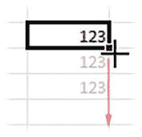 一个快速向下复制设置图标的表示。列中的第一个单元格已被选中。右下角有一个黑色十字，下方有一个向下箭头。 |
| **填充空单元格** 要用前一个单元格的值填充空单元格 • 选中整个区域。 • 按 `F5` ➤ 定位条件... ➤ 空值。 • 单击“=”号，然后单击上箭头键，创建对前一个单元格的引用。 • 按 `CTRL+Enter` 键，将生成的公式输入到所有单元格中。 |
|  一个列的表示。前 3 个单元格填充了 A，接下来的 2 个单元格填充了 B，再接下来的 3 个单元格填充了 C。 |
| **向图表添加系列** 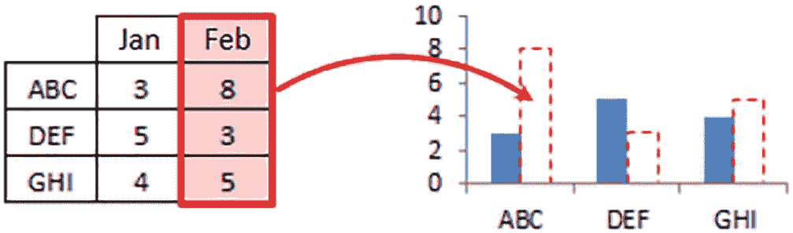 一个表格，包含“一月”和“二月”两列以及 3 行（A B C、D E F、G H I），以及一个垂直双柱形图。表格中选中的“二月”列在柱形图中以虚线柱体表示。只需复制单元格区域，然后使用鼠标右键或键盘快捷键 `CTRL+C` 和 `CTRL+V` 将其粘贴到图表中。 |