# 2. 仪表盘组装

之前步骤获得的结果仅仅是准备阶段。仪表盘的工作始于创建其布局，布局需考虑信息呈现的要求，以及可视化元素和交互式切片器的位置。

我们已经完成了数据准备，接下来我们将处理所谓的仪表盘草稿。我们将准备一个布局，在上面放置包含可视化元素的信息块，并组装一个交互式版本。

## 2.1 根据布局组装仪表板

你可以从创建草图开始，即未来仪表板的轮廓。任何图形编辑器、`Microsoft PowerPoint` 程序，甚至一张纸都足以完成此操作——草图可以手绘示意。根据这份文档，我们将创建一个布局。

我们的仪表板结构可以表示如下：

1. 仪表板标题
2. 关键绩效指标（KPI）卡片
3. 工作区域
4. 左侧的切片器面板

需要将草图转换为实际的布局，这将是我们工作的起点。这里需要更精确——布局应包含所有可视化图表、切片器和辅助元素。

在中间部分（KPI 卡片下方），我们将两个区块合并为一个，以便能够追踪更长时期内的费用动态。

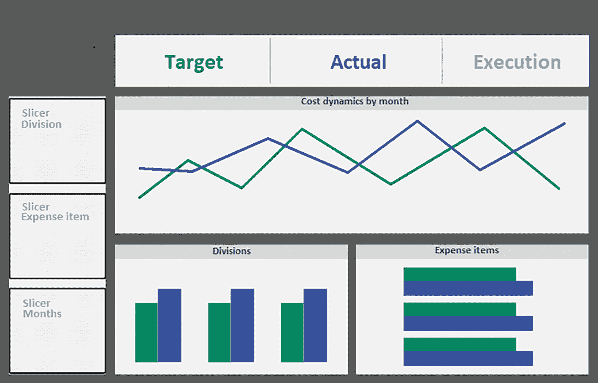

仪表板显示三个组成部分：目标、实际和执行情况。此外，它还包含三个侧边区块：切片器部门、切片器费用项目和切片器月份，以及三个中间区块：月度成本动态、部门和费用项目。

现在我们有了布局和可视化元素的半成品。我们将它们组装起来，使其结构符合所创建的布局。

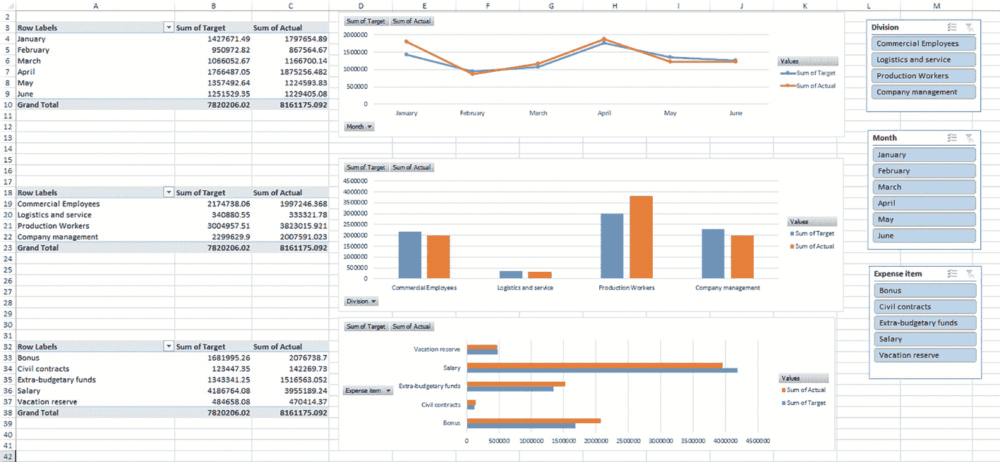

仪表板由三个图表组成，分别对应月份、部门和费用项目。它包含三个侧边区块（即部门、月份和费用项目）位于一侧，以及另一侧的一些计算区域。

我们在 Excel 文件的一个单独工作表中进行此操作——我们将其命名为“`Dashboard`”。

当前存放数据透视表半成品的工作表将被重命名为“`Draft`”。我们将在此处存储和准备最终仪表板所需的所有数据。

首先，我们将所有切片器转移到“`Dashboard`”工作表。为此，在“`Draft`”工作表上选择第一个切片器，然后按住键盘上的 `Ctrl`（或 `cmd`）键，用鼠标选择其余切片器。我们剪切掉整个切片器组。

**提示！**

不要在“`Draft`”工作表中留下可视化元素的副本，以免日后混淆。将工作所需的所有内容转移到“`Dashboard`”工作表，将“`Draft`”工作表留给数据准备和计算。

转到“`Dashboard`”工作表并粘贴剪切的内容。我们将切片器放在左侧，按照布局排列，在顶部留出五行空间用于放置仪表板标题和 KPI 卡片。

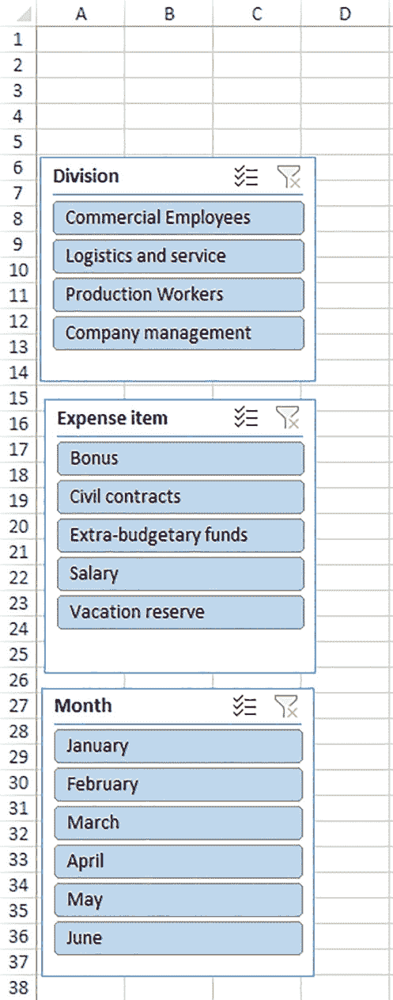

一个 Excel 工作表的片段，包含三个垂直元素：部门、费用项目和月份。

然后，我们将准备好的图表从“`Draft`”工作表转移到“`Dashboard`”工作表：方法与处理切片器时相同。我们按照布局将图表放置在工作表上：

- 屏幕顶部是整个宽度的动态图。
- 左下角是部门的簇状柱形图。
- 右下角是费用项目的簇状条形图。

我们现在已经有了类似仪表板的东西。在这种情况下，“`Draft`”工作表上仅保留了来自数据透视表的样本。

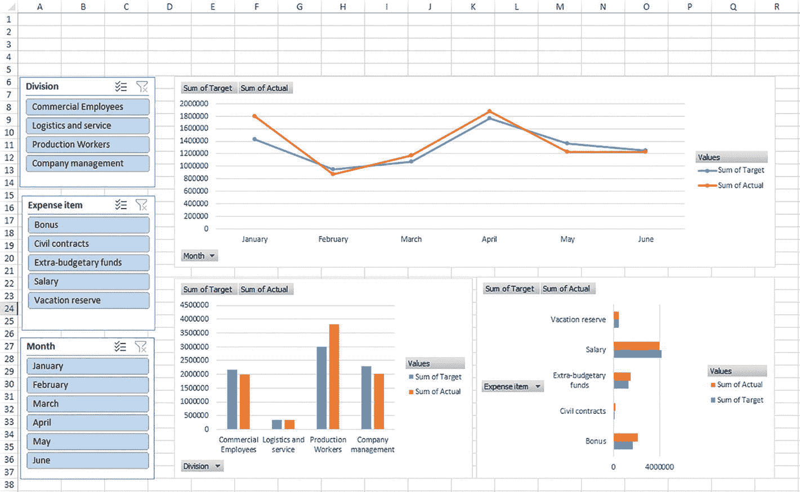

一个片段展示了一个折线图和两个条形图，即月份、部门和费用项目，以及三个侧边区块，即部门、费用项目和月份。

### 2.1.1 总结

通过创建草图和布局开始制作仪表板。为此，可以使用任何可视化编辑器，也可以手绘草图。

1. 确定仪表板上需要哪些可视化图表。
2. 按照“从总体到具体”的原则将它们排列在布局上。
3. 确保最重要的数据不会在其他数据的背景中“丢失”。

对于大多数初学者来说，根据布局进行组装更快、更容易。首先，因为我们提前准备了可视化元素的半成品。其次，因为我们可以立即看到工作的可视化成果。

可视化图表还不是最终版本。但与切片器的交互已经可以筛选图表，我们可以看到交互式仪表板将如何工作。

## 2.2 创建 KPI 卡片

在仪表板顶部，我们为汇总数据留出了空间。这里无需构建图表，只需足够大地显示数值及其标题即可。我将此类对象称为 KPI 卡片。我们需要创建三张这样的卡片：

- 目标
- 实际
- 执行情况

为此，您还需要来自数据透视表的数据样本。可以按照与我们为可视化元素制作半成品相同的方式来复制它们。此处不使用已创建的样本，因为 KPI 卡片可能需要进行额外的计算或转换。

### 2.2.1 为卡片抽样数据

为了复制，在“`Draft`”工作表上复制任意一个样本，将其粘贴到稍下方，然后在“`PivotTable Fields`”窗格中，取消选中带有“费用项目”分类的字段名称旁边的复选框。您也可以从“行”区域中移除此字段。

这样，我们就获得了一个基于数据透视表的样本，其中包含目标和实际的关键指标数据。

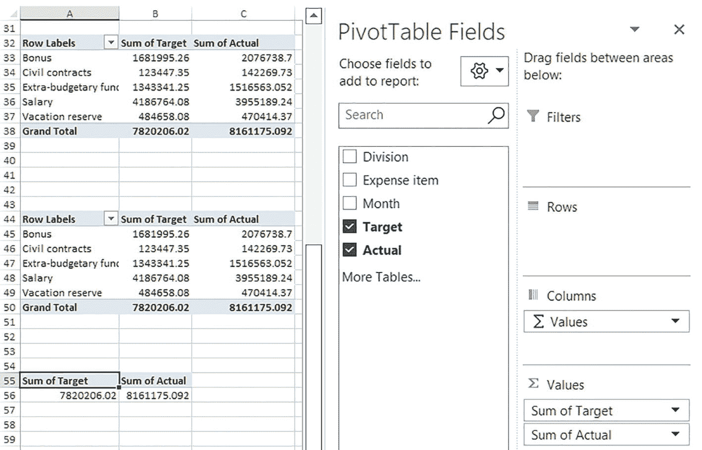

一个 Excel 工作表的片段，显示了数据透视表字段窗格以及三个未选中的复选框（即部门、费用项目和月份），以及两个选中的复选框（即目标和实际）。

### “目标”卡片

在仪表板工作表中，我们开始创建第一个 KPI 卡片。将光标放在单元格中，我们添加一个指向“草稿”工作表上通用目标指标的链接。为此，请输入 `= Draft!A56`，其中 `A56` 是包含示例的工作表上的单元格地址。这样，我们就能在仪表板工作表上获得所需的值。

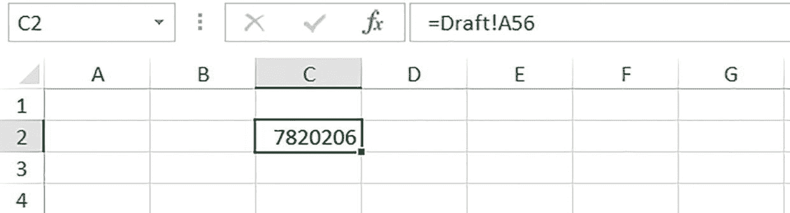

一个 Excel 表格片段，包含四列（1、2、3）和七行（A、B、C、D、E、F、G）。在第 C 行中显示了一些数值。

**如果链接显示错误，请禁用 `GETPIVOTDATA` 函数**

最初，单元格链接可能如下所示：

`=GETPIVOTDATA("Sum of Target";Draft!$A$56)`。在这种情况下，您需要禁用 `GETPIVOTDATA` 函数。

这个函数很有用：它可以从数据透视表中提取必要的数据，以便在其他表格或计算中使用。但在创建仪表板时，它会成为一个麻烦。

在示例中的任意单元格中，转到“数据透视表分析”选项卡 ➤ “数据透视表” ➤ “选项” ➤ 取消勾选“生成 GetPivotData”。

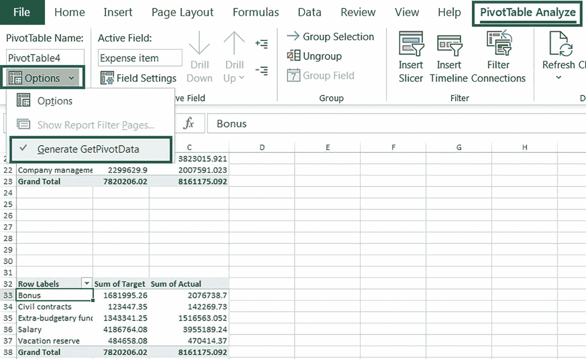

一个片段展示了已点击的文件工具图标。它打开了选项工具并勾选了“生成并获取数据透视数据”。

这样，您将获得数据透视表单元格的链接，而无需使用 `GETPIVOTDATA`，而是以通常的方式，采用指向单元格 `A1`、`B2` 或 `C4` 的链接形式。

请注意，如果在禁用该函数之前已经创建了指向数据透视表的链接，那么在禁用之后，这些链接将保持其原始形式。

**提示！**

如果卡片中的数字包含大量字符，请更改其位数。例如，将其转换为千或百万。这样，指标将变得更紧凑且易于理解。

我们为指标命名并设置其位数为“目标, $K”。单元格中的初始数据除以 1000。剩下的只是设置数字格式。我们在“开始”选项卡的“数字”部分中执行此操作：

- 点击“千位分隔样式”图标（看起来像逗号）将使用千位分隔符格式化数字。
- 点击“减少小数位数”旁边的图标（带右箭头的 000）将显示更少的小数位数。

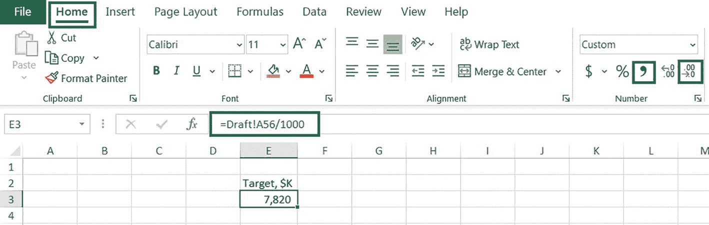

一张以千美元为单位的“目标支出”截图，显示了图表的一个单一数值 7820。

**不要仅仅为了一个单一数值而构建图表！**

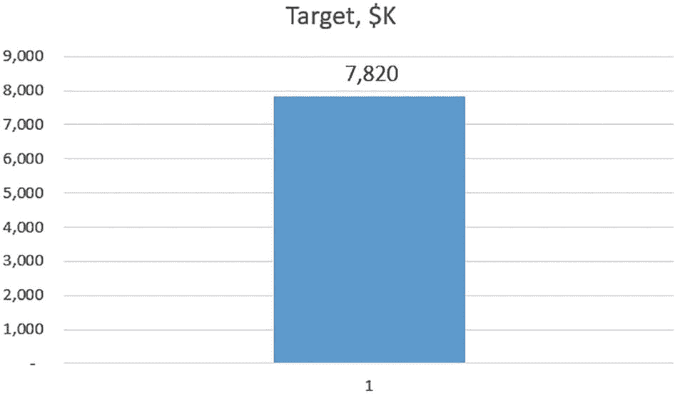

一张以千美元为单位的“目标支出”片段，显示了图表的一个单一数值 7820。

这种可视化方式并没有增加信息量，反而分散了对数字的注意力，并以刻度、线条和柱状图的形式形成了信息噪音。没有东西可以与该单个柱状图进行比较，因此它毫无意义——请将 KPI 呈现在卡片中。

为了聚焦于指标值，我们将字体增大到 20 磅。

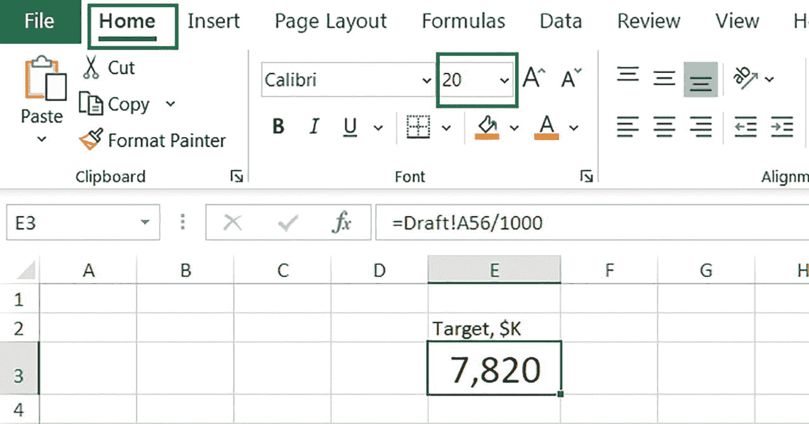

一个片段展示了“开始”工具图标及其选项，即剪切、复制和格式刷，并选择了 20 作为字号。

填充色有助于将注意力集中到卡片上：将其添加到包含数字和指标名称的单元格中。不要选择深色或明亮的颜色，否则数值可能会在背景色中难以辨认。

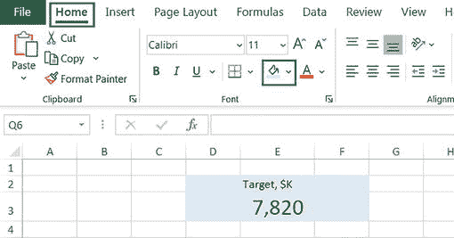

一个片段展示了电子表格的工具栏和“开始”工具图标及其选项，以及写在列中的数字值。

要选择卡片大小，请拉伸包含数值的列。在这种情况下，数字的对齐方式可能会被打乱。要修复此问题，我们将在“开始”选项卡上设置单元格格式：在“数字”部分，点击带箭头的矩形打开对话框窗口。在打开的“单元格格式”窗口中，您必须：

- 在“数字”部分选择“数字”类别。
- 确保小数位数为零。
- 确保在“使用千位分隔符 (，)”字段中有一个勾选标记。
- 点击“确定”。

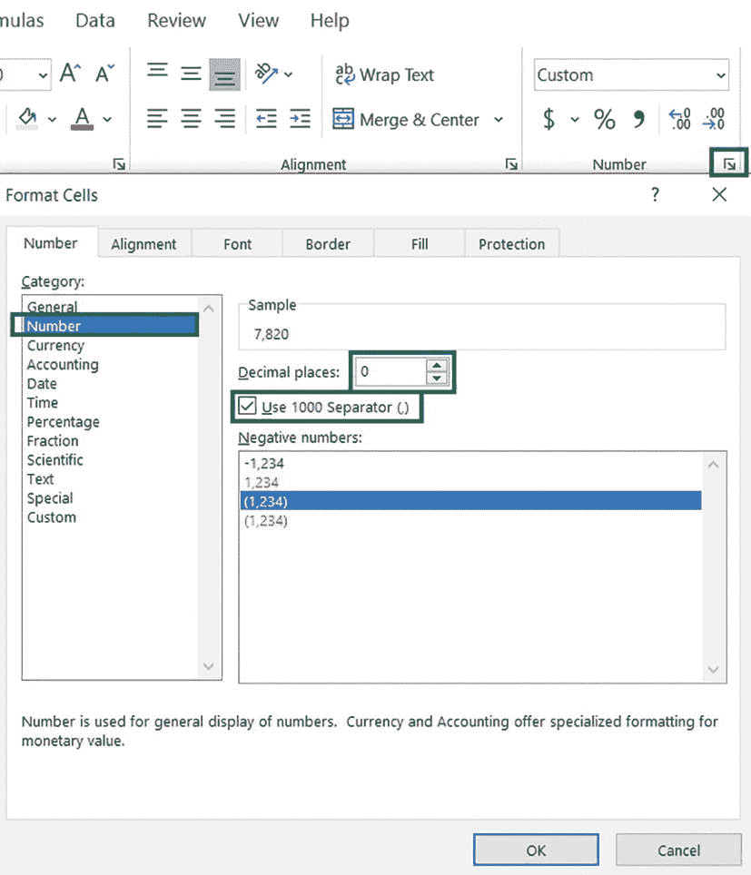

一个仪表板展示了已点击的“数字”栏，打开了“类别”选项，勾选了“使用千位分隔符”框，并给出了一些负数。

就这样——带有目标指标的卡片就准备好了。

**“实际”和“执行”卡片：创建与配置**

然后，我们只需复制已创建的卡片：复制，后退两列，留出间隙，然后粘贴。更改复制卡片中的单元格链接（现在需要实际指标，而不是目标指标）。与第一张卡片一样，这里也需要将指标除以 1000：确保公式中保留了这一点。

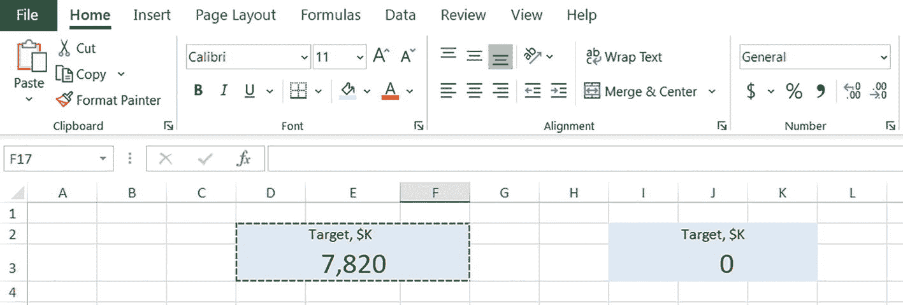
*一个电子表格工具栏的摘录。包含两个千美元目标值，并且已点击文件工具图标。*

我们将新卡片的标题更改为“实际, $K”。如果数据不匹配并以 `"#######"` 的形式显示在单元格中，这没什么大不了的。要查看实际值，只需拉伸列宽即可。剩下的只是将获得的数据调整到所需的位数。

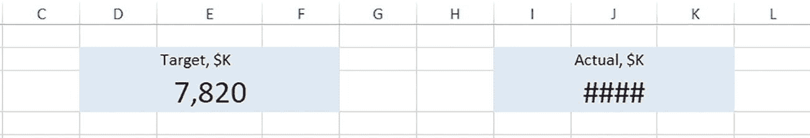
*一个片段展示了电子表格的上部区域。它包含三个用于在列宽中输入数值的数字值。*

第二张卡片“实际, $K”已创建。由于我们复制了一张已配置好的卡片，因此无需重复所有配置步骤。

要创建第三张“执行”卡片，请复制已创建的卡片之一，并将其粘贴到距离相邻卡片两列的位置。要计算此卡片中的值，只需插入一个公式，将“实际, $K”卡片中的值除以“目标, $K”卡片中的值。

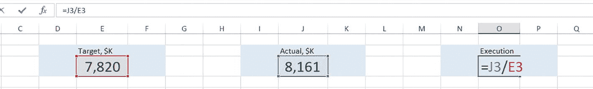
*一个片段展示了仪表板的上部区域。它包含三个数值。第三列的值是一个插入用于计算的公式。*

结果值以百分比显示；为此，请在“开始”选项卡的“数字”部分中点击“百分比样式”按钮。我们使创建的卡片在视觉上具有相同的大小——然后它们就准备好了。

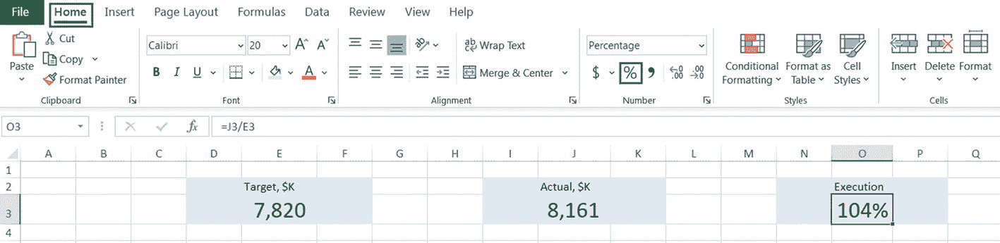
*一个片段展示了电子表格的工具栏。它展示了三个结果值，即目标千美元、实际千美元和执行百分比。*

**提示！**

> 不要过度使用 KPI 卡片的数量。如果客户要求在其上显示 7–10 个指标，请解释这会使数字难以感知，并会导致仪表板过载。我建议添加不超过六张卡片。

### 总结

KPI 卡片是用户在仪表板上首先看到的内容。不需要图表和鲜艳的颜色，所有注意力都应集中在重要的数字指标上。我们通过几个步骤创建了这些元素。

*   在包含数据透视表的工作表上，我们创建了一个包含目标和实际值通用指标的示例。
*   在包含图表模板（“仪表板”）的工作表上，设计了第一张卡片：它引用了另一工作表上包含目标指标的单元格。我们为卡片调整了位数并赋予了清晰的标题。
*   我们设计了第一张卡片的外观：增大了数字指标的字体，并添加了浅蓝色填充以将注意力集中在 KPI 上。
*   通过复制已创建的卡片，创建了两张新卡片：“实际”和“执行”。在这种情况下，您无需重复所有配置步骤，但需要更改“执行”卡片的指标公式。

## 2.3 对齐仪表板并添加标题

由于卡片尺寸发生了变化，布局中的图表被拉伸，其上的一些数据超出了屏幕范围。但让用户能一眼看到所有信息对我们来说非常重要。

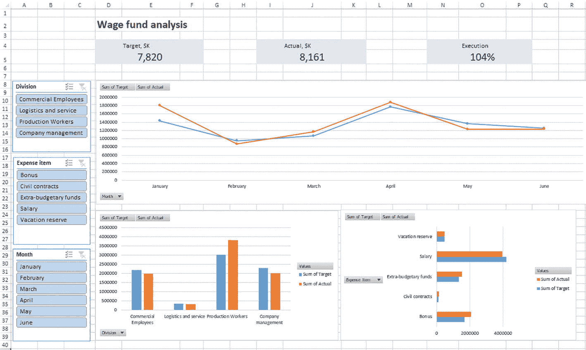
*一张示意图展示了一个折线图和两个柱状图，分别是月度目标、费用项目以及管理层与员工的划分。*

为了让所有内容都适应一个屏幕，你需要更改图形和图表的大小。为此，选中一个包含图表的模块，然后通过移动其边框线条来调整大小。

对其他可视化元素也执行相同操作。如果你需要将图表模块沿水平或垂直方向精确移动，请选中它，然后按住 `Shift` 键，用鼠标进行拖动。

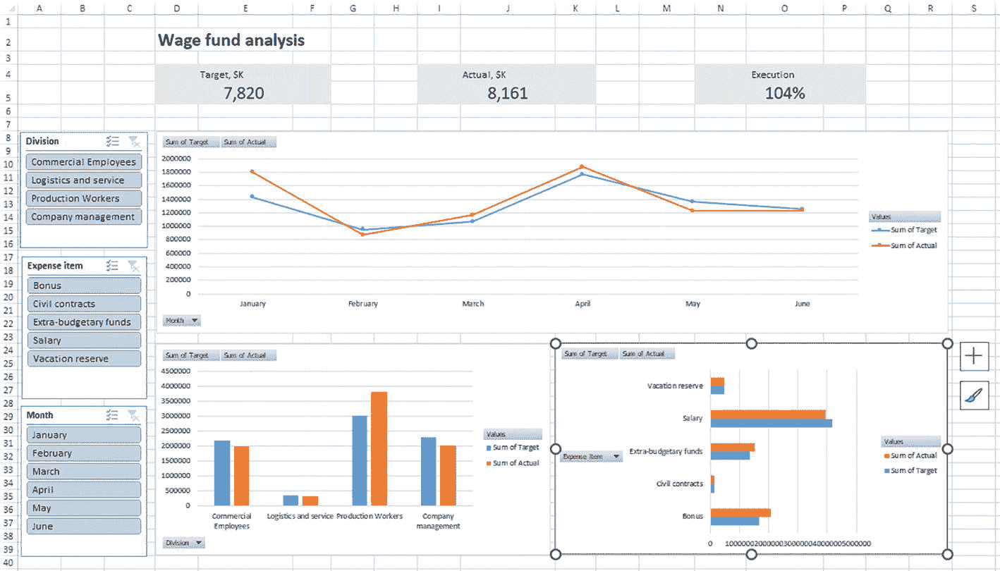
*一张示意图展示了块大小缩小的过程。它包含一个折线图和两个柱状图，分别是部门、费用项目和月份。*

删除卡片与可视化元素之间多余的行。现在，让我们为工作表添加仪表板标题。

*   我们需要在 KPI 卡片上方留出三个空行：如果行数不够，请添加。
*   在第二个空行中，位于第一张卡片上方的单元格（在我们的例子中是 `D2`）中，写入仪表板标题“工资基金分析”。
*   将标题的字体大小设置为 20 磅：与卡片中的数值指标相同。

在此阶段完成仪表板的工作，只需移除仪表板工作表上的网格线即可。只需单击鼠标一次：在“视图”菜单选项卡中，取消选中“网格线”参数。

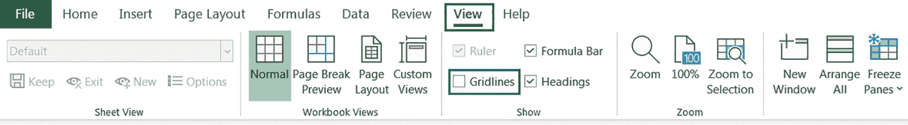
*一张示意图展示了收入基金调查。它包含一个折线图和两个柱状图，分别是部门、费用项目和月度目标。*

这就是我们的仪表板在完成所有组装操作后的样子。

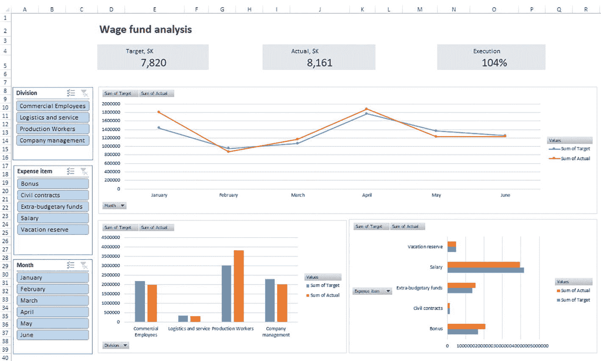
*一张示意图展示了电子表格的工具栏。它表示选中了“视图”选项和一个未选中的“网格线”选项。*

### 2.3.1 总结

实践表明，任何粗心大意不仅会降低你工作的价值，甚至会降低数据的可信度。一个设计良好的仪表板价值更高。因此，关注元素的正确排列及其对齐非常重要。

为此，我们做了以下工作：

*   更改了图表的大小，以使所有内容适应一个屏幕
*   对齐了可视化元素的位置
*   在卡片上方的空行中添加了仪表板标题
*   移除了 Excel 工作表中的网格线