# 3. 图表的剖析

我们很快就构建了一个仪表板。它看起来像一个交互式分析应用程序，而不像 Excel 中通常那样只是一组图表和筛选器。许多人认为这已经很好了，但我们只是刚刚起步。

本书的这一部分是关于微调图表元素的，其给人的第一印象是“漂亮且清晰”。你不必成为设计师也能让你的作品看起来专业且昂贵。你只需遵循一些规则，我将为你介绍这些规则。

这些规则适用于任何工具，无论是 Excel、PowerPoint、Power BI、Tableau 还是其他软件。这些工具中的图表元素名称可能不同，但配置原则是相同的。你在普通 MS Excel 中学到的东西，将能够熟练地应用到高级程序中。

## 3.1 分析现成的设计样式

Excel 提供了一整套模板来自定义图表的外观。让我们弄清楚它们适用于什么情况，又不适用于什么情况。

要查看建议的选项，请选中任意图表并打开菜单中出现的“设计”选项卡。标准模板列表可以在“图表样式”部分以及“快速布局”按钮下的下拉菜单中看到。

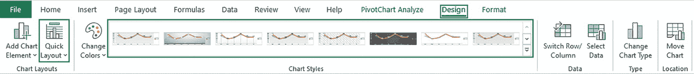

一张示意图展示了不同的选项，如文件、开始、插入、页面布局、公式、数据、审阅、视图、帮助、数据透视图分析、设计和格式。菜单栏中的“设计”和菜单按钮“快速布局”已被选中。

### 3.1.1 如何选择快速布局

Excel 为我们的“付款动态”图表提供了 12 种模板选项。它们的不同之处在于某些元素的存在与否，以及它们的不同位置。

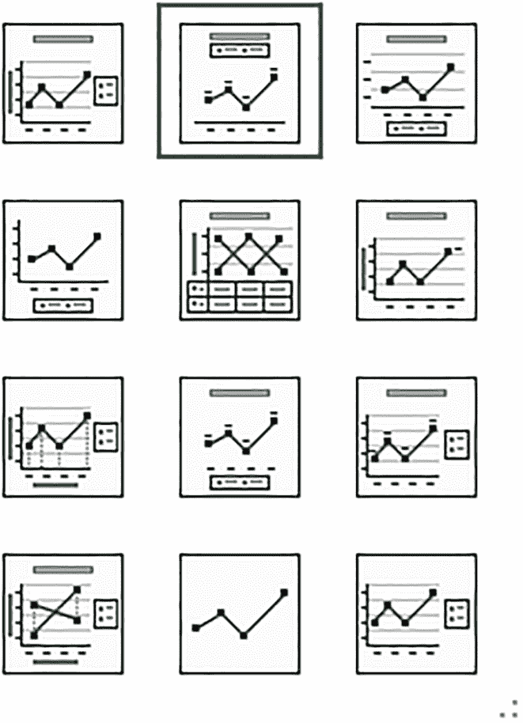

十二个模板，其节点由顶点连接，描绘了带有必要数据元素集的付款动态图表，其中`布局2`被选中。

在这些选项中，“布局 2”或多或少适合我们，因为它拥有必要的数据和元素集：

*   `图表标题`。
*   正确定位的`图例`（位于图表上方）。
*   `数据标签`。
*   仅保留水平轴（不需要垂直轴，因为已有`数据标签`）。
*   没有网格线，以免干扰信息感知。

其余的快速布局不适用于我们的任务：它们要么缺少必要的元素，要么包含太多不必要的元素。因此，当时间紧迫时，可以采用这种布局进行进一步的改进。

我们不会使用这个选项，而是自行微调图表，以便你理解这个过程是如何运作的。但首先，让我们看看 Excel 在“图表样式”部分提供了哪些模板。

### 3.1.2 模板样式存在什么问题

在每种建议的样式中，某些设置已经完成：图表的背景、`图例`的位置、字体大小、线条或柱形的视觉设计。

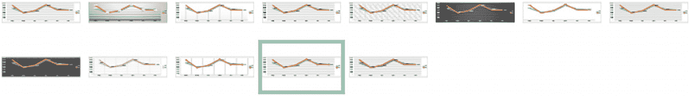

一个片段展示了包含某些数据的十三种视觉设计或样式选项，其中第十二种设计被选中。

让我们看看几个建议的选项，并找出它们为何不适合我们，以及设计中应避免哪些错误。

**以数据为重点的模板。** 作为第一个例子，我们考虑一种带有明亮大圆点的样式变体。

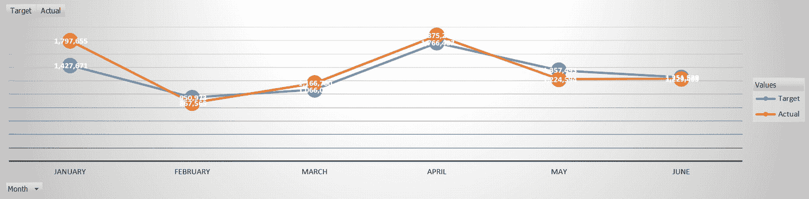

一张折线图展示了波动曲线，曲线上的圆点标示了从一月到六月目标总和与实际总和的数据。

圆点将注意力吸引到数据上，这使图表显得独特。但该模板仍有缺陷。

灰色渐变背景使图表顶部变亮，底部变暗。对于商务图表，这种装饰没有实际意义。此外，白色`数据标签`在此背景下完全看不清。

网格也存在问题。线条从顶部几乎不可见，越靠近底部变得越粗——这给图表增加了“重量感”。而且，网格在此处并未发挥其功能。如果没有标签，它有助于将数据点与 Y 轴上的数值对应起来。但这里有标签，却没有 Y 轴。

**深色背景上的模板。** 为了全面了解可用的样式，我们不仅限于“付款动态”图表的模板——我们还将考虑一个按部门划分的费用图表选项。

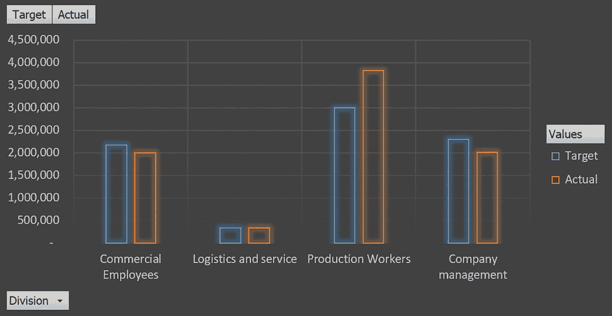

一张深色背景的柱状图展示了商业员工、物流与服务、生产工人以及公司管理层的目标总和与实际总和。生产工人的实际总和最高。

深色背景上的样式模板以其“霓虹”般的、仿佛发光的柱形吸引眼球。但对于我们这里的实际使用来说，它并不合适。

首先，这里没有`数据标签`——我们看不到具体的数值。其次，网格线越靠近底部越“模糊”——这使得难以将小柱形与 Y 轴上的数值对应起来。第三，不清楚柱形为何需要“发光”。毕竟，我们的目标是清晰地传达业务信息，而不是在仪表盘上模拟舞池。

**带垂直标签的模板。** 在建议的样式中，也有不带彩色背景的选项。我们来看其中一个。

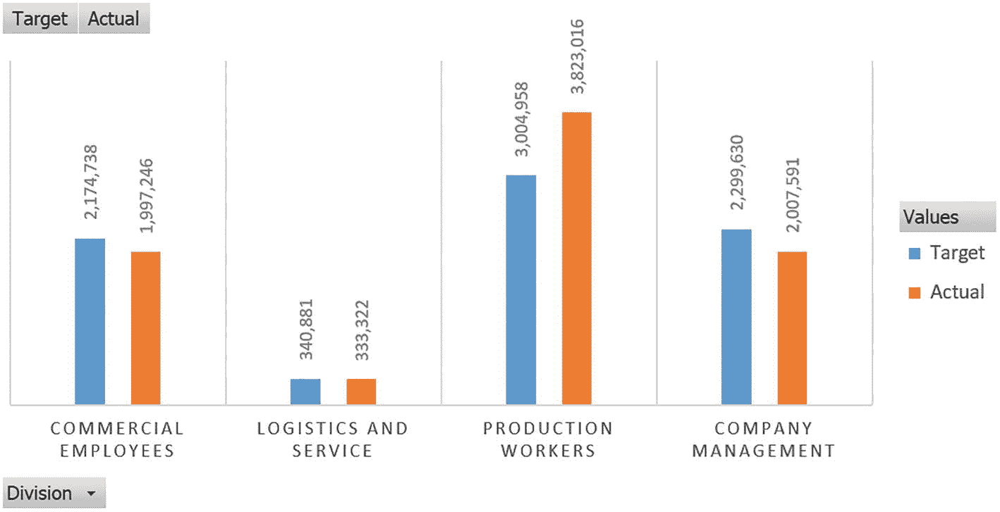

一张柱状图展示了商业员工、物流与服务、生产工人以及公司管理层的目标总和与实际总和的数据。生产工人的实际总和最高。

这种样式看起来不错，但它也有太多缺点，不适合用在仪表盘上。

垂直`数据标签`很糟糕。为了阅读它们，用户不得不歪着头，这绝对无助于舒适地查看报告。

柱形非常细，它们之间的间距非常大。这没有给我们带来任何优势，只是在图表上形成了大量空白区域。

另一个问题是类别标签全部使用大写字母。这不仅是因为它们占用更多空间并造成不必要的强调。整句的大写字母会给人“喊叫”的感觉，因此被认为是品味不佳的表现。

缩写或短名称中使用大写字母是正常的，关键在于不要过度使用强调。接下来的图表样式模板中就有这样的例子。

**柱形带渐变的模板。** 为了完整呈现，我们再来看一个条形图标准样式的变体。

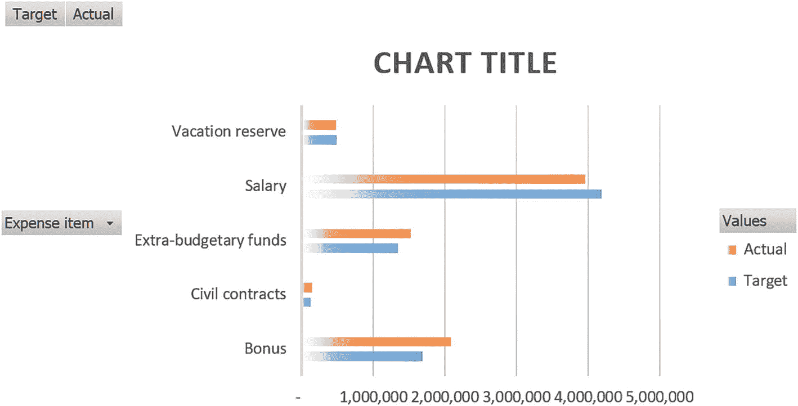

一张水平条形图展示了假期储备金、工资、预算外资金、民事合同和奖金的实际支出总和与目标总和的数据。

首先引人注目的是图表的标题。我不会批评大写字母——它们有时是合适的。但是。在这里它是最显眼的元素，分散了对数据的注意力。

有三种工具可以放置强调重点：

*   字体大小
*   加粗
*   大写字母

选择其中一种就足够了，而不是同时全部使用。否则，就会像这个例子一样，明显过度。

柱形的设计也引发了不少问题。首先，它们非常细：这也是为什么所有注意力都集中到了标题上。其次，柱形上的渐变看起来是多余的装饰——没有实际意义。

此外，这种样式模板不提供`数据标签`，用户看不到精确的数值。网格线稍微有助于将柱形的长度与 X 轴上的标签对应起来，但它的垂直线似乎将这些柱形分割成几部分，破坏了它们的“完整性”。

### 3.1.3 商业图表应是什么样的：推荐示例

在提供的模板和样式中，图表看起来各不相同，但没有一个选项适合我们的目的。在接下来的部分中，我们将自行定制所需的样式，并创建一个用于解决业务问题的极简图表模板。

图表将包含必要的最小元素：`标题`、`图例`和`数据标签`。我们将禁用 Excel 默认提供的辅助元素，以便专注于主要数据。

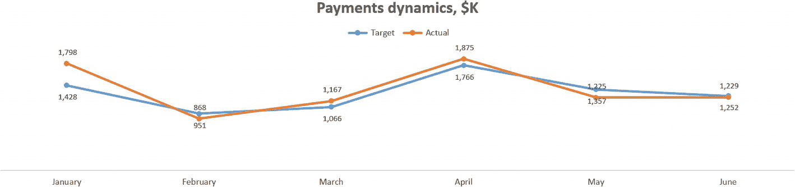

一张带有数据点的两条波动曲线折线图，分别描绘了从一月到六月目标总和与实际付款动态的精确数据。

我们也将整理一下柱状图。我们会保留必要的最小元素，但会移除图表中柱形之间的间隙，从而使每个部门的目标和实际指标看起来像一个整体。

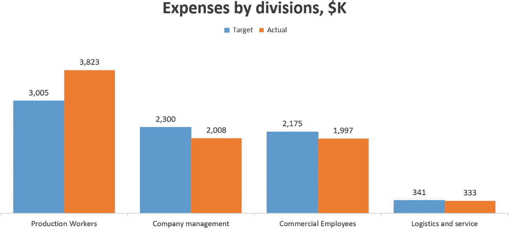

一张柱状图描绘了商业员工、物流与服务、生产工人以及公司管理层的目标总和与实际总和的数据。生产工人的实际总和最高。

我们还要处理“按项目分类的费用”条形图的设计特点，并对其进行正确的柱形排序：Excel 在这方面有它自己的“惊喜”。

### 3.1.4 总结

默认情况下，Excel 生成的是图表的“粗略”版本，并提供一组布局和样式用于设计。我们检查了其中一些选项，看看它们是否适合我们。

*   我们检查了“设计”选项卡中提供的`快速布局`：所需的数据集仅包含其中之一。
*   我们确认了这唯一的`快速布局`也需要额外设置。
*   我们测试了几种标准图表样式，并记录了每种样式的优缺点。

根据此测试的结果，很明显，不经改进，所提议的任何一个标准选项都不适合我们。因此，我们将继续深入探究图表的内部结构，并自行进行微调。

## 3.2 设置数据标签

从图表中，我们已经能大致看出计划付款和实际付款随时间的变化趋势。可以看到，四月份的支出略有增加，或者实际线略高于目标线。

但这里无法看出精确数值。例如，公司五月份花了多少钱？这就需要`数据标签`了。同时，让它们具有视觉可读性也很重要：有时标签看似存在，但在其他元素的背景下，这些微小的数字很难看清。

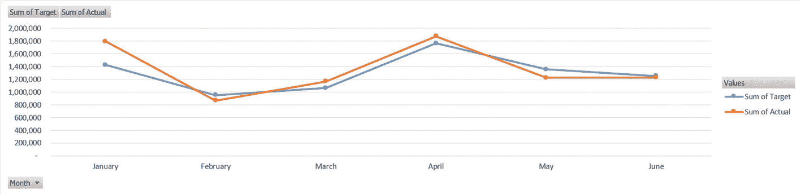

折线图有两条波动曲线，其数据点分别代表一月至六月目标总和与实际总和的精确数值。

### 3.2.1 如何添加数据标签

首先，我们将为图表添加数据值。有三种方法可以实现。

**方案 1.** 选中图表区域，在“设计”菜单选项卡上点击“添加图表元素”。从下拉列表中，选择子项“数据标签”，并指定您想要放置它们的具体位置。

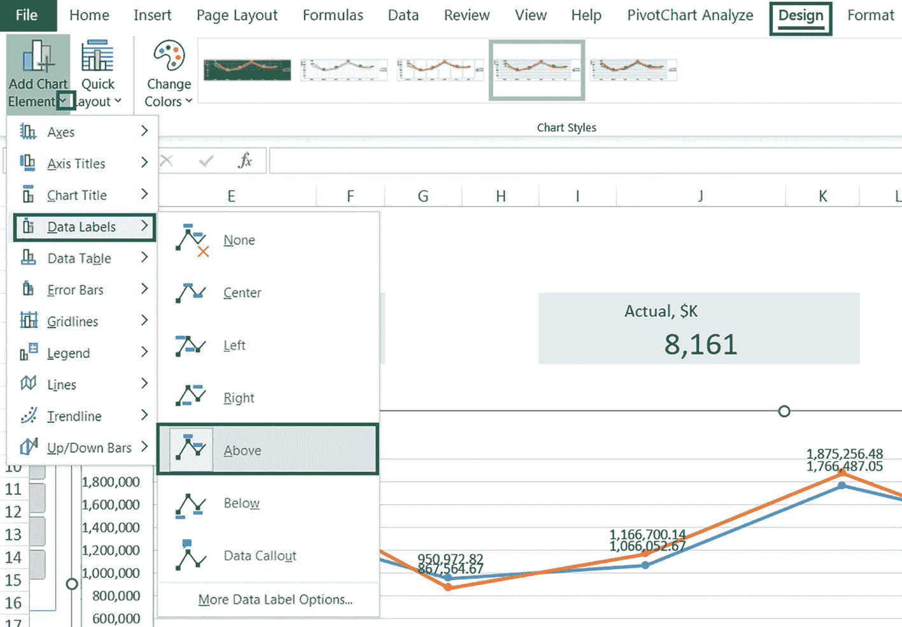

一个片段，展示了一张折线图，描绘了目标和实际数据（单位：千美元），并正在通过几个选定的`数据标签`和设计进行准备。

**方案 2.** 选中图表区域，点击右侧的绿色十字图标。在出现的“图表元素”菜单中，勾选`数据标签`复选框，并选择将它们放置在顶部。

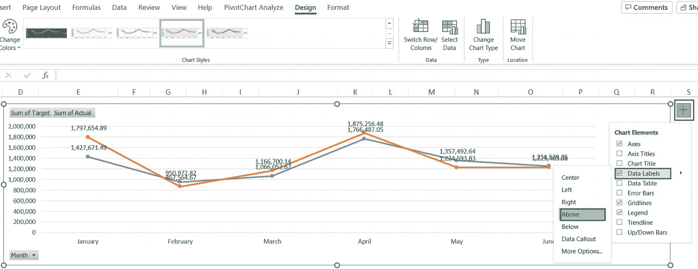

# 处理图表数据标签与文本

## 添加数据标签

一个片段，展示了一张折线图，其波动曲线描绘了目标和实际值数据（单位：千美元），以及 104% 的执行百分比，并包含一个选定的数据标签和设计。

**方案 3.** 点击图表中的线条将其选中，然后右键打开上下文菜单。选择“添加数据标签” ➤ “添加数据标签”。

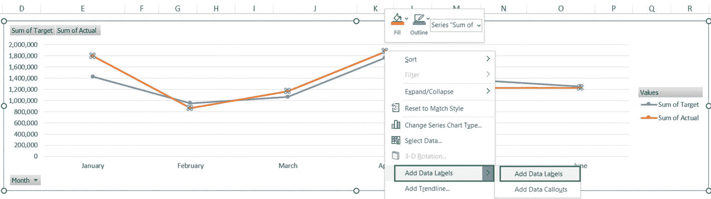

一个片段展示了一张折线图，其波动曲线描绘了一月至六月目标总和与实际总和的数据，并显示了右键点击选项。

所有这些方法都能达到相同的结果，但我使用第二种方法，即通过点击图表右侧的“+”图标来添加数据标签。

### 3.2.2 标签格式：处理长数字

数据标签已经出现。但每个数字都有九位数：这很难辨识，因此需要减少数字的位数。

首先，将 Y 轴的位深从个位改为千位。

1.  用鼠标点击选择 Y 轴上的数值。

2.  右键打开上下文菜单，选择“设置坐标轴格式...”。

3.  在右侧打开的面板中，找到“显示单位”字段，从下拉列表中选择“千”。

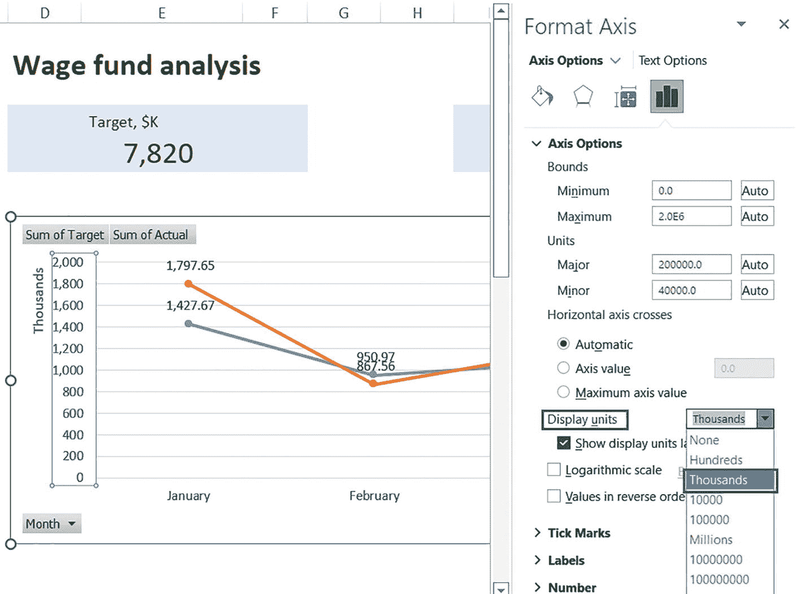

一个片段展示了一张折线图，包含 104% 的执行百分比，描绘了一月和二月的数据（单位：千），右侧显示了带有格式选项的“设置坐标轴格式”菜单。

我们设置了坐标轴的位深，但标签中的九位数依然存在。要解决这个问题，我们还需要更改数据标签的格式。

1.  单击图表中的任意数字以选中一个数据系列。要选中单个数字，需要双击它。

2.  右键打开上下文菜单，选择“设置数据标签格式...”。

3.  在右侧打开的面板中，在“数字”部分，设置“数字”类别。

4.  在“小数位数”字段中指定“0”，并勾选“使用 1000 分隔符 (,)。”复选框。

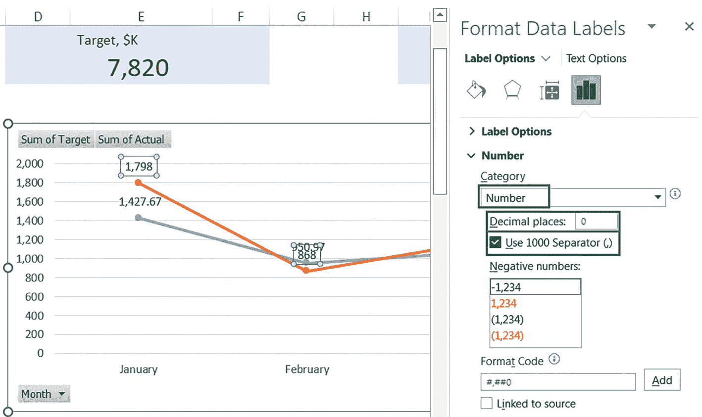

一个片段展示了一张折线图，数值以千为单位，包含 104% 的执行百分比，右侧显示了“设置数据标签格式”菜单，其中包含标签选项和文本选项。

所选数据系列已经呈现出理想的形式——数字清晰可读，易于理解。

**如何通过工作表中的数据格式化标签**

转到“草稿”工作表，选中所需数据范围。在“开始”菜单选项卡的“数字”部分，使用“千位分隔符格式”（`'` 图标）和“减少小数位数”（带箭头的 `000`）按钮来格式化数字类型。

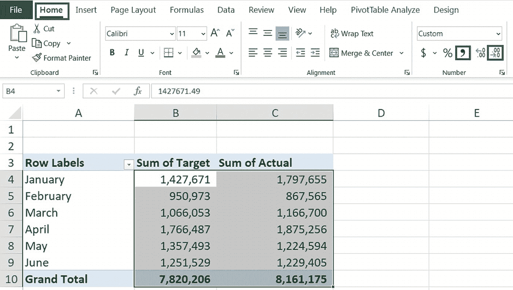

一个片段包含了 Excel 工作表上的三列，列名分别为 `行标签`、`目标总和` 和 `实际总和`，并带有几个选项。

完成这些操作后，图表上的所有数据标签都会以所需格式显示。

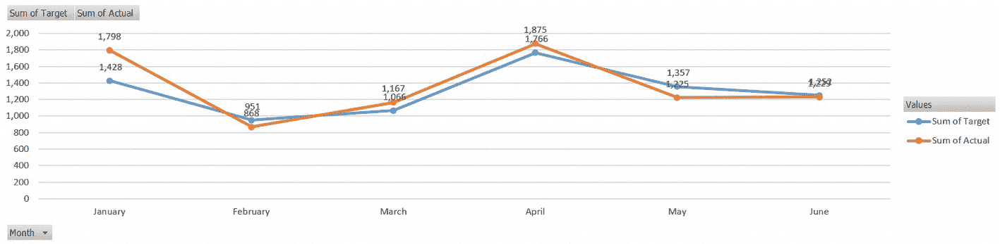

一张折线图，有两条线条分别代表目标总和与实际总和的值，显示一月到六月从 200 到 2000 千的值。

### 3.2.3 数据标签的大小和颜色

默认情况下，Excel 将数据标签的字体大小设置为 9。为了更易于阅读和辨识，我们将其增加到 12。

选择图表区域，在“开始”选项卡的“字体”部分指定所需大小。字体将同时在多个元素上自动增大：数据标签、坐标轴标签和图例中。所有这些更改完全符合我们的要求。

> **提示！**
>
> *有些客户要求为数据标签添加背景，因为他们“习惯如此”。但对于现代样式来说，这种做法已经过时，因此我不建议使用。*

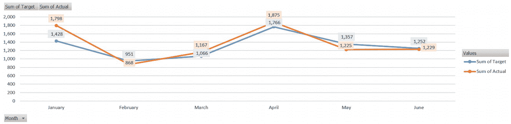

一张折线图，有两条波动曲线，描绘了一月到六月目标总和与实际总和的值及其数据点。实际总和的最大值是四月份的 1875。

但还有一个问题：我们的图表中有两行数据，它们的标签相互重叠。Excel 没有能直接消除这个缺点的按钮，但我们可以通过将数据标签调整为与其所在数据线的颜色相匹配来弥补。

为此，我通过鼠标点击选中一行数据的所有标签，然后在“开始”选项卡的“字体”部分，使用“字体颜色”按钮设置所需的颜色。我建议选择比图表线条稍深一点的色调。这样，用户就能立刻明白图表上的每个标签属于哪条线。

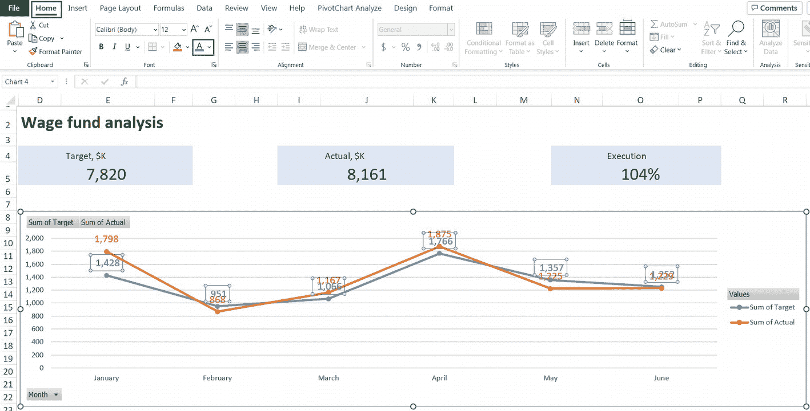

一个片段展示了一张工资基金分析的折线图，数值上显示了目标和实际值（单位：千），以及 104% 的执行百分比，并包含一个划分列和费用项目。

> **提示！**
>
> *对于 X 轴标题和标签，最好保留默认颜色或选择中性色（例如深灰色）——这些元素不应分散对主要信息的注意力。*

### 3.2.4 坐标轴和网格线不再需要

我们已经将所有数据点直接标注在图表上，因此不再需要左侧的刻度。既然它不执行任何功能，我们就将其删除，以免用多余的图形元素阻塞视图。正是从这些细节中，才能形成“赏心悦目”的可视化效果。

**解决方案 1.** 选中图表上的 Y 轴数值，右键单击打开上下文菜单 ➤ 选择“删除”项。

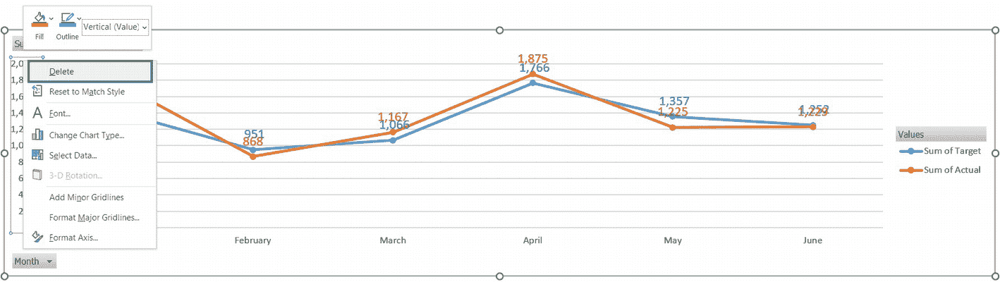

一个片段包含一张折线图，展示了工资基金分析中目标值和实际值的数值（单位：千），执行率为 104%，并带有部门和费用项目列。

**解决方案 2.** 选中图表，点击右侧出现的绿色十字。在“坐标轴”部分，取消勾选“主要纵坐标轴”项旁边的复选框。

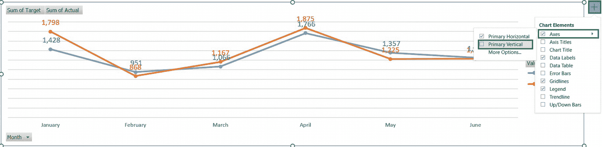

一张折线图描绘了数据，显示目标值和实际值的总和数值，并带有标注一月到六月确切数据点的图表元素。

按照同样的原理，我们将删除图表中的水平网格线。网格线用于将图表上的点与刻度进行比较。但如果没有刻度，这些线就无法执行有用的功能。

> **提示！**
>
> *有时会有人反驳我：没有线条看起来很空，至少给图表加个背景填充吧。我的回答是不。我们处理的是极简风格的商业图表，让我们将这种风格贯彻到底。当我们完成仪表板时，你会确信，像线条或背景这样的装饰是不必要的。*

要删除图表中的网格线，请单击任意一条网格线，确保整个网格都被选中，然后点击“删除”。或者，使用高亮图表右侧的“+”图标，在下拉菜单中取消勾选“网格线”项。

现在图表上几乎没有多余的元素了。

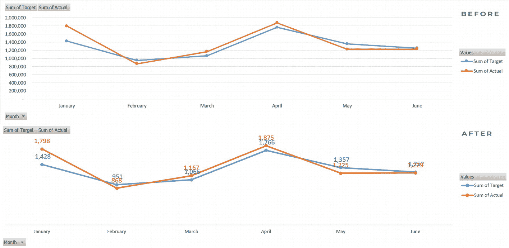

一组两张标记为“之前”和“之后”的折线图，带有波动的曲线，描绘了从一月到六月目标总和与实际总和的数据值。

### 3.2.5 小结

仪表板上标签的任务是促进数据感知，使可视化易于理解。默认设置对此无益，因此我们亲自将标签调整到了所需的形式。

*   在“图表元素”菜单中添加了数据标签。
*   在“数据标签格式”面板上将标签的小数位数设置为零。
*   去除了小数位，以便于理解数字。
*   增大了数据标签、X 轴标签和图例的字体。
*   我们移除了 Y 轴及其上的数值：我们已经有了数据标签。
*   移除了图表上的网格线，以避免“信息噪音”。

## 3.3 处理文本：删除多余，添加必要

在上一部分，我们简化了图表上数字的感知。现在我们来处理文字和标题，使它们能够尽可能快速、清晰地传达可视化元素的含义。

为此，我们将处理图例，并从图表中移除所有无助于数据分析的内容。

### 3.3.1 图例的放置位置与方法

默认情况下，Excel 将图例放置在图表右侧。但用户习惯从左向右阅读。也就是说，他会先看到图表，然后碰到图例才明白线条的含义。因此，他还得再回头看图表。

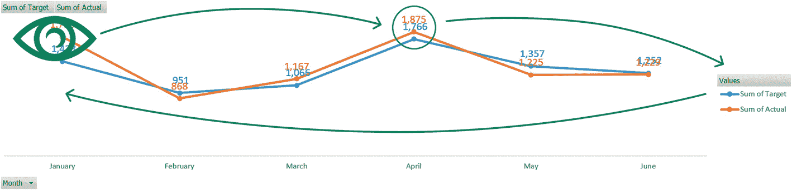

一张折线图带有波动的曲线和点（眼睛和圆圈图标），描绘了从一月到六月带有确切数据的数据。文字为外语。

因此，图例应当立即可见。为此，应将其放置在图表上方或左侧。也就是，顺着阅读方向：从上到下，从左到右。有几种方法可以配置正确的位置。

**解决方案 1，通过上下文菜单**

*   选中图表上的图例。
*   右键单击打开上下文菜单，选择“设置图例格式...”项。
*   在打开的窗格中，在“图例位置”部分选择“靠上”项。
*   勾选“显示图例，但不与图表重叠”复选框。

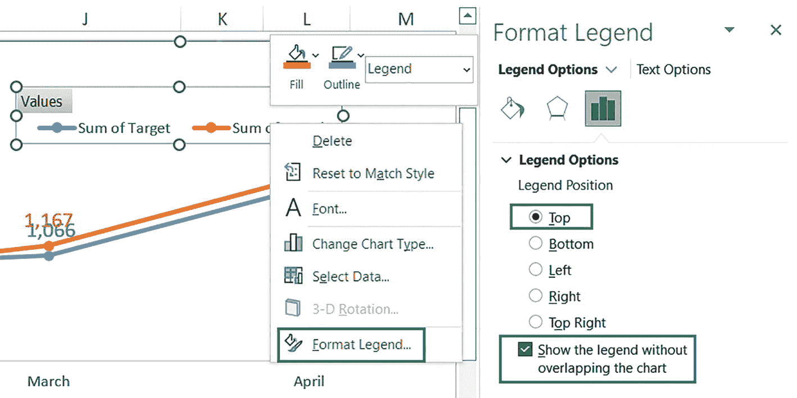

一个片段展示了设置图例格式的窗格和一张折线图，其中选中了“设置图例格式”菜单，旁边是包含 T 到 X 列的 Excel 页面。

**解决方案 2，在“图表元素”菜单中**

*   选中图表上的图例。
*   点击图表右侧的绿色十字图标，打开“图表元素”菜单。
*   在“图例”字段旁边的下拉列表中，选择“靠上”项。

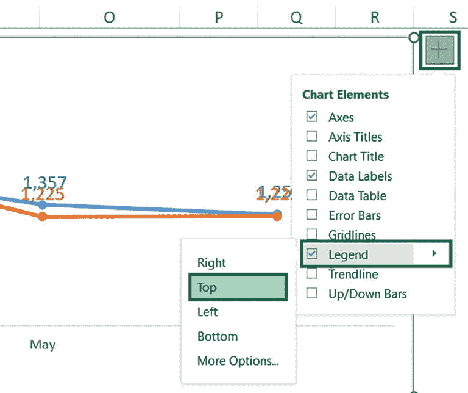

一个片段展示了右侧的“图表元素”菜单，其中从图例选项中选择“靠上”。左侧是一月到六月的折线图数据。

这种图例的布置方式考虑到了人类感知的特点，并节省了仪表板上的空间。

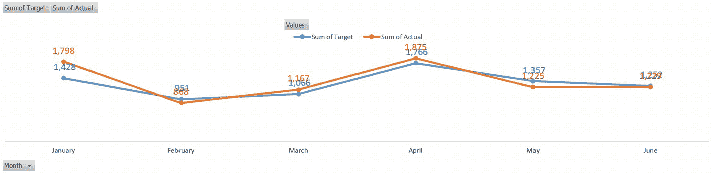

一张带有两条波动曲线的折线图，展示了目标总和与实际总和数值的数据，并带有一月到六月确切数值的点。

### 3.3.2 如何处理自动标签

图例的默认位置并非唯一的问题。图表中还存在带有 `Target 求和项` 和 `Actual 求和项` 标题的自动字段标签。需要将它们分别更改为简单易懂的 `Target` 和 `Actual`。

图表设置中本身没有“禁用字段求和”按钮，因此我们将在“草稿”工作表的原始选择中更改这些字段的名称。有几种方法可以实现。

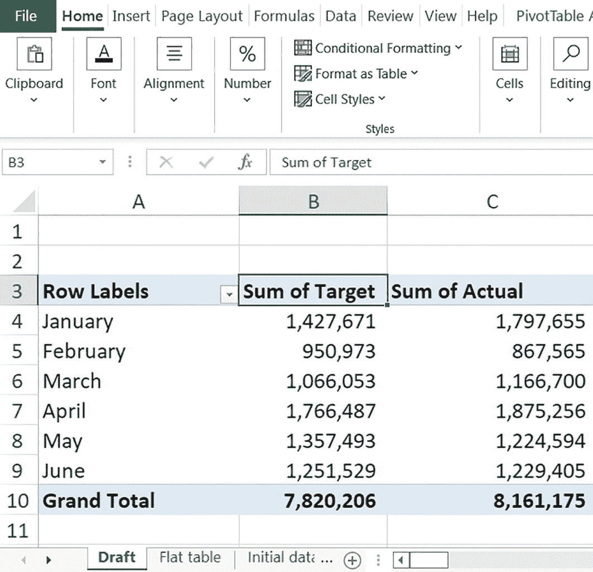

一个 Excel 表格片段，包含三列，分别是行标签、`Target 求和项`和 `Actual 求和项`，其中包含关于不同选项的草稿数据。

**解决方案 1.** 将光标放在字段名称的单元格中，删除多余的“`求和项`”字样。如果我们有多个样本，这不会花费太多时间。

**解决方案 2.** 双击样本中的字段名称 – 将打开“值字段设置”对话框。在“自定义名称”部分，删除多余的词语。同样地，你需要编辑每个字段的名称。

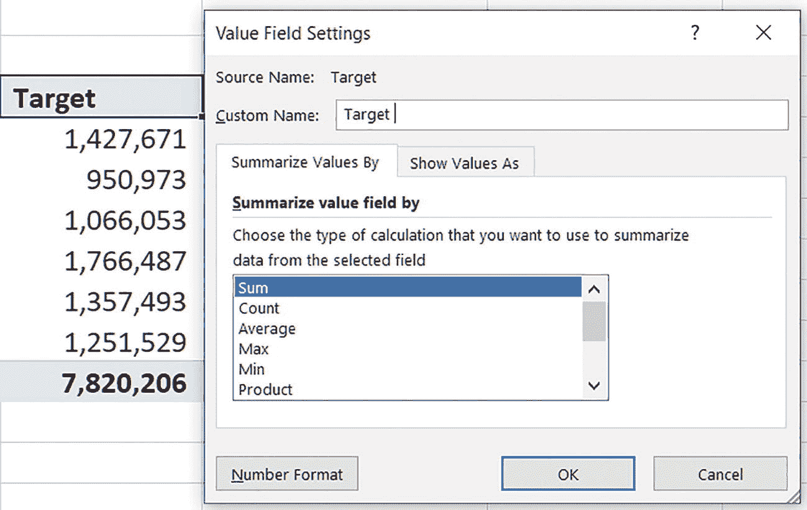

一个片段包含`值字段设置`对话框，以及源名称、选择了`求和`的选项的自定义名称，以及左侧给出的实际数据。

编辑字段名称时，在开头或末尾留一个空格以避免错误：

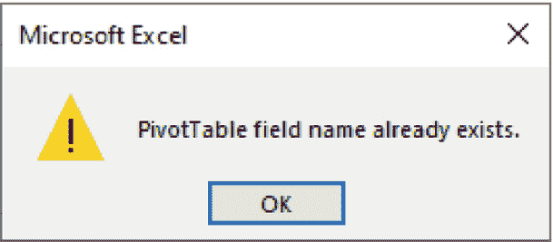

Microsoft Excel 错误弹窗的片段，显示数据透视表字段名称已存在。底部是“确定”按钮。

对于可视化来说，这个空格不起作用，但对程序而言，这将与数据透视表中的字段名称有所区别。

**解决方案 3，推荐使用。** 也可以使用自动更正功能删除文本“`求和项`” – 这是最快的选项。

在“草稿”工作表中，找到“开始”选项卡“编辑”部分中的“查找和选择”按钮。从下拉列表中选择“替换”。

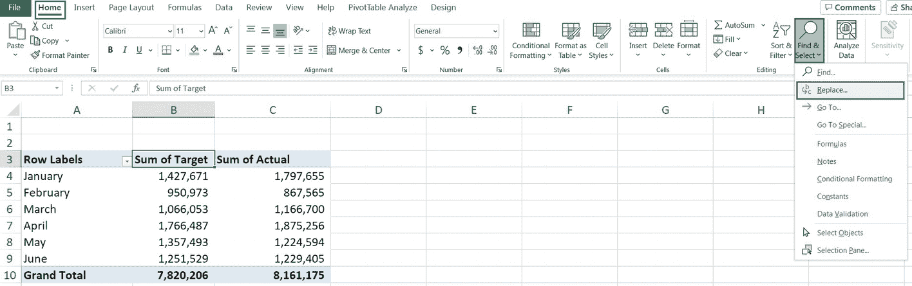

一个片段包含一个 Excel 表格，有三列数据，分别是行标签、`Target 求和项`和 `Actual 求和项`。右侧提供了“查找和替换”下拉菜单选项。

将出现一个对话框 – 也可以使用键盘快捷键 `Ctrl + H`（或 `cmd + H`）调出。在“替换”选项卡上，有两个字段。在第一个字段中输入“`求和项`”，第二个字段留空，然后单击“全部替换”。将出现一个窗口，显示命令已执行以及所做的更改次数。

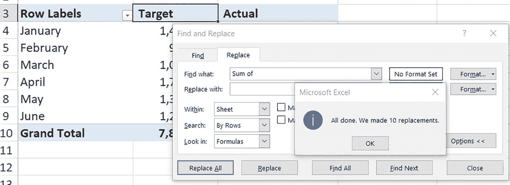

一个片段包含三列，分别是行标签、`Target`和 `Actual`（一月至三月），以及“查找和替换”对话框和一个确认 10 次替换的弹出窗口。

之后，图例中的字段名称将自动更新，变得更加易于理解。

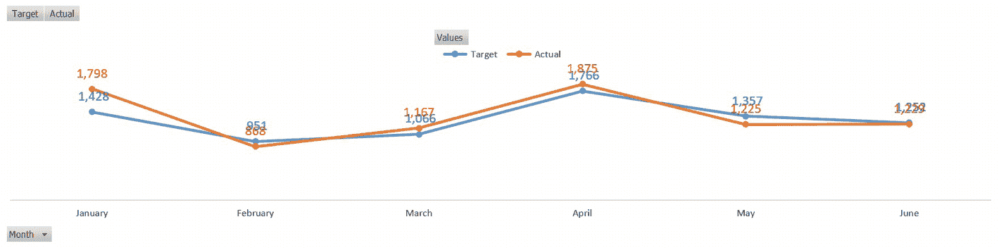

一个带有波动曲线的折线图，展示了 `Target` 和 `Actual` 的值数据，并用点表示一月至六月的具体数值。

### 3.3.3 如何删除字段按钮

我们是基于数据透视表构建的图表，因此 Excel 会自动添加几个按钮：在图表上，这些是“`Target`”、“`Actual`”、“`值`”和“`Month`”。它们在我们的仪表板上没有任何有用的功能。你只能点击“`Month`”按钮打开筛选器，但使用切片器更方便。这些按钮占用了图表近一半的工作区域，因此我们将删除它们。

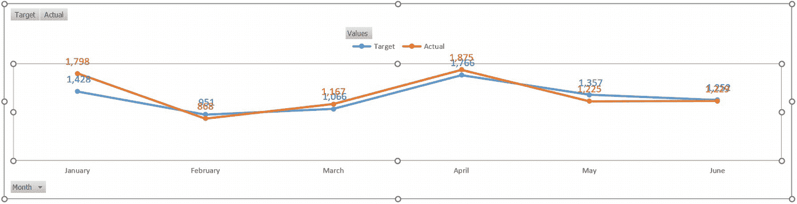

一个带有波动曲线和精确数据点的折线图，描绘了一月至六月 `Target` 和 `Actual` 的值数据。

**解决方案 1.** 警告：此方法不适用于所有版本的 Excel。选择图表上的按钮，并用鼠标右键打开上下文菜单。选择“隐藏图表上的所有字段按钮”。

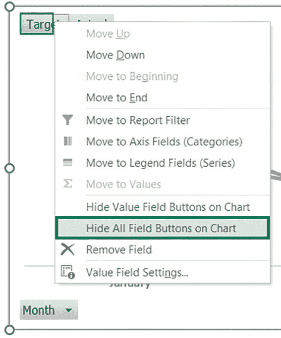

一个片段显示 `Target 求和项`和 `Actual 求和项`的列及其数据，并选中了包含“隐藏图表上的所有字段按钮”选项的对话框。

***提示！***

*切勿选择“删除字段”选项，否则程序将删除数据透视表中包含数据的原始字段。*

**解决方案 2.** 选择图表，在菜单选项卡“`数据透视图分析`”（在较旧版本的 Excel 中，这是“分析”选项卡）的右侧，你会看到“`字段按钮`”。在此按钮下的下拉菜单中，勾选“全部隐藏”项。

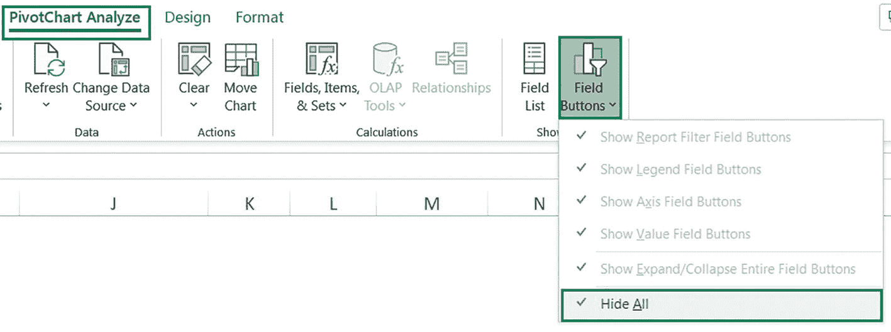

一个片段包含元素“`数据透视图分析`”、“设计”和“格式”，其中在“`字段按钮`”菜单下勾选了“全部隐藏”选项。

就这样 – 不必要的元素被移除了，图表本身的空间增加了一倍！

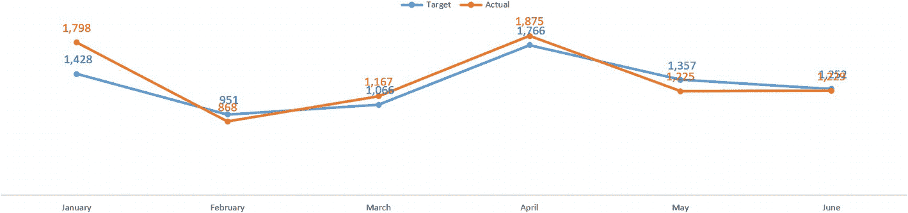

一个带有两条波动曲线的折线图，展示了 `Target` 和 `Actual` 的值，并用几个点标出从一月到六月的精确数据。

### 3.3.4 添加图表名称的两种方法

为了让用户立刻理解图表显示的内容，你需要为其添加一个有意义的标题。如果我们是针对幻灯片进行可视化设计，那么我们会尝试直接在标题中得出结论。但我们的仪表板是动态的，图表的内容取决于筛选器。因此，我们将在标题中简要地指出关键词。

**解决方案 1.** 在“设计”选项卡上，点击左侧的“添加图表元素”按钮。在下拉列表中选择“图表标题” ➤ “图表上方”。图表上将出现一个字段，你需要在其中输入我们的图表名称 – “支付动态”。

**解决方案 2.** 点击所选图表右侧的加号，勾选“图表标题”框 – 与第一种方法一样，将出现一个标题字段。

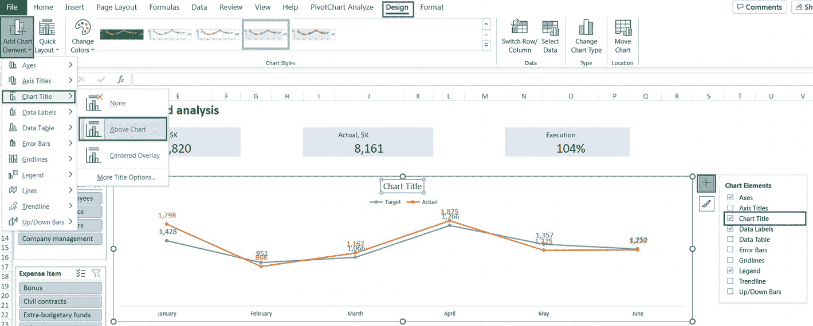

一个带有两条波动曲线的折线图，展示了 `Target` 和 `Actual` 的值，并用几个点标出从一月到六月的精确数据。已选择“添加图表元素”菜单。

将标题居中并置于图表顶部有助于增加图表的工作区域。但此选项仅适用于静态幻灯片，如果线条或柱形不与标题重叠的话。在动态仪表板上，我们选择“图表上方”选项，这样在更改或筛选数据时就不会发生重叠。

还需要设置图表标题的字体大小：它应该比标签和图例更大：根据可用空间，从 14 到 18 磅不等。为此，选择标题块，然后在主菜单选项卡的“字体”部分设置所需的值 – 我选择了大小 16。

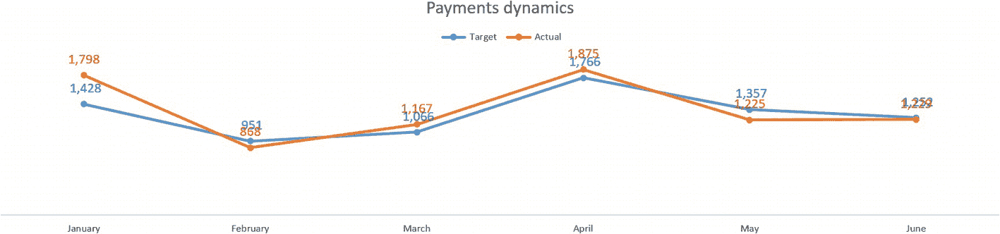

一个带有两条波动曲线的折线图，展示了 `Target` 和 `Actual` 的值，并用几个点标出从一月到六月的精确数据。

### 3.3.5 总结

图表中的文本应尽可能少——只保留那些能帮助用户轻松阅读和理解信息的内容。为了解决这个问题，我们执行了几个操作：

*   我们将图例放置在图表上方，以便图表内容一目了然。

*   通过更改数据透视表中的字段名称，移除了图例中的“自动”标签。

*   从图表区域移除了从数据透视表继承的无用字段按钮。

*   为图表添加了清晰的标题，并将其放置在顶部。

*   将图表标题的字体大小增加到 16。

## 3.4 设计条形图

数据标签、数字格式与位数、坐标轴与网格线的去除、图例、额外按钮、名称——所有这些对于设置任何视觉元素都是相关的，而不仅仅是针对图表。

但在我们仪表板的图表中，有一个图形上没有的元素——那就是柱子。严格来说，“按部门支出”和“按项目支出”是不同类型的可视化：

- 垂直柱子——柱形图

- 水平柱子——条形图

两者都可以称为条形图。它们具有相同的设置原则，唯有一点细微差别。

为了方便信息的感知和比较，我们将调整柱子之间的距离，并设置其排序，以便最佳和最差的指标能够一目了然。

在这一部分中，我将在已配置好的图表上演示操作，以免无关元素分散你的注意力。稍后，你将使用本部分末尾的特殊检查清单来添加这些设置。

### 3.4.1 柱子之间的距离

默认情况下，目标值与实际值的柱子之间会形成空白区域。我们需要这些指标看起来像是每个部门的一个整体元素。为此，需要“粘合”这些柱子。

通过鼠标点击，选择任意一行柱子 ➤ 打开上下文菜单 ➤ 选择“`设置数据系列格式`”项。

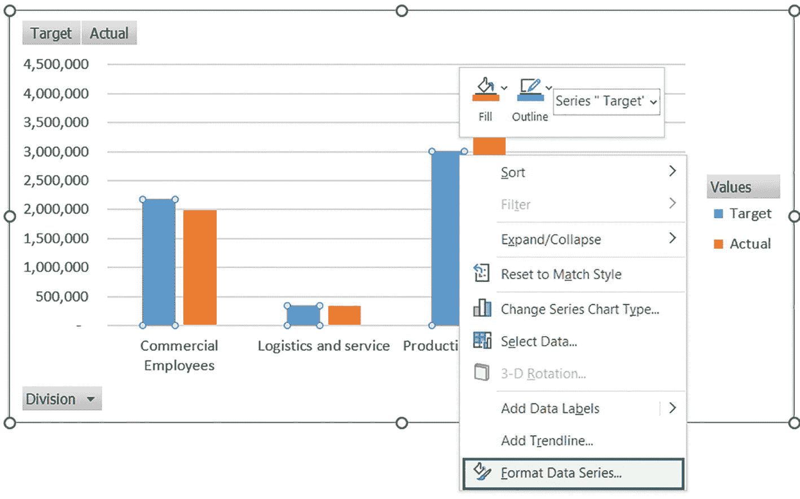

一个片段包含一个条形图，位于一个显示按部门划分的数值数据的方框下方。从对话框中选择“`设置数据系列格式`”。

在右侧打开的窗格中，在“`系列选项`”部分，我们配置以下值：

- “`系列重叠`” – 0%

- “`间隙宽度`” – 50%

现在，每个部门的目标值和实际值的柱子看起来像一个整体元素，这有助于聚焦于它们之间的差异。

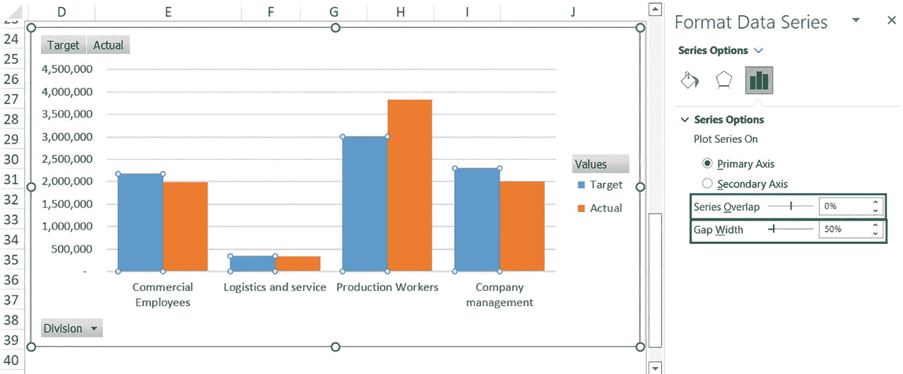

一个片段包含一个显示按部门划分的数据的条形图（左侧），以及一个包含系列选项的“`设置数据系列格式`”图表（右侧）。

### 3.4.2 对柱子进行降序排序

对有序数值的感知总是更容易。为了不让用户的眼睛在不同高度的柱子之间来回跳跃，而是能从大到小有序地浏览，我们需要设置排序。

*图表中柱子的顺序取决于数据透视表中行的顺序。动态图表是根据月份名称构建的——它们已经自动正确排序。而在其他两个视觉元素的样本中，需要在“实际值”字段中调整排序，使其从大到小排列。*

有两种方法可以对柱形图中的柱子进行排序。

**方法 1：在图表上。** 我们在“按部门支出”图表中选择一个柱子。由于我们主要根据实际结果来比较部门，因此选择“`实际值`”柱子。右键单击，在上下文菜单中选择“`排序`”➤“`降序排序`”。

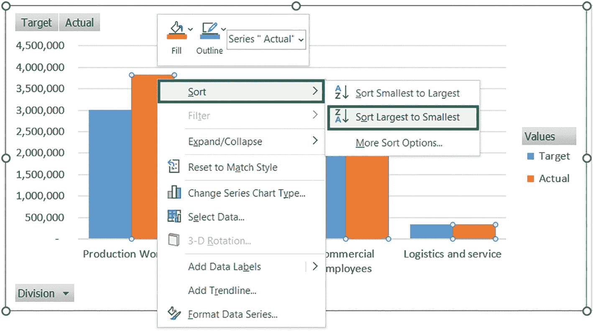

一个包含条形图的片段显示在一个显示按部门划分的支出数据的方框下方，旁边是一个用于从大到小排序元素的对话框。

**方法 2：在数据透视表中。** 在“草稿”工作表中，将光标放在“按部门支出”样本的单元格中。右键单击上下文菜单，选择`排序`➤`降序排序`。

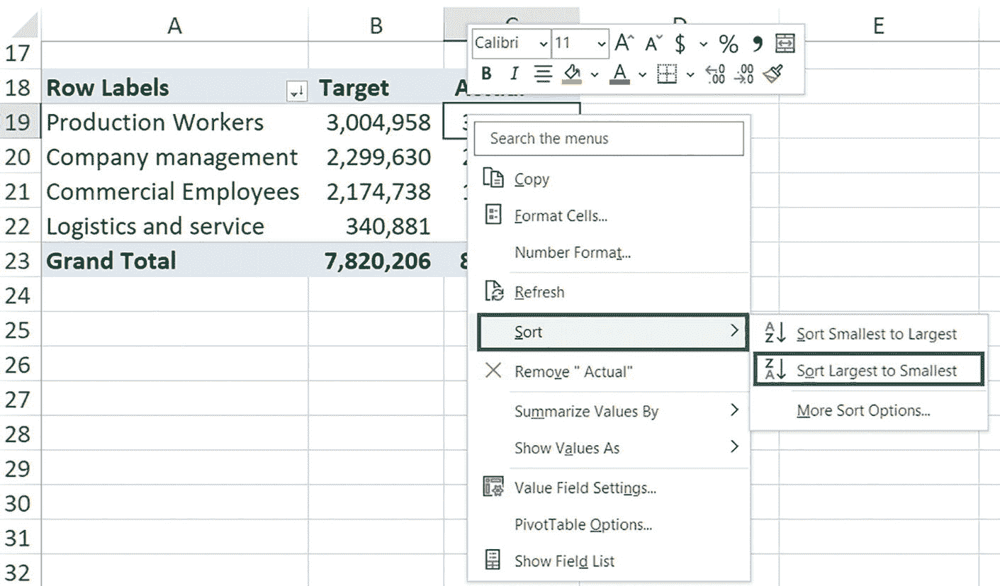

一个片段展示了两个列，即`行标签`和`目标值`（包含数据及总计），以及一个用于从大到小排序元素的对话框。

“仪表板”工作表中的图表柱子顺序将自动更改，并呈现出符合人类感知逻辑的形态。

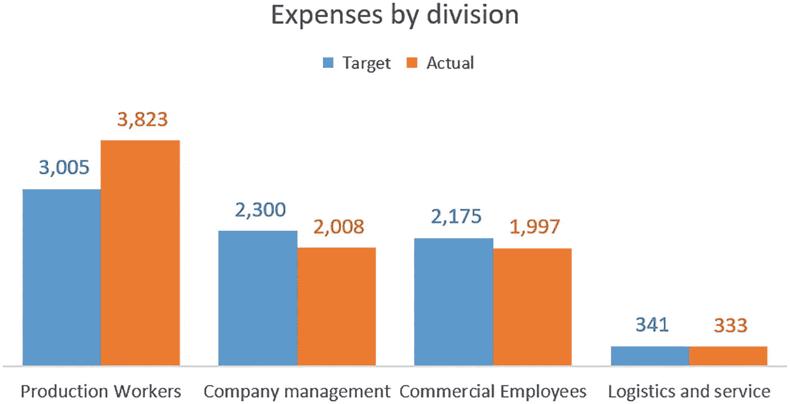

一个条形图显示了生产工人、公司管理层、商业雇员以及物流与服务人员的`目标值`和`实际值`的支出数据。

*提示！*

*在创建数据透视表后，我会立即对数据进行排序，并调整数字的格式和位数。这有助于避免在后期设计图表时再回头处理这些设置。*

### 3.4.3 条形图的柱子排序

对于条形图来说，情况并不那么简单：`Excel` 默认以逆序构建数据类别。

即使您像我们对柱形图所做的那样，将表格设置为`降序排序`，类别在图表上的排列顺序也可能完全相反。

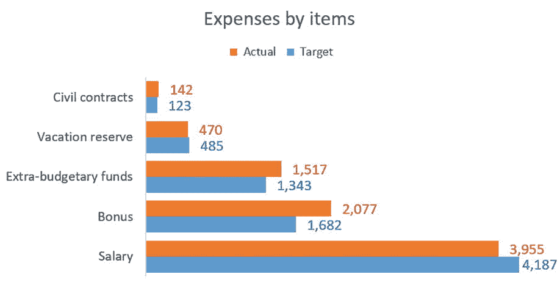

一个水平条形图显示了按项目（即民事合同、假期储备、预算外资金、奖金和工资）划分的`目标值`和`实际值`支出数据。

要解决这个问题，需要在数据样本中设置反向排序——`升序排序`。然后（哇，真是奇迹！）在条形图上，它们将按降序排列。我不会深究这种构建方式的原因，只需接受它——`Excel` 就是这样……

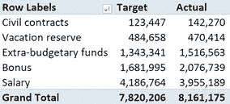

给出了一个包含三列（`行标签`、`目标值`、`实际值`）的片段，其中包含不同标签的数据值。最后一行是总计。

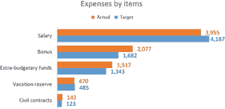

一个水平条形图显示了按项目（即工资、奖金、预算外资金、假期储备和民事合同）划分的`目标值`和`实际值`支出数据。

“`目标值`”和“`实际值`”柱子的顺序也存在同样的问题。在图表中，无论是在图例中还是在柱子上，“`目标值`”都排在首位。但只有在条形图中，“`实际值`”才排在前面。让我们通过调整坐标轴格式来解决这个问题。

用右键选择 Y 轴上的类别，然后在上下文菜单中选择“`设置坐标轴格式`”。

在出现的窗格中，在“`设置坐标轴格式…`”部分，指定以下内容：

- 在“`水平坐标轴交叉`”组中，选择`最大分类`。

- 在“`显示单位`”组中，勾选`逆序类别`。

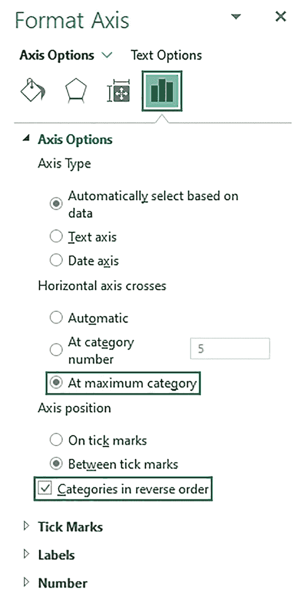

显示了一个名为“`设置坐标轴格式`”的片段，其中包含`坐标轴选项`和`文本选项`。在`文本选项`下，从`坐标轴选项`中选中了“根据数据自动选择”单选按钮。

这些参数将根据样本中的字段顺序自动排列行，我们无需再做额外操作。

我建议您始终选择第二种方法来配置条形图。

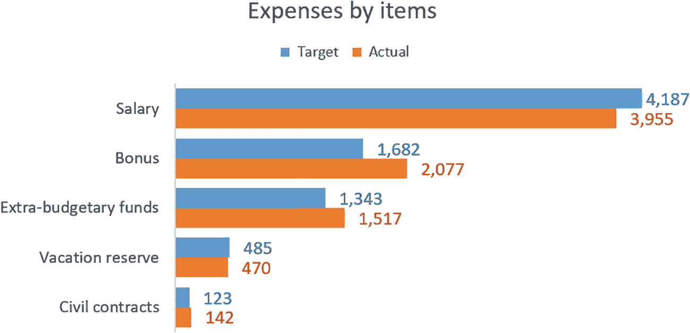

一个水平条形图显示了按项目（即工资、奖金、预算外资金、假期储备和民事合同）划分的`目标值`和`实际值`支出数据。

### 3.4.4 图表设计检查清单

让我们在“按部门支出”图表上演练一下设计特性：使用一个简短的检查清单来配置这个视觉元素。

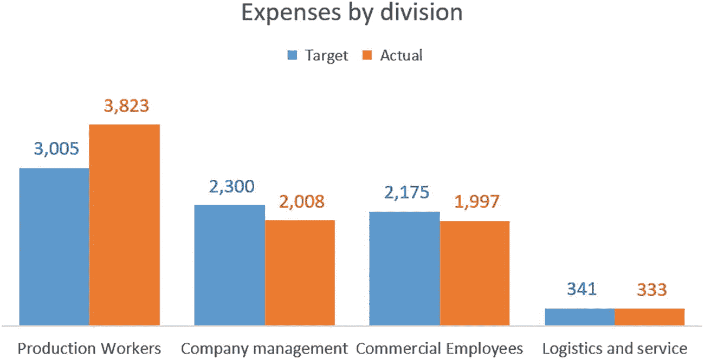

一个条形图显示了按部门（即生产工人、公司管理层、商业雇员以及物流与服务人员）划分的`目标值`和`实际值`支出数据。

1.  添加数据标签，为其设置 12 磅字体。

2.  将数字的位数更改为千或百万，使标签中只保留 3-4 个字符。

3.  移除刻度和网格线。

4.  将数据标签的颜色设置为该数据系列的颜色（更深一级），不要为标签添加背景。

5.  隐藏数据透视表字段按钮。

6.  将图例放置在顶部（有时放在左侧）。

7.  移除图例中的自动标签。

8.  添加图表标题，为其设置 16 磅字体。

9.  将图表柱子之间的间隙宽度减少到 50%。

10. 将柱子从大到小调整排序。

### 3.5 设置图表模板

处理每个图表都是件单调乏味的事——不是每个人都喜欢，而且很耗时。如果你设置好一个图表并将其保存为模板，供其他工作使用，这个过程也可以得到优化。

我们将使用已经按照清单设置好的`按部门支出`图表来制作一个模板。

#### 3.5.1 如何保存模板

这里很简单：右键点击`按部门支出`图表所在的区块，在上下文菜单中选择`另存为模板...`。你可以选择整个图表，也可以只选择绘图区——区别仅在于上下文菜单的长度，但所需选项在两种情况下都可用。

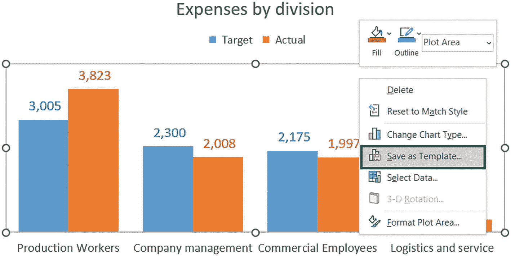

*提示！*

*不要更改保存模板的文件夹路径。`Excel`只会自动从该文件夹加载自定义模板。*

保存时，别忘了为模板起个清晰的名字，以便日后在列表中轻松找到所需的图表。我们的模板以`Chart1`的名称保存。

#### 3.5.2 使用模板创建新图表

要将现成的模板应用于另一个（未设置的）图表，请执行以下操作：

- 选中整个图表或其中的绘图区。

- 在上下文菜单（右键单击）中，选择`更改图表类型`。

此时会打开一个窗口，左侧有一个菜单——进入`模板`文件夹，选择我们保存的模板`Chart1`。

我们模板的所有设置都会自动应用于所选图表：标签的位置和颜色、数字的位数以及其他所有内容。剩下的就是将名称改为`按项目支出`。

#### 3.5.3 根据图表调整模板

我们需要以带有水平条的条形图形式来可视化按项目支出的数据。但在使用模板时，可视化元素的样式也发生了变化——条形变成了垂直方向。让我们通过重新选择图表类型来解决这个问题。

选中整个图表或仅选中绘图区。

1. 打开上下文菜单，选择`更改图表类型`。

2. 在打开的窗口中，选择`条形图`图表类型。

完成这些步骤后，`按项目支出`图表就根据布局呈现出了所需的样式。

剩下的就是更改条形图中的排序和列的顺序。好了——我们已经拼凑出了一个完整的仪表盘草稿！

#### 3.5.4 小结

设计每个可视化元素都需要时间。由于任何仪表盘上都有多个这样的元素，因此会花费大量时间。使用模板有助于简化和加快这一过程。

- 设置好图表后，将其保存为模板，不要更改文件夹路径。

- 选择一个新的草图图表，并使用`更改图表类型`选项将保存的模板应用于该图表。

- 通过将可视化元素的类型重新更改为新图表所需的类型来调整模板。