# 4. 最终设计

我们现在有一个极简风格的仪表盘，它遵循了数据可视化的所有规则。它仍采用标准的`Excel`样式设计，而客户通常更喜欢多样化的设计。

为了创造新样式，我们将超越传统的图表设置，使用一些小技巧。这样，标准的仪表盘看起来就会像设计师的作品一样。

我将继续采用所选的极简风格。它仍然很实用：在信息过载的背景下，删除所有多余内容，只保留重要的形状、数字和文本标签至关重要。信息设计不是装饰。

我们使用的技巧也适用于其他数据可视化工具，包括国产的 BI 系统。唯一的区别在于配置方式。正是在这里，我们运用独创的小技巧来操作`MS Excel`。

## 4.1 将标题与单元格网格对齐

凭眼睛对齐仪表盘的所有元素并不总是可行的。如果仔细观察，你会发现我的示例中存在不精确之处，这对初学者来说非常困难：像素级对齐既费力又耗时。

标准的图表标题也存在类似问题。你无法更改此区块的大小：如果标题很长，它会占据两行，进而将图例下移，破坏相邻图表之间的对称性。

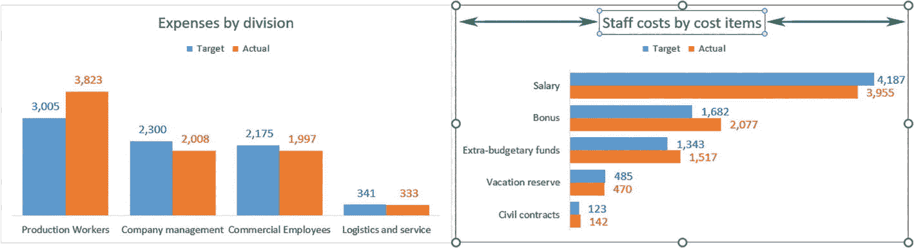

`提示！`
`我建议为所有后续操作复制一个`Dashboard`工作表的副本。这样既能保留草稿版本，又能看出标准`Excel`仪表盘与专业仪表盘之间的差异。`

### 4.1.1 在单元格中添加标题

处理新的仪表盘时，我们首先在单元格中创建并排列好标题，然后禁用图表上的标准标题。

将顶部图表稍微向下移动，以便为标题行腾出空间。在图表的左上角单元格中输入图表标题`付款动态`。

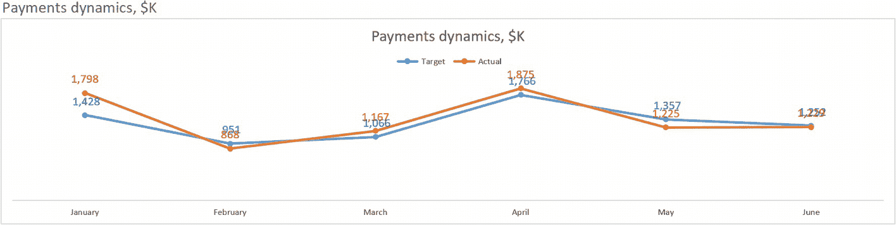

### 4.1.2 应用单元格样式

现在，我们需要为标题设置一种与普通文本单元格视觉上不同的样式。

在“开始”菜单选项卡中找到“单元格样式”部分（在较旧版本的 Excel 中为“样式”），然后从下拉菜单中选择“标题 2”。此选项将为包含标题的单元格的下边框添加浅蓝色轮廓线。

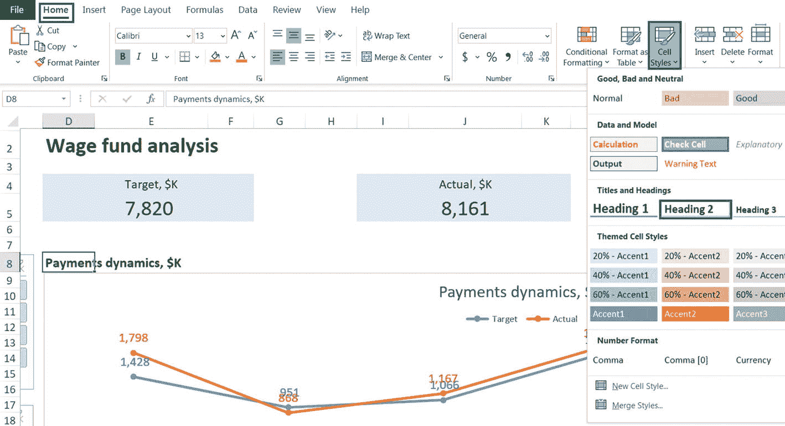

一张屏幕截图显示了一个包含工资基金分析图表的 Excel 文件。图中绘制了两条波动曲线，峰值出现在四月，达到最大实际值。

这条轮廓线将在视觉上区分仪表板上的各个语义块。它还会略微强调仪表板上元素的对称性和精确性。

Excel 中新标题的默认字体大小为 13 磅——我们将其设置为 16。然后，我们将通过图表右侧的绿色十字（“图表标题”项）或“设计”选项卡（“添加图表元素”按钮）来禁用图表块中的重复标准标题。

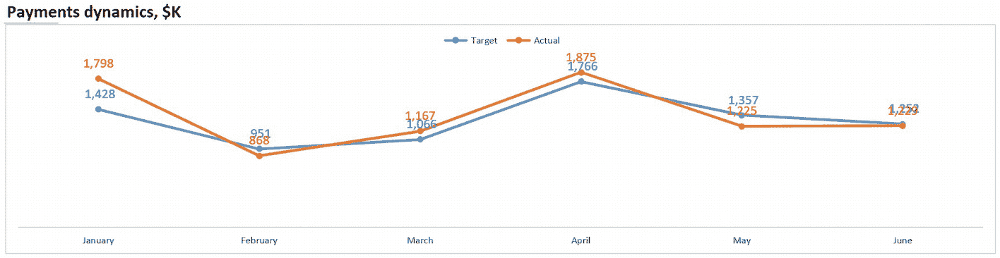

一月到六月间的付款动态折线图。图中绘制了两条波动曲线，峰值出现在四月，实际值最大为 1875。

### 4.1.3 将格式复制到相邻单元格

我们将在另外几个单元格中使用相同的格式。将光标放在带有图表标题的单元格中 ➤ 单击“开始”菜单选项卡中的“格式刷”按钮 ➤ 用鼠标选中标题之后到图表末尾的单元格。

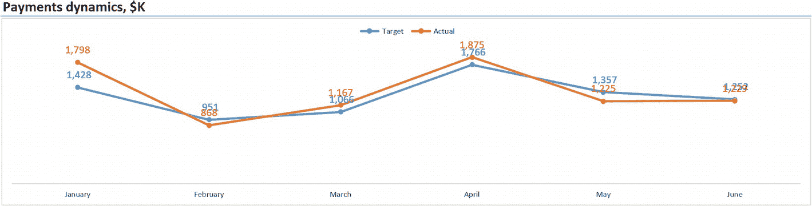

一月到六月间的付款动态折线图。图中绘制了两条波动曲线，峰值出现在四月，实际值最大为 1875。

如果一切正确，所有这些单元格的下边框上会出现相同的浅蓝色轮廓线。这条线带来了美观效果，同时也为仪表板上的所有元素设定了边界，并在视觉上区分了各个语义块。

现在关闭图表的轮廓线——这将使我们的成品摆脱典型的 Excel 功能特征，并为报告增添额外的通透感。为此，你需要：

-   选中包含图表的块。
-   单击“格式”菜单选项卡中的“形状轮廓”。
-   在下拉列表中选择“无轮廓”。

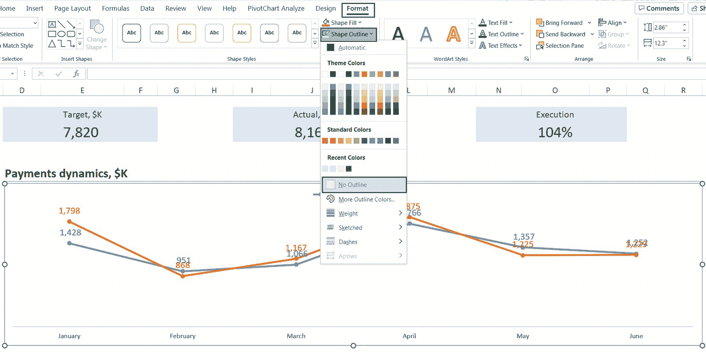

一张屏幕截图显示了一个包含工资基金分析图表的 Excel 文件。图中绘制了两条波动曲线，峰值出现在四月，实际值最大为 1875。

去掉轮廓线后，我们现在有了更多自由空间。将图例稍微抬高一点，并扩展图表的区域。这将使人们的注意力集中在数据上。

`提示！`
`将标题左对齐而不是居中对齐。这有助于避免仪表板上留下空白空间。你将能够在不堆积仪表板元素的情况下将图例抬高。`

在这一阶段，新标题下方已有足够的线条来创建清晰的仪表板结构。它们也与 Excel 网格绑定，在后续的可视化工作中不会发生偏移。图表标题的外观就是这样。

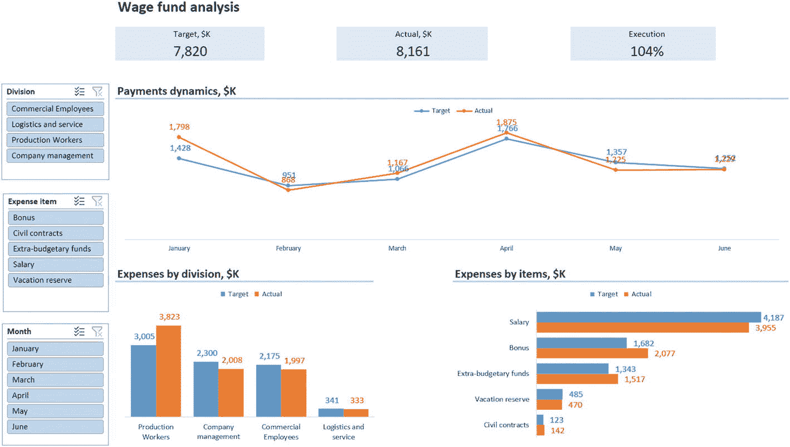

一张屏幕截图展示了付款动态、部门支出和项目支出三张图表。每个图表分别有实际值和目标值 8161 和 7820，执行率为 104%。

### 4.1.4 总结

我们通过在单元格中设计图表标题，启动了仪表板的新设计版本。它们将整个面板划分为语义块，并为其设定了清晰的结构。

我们在每个图表左上角上方的单元格中添加了标题。我们将它们左对齐，以避免留下空白空间。我们为带有标题的单元格选择了“标题 2”样式。我们将字体大小增加到 16，以定义语义块。我们禁用了图表内部的标准名称。我们将样式复制到标题右侧的单元格。我们禁用了图表轮廓并扩展了绘图区域。

## 4.2 在单元格之上创建新卡片

现在图表标题位于单元格内，这一点并不显眼。这简化了对齐并增加了图表的工作区域。但也有一些副作用。

下方图表之间的距离等于单元格的宽度，这个宽度本身相当大。要缩短这个距离，你必须减小 J 列的宽度。这将影响包含实际指标值的卡片：该值将不再适合列宽，并会显示为多个`###`字符。

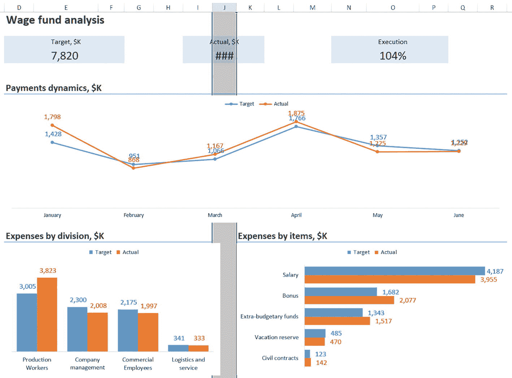

一张屏幕截图展示了付款动态、部门支出和项目支出三张图表。每个图表的实际值显示为哈希值，目标值为 7820，执行率为 104%。

合并单元格似乎是一个可行的解决方案。然而，如果卡片“存在于”单元格内部，这个问题总会发生。

例如，我想添加另一张显示平均月薪的卡片。那么我将不得不压缩并移动其他卡片，这反过来又会影响整个图表的对齐。

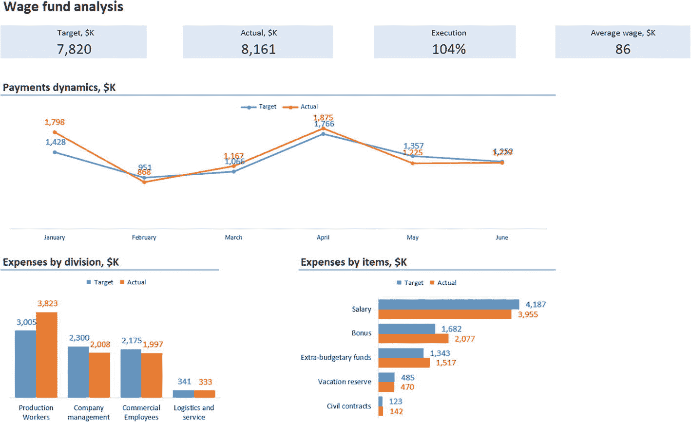

三张图表：付款动态、部门支出和项目支出。每个图表分别有实际值和目标值 8161 美元和 7820 美元，执行率为 104%，平均工资为 86 美元。

在创建仪表板并与客户商议时，你可能需要反复添加和删除卡片及图表。为了避免破坏对齐，我们将把卡片从网格单元格的边界中“解放”出来。我们将创建新的独立元素。

### 4.2.1 如何使用形状和文本框添加卡片

现代商业智能系统都带有卡片小部件。你只需添加一个指标，就会出现一个带有标题和最终值的样式化矩形。Excel 中没有现成的此类对象，我们将使用临时工具——矩形和文本框——来组装一个。

这看起来可能有点可笑，但这个技巧在 Excel 和其他程序中都会很有用。当仪表板布局非标准，并且需要将几个指标归入一个标题下时，它尤其方便。让我们仔细看看这个过程的步骤。

**第 1 步。** 点击“插入”选项卡中“插图”区域的“形状”按钮 ➤ 在下拉菜单中选择“矩形”形状。如果你的屏幕较大，“形状”按钮会直接显示在功能区内。

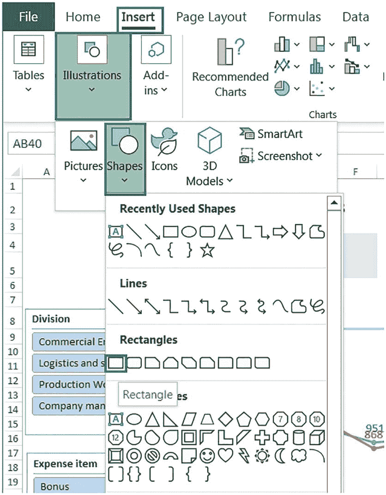

一张 Excel 表格的快照。已选中`插入`选项卡。其下选中了插图选项。在下拉菜单中选中了形状。选中了一个矩形形状。

**第 2 步。** 在第一个 KPI 卡片上方放置一个矩形。可以通过拉动形状的边缘来将其设置为任意大小。这不会影响表格中列的宽度。

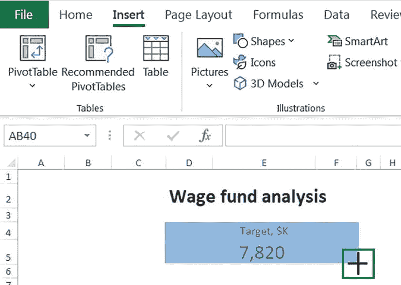

一张截图展示了一个 Excel 文件，其中包含文本“工资基金分析”，目标值为 7820 千美元，背景色为浅色。

**第 3 步。** 选中矩形，输入卡片标题：“目标（$K）”。设置字体大小（12）和居中对齐。

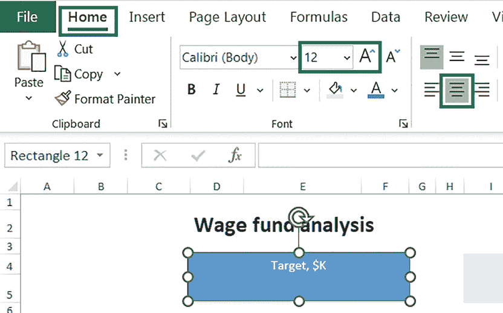

一张截图展示了一个 Excel 文件，其中列出了“开始”选项卡下的选项，包含文本“工资基金分析”，目标值为 7820 千美元，字体为 Calibri，字号 12。

**第 4 步。** 点击一个空白单元格以取消选中矩形。点击“插入”选项卡中“文本”区域的“文本框”按钮，将出现的项目放入矩形内。这个元素将用于添加我们的指标。

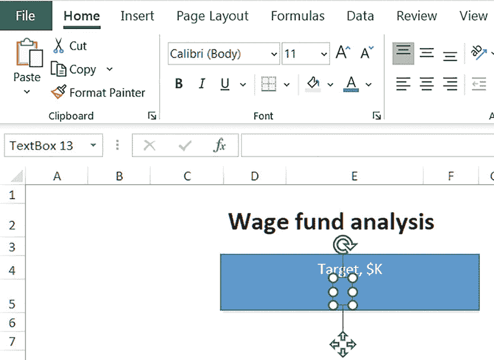

一张截图展示了一个 Excel 文件，其中列出了“开始”选项卡下的选项，包含文本“工资基金分析”，目标值为 7820 千美元，以及一个小对话框。

要向卡片添加指标，我们需要在数据透视表样本中创建一个新单元格。

### 4.2.2 卡片合计值放在独立单元格中

我们在草稿仪表板中编写了公式，以便用便捷的格式显示卡片指标，并避免使用过多字符。你也需要根据其特殊性来配置这种格式。

“矩形”和“标签”元素的公式栏中不能指定公式。如果尝试这样做，将会看到一条错误消息。

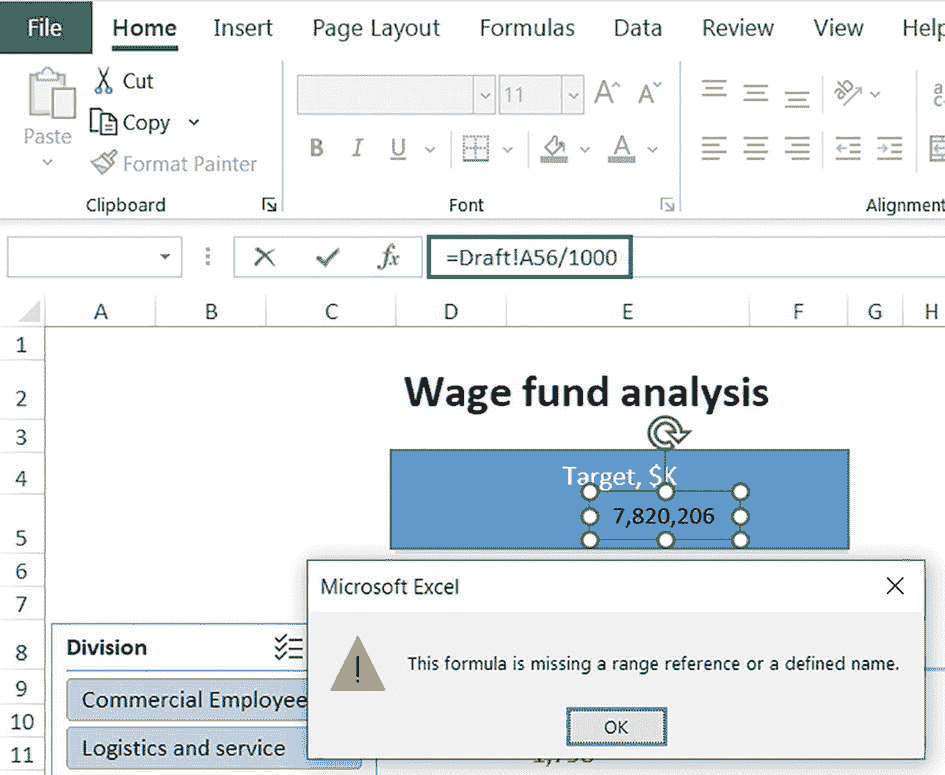

一张截图展示了一个 Excel 文件，其中包含文本“工资基金分析”，目标（千美元），以及一个小对话框，显示 7820206.02 和一个高亮的“确定”按钮。

要向新的卡片类型添加数字指标，我们需要在“草稿”工作表的“关键指标”样本下创建带有公式的单元格。

### 第 1 步。
选中样本第一列下的一个空白单元格，并在公式栏中输入以下值：`= A43/1000`，其中`A43`是包含计划指标的单元格地址，你需要减少其字符数。

### 第 2 步。
像之前一样设置新单元格的格式。这会降低位深度，并保留整数，不含小数。

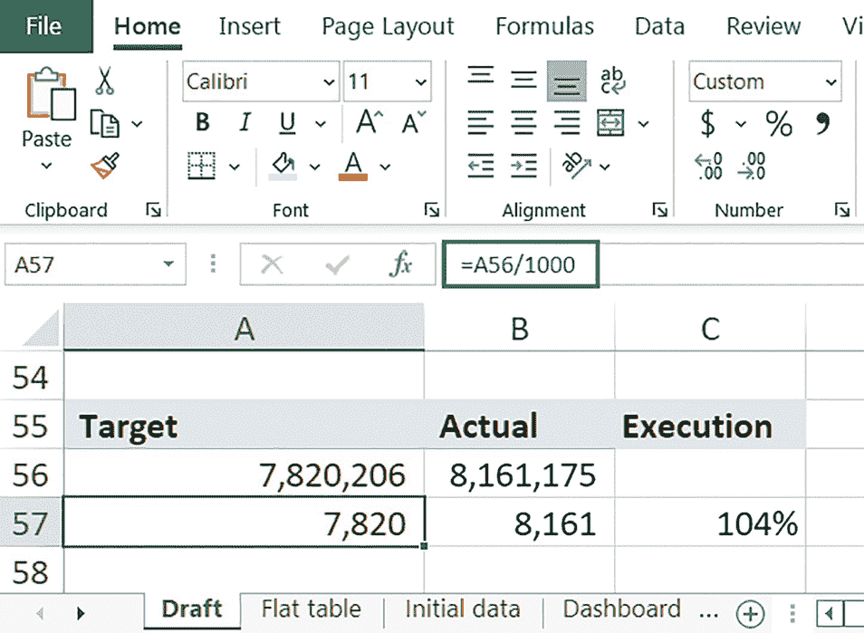

一张截图展示了一个 Excel 文件，其中 A、B、C 列分别含有目标值、实际值和执行率的合计，数值分别为 7820、8161 和 104%。

### 第 3 步。
在新版仪表板所在的工作表上，选中添加到卡片中的“文本框”元素，并在公式栏中指定一个指向包含所需指标的新单元格的链接。调整字体大小、颜色，并将指标位置设为居中对齐。

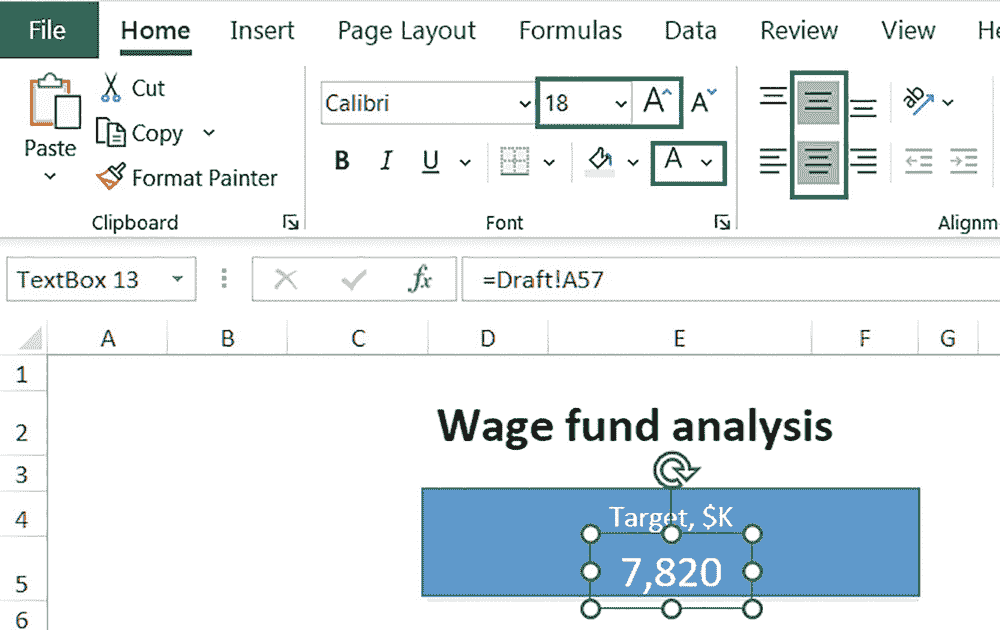

一张截图展示了一个 Excel 文件，其中列出了“开始”选项卡下的选项，包含文本“工资基金分析”，目标值，目标（千美元）7820，字体为 Calibri，字号 18。

用同样的方法，提前为另外两个卡片准备好带公式的单元格：

*   为“实际”指标设置公式，然后通过删除小数点来降低位深度。
*   在公式内部，为“执行率”卡片编写实际指标除以目标指标的计算公式。在“开始”选项卡的“数字”区域将结果转换为百分比格式。

### 第 4 步。
将卡片的各个元素相对对齐。按住`Shift`键，先用鼠标选中“文本框”元素，再选中“矩形”元素。在“形状格式”菜单选项卡中选择“对齐” ➤ “水平居中”。

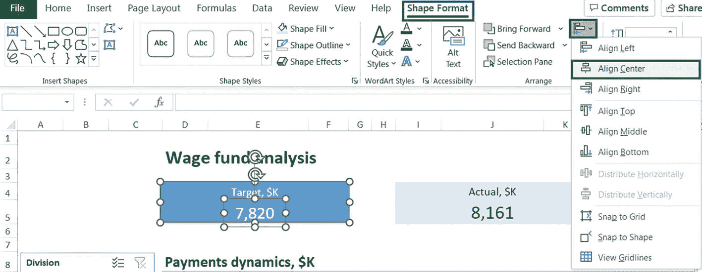

一张截图展示了一个 Excel 文件，其中包含文本“工资基金分析”，以及目标、实际、执行率。其下列出了“对齐”选项，并选中了“水平居中”。

### 第 5 步。
组合卡片元素。先选中“文本框”，再选中“矩形”。使用以下任一种组合方式：

1.  在“形状格式”选项卡上选择“对齐” ➤ “吸附到形状”。
2.  在右键菜单中选择“组合” ➤ “组合”。

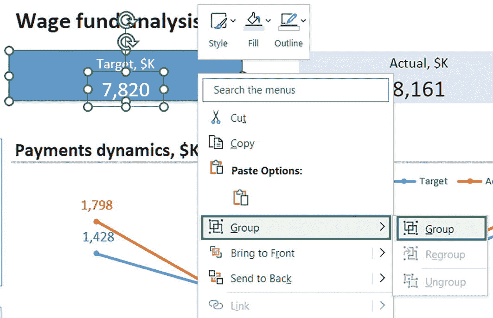

一张截图展示了一个 Excel 文件，其中包含工资基金分析的图表并显示目标值，其下列出了“组合”选项。

完成所有步骤后，我们就得到了一个组合好的“卡片”元素，其中包含目标指标。

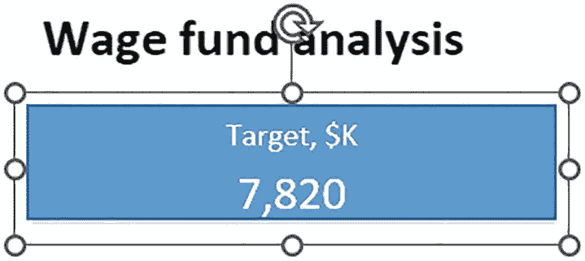

一张插图展示了文本“工资基金分析”和一个小对话框，内容为目标（千美元）7820。

## 4.2.3 复制卡片
我们的仪表板应该有三个关键指标卡片：“目标”、“实际”和“执行率”。为了避免逐一设置每张卡片，我们将使用熟悉的复制技巧。

为此，我选中“目标”卡片，按住键盘上的 `Ctrl` (或 `cmd`) 键，然后用鼠标将元素的副本移动到所需位置。我们将把这个副本变成包含实际指标的卡片。

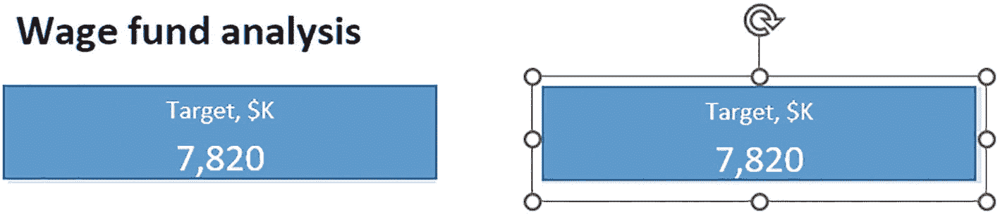

一张插图展示了文本“工资基金分析”，目标（千美元）7820，以及右边一个小对话框，内容为目标（千美元）7820。

我们将新卡片命名为“实际（$K）”，并更改指向“草稿”工作表中实际计算指标的链接。

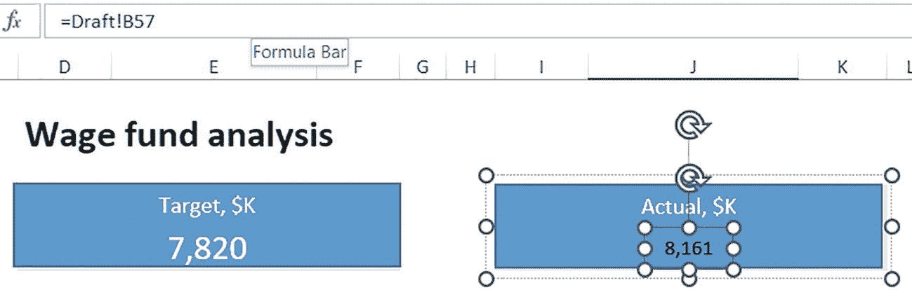

一张截图展示了一个 Excel 文件，其中包含文本“工资基金分析”，目标（千美元）7820，以及右边一个小对话框，内容为目标（千美元）8161。

此时，格式化标签的字体恢复为默认的黑色。这可能会让你觉得做错了什么。别担心——这只是 Excel 的又一个“小毛病”。深呼吸，手动重新调整字体：增大字号并将颜色改为白色。

## 4.2.4 如何修复背景样式
KPI 卡片上最主要的内容是指标——毕竟，它们是首先映入眼帘的部分。然而，此处明亮而“沉重”的填充色却抢了风头。我们需要更改元素的样式，使指标具有对比度并且清晰可见。

**提示！**

*不要追求标新立异，保持风格简约——浅色背景配深色字体（除非仪表盘设计有特殊要求）。*

打开“形状格式”选项卡（在旧版 Excel 中为“格式”选项卡）中带有形状样式的下拉菜单。

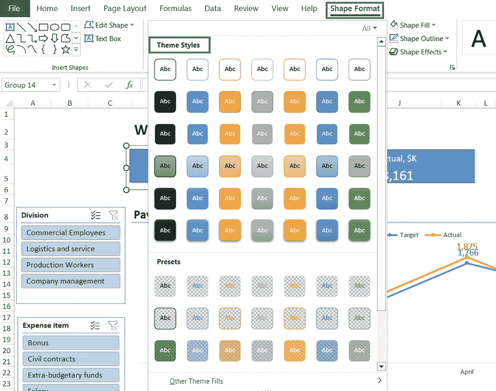

一张屏幕截图展示了一个 Excel 文件，其中列出了“形状格式”下的选项，包含不同的主题样式、预设及其他主题文件。

给定的选项都不符合我们的公司仪表盘设计。我们需要放弃现成的解决方案，创建自己的样式。我们将转到“形状格式”菜单选项卡，并设置以下参数：

*   形状填充：最浅的蓝色
*   形状轮廓：无轮廓
*   文本填充：黑色

现在我们得到了所需的简约风格。

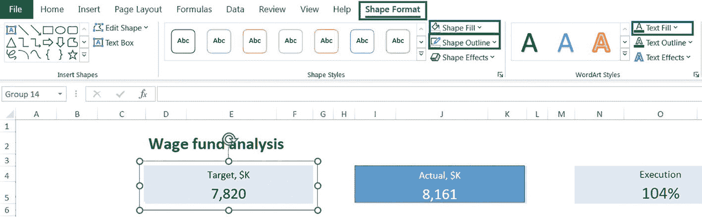

一张屏幕截图展示了一个 Excel 文件，包含文本“工资基金分析”、“目标”、“千美元 7820”，以及右侧一个显示“目标，千美元 8161”的小对话框。

我们对“实际”卡片重复相同的步骤，然后复制为“执行”卡片配置好的元素，在“草稿”工作表的“关键指标”样本中设置公式和格式。

一张图示展示了三个矩形框，分别对应目标值、实际值（7820 和 8161 千美元），以及 104% 的执行率。

在此示例中，我们选择了浅色填充并移除了轮廓。你也可以反其道而行之：移除填充，保留彩色轮廓。如果这样做，请选择颜色稍亮的线条，并将粗细增加到 2 像素。

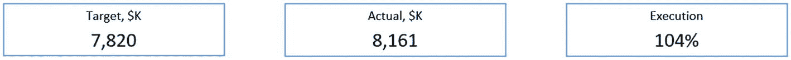

一张图示展示了三个矩形框，分别对应目标值、实际值（7820 和 8161 千美元），以及 104% 的执行率。

我们已经创建了不与 Excel 网格绑定的卡片。你可以根据自己的喜好更改它们的大小：这不会使仪表盘上的其余元素变形。

## 4.2.5 对齐新卡片
当卡片脱离 Excel 单元格层级后，你可以快速地在仪表盘上对齐它们。现在操作起来容易多了，因为你不再需要凭目测调整元素。

### 步骤 1.
沿图表边界对齐。首先，将“目标”卡片与“支出动态”图表的左边界对齐。选中两个元素，在“形状格式”选项卡的“对齐”按钮下，点击“左对齐”。

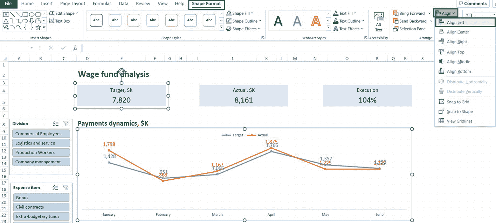

一张 Excel 表格的快照。其中包含一个工资基金分析图表，显示有目标值和实际值。在“形状格式”下，选择“对齐”选项。在其中，选择“左对齐”。

第三张卡片“执行”需要与“支出动态”图表的右边界对齐。我们也将选中两个元素，并在同一菜单项中点击“右对齐”。

### 步骤 2.
垂直对齐。这也相当简单：我们选中所有卡片，并在同一菜单中选择按上角、中间或下角对齐——选择最合适的方式。

### 步骤 3.
水平对齐。为了使卡片间距相等，选中所有卡片，并在菜单中点击“横向分布”。

我们通过三个简单的步骤，在仪表盘上完美地设置了卡片的位置。现在，卡片彼此之间以及与其他元素之间都已对齐。

## 4.2.6 总结
“独立”于 Excel 网格的 KPI 卡片为设计提供了更多可能。首先，它们的大小不会扭曲其他视觉元素的比例。其次，它们可以轻松地在仪表盘上移动。

以下是我们将卡片从网格中“解放”出来以使工作更便捷的具体做法：

1.  在包含 KPI 的数据样本下方，以所需格式创建用于计算指标的公式单元格。
2.  在仪表盘顶部添加“矩形”形状，并在其中添加卡片标题。
3.  在矩形中添加“文本框”元素，并将指向新样本单元格的链接放入其中。
4.  对卡片各部分进行分组，将“矩形”和“文本框”合并为一个元素。
5.  复制该元素并更改标题的单元格链接。我们还手动修正了偏移的格式。
6.  通过选择浅色背景配深色字体，更改默认的卡片样式。
7.  通过三个步骤对齐仪表盘上的卡片。

## 4.3 设计交互式切片器
移除多余元素是仪表盘设计的首要任务。我们已经在图表和 KPI 卡片上实践过这一点。工作区看起来“清爽”多了，同时内容一目了然。

切片器在背景上显得过于繁杂。我们将去除多余的轮廓，并为交互式报表设置正确的操作方式。

### 4.3.1 如何禁用切片器边框
我们需要禁用切片器边框以去除多余元素。这是仪表板在此阶段的样子。

截图显示了一个 Excel 文件，其中包含三个图表：付款动态、按部门划分的支出，以及包含实际值、目标值和执行率的项目。

Excel 为交互式切片器提供了多种不同的样式，但未提供无轮廓的选项。让我们换一种方式来处理。

### 第 1 步。
用鼠标选中任意切片器，然后在 `切片器` 菜单选项卡（旧版 Excel 中为 `选项`）中右键单击浅蓝色样式。在上下文菜单中选择 `复制`。

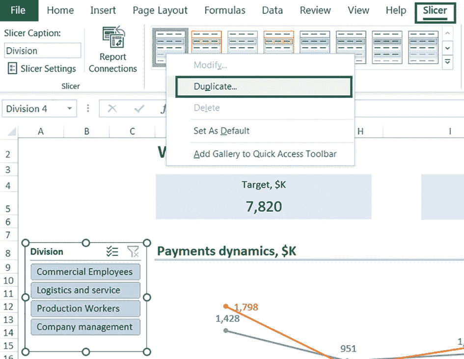

截图显示了一个 Excel 文件，该文件在切片器下方列出了选项，并选中了复制选项。其中包含一个图表，显示工资基金分析的目标值和实际值。

# 4.4 在 Excel 中处理颜色与字体

**第 2 步。** 在`修改切片器样式`对话框中，选择`整个切片器`，然后点击`格式`按钮。

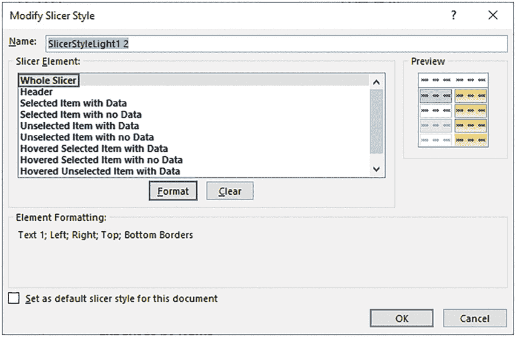

**第 3 步。** 将打开一个新窗口`切片器元素格式`用于配置参数：在`边框`选项卡上选择`无`，然后点击`确定`。

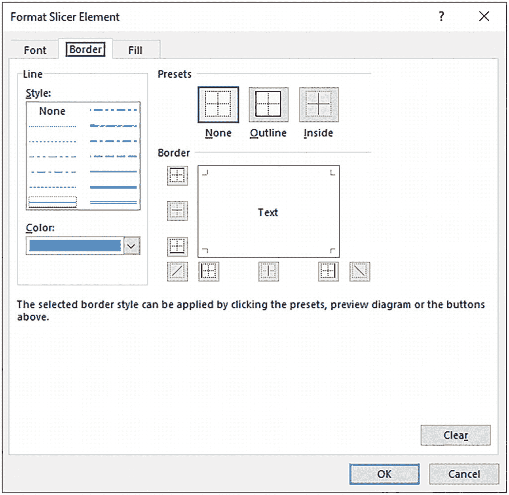

在第一个窗口`修改切片器样式`中重复点击`确定`。

**第 4 步。** 下拉菜单中出现了一个新的无轮廓切片器样式选项。要使用此选项，请按住`Ctrl`（或`cmd`）键选中所有切片器，然后点击该选项。

现在，我们的仪表板完全没有了多余的线条和视觉障碍。我们还获得了额外的工作空间：你可以将切片器拉伸覆盖几个月，并移除另一个不必要的元素——滚动条。

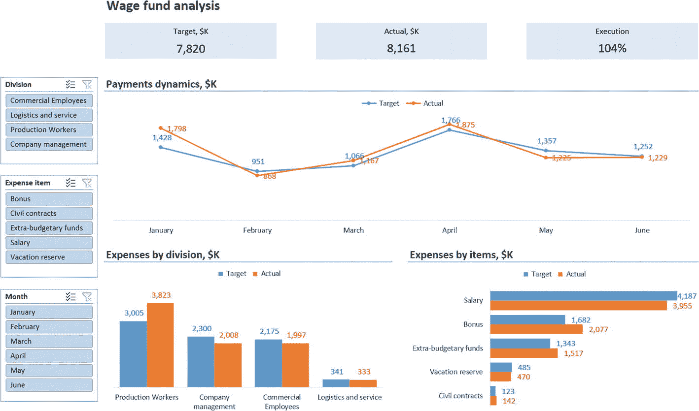

## 处理切片器和空白图表：避免错误

Excel 仪表板上的每个交互式切片器默认都会筛选所有图表——包括基于它们自身创建的图表。这在用户看来可能是一个错误。

例如，点击“月份”，我们在“支出动态”图表部分只会看到模糊的点，而不是正常的图形。

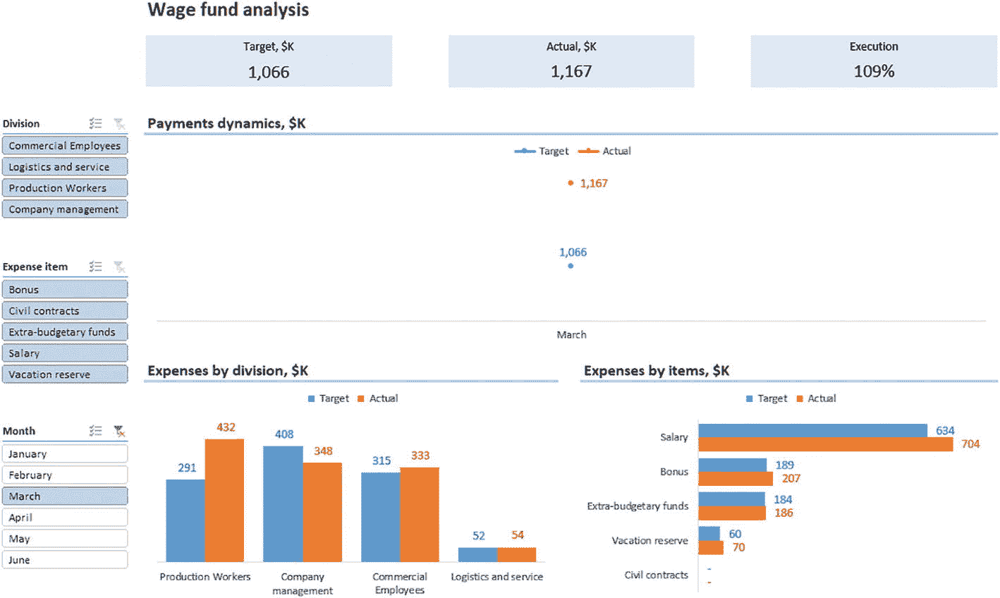

当选择特定的部门或支出项目时，也会发生同样的情况：与所用切片器关联的图表无法说明该类别相对于其他类别是好是坏。

如果你同时应用多个筛选器，仪表板可能会完全变得`空白`，这会让用户感到困惑。

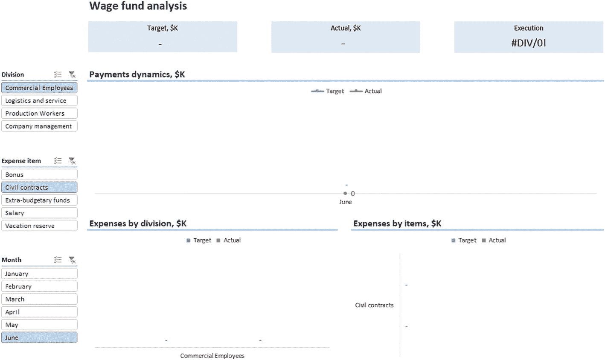

### 4.3.2 解决问题

为了在筛选时保留必要信息，我们将禁用图表上与其关联的切片器。我称之为`让切片器与自身断开连接`。我们在仪表板开发的最后阶段添加此设置。

我们需要一个窗口来列出与切片器连接的报告。可以通过两种方式打开：

1.  选中切片器 ➤ 右键单击打开上下文菜单 ➤ 选择`报告连接`。
2.  选中切片器 ➤ 转到`切片器`菜单选项卡（旧版 Excel 中为`选项`） ➤ 选择`报告连接`按钮。

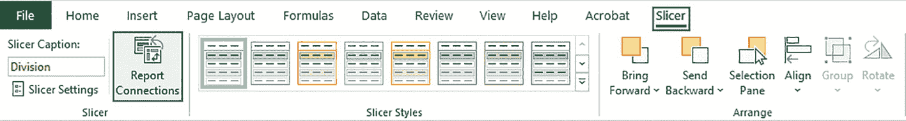

我们将在打开窗口的标题括号中看到正在设置的切片器名称：这就是我们在第 1.3 节中为数据透视表命名的原因。现在我们需要取消选中与切片器同名的数据样本旁边的复选框。

例如，如果我们正在设置按部门划分的切片器，则需要取消选中`部门`字段旁边的复选框。使用此切片器时，`按部门支出`图表将不会被筛选。

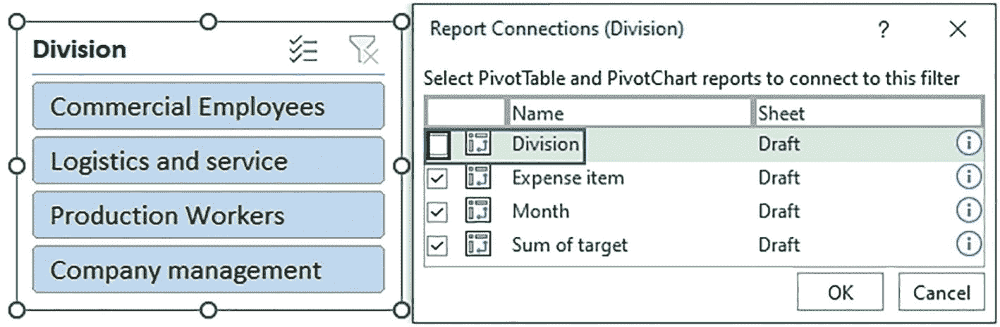

我们应该对所有其他切片器执行类似的操作：`按月份`筛选器应对`月份`样本禁用，按支出的筛选器应对`支出项目`样本禁用。

此设置将防止筛选器影响同名的数据集：你可以使用任意切片器，所有视觉元素将保持原位，不会给用户造成混淆。

以下是同时应用多个筛选器时我们可以得出的一些结论：

-   公司管理层四月份的工资占计划值 153,000 美元的 88%——这是我们可以在卡片上看到的信息。
-   `支出动态`图表显示了公司管理层的工资目标值和实际值各月变化情况。
-   我们可以在`按部门支出`图表中将公司管理层四月份的工资总额与其他部门的指标进行比较。该工资低于生产人员和商业雇员，但高于物流与服务部门雇员。
-   `按项目支出`图表显示公司管理层的多数支出以奖金形式支付：四月份，该部门的工资支出排在第二位。

仪表板上不再有空白区域：正确的切片器配置使每个图表的信息量最大化。

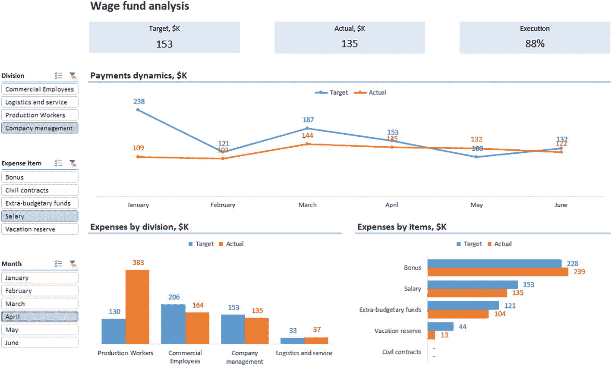

### 4.3.3 总结

我们在仪表板开发的最后阶段自定义了交互式切片器的外观和功能。以下是我们所做工作的简要总结。

要禁用切片器的轮廓，我们：

-   选择了一种合适的浅蓝色切片器样式
-   通过在设置中移除边框来修改该样式
-   将新样式应用于所有切片器

要将切片器连接到数据样本，我们：

-   在菜单中选择`报告连接`功能
-   禁用每个切片器对其关联图表的影响
-   在仪表板上测试配置好的切片器的工作效果

## 4.4 在 Excel 中处理颜色与字体

在开发仪表盘的草稿版本时，我们使用了标准的 Excel 主题。它有其优点：无需花费太多时间，而且蓝色和橙色之间能形成良好的对比。

缺点也同样存在：这种仪表盘看起来不够原创，更谈不上高级。我们将它作为草稿版本，并继续进行高级设计。我们的任务是创建一个在视觉上不同于标准 Excel 风格的仪表盘。

让我们首先研究一下程序提供的工具。它们之间有何不同？我们又该如何选择合适的工具？

用于设置“最终”参数的工具：

-   **调色板** – 这些是能相互很好搭配的颜色集合（按 MS Office 创作者的说法）。
-   **字体** – 任何选择都会更改仪表盘上所有元素的字体。
-   **主题** – 每个主题都包含一组“和谐”的颜色以及一组字体。

所有这些都可以在`页面布局`菜单选项卡的`主题`部分中找到。

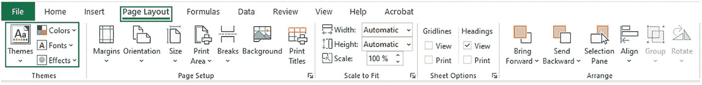

### 4.4.1 如何处理调色板

这个选项适用于你对仪表盘上的字体和字号感到满意，但仍需避免使用标准颜色设计的情况。

单击`颜色`按钮可以查看所有可用选项 – 下拉列表中有超过 20 种组合。将鼠标悬停在调色板上，就能看到每种组合在仪表盘上的效果。

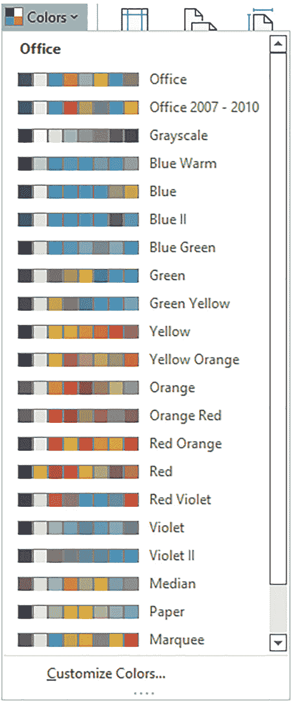

### 4.4.2 不成功的相似调色板

在这些选项中，有许多是单色、缺乏对比的组合。它们无法突出数据，会使仪表盘变成一块单色画布，我不建议使用它们。以下是几种此类调色板。

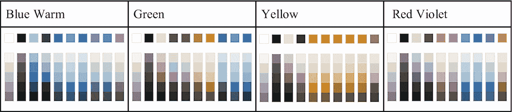

另一个缺点是缺少用于可视化偏差的颜色集合。我们使用红色来聚焦负面指标，使用绿色来聚焦正面指标，而黄色有助于标记接近临界值的数值。Excel 中缺乏对比度的调色板通常只包含其中一两种颜色。

这就是使用`红色和紫色`调色板时仪表盘的效果。

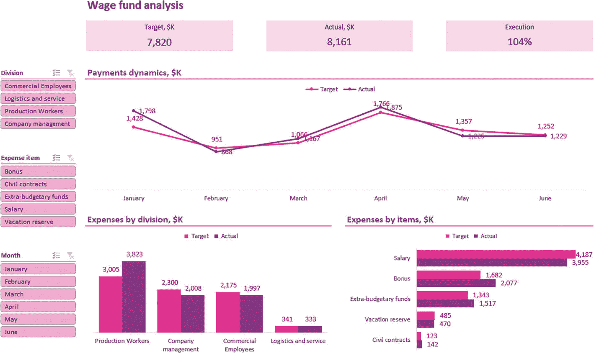

在这种颜色搭配中，没有任何东西能吸引眼球：没有视觉重点。即使是`目标`和`实际`之间也没有区别，尽管它们之间应该形成清晰的对比。任何图表的目的都是为了简化比较并使其可视化。

### 4.4.3 合适的调色板

Excel 中也存在好的调色板。通过引入一些小的改进，完全有可能设计出像样的仪表盘。以下是一些示例。

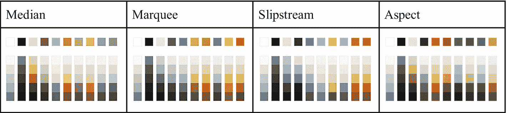

这些调色板已经更加均衡，并且包含一套颜色来聚焦偏差，提供了多种组合以达到所需的对比度。

在选择调色板时，你不必选择 Excel 能自动为所有元素上色的选项。所有元素都可以修改：你可以更改卡片、切片器、图表柱形和线条的颜色。选择所需元素，然后使用功能区主选项卡中的`填充颜色`按钮或右键菜单中的相应选项。

举例来说，我将重点介绍`Aspect`调色板。它存在以下几个缺点，如下所列：

-   背景卡片颜色，虽然不鲜艳，但仍与文本冲突。
-   目标和实际指标之间的对比度不足，这些类别的数据标签几乎不可见。
-   `实际`柱形是红色的，这会被视为偏差和负面指标。

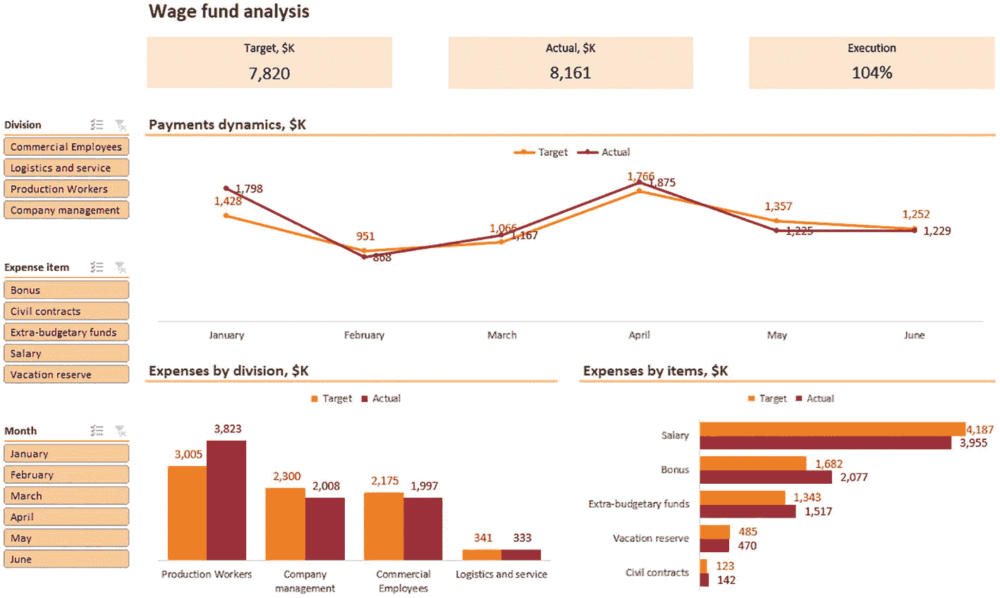

让我们尝试编辑原始版本，绕开它的这些缺点。以下是我所做的操作。

1. 为 `目标` 和 `实际` 参数选择了对比色，使它们不与偏差颜色关联。我选择了蓝色和棕色。
2. 为卡片和切片器选择了调色板中最浅的色调 - 浅棕色。
3. 将标题颜色从黑色改为深棕色，使其不引人注目。
4. 为标题分隔线选择了一种和谐的棕色色调。
5. 将数据标签重置为比柱形和线条稍暗的色调。

结果是一个配色更柔和的仪表盘，通过 `目标` 和 `实际` 之间的对比来突出数据。

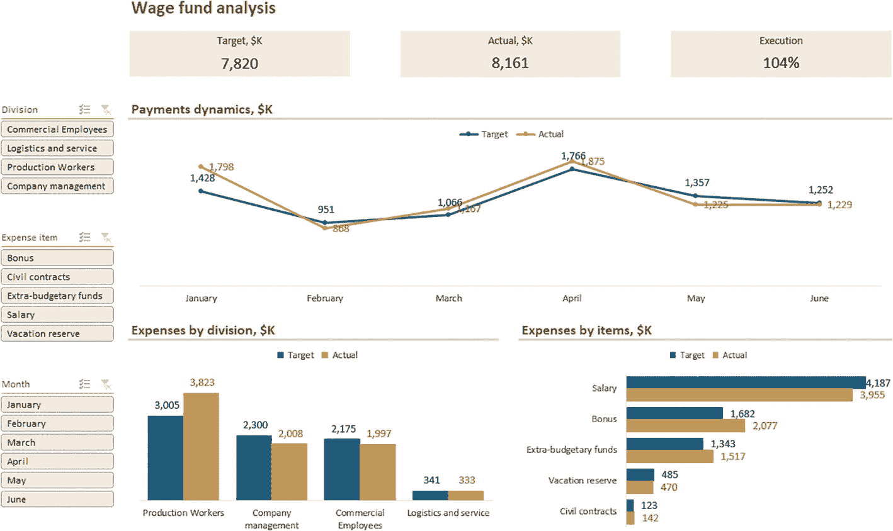

截图展示了工资基金分析，包含三个图表（付款动态、各部门费用、各项费用），以及部门、月份和费用项目字段，采用深色主题。

### 4.4.4 处理字体：要点

如果你想像真正的设计师一样“玩弄字体”，你也可以在 `页面布局` 选项卡的 `主题` 部分进行设置：下拉列表中有超过 25 个选项。

字体似乎没什么难度。然而，它们既影响仪表盘的外观，也影响其整体观感。

请注意：字体会在仪表盘的所有元素上自动更改，但 KPI 卡片中的标签和指标除外。微软连这些细节都没处理好。你将需要手动更改卡片中的字体。正是这些细微之处，区分了专业作品与业余之作。

说明文字和标题的字体可以不同。重要的是，说明文字应使用“最干净”的字体，不带衬线和其他装饰。

另一个重要规则是，在所有图表和图形中，数据标签和说明文字应使用相同的字体大小。如果我们在一个关于支出动态的图表中选择了 12 号字体，那么它应该对所有视觉元素保持一致。

**提示！**

*避免使用粗体、带衬线、高密度或小字间距的字体。字体不应吸引过多注意力。最好选择传统的 Arial、Calibri 或 Tahoma。*

总的来说，如果你对仪表盘上已有的字体不满意，我建议直接转到同一菜单中的主题选择。

### 4.4.5 使用主题

主题是预设了颜色和字体的设计选项。任何主题都可以进行修改和调整。我来演示一下如何选择一个更省时的选项。

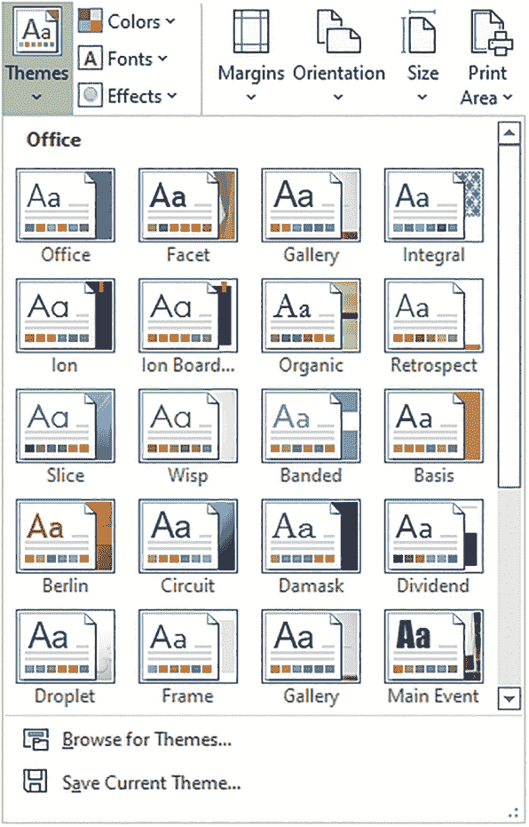

主题下的下拉选项。其中列出了各种 Office 主题。可以浏览主题并保存当前可用主题选项。

选择主题时，请注意题注的字体：在某些 Excel 选项中，这个参数可能会抵消仪表板的所有优点。如果你应用 `Main Event` 主题，就会发生以下情况。

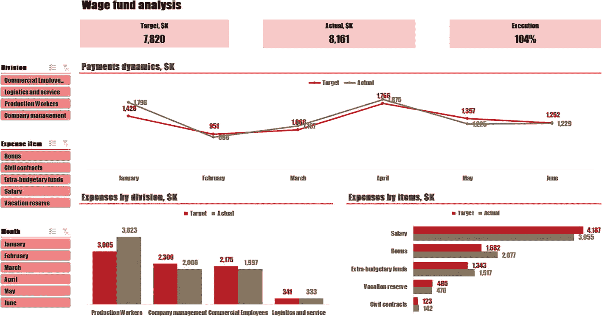

截图展示了在深色主题下，包含支付动态、各部门和项目支出等 3 个图表，以及部门、月份和支出项目字段的工资基金分析。

直说吧：这简直糟透了。一个毫无用处的样式，既没有意义又毫不留情。我希望每次我看到这些选项时，微软的某个人都会开始打嗝。颜色和字体都不好用。我会尽量控制情绪，尽可能客观地分析这个 Excel 设计的“奇迹”。

**技术故障分析**

-   卡片标题的粗体字体分散了对数据的注意力。
-   直方图上的类别标签无法水平显示——同样因为粗体而丢失。
-   出于同样的原因，图例反而更吸引眼球。
-   粉红色卡片上的黑色字体，以及在深红色切片器上更是如此——导致难以阅读。
-   红色与负面指标相关联：感觉公司好像 `处于亏损状态`。

要优化主题，可以更改单个颜色或使用不同的调色板。也可以更改仪表板上所有元素的字体。我们不会用 `Main Event` 主题来修改：纠正其缺陷需要太多时间。

**提示！**

*选择主题时，请优先考虑对比鲜明的选项：同一颜色的不同色调会使信息难以阅读，且无法突出显示所需的数据。*

**更改主题中元素的颜色。** 选择一个项目，然后在上下文菜单或功能区的常用选项卡中使用 `填充颜色` 按钮选择一种新颜色。

**更改主题中的颜色组合。** 在 `页面布局` 选项卡的 `颜色` 下拉列表中，选择不同的调色板。新的颜色组合将自动应用于仪表板上的所有元素。主题的字体将保持不变。

**更改主题字体。** 在 `页面布局` 选项卡的同一菜单中，从 `字体` 按钮下的下拉列表中选择所需选项。

**请注意，某些主题为文本标签和数字 `内嵌` 了不同的字体。** 它们的轮廓通常相似，但字符的粗细和密度可能有所不同，以便数字保持可见且不会丢失。

这些选项包含在 `Badge` 和 `Parcel` 主题中。

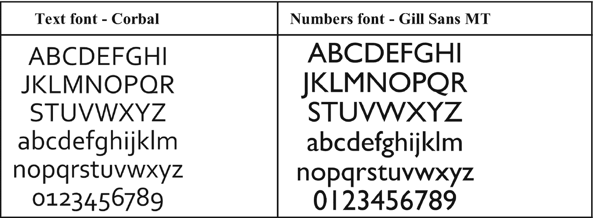

一个表格有两列，标题分别为“文本字体-corbal”和“数字字体-gill sans M T”，并分别展示了不同大小的字母和自然数。

**使模板图表适应新主题**

默认情况下，所选的颜色主题（以及调色板）不会影响从模板创建的图表。`按项目支出` 图表可以作为一个例子。

要正确地重新着色，我们将重复第 3.5 部分中处理模板的步骤。

1.  将自定义的 `按部门支出` 图表另存为模板，不要更改 `保存` 目录的路径。
2.  选择 `按项目支出` 可视化对象，在上下文菜单中选择 `更改图表类型`，并在 `模板` 文件夹中指定所需的选项。
3.  模板会将图表转换为直方图。要修复此缺陷，请重复 `更改图表类型` 过程，并从菜单中选择所需的图表。
4.  调整条形图上的排序，以便 `目标` 和 `实际` 在列和图例中都按正确顺序排列。

### 4.4.6 小结

在本部分中，我们暂时离开了仪表板的操作，来熟悉 Excel 为 `最终` 设计提供的工具。

-   要为仪表板选择颜色和字体，请使用 `页面布局` 菜单选项卡中的 `主题` 部分。
-   如果你对仪表板上的字体感到满意，但仍想摆脱标准的颜色设计，请在 `颜色` 按钮中测试不同的调色板。
-   确保所选的调色板包含红色、绿色和黄色，以突出显示偏差。
-   如果你需要更改颜色组合和字体，请使用同一菜单部分中 `字体` 按钮下的主题。
-   确保所选主题中存在对比色：它们将有助于吸引人们对数据的注意。
-   如有必要，可为单个元素或整个报表更改调色板和主题颜色。

### 4.5 改进标准 Excel 主题

在设计问题上，没有绝对正确的观点，最终决定权通常在于客户。这就是为什么我的团队总是为客户提供几种仪表板设计方案：白色背景的极简版本、对比鲜明的深色版本以及中间色版本。

在本部分中，我将展示如何在 Excel 中基于标准主题快速创建设计方案。我们将使用客户最常选择的样式——极简浅色和带有明亮强调色的中间色。

#### 4.5.1 示例 1：主色应具有对比性

我们以 `Facet` 主题为例。我们已经看过同名的调色板，但这个主题看起来完全不同。这里的默认设计是不同深浅的绿色。

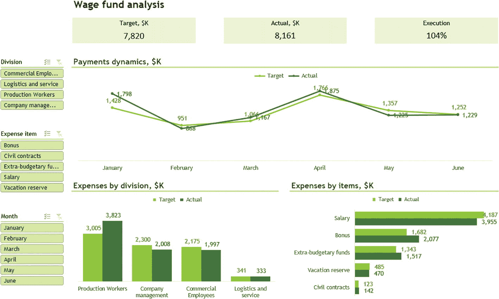

截图展示了在浅色主题下，包含支付动态、各部门和项目支出等 3 个图表，以及部门、月份和支出项目字段的工资基金分析。

**为什么这个主题合适**

默认结果可能看起来不太合适。但是，如果我们查看可用的颜色集并分析字体，就会发现这个主题是可以优化的。

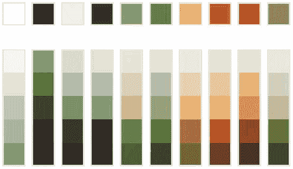

截图展示了一个包含深色、浅色和淡色不同调色板的主题。

-   有颜色可以突出显示偏差。绿色、红色和黄色饱和度良好，在其他颜色背景下会很明显。
-   可以为 `目标` 和 `实际` 指标选择对比色——例如蓝色和棕色。
-   可用的调色板允许你为其余仪表板元素选择合适的色调。
-   主题字体为无衬线字体，字形正常。所有数字大小相同——易于阅读。

**分析缺陷**

首先，这种绿色组合缺乏对比度：目标和实际的柱状图融合成了一片模糊的形状。

其次，绿色与积极结果相关联。因此，客户可能会忽略实际支出超出计划数的净额。

第三，卡片和切片器中的颜色亮度接近 `目标` 列填充的亮度。我们需要调暗服务元素的背景，这将突出数据可视化。

**解决问题**

我们将为卡片和切片器选择浅绿色和浅黄色的色调，以免它们过于引人注目。

我们将为标题指定一种暗灰色，使其能更好地融入新的配色范围。

我们将为 `Target`（目标）列和线选择一种对比色，使其与其他元素区分开来。此处选择的对比色是黄色。

我们将为 `Actual`（实际）列和线保留默认的绿色。

我们将把数据标签的颜色设置为比对应列稍暗的色调，以便让它们更清晰可见。

最终结果是，使用相同的色彩主题 `Facet`，打造出了一个风格迥异的仪表板。

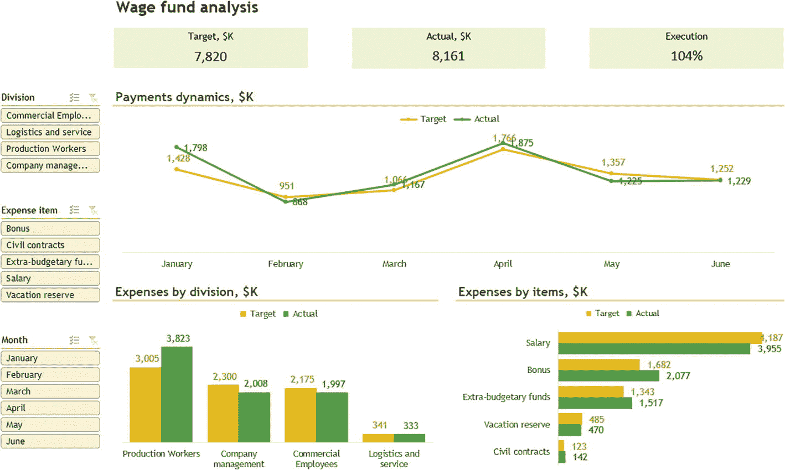

该截图展示了工资基金分析，包含 3 个图表（付款动态、按部门划分的费用及费用项目），以及部门、月份和费用项目字段，整体采用浅色主题。

#### 示例 2：降低服务元素的亮度

让我们来看 Excel 中的另一个选项——`Badge` 主题。它虽然提供了不错的调色板，但默认情况下黄色过多，并且切片器过于饱和的颜色会分散对数据的注意力。

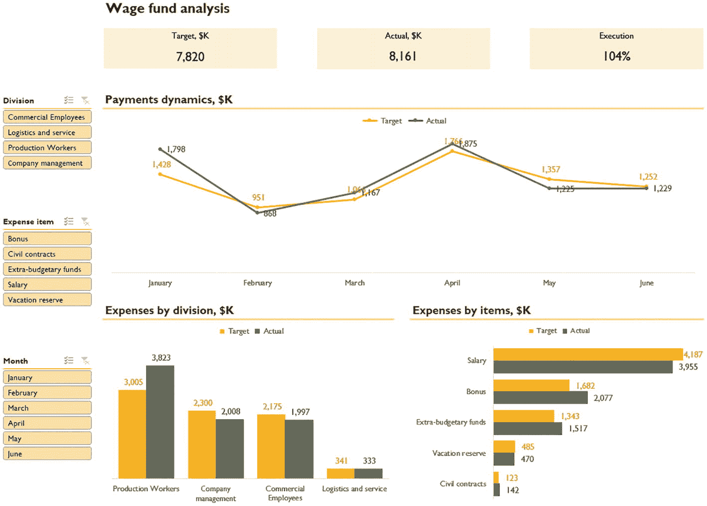

该截图展示了工资基金分析，包含 3 个图表（付款动态、按部门划分的费用及费用项目），以及部门、月份和费用项目字段，整体采用深色主题。

**为何该主题适用**

此调色板提供了我们完成设计所需的色彩选择。

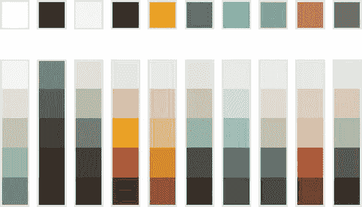

该截图展示了一个包含深色、浅色和褪色多种调色板的主题。

# 仪表板色彩主题的设计与调整

-   它具有强调正面和负面指标的色彩：绿色、红色和黄色。

-   主色有两种选择。第一种方案是 `golden`（金色）用于 `Target`，橄榄绿用于 `Actual`。第二种方案是蓝绿色用于 `Target`，紫色用于 `Actual`。每种组合都具有恰当的反差。

-   主题的字体很好——字母没有衬线或装饰，数字均匀且易于阅读。

## 分析缺陷

你可以在该主题中找到一些小瑕疵，但我建议我们重点关注其最大的缺陷。所有元素上大量的黄色分散了对数据的注意力——你需要在仪表板上费力地寻找所需信息。

## 解决问题

-   更改卡片和切片器的颜色以消除黄色的饱和度。我降低了它们的亮度，设置了一种通用的浅灰色调。

-   从主题调色板中为图表标题下方的分隔线选择另一种颜色。我选择了浅紫色。

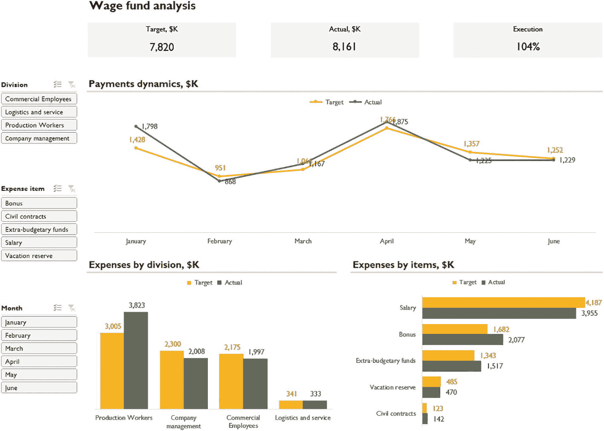

该截图展示了工资基金分析，包含 3 个图表（付款动态、按部门划分的费用及费用项目），以及部门、月份和费用项目字段，整体采用深色主题。

如果我们把指标的颜色改为蓝绿色和紫色，并反转卡片上的颜色，我们将得到一个风格完全不同的仪表板。

该截图展示了工资基金分析，包含 3 个图表（付款动态、按部门划分的费用及费用项目），以及部门、月份和费用项目字段，整体采用浅色主题。

我提到过，我建议在卡片上使用浅色背景和亮深色字体。然而，采用高饱和度填充的选项看起来更独特，有些客户可能更喜欢。

需求创造供给。有时客户会要求“带有装饰图案的金色背景配黑色文字”，因为他们从未见过其他“高级”设计的例子。这也是为什么我们提供多个设计方案供选择的原因。

随着每天使用仪表板，客户会逐渐明白，浅色背景上的黑色文字读起来更方便。

### 示例 3：仪表板的背景不一定是白色

让我们看看 Excel 的另一个选项——`Parcel` 主题。这里也有大量的黄色，但即使在默认版本中，`Target` 和 `Actual` 的对比度也很好。你可以保持原样，也可以再花半小时，超越客户的预期。

该截图展示了工资基金分析，包含 3 个图表（付款动态、按部门划分的费用及费用项目），以及部门、月份和费用项目字段，整体采用深色主题。

## 为何该主题适用

乍一看，由于其中性的柔和色调，这个调色板可能显得过于苍白。但你仍然可以使用这些色调创建出既原创又功能完备的仪表板风格。该调色板提供了有趣的色调——砖红色、橄榄绿和金色——取代了经典的“交通灯”色（绿、黄、红）。

该截图展示了一个包含深色、浅色和褪色多种调色板的主题。

## 分析缺陷

该主题本身没有明显的缺点，但在使用过程中，你可能会得到过于苍白或彼此融合的颜色。如果你不信任自己的直觉去选择合理的色彩组合，那就不要冒险。

例如，这里该主题对于仪表板来说就不太合适，结果一切都是黄色的。这正是我们需要修复的问题。

## 解决问题

我们决定摆脱标准的 Excel 布局——现在需要记住，白色背景只是一种选择。只要不是太亮，你可以使用任何颜色。

为了改变背景颜色，我通过点击 Excel 工作表左上角、行号上方的三角形来选中所有单元格。我选择最浅的灰色作为填充色。图表区域的填充色将保持白色。

我为切片器选择了浅蓝色而非黄色，这立即使得我们的仪表板更加沉稳。我指定深蓝色作为卡片背景，使卡片更醒目。

我将设置 `Target` 和 `Actual` 的列和线使用其他颜色进行对比——分别使用砖红色和橄榄绿。

该截图展示了工资基金分析，包含 3 个图表（付款动态、按部门划分的费用及费用项目），以及部门、月份和费用项目字段，整体采用深色主题。

> **注意**
>
> 我移除了标题下方的线条，这些线条之前创建了语义块之间的清晰边界。现在这个功能由图表的白色背景来承担，这意味着不再需要额外的线条，不必用它们来使界面过载。

## 总结

我们弄清楚了如何以不同风格快速设计仪表板并向客户提供选择。同时，我们也从常见的蓝橙配色方案中衍生出了几种新的选项。

-   我们在 `Facet` 主题中修改了颜色，将原本混为一体的绿色仪表板改成了亮绿色和黄色。

-   我们使用 `Badge` 主题创建了两种不同颜色的变体：平静的灰色（强调数据）以及蓝绿色配紫色。

-   我们在 `Parcel` 主题中更改了工作区颜色，并为主要指标选择了浓郁的橄榄绿和柔和的砖红色。

该截图展示了工资基金分析的 4 个页面，包含 3 个图表（付款动态、按部门划分的费用及费用项目），以及部门、月份和费用项目字段，采用了多种色彩主题。

尝试改进标准主题。不要犹豫，向客户展示你的成果：请他们做出选择并解释原因。这将有助于使未来的仪表板版本更适合用户。

## 4.5.5 色彩主题适配检查清单

*我建议遵循以下清单自行选择颜色。这些规则既适用于 `Excel`，也适用于其他数据可视化工具。*

1.  色板的主色调具有对比性。可以使用绿色、红色和黄色的渐变色调，或者至少包含其中两种颜色。

2.  KPI 卡片的背景不与文字冲突。在浅色背景上选择黑色或深灰色字体。有时，白色字体搭配深色背景（例如蓝色）效果也不错。

3.  图表中的柱状图彼此不重叠。选择对比色对，例如蓝色和橙色。或者只突出一个重点：用明亮的“实际值”和灰色的“目标值”。

4.  数据标签清晰可见。其颜色应比图表的柱形或折线稍浅或稍深——不要让数值难以辨认。

5.  辅助元素（例如切片器）的背景应暗淡。灰色是通用选择，或者使用主色调中最浅的颜色。

6.  附加图形元素（如图表背景、标题、分隔线）颜色应更淡——它们不应吸引过多注意力。

7.  图表中的主要文字（如数据标签、坐标轴）应保持统一。标题和卡片除外。