# 5. 企业形象

我们已经了解了如何向客户提供不同于标准版的设计方案。但大型公司通常已有批准的企业风格，仪表板必须与之匹配。

更改图表的字体和颜色并不困难——这已经能带来 80%的预期效果。但专业人士与业余爱好者的区别恰恰在于剩下的 20%的细节。

在本章中，您将学习仪表板元素的微调。得益于这些细节，有些客户甚至没有意识到这只是一个普通的 `Excel`，而不是昂贵的 BI 系统。商业客户会对此类工作给予更高的评价。

## 5.1 根据品牌手册创建主题

许多公司都有企业风格报告的模板。最常见的是传统的演示文稿，其中已包含正确的颜色、字体和其他元素（例如徽标）。但有时，公司有企业风格，却还没有可以提取这些元素的文档。

在本部分，我们将处理这两种情况。首先，我们将学习如何在 `Excel` 中为仪表板设计创建自己的主题。然后，我们使用来自 `PowerPoint` 演示文稿的现成主题模板。

### 5.1.1 如何从头创建主题

当然，您可以手动更改仪表板上每个元素的颜色，并为每个元素设置所需的字体。但这会花费很长时间。我将向您展示如何节省时间，并尽可能快速地在 `Excel` 中创建一个“企业”主题。

我将以商业智能研究所的品牌手册为例来演示这一过程。以下是构成新主题的企业风格元素：

-   浅色背景颜色：浅黄色 `#FFFCEB`
-   深色背景颜色：深棕色 `#1F1A1A`
-   品牌颜色：黄色 `#F8C845`，砖红色 `#CB5033`，蓝色 `#2C4A94`，绿色 `#008864`
-   字体：`Montserrat`

让我们在 `Excel` 中设置这些颜色，添加所需的字体，并将整个集合保存为一个新主题。

**第 1 步。** 在左上角的“页面布局”选项卡中，选择“颜色”下拉菜单，并点击其中的“自定义颜色...”项。将打开“新建主题颜色”窗口——我们将在此窗口中构建调色板。

**第 2 步。** 点击每一行中的三角形，打开菜单并选择其中的“其他颜色...”。将打开一个新窗口，我们在此设置所需颜色的代码。这样，我们指定了深色和浅色背景的颜色，并在“强调文字颜色”行中设置其余颜色。

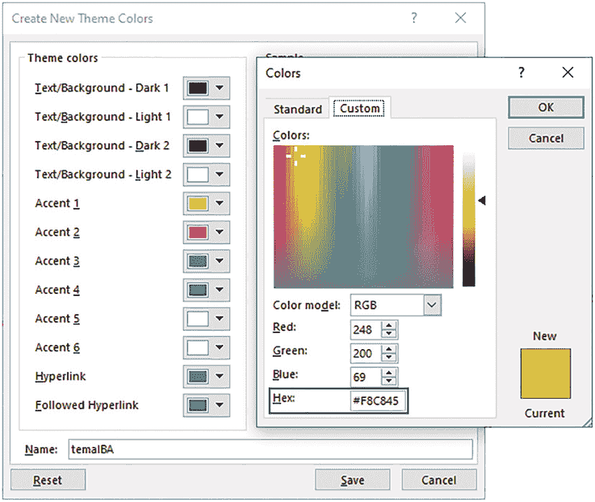

**第 3 步。** 所有颜色配置完成后，在“新建主题颜色”窗口中，为我们的主题命名，然后点击“保存”。

**第 4 步。** 进入字体设置。在“页面布局”菜单选项卡中，选择“字体” ➤ “自定义字体...”。输入 `Montserrat` 字体的名称，在下一行指定我们新主题的名称，然后点击“保存”。

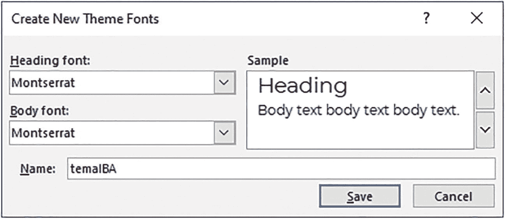

**第 5 步。** 颜色和字体配置完成后，保存新主题。为此，在“页面布局”选项卡上，点击“主题”，然后选择“保存当前主题...”。

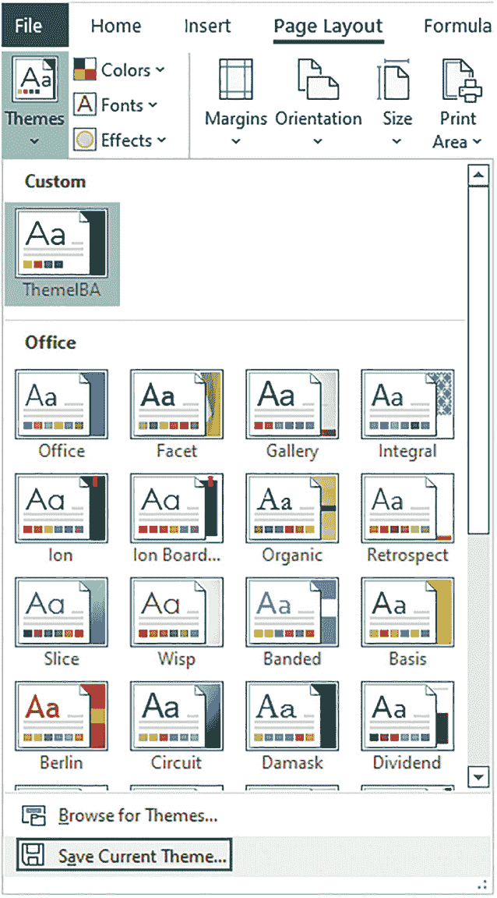

完成！在可用主题列表中，出现了一个新的“自定义主题”部分，其中包含我们的“品牌”主题。

### 5.1.2 生活技巧：从 PowerPoint 导入现成主题

当公司已有企业风格演示文稿模板时，这部分内容非常实用。这些模板可用于 Excel 中的交互式仪表板。

我将以商业智能研究所的演示文稿为例，展示如何操作：该演示文稿已具备公司规定的颜色和经批准的字体。按照同样的方法，您也可以使用所在组织的仪表板设计。

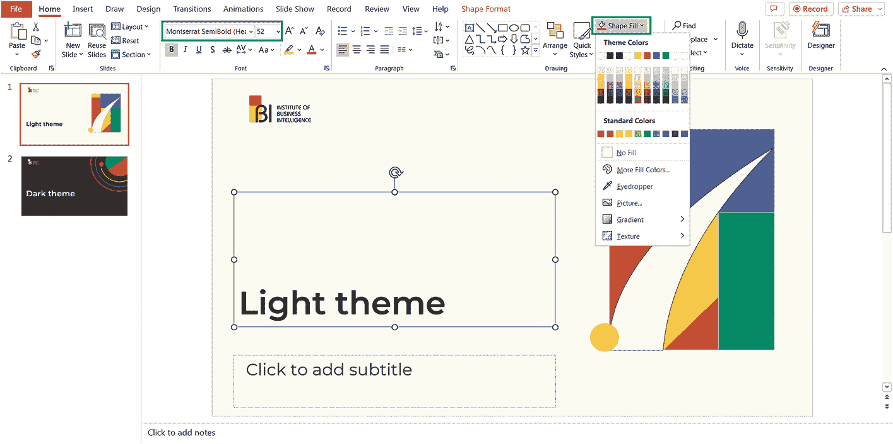

PowerPoint 窗口中显示的是商业智能研究所的演示文稿。它采用了公司批准的字体和精心挑选的颜色。屏幕设置为浅色主题。

与图表模板类似，PowerPoint 的企业主题可以保存到您的电脑中，然后在 Excel 中使用。

**第 1 步。** 打开演示文稿，进入`设计`菜单选项卡，展开`主题`部分的下拉列表，选择`保存当前主题`选项。

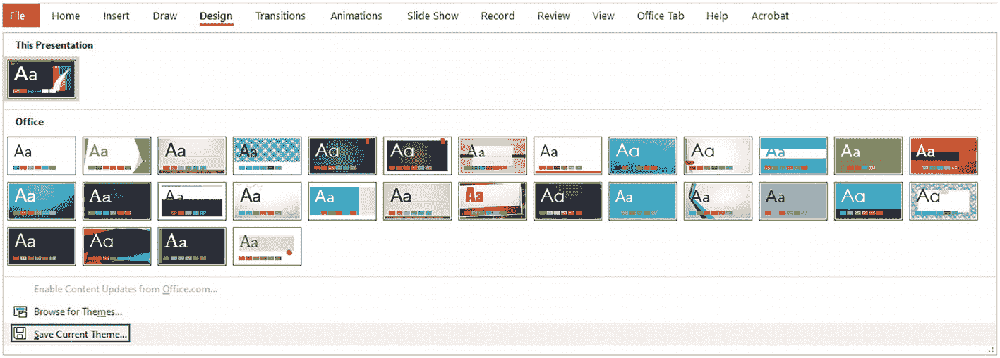

截图展示了设计菜单选项卡，其中主题部分显示了不同的字体和主题，左角有保存和浏览选项。

在打开的对话框中，指定文件名，选择保存主题的文件夹，然后点击`保存`。

**第 2 步。** 在 Excel 工作簿中，打开仪表板新版本所在的工作表，进入`页面布局`菜单选项卡，点击`主题`，然后在主题图标列表下方找到`浏览主题...`按钮。

在打开的`选择主题或主题文档`窗口中，进入包含所需文件的文件夹，选中该文件并点击`打开`。

完成！PowerPoint 中的主题会自动应用到整个 Excel 工作簿。您可以通过查看可用的颜色来验证：它们必须与演示文稿中的调色板匹配。

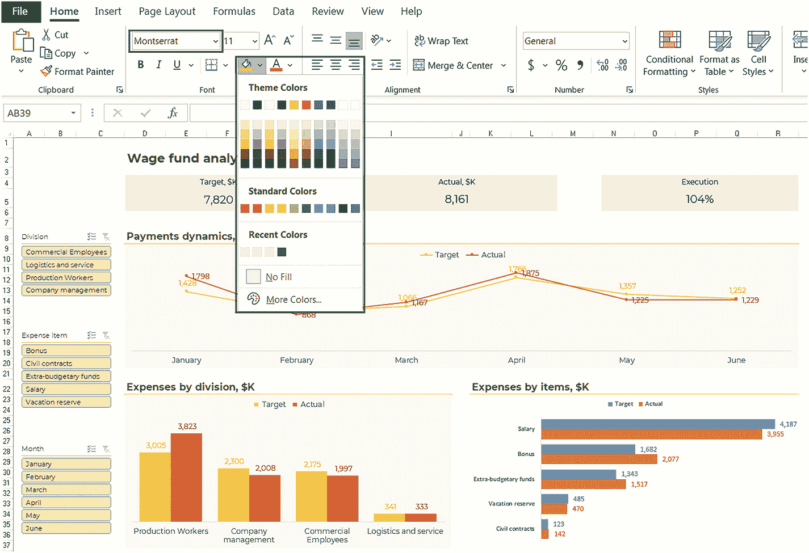

窗口屏幕使用了公司字体 Montserrat。其中包含按部门和项目划分的费用图表，以及附带部门和项目列表的薪资基金分析，此外上方还有调色板。

企业字体 Montserrat 比标准字体更宽，因此`按部门划分的费用`图表上的标签文字会倾斜排列。我增大了图表尺寸，使它们重新变为水平。如果这对您没有帮助，您可能需要将标签字体缩小到 11 号。

这里我们再次遇到了 Excel 的一个缺陷：除 KPI 卡片外，仪表板上的所有元素字体都已更改。KPI 卡片的字体需要手动修改。

与 Excel 中的内置颜色主题一样，新样式不会自动应用于从模板创建的图表。

当某个视觉元素脱离整体风格时，我会感到有些困扰，因此每当颜色变化时，我都会保存并使用新模板。就像我们在第 3.5 部分中使用`更改图表类型`选项所做的那样。之后，我们就能看到新的默认主题效果。

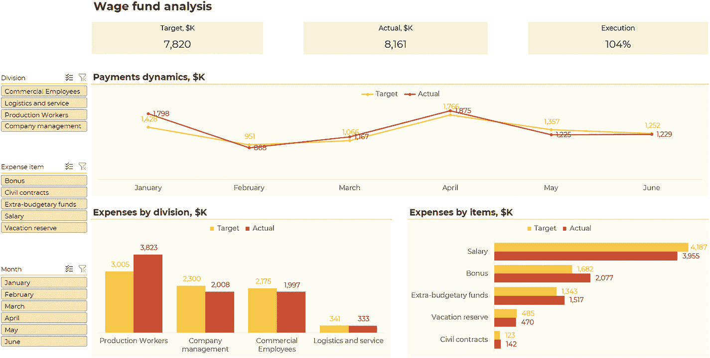

窗口屏幕显示了图表和线条中的新主题。它展示了关于付款动态以及按部门和项目划分的费用图表。不同的颜色用于区分图表的柱形。

### 5.1.3 对照清单检查与改进点

为了使新主题与企业形象保持一致，我们根据上一部分的清单来检查设计。同时，我们还会补充一些需要处理的要点。

| 1 | 调色板包含对比鲜明的颜色集，有`交通灯`的色调 |  勾选标记。 | 在这方面，主题完全符合要求 |
| 2 | KPI 卡片背景与文字不冲突 |  勾选标记。 | 浅色背景上的黑色字体易于阅读 |
| 3 | 图表柱形之间不相互融合 |  叉号标记。 | 在新背景上失去了对比度 |
| 4 | 数据标签清晰可见 |  叉号标记。 | 在新背景上难以区分 |
| 5 | 服务元素背景柔和 |  勾选标记。 | 与企业形象调色板一致 |
| 6 | 图表底衬不显眼 |  勾选标记。 | 浅色不会分散注意力 |
| 7 | 数据和坐标轴的字体与颜色一致 |  勾选标记。 | 现在使用的是 Montserrat 字体 |
| 8 | 仪表板背景为企业风格 |  叉号标记。 | 图表之间和切片器上存在白色斑点 |
| 9 | KPI 卡片及其上的指示器保持醒目 |  叉号标记。 | 未从整体背景中突出 |
| 10 | 所有标签的字体均符合企业规范 |  叉号标记。 | 未对所有元素自动更改 |

### 5.1.4 总结

有多种方法可以设计企业风格的仪表板。我们回顾了那些能帮助您快速完成此任务的方法：从零开始在 Excel 中创建主题，以及从 PowerPoint 演示文稿中导入主题。

在 Excel 中为新主题应用仪表板后，务必了解需要改进和修正的内容。这正是我们案例中需要完善的地方。

- 恢复图表柱形与图形线条之间的对比度。
- 为数据标签挑选新颜色，使其在图表浅黄色背景上清晰可见。
- 整理仪表板的新背景，消除其上的白色斑点。
- 使 KPI 卡片及其上的指示器更加醒目，避免与背景融合。
- 将卡片中的字体更改为企业规范中批准的字体，因为它没有自动更改。

**下载企业风格主题**

 条形码照片。

## 5.2 根据清单调整主题

许多人抱怨：你学会了创建仪表板，但老板仍然要求提供演示文稿。我们不得不设法应付，但结果往往不尽如人意。

有些人插入单个图表，但格式在幻灯片上就会走样。有些人添加截图，然后花费数小时调整位置，以求一切整齐划一。而如果数据更新了，又得手动重做所有工作...

这一部分就是为了让您不把时间和精力浪费在将仪表板转换为幻灯片上。我们将使其能够替代任何演示文稿，而且它还将是交互式的。

为了达到这样的效果，我们需要纠正由于使用企业风格主题而出现的缺陷。一些元素“褪色”了，变得难以区分；另一些则失去了必要的对比度。在这一部分，我们将修正所有与我们的清单不符的地方，同时消除新出现的缺陷，使仪表板完全符合企业形象。

### 5.2.1 仪表板背景上的白色斑点

演示模板的背景并非纯白色，而是接近“纸张”色调的淡黄色。这种颜色应用于图表，但工作表中单元格的填充色仍然是白色。因此，图表之间的空隙看起来就像未上色的条纹。

要解决此问题，请单击表格左上角（第 1 行上方）的三角形，选中工作表中的所有单元格。在`开始`菜单选项卡下的`填充颜色`按钮中，选择淡黄色（默认情况下是调色板中的第一种颜色）。

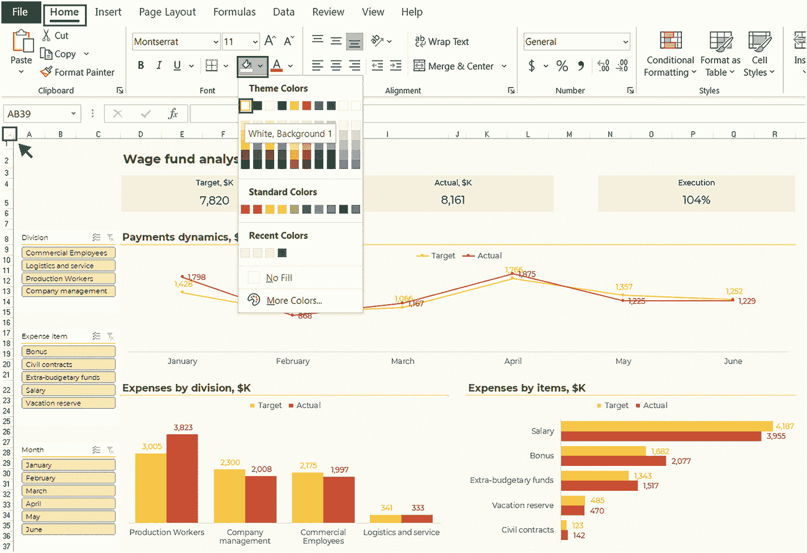

屏幕窗口显示背景颜色的呈现方式。其中有一个调色板，可选择白色。已选中工作表左上角的三角形以选取每个单元格（用箭头指示）。

### 5.2.2 KPI 卡片的亮度

由于新的配色主题，带有关键指标的卡片在整体背景中变得不显眼，几乎看不见。要解决此问题，我们将更改它们的背景和颜色，并再次检查公司字体。

-   卡片背景 – 我们采用对比鲜明的蓝色。
-   文字字体 – `Montserrat SemiBold`。
-   文字颜色 – 白色。

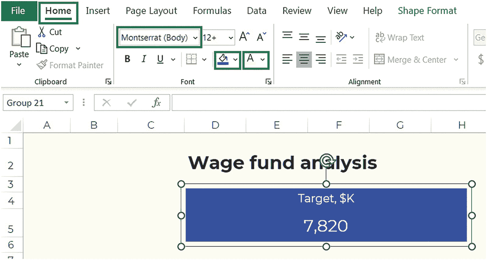

一个 PowerPoint 窗口屏幕显示卡片亮度的更改。`Montserrat Semibold` 被选为文字的字体，背景采用对比色，文字颜色选择白色。

**提示！**

*确保所有文字的字体都已更改为“品牌字体”。Excel 可能会在字体选择字段中显示新字体，但在选中文本时，可能会发现字体仍然是“标准字体”。*

### 5.2.3 所有元素使用新字体

必须检查仪表板上所有元素的字体更改情况。应从标题开始检查。如果字体仍然是标准字体，则将其更改为`Montserrat`并选择粗体。还要确保图表标题和数据标签的字体已更改。

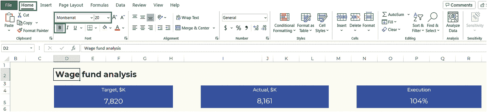

一个 Excel 工作表显示所有元素的新字体。在工资基金分析下方，包含三个组成部分。`Montserrat` 在字体选项卡中被选中，并选择了字号`20`。图表标题和数据标签已更改。

### 5.2.4 图表增加对比度

在图表中，饱和的黄色和砖红色是可以区分的，但仍然值得增加对比度。这在图表上尤其明显，细黄线与背景融合在一起。将图表中“目标”类别的颜色替换为之前在卡片中使用的蓝色。

每个图表都可以手动配置。但使用模板更快。完成两个可视化图表后，将柱状图另存为模板，并将其用于“按项目划分的费用”项目——就像我们在第 3.5 部分中所做的那样。

请记住，Excel 默认按逆序对柱状图的列进行排序。请按照第 3.4 部分的说明更改排序顺序。

不要忘记为数据标签设置新的字体颜色。这里我们遵循熟悉的规则：选择比相应列和线条颜色深一级的颜色。

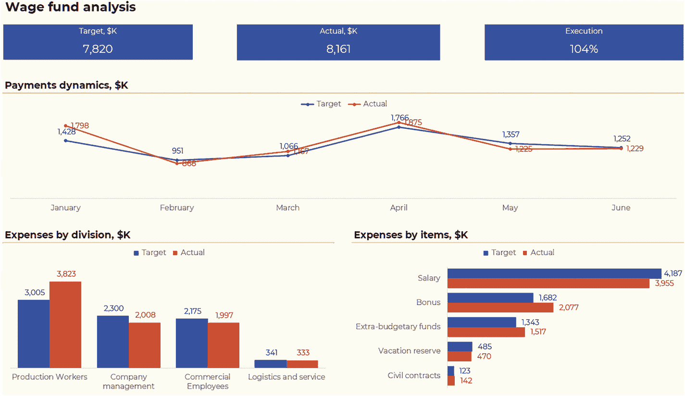

一个示例窗口显示图表上的对比度。其中包含两个图表和一个曲线分析。目标类别已替换为对比色，图形和图表上的数据标签也使用了替代颜色。

### 5.2.5 适配切片器

切片器的背景色仍然是白色——这不符合品牌形象。要更改此设置，请选择任意一个切片器，然后进入`切片器`菜单选项卡（在较旧版本的 Excel 中，这是`选项`选项卡）。在`切片器样式`部分，右键单击列表中的第一个样式，然后选择`编辑`按钮。

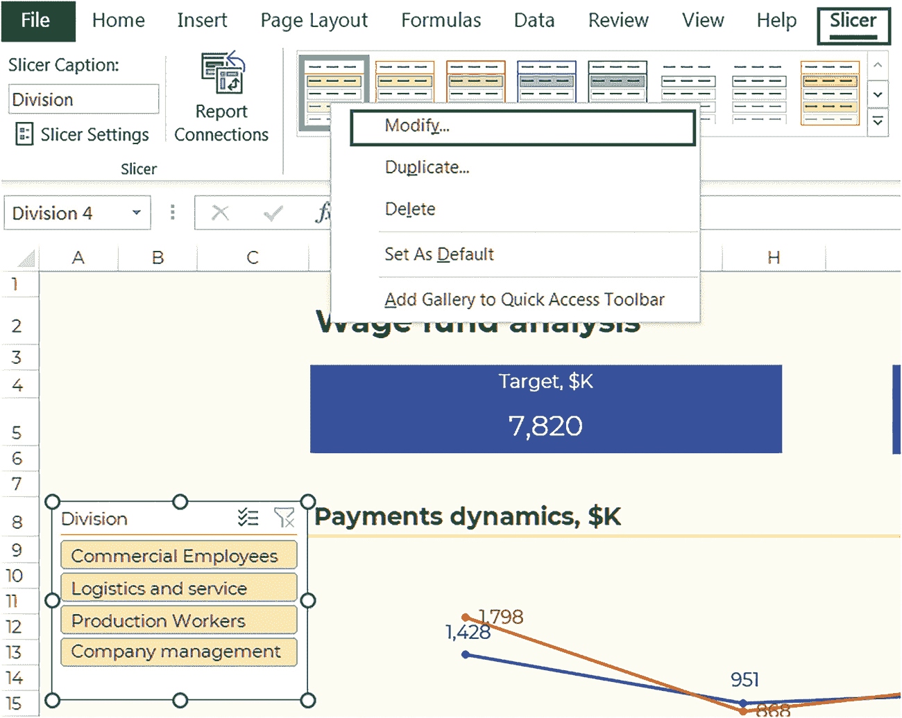

一个 Excel 工作表显示切片器的背景色。在此屏幕的切片器菜单中，列表中的第一个切片器样式被高亮显示，并选择了`修改`选项。

在打开的窗口中，选择`整个切片器`，然后单击`格式`按钮。在新窗口的`填充`选项卡中，我们设置淡黄色背景色。

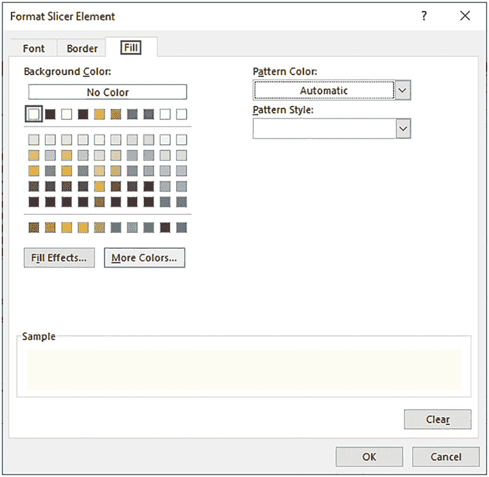

一张截图展示了格式化切片器元素，其中包括字体、边框、带填充效果的填充以及更多颜色。

更改后的样式会自动应用于其余的切片器。我们已经将这些服务元素从白色背景中移除，使其符合品牌形象。

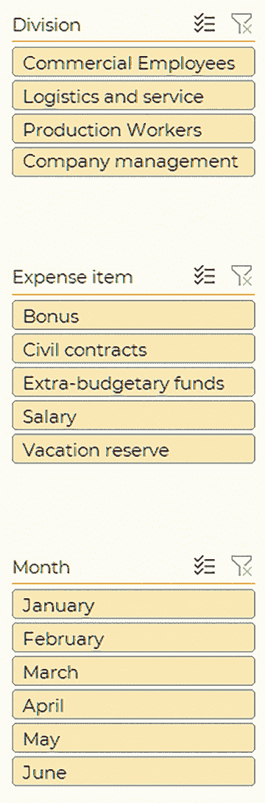

一组三个示例切片器（标题：部门、费用项目和月份）。下图展示它们及其对应列表，均采用品牌形象设计。

### 5.2.6 收尾润色与演示模式

最后一步——在仪表板上添加公司徽标。它在屏幕左上角有一个专门的位置，位于切片器上方。我使用同一个 PowerPoint 演示文稿中的徽标，但您也可以上传单独的图片。

至此，创建公司风格交互式仪表板的工作就完成了。如果您保存了“标准”版本，现在可以比较结果发生了多大变化。

为了增强效果，还需要准备“演示者模式”，尤其是在大屏幕上展示仪表板时。

PowerPoint 有幻灯片放映模式，许多 BI 系统也有全屏演示模式。Excel 中没有此功能，但和往常一样，我们可以用现有工具拼凑出来：

-   在`视图`选项卡上，取消选中`编辑栏`项旁边的复选框。
-   对`标题`复选框执行相同操作，以移除行号和列字母，这意味着将仪表板的缩放比例再增加 5–10%。
-   双击任一菜单项的标题或`折叠功能区`箭头以隐藏功能区。

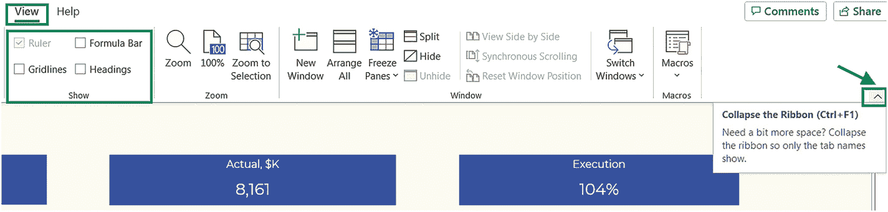

一个窗口屏幕显示演示模式。在`视图`选项卡上，取消选中编辑栏旁边的复选框。折叠功能区选项用屏幕右上角的箭头标记。

这样的仪表板不再需要截屏插入到演示文稿中：现在它本身就是一份精美的交互式演示文稿。

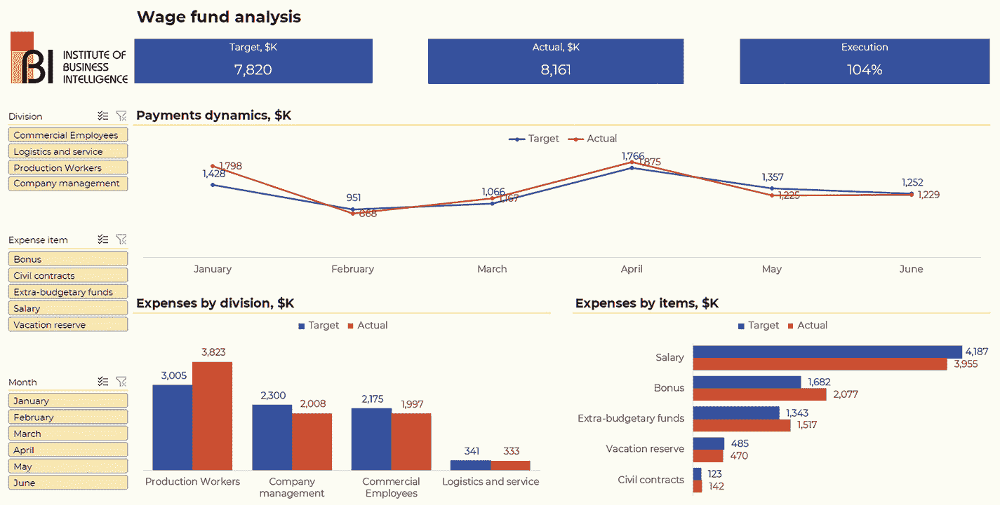

一个窗口显示 BI 商业智能研究所的页面，其中包含关于工资基金分析的图形和图表。页面展示了一个具有新交互式演示文稿的仪表板。

### 5.2.7 总结

为了使仪表板符合品牌手册的要求，仅仅应用“公司”主题是不够的。新的颜色可能会降低对比度，新的字体可能会扭曲布局。

为了获得专业效果，请根据第 4.5 部分的检查清单逐项检查您的工作。并且不要忘记品牌形象的要素。

-   背景颜色在整个面板中分布正确：图表之间没有白色斑点。
-   标题和文字（包括卡片中的）的标准字体已更改为“公司”字体。
-   新字体的大小对于仪表板来说是最佳的：文字水平排列且易于阅读。
-   需要进行比较的图表元素之间有足够的对比度，并且它们不会融合在一起。
-   KPI 卡片没有因为所使用的主题而在整体背景中丢失：它们清晰可见。
-   交互式切片器的背景也使用了正确的颜色装饰：上面没有留下白色斑点。
-   仪表板具有所有必要的品牌风格元素，例如徽标。

## 5.3 创建深色主题仪表板

深色风格在演示文稿和仪表板中看起来都更具原创性和高级感。但要达到这种效果，你需要付出更多努力：检查所有元素，确保它们清晰可见且对比度足够。在某些地方需要增加对比度，而在另一些地方则需要减少。

有些细微之处无法用清单罗列——它们需要经验和观察力。这就是为什么我推荐使用浅色主题，客观上来说，浅色主题更容易处理。

如果你必须让你的作品符合特定的企业形象，那么这部分内容就是为你准备的。如果不是，你可以结束练习，继续学习可视化规则。

我建议从浅色主题的副本开始创建深色主题的仪表板。复制包含“品牌化”版本的工作表，并给它一个明确的名字。这样你就能同时保留浅色和深色两种符合企业风格的仪表板。

我们在 PowerPoint 中采用的调色板已经包含了浅色和深色两种选项的颜色。因此，我们使用一种新的填充色——最深的棕色。然后我们来检查一下效果如何，以及哪些地方需要修正。

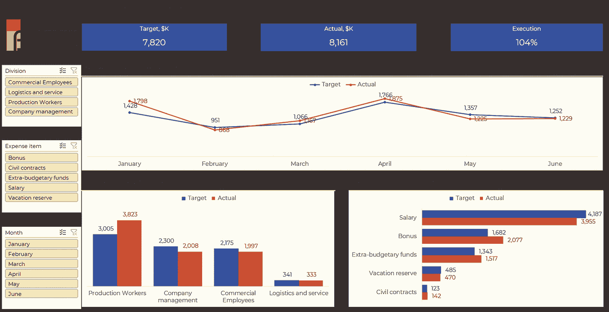

一个窗口屏幕显示深色主题下的 B I 商业与智能学院页面。在这种情况下，深色字体的标志和标题变得不可见。柱状、折线和数据标签的颜色融为一体。

*   标志在深色背景上变得难以区分。
*   标题的黑色字体也变得不可见。
*   蓝色的 KPI 卡片与新的设计不协调。
*   图表的背景仍然是浅色的——这与深色主题不符。
*   切片器的设计也不符合仪表板的深色主题。

而这些还不是全部的缺点。柱状和折线的颜色，以及数据标签和文字字体的颜色，仍与浅色主题中的相同。但我们在制作深色仪表板：一旦我们更改了图表的背景，它们也会丢失。

### 5.3.1 仪表板标题和标志

我将复制了浅色品牌仪表板的工作表命名为“仪表板 _Dark”：我将在此工作表上进行转换。

首先引人注意的是“褪色”的标志。由于新的背景，它变得难以区分。我们将从 PowerPoint 演示文稿中选取一个深色主题的选项。就像我们在上一章中所做的那样。

一张截图显示深色主题下仪表板的标题和 B I 商业与智能学院的网站标志。这里可以看到选中的标志（由于深色背景而显得褪色且难以区分）。

我们同时也立即看到，标题“工资基金分析”在深色背景上消失了。选中包含仪表板标题的单元格，然后在主菜单选项卡的`字体颜色`按钮下选择白色。

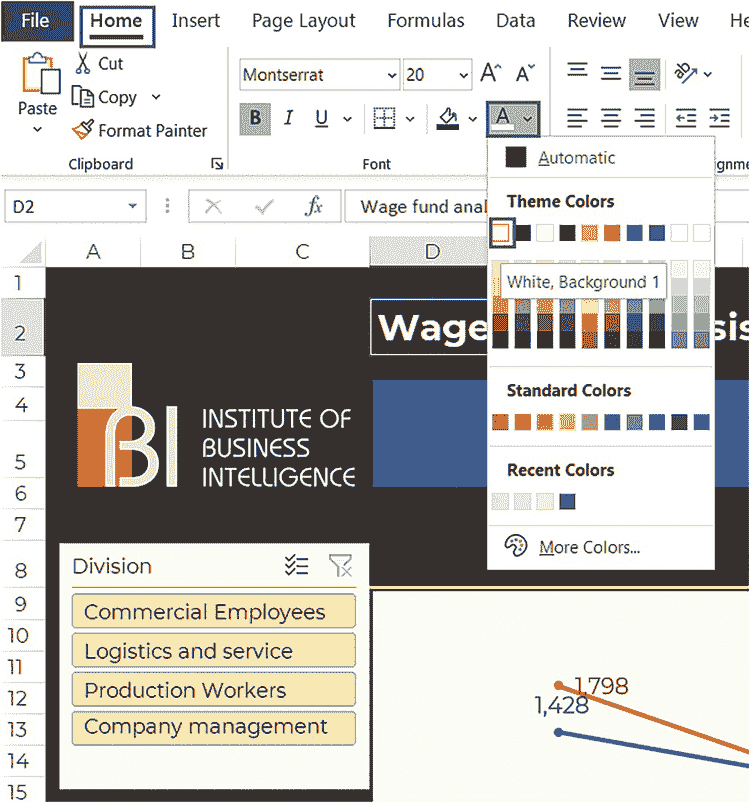

一个 Excel 工作表显示深色主题演示文稿中的 B I 商业与智能学院网站标志、切片器和仪表板标题。为仪表板文本从调色板中选择了一种浅色。

这里不需要进行任何检查字体或更改其大小的操作：我们在仪表板上使用已配置好的“品牌”字体制作深色版本。

### 5.3.2 图表标题

它们在深色背景上也失去了可见性，这意味着我们也要更改这些元素的字体颜色。为了使它们不“抢走”仪表板标题的亮度，我们将从调色板中选择最浅的棕色（比背景浅 90%）。

**标题下方的线条。** 这个元素也仍然是浅色的，这也需要更改：在深色版本中，语义块也应该清晰地相互分隔。首先，我们将调整这条线的宽度。

*   选中包含图表标题的单元格。
*   在“开始”菜单选项卡上，点击“边框”按钮。
*   在下拉菜单中，选择“线型” ➤ 最宽的线。

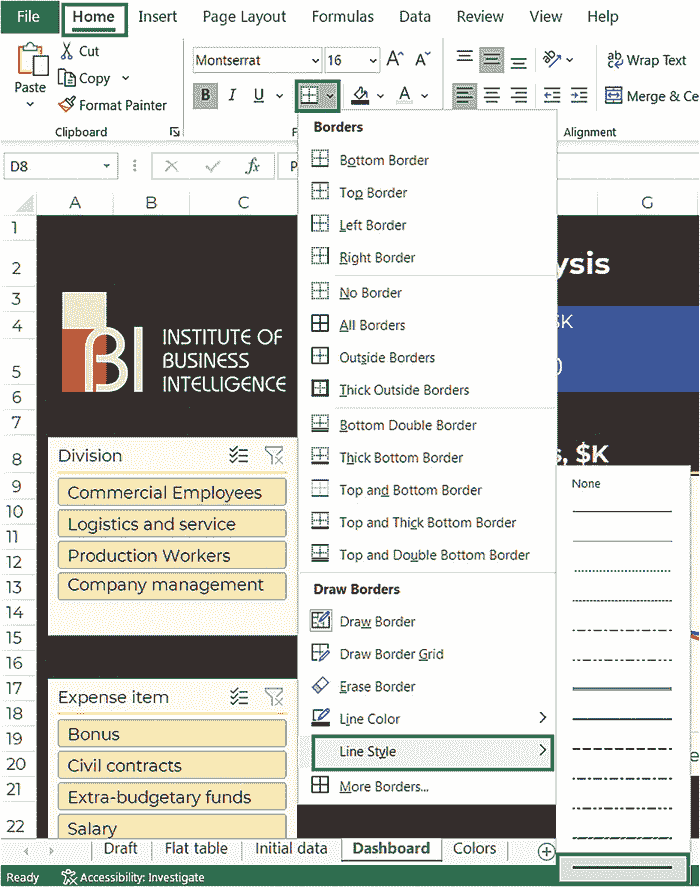

一个 Excel 工作表展示了深色主题企业页面上标题下方线条的更改。包含图表标题的单元格被选中，并从“开始”菜单中选择了“边框”选项以获取线型。

接下来，在同一菜单中，点击“线条颜色”：从建议的选项中，你需要选择一种比我们的背景色调稍亮的颜色。

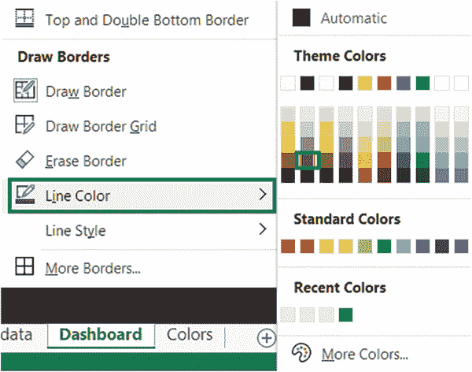

屏幕显示“开始”菜单选项。从“开始”菜单中选择“线条颜色”后，从调色板中选择一种比背景更亮的颜色以吸引对文本的注意。

不要害怕出现的“铅笔”：它只会画直线。我们只能用它来描画图表标题下方的线条。你可以使用`Esc`键退出绘图模式。

我们对其他图表的标题设置相同的格式。你可以为每个标题重复前面的步骤，或者你可以选中一个已设置格式的单元格，并使用“格式刷”按钮将此格式复制到其他标题。

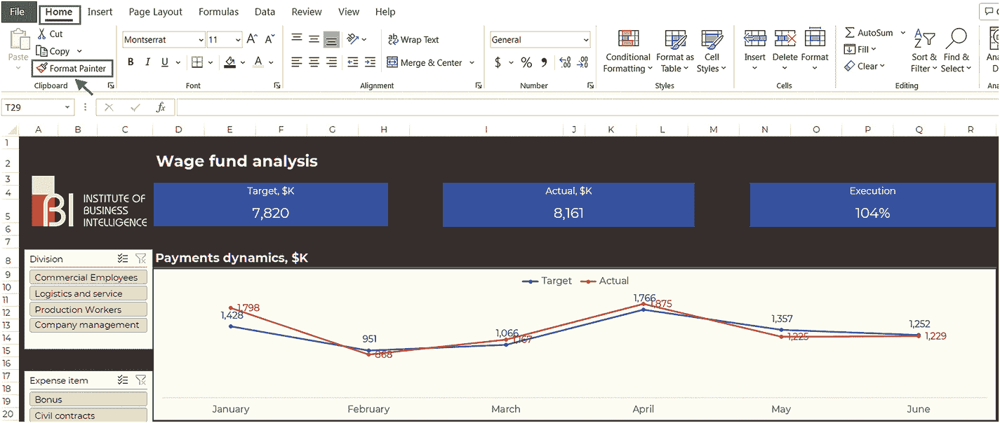

一个 Excel 工作表显示深色主题下的企业页面。第一个仪表板标题通过不同的字体得以区分，而另外两个则被深色背景所掩盖。

### 5.3.3 卡片的新颜色

它们首先会吸引眼球——饱和的蓝色与我们仪表板的新主题不协调。如果我之前推荐对白色背景使用浅灰色或浅蓝色卡片，那么在这里，根据同样的原则，我将采用品牌棕色中仅比背景亮 25% 的色调。这样卡片看起来就像是“内嵌”在背景之中。

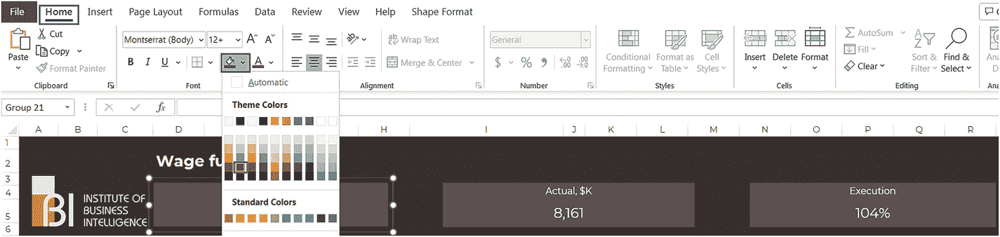

一个 Excel 工作表显示了卡片的新颜色。在“开始”菜单中设置配色方案，并为卡片选择了品牌棕色调。

### 5.3.4 设置图表

**图表的背景。** 当前背景仍为浅色主题，我们需要使其与整个仪表板的颜色保持一致。为此，选中绘图区，在主菜单选项卡中点击“填充”颜色，选择最深的棕色——即我们用于仪表板背景的同一颜色。

**图表中的线条。** 现在有一个新任务——在这样的背景下，蓝色线条图形显得暗淡。让我们将其颜色改为绿色。为此，选中绘图区，通过鼠标右键打开菜单。这里你需要同时使用两个按钮：“填充”和“轮廓”。

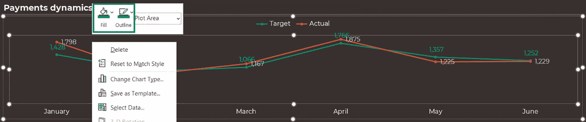

屏幕截图展示了图表设置和背景修改。绘图区下拉选项被选中，并显示了填充和轮廓按钮。同时选择了更改图表类型按钮以配置图表。

**图表上的数据标签。** 我们在功能区菜单中为数据标签选择颜色。通常我会让它们与线条或柱形的颜色一致，但在深色背景上，这种设置可读性会变差。因此，对于“目标”和“实际”标签，我选择比对应图表线条浅几个色阶的颜色。红色不难处理——合适的颜色就在可用调色板中。

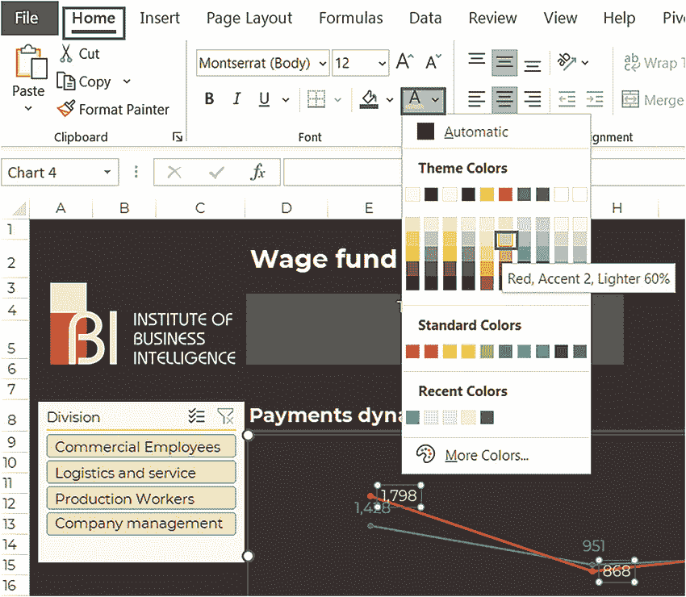

一张 Excel 工作表展示了图表上数据标签的修改。折线图被选中。从“开始”菜单中访问调色板，并选择了比相应图表线条更浅的颜色。

但对于绿色系，调色板中的现有颜色不合适——太“荧光”了。因此，我们将为这条线的标签手动选择颜色。以下是我的做法。

*   选中“目标”线条的数据标签。
*   为标签选择基础绿色（与线条颜色相同）。
*   在菜单中再次点击“字体颜色” ➤ “其他颜色”。
*   在打开的窗口中，选择一个比线条更浅的色调。

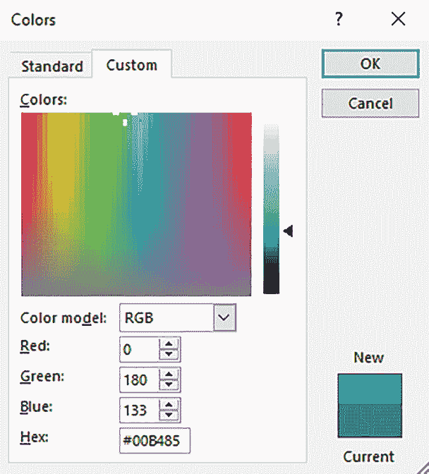

屏幕截图展示了从自定义颜色中选择“其他颜色”选项，其中包含颜色代码以及“确定”和“取消”选项。

**坐标轴和图例中文字的颜色。** 更改图表背景后，类别标签“变淡了”，难以辨认。图例中的参数名称也是如此。为了修正这一点，我们将类别名称和图例标题的字体颜色改为最浅的棕色。

### 5.3.5 通过模板应用图表

该图表已完全定制并适配仪表板的深色主题。我们将其用作模板，以便在其他图表中无需重复所有步骤。

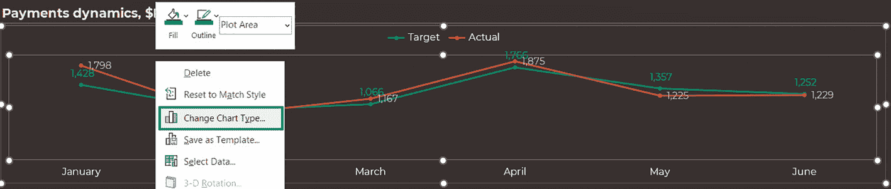

屏幕截图展示了如何通过填充和轮廓选项在仪表板中使用模板，以节省创建仪表板的时间。

1.  选中图表，在右键菜单中选择“另存为模板”。
2.  将模板保存到建议的文件夹中（不要更改路径），并赋予其一个清晰的名称。
3.  选中“各部门支出”图表，在右键菜单或“设计”选项卡中选择“更改图表类型”选项。
4.  在打开的窗口中，进入“模板”文件夹，选择已定制的深色图表模板。
5.  再次使用“更改图表类型”选项，在菜单中选择柱形图。

并非所有设置都能自动达到预期效果。如果 X 轴标签倾斜放置，请减小字号——它们应保持水平。

此外，“目标”列上的绿色变成了黄色。我们将其恢复：用鼠标选中任一列（所有“目标”列应被高亮），然后选择绿色填充。

对第三个图表“各项目支出”重复使用模板的步骤。最终图表应如下所示：

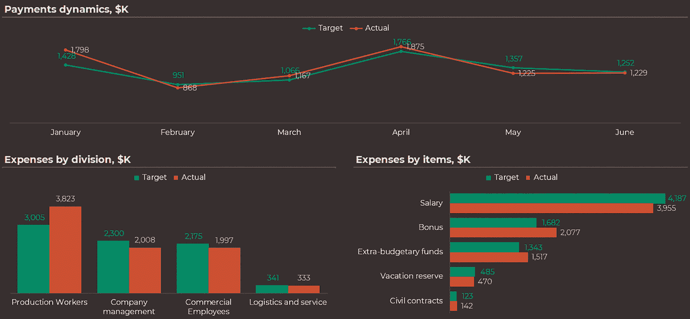

窗口屏幕显示了模板修改工作后的输出页面。它包含一个关于付款动态的折线图，以及两个关于各部门和各项目支出的柱形图。

### 5.3.6 在深色主题中设置切片器

交互式切片器是仪表板上唯一尚未成型的元素。现成的样式中没有合适的，因此我们将自行配置。

我们以 `深色` 部分中带有红色按钮的样式为基础——将其调整至所需效果。在样式列表中，它被称为 `玫瑰色`。

要修改它，请在仪表板上选择任意一个切片。在菜单选项卡 `切片器`（或 `选项`）上，右键单击所需的样式 ➤ `复制`。

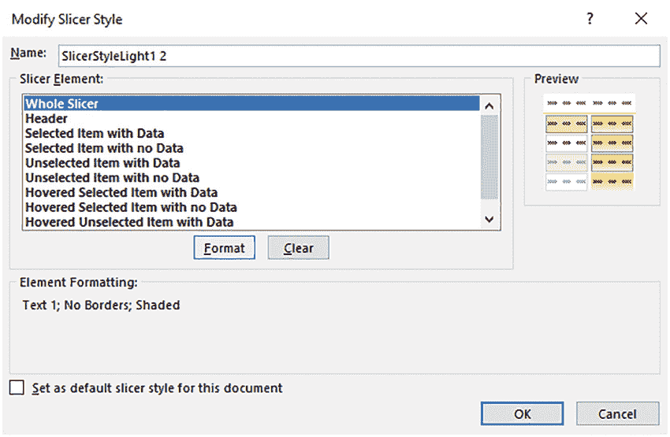

此截图展示了用于修改切片器样式的不同切片器样式。它还包含了预览、格式和清除选项。

在打开的窗口中，`切片元素` 部分下有大约十个项目。其中大部分用于自定义切片器按钮在不同状态下的外观：选中时、鼠标悬停时等。

为了确保一切按预期工作，我们必须分别配置这些项目中的每一项。我们将按照相同的方案进行操作：选择所需的项目，单击 `格式` 按钮，然后在新窗口中添加必要的设置。

**整个切片器。** 在 `边框` 选项卡中，选择 `无` 选项。在 `填充` 选项卡中，选择最深的棕色阴影——与我们用于仪表板背景的颜色相同。单击 `确定`。

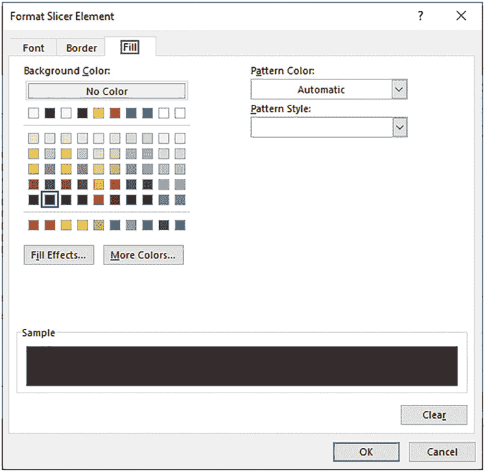

此截图展示了格式切片元素选项，用于填充仪表板的背景，包括图案颜色和样式。

**标题。** 这是切片元素列表中的第二项。在 `字体` 选项卡中，设置 `Montserrat (正文)`，并调整颜色。此处我们将设置最浅的棕色阴影——与我们为其他标题选择的颜色相同。

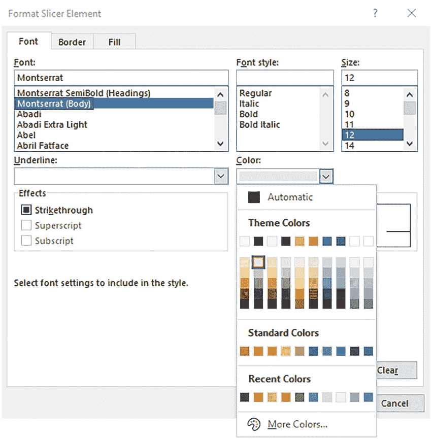

此截图展示了通过更改颜色、样式、大小和效果来修改切片器字体。

**已选中有数据的项。** 此处我们配置活动按钮的类型，即已按下用于筛选的按钮。默认情况下，`填充` 选项卡中有一个适合我们的颜色——我们保持不变。

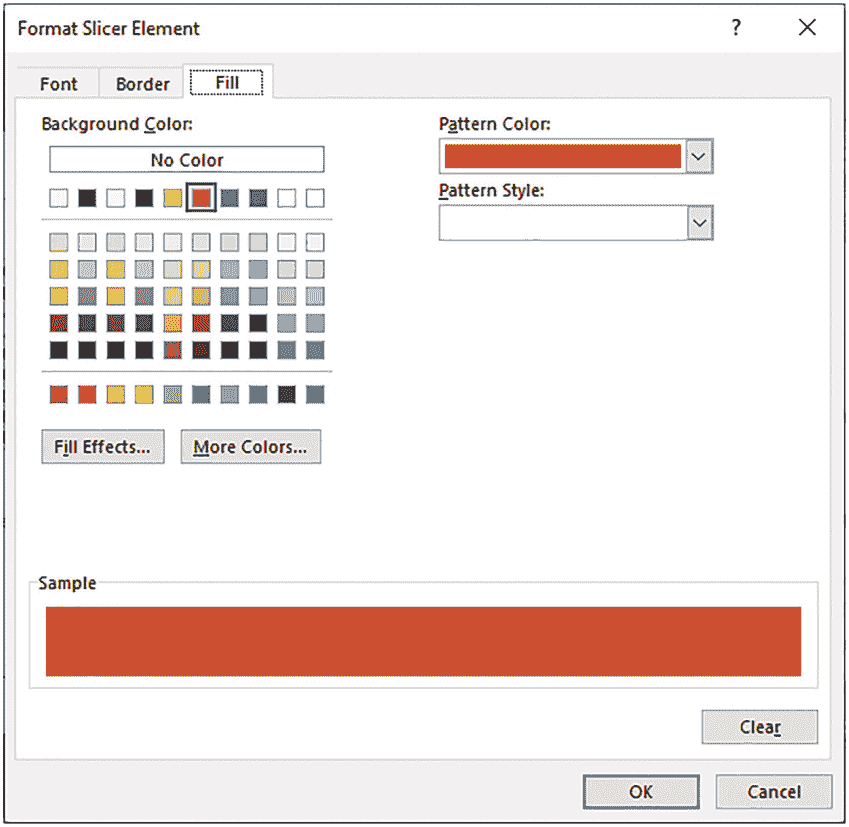

此截图展示了如何通过填充颜色选项修改切片器的图案样式和颜色。

**已选中无数据的项。** 这些是已按下但下方没有数据的按钮。我们对默认设置感到满意——保持原样。

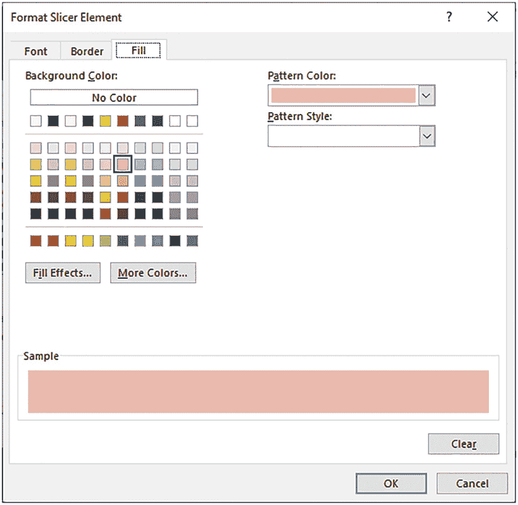

此截图展示了如何使用不同颜色填充仪表板的字体图案。

**未选中有数据的项。** 这是使用切片器时非活动按钮的颜色设置。默认情况下，筛选时它们会变为灰色：我们将此填充颜色更改为棕色——我们将选择介于最深和最浅之间的阴影。

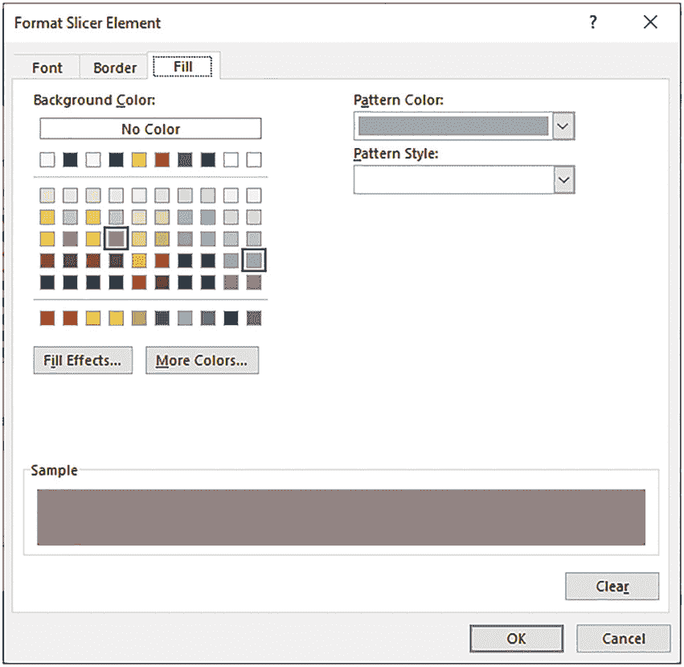

此截图展示了在深浅色之间选择颜色时，如何更改默认颜色。

**未选中无数据的项。** 此处我们使用浅棕色填充。它将应用于下方没有数据的非活动按钮。

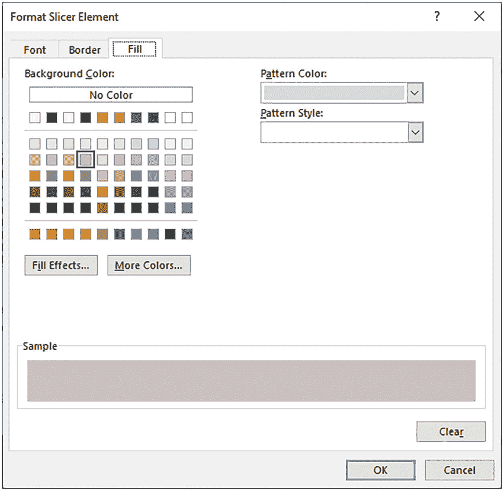

此快照展示了为未选中的数据添加不同颜色以突出显示数据。

在 `切片元素` 部分中，我们还剩下四个项目。所有这些项目都用于调整按钮在鼠标悬停时的外观。

- 悬停时已选中有数据的项
- 悬停时已选中无数据的项
- 悬停时未选中有数据的项
- 悬停时未选中无数据的项

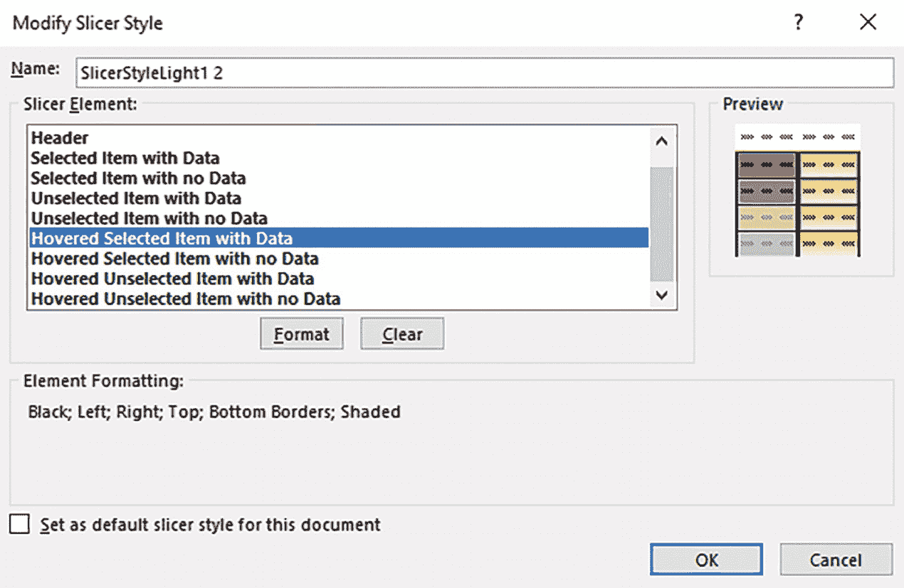

此快照展示了添加了不同颜色的切片元素，用于调整仪表板的外观。

对于这些剩余的项目，我们将设置相同的设置：

- 在 `填充` 选项卡中，我们将选择一种比仪表板背景浅一个色调的颜色。
- 在 `字体` 选项卡中，我们将设置浅棕色和 Montserrat 字体。

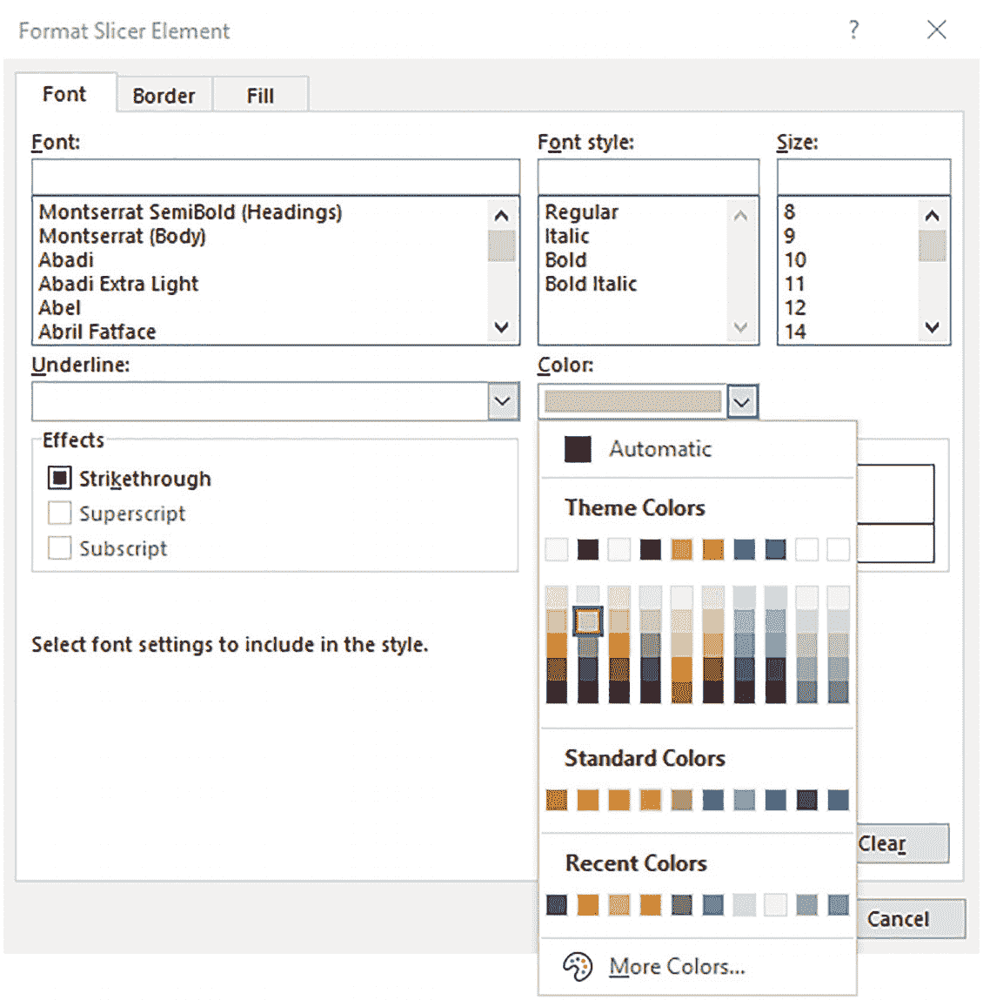

此快照展示了用于修改仪表板的字体样式和大小、下划线和效果以及主题颜色。

所有元素都已配置完毕。在 `修改切片器样式` 窗口中，单击 `确定`。生成的样式将应用于我们仪表板上的其余切片器。

深色企业形象主题的仪表板 `工资基金分析` 已准备就绪！

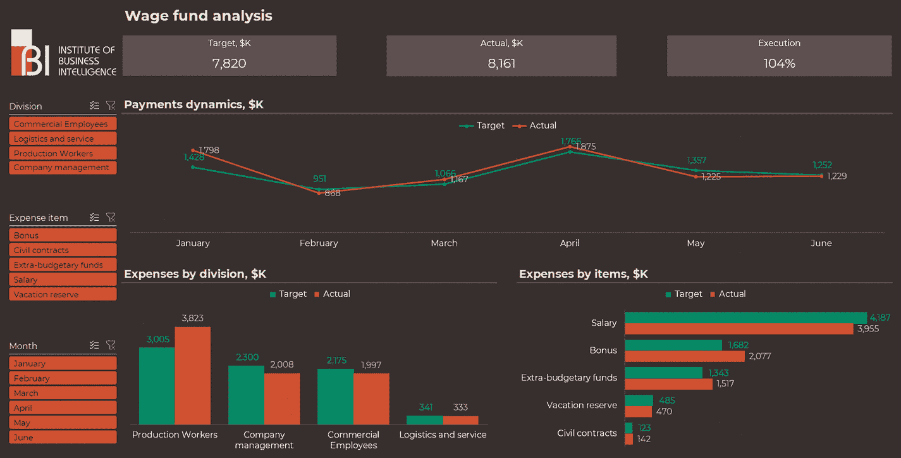

一个窗口屏幕显示了深色主题下的 B I 商业与信息研究所页面。工资基金分析通过图表和折线图突出显示。屏幕左侧的切片器更为明显。

### 5.3.7 总结

为了创建深色主题下的专业仪表板，我必须特别注意元素的对比度。有些地方我们增加了对比度，而有些地方则相反，我们减少了对比度。

- 仪表板和图表的标题设置为浅色，以便在深色背景上清晰可见。
- 标题下方的线条降低了亮度，并选择了一种比仪表板背景浅一个色调的颜色。
- 蓝色卡片不适合新设计——我们也将其设置为比仪表板背景浅一个色调。
- 我们更改了图表过于明亮的背景：为此我们使用了与仪表板背景相同的填充。
- 在新的背景上，图表的蓝色线条变淡了：我们将其颜色改为绿色。
- 我们为数据标签选择了新的颜色。调色板中的绿色不合适，因此我们手动选取了它。
- 类别标题已设置为浅色，以便在新的深色背景上可见。

切片器则是另一回事：我不得不费一番功夫，为每个状态调整按钮颜色。我承认，我自己也记不住所有这些组合。这再次表明，Excel 无所不能。了解其功能的人会获得很大的行动自由，并且可以更快地完成工作。

