# 6. 数据可视化规则

实践部分已结束——现在我们进入理论部分。通常人们会反着来，但我有意采用这种方法。首先，是为了不立即用理论限制你。其次，是因为每个可视化规则都有例外——我将在本部分中也展示它们的例子。

这些规则不仅适用于 Excel。在任何 BI 平台中工作时，如果你想准确快速地向用户传达数据的本质，它们都会派上用场。

本部分的信息是为初学者提供的清晰基础，有助于准确展示数据的含义，并为任何客户的分析工作增加价值。

## 6.1 数据分析的类型

有些员工不知怎地就能奇迹般地做出管理层喜欢的、简单易懂的演示文稿。而另一些人则备受煎熬；他们反复修改五次，老板却仍然不满意。即便请来设计师，情况也未见好转。

我将分享我个人的经验。在我职业生涯初期，我致力于科研项目的商业化，寻找投资人。当时，投资演示文稿有着严格的格式要求：必须在十页幻灯片内阐明项目本质、展示市场分析和财务模型。我不知何故自己就能将其清晰可视化。

后来，当我需要制作第一个仪表盘时，我请了一位设计师来“把它做漂亮”。结果做出来色彩鲜艳、创意十足，但内容却不清晰。随后，我阅读了吉恩·泽拉兹尼的《用图表说话》一书，才意识到我一直在凭直觉遵循可视化规则。但我无法向其他人清楚地解释，为什么一定要构建那样的图表。

随着时间的推移，通过积累经验，我摸索出了这套方法。借助它，我与客户建立了有效沟通，开始向他们提出正确的问题，理解他们想看到什么，以及要做出哪些决策。这样一来，我就能清晰地为分析师和开发人员设定任务，以便第一次就获得期望的结果。

图表应该展示什么？它应该引导出什么结论？这取决于数据分析的类型，也就是你的数据在含义上属于哪一类。

### 6.1.1 分析的基本类型

| **排名** 基于“多-少”原则的定量比较：谁排名第一，谁位列前五，领先幅度是多少，谁又落后了多少。可视化：柱状图（横向和纵向） |  一个圆圈内放置了四个大小不一的水平条。 |
| **动态** 指标随时间的变化：收入的增长或下降、月度员工数量等。可视化：通常是时间轴上的折线 |  一个插图展示了圆圈内填充颜色的波形。 |
| **结构** 对整体构成的分析，重点不在于数量，而在于各部分占总体的百分比（100%）。有助于理解哪些细分市场和类别对实现指标有贡献。可视化：被分割成扇区的图形 |  一个插图展示了中心有线条的圆圈。 |
| **分布** 某个数值在定量尺度（恒定或区间）上的分布情况。例如，按年龄或消费金额对客户进行细分。可视化：散点图、直方图 |  一个插图展示了中心有一团点的圆圈。 |
| **关系** 展示指标之间的依赖关系，以及类别之间的逻辑关联。例如，控股公司内部的资金流如何运作。可视化：图表及其他复杂图形 |  一个插图展示了中心有几个点及其相互连接的圆圈。 |

最后两种分析类型，即分布和关系，在管理报告中很少使用。它们属于统计分析范畴，需要寻找相关性并构建复杂图表。要在会议上做报告，你需要的是简单易懂的可视化图表，能准确传达数据的含义。

还有更复杂的分析类型（如因子分析、同期群分析），它们是几种基本分析类型的组合。针对这些分析，存在高级的可视化方法：有些可以在 Excel 中实现，而另一些则需要完整的 BI 系统。但首先我们需要处理好基础数据，避免在这个层面犯错。

### 6.1.2 典型错误

有人可能会说，下面的例子是些小儿科的错误。但在大型企业的项目中，我经常看到成年人会在他们的报告中犯这些错误。原因是“大家都这么做”或者“我们已经习惯了”。又或者是因为某次总监喜欢了这种图表，于是现在每个人都不分场合地用它。

#### 伪动态

这里我们看的是经理们的利润图表。但能从这个折线图中得出什么结论呢？它似乎描绘了增长和下降的时期。Williams 出现峰值，然后 Wilson 下降，接着 Johnson 再次达到峰值，然后平稳下降。

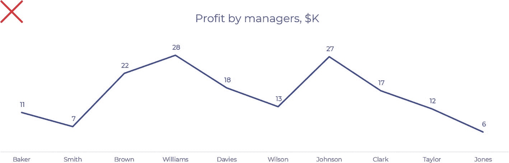

一张折线图展示了经理们的利润范围。Williams：28，Johnson：27，Brown：22，Davies：18，Clark：17，Wilson：13，Taylor：12，Baker：11，Smith：7，Jones：6。左上角标有一个叉号标记。

如果需要比较员工之间的利润，那么首先要看的是谁是第一，谁在前三、前五，以及领先其余人的幅度。对于落后者也同样如此。

但按字母顺序排序经理姓名，并不能帮助我们理解谁排在第几位。而且折线图与姓氏的对应关系是割裂的：我们先看到最大值，然后再用眼睛去找它对应的是谁。

在 X 轴上，我们只应在动态图和统计图中对类别进行排序。在其他情况下，我们应沿 Y 轴将数值从大到小排列。

折线图用于追踪指标随时间的变化，而不是用于比较 X 轴上的各个类别。

要比较员工所获利润的多少，柱状图是完美的选择。上面一目了然：有两位领先者，Brown 经理排在第三位，他之后有两人并列第四。部门的后半部分则处于落后。

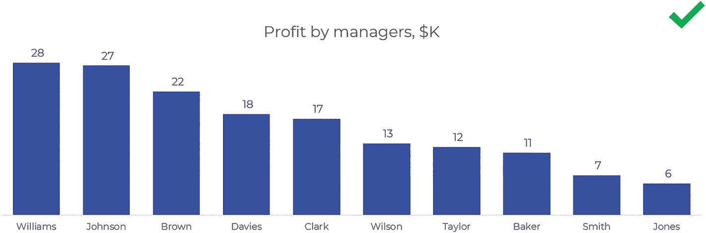

一张条形图展示了 10 位经理的利润水平。Williams 位居第一（2.8 万美元），Jones 垫底（6 千美元）。右上角标有一个勾号标记。

显然，仅凭这些数据还不足以对劳动生产率做出严肃的结论。你需要将实际情况与计划、客户群规模以及其他指标进行比较。但单就这个事实本身而言，在这样一张柱状图上已经展示得尽可能清晰了。

#### 不恰当的漏斗图

许多人认为漏斗图是先进 CRM 系统和出色销售分析的象征。因此，当他们在 MS Excel 或 Power BI 中看到它时，就会试图在每一个机会中使用它。结果往往是不合时宜的，如果没有解释，读者根本无法理解作者想要传达什么。

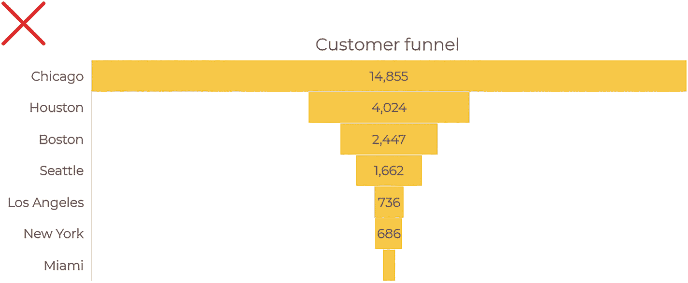

这张漏斗图展示了芝加哥、休斯顿、波士顿、西雅图、洛杉矶、纽约和迈阿密的客户数量。芝加哥的客户数量最高（14,855）。左上角显示了一个叉号标记。

在这里，作者试图借助漏斗图来比较各分支机构的客户数量。但外人看来，这就像是在描述这样一个过程：

- 4024 名客户从休斯顿转移到了波士顿分部。
- 其中，2447 名客户又转移到了西雅图分部。
- 就这样，客户们在这些城市间流转，直到数量耗尽。:)

当然，作者实际想表达的是别的含义：哪个分支机构的客户更多。也就是说，这是一种基于规模的量化比较，属于排名分析。为此，我们不需要将柱形偏移到中间：只需在常规柱状图上从零开始绘制即可。

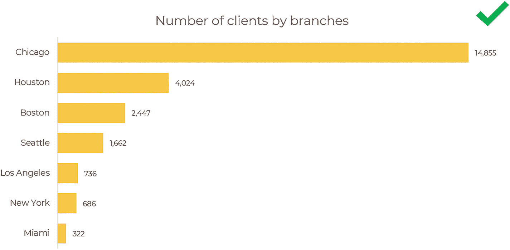

这张柱状图展示了各分支机构的客户数量。芝加哥的客户数量最高（14,855），迈阿密的客户数量最少（322）。右上角显示了一个对勾标记。

“但是漏斗图上的数值就是从大到小排列的啊！”学生们说。“用于排名有什么不对？”我来解释一下。漏斗图并非用于比较指标。

漏斗图是一种特殊的动态图。它唯一的作用是可视化一个存在逐级流失的阶段性流程。

例如，它可用于展示从经理初次通话到合同签订过程中客户数量的变化。你会看到，在演示之后，只有少数客户接触到试用版，但随后转化为报价和合同的转化率却很高。

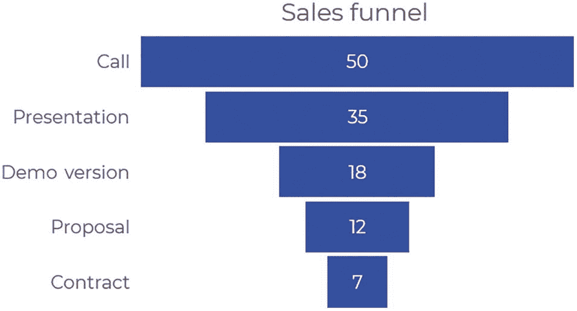

这张销售漏斗图展示了通话、演示、试用版、报价和合同等环节。通话环节的数值最高，为 50；合同环节的数值最低，为 7。

#### 并非所有饼图都同样有用

饼图常常被用于其他目的。让我们看看这个项目组合的可视化图表。

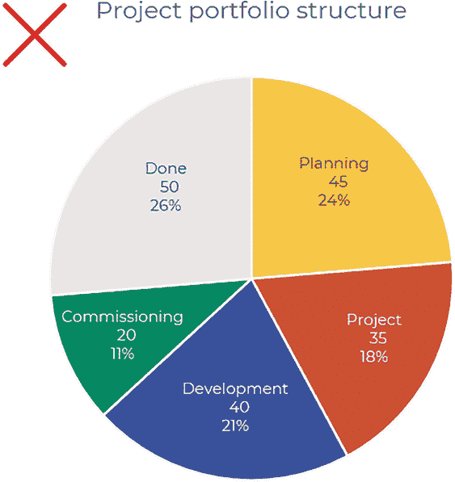

这张柱状图以百分比展示了项目组合结构。“已完成”占比最高，为 26%；“投产”占比最低，为 11%。最左边顶部有一个叉号标记。

一切看起来似乎都做得不错。饼图被用于展示结构，其上只有五个扇区，有数据标签，且类别标题水平放置。但不管我把这张图给谁看，大家都不喜欢：有人建议将标签放在圆外，有人说需要改变颜色……但问题其实不在这里。

该图表的目的本应是展示当前时刻各项目阶段的状态。这里我们没有按从多到少的顺序排列阶段，它们是依次衔接的：先是规划，然后是设计，接着是开发，以此类推。实际上，这是一个时间顺序，只不过不是按日历周期，而是按项目的各个阶段。

这不是结构分析，而是动态分析——我们通常沿着水平轴从左到右来展示它。这样你一眼就能看到 50 个项目已完成，20 个处于投产阶段，40 个在开发阶段，等等。饼图常用的百分比数据标签在这里并不需要，反而会造成混淆。

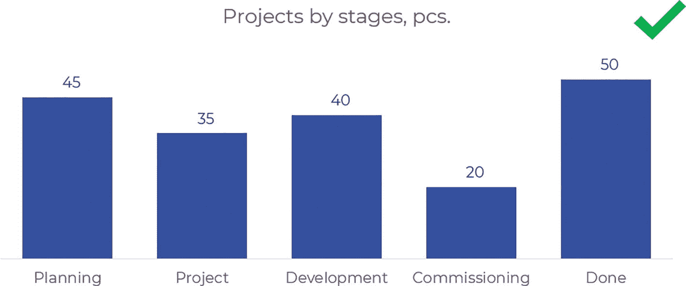

这张柱状图展示了按阶段划分的项目情况。“已完成”数值最高，为 50；“投产”数值最低，为 20。最右边顶部显示了一个对勾标记。

我再次强调一下水平时间轴。有些人可能认为条形图效果更好，尤其是在标签较长的情况下。

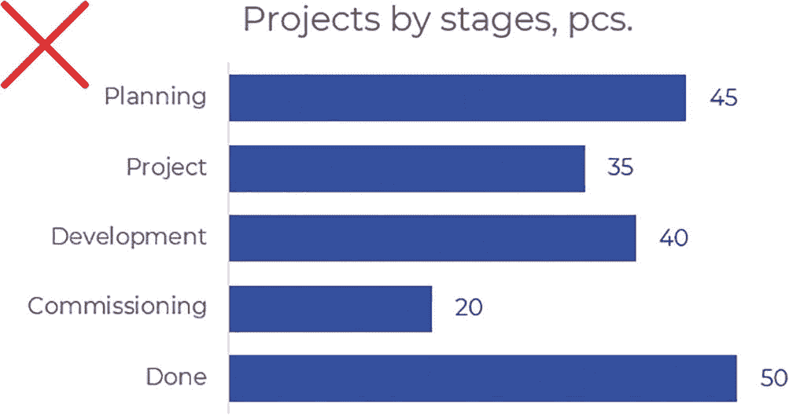

这张条形图展示了按阶段划分的项目情况。“已完成”数值最高，为 50；“投产”数值最低，为 20。最左边顶部显示了一个叉号标记。

即使这不是致命的错误，也算得上是一个错误。默认情况下，眼睛会将水平柱形视为一个排序列表，而我们需要强调的是动态变化。

还有另一个不当使用饼图的例子，有人试图用它来展示我们的客户群由哪些年龄组构成。

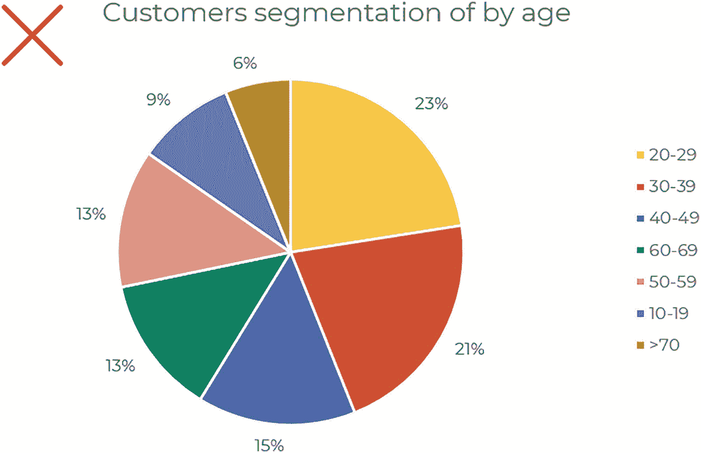

这张饼图展示了按年龄划分的客户细分。20 至 29 岁年龄组占比最高，为 23%。最左边顶部显示了一个叉号标记。

扇区按照饼图所需的方式进行了排序——从大到小。但细分部分实际上是年龄分布区间。也就是说，我们再次面对的是一个从最小值到最大值的水平刻度尺。

最显而易见的做法是用柱形来展示各细分部分的大小。这样就不需要像扇区那样着色，也无需图例：X 轴上已经标注了年龄区间。

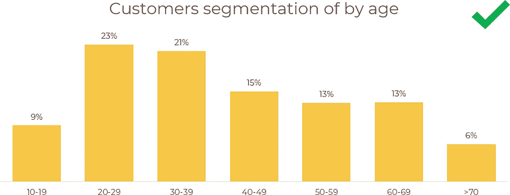

这张柱状图展示了按年龄划分的客户细分。20 至 29 岁年龄组占比最高，为 23%。最右边顶部显示了一个对勾标记。

你可能会好奇，为什么纠正所有错误最终都会导向使用水平或垂直柱形图？但这确实是最高效的可视化方式。

任何类型的图表都应该有意识地选择。首先，我们要确定数据在含义上属于什么类型，以及需要进行哪种数据分析。然后，我们才能选择恰当的图表。这不是一个创造性的过程，而是一个纯粹的逻辑过程。

每种分析类型都有几种对应的有效图表。本章后续部分的指南将教你如何在不同情况下做出正确选择。即使你不是设计师，也能掌握数据可视化的技巧。

### 6.1.3 本章小结

**五种数据分析类型**

1. 排名分析 – 用于指标的量化比较
2. 动态分析 – 用于理解随时间的变化
3. 结构分析 – 用于分析整体的构成，占整体的百分比
4. 关联分析 – 用于评估多个参数之间的数量和逻辑关系
5. 分布分析 – 用于按区间或恒定尺度进行细分

在企业报告中，90% 的情况下只用到其中三种：排名分析、动态分析和结构分析。

为了避免错误，必须首先确定数据分析的类型，然后再选择相应的图表。

## 6.2 如何选择图表

每种分析类型都有适合和不适合的图表。例如，用饼图展示月度动态就不是一个好主意——展示动态我们通常使用折线图，虽然也可以在时间轴上看到柱状图。那么问题来了：哪种选项更好？

首先，这取决于数据量：5 个柱形是一种情况，15 个柱形则是另一种。我会介绍一些推荐规则，但不能将它们视为严格的算法。你会不断遇到规则之外的例外情况，因为图表的选择还取决于其他细微之处。例如，它取决于类别标签的长度以及屏幕上分配给图表的空间。

此外，图表的选择还取决于你想在上面放置多少个数据系列：仅仅是实际指标，还是与计划、去年数据、行业基准的对比。在这一部分，我们将从简单的开始：如何为单行数据的排名分析、动态分析和结构分析选择图表。

### 6.2.1 用于评分的图表

为了直观地进行定量比较，我们使用一种称为“柱形”的图形，它可以是水平方向或垂直方向的。

但在微软 Office 中，这是两种不同的图表：垂直方向称为柱形图，水平方向称为条形图。两者都适用于单行数据的评分，但并非总是可以互换。让我们弄清楚在哪些情况下不必使用大家最喜欢的柱形图。

#### 按类别数量选择

当柱形图上的柱子很多时，类别标签在水平方向上会放不下，并且倾斜的角度下很难判断数据标签属于哪根柱子。

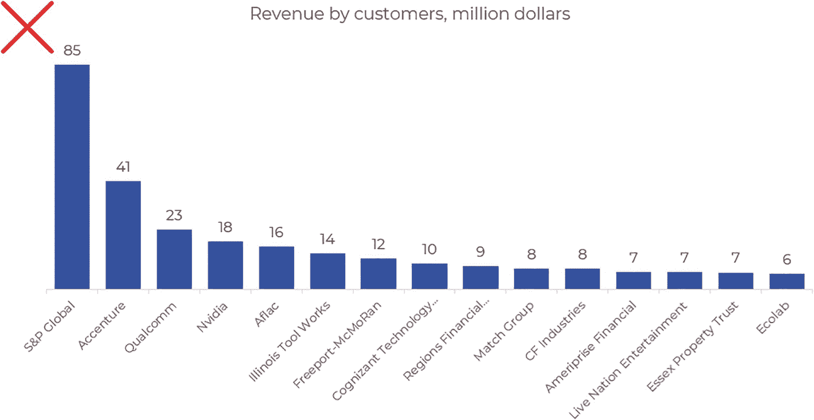

按客户划分收入的条形图。S&P Global 的价值最高，为 8500 万美元，Ecolab 的价值最低，为 600 万美元。左上角有一个叉号标记。

为了解决这个问题，需要将图表“翻转”过来，这样类别标签就可以从左到右水平地轻松阅读。通常，如果你有不超过十个类别，标签放在垂直柱形图上；超过十个，则放在水平条形图上。

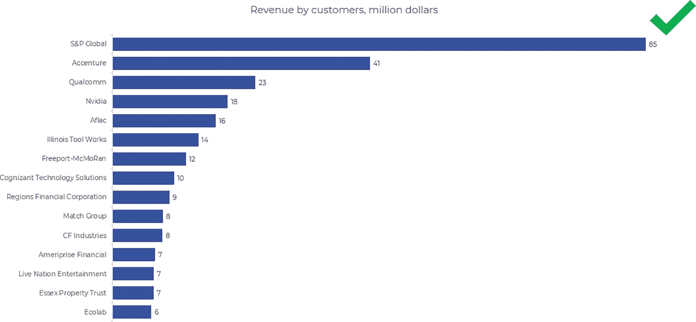

按客户划分收入的条形图。S&P Global 的价值最高，为 8500 万美元，Ecolab 的价值最低，为 600 万美元。右上角有一个对勾标记。

我提醒一下，十个类别只是一个大致参考，你还需要考虑其他细微差别。

#### 考虑标签长度

在这个例子中，只有八种服务类型，但它们的名称非常长，而且再次以倾斜角度显示。

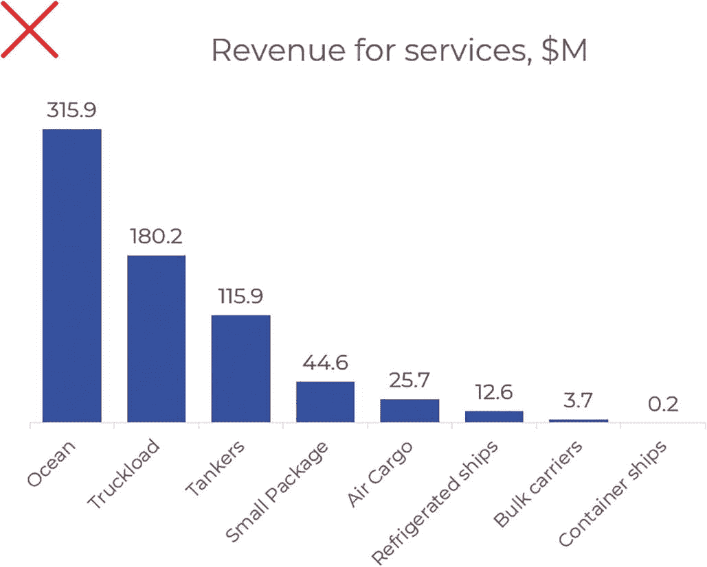

按服务划分收入的条形图。Ocean 的最高点为 31590 万美元，Container ships 的最低值为 20 万美元。左上角有一个叉号标记。

在这种情况下，条形图仍然能解决问题，不过我建议对于长的服务类型或成本项目选择缩写名称。空间应该用于可视化，而不是冗余文本。

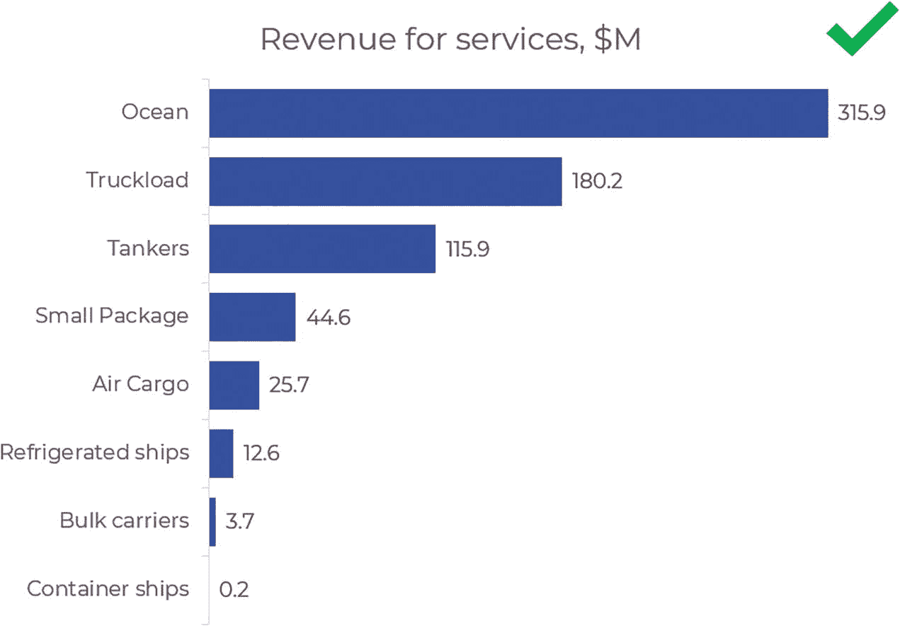

按服务划分收入的条形图。Ocean 的最高点为 31590 万美元，Container ships 的最低值为 20 万美元。右上角有一个对勾标记。

#### 评估屏幕上的可用空间

如果仪表盘或幻灯片屏幕至少有半个宽度可用于显示，则七个分支的收入在柱形图上将是可见的。但这里我们只有大约四分之一的宽度，所以标签再次放不下。而对于条形图来说就没有这个问题——它很好地发挥了其功能。

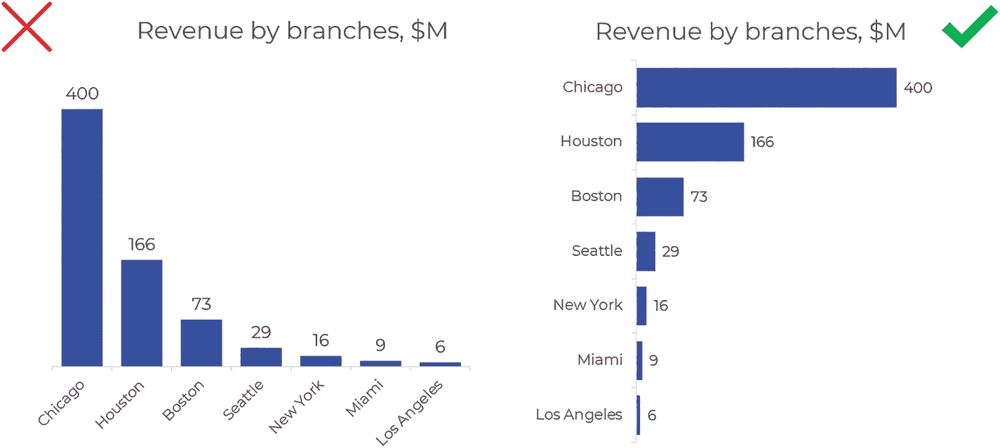

一组两个条形图展示了各分支的收入水平。芝加哥：4 亿美元（最高范围）。垂直和水平条形图的顶角分别有叉号和对勾标记。

**简要结论：什么时候不适合使用柱形图**

*   如果需要比较超过十个对象
*   如果类别标题在水平方向上放不下
*   如果仪表盘上没有足够的空间放置柱形图

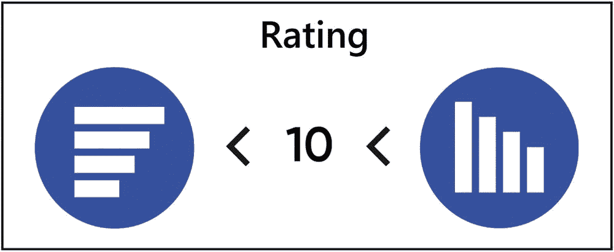

此图展示了水平和垂直方向的定量比较。数字 10 代表评分的等级水平。

### 6.2.2 用于动态趋势的图表

为了展示某个指标随时间的变化，折线图或柱形图更为合适。在某些情况下，你也可以使用面积图——我暂时不重点讨论它。

让我们弄清楚何时选择垂直柱形图，何时选择折线图。标准仍然是数据点的数量；只是这里的上限增加到了 12。

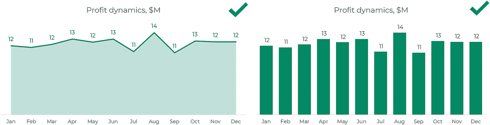

折线图和柱形图展示了一月至十二月的利润动态范围。八月利润动态最高（1400 万美元）。图表右上角有对勾标记。

12 个时段在折线图和柱形图上都能清晰显示，因为月份名称被缩短了。但如果仪表盘上还出现了下一年的月份，就会显得过载。

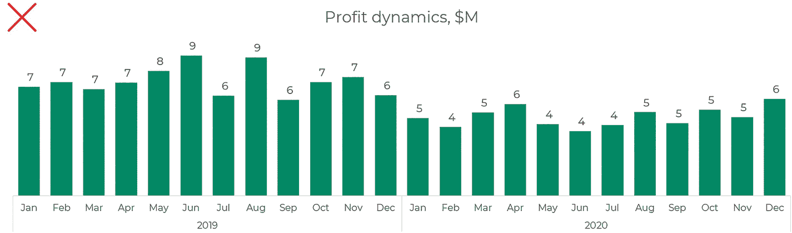

柱形图展示了 2019 年和 2020 年的利润动态范围。2019 年 6 月和 2019 年 8 月利润动态最高（900 万美元）。左上角有一个叉号标记。

在这种情况下，折线图能更好地将注意力集中在趋势线上，并消除不必要的视觉“噪音”。

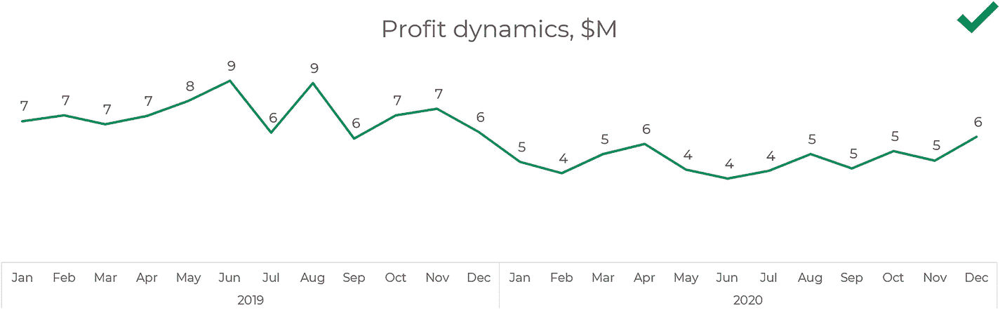

折线图展示了 2019 年和 2020 年的利润动态范围。2019 年 6 月和 2019 年 8 月利润动态最高（900 万美元）。右上角有一个叉号标记。

#### 少于六个时段

相反的情况是，我们只有很少的数据点，例如一年中的四个季度。在我的讲座中，我会并排展示两个图表：我提醒听众数据是相同的，并询问第一印象哪个更好。大多数人选择柱形图。

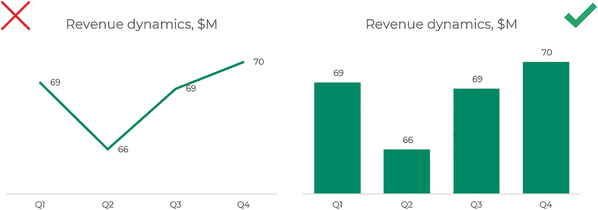

折线图和柱形图展示了 4 个季度的收入动态。第四季度收入动态最高（7000 万美元）。折线图和柱形图的顶角分别有叉号和对勾标记。

我同意他们的看法：折线图看起来与刻度脱节，并且有些空旷。点之间的平滑曲线也容易令人困惑，因为增长或下降很少如此均匀。没有足够的数据来形成令人信服的趋势线，人们对其缺乏信任。而柱形图则更侧重于每个季度的总额，同时保留了时间顺序。

#### 关于刻度方向的常见错误

有时仪表盘上会在关键绩效指标（KPI）卡片正下方（甚至代替它们）添加动态迷你图，例如，显示几年的数据。并且经常使用条形图来实现。

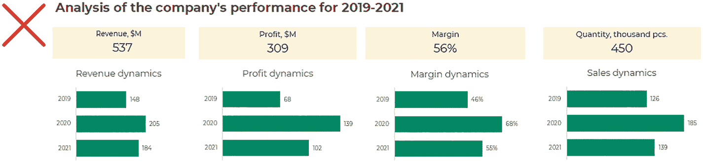

一组四个水平条形图展示了 2019、2020 和 2021 年的收入、利润、利润率和销售动态。左上角有一个叉号标记。

不要犯这样的错误！我们的时间轴严格位于 X 轴上，也就是水平方向。因此，对于此类迷你图，我们应该选择迷你柱形图。

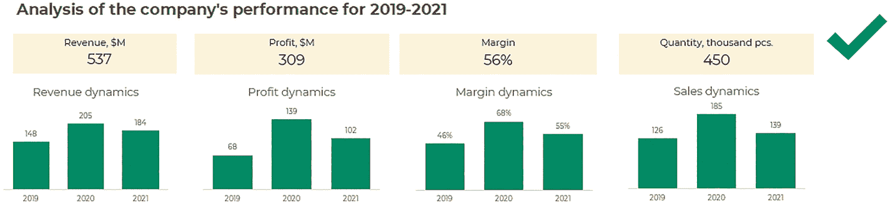

一组四个垂直柱形图展示了 2019、2020 和 2021 年的收入、利润、利润率和销售动态。右上角有一个对勾标记。

**简要结论：垂直柱形图还是折线图？**

*   如果少于六个时段，选择柱形图。
*   如果最多有 12 个时段，两者都适用。
*   如果超过 12 个时段，只选折线图。
*   条形图不适合显示动态趋势。

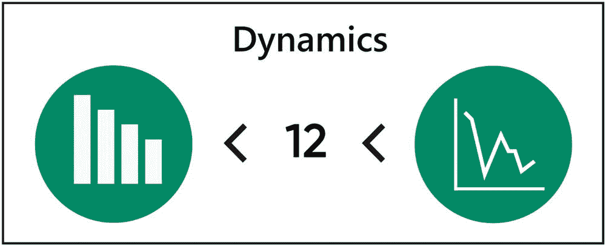

此图展示了条形图（左）和折线图（右）的动态范围。12 是动态范围。

### 6.2.3 用于结构的图表

为了展示某个整体由哪些部分组成，最常使用饼图或其变体——环形图。两者之间没有区别，因此选择权在你手中。但还有一种显示结构的方法——即树状图。

饼图和树状图都被划分成扇区——即整体的各个相同部分。在扇区中，你可以展示，例如，每个城市在收入中所占的份额。或者，如果不同的费用项目位于扇区中，则可以查看公司费用的完整结构。让我们弄清楚何时将圆划分成几部分，何时将矩形划分成几部分。

#### 六个扇区——饼图的最大限度

接下来关于饼图的所有论述同样适用于环形图。两者都展示整体，并且这种形式对二者都施加了一些限制。其中之一就是允许的扇区数量，不应超过六个扇区。

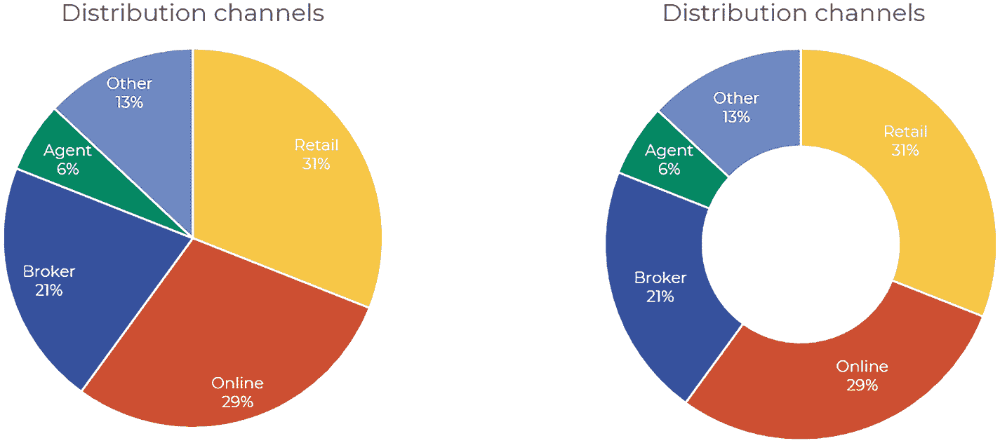

饼图和环形图展示了分销渠道的百分比。`Online`：29%。`retail`：31%（最高），`broker`：21%，`agent`：6%（最低），以及`other`：13%。

否则，圆形的扇区会变得太小，很难理解它们之间的差异。此外，你将无法在扇区内放置标签。将标签放到图表外部是一个坏主意：这会使用户感到困惑并造成元素堆积。

如果你的整体数据包含 7 到 10 个扇区，最好选择矩形树图进行可视化。

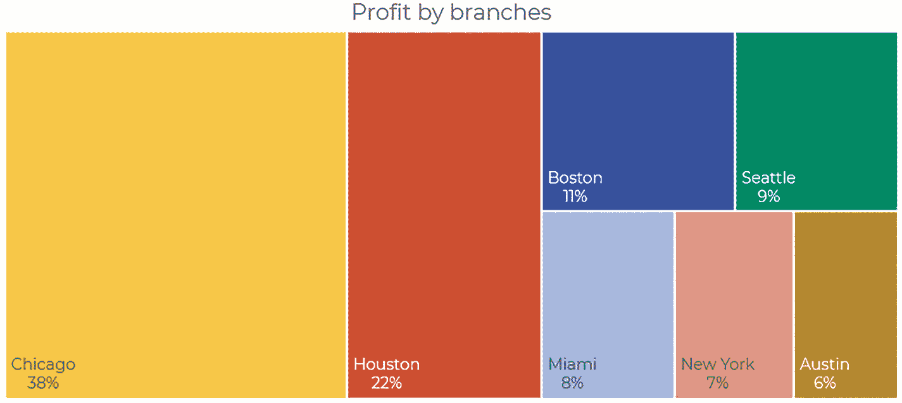

矩形树图展示了各分支的利润百分比。`Chicago`：38%（最高），`Houston`：22%，`Boston`：11%，`Seattle`：9%，`Miami`：8%，`New York`：7%，以及`Austin`：6%（最低）。

#### 标签过长？放弃饼图

即使扇区数量不多，类别标题也可能无法容纳。这也是替换图表的原因。矩形树图的尺寸更大，因此更容易将未能放入圆形或环形图扇区中的标题放置其中。

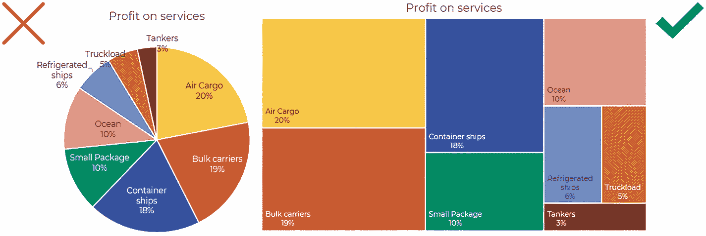

饼图和矩形树图展示了服务利润的百分比。`Air Cargo` 的百分比最高（20%）。饼图和矩形树图的右上角分别显示了一个叉号和一个对勾。

#### 饼图设计技巧

饼图有很多缺点，但有时它却是最佳的可视化选择。饼图上感知和数据分析的便利性很大程度上取决于其设计。

-   将第一个扇区放置在圆形的顶部，类似于表盘上的`12:00`位置。按从大到小的顺序排列扇区。

两个饼图展示了销售来源的百分比。1. 左上角显示一个叉号。2. 右上角显示一个对勾。网站的百分比最低（10%）。

-   不要在饼图上使用图例：不要强迫用户的眼睛从扇区移动到图例中的名称，并匹配这些元素的颜色。将标签放置在扇区内部。

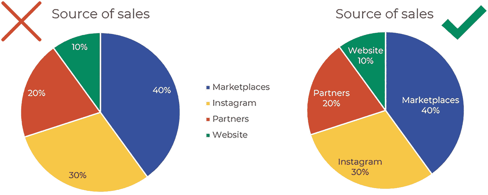

两个饼图展示了销售来源的百分比。`Marketplaces` 的百分比最高（40%）。1. 左上角显示一个叉号。2. 右上角显示一个对勾。

-   最好将较小元素的标签放在图表外部。确保它们的数量不要太多，否则标签会相互重叠。

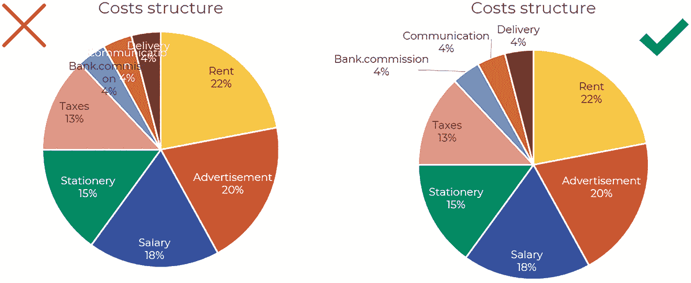

两个饼图展示了成本结构的百分比。`Rent` 的百分比最高（22%）。1. 左上角显示一个叉号。2. 右上角显示一个对勾。

-   永远不要。永远不要使用 3D 图表。出于某种原因，这种情况在饼图中最为常见——有些人觉得它们更美观，有些人觉得它们更专业。但 3D 效果扭曲了对数据的感知。这个例子清楚地展示了 29%的“立体”近端扇区看起来比 31%的扇区更大。

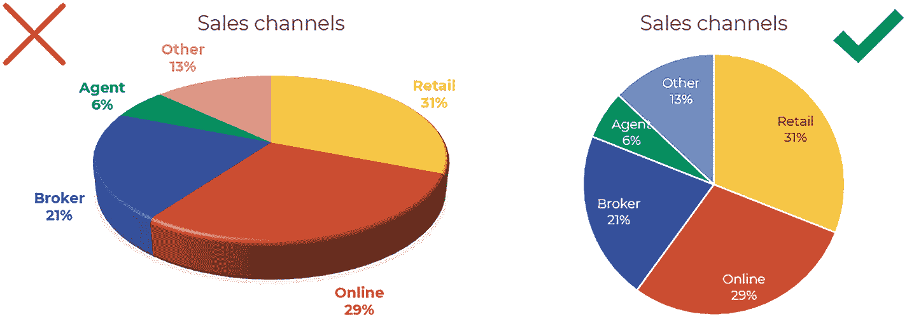

一个 3D 饼图和一个饼图展示了销售渠道的百分比。`Retail` 的百分比最高（31%）。1. 左上角显示一个叉号。2. 右上角显示一个对勾。

#### 简要结论：如何展示整体构成

-   如果结构中不超过六个独立部分，饼图或环形图是可行的。

-   如果标签放不进圆形的扇区，请使用矩形树图。

-   不要在饼图上使用图例。

-   如果结构中有 6 到 10 个独立部分，矩形树图是合适的。

-   如果标签放不进矩形树图的扇区，作为极端情况，使用条形图。

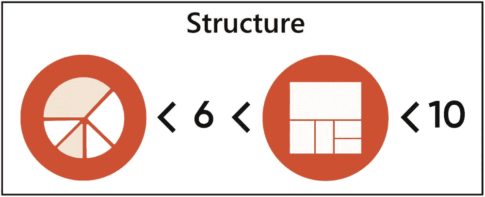

一张图展示了饼图和矩形树图的结构范围。6 是饼图的范围，10 是矩形树图的范围。

### 6.2.4 总结

即使是在三种流行的数据分析类型中，如果你不知道选择图表的规则，也可能感到困惑。使用一个简单的方案。

-   对于排名：柱状图或条形图
-   对于趋势：折线图、柱状图或面积图
-   对于结构：饼图（环形图）或矩形树图

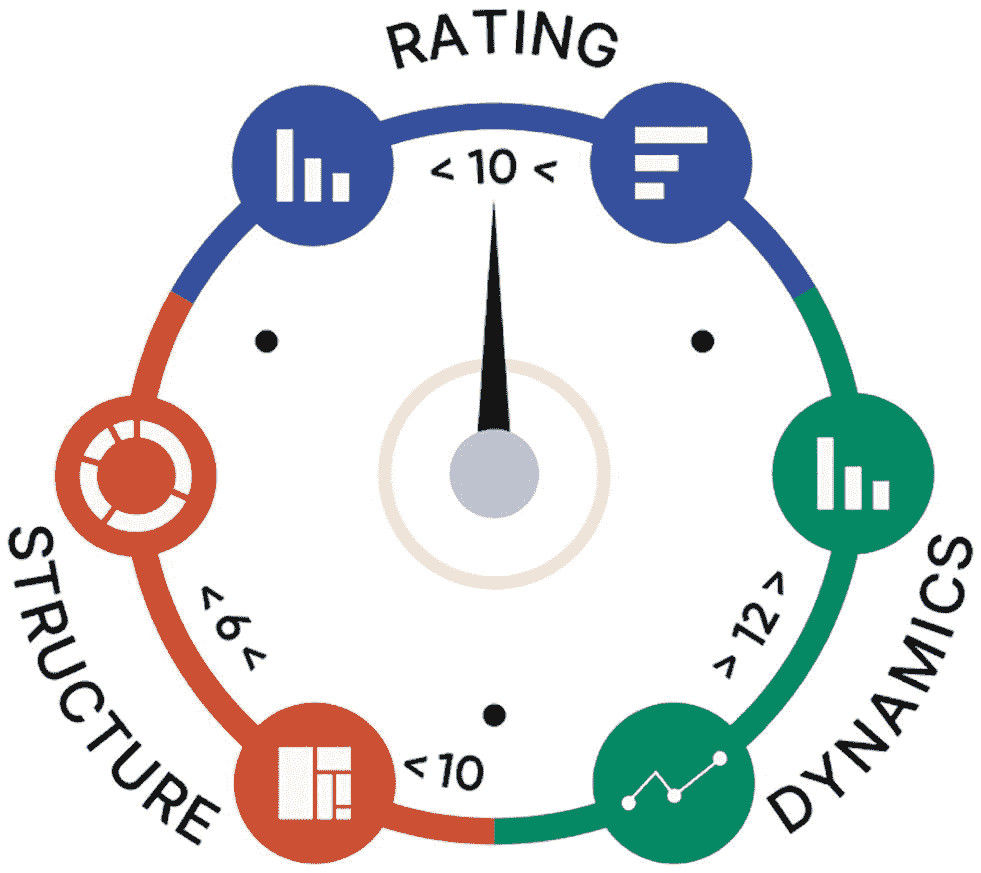

一个框架展示了排名（在条形图中）、趋势（在条形图和折线图中）和结构（在环形图和矩形树图中）的范围。`Rating`：10，`dynamics`：12，以及`structure`：6 和 10。

## 6.3 多数据系列的生活技巧

在最后一部分，我们处理了仅显示实际值的单一数据系列。但在实际报告中，你经常需要处理多个数据行，比较排名、趋势或结构方面的实际指标与目标指标。

在“`Wage fund analysis`”仪表盘上，我们根据目标和实际值比较了部门和费用项目。为了可视化这些排名，我们使用了柱状图和条形图，尽管对于此类数据，水平和垂直柱状图在两种情况下都适用。对于 4-5 个类别，它仍然具有可视性。

对于趋势，我们构建了线性图，尽管只有六个数据点。这可能看起来与前面描述的规则相矛盾。但仪表盘上的数据会随着新月份的加入而更新，总有一天会达到 12 个。此外，一开始对我来说，向你展示不同的图表（而不仅仅是柱状图）很重要。

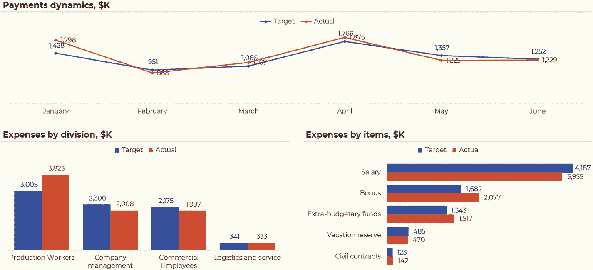

3 张图表。一张折线图展示了实际与目标支付趋势。垂直和水平的双柱状图分别展示了按部门和项目划分的费用（实际与目标）。

以上所有内容都可以通过组合系列更紧凑地表示。

-   对于月度趋势 – 使用带有折线和柱状图的组合图。
-   对于部门排名 – 使用带有标记的图表，这些标记替代了目标值的柱状图。
-   对于按项目排名 – 使用带有组合柱状图的图表：实际值位于目标值的背景之上，就像一个进度条在向它靠近。

我必须马上说明，这不是标准的可视化做法：Excel 的效果不如在`Power BI`中那么美观和直观。而且无论如何，我们的主要重点已经放在了实际值上，而目标值则是背景。在某些情况下这可能不错，但在某些情况下可能不太好。

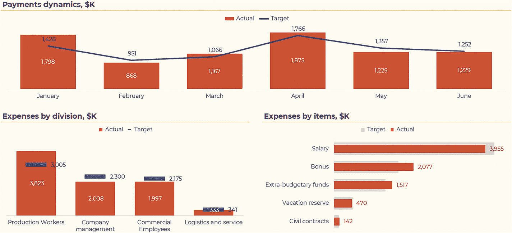

3 张图表。一张组合图展示了实际与目标支付趋势。垂直和水平的重叠条形图分别展示了按部门和项目划分的费用。

让我们弄清楚你可以使用哪些技巧来构建这些可视化图表，以及它们各自的优缺点。

### 6.3.1 动态组合图

前面所有的新可视化效果都有一个共同思路：目标是一个被实际值穿越的标记。要在图表上进行相应调整，请选中带有目标值的线条，然后在右键菜单中选择“更改系列图表类型…”。如果没有这个选项，说明你点击的是图表区域，而非系列本身（折线或柱形）。

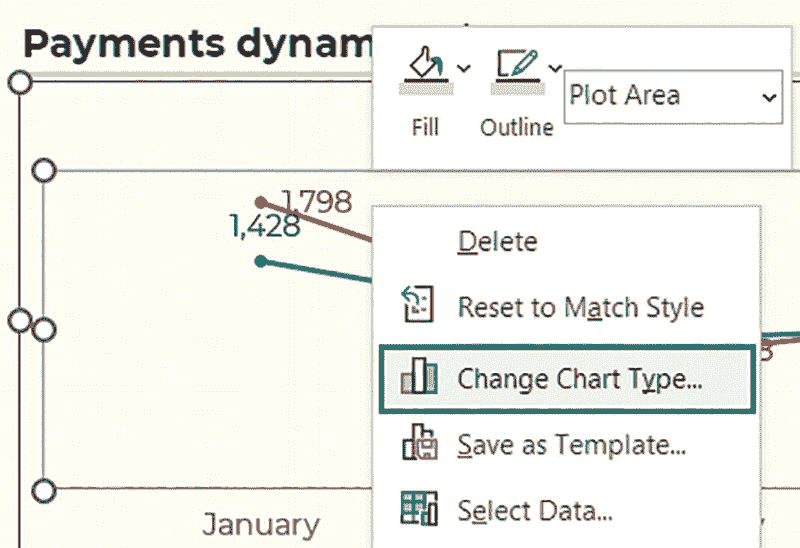

截图显示了右键菜单中的一系列选项。其中选中的是`更改图表类型`。

在打开的窗口中，我们可以为每个数据系列选择单独的图表类型。在我们的案例中，为“实际值”系列选择了`簇状柱形图`。

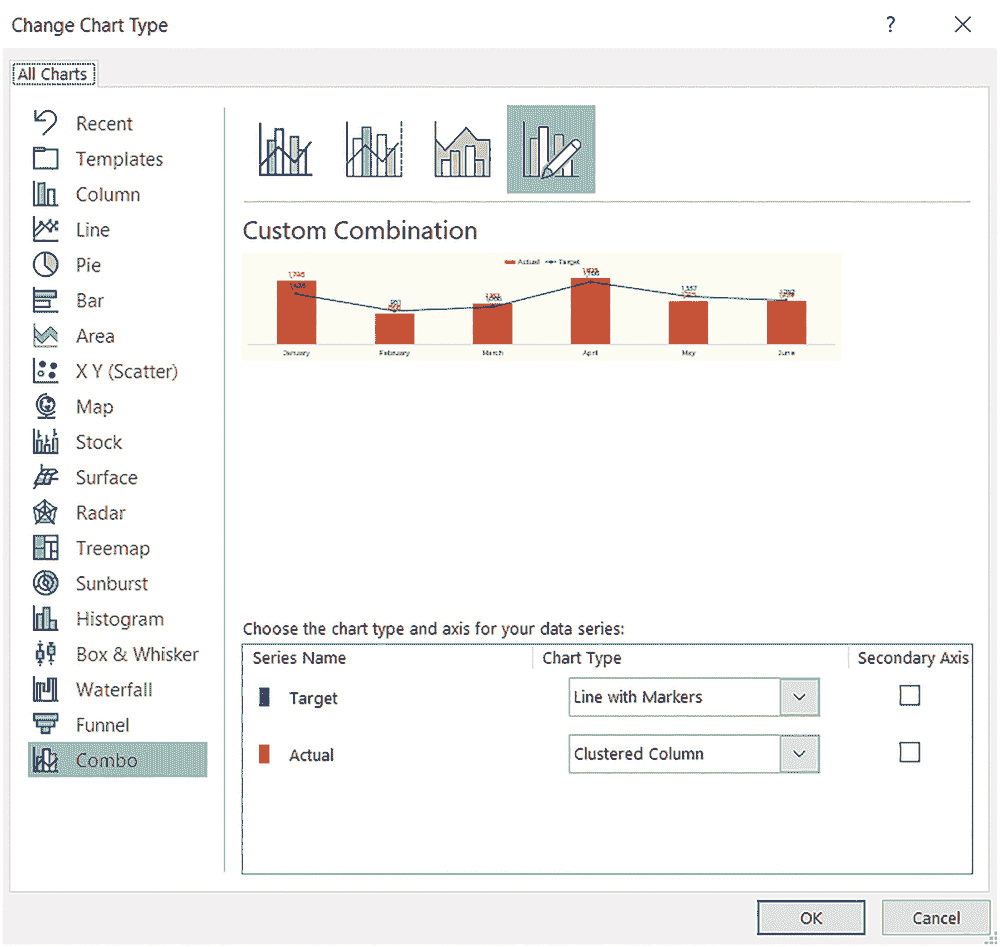

`更改图表类型`对话框展示了一系列图表。选中了`组合图`作为图表类型。中间展示了`自定义组合`。底部展示了图表类型和坐标轴选项。

这就是全部技巧。柱形图的好处是数据标签可以放置在中心位置，并且不会像之前那样与目标值重叠。

剩下的事情就是根据第 3.4 部分的清单来调整图表。首先，我们将`间隙宽度`从 150%缩小到 50%。然后，将“目标值”线条的粗细增加到 3 磅，这样它就不会在粗大的柱形背景下显得模糊不清。

在这个例子中，保留折线也是可以的，一切都很清晰。但通常需要展示三个系列：目标值、实际值和去年的实际值。在这种情况下，这种技巧就非常有帮助。只需注意主次分明：去年的数据不应分散对今年数据的注意力。

如果需要展示更多动态指标，根据规则，我们会选择折线图。但当你需要同时查看今年的利润值、目标值和去年的数值时，柱形图和折线图的组合就更合适了。

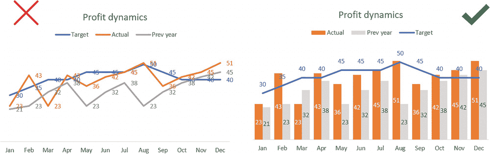

一个由折线和柱形构成的图表展示了利润动态，包含目标值、实际值和去年值。在图表最左端和最右端顶部有一个叉形标记。

有时需要在图表上放置不同量级的数据。例如，以千美元计的收入和以美元计的小额平均客单价。简单地在图表上反映此类数据是行不通的：平均客单价的折线会“贴”到 X 轴上。为了避免这种情况，应该将平均客单价的趋势线放在次要纵坐标轴上。

为了清晰起见，我将坐标轴涂成了与线条相同的颜色，以便清楚每条线对应哪个轴。仅靠标签无法解决问题：标签会变成一堆难以阅读且混杂在一起的数字。这样做效果会更好，虽然并非完美。

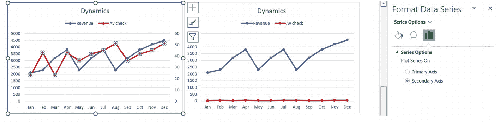

一对折线图展示了收入和平均客单价的动态趋势。两者都呈现波动趋势。右侧显示了`设置数据系列格式`选项。

为了强化重点，我们使用另一种技巧——对不同量级的数据使用不同的图形。我们将收入显示为柱形图，代表一个总量、总指标，而将平均客单价保留为折线图，但将其视为一个计算指标。

根据清单自定义视觉呈现——添加标签，移除坐标轴。但这里出现了一个问题：即使系列是建立在次要坐标轴上的，平均客单价的折线还是会再次贴到 X 轴上。这是 Excel 的另一个特性，导致我们不能简单地从图表中移除刻度。但我们可以隐藏它：通过将坐标轴重新着色为背景色（这里是白色）使其不可见。坐标轴仍然存在，但不再分散对数据的注意力。

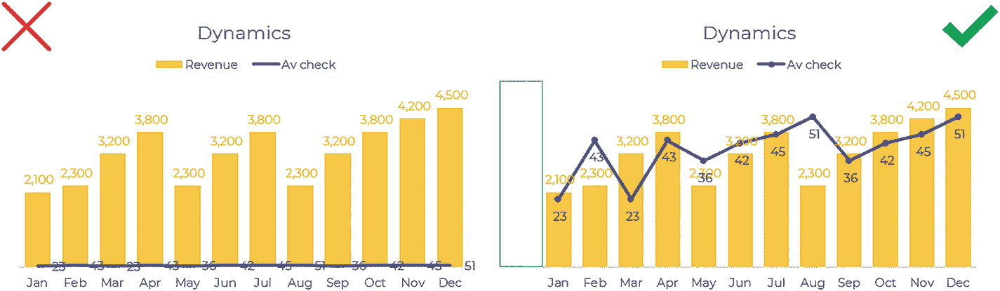

一个垂直柱形图和一个组合图（柱形+折线）展示了动态范围。柱形表示收入，折线表示平均客单价。1. 左上角有一个叉形标记。2. 右上角有一个勾选标记。

我们之所以需要所有这些复杂操作和技巧，只是为了在 Excel 中构建此类图表。在 Power BI 等专业软件产品中，则无需如此复杂。

### 6.3.2 用于目标-实际值评分的子弹图

`子弹图`用于显示目标-实际值。其视觉创意是：带有实际值的条带仿佛射出、飞离标有目标的枪管。左侧的示例看起来更像那种枪，而右侧的则是极简版本，其中的目标是一条线，一个由实际值触及的条。此外，这里还使用了条件格式：如果未达到目标，则显示红色；如果完成目标，则显示绿色。

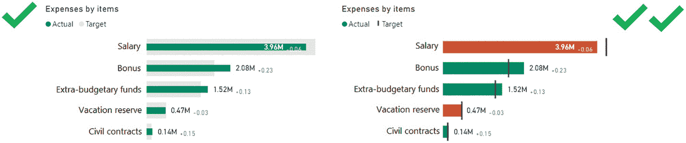

一对按项目显示支出并带有实际值和目标值的柱形图。薪金支出最高，为 396 万。在最左端和最右端顶部各有一个勾选标记和双勾选标记。

两种方案都正确，但我推荐第二种。它为实际值柱形留出了更多空间，并且目标值紧凑地显示为一条短划线。但这些是在 Power BI 中构建的现成`子弹图`示例。在 Excel 中，我们需要动一番脑筋，并且结果不会 100%符合标准。

#### 系列组合实现的水平子弹图

要构建水平子弹图，我们首先需要更改“目标值”数据系列的参数，并将`系列重叠`设置为 100%。所有数据标签都混在一起了，因此我们从“目标值”柱形中删除它们。

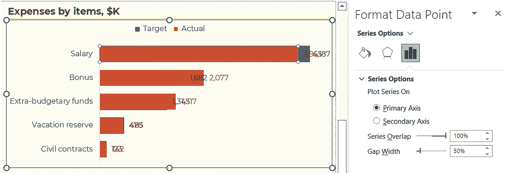

截图展示了一个重叠柱形图，表示按项目划分的实际支出和目标支出范围。`设置数据点格式`（右侧）显示了一系列系列设置选项。

接着，我们将“实际值”系列切换到次要纵坐标轴，并将其`系列重叠`设置为 0%，`间隙宽度`设置为 125%。设置好次要系列的坐标轴进位基准后，将其从图表中移除。

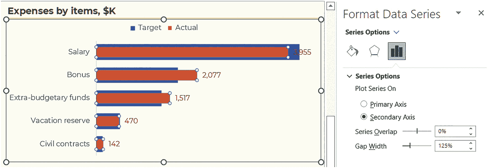

截图展示了一个重叠柱形图，表示按项目划分的实际支出和目标支出范围。`次要纵坐标轴`是选中的绘图系列设置。

然后，选中数据系列“目标值”。将其颜色改为中性灰色，以便重点只保留在实际值上，并为其设置以下参数：`系列重叠`为 0%，`间隙宽度`为 25%。

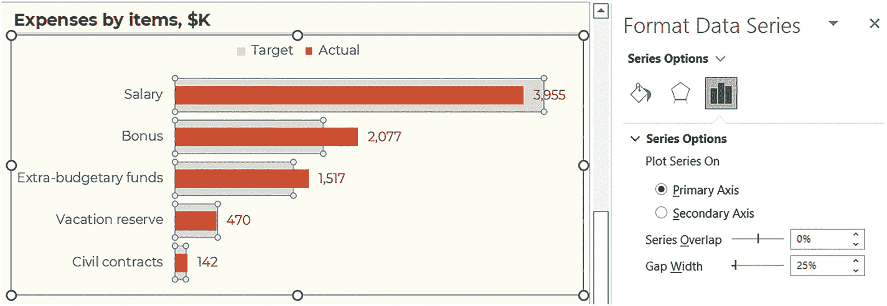

截图展示了一个重叠柱形图，表示按项目划分的实际支出和目标支出范围。`主要纵坐标轴`是选中的绘图系列设置。

至此，子弹图的所有设置已完成，它看起来几乎与 Power BI 中的标准图表一样。如果需要，你也可以用同样的方法设置垂直子弹图。

#### 带虚线的垂直子弹图

第二种标准子弹图也可以在 Excel 中创建。

**第一步。** 选择组合图来更改图表类型，然后为目标值选择“带标记的折线图”类型。

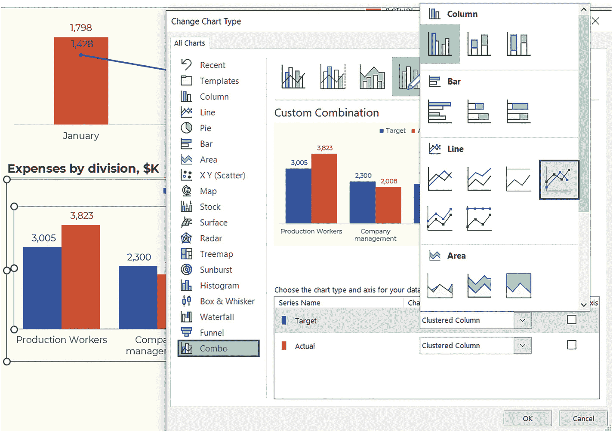

截图展示了更改图表类型的对话框，其中显示了一系列图表。组合图是选中的图表类型。一个上下文菜单展示了柱形图、条形图、折线图和面积图的设置选项。

**第二步。** 设置数据系列 `Target`：在 `Line` 部分，将值设置为 `No line`；在 `Marker` 部分的 `Marker Options` 子部分，选择 `Built-in` 类型，类型为最大虚线，并将大小设置为 45。

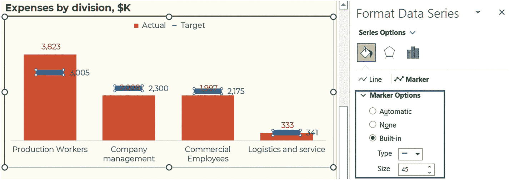

截图展示了一个重叠条形图，按部门表示实际支出和目标支出。右侧显示了“设置数据系列格式”面板。`Built-in` 是选中的标记选项。

**第三步。** 由于实际值与标记重叠，需要为该系列传输数据标签，并选择位置 `居中`。

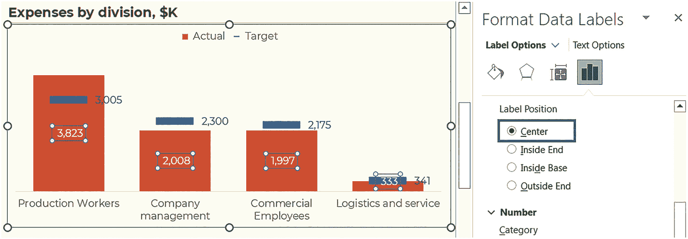

截图展示了一个重叠条形图，按部门表示实际支出和目标支出。右侧显示了“设置数据标签格式”面板。居中（The center）是选中的标签位置。

但最终效果并不完美：对于较小的数值，物流和服务部门的数据标签仍然没有足够的空间。

遗憾的是，这种子弹图只能在 Excel 中为垂直柱形图创建，而无法用于水平条形图。因为标记是图表的属性，而图表只能显示动态变化。动态变化只能存在于水平时间轴上。在这里，Excel 的创建者出人意料地做了正确的决定，甚至没有提供创建垂直图表的机会。

### 复杂结构的图表

在公司报告中，结构很少采用复杂的形式。但一旦出现这种情况，十份报告中有八份会以令人费解且错误的方式传达信息。这尤其适用于以下两种情况：

- 需要同时按两个参数显示结构时
- 需要将结构与其他分析类型结合展示时

我将展示最常见的一个错误，并为这类问题提供替代的解决方案。

#### 错误：双数据系列的环形图

传统的结构图表，即饼图和三维饼图，只能显示一个数据系列。虽然环形图可以显示两个系列，有些人也乐于使用这种技巧。

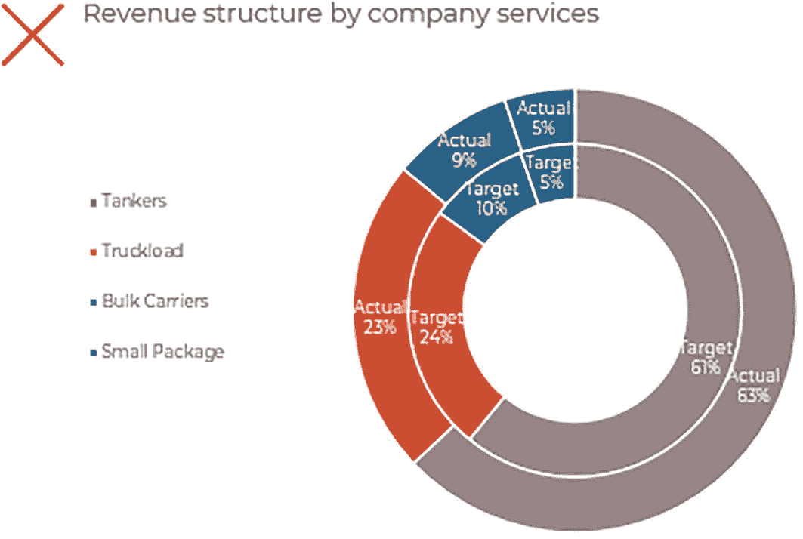

一个环形结构图展示了按公司服务划分的收入结构，包含目标值和实际值。其中，Tankers 的实际值占比最高，达到 63%。

但这仍然是一种不成功的可视化方式，它会扭曲数据。仔细观察橙色扇区：实际值的 23% 看起来比目标值的 24% 还要大。这在逻辑上可以解释为，表示实际值的环半径更大，因此较小的比例占据了比目标值环上更大的空间。但问题在于，这需要解释。而好的可视化应该遵循“一看就懂”的原则。

在这种情况下，作为一种折中方案，我们可以考虑使用归一化的条形图。这里将两个环展开成两条等长的直线。虽然扇区之间相互错位，但 24% 显然比 23% 更大。而且，我们确实可以看到实际收入结构相对于目标收入结构的整体变化。

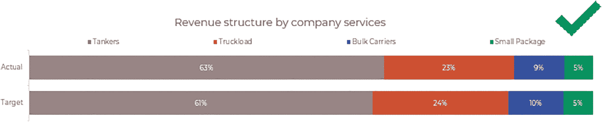

两条水平条形图展示了按公司服务划分的收入结构，包含实际值和目标值。Tankers 的实际值占比最高，达到 63%。最右侧顶部有一个勾选标记。

我要提醒您注意图表设计清单的重要性！每个项目单独看起来可能无关紧要，但它们汇总起来会产生截然不同的印象。比较一下，如果我们只是简单地更改图表类型，结果就会像下面这样。

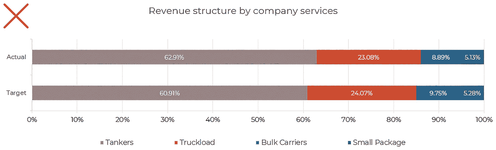

一个堆叠条形图展示了按公司服务划分的目标和实际收入结构。Tankers 的实际值范围贡献了最高的百分比（62.9%）。左上角有一个叉号标记。

以下是我们在最终版本中完善的关键点。

-   数据标签以百分比形式显示。条形图没有这种显示参数，因此需要在源数据中重新计算（稍后您将学习如何在数据透视表中执行此操作）。
-   我们通过减少侧边间隙，并移除刻度和网格线，使条形变得更宽、更直观。

这种图表也有其缺点。例如，数据标签只能放置在扇区内部，但在小扇区中，它们会相互重叠并变得难以阅读。和环形图一样，它最多也只能清晰显示六个扇区。然而，这种可视化至少有助于观察条形长度上的差异。

#### 复合树形图

树形图不仅可以展示单个数据系列的结构，还可以展示两个类别的结构。更准确地说，可以在两个层级上，例如，根据一家物流公司的活动对其服务类型进行分组。我将向您介绍如何构建这种带有分数的图表。

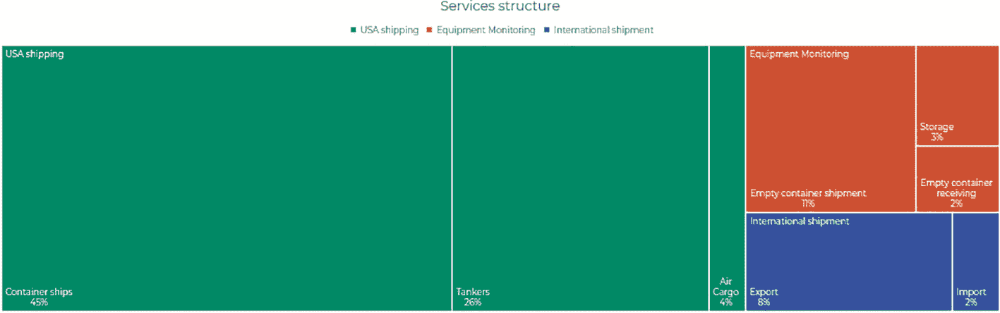

一个包含多个分段的矩形模型描绘了服务的结构。美国航运占比最高，达到 75。

**第 1 步。** 首先，我们将为数据透视表创建一个样本，添加包含业务领域、服务类型和销售额的字段。默认情况下，数据透视表是以分层形式构建的，如果不进行额外的数据准备，就无法构建树形图。

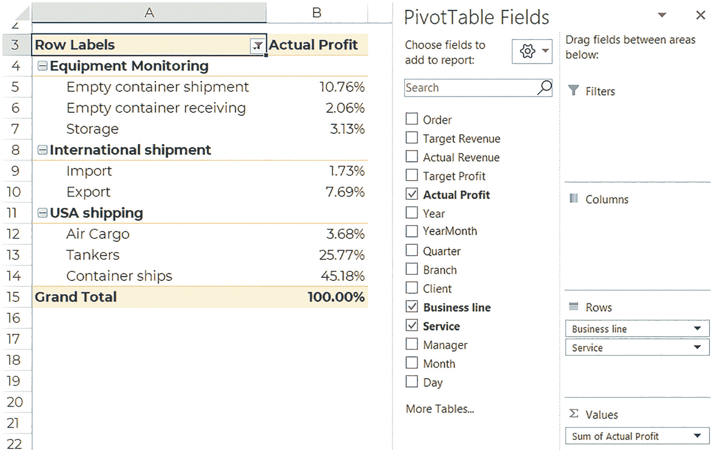

一张截图显示了 Excel 表格中的行标签和实际利润。右侧显示了数据透视表字段列表。“业务线”和“服务”是选定的行选项。

**第 2 步。** 要以所需的形式展开数据透视表中的数据，首先需要在“设计”选项卡上选择“报表布局”项，然后依次选择“以表格形式显示”子项和“重复所有项目标签”子项。

一张截图展示了“报表布局”选项的下拉列表。“以表格形式显示”和“重复所有项目标签”是选中的设置。

之后，通过单击“分类汇总”子项下的“不显示分类汇总”来禁用总计的显示。

一张显示了文件菜单并启用了分类汇总选项的截图。“不显示分类汇总”已被选中。

**第 3 步。** 数据以绝对值形式呈现，我们需要将其转换为百分比。为此，请转到“销售额”列的任意单元格，在右键菜单中，选择“值字段设置...”。或者双击列标题。在打开的窗口中，在“值显示方式”选项卡上，从下拉菜单中选择“% 的汇总”公式。

一个“值字段设置”对话框显示了源名称、自定义名称、基本字段和基本项选项。“实际利润”是源名称。“值显示方式”选项是选定的“值汇总方式”。

**第 4 步。** 由于无法在 Excel 中直接从数据透视表创建树状图，我们将通过放置指向数据透视表单元格的链接来创建其表格的副本。不要忘记为副本表格中的列设置百分比数据类型（默认情况下，链接将传递十进制数字格式）。

一个裁剪过的 Excel 表格截图显示了业务线、服务和实际利润。业务线包括设备监控和国际运输。“100.00%”是总计值。

**第 5 步。** 我们基于副本表格创建一个新的树状图，并通过勾选类别名称和值项以及选择“换行”分隔符类型来配置数据标签。

一个带有分隔的矩形框描绘了服务结构。美国航运占比最高，达到 75。格式数据标签中的标签选项“类别名称”和“值”已启用。

我们已经回顾了如何从简单图表创建非标准可视化的技巧。老实说，我认为这与其说是技巧，不如说更像是拐杖：调整辅助轴、将刻度隐藏到背景色中、从图表中禁用线条、以及将数据透视表的链接放置到相邻单元格中。

如果您经常在 Excel 或 PowerPoint 中这样做，那么也许是时候转向 Power BI 了。那里，这些可视化已经得到增强，并且有更多有用的图表和功能来处理数据。

另一方面，在理解了这个层次的图表结构之后，您将在高级 BI 系统中拥有更多的操作自由度。

### 6.3.4 总结

通常，在仪表板上会将实际值与目标值或其他指标进行比较。为了保持可视化的清晰性，我们使用非标准图表。在现代 BI 系统中，这些是现成的小组件，但在 Excel 中，您必须使用一些技巧才能获得类似的结果。

**评级：** 我们根据子弹图的原则将两列合并*，就像实际值“突破”了目标的边界一样。*

* 基于条形图 – 通过沿着辅助轴构建实际值系列，并调整间隙宽度。
* 基于**柱形图** – 通过以带有标记的线性图形形式显示目标系列。然后我们移除线条并将标记调整为大条带的形式。

**动态**

* 将折线图和柱形图结合起来，避免数据点堆积在一处。
* 如果数值量级不同（一个在数百，另一个在数千），则使用辅助轴。只是不能删除刻度，您需要将其隐藏在背景色中。

***结构***

* 为了比较目标值和实际值的结构，我们使用 100% 堆叠条形图。这在六个类别以内时可视性较好。
* 树状图适用于两个类别。它将显示按顶层类别划分的整体结构，以及顶层类别内部的子类别结构。

## 6.4 如何一次性展示所有信息

数据可视化项目通常从一个漂亮整洁的布局开始。但最终结果往往大相径庭。一旦客户看到产品，新的需求和想法就会出现。

– 我们能不能在图表中不仅加入目标值，还加入去年的实际值？

– 与去年比较还不够（疫情、危机或新的灾难）。我们还需要前年的数据。

– 在图表中添加百分比偏差。不，用绝对值。嗯，要不百分比和绝对值都加上！

这份清单可以一直列下去，每一项新内容都让经理和分析师们眼皮直跳。当然，最终结果会变得很糟糕。

一张柱形图描绘了公司经理的效能。它绘制了目标收入、实际收入、收入完成率、利润率和利润完成率的 5 条波动趋势线。

有时出现这样的问题是因为我们忘记了自己在使用哪种分析：有时我们改变了图表类型，有时我们将图表一分为二。但有时，您确实需要一次性比较多个指标。

当然，最终决定权始终在客户手中。在我公司的项目中，有时你也必须做出妥协，这些我不会作为最佳实践案例放在作品集中展示。

### 6.4.1 当表格是唯一选择

即使在 Power BI 和 Tableau 中，也没有哪种图表能在多个类别背景下直观地显示四行数据。对于单个图表，三个指标是极限：你可以使用我在前面部分展示的组合图表，或者为带有子类别的类别使用两级树状图。

对于更大量的数据，只有一个可行的选择——表格。许多人并不喜欢这个选项，但它至少能让你读取数值，而且总比过度负载的图表要好。

**提示！**

*要让表格既直观又易于理解，关键在于不要过度使用花哨的设计，并正确设置视觉重点。*

许多人对数据透视表的标准格式就感到满意了。但我的方法与处理图表时相同：一份用于计算的草稿，和一份位于仪表板工作表上的最终版本。

一张具有代表性的表格展示出经理名单、实际收入、目标实际值、实际利润、目标利润、利润率百分比以及订单数量。左上角有一个叉号标记。

一张具有代表性的表格展示出经理名单、收入（以美元计和百分比计）、利润（以美元计和百分比计）、利润率百分比以及订单数量。右上角有一个勾选标记。

**注意**

在设计版本中，我移除了目标指标。取而代之的是，我添加了百分比偏差，并按照交通灯原则进行了颜色编码。无需在心里计算目标与实际之间的差值——我们有了对目标的视觉强调，以及偏离目标的视觉指示器。

让我们看看如何使用数据透视表的附加选项来获得这样的结果。

### 6.4.2 如何添加计算字段

在我的示例中，它将是对收入、利润和利润率的目标执行情况进行计算。

我们在`数据透视表分析`选项卡上向数据透视表添加列：`计算`部分 ➤ `字段、项目和集`按钮 ➤ `计算字段...`选项。

一张屏幕截图展示了数据透视表分析，其中选中了字段、项目和集，并选择了计算字段。

在打开的`在“数据透视表”中插入计算字段`窗口中，我们为新字段指定一个明确的名称并设置计算公式。如果公式需要来自数据透视表现有字段的数据，则从`字段`模块中按名称选择。

一张屏幕截图展示了插入计算字段的窗口，包含名称和公式，并选择了目标收入字段。

你还需要将实际指标的位数改为百万为单位——这样数字会变得更短，更容易感知。为此，我们以相同方式创建计算列，只是在公式中将`实际`列的值除以 1,000,000。

结果，字段列表中出现了三个新指标（收入、利润和利润率），以及两个将收入和利润转换为百万单位的字段。有人会说在相邻单元格中简单地将实际值除以计划值更简单快捷，他说的没错。但计算字段的优势在于它可以在数据透视表的其他筛选中使用。这种方法将来会节省时间，而且通常被认为是一种良好的做法。

一张屏幕截图展示了数据透视表字段，其中启用了收入执行、利润执行、利润率、收入 SM 和利润 SM 选项。

我们已从表格中移除了目标并添加了计算字段。但它仍然只是一个没有视觉重点的表格。为了安排这些重点，我们使用条件格式。

在 Excel 中，此功能非常强大，并且有大量自定义格式。但我们不会选择它的格式化样式——那些像是用红色填充含有绿色数值的单元格或其他视觉丑陋的做法。我们将自行设置必要的参数。

### 6.4.3 单元格格式化规则

在格式化表格之前，我们将预先确定其规则。为此，我们需要确定格式化方法（在哪里添加数据条，在哪里添加图标，以及在哪里更改字体颜色），并设置颜色变化所依据的数值。

1.  为了清晰起见，我们将为收入、利润和订单数量的数值指标添加数据条——单元格中的柱状图长度将使比较更直观。
2.  百分比列使用字体颜色进行格式化。对于目标执行列，我们使用以下规则：如果目标已完成，颜色为绿色；如果未完成，颜色为红色。
3.  `利润率`列中的值用交通灯样式的图标标记。负值指标将高亮为红色，平均值为黄色，正值指标为绿色。

#### 使用数据条进行条件格式设置

对于实际值列，通常添加数据条以直观显示排名。

选中该列，然后在`开始`选项卡上，`条件格式`按钮下，选择`数据条`选项，然后指定其类型。对于`收入，$M.`列，我们将添加一个蓝色数据条。

一张屏幕截图展示了启用了数据条和实心填充的条件格式选项。

默认情况下，添加的数据条颜色饱和度较高，但最好使用较暗淡的色调来格式化表格。可以在设置完所有条件后进行更改。

为此，在`开始`选项卡上，`条件格式`按钮下，选择`管理规则...`选项。打开的`条件格式规则管理器`窗口中已显示应用于数据透视表的规则。

一张屏幕截图展示了条件格式规则管理器。显示此数据透视表的格式规则已启用数据条。

从规则中选择所需的那一条：可以双击它，或点击`编辑规则...`。在打开的窗口中，在`颜色`部分，通过向上移动滑块将蓝色调得更浅。点击`确定`。

一张页面截图展示了编辑格式规则，其中启用了颜色选项。选择了 RGB 颜色模型。

类似地，我们更改其他数据条的颜色。选中`收入执行`列，然后在主菜单选项卡上，`条件格式`按钮下，选择`突出显示单元格规则` ➤ `大于...`。

一张页面截图展示了启用条件格式，其中高亮单元格规则大于某个选项。

在打开的窗口中，在`为大于以下值的单元格设置格式`部分的第一个字段中指定值——100%。在第二个字段中，选择`自定义格式`。在打开的附加窗口`设置单元格格式`中，我们在`字体`选项卡上设置绿色。

一张页面截图展示了“大于”选项，其中包含“为大于以下值的单元格设置格式”的“自定义格式”。

一张页面截图展示了设置单元格格式，其中启用了字体选项，带有删除线效果并选择了颜色。

现在，我们将为同一列设置第二条规则——用于目标未达成的情况。重复之前的步骤，只是在`条件格式`菜单中选择`小于...`选项，并在`自定义格式...`中设置红色。

#### 使用图标进行条件格式设置

对于 `Margin` 列的条件格式设置，我们将根据交通灯规则使用彩色图标：

1. 红色 – 表示值小于 10%
2. 黄色 – 表示值在 10% 到 20% 之间
3. 绿色 – 表示值大于 20%

为此，请选中 `Margin` 列，然后选择主菜单标签页中 `条件格式` 按钮下的 `图标集` ➤ `其他规则...`。

页面展示了启用图标集的条件格式。

在打开的窗口中，我们设置规则。在 `根据这些规则设置每个图标` 部分指定所需的值，并在 `类型` 下拉列表中选择 `数字`。

页面展示了新的格式规则，其中所有单元格的格式已根据图标集的值启用。

完成所有这些操作后，我们将删除表头和总计行的填充。这样我们将得到一个使用更柔和色调、设计协调的表格。

一个表格列出了经理姓名、收入、收入执行情况、利润、利润执行情况、利润率以及几个订单。

由于这是一个数据透视表，你可以连接切片器来筛选数据。

### 6.4.4 典型错误

使用条件格式时切勿过度，否则会让眼睛感到眼花缭乱。例如，同时为单元格值及其背景着色时就会发生这种情况。你需要适可而止，原则是：**一列只使用一种格式化方式。**

两个表格按递减方式列出了带有颜色填充和无颜色填充的经理姓名及收入执行情况。左上方和右上方分别有一个叉号和勾号。

两个表格。1. 列出了经理姓名和实际收入值。左上角显示一个叉号。2. 列出了经理姓名和收入。右上角显示一个勾号。

要选择正确的格式化方法，请思考数据分析的类型。如果需要比较数值并显示孰高孰低，这属于评级。它应以水平柱状图的形式显示。而百分比偏差则按交通灯的原则突出显示。

新手设计师的一个特别偏好是渐变。我极少数情况下才使用它，原因有二。

-   **从逻辑角度考虑。** 我们为指标设置特定的阈值：`好` – 在绿色区域，`差` – 在红色区域。我们将黄色分配给中间允许的偏差，而不是用渐变模糊处理。
-   **从美学角度考虑。** 红色和绿色之间的渐变会产生一种脏兮兮的色调。再加上黄色，要么变得脏乱，要么变得过淡。

两个表格按递减方式列出了带有颜色填充和无颜色填充的经理姓名及利润率。左上方和右上方分别有一个叉号和勾号。

`热力图`技术可以是渐变填充的一个例外。下面的示例展示了各经理按月与客户的忙闲程度。情况比较模糊：一方面，可以看出谁工作多，谁工作少；另一方面，色调开始让人眼感到缭乱。

一个代表性表格展示了经理们从一月到十二月的工作量。右侧显示了总范围。Baker 的工作量最大（4,856）。

在这种情况下，需要思考应该关注哪个区域：是正向还是负向。没有必要就颜色设计去咨询客户：最好是自己准备好并展示所有可能的选项。

#### 选项 1. 正向

最饱和的填充用于最大值 —— 可以立即看出五月份经理 Baker 的销售业绩达到峰值。同样，销售中的峰值或实际空白点也很明显。并且可以明显看出谁对整体结果的贡献微不足道。

彩色 Excel 表格包含各经理每月的工作量，左侧一列有 11 位经理的姓名。右侧是从一月到十二月的月份以及总计行。最大工作量由 Baker 担任，为 4856；最小工作量由 Wilson 担任，为 884。

#### 选项 2. 负向

这里的情况正好相反：最亮红色用于最小值，而最大值用白色突出显示。但采用这种方法，整个表格几乎都被红色点亮，即使是销售领先者也是如此。这不是最成功的可视化方式，因为重点再次丢失了。

一个代表性表格展示了经理们从一月到十二月的工作量。表格中使用了负向选项。最小值以亮红色显示。

#### 选项 3. 交互式

分析师们经常会将各种表格组合放在多个工作表中。他们称之为仪表板，然而，采用这种呈现方式，其理念就丢失了：需要一份单独的说明来解释应该看哪里以及从哪里开始。

即使客户坚持使用这样的表格，我也会向他提供一个基于交互式仪表板理念的选项。并且我一定会向他演示如何使用它。

例如，图表显示我们在八月份达到了销售高峰。这是谁的功劳？我们在切片器中选择八月，可以看到这个月的收入领先者是经理 Williams，而 Jones 为公司带来的收入最少。

包含折线图和柱状图的一个图表展示了利润、订单及按经理划分的收入动态。

我们通过在切片器中选择 Williams 的姓氏来查看他的个人统计信息。我们发现他是全年的最佳员工。在这一年中，经理 Williams 带来了 1.25 亿美元的收入，公司从他的工作中获得的利润平均每月为两百万美元。

包含折线图和柱状图的一个图表展示了利润、订单及按经理划分的收入动态。

我经常遇到一些并不真正需要可视化、表格就够用的经理。这对于有财务背景的人来说尤其如此：一个表格能告诉他们的信息比十几个图表还要多。这类经理将会特别欣赏这些规则的使用，因为它们在独立数据分析上节省了大量时间。

### 6.4.5 总结

任何分析师迟早都会遇到需要在图表上显示大量指标以至于图表变得难以辨认的情况。对于这种情况，一个很好的解决方案就是对表格字段进行条件格式设置。这在所有 BI 系统中都存在，且其工作原理与 Excel 相同。

放置视觉重点的五条规则

1.  不要使用目标、实际和偏差指标，只使用实际值和偏差值。去掉那些不能给你带来新信息的东西。
2.  用彩色条形图设计实际值，对于偏差则使用绿色、黄色和红色。可以是字体颜色或带有交通灯圆圈的图标。
3.  如果使用数据透视表，添加计算字段来计算偏差。它们也可以用于其他数据样本中。
4.  每列只使用一种格式化技术：数据条、字体颜色、交通灯图标或单元格填充。
5.  确保格式化突出显示的峰值，而不是简单地将表格涂上彩虹的所有颜色。

## 6.5 漏斗图、瀑布图和魔法垫片

在第 6.3 部分中，我介绍了在图表上显示多个数据系列的小技巧，以及如何基于常规柱形图构建非标准子弹图。但 Excel 中还可以构建一些高级图表。

最流行的非标准图表是漏斗图和瀑布图。销售人员和营销人员梦想着将漏斗可视化，而财务人员则梦想着在瀑布图上进行因素分析。

长期以来，许多人认为在 Excel 中无法构建这些图表。有些人使用额外的插件，例如 Think-cell，在 PowerPoint 中制作这样的图表。有些人则认为这只能通过 BI 系统实现，别无他法。这里有两个细微之处：

- 漏斗图和瀑布图在新版本的 Excel 中都有，但无法基于数据透视表构建。
- 这两种图表都可以借助“垫片”（辅助透明行）在旧版本中制作。

### 6.5.1 漏斗图 = 结构 + 动态

最初，销售流程使用分阶段的漏斗图进行可视化。入口处有大量的通话和冷接触，其中一部分会进入会议、演示等环节，最终签署合同。

一方面，这是一个连续的过程，即动态。另一方面，它是对结构变化的分析：我们观察每个阶段淘汰的比例。漏斗图适合结合这两种类型的数据分析。

！

插图展示了销售漏斗，包括通话、演示、试用版、商业提案和合同。

在人力资源领域，同样的方法被用于可视化招聘流程。同样重要的是，漏斗会不断补充新的候选人。而且众所周知，在后续的每个阶段都会有淘汰。以下是一个在 Power BI 中构建的图表示例——我很喜欢它能立即显示每个阶段的转化率。

！

招聘流程漏斗图插图，包含认知、考虑、筛选、兴趣、申请和录用。

#### 如何在 Excel 2019 及以上版本中构建漏斗图

从 2019 版开始，该图表已包含在标准 Excel 设置中。其默认视图让我感到惊喜：最小的侧边间隙，对比鲜明的标签。一切都很好，但 Excel 拒绝基于数据透视表构建它。不过，可以通过切片器进行筛选，使此图表具有交互性。

！

表格展示了阶段漏斗，已启用经理 Mary，以及销售流程漏斗。

原来，切片器筛选了左侧的数据透视表，而右侧的单元格引用该数据透视表。这样我们就“智取”了 Excel，构建了一个可点击的漏斗图。

#### 针对旧版本的小技巧

并非所有人都有 Excel 2019 或 Office 365，因此我将展示如何在任何旧版本中构建这样的图表。这可以通过在表格中添加一个辅助列以及使用条形图来实现。

事实上，漏斗图就是一个条形图，只是居中对齐。Excel 不允许调整这种对齐方式，而这正是辅助计算列（即所谓的“垫片”）的用武之地。在其中，我们将指明数据列需要从类别轴移开多少，以使图表呈现漏斗形状。稍后，我们将使这个垫片不可见。

**步骤 1.** 在表格中添加一个名为“垫片”的新列。需要在此列的每一行中使用公式设置值。在第一行（数值最大）中，此值为零，因为此列的图表不需要移动。

对于每个后续阶段，在“垫片”列中设置公式：将漏斗中前一阶段与当前阶段值的差值除以 2，然后加上前一阶段的垫片值。

！

表格展示了每个阶段的漏斗和垫片值。

在我们的例子中，公式如下：`=(E2-E3)/2+F2`，其中`E`是包含数字的列，`F`是包含垫片值的列，`2`和`3`是包含所需数据的行号。

你不需要每次都加上前一个值，而可以始终从第一个（最大值）中减去。为此，需要固定单元格`E2`（在字母和数字前加`$`符号，或直接按`F4`键）。

！

表格展示了每个阶段的漏斗和垫片值。

**步骤 2.** 现在，我们的表格中有三列。选中它们，然后从菜单功能区插入一个堆叠条形图。Excel 在此阶段构建的图表看起来还完全不像漏斗图。

！

条形图展示了销售流程的漏斗和垫片值。通话的漏斗值最高，为 40。

实际上，垫片应该放在前面，将漏斗推到中心位置。为此，我们调出“选择数据…”菜单，在打开的“选择数据源”窗口中，更改列的顺序：通过点击箭头按钮将“漏斗”行向下移动。

！

页面展示了选择数据源，包含图表数据区域、启用了漏斗和垫片选项以及水平轴标签。

第二步，我希望你已经掌握了。需要再次在坐标轴上勾选“逆序类别”。这样它看起来就更像所需图表的原型了。

！

条形图展示了销售流程的漏斗和垫片值。通话的漏斗值最高，为 40。

**步骤 3.** 为了使图表呈现漏斗形状，现在我们需要让“垫片”系列不可见，即简单地移除颜色填充。剩下的就是根据第 3.4 部分的核对清单来设置漏斗图：

- 添加数据标签
- 移除数值轴
- 移除网格线
- 将数据系列的间隙宽度设置为 10%
- 移除图例
- 将标签和数据标签的字体大小增大到 12

！

销售流程漏斗图插图，包含通话、演示、试用版、提案和合同。

### 6.5.2 瀑布图 = 动态 + 评级

瀑布图因其柱子（砖块）悬浮在半空中，也被称为**飞砖图**或**马里奥赛车图**。在金融领域，它通常被称为**桥图**。

这种可视化元素最常用于因素分析。图表由柱子组成：第一根和最后一根分别显示初始值和最终值，中间的柱子则显示影响结果的因素。中间柱子的不同颜色赋予了图表清晰性：绿色代表指标增长；红色代表指标下降。

瀑布图揭示了现金流情况。它展示了毛利润（5,109,518）、管理费用（-854,377）、应收占比（174,220）和应付占比（-942,045）等数值。

这个例子基于关于净利润如何形成的财务数据。我们看到，管理费用从毛利润中扣除，利息被加到收款中，利息又从付款中扣除。然后他们加入了 280 万的其他收入，得到了一个峰值现金流：其中 410 万被冲销为其他费用，在剩余的小基数上支付了 34 万税款。之后，就剩下了一根 200 万净利润的灰色柱子。

要获得这样的可视化效果，我们同样需要结合两种基础分析类型：

*   **动态分析**，以展示指标从起点到终点分阶段的变化
*   **评级分析**，以量化对结果产生正面或负面影响的因素

财务人员可以在表格中理解这些信息。但对于一个不深究计算细节的经理或企业家来说，这种可视化可以让其立刻看到公司亏损的原因以及是什么影响了利润的增长。

在进行成本分析时，颜色编码可以反转。这里我们看到，计划人工成本是 5500 万，而实际达到了 7050 万。主要的节约源于工期的推移和项目退出，以及一小部分由于行政管理人员减少。而超支则源于费率调整、人员流动和奖金发放。我们将最重要的因素展示在图表上，但也存在一些小的因素，它们总共节省了 500 万美元。

瀑布图揭示了工资基金变化的影响因素。工资基金总额：55,000，实际工资基金：70,500（最高值）。

我将告诉你在较新版本的程序中如何构建图表（剧透：很简单），以及在 2016 之前的版本中如何使用带有“垫脚石”的实用技巧。

#### 如何在 Excel 2016 及更高版本中构建瀑布图

在 Excel 中，这个图表自 2016 年起就已存在，但很少被使用。很大程度上是因为其构建逻辑：它不直观，并且无法按照我们熟悉的柱状图和折线图的样式进行格式化。

让我们看一个关于利润变化的财务示例。原始数据应写入表格，使得费用以负号表示。Excel 将根据这个标准来确定柱子的方向：正值向上，负值向下。

一个代表性表格显示了项目列表（包括租金、所得税和净利润）及其金额数值。毛利润具有最高的金额数值（5,109,518）。

**步骤 1。** 在功能区上找到瀑布图图标。点击后得到一个奇怪的形状。在这个步骤，许多人最终对新版 Excel 感到失望，并转向在 PowerPoint 中用矩形拼凑瀑布图。

截图显示页面中央有一个瀑布图。图中的条形代表各项目的增加、减少和总计值。

起初还能看明白：蓝色的毛利润柱，从中扣除了管理费用……但接下来本该是绿色的增长柱却又是蓝色的，最后净利润悬在空中。是的，图例中还有某种难以理解的灰色“汇总”。

**步骤 2。** 事实是，“汇总”是从零开始构建的柱子的标志。要“落地”净利润，你需要首先猜一下，然后点击这个柱段一次，再点击第二次使其高亮显示。不要与快速双击混淆：先按一次左键，松开，再按一次。之后，右键单击弹出上下文菜单，选择“设置为汇总”。对初始列也执行相同操作。

裁剪后的截图显示页面中央有一个瀑布图。从上下文菜单中选中“设置为汇总”选项。增加、减少和总计值用不同颜色表示。

**步骤 3。** “桥梁支柱”变成了中性的灰色，但收益仍然是蓝色，我想让它们变成绿色。这时又出现了不明显的新问题。当然，我可以依次选择每个柱子并为其设置所需的绿色和红色。但 Excel 提供了同时为整个类别自定义颜色的功能。

为此，先点击图例一次，再在“填充”元素上点击一次，并为其选择绿色。此功能仅在 2019+版本中稳定工作，在较旧版本中会将图例背景变为绿色。

裁剪后的截图显示页面中央有一个瀑布图。填充下拉菜单显示了一个调色板。增加、减少和总计值用不同颜色表示。

**步骤 4。** 根据第 3.4 部分的检查清单设计图表：删除多余的 Y 轴、网格线和图例。为了使类别标签水平放置，你必须缩小字体并横向拉宽图表。如果文本没有足够的空间，Excel 会强制将其旋转并倾斜放置。所以，如果你有较长的偏差因素名称，它们仍然放不下，这是没办法的事。

**步骤 5。** 收尾工作。我很满意柱子之间的间距默认是 50%。但对于瀑布图来说，有必要强化视觉隐喻，使“台阶”几乎彼此相邻。为此，我们将间距减少到 10%。

数据标签的位置并非偶然：对于正类别，它们位于彩色柱子上方；对于负类别，则位于下方。我不会改变这一点，只会调整小数位数，去掉小数位，并稍微增大字号。现在图表就准备好了！

一幅瀑布图展示了现金流。它显示了毛利润 (5,109,518)、净利润 (2,006,783)、租金 (96,488)、应收占比 (174,220) 和所得税 (负值 343,976) 等数值。

与漏斗图一样，瀑布图不能基于 Excel 中的数据透视表构建。要绕过这个限制，同样需要创建对相邻单元格的引用。

#### 如何在旧版 Excel 中构建瀑布图

如果你使用的是 Excel 2013 或更早的 2010 版本，你同样可以通过一个“垫脚”技巧来构建精美的瀑布图。我甚至可以说——你会拥有更多的操作自由。例如，你可以基于条形图制作水平瀑布图，从而容纳较长的类别名称。

**步骤 1.** 在表格中，我们创建 `Minus` 和 `Plus` 两列。在第一列中，我们将 `Sum` 列中负值的指标转移过来（不带负号！），而在第二列中则转移正值。在 `Sum` 列中，我们只保留初始指标——毛利润的数值。然后，我们将基于生成的表格构建图表。

一张代表性的表格展示了各个项目（包括毛利润、净利润和租金）、金额、负值及正值的列表。其中，5,109,518 是毛利润的金额值。

**步骤 2.** 现在我们来填充空白的 `Sum` 列——这需要使用公式。首先，填充该列中毛利润指标下方的第二个单元格。

输入公式：选中该列的上一单元格 ➤ 减去当前行 `Minus` 列的值 ➤ 再加上 `Plus` 列上一单元格的值。

一张裁剪后的截图展示了一个表格，其中列出了各个项目、金额、负值和正值的列表。在毛利润指标下方的第二个单元格中，显示了一个公式。

在我的案例中，公式如下：`=C3-D4+E3`。之后，只需将公式拖拽填充整个 `Sum` 列即可。如果计算正确，最后两个值（所得税和净利润）对你来说应该是相同的。最终，我们得到如下表格。

一张代表性的表格展示了各个项目（包括毛利润、净利润和租金）、金额、负值及正值的列表。其中，毛利润拥有最高的金额值（5,109,518）。

**步骤 3.** 选中表格并插入一个堆积条形图。这样就得到了未来“瀑布图”的基础。然后，我们将 `Sum` 行设置为透明，但该行中的第一个和最后一个横条柱应成为总计值。我们分别选中它们，并填充为灰色。

一张瀑布图展示了净利润、所得税、其他费用与收入、租金、应收及应付百分比、管理费用和毛利润的范围。条形图代表了负值和正值。

接下来——按照第 3.4 部分的清单来设置设计样式。我们得到了一张水平瀑布图，即使在最新版本的 Excel 中也找不到类似的图表。它解决了因长类别名称导致瀑布图上文字被截断或旋转的问题。

一张水平瀑布图展示了现金流。它显示了毛利润：5,110、净利润：2,007、租金：96、应收百分比：174 以及所得税：344 的值。

按照这个原理，你也可以创建垂直瀑布图，只需以堆积柱形图为基础，而非条形图。如果操作得当，效果将与示例完全一致。

因素分析可视化还有很多细微之处。例如，添加带有小计的列，或者通过数据透视表筛选实现从年初开始的“累计”重算。关于这些，我们可能要多写几个章节，但我的目标是让你理解这个思路和运作原理，而不过多深入技术细节。

我同样分享这种方法，因此只重点介绍了两种流行的图表。尽管有些能工巧匠能构建更复杂的流程图和连接图，但这需要更复杂的数据准备、计算公式甚至宏。在 Excel 的新奇图表中，还有一个旭日图，但它没什么实际意义，所以我没做考虑。

我也没有向你介绍散点图和气泡图的构建细节，因为它们不常用于管理仪表板。在静态演示幻灯片上，你尚可调整标签的大小和格式。但在动态数据筛选条件下，基于柱形的形状仍然是最可靠的。接下来就全是技巧了：一会儿让这一行透明，一会儿又让字体在白色背景上变成白色。

我认为这对大脑来说是一次有用的锻炼。当这成为习惯后，你只需十分钟就能制作出所需的可视化图表，而别人却要花上几个小时费力地用语言解释他们的想法并协调布局。这就是新数字世界中的行动自由和工作灵活性。

### 6.5.3 总结

在新版本的 Excel 中，出现了针对特定业务场景显示类型分析组合的高级图表。它们无法在数据透视表中使用，但可以通过将链接指向相邻单元格轻松解决。

了解图表的构成原理后，你可以基于普通柱形图来构建它们，同时还能获得更多的操作自由。核心技巧就是辅助性的透明行。

**漏斗图 = 动态 + 结构**

1.  在表格中添加一个新列，并根据指定公式计算其中的垫脚值。
2.  构建一个堆积条形图，并将 `Pillow` 行放在首位。
3.  移除该行的颜色填充，使其变为透明。
4.  根据清单设计图表的样式。

**瀑布图 = 动态 + 评级**

1.  在表格中添加包含负值和正值的辅助列。
2.  根据给定公式，用新的垫脚值填充主列。
3.  构建一个堆积柱形图。将垫脚行设为透明，仅恢复第一列和最后一列的颜色——这些是“桥墩”。
4.  对于偏离因素，根据交通灯规则设置颜色。
5.  根据清单设计图表的外观。

## A

- 实际值
- 自适应主题
  - 清单
  - 图表
  - 仪表板
  - 字体
  - KPI 卡片
  - PowerPoint 演示文稿
  - 切片器
- 分析技能

## B

- 条形图
- 子弹图
  - 横向子弹图
  - 纵向子弹图

## C

- 计算字段
- 计算
- 图表设计清单
- 动态图表
  - 折线图/柱形图
  - 迷你图
  - 针对屏幕上可用空间评分的反向情况
  - 条形图类别
  - 结构标签的长度
  - 饼图扇区
  - 3D 图表
  - 矩形树图
- 清晰度
- 颜色编码
- 柱形图
- 条件格式
- 企业报告系统
- 创建主题清单
  - PowerPoint 草稿

### D, E

- 深色仪表板
  - 图表标题
  - 卡片颜色
  - 深色主题图表模板
  - 标题/徽标
- 数据分析
- 数据驱动方法
- 数据驱动管理
- 数据准备
  - 类别
  - 常见问题
  - 复制单元格
  - 扁平格式
  - 扁平表格
  - 人员成本
- 数据可视化规则
  - 动态组合图
  - 数据分析错误
  - 用于格式化单元格的数据分析
  - 使用直方图的条件格式
  - 使用图标的条件格式
  - 方法
  - 典型错误
  - 需求与构想
  - 项目
  - 选择图表的规则
  - SeeCharts
- 环形图

### F, G

- 格式化方法
- Excel 2019 中的漏斗图

## H

- “热力图”技术
- 直方图
- 横向子弹图
- 横向瀑布图

### I, J

- 商业智能研究所

## K

- 关键绩效指标（KPI）卡片

## L

- 浅色主题

### M, N, O

- 管理仪表板
- 管理报告
- 迷你图
- Montserrat 企业字体
- MS Excel
  - 对齐仪表板
  - 添加页眉
  - 删除多余行
  - 视图菜单选项卡
- MS Excel 组装仪表板
  - 草稿表
  - KPI 卡片单元格格式
  - 执行
  - 卡片指标值
  - 数据透视表字段
  - 目标卡片布局结构
  - MS Excel 仪表板
    - 添加数据
    - 添加页眉
    - 单元格对齐页眉
    - 新卡片对齐单元格
    - 应用单元格样式
    - 徽标主题
    - 分析故障
    - 数据包主题
    - 问题修复
    - 主题适合的业务图表
    - 卡片指标
    - 卡片复制
    - 图表模板适配
    - 模板图
    - 保存模板
    - 使用新图表
    - 选择快速布局
    - 颜色主题
    - 连接切片器
    - 复制相邻单元格
    - 创建数据透视表
    - 创建新卡片
    - 添加数据标签
    - 数据轴与网格标签
    - 设置尺寸与颜色格式
    - 设计条形图
    - 降序排列
    - 设置数据系列格式
    - 对列排序
    - 设计交互式切片器
    - 禁用幻灯片边框
    - 按部门划分的支出图表
    - 支出动态图
    - 筛选器模块
    - 修复背景样式
    - 优化主题
    - 分析故障
    - 侧面适合的主题
    - 插入切片器
    - 关键指标
    - 神奇切片器
    - 数值数据
    - 调色板
    - 合适调色板的选项
    - 数据透视表分析
    - 放置图例
    - 添加图表名称
    - 自动标签
    - 图表元素菜单
    - 上下文菜单
    - 删除字段按钮
    - 报告连接范围
    - 选择整列
    - 形状格式
    - 智能表格步骤
    - 表格设计模板样式
    - 深色背景强调
    - 数据渐变列
    - 垂直标签
    - 更新数据
    - 使用形状与文本框
    - 处理颜色与字体
    - 处理字体
    - 处理主题
    - 技术故障分析
    - 模板图

## P

- 个人技能
- 饼图
- 枕形图
- Power BI
  - 准备数据样本
  - 添加字段
  - 聚合方法
  - 簇状条形图表示
  - 数据透视表分析
  - 数据透视表字段
  - 复制数据
- 专业问题

## Q

- 定量比较

## R

- 招聘流程

## S

- 源会计系统

### T, U

- Tableau
  - 3D 图表
- 过渡阶段
- 矩形树图
- 三角图

## V

- 纵向瀑布图

### W, X, Y, Z

- 工资基金分析仪表板
- 瀑布图
  - 在 Excel 2016 中
  - 在旧版 Excel 中
- 瀑布图
