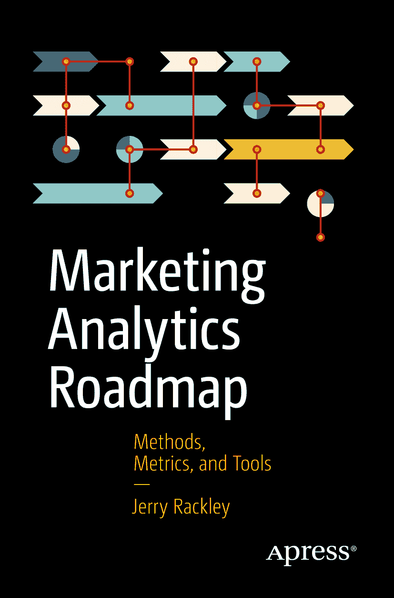

# 营销分析路线图：方法、指标与工具

作者在本文中引用的任何源代码或其他补充材料，均可通过[`www.apress.com`](http://www.apress.com/)向读者提供。有关如何查找本书源代码的详细信息，请访问[`www.apress.com/source-code/`](http://www.apress.com/source-code/)。

ISBN 978-1-4842-0260-9  
电子版 ISBN 978-1-4842-0259-3  
DOI 10.1007/978-1-4842-0259-3  

© Apress 出版社 2015  

营销分析路线图：方法、指标与工具  

常务董事：Welmoed Spahr  
策划编辑：Susan McDermott  
开发编辑：Douglas Pundick  
编辑委员会：Steve Anglin, Mark Beckner, Gary Cornell, Louise Corrigan, James DeWolf, Jonathan Gennick, Robert Hutchinson, Michelle Lowman, James Markham, Susan McDermott, Matthew Moodie, Jeffrey Pepper, Douglas Pundick, Ben Renow-Clarke, Gwenan Spearing, Matt Wade, Steve Weiss  
协调编辑：Rita Fernando  
文字编辑：Laura Poole  
排版：SPi Global  
索引编制：SPi Global  
封面设计：Friedhelm Steinen-Broo  

如需了解翻译事宜，请发送电子邮件至`rights@apress.com`，或访问[`www.apress.com`](http://www.apress.com/)。

Apress 及 friends of ED 的书籍可批量购买，用于学术、企业或促销用途。多数图书也提供电子版及许可。更多信息，请参阅我们的特殊批量销售–电子书许可网页，网址为[`www.apress.com/bulk-sales`](http://www.apress.com/bulk-sales)。

本作品受版权保护。出版商保留所有权利，无论是涉及材料的全部或部分，特别是翻译、重印、重用插图、背诵、广播、缩微胶片复制或任何其他物理形式的复制权，以及传输或信息存储与检索、电子改编、计算机软件，或目前已知或未来开发的任何类似或不同方法的权利。法律保留的例外情况包括：与评论或学术分析相关的简短摘录，或专门为在计算机系统上输入和执行而提供的材料，仅供购买者独占使用。未经出版商所在地现行版权法规定许可，不得复制本出版物或其任何部分，且使用许可必须始终从 Springer 获取。使用许可可通过版权清算中心的 RightsLink 获取。违反者将根据相应版权法被起诉。

本书中可能出现商标名称、标识和图像。我们并未在每个商标名称、标识或图像出现时都使用商标符号，而是仅在编辑性用途中使用这些名称、标识和图像，以维护商标所有者的利益，无意侵犯商标权。本出版物中使用的商品名称、商标、服务标志及类似术语，即使未明确标识，也不应被视为对其是否受专有权利保护的表达。

尽管本书中的建议和信息在出版时被认为是真实准确的，但作者、编辑和出版商均不对可能存在的任何错误或遗漏承担法律责任。出版商对本材料内容不作任何明示或暗示的保证。

本书通过 Springer Science+Business Media New York 在全球图书贸易中发行，地址为 233 Spring Street, 6th Floor, New York, NY 10013。电话：1-800-SPRINGER，传真：(201) 348-4505，电子邮件：`orders-ny@springer-sbm.com`，或访问`www.springeronline.com`。

Apress Media, LLC 是一家加利福尼亚州的有限责任公司，其唯一成员（所有者）是 Springer Science + Business Media Finance Inc（SSBM Finance Inc）。SSBM Finance Inc 是一家特拉华州的公司。

致丽莎：我三十年的妻子。一个男人在生活中再找不到更优秀、更真诚的伴侣了。  
以及，致那些正在寻找更好方式来回答“你最近为我们做了什么？”这一问题的营销人员。

## 引言

我进入营销行业纯属偶然。30 多年前，我大学毕业，获得计算机科学学位。在攻读学位的四年里，我在大学的数据中心工作。我拥有软件开发的理论基础，简历上也包含了高度相关的经验。尽管毕业时就业市场相对不景气，我还是收到了三份不错的录用通知。令我自己惊讶的是，我选择了起薪最低的那一份，来自 IBM，因为我喜欢那里的文化和晋升机会。IBM 没有把我视为软件程序员，而是将我安排在了销售与营销分支机构。从那天起，我再也没有写过一行代码，并且我对此毫不后悔。

我立刻被吸引到了销售和营销的世界，并尽我所能从 IBM——业内最擅长营销其解决方案的公司之一——学习一切。通过一系列工作变动，每一次都让我更深入地进入营销行业，我从导师和经验（及错误）中了解到营销在现实世界中是如何运作的。我的分析编程背景从未离开过我。尽管我对营销充满热情，但也对如何将我的营销工作与业务成果联系起来知之甚少感到困扰。我见过营销部门获得了本非由其产生的业务成果的赞誉，也见过它创造了成果却未能获得认可，还因其贡献不足而受到（公平或不公平的）指责。几乎在每种情况下，对营销的判断都基于观点和推测，而非数据。这让我感到困扰。

不可避免的结论是，对营销成功的判定过于随意、过于主观。即使营销表现出色，如果没有数据证明，首席财务官仍可能削减营销预算。首席执行官会质疑营销的贡献。组织的其他部门很容易将营销视为一种奢侈品，而非必需品。在审视其他企业职能时，例如研发、人力资源或销售，我注意到它们各自都有一套特定的指标，清晰地表明了其工作完成情况。而营销部门并非如此。如果营销部门被送上法庭，因其表现接受审判，辩护方能为营销提供什么证据呢？似乎非常少。

营销所需要的是一套指标，能够将其成功的判定从主观臆测的领域带入客观事实的范畴。作为领导者，我知道我们需要的不仅仅是能够说出我们生产了 X 个资产或管理了 Y 次贸易展会的参与，以及其他类似的、试图将我们的工作与高层管理者关心的事情联系起来的模糊尝试。这些关于问责制的尝试在每个人心中都留下了关于营销真实表现如何的疑问。解决方案是采用分析方法和一套指标，提供有关营销贡献的有意义数据，这样，即使有人可能不同意营销的方法，也对结果无可争辩。

## 本书目的与读者

本书源于我过去在营销绩效管理及其评估方式上的挫折与经验。我专为那些尚未开启数据分析之旅，但深知其必要性并正在摸索起点的营销组织而撰写。我希望这本书能激励营销人员与营销组织行动起来，并为他们指明前进方向。正如书名所示，书中的建议提供了一张路线图，并针对旅途中应考虑的方法、指标和工具给出了推荐。本书不会提供从营销分析之旅开始到结束的详细、逐步骤的指引。原因很简单：每个组织的旅程都必然不同。决定这段旅程的速度、载体甚至绕行路线的因素，每家公司都各不相同。

本书不适合那些已经实现营销分析流程成熟的组织，除非他们希望来一次怀旧之旅，回顾自己走过的路。即便如此，本书所指引的方向依然拥有广泛的读者群体。就在本书即将出版之际，我与 VisionEdge Marketing 合作完成的一项研究显示，仅有五分之一的营销组织建立了有效的分析流程。对于其余 80%的读者来说，本书将为启动并完成营销分析之旅提供一些鼓励和建议。正如老子所言：“千里之行，始于足下。”我希望这本书能帮助众多营销人员迈出那第一步。

杰里·拉克利
2015 年 5 月

## 致谢

我感激我的 Demand Metric 同事们，特别是约翰·福利特和杰西·霍普斯，感谢他们在本书写作过程中给予的鼓励和支持。同样感谢俄克拉荷马州立大学斯皮尔斯商学院营销系的约书亚·维纳博士和汤姆·布朗博士，他们一直鼓励、支持并指导着我。

还有一大批营销专业人士倡导营销分析事业及其背后的技术：仅举几例，如斯科特·布林克、劳拉·帕特森、克莱尔·普莱斯和斯蒂芬·索格。他们的热情与激情激励我将自己的想法和理念付诸书籍。

我感谢那些让我成为他们营销人员的客户和雇主。在与他们并肩作战的营销一线工作中获得的经验，为本书提供了素材。

最后，感谢杰夫·奥尔森，他找到了我，联系了我，并说服我开启了这次写书之旅。感谢阿普雷斯的丽塔、苏珊、劳拉以及优秀的团队，在整个过程中给予了我亲切而耐心的支持。

## 阿普雷斯商业：商业信息的公正来源

阿普雷斯的商业书籍提供必要的信息和实用的建议，每本书都由公认的专家为从业者撰写。商业世界各个领域的忙碌管理者与专业人士——无论其技术素养高低——都信赖我们的书籍，从中获取可行的想法和工具，以解决问题、更新和提升专业技能、减轻工作负担并抓住机遇。

无论商业领域的主题是什么——创业、金融、销售、营销、管理、法规、信息技术等——阿普雷斯都因提供您在日常工作中脱颖而出所需的客观信息和中立建议而备受赞誉。我们的作者没有偏见；他们明白自己只有一个使命——简洁、精准且富有深刻洞察地提供最新、准确的信息，满足读者的真实需求。

如今，要在新闻媒体、互联网乃至书籍中（这种情况如今屡见不鲜）找到不偏不倚、真正为您利益着想的资讯越来越难。因此，我们希望您能喜欢这本精心打造、符合我们高质量与公正报道标准的书籍。

我们始终期待您对新书目的反馈或想法。或许您甚至想自己写一本书。无论何种情况，请通过`editorial@apress.com`联系我们，编辑会迅速回复。顺便提一下，在本书末尾，您会找到一个有用的相关书目列表。请访问[`www.apress.com`](http://www.apress.com/)注册以获取新闻通讯和未来购买的折扣。

阿普雷斯商业团队

## 目录

- 第 1 章：营销分析 1
- 第 2 章：营销分析全景 15
- 第 3 章：营销分析的影响 31
- 第 4 章：营销分析流程 45
- 第 5 章：分析入门 57
- 第 6 章：投资回报率 71
- 第 7 章：营销仪表板 87
- 第 8 章：工具与技术 103
- 第 9 章：成为数据驱动型组织 119
- 第 10 章：营销分析前沿 133
- 索引 147

## 关于作者

