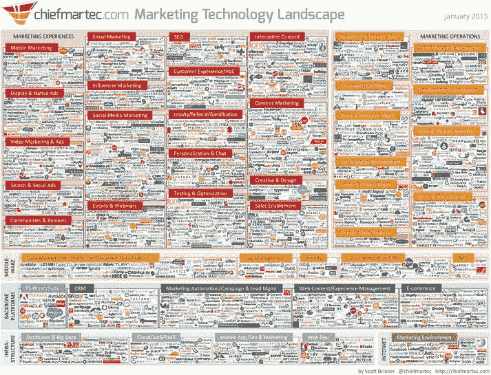
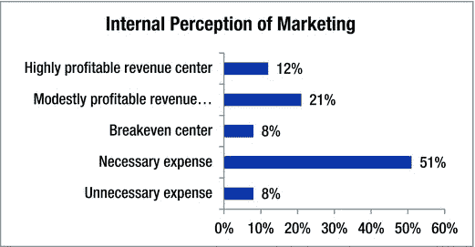
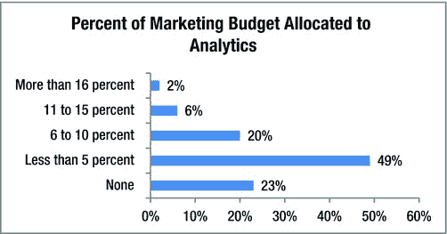
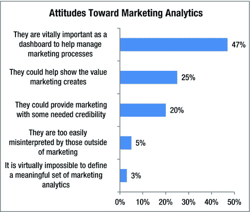
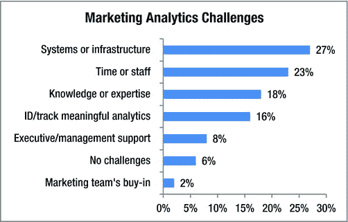
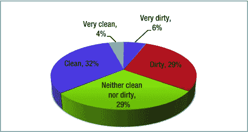
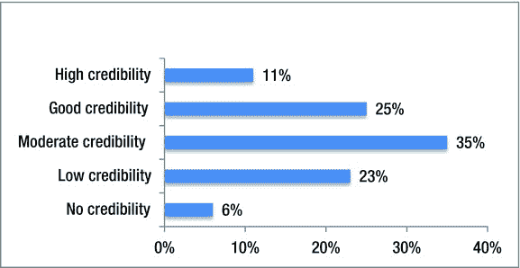

# 2. 营销分析全景

## 事实、态度与挑战

如果将营销视为一个实体，你可以把它看作具有三种类型的人格，类似于 第 1 章 所描述的：无分析、伪分析或真分析。这些人格代表了营销团队运作和创造价值的不同光谱。在光谱的一端，营销是被动且以运营为导向的，由永远忙碌、焦头烂额的管理者掌控。占据光谱另一端的是那些将营销视为战略资产的组织，它们通过一位富有远见的领导者来执行与公司战略一致的计划，从而为整个公司提供领导力。该计划的基础是一套分析工具，如同护栏一般帮助营销保持正确航向。

在这条光谱的运营侧，营销充其量只能带来增量价值，并且它一直苦苦挣扎，不仅需要为其预算正名，更要证明其存在的必要性。而在光谱的战略侧，营销是公司成功的主要驱动力。由于有效运用了分析工具，营销能够毫不费力地证明其价值。作为一项具有战略意义的创收资产，营销很容易证明自身存在的合理性，并为其投资提供回报。

任何营销组织的相关性都取决于其从运营导向向战略导向转变的能力，许多营销人员都渴望帮助他们的组织完成这一转型。进行这一转变对于营销将其地位从可容忍的支出转变为有价值的收入中心至关重要。从领导力的角度来看，营销完成这一转型的能力关系重大，因为以运营为导向的营销组织影响力有限。

大多数营销人员并非不了解转型的必要性，但变革的步伐有时似乎极其缓慢，令营销团队及其上级领导感到沮丧。推动营销前进的是营销人员正在开发或利用的日益丰富的技术解决方案、工具、方法、渠道、技能和领导力。图 2-1 描绘了营销技术领域巨大的多样性，几乎所有解决方案都具备参与营销分析计划或为其贡献数据的能力。

> 技术决策与营销策略是相互交织的。— Scott Brinker，《营销技术专家的崛起》

图 2-1.

Chiefmartec.com 的营销技术全景图揭示了营销解决方案领域的多样性和复杂性。经许可使用

然而，营销技术领域的复杂性本身也令人望而生畏，因为营销人员需要评估无数种能够帮助他们将业务成果归因于其活动的解决方案。不过，技术挑战是暂时的，如果没有一些支持系统和可靠的数据源，营销分析计划就无法启动。对营销分析计划造成最大阻碍的是各种态度，这些态度通常存在于组织内部，有时也存在于营销人员所服务的组织之中。

现代营销人员普遍理解让营销团队作为收入中心运作的重要性，即通过分析流程来量化并报告其收入贡献。当营销作为一项支出而非收入中心存在时，它就处于危险之中，因为当公司面临财务压力时，营销总是裁员或削减开支的首要候选。作为收入中心运作，不仅能帮助营销在公司困难时期生存下来，甚至能蓬勃发展。正因如此，即使首席营销官（CMO）尚未完全弄清楚如何将团队转变为收入中心，他们也会稳步推进这一转型，因为这对营销的长期生存至关重要。

从宏观角度来看，当今的营销被视为支出中心还是收入中心？Demand Metric 研究公司在 2014 年第一季度完成了一项研究¹ 提供了答案。该研究首先试图了解公司内部对营销的财务认知。图 2-2 显示了来自 250 多位研究参与者的结果（其中大部分是营销人员），展示了他们所在的营销职能在组织内部是如何被看待的。

图 2-2.

组织内部对营销的主流看法是将其视为一项支出

这个数据很好地反映了营销分析的现状，因为改变“营销是支出”这一看法的最佳工具就是分析流程。对该研究数据的进一步分析表明，在那些将营销视为支出的组织中，有一半根本不使用分析工具，或者使用程度很低。无论出于何种原因，它们正在剥夺自己引导努力方向并向组织其他部门展示责任归属的最佳手段。

相比之下，在图 2-2 中那些将营销视为收入中心的组织里，仅有 16% 报告称没有分析流程。任何恰当实施了客户关系管理（`CRM`）和营销自动化系统，并管理好这些系统中数据质量的公司，都能够获取必要的信息，不仅证明其相关性，更能证明其收入影响。现代营销组织别无他法。

**注意**

营销被视为收入中心与其使用分析流程之间存在强关联。

现代营销人员不会否认营销职能部门应该作为收入中心来运作，并且是组织其他部门不可或缺的一部分。一个“不可或缺”的营销组织具备哪些特征？我们需要比“创造收入”更详细的特征来理解这类营销组织是如何运作的，以及它们与被视为成本中心的组织有何不同。图 2-3 揭示了在关于营销分析的调查中²，被描述为“如果没有营销的贡献，我们将无法实现业务目标”——换言之，即不可或缺——的营销组织的三个关键特征。当使用这三个特征来比较这些不可或缺的营销组织与所有营销组织时，发现了显著差异。

图 2-3.

“不可或缺”的营销组织展现出三个特征：战略导向、销售与营销协同，以及分析驱动

一个不可或缺的营销组织的首要特征是战略导向。这意味着有一项计划驱动着营销工作的开展。理想情况下，该计划源于公司关键利益相关者参与的**战略规划**过程。这项计划与公司目标紧密对齐，并设有里程碑和衡量指标来跟踪进展。

相比之下，作为成本中心存在的营销组织更倾向于**运营导向**。这并不意味着他们没有计划，而是计划往往被忽视甚至放弃。这些营销组织是由需求驱动的，反应更为被动。它们类似于第 1 章中描述的那种在分析方面“瞎飞”的营销组织。

不可或缺的营销组织的第二个特征是，它们与自己支持的销售团队高度协同。它们共同协作，而非各自为政，并且拥有兼容甚至共享的目标。

不可或缺的营销组织的第三个特征是，它们高度甚至完全由**分析驱动**。分析是这些营销组织运作的核心。它们依靠分析和指标来验证自身努力，并向组织的其他部分展示责任担当。

具备这些特征的营销组织不会面临被视为“开支”的风险。此外，分析并非独立于其他特征之外。分析能力支撑了上述前两个特征。我们将审视营销分析的现状，了解这些不可或缺的营销组织有多普遍。

## 营销分析的现状

营销人员始终面临着一个挑战：向所在组织证明自身的价值和相关性。尽管有时不情愿，但营销人员普遍认同，分析过程提供了证明其贡献的最有力证据。那么，整个营销界的分析现状如何呢？

图 2-4 提供了一张图表，总结了 700 多位公司总裁、CEO、CMO、营销副总裁、营销总监、营销经理、销售经理以及产品和品牌经理对其所在公司营销分析状况的看法。针对该群体的调查³采用以下回答类别，盘点了他们分析工作的状态：

图 2-4.

大多数营销组织都在尝试利用分析做点什么，但成功程度各不相同

-   **回避**：除非被要求使用，否则我们尽量避免分析。
-   **探索**：我们想做点事，正在寻找最佳切入点。
-   **试验**：我们正在试验以确定最佳分析集，但尚未影响行为或活动。
-   **低可见度**：我们正在追踪有意义的分析指标，但这些指标在营销组织外部尚未被关注。
-   **高可见度**：我们正在追踪有意义的分析指标，并且这些指标在整个组织内都已被关注。

在当今的现代营销时代，仅略超过三分之一的公司报告说他们正在追踪有意义的分析指标。同一组参与者还被要求使用 1 到 5 的评分标准（1 代表“回避”，5 代表“有意义且可见的结果”）来评价其营销流程。此项分析显示，大公司（员工超过 1000 人）报告的分析进展更大，平均得分为 3.46，而小公司（员工不超过 100 人）的平均得分为 3.17。

公司规模与分析状态之间也存在关联：

-   33%的小公司要么回避分析，要么在寻找最佳切入点。
-   26%的中型公司（员工 101 至 1000 人）属于这两类。
-   19%的大公司属于这两类。

公司规模越大，其营销部门似乎越有可能使用分析。小公司可能因多种原因觉得推行营销分析的动力不足。通常，小公司有一种“全员出动”的心态，每个人都为了公司的成功而全力投入，这自然也包括营销。小公司内的各种职能通常相互邻近，几乎是并肩工作。在这种环境下，每个人似乎都知道其他人在做什么，因此对分析所提供的责任担当的需求并不那么迫切。

在考察营销分析现状时，分析举措获得的资金支持力度是一个重要的指标。公司投资的方向揭示了他们的优先事项以及努力的严肃程度。尽管营销分析并不代表巨额支出，但要想让流程产生影响，确实需要一定的资金和资源。图 2-5 总结的数据展示了营销预算中有多少被指定用于分析。⁴

图 2-5.

近四分之一的组织在其营销预算中未为分析分配任何资金

进一步分析图 2-5 中的数据，可以深入了解分析资金与有效性之间的关系。8%的研究参与者将超过 10%的营销预算投入到营销分析上。在精英群体中，50%的人报告说他们正在追踪在整个组织内具有可见性的有意义分析指标（图 2-4）。这一分析成熟度水平几乎是预算支出在 6%到 10%之间的组织的两倍，是预算支出低于 5%的组织的三倍。此项分析清楚地表明，更多的投资能带来更高的分析数据可见度。那么，这种可见度是否也等同于更好的结果呢？尽管可见度很重要，但结果才是关键。

对图 2-5 中预算数据的进一步分析显示，在营销分析投资上存在一个明显的回报递减点。将营销预算的 6%到 10%用于营销分析的组织取得了最佳结果，其中 51%报告称通过分析实现了营销效果的最高改善率。对于预算支出超过 10%的精英群体，45%报告了最高的改善率；而对于分析预算低于 5%的组织，40%属于最高改善率范围。因此，最佳投入点似乎是将营销预算的 6%到 10%分配给分析。

## 对营销分析的态度

公司内部存在营销分析流程，并不一定意味着对分析持积极态度。事实上，对于被测量和追踪的营销分析数据，近四分之一的公司报告称“似乎没人使用”。⁵ 在某些公司，高管们迫使营销团队强行推进分析工作。在这种情况下，对分析流程的抵触情绪相当高。尽管该流程往往能争取到一些转变者，但要克服营销团队在面对被强加的分析任务时通常表现出的被动抵抗，仍然是一场艰苦的战斗。

较少见的情况是，推崇分析的营销团队无法让公司其他部门注意到该流程所能提供的价值。同样，随着时间的推移，营销团队很可能也能赢得对此流程的转变者。无论哪种情况，分析流程带来的实际成果都极具说服力。

这两种立场反映了组织内部可能存在的对分析的不同态度。对于任何举措而言，最大的障碍往往是态度上的，因此，在我们审视营销分析格局时，了解塑造它的各种态度的普遍性会有所帮助。“需求指标”（Demand Metric）研究也揭示了关于分析存在的各种态度及其广泛程度。图 2-6 总结了关于这些态度的数据。

图 2-6.

绝大多数情况下，对营销分析的主流态度是认为其作为一种管理工具至关重要

在图 2-6 所示的五种态度中，只有两种是消极态度，且仅占调查样本的 8%。其余三种态度是积极的。在接下来的段落中，我们将详细探讨这些态度。

最不普遍的态度认为，定义一套有意义的营销分析指标是不可能的。断然声称无法得出一套有意义的指标，这不过是一种巧妙包装的“不愿意”声明。当然，任何营销组织通过充分的思考和规划，都有可能识别出一套有效的绩效指标。尽管这种态度很少见——也许是因为很少有 CEO 能够容忍它——但它往往与那些不希望事实或分析数据干扰其营销议程的 CMO 相关。简单地用一句“不可能衡量营销努力的结果”来否定分析，要么是完全无知，要么是傲慢自大。诚然，精确衡量营销业务影响可能存在障碍，但没有任何障碍是无法克服的。

图 2-6 中第二种消极态度也并非常见：该研究中仅有 5%的样本报告称，分析数据太容易被营销部门以外的人误解。通常有三种驱动因素导致这种态度。第一是合理的担忧，即那些不理解或不欣赏分析数据的人可能会不当使用它们。第二是担心分析会暴露营销部门的糟糕表现。第三是傲慢。

认为分析数据太容易被非营销人员误解这一态度的第一个根本原因，是对后果的合理恐惧。分析数据，尤其是在初次实施时，并不总能讲述一个令人愉快的故事。如果营销部门对其分析数据完全透明，一些营销部门之外的人可能会抓住机会，利用这些数据谋取政治利益。然而，真正需要发生的是，营销部门有机会利用这些数据进行改进，而这可能需要完成几个周期的测量和分析。如果公司内部存在一种功能失调的文化，这种情况就更难发生。在这种文化下，营销部门可能有充分的理由担心完全的分析透明。不幸的是，在企业环境中，并非所有文化都是健康的。任何在营销领域工作时间够长的人，或许都能分享一些因透明地沟通分析和绩效数据而受到惩罚的经历。

认为分析数据太容易被非营销人员误解这种态度的第二个驱动因素是缺乏安全感。这种不安全感的根源在于 CMO 知道，有意义的分析数据会暴露营销部门的糟糕表现。即使没有分析数据，营销人员对自己工作所产生的影响也有相当好的直觉。对于对自己团队表现缺乏安全感的营销经理来说，一种生存策略是避开分析，用一连串的活动来粉饰团队，并空谈结果。当 CEO 建议或下令使用分析时，这会让这些 CMO 心生恐惧。在这种情况下，几乎自动的反应就是：“分析数据太容易被非营销人员误解了。”其目的是将营销描绘成某种深奥的艺术，一种如此神秘的实践，以至于只有行内人士才能指望理解其中的分析。具有讽刺意味的是，一个恰当的分析举措恰恰能为这个营销组织提供改进数据，从而消除对被“曝光”的恐惧。

第三个驱动因素纯粹是傲慢。当傲慢作祟时，营销部门实质上是在向组织其他部门传达：其所做的事情是外人无法理解的。从外人的角度来看，作为这种态度的驱动因素，不安全感与傲慢之间并无明显区别，因为两者都将营销描绘成不可理解之物。然而，无论哪种情况，其最终效果都是建立一道烟幕，以掩盖营销的真实绩效，而这源于反对营销分析的故意决定。事实仍然是，对营销分析数据含义进行适当的教育和沟通，就能消除对误解的担忧。

图 2-6 中描述的第三种态度承认分析可以为营销提供一些所需的公信力。不使用分析数据来证明其贡献的营销组织，其公信力很容易受到质疑。最坏的情况下，当营销组织在其所服务的组织内部的公信力受到质疑时，其自身的存续都可能面临威胁。最好的情况下，当营销存在公信力问题时，它将难以获得其希望部署的战略和活动的认可。调查样本中 20%选择这种态度选项的人，承认了拥有分析流程的好处之一：拥有数据证明营销有效性的公信力。伴随这种公信力而来的是 CMO 极大的自主权和授权。第 3 章将更详细地探讨这个问题。

图 2-6 所示的第四种态度（在调查样本中占比 25%）认为，分析有助于展示营销创造的价值。这种态度揭示了一个现实：营销组织可以通过分析来证明其对收入的影响。除了通过一系列将营销活动与业务成果联系起来的指标外，首席营销官（CMO）别无他法能够说明直接归因于营销的收入份额。每个营销组织都应努力向公司证明自己的价值。即使营销组织通过启发性的创意活动和执行创造了内在价值，它们仍然需要提供所交付价值的证据。而分析流程正是提供这种证据的方式。

图 2-6 所示的第五种也是最后一种态度是持有最广泛的。近一半的受访者认为，作为帮助管理营销流程的仪表板，分析至关重要。这种态度代表了分析流程的最终目标：将其输出作为管理工具，持续改进营销工作。分析有助于证明营销的可信度，并且是展示营销价值的一种方式。这些收益源于将分析用作指导营销工作的仪表板。因此，这种态度代表了营销人员的首要分析目标：建立一个能够作为有效仪表板来指导营销工作的分析流程，随之而来的将是可信度和可证明的价值。

## 营销分析面临的挑战

找到一些营销指标来衡量和报告固然容易。然而，对大多数公司而言，创建一个能够衡量和追踪有意义内容的分析流程却复杂且时常困难。构建有效分析流程面临的挑战范围广泛，涉及态度、技能、技术和资源等方面。仅有 6%的公司声称没有任何与营销分析相关的挑战。⁶ 图 2-7 总结了公司在营销分析工作中面临的最大挑战。

图 2-7.

94%的组织报告称在营销分析方面面临某种挑战

值得注意的是，什么不是营销分析面临的重大挑战：即接受度或支持度。在本数据来源的调查中，超过半数的参与者是营销领导者：包括 CMO、品牌经理、营销副总裁、营销总监或营销经理。通过这项调查，他们告诉我们，获取自己团队的支持几乎不成问题。营销团队成员明白，拥有分析流程符合他们的最大利益。获得高管或管理团队支持的挑战也微不足道。这合情合理，因为哪位高管或管理者会通过不支持分析计划，来向营销团队暗示其不想要问责制、投资回报率（ROI）或可衡量的价值呢？对于 CMO 而言，缺乏上下级的支持并不是分析的严重挑战。

最大的挑战是缺乏衡量和追踪营销分析的系统或基础设施。现代营销组织使用多种渠道，其中大部分是数字渠道，而营销制作的活动和内容是在多种设备上被消费的。这种环境带来的问题不是缺乏分析数据，而是数据过多。涌向营销团队的数据量和种类之多，让人感觉像是在对着消防水管喝水。要捕捉这些数据并将其作为分析流程的一部分充分利用，就需要一定的技术。这些数据过于庞大和多样，无法通过人工流程处理。分析计划需要技术辅助来捕捉数据并使其有意义。第 8 章将探讨现代营销人员可以用来克服营销分析系统挑战的一些工具、系统和技术。

缺乏进行营销分析的时间或人员是另一个重大挑战。实施分析流程是一项战略性工作，对于忙碌的组织而言，花时间规划和执行它，就像在车辆行驶途中更换轮胎一样困难。这些忙碌的营销组织期待某个风平浪静的时刻，以便能有时间进行恰当的规划，从而很好地实施分析。然而，在忙碌的组织中根本不存在所谓的闲暇时间。大多数组织之所以忙碌，是因为在没有分析流程的情况下，活动本身就是进展的证据。那些声称没有时间做分析的组织，恰恰是最需要分析的组织。对他们而言，停下营销这辆车（哪怕是为了做出能提升性能的改进）的想法，是令人深恶痛绝的。

## 分析团队的人员配置

分析团队的人员配置是一项挑战，它反映了企业的优先级。很少有营销组织——即使是那些借助有效分析流程来指导工作的组织——声称拥有所有需要的员工。分析流程是营销卓越与成就的基石。未能为这一流程配备足够的人员都是不可想象的，因为这一因素对营销的长期成功至关重要。分析职能的人员配置应享有最高优先级，因为该流程的产出有助于为其他营销领域的人员配置和资金投入提供商业依据。

## 知识或专业技能

知识或专业技能的缺乏是营销分析面临的另一项挑战。营销人员应该问的问题是：哪方面的知识或专业技能？只要有营销学科存在，深入了解客户和产品就始终至关重要。这一点永远不会改变。当分析进入视野时，人们很自然地会认为统计能力是必备的。理解统计过程当然不会是一种负担，但它也并非当务之急。

### 技术技能

对现代营销人员而言，日益关键的是技术技能，或者更准确地说，是科技技能。有效利用我们可用的软件和技术的能力，正迅速成为营销简历上的关键区分点。那些处于行业顶端的、熟练的现代营销人员，将传统的营销创意技能与技术技能融为一体。“软件是营销与现实世界的接口，”斯科特·布林克说道。

现代营销人员无需了解图 2-1 中描绘的每一种解决方案，但他们很可能会用到其中大多数类别中的一种解决方案。这些解决方案能够捕获和追踪分析流程所需的绩效数据。对营销人员来说，好消息是这些解决方案的功能在不断增强，同时使用起来也变得更加简便。尽管如此，牢固掌握营销技术已不再是奢侈，而是必需，营销人员不能将营销的技术部分外包给 IT 部门。现代营销组织必须投资于获取和提升自身的技术能力，这不仅是为了在分析方面取得成功，也是为了完成营销的全部工作。

## 识别与追踪有意义的分析指标

图 2-7 总结的最后一个挑战是识别与追踪有意义的分析指标。尽管仅有 16%的研究参与者选择了这一点，但它或许是在通往数据驱动之路中*最难克服的挑战*。一旦其他所有挑战——系统、资源、人员配置和技能——都被克服，这个挑战依然存在。

营销人员无需深入探究分析的细节，就能理解这一挑战的严重性。现代营销活动会产生大量的数据。从中挑选一些内容、开始追踪并制作一些带有看似正确方向趋势线的摘要图表，是相对容易的。问题在于相关性。例如，知道某次特定的邮件群发获得了高于平均水平的打开率，或者知道一篇社交媒体帖子被分享了多少次，这令人满足。这些事情相对容易统计，但它们在创造价值方面有多重要呢？正如威廉·布鲁斯·卡梅伦所言，“并非所有可数之物都重要，也并非所有重要之物都可数。”

营销人员面临的挑战是识别出真正重要的指标。这一过程不能从寻找任何现成的指标或仅仅追踪现有的营销流程开始。相反，指标的识别过程必须始于理解营销所追求的战略目标。这是一种自上而下的方法。不这么做就是本末倒置。营销部门必须确定哪些指标能够证明其在追求目标过程中所取得的成效、创造的价值或产出的有意义成果。

在确定了最佳指标后，理想的情况是这些指标能够实时地从某个系统中直接提取出来，并形成易于理解、可共享的报告。有时这可以实现。但更多时候，并没有一条简单直接的途径来获取用于分析流程的最佳指标组合。营销人员会发现他们必须从多个来源推导出正确的指标组合，通过混合和计算数字，最终得出能够真正反映流程运行状况及其所创造价值的东西。这是一个规划、测试和优化的过程。完全做对可能需要几个报告周期，即便如此，还需要定期验证这些数字是否仍然具有意义。

## 营销分析能力

本章探讨了与营销分析相关的图景、态度和挑战。在描绘了整体概况之后，我们以一个关于营销分析能力与局限性的简要、高层级讨论作为总结。

截至目前，本书已使用了多种隐喻来描述营销分析：仪表盘、仆从、护栏等等。这些隐喻准确地传达了人们对营销分析作用的理解：提供方向和指导。当正确实施时，分析过程会持续输出一系列有用的信息，用于：

-   **了解营销绩效。** 内部使用方面，分析过程使用的指标能告知营销部门自身的表现如何。借用仪表盘的隐喻：当指针处于绿色区域时，营销部门可以自信地继续开展工作，甚至加速推进工作；当指针处于黄色区域时，则表示某方面即将出现故障，需要关注；当指针处于红色区域时，营销部门就能确定某方面出现了问题，故障流程需要彻底检修或弃用，转而采用更好的方案。
-   **报告营销绩效。** 外部使用方面，分析过程的输出结果（或至少是部分结果）有助于向组织其他部门展示其在营销投入上获得了回报。分享工作成果能在整个组织内建立对营销工作的信心，帮助首席营销官（CMO）维持营销部门在重大决策会议上的席位。

分析为营销组织提供了这些重要的能力。但同样也存在局限性。分析不会引领方向。这个过程在功能上并不等同于营销团队的自动驾驶仪。营销职能若要蓬勃发展并为所服务的公司提供最大价值，就需要 CMO 提供强有力的、富有远见的领导。CMO 对营销的愿景应包含一套分析流程。愿景与分析的结合将创造出绩效最高、能够全面解释其工作并持续做出贡献的营销职能。这代表了每一位 CEO 对营销的期望。

**脚注**

1 “营销报告卡：保住我们在会议桌上的席位，” Demand Metric Research Corporation，2014 年 3 月。[`www.demandmetric.com/content/marketing-report-card-benchmark-report`](http://www.demandmetric.com/content/marketing-report-card-benchmark-report)。

2 同上。

3 “2013 年营销分析：基准、洞察与建议，” Demand Metric Research Corporation，2013 年 3 月。[`www.demandmetric.com/content/marketing-analytics-benchmark-report`](http://www.demandmetric.com/content/marketing-analytics-benchmark-report)。

4 同上。

5 同上。

6 同上。

7 斯科特·布林克，营销技术专家：营销矩阵中的尼奥。[`chiefmartec.com/2013/12/marketing-technologist-neo-marketing-matrix/`](http://chiefmartec.com/2013/12/marketing-technologist-neo-marketing-matrix/)。

8 威廉·布鲁斯·卡梅伦，《非正式社会学：社会学思维的非正式入门》。纽约：兰登书屋，第 13 页。

## 营销分析的影响

给我看钱

希望前两章已经为营销分析提供了令人信服的理由。然而，仅仅收集所有正确的数据输入到合法的营销分析流程中是不够的。营销分析成功的关键在于应用。如果流程得出的结果和洞察未被使用，那么营销分析计划就没什么价值。为了让整个组织受益，分析必须影响思考、决策，并最终影响营销的运作方式。

仅将营销分析视为一种绩效管理工具，就错失了这个流程的意义。诚然，正确实施分析可以帮助营销工作做得更好：更高效、更有效。尽管分析流程应提供有助于营销事半功倍的数据，但归根结底，分析是为了创造收入。分析流程最高和最佳的用途是帮助营销部门作为一个收入中心来运作。当 CEO 用某种方式说“给我看钱”时，拥有正确分析数据并明智使用它的营销部门就能够做到这一点。

> **注意**
> 分析虽然有助于提高营销的效率和效果，但其最终目的是帮助营销职能部门作为一个收入中心来运作。

对于拥有分析流程的营销组织来说，肯定有一些极端情况需要避免。第一个极端是拥有了分析流程，但对输出结果不采取任何行动。第二个极端是拥有了分析流程，并期望其输出结果成为营销团队领导力的主要来源——而这其实是 CMO 或营销副总裁的工作。分析不能替代领导力。营销分析流程的定位应处于这两个极端之间。在这个位置上，分析是真实的，具有影响力，并作为一个参考点来帮助 CMO 验证决策和完善战略。

第 2 章介绍了营销分析的现状，以及人们对它们的态度和所面临的挑战。在现实世界中，组织在寻找上述两个极端之间的分析“最佳平衡点”方面做得如何？图 3-1 分享了一项研究结果¹，揭示了营销组织如何利用他们所衡量和追踪的分析数据。

图 3-1. 营销分析数据使用情况

图 3-1 显示，近四分之一的拥有分析数据的营销组织处于两个极端中的第一个：他们完全没有利用这些数据。对于这些组织来说，分析不过是瞎忙活。数据中蕴含着提升绩效或至少证明营销贡献的力量，但却被闲置了。这种不使用的情况表明，营销部门要么认为自己已经表现足够好，不需要通过使用数据来提升，要么就是根本不在乎。

最好的情况是，营销部门和 CMO 渴望将分析作为一项持续改进的策略。在没有任何来自上级压力的情况下，理想的营销团队会寻求自我提升，并利用分析作为管理其工作方式的工具。如果缺乏这种改进的热情，公司高管也可以强制要求建立指标并围绕这些指标收集数据，以便进行问责。无论哪种方式，对于那 24%不利用手头分析数据的人来说，并不存在要求其使用该资源的问责机制。

在图 3-1 所示的样本中，其余 76% 的受访者分散在四个选项里，表明他们在不同程度上使用了分析数据。这些剩余的回答均非负面，尽管其中一些可能代表了更高或更先进的使用水平。在这四个选项中，有两个——**CMO**（首席营销官）和营销团队对数据的审查——属于分析过程输出的内部使用。

仅在营销部门内部使用和报告分析数据并非坏事。即使这些数据从未流出营销部门，有效的分析数据同样具有影响决策的能力。在图 3-1 中，近半数的营销组织将分析数据保留在内部。最常见的情况是，只有营销团队成员（38%）能够访问并使用这些数据。较少见的是，只有 CMO（10%）能查看和使用这些数据。

从宏观角度来看，分析数据的主要用途之一是为决策提供信息并验证决策的有效性。即使数据仅存于部门内部，营销分析数据也丝毫不会削弱其在这方面的作用。然而，分析数据的另一个主要用途是作为一种问责机制。将分析数据报告给营销部门之外的人员，通常是高管和其他利益相关者，能够建立起健康的问责水平。当数据留在营销部门内部时，它作为问责机制的大部分效力就会丧失。较低的分析成熟度通常与将数据保留在部门内相关联。

> **注意**  
> 若分析数据仅停留在营销部门内部，其作为问责机制的很大一部分效力将被削弱。

最高的营销分析成熟度与那些利用分析数据对外报告绩效的组织相关联。图 3-1 显示了代表分析数据对外报告的两类回答：向高管团队报告以及向组织内的任何人报告。其中占比较大的是那 18% 向高管团队报告数据的典型营销组织，这是最重要的问责层级。当这种情况发生时，希望产生的一个结果是 CMO 与 CEO 之间就营销工作内容及其贡献方式展开持续、健康的对话。分析数据是这类讨论的绝佳催化剂，尤其是在 CEO 期望此类问责而 CMO 也愿意主动提供时。

构成对外报告分析数据的两个群体中，较小的是那些实行完全透明的营销组织。它们允许组织内任何想要查看分析数据的人获取这些信息。这种关于营销工作的“无可隐瞒”态度是一种值得称赞的立场，更多组织应当追求但鲜有达到。实践这种透明度的营销团队通常与最高的分析成熟度相关联。

### 分析的影响力

> 我花在广告上的钱有一半都浪费了；问题是我不知道是哪一半。 ——约翰·沃纳梅克，19 世纪零售业先驱

诚然，分析可以帮助营销提升其绩效。通过正确选择指标、收集数据、进行细致的分析与报告，并据此做出决策，分析是一种强大的绩效增强剂。但提升的是何种绩效？这些改进又是如何实现的？如果分析是达到目的的手段，而这个目的就是更好的营收绩效，那么分析是如何帮助我们实现这一跨越的呢？

营销分析的最终目标是营收，一旦明确了营收影响和支出，就有可能推导出营销的投资回报率（ROI），这是第 6 章将进一步讨论的话题。那么，分析过程是如何帮助创造营收的呢？理解营销分析如何影响营收是许多分析项目的根本出发点。

要理解这一点，不妨考虑大多数潜在客户转变为客户的旅程。首先是需求的初步认知，然后是发现潜在解决方案的过程，接着是评估这些方案，并最终做出决定。营销 101 告诉我们，潜在客户必须先知晓解决方案，才能考虑它们并最终完成购买。因此，营销的很大一部分工作就是在这个购买周期中尽早建立认知。

建立这种认知有多种方式。在营销的早期阶段，用于建立认知的工具和渠道较少。营销与广告几乎等同，而印刷品是主要渠道。但即便在那个时代，也仍然需要分析数据。

上文引用过的约翰·沃纳梅克，深知缺乏广告活动分析数据所带来的限制。他唯一能用来优化广告的就是自己的直觉。

快进到 21 世纪，营销人员可以支配无数传统和数字渠道来建立认知。信息、创意和渠道的组合如此之多，以至于如果没有分析，几乎无法就优化媒体组合做出明智的决策。分析对现代营销人员而言不可或缺。

现代营销人员建立认知的努力表现为各种营销活动，其期望产出是线索：即那些表明对某种解决方案有某种程度需求或兴趣，并已提供联系方式的个人或企业。对大多数公司而言，线索是销售引擎的燃料。营销的职责是确保持续流入的线索得到培育、筛选，然后移交给销售团队。大多数时候，线索生成过程是营销分析的原点。

测试与分析的恰当结合，可以使线索生成活动要么惨淡收场，要么大获成功。由于营销人员用于线索生成的预算有限，分析便成为重要工具，帮助他们判断哪些活动应该扩大、哪些需要修改、哪些应当放弃。分析提供了营销人员优化活动所需的信息，进而生成更多线索，而销售团队则将线索转化为更多营收。

## 市场营销中的分析：案例研究与可信度

一个绝佳的例子，说明分析如何帮助营销人员开展更有效的品牌认知和潜在客户开发活动，来自 2008 年美国总统大选。2007 年，当时的候选人巴拉克·奥巴马正角逐民主党提名，但在民调中落后两位数。竞选团队的分析总监丹·西罗克认为，访问奥巴马网站的每一位访客都是提升认知度和筹集竞选资金的机遇。网站首页展示了一张候选人奥巴马的大型图片，页面底部有一个行动号召按钮。西罗克面临的问题是，哪种媒体与行动号召按钮的组合能产生最佳效果？

西罗克进行了一系列 A/B 测试（也称为着陆页拆分测试），以确定六张图片和四种行动号召按钮的哪种组合最为有效。所有图片都展示了候选人在不同场景下的形象。行动号召按钮的选项分别标注为“立即加入我们”、“了解更多”、“立即注册”和“注册”。西罗克的目标是找出 24 种可能的图文组合中哪种表现最佳，因此他设计了一项实验，向网站访客展示各种组合并收集数据。

他用来衡量成功的指标是注册率——即某测试组合的图片和行动号召按钮促使访客向竞选活动提供电子邮箱地址的比率。在收集到足够数据后，获胜组合得以确定，而这并非工作人员最初青睐的组合。

表现最佳组合的页面注册率为 11.6%，而原先的注册率为 8.3%。这意味着提升了近 41%的效率。在整个竞选过程中，这一差异转化为了近 290 万个额外电子邮箱注册量，平均每笔注册捐赠金额为 21 美元。经过分析优化的网页为竞选活动额外带来了 6000 万美元的收益。

在这个例子中，分析通过揭示关于网页着陆页表现的关键信息（否则这些信息将不为人知），在大范围内产生了显著影响。采取本例所述的方法当然需要成本：它需要时间、精力和一些技术投入，而这种投资往往是实施的障碍。然而，这项投资的回报几乎总是超过成本。充分了解信息的价值几乎总高于保持无知所需付出的代价。正如 MKT Media Group 首席执行官迈克·克拉斯所说：“光明的代价低于黑暗的成本。”

分析无疑将帮助营销人员改进网站上的行动号召和营销活动着陆页，但其影响远不止于此。分析还可以在以下领域发挥影响：

- **品牌认知度**：了解您的品牌所拥有的心智份额以及客户对它的情感倾向。
- **内容**：确切地知道哪些营销内容消费最广、分享最多，并能产生最佳转化效果。
- **渠道优化**：比较各种营销渠道（如电子邮件或点击付费广告）的表现，以改进其绩效或仅投资于表现最佳的渠道。
- **客户理解**：更深入地了解客户行为，从而更好地理解其需求和偏好。
- **预测智能**：在购买周期早期就准确预测哪些客户会购买以及何时购买。

这份清单仅列举了分析能够产生重大影响的部分领域，而且这些影响不仅限于营销职能，而是贯穿整个组织。然而，分析只有在基于正确的指标时才能发挥这种影响力，这些指标需要被勤勉地追踪、报告并用于影响决策，并且组织认为整个过程是可信的。即使分析流程坚如磐石，如果组织对其缺乏信任，分析也无法以应有的方式影响组织。

### 分析的可信度

拥有一个达到一定成熟度的营销分析流程是一回事，而让该流程的基本输出——数据——享有可信度则是另一回事。决策是基于这些数据做出的，因此，如果希望对这些决策有信心，那么分析流程及其产生的数据必须可靠。营销分析流程必须具有完整性和可信度，以便整个组织能够信任该流程以及由此产生的决策。

仅仅因为营销分析流程收集并报告一组指标的数据，并不意味着每个人都会相信这些数字。对于分析数据准确性和可信度的质疑，可能存在于营销组织内部和外部。有时，怀疑是因为流程可疑或输入数据存在质量问题；其他时候，数据的受益者只是不愿意相信数据所揭示的信息。

任何人怀疑营销部门收集、维护和使用的数据都是常有的事。营销所依赖的大部分数据通常存储在客户关系管理系统和营销自动化系统中。这些数据通过多种途径进入这些系统，而每条途径在保持准确性和质量方面都面临挑战。

理想情况下，组织应具备确保数据质量或清理数据的流程或机制，因为脏数据在系统中存留的时间越长，质量问题损害使用它的分析、营销活动、人员或其他系统的可能性就越高。然而，大多数组织没有正式的数据清理流程，而缺乏这一流程正是分析可信度问题的根源。图 3-2 总结了销售和营销数据质量的现状。

**图 3-2.** 销售和营销数据清洁度

如图 3-2 所示，仅有 36%的组织表示其销售和营销数据“清洁”或“非常清洁”。由于分析流程建立在数据基础之上，这意味着其余 64%的组织必然会看到其分析流程面临可信度差距，特别是在已知或认为数据质量较低的情况下。即使拥有清洁的数据，也不能保证营销分析流程会享有可信度。

尽管如此，拥有清洁的数据仍是一个有效、可信的分析流程的先决条件。多数组织当前的数据质量状况应当为清理这些数据营造一种紧迫感。当考虑到数据量增长时，这种紧迫感只会加剧，因为对大多数公司而言，数据量会随着每一次销售电话、营销活动、网络研讨会或贸易展览而增长，从而使问题复杂化。

即使数据量没有增长，静态数据也不会无限期地保持有效。数据质量会随着联系人更换公司、电子邮箱、角色、职位和职责而衰减。营销分析数据当然不仅仅包含潜在客户或客户联系数据，但营销能够追踪的大多数指标最终都会追溯到客户，因此它与客户联系记录相关联。当这种情况发生时，组织需要与准确的客户和潜在客户数据建立联系。在数据质量方面不作为，就是对低劣数据质量的默认承诺。组织必须具有某种程度的主动性和流程纪律，才能将数据质量维持在任何水平上，或者（理想情况下）提升它。

关于数据质量的最后一点思考：无论输入营销分析流程的数据多么纯净，那些对流程持（或可能持）批评态度的人也必须了解数据的清洁程度。营销团队在这方面需要承担一定的公关责任。如果营销部门要维护或提升其分析流程的可信度，就必须确保数据是干净的，并且让所有人都知道它是干净的。对数据质量的任何错误认知，都可能摧毁任何分析流程的可信度。

对流程缺乏信心或信任，无论在选择和跟踪正确指标上投入了多少心血，都会严重阻碍营销分析工作的开展。分析流程中可信度问题的严重性，是分析领域一个非常现实的障碍。图 3-3 展示了在营销分析可信度范围内，各组织所处的现状。

**图 3-3.** 营销分析可信度认知

图 3-3 所示的数据触及了营销分析流程中信任度的核心。考虑到分析流程应如何运作——即产出数据，帮助营销部门使其工作与战略保持一致并表现出色——一个关键的成功因素是信任。如果分析流程不足以被信任来影响重大决策，那么它的价值何在？因此，该流程的输出必须能够影响决策。只有当流程的相关方对流程及其输出有信心时，它才可能具有影响力。

目前，只有三分之一的公司声称对其营销分析给予了“良好”或“较高”的可信度。而“中等”、“较低”或“无”可信度的认知则表明存在怀疑。这些可信度数据表明，仅仅拥有一个健全的营销分析流程是不够的；该流程还必须赢得相关方的信任，以便分析能够影响决策。对营销分析流程的真正试金石是：公司是否愿意根据流程提供的指导做出严肃决策并投入资源？第 5 章详细阐述了一个帮助组织实施健全营销分析流程的计划，该计划的一部分包括在流程输出中建立信任和信心的努力。

### 分析与决策制定

最终，营销分析流程应提供有助于做出更好决策的数据。正如第 1 章所讨论的，营销组织中的分析并非为了让决策过时，而是为决策提供信息。在做出决策后，分析还有另一个用途：判断这些决策是否正确。最成熟的营销分析流程在决策前和决策后阶段都会使用分析。

为了理解分析如何为决策提供信息并随后验证决策，让我们设想一个营销团队面临挑战时的假设性决策情景。假设你是首席营销官（CMO）。在一次高管团队会议上，首席财务官（CFO）报告称，本季度的收入预测显示将“未达标”50 万美元。经过一番讨论，首席执行官（CEO）转向你，CMO，要求你想办法弥补预测的收入缺口。

如果你所处的营销组织很少或根本不使用分析，你会怎么做？你仍然需要做出决策，并且会依赖你的经验和直觉。有时，这种方法对组织有益，但有时则不然。这就像掷骰子，在这种情况下，你会希望已经有一个分析流程可以提供一些见解。

与 CEO 开完会后，你的第一站是销售副总裁。你们俩必须共同决定收入将从何而来：新客户、现有客户，还是两者兼有？由于公司已实施客户关系管理（CRM）和营销自动化系统，做出明智决策所需的指标是现成的。你知道的是，将一个合格的潜在新客户培养到成交的平均销售周期是六个月。此外，分析告诉你，销售团队成功将你们接触的合格潜在客户中的 30% 转化为销售。以平均销售额 5000 美元计算，你需要达成 100 笔新销售才能填补收入缺口。根据你的销售转化率，营销团队需要识别出 330 个新的合格潜在客户，才能获得 50 万美元的新收入。

问题在于：你来不及在本季度结束前产生 330 个新的合格潜在客户，并让至少其中 100 个完成六个月的销售周期。因此，你继续与销售副总裁进行商议，审视销售管道中已经在跟进的机会。同样，由于你使用了适当的系统（这里指 CRM），你可以获取相关数据。

与销售副总裁合作，你分析了管道数据，移除了本季度预计会转化的潜在客户。这样做之后，你发现销售管道中有 285 个合格的潜在客户被搁置。这些机会是作为合格潜在客户进入管道、已经经历了部分购买周期，但由于各种原因，要么没有引起销售团队的足够重视，要么没有被营销部门培育。

你和销售副总裁断定，这 285 个现有的合格潜在客户代表了在本季度末弥补 50 万美元收入缺口的最佳机会。一个担忧是，平均转化率告诉你，你可以期望将这些潜在客户中的 30% 转化为销售。按此转化率，仅有 285 个潜在客户，你将获得约 85 笔销售，即 42.5 万美元，距离填补收入缺口还差 7.5 万美元。过去的经验告诉你，采用相同的方法会产生相同的结果。你花了几分钟时间大声思考，尝试一些新方法来培育管道中这些被忽视的潜在客户。离开销售副总裁办公室时，你承诺会让你的团队制定一个计划，以更高的转化率来转化这 285 个潜在客户。

回到办公室后，你召集团队讨论这个挑战。通常情况下，你的潜在客户培育工作包括通过电子邮件链接到登录页面，提供某种高级内容，例如白皮书或案例研究。你的团队因制作既引人入胜又具有视觉吸引力的内容而享有盛誉。然而，弱点一直在于让潜在客户访问登录页面以获取这些内容，这些内容被“封锁”在需要访问者提供联系信息的表单后面。

你与团队一起回顾了几次以往电子邮件营销活动的结果。每次活动，你都有包含打开率、跳出率、点击率甚至哪些收件人打开了邮件的分析数据。在审查这些数据时，你确认了之前的想法是正确的：你的打开率一直很高。这得益于你为确保 CRM 和营销自动化系统中数据质量所做的努力。然而，这些分析还显示，点击率低于行业平均水平，并且正在下降。换句话说，你的促销邮件反馈很强，但点击邮件中链接到你创建的登录页面的收件人不够多。这令人担忧，但至少分析数据告诉了你问题所在。

接下来，你与团队审查的是登录页面的网络分析数据。在这里，你发现了另一个问题。只有极少数花时间点击进入登录页面的邮件收件人会选择行动号召按钮，通常像“下载案例研究”或“立即注册”以及类似的行动号召。这些数据证实了你几个月来的直觉：你正在经历那些曾经行之有效的、经过验证的培育方法的性能下降。在此之前，你从未因预计收入缺口而产生更密切监控这些分析数据的紧迫感。

当你和团队思考这些分析数据所揭示的问题时，大家讨论了如何以不同方式培育这 285 个潜在客户，希望能产生超过 30%的转化率。如果你们能策划出一个达到 35%转化率的活动，就将获得所需的 100 笔销售，从而产生 50 万美元的收入。这个算术很简单。关键问题是，采用什么方法才能实现这一目标？

你团队中的一名成员最近一直在试验互动视频，对各种登录页面的配置进行 A/B 测试。互动视频是一种营销视频内容，其特色是内置于视频本身的行动号召链接。这些视频时长通常不超过两分钟，当视频结束时，会向观看者展示一个或多个行动号召按钮。与你通常使用登录页面的方式不同，团队测试了未被“封锁”的互动视频——换句话说，访问者不必先输入他们的联系信息。取而代之的是，在视频的结尾，其中一项行动号召允许观看者请求更多信息并与销售代表联系。

提供未封锁的内容与你团队过去使用的方法有所不同。网络表单一直是你们活动登录页面的一部分，因为它们允许你为销售团队捕获潜在客户。然而，这种情况有所不同。你并非试图捕获新潜在客户，而是为已经拥有的潜在客户加速购买周期。来自互动视频测试的分析数据看起来非常有希望：访问者显然更喜欢视频，并且他们选择点击视频末尾的“联系我”按钮的比率是你以前对其他形式内容经验数据的两倍。你决定使用互动视频来构建一个营销活动。

下一个重大的活动决策是确定视频将展示什么内容。视频营销的最佳实践表明，90 秒或更短的视频最为成功。你再次与团队一起审查分析数据，以确定哪种类型的营销信息可能对处于购买阶段后期的合格潜在客户最有效。分析过去的营销活动，你发现那些以案例研究——一个关于客户实施你的解决方案并描述所获收益的真实故事——为特色的内容具有最强的转化率。基于现有数据，你安排团队着手制作一个 90 秒的互动案例研究视频。

团队工作迅速，视频很快准备好投放。使用你的营销自动化系统，你准备了活动登录页面以及将发送给确定的那 285 个潜在客户的邮件。利用营销自动化系统中的分析数据，你确定了发送邮件的理想星期几和时间。

由于你在营销团队中建立了数据驱动的文化，他们总是思考如何衡量所做的每一件事。这个活动视频在制作时就具备了追踪观看时长和分享次数的能力。此外，你的营销自动化系统与 CRM 系统完全集成，因此当合格潜在客户观看视频时，该活动会在两个系统中被记录。另外，当潜在客户看完整个视频时，一封电子邮件提醒会被发送给销售团队的某位成员。你的活动将实时跟踪并报告这些指标，使销售团队能够在潜在客户的行为表明其兴趣时迅速做出响应。

你启动了营销活动。初始邮件发送后的头几天将告诉你策略是否有效，或者你是否需要制定一个 B 计划。邮件的打开率跟踪数据显示其处于正常范围，正如你所预期。然而，最令人鼓舞的是，指向活动登录页面的点击率略高于平均水平。更棒的是，登录页面上观看案例研究视频的行动号召表现远优于之前邀请访问者消费封锁内容的登录页面。到目前为止，策略运作得非常出色，但最终的活动指标——收入——仍然未知。

是时候去查看销售副总裁那边的情况了。你顺道过去做个快速更新，发现销售部门一片沸腾！副总裁没什么时间聊天，但这是出于最好的原因。互动视频通过视频末尾嵌入的行动号召选项，引发了向销售团队咨询的热潮。案例研究视频显然引起了共鸣。副总裁分享说，许多潜在客户已经重新开始了销售对话，大意是“我们和视频中的客户有同样的问题——帮我们解决它”。销售团队正在预订演示，并与活动中定位的许多潜在客户进行高质量的互动。

几周之内，季度收入预测被上调。销售副总裁报告说，预计到本季度末将额外完成 105 笔交易，抹平了预测的收入缺口。你与营销团队复盘了这次活动，回顾所有指标以确定下次如何改进策略。大家一致认为：当你向首席财务官申请更多资金以更大力投资视频营销时，鉴于这次活动的结果，获得批准不会有任何困难。

正如上述场景所示，分析以多种方式影响着现代营销组织内部的决策，无论大小。这个场景只是展示了分析如何帮助驱动自信决策的一种方式，而这些决策的结果可以直接与收入挂钩。

脚注 1

  
“2013 年营销分析：基准、洞察与建议”，Demand Metric 研究公司，2013 年 3 月。[`http://www.demandmetric.com/content/marketing-analytics-benchmark-report`](http://www.demandmetric.com/content/marketing-analytics-benchmark-report)  

“奥巴马如何通过一个简单的实验筹集了 6000 万美元”，Optimizely 博客，2010 年 11 月 29 日。[`http://blog.optimizely.com/2010/11/29/how-obama-raised-60-million-by-running-a-simple-experiment/`](http://blog.optimizely.com/2010/11/29/how-obama-raised-60-million-by-running-a-simple-experiment/)  

“销售与营销数据质量基准报告”，Demand Metric 研究公司，2013 年 11 月。[`http://www.demandmetric.com/content/sales-marketing-data-quality-benchmark-report`](http://www.demandmetric.com/content/sales-marketing-data-quality-benchmark-report)  

同上。  

“2013 年营销分析：基准、洞察与建议”，Demand Metric 研究公司，2013 年 3 月。[`http://www.demandmetric.com/content/marketing-analytics-benchmark-report`](http://www.demandmetric.com/content/marketing-analytics-benchmark-report)  

