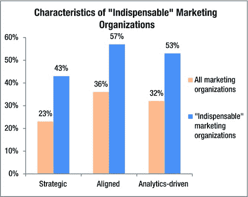
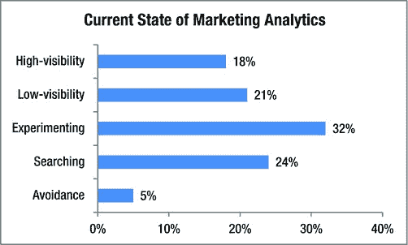

# 2. 营销分析全景

## 事实、态度与挑战

如果将营销视为一个实体，你可以把它看作具有三种类型的人格，类似于第1章所描述的：无分析、伪分析或真分析。这些人格代表了营销团队运作和创造价值的不同光谱。在光谱的一端，营销是被动且以运营为导向的，由永远忙碌、焦头烂额的管理者掌控。占据光谱另一端的是那些将营销视为战略资产的组织，它们通过一位富有远见的领导者来执行与公司战略一致的计划，从而为整个公司提供领导力。该计划的基础是一套分析工具，如同护栏一般帮助营销保持正确航向。

在这条光谱的运营侧，营销充其量只能带来增量价值，并且它一直苦苦挣扎，不仅需要为其预算正名，更要证明其存在的必要性。而在光谱的战略侧，营销是公司成功的主要驱动力。由于有效运用了分析工具，营销能够毫不费力地证明其价值。作为一项具有战略意义的创收资产，营销很容易证明自身存在的合理性，并为其投资提供回报。

任何营销组织的相关性都取决于其从运营导向向战略导向转变的能力，许多营销人员都渴望帮助他们的组织完成这一转型。进行这一转变对于营销将其地位从可容忍的支出转变为有价值的收入中心至关重要。从领导力的角度来看，营销完成这一转型的能力关系重大，因为以运营为导向的营销组织影响力有限。

大多数营销人员并非不了解转型的必要性，但变革的步伐有时似乎极其缓慢，令营销团队及其上级领导感到沮丧。推动营销前进的是营销人员正在开发或利用的日益丰富的技术解决方案、工具、方法、渠道、技能和领导力。图`2-1`描绘了营销技术领域巨大的多样性，几乎所有解决方案都具备参与营销分析计划或为其贡献数据的能力。

> 技术决策与营销策略是相互交织的。— Scott Brinker，《营销技术专家的崛起》

图`2-1`.

Chiefmartec.com 的营销技术全景图揭示了营销解决方案领域的多样性和复杂性。经许可使用

然而，营销技术领域的复杂性本身也令人望而生畏，因为营销人员需要评估无数种能够帮助他们将业务成果归因于其活动的解决方案。不过，技术挑战是暂时的，如果没有一些支持系统和可靠的数据源，营销分析计划就无法启动。对营销分析计划造成最大阻碍的是各种态度，这些态度通常存在于组织内部，有时也存在于营销人员所服务的组织之中。

现代营销人员普遍理解让营销团队作为收入中心运作的重要性，即通过分析流程来量化并报告其收入贡献。当营销作为一项支出而非收入中心存在时，它就处于危险之中，因为当公司面临财务压力时，营销总是裁员或削减开支的首要候选。作为收入中心运作，不仅能帮助营销在公司困难时期生存下来，甚至能蓬勃发展。正因如此，即使首席营销官（CMO）尚未完全弄清楚如何将团队转变为收入中心，他们也会稳步推进这一转型，因为这对营销的长期生存至关重要。

从宏观角度来看，当今的营销被视为支出中心还是收入中心？Demand Metric研究公司在2014年第一季度完成了一项研究¹ 提供了答案。该研究首先试图了解公司内部对营销的财务认知。图`2-2`显示了来自250多位研究参与者的结果（其中大部分是营销人员），展示了他们所在的营销职能在组织内部是如何被看待的。

图`2-2`.

组织内部对营销的主流看法是将其视为一项支出

这个数据很好地反映了营销分析的现状，因为改变“营销是支出”这一看法的最佳工具就是分析流程。对该研究数据的进一步分析表明，在那些将营销视为支出的组织中，有一半根本不使用分析工具，或者使用程度很低。无论出于何种原因，它们正在剥夺自己引导努力方向并向组织其他部门展示责任归属的最佳手段。

相比之下，在图`2-2`中那些将营销视为收入中心的组织里，仅有16%报告称没有分析流程。任何恰当实施了`CRM`和营销自动化系统，并管理好这些系统中数据质量的公司，都能够获取必要的信息，不仅证明其相关性，更能证明其收入影响。现代营销组织别无他法。

**注意**

营销被视为收入中心与其使用分析流程之间存在强关联。

现代营销人员不会否认营销职能部门应该作为收入中心来运作，并且是组织其他部门不可或缺的一部分。一个“不可或缺”的营销组织具备哪些特征？我们需要比“创造收入”更详细的特征来理解这类营销组织是如何运作的，以及它们与被视为成本中心的组织有何不同。图`2-3`揭示了在关于营销分析的调查中²，被描述为“如果没有营销的贡献，我们将无法实现业务目标”——换言之，即不可或缺——的营销组织的三个关键特征。当使用这三个特征来比较这些不可或缺的营销组织与所有营销组织时，发现了显著差异。

图`2-3`.

“不可或缺”的营销组织展现出三个特征：`战略导向`、`销售与营销协同`，以及`分析驱动`

一个不可或缺的营销组织的首要特征是`战略导向`。这意味着有一项计划驱动着营销工作的开展。理想情况下，该计划源于公司关键利益相关者参与的`战略规划`过程。这项计划与公司目标紧密对齐，并设有里程碑和衡量指标来跟踪进展。

相比之下，作为成本中心存在的营销组织更倾向于`运营导向`。这并不意味着他们没有计划，而是计划往往被忽视甚至放弃。这些营销组织是由需求驱动的，反应更为被动。它们类似于第1章中描述的那种在分析方面“瞎飞”的营销组织。

不可或缺的营销组织的第二个特征是，它们与自己支持的销售团队高度协同。它们共同协作，而非各自为政，并且拥有兼容甚至共享的目标。

不可或缺的营销组织的第三个特征是，它们高度甚至完全由`分析驱动`。分析是这些营销组织运作的核心。它们依靠分析和指标来验证自身努力，并向组织的其他部分展示责任担当。

具备这些特征的营销组织不会面临被视为“开支”的风险。此外，分析并非独立于其他特征之外。分析能力支撑了上述前两个特征。我们将审视营销分析的现状，了解这些不可或缺的营销组织有多普遍。

## 营销分析的现状

营销人员始终面临着一个挑战：向所在组织证明自身的价值和相关性。尽管有时不情愿，但营销人员普遍认同，分析过程提供了证明其贡献的最有力证据。那么，整个营销界的分析现状如何呢？

图`2-4`提供了一张图表，总结了700多位公司总裁、CEO、CMO、营销副总裁、营销总监、营销经理、销售经理以及产品和品牌经理对其所在公司营销分析状况的看法。针对该群体的调查³采用以下回答类别，盘点了他们分析工作的状态：

图`2-4`.

大多数营销组织都在尝试利用分析做点什么，但成功程度各不相同

-   **回避**：除非被要求使用，否则我们尽量避免分析。

-   **探索**：我们想做点事，正在寻找最佳切入点。

-   **试验**：我们正在试验以确定最佳分析集，但尚未影响行为或活动。

-   **低可见度**：我们正在追踪有意义的分析指标，但这些指标在营销组织外部尚未被关注。

-   **高可见度**：我们正在追踪有意义的分析指标，并且这些指标在整个组织内都已被关注。

在当今的现代营销时代，仅略超过三分之一的公司报告说他们正在追踪有意义的分析指标。同一组参与者还被要求使用1到5的评分标准（1代表“回避”，5代表“有意义且可见的结果”）来评价其营销流程。此项分析显示，大公司（员工超过1000人）报告的分析进展更大，平均得分为3.46，而小公司（员工不超过100人）的平均得分为3.17。

公司规模与分析状态之间也存在关联：

-   33%的小公司要么回避分析，要么在寻找最佳切入点。

-   26%的中型公司（员工101至1000人）属于这两类。

-   19%的大公司属于这两类。

公司规模越大，其营销部门似乎越有可能使用分析。小公司可能因多种原因觉得推行营销分析的动力不足。通常，小公司有一种“全员出动”的心态，每个人都为了公司的成功而全力投入，这自然也包括营销。小公司内的各种职能通常相互邻近，几乎是并肩工作。在这种环境下，每个人似乎都知道其他人在做什么，因此对分析所提供的责任担当的需求并不那么迫切。

在考察营销分析现状时，分析举措获得的资金支持力度是一个重要的指标。公司投资的方向揭示了他们的优先事项以及努力的严肃程度。尽管营销分析并不代表巨额支出，但要想让流程产生影响，确实需要一定的资金和资源。图`2-5`总结的数据展示了营销预算中有多少被指定用于分析。⁴

图`2-5`.

近四分之一的组织在其营销预算中未为分析分配任何资金

进一步分析`图 2-5`中的数据，可以深入了解分析资金与有效性之间的关系。8%的研究参与者将超过 10%的营销预算投入到营销分析上。在精英群体中，50%的人报告说他们正在追踪在整个组织内具有可见性的有意义分析指标（`图 2-4`）。这一分析成熟度水平几乎是预算支出在 6%到 10%之间的组织的两倍，是预算支出低于 5%的组织的三倍。此项分析清楚地表明，更多的投资能带来更高的分析数据可见度。那么，这种可见度是否也等同于更好的结果呢？尽管可见度很重要，但结果才是关键。

对`图 2-5`中预算数据的进一步分析显示，在营销分析投资上存在一个明显的回报递减点。将营销预算的 6%到 10%用于营销分析的组织取得了最佳结果，其中 51%报告称通过分析实现了营销效果的最高改善率。对于预算支出超过 10%的精英群体，45%报告了最高的改善率；而对于分析预算低于 5%的组织，40%属于最高改善率范围。因此，最佳投入点似乎是将营销预算的 6%到 10%分配给分析。

## 对营销分析的态度

公司内部存在营销分析流程，并不一定意味着对分析持积极态度。事实上，对于被测量和追踪的营销分析数据，近四分之一的公司报告称“似乎没人使用”。⁵ 在某些公司，高管们迫使营销团队强行推进分析工作。在这种情况下，对分析流程的抵触情绪相当高。尽管该流程往往能争取到一些转变者，但要克服营销团队在面对被强加的分析任务时通常表现出的被动抵抗，仍然是一场艰苦的战斗。

较少见的情况是，推崇分析的营销团队无法让公司其他部门注意到该流程所能提供的价值。同样，随着时间的推移，营销团队很可能也能赢得对此流程的转变者。无论哪种情况，分析流程带来的实际成果都极具说服力。

这两种立场反映了组织内部可能存在的对分析的不同态度。对于任何举措而言，最大的障碍往往是态度上的，因此，在我们审视营销分析格局时，了解塑造它的各种态度的普遍性会有所帮助。“需求指标”（Demand Metric）研究也揭示了关于分析存在的各种态度及其广泛程度。`图 2-6`总结了关于这些态度的数据。

**图 2-6.**

绝大多数情况下，对营销分析的主流态度是认为其作为一种管理工具至关重要

在`图 2-6`所示的五种态度中，只有两种是消极态度，且仅占调查样本的 8%。其余三种态度是积极的。在接下来的段落中，我们将详细探讨这些态度。

最不普遍的态度认为，定义一套有意义的营销分析指标是不可能的。断然声称无法得出一套有意义的指标，这不过是一种巧妙包装的“不愿意”声明。当然，任何营销组织通过充分的思考和规划，都有可能识别出一套有效的绩效指标。尽管这种态度很少见——也许是因为很少有 CEO 能够容忍它——但它往往与那些不希望事实或分析数据干扰其营销议程的 CMO 相关。简单地用一句“不可能衡量营销努力的结果”来否定分析，要么是完全无知，要么是傲慢自大。诚然，精确衡量营销业务影响可能存在障碍，但没有任何障碍是无法克服的。

`图 2-6`中第二种消极态度也并非常见：该研究中仅有 5%的样本报告称，分析数据太容易被营销部门以外的人误解。通常有三种驱动因素导致这种态度。第一是合理的担忧，即那些不理解或不欣赏分析数据的人可能会不当使用它们。第二是担心分析会暴露营销部门的糟糕表现。第三是傲慢。

认为分析数据太容易被非营销人员误解这一态度的第一个根本原因，是对后果的合理恐惧。分析数据，尤其是在初次实施时，并不总能讲述一个令人愉快的故事。如果营销部门对其分析数据完全透明，一些营销部门之外的人可能会抓住机会，利用这些数据谋取政治利益。然而，真正需要发生的是，营销部门有机会利用这些数据进行改进，而这可能需要完成几个周期的测量和分析。如果公司内部存在一种功能失调的文化，这种情况就更难发生。在这种文化下，营销部门可能有充分的理由担心完全的分析透明。不幸的是，在企业环境中，并非所有文化都是健康的。任何在营销领域工作时间够长的人，或许都能分享一些因透明地沟通分析和绩效数据而受到惩罚的经历。

认为分析数据太容易被非营销人员误解这种态度的第二个驱动因素是缺乏安全感。这种不安全感的根源在于 CMO 知道，有意义的分析数据会暴露营销部门的糟糕表现。即使没有分析数据，营销人员对自己工作所产生的影响也有相当好的直觉。对于对自己团队表现缺乏安全感的营销经理来说，一种生存策略是避开分析，用一连串的活动来粉饰团队，并空谈结果。当 CEO 建议或下令使用分析时，这会让这些 CMO 心生恐惧。在这种情况下，几乎自动的反应就是：“分析数据太容易被非营销人员误解了。”其目的是将营销描绘成某种深奥的艺术，一种如此神秘的实践，以至于只有行内人士才能指望理解其中的分析。具有讽刺意味的是，一个恰当的分析举措恰恰能为这个营销组织提供改进数据，从而消除对被“曝光”的恐惧。

第三个驱动因素纯粹是傲慢。当傲慢作祟时，营销部门实质上是在向组织其他部门传达：其所做的事情是外人无法理解的。从外人的角度来看，作为这种态度的驱动因素，不安全感与傲慢之间并无明显区别，因为两者都将营销描绘成不可理解之物。然而，无论哪种情况，其最终效果都是建立一道烟幕，以掩盖营销的真实绩效，而这源于反对营销分析的故意决定。事实仍然是，对营销分析数据含义进行适当的教育和沟通，就能消除对误解的担忧。

`图 2-6`中描述的第三种态度承认分析可以为营销提供一些所需的公信力。不使用分析数据来证明其贡献的营销组织，其公信力很容易受到质疑。最坏的情况下，当营销组织在其所服务的组织内部的公信力受到质疑时，其自身的存续都可能面临威胁。最好的情况下，当营销存在公信力问题时，它将难以获得其希望部署的战略和活动的认可。调查样本中 20%选择这种态度选项的人，承认了拥有分析流程的好处之一：拥有数据证明营销有效性的公信力。伴随这种公信力而来的是 CMO 极大的自主权和授权。第 3 章将更详细地探讨这个问题。

`图 2-6`所示的第四种态度（在调查样本中占比 25%）认为，分析有助于展示营销创造的价值。这种态度揭示了一个现实：营销组织可以通过分析来证明其对收入的影响。除了通过一系列将营销活动与业务成果联系起来的指标外，首席营销官（CMO）别无他法能够说明直接归因于营销的收入份额。每个营销组织都应努力向公司证明自己的价值。即使营销组织通过启发性的创意活动和执行创造了内在价值，它们仍然需要提供所交付价值的证据。而分析流程正是提供这种证据的方式。

`图 2-6`所示的第五种也是最后一种态度是持有最广泛的。近一半的受访者认为，作为帮助管理营销流程的仪表板，分析至关重要。这种态度代表了分析流程的最终目标：将其输出作为管理工具，持续改进营销工作。分析有助于证明营销的可信度，并且是展示营销价值的一种方式。这些收益源于将分析用作指导营销工作的仪表板。因此，这种态度代表了营销人员的首要分析目标：建立一个能够作为有效仪表板来指导营销工作的分析流程，随之而来的将是可信度和可证明的价值。

## 营销分析面临的挑战

找到一些营销指标来衡量和报告固然容易。然而，对大多数公司而言，创建一个能够衡量和追踪有意义内容的分析流程却复杂且时常困难。构建有效分析流程面临的挑战范围广泛，涉及态度、技能、技术和资源等方面。仅有 6%的公司声称没有任何与营销分析相关的挑战。⁶ `图 2-7`总结了公司在营销分析工作中面临的最大挑战。

**图 2-7.**

94%的组织报告称在营销分析方面面临某种挑战

值得注意的是，什么不是营销分析面临的重大挑战：即接受度或支持度。在本数据来源的调查中，超过半数的参与者是营销领导者：包括 CMO、品牌经理、营销副总裁、营销总监或营销经理。通过这项调查，他们告诉我们，获取自己团队的支持几乎不成问题。营销团队成员明白，拥有分析流程符合他们的最大利益。获得高管或管理团队支持的挑战也微不足道。这合情合理，因为哪位高管或管理者会通过不支持分析计划，来向营销团队暗示其不想要问责制、投资回报率（ROI）或可衡量的价值呢？对于 CMO 而言，缺乏上下级的支持并不是分析的严重挑战。

最大的挑战是缺乏衡量和追踪营销分析的系统或基础设施。现代营销组织使用多种渠道，其中大部分是数字渠道，而营销制作的活动和内容是在多种设备上被消费的。这种环境带来的问题不是缺乏分析数据，而是数据过多。涌向营销团队的数据量和种类之多，让人感觉像是在对着消防水管喝水。要捕捉这些数据并将其作为分析流程的一部分充分利用，就需要一定的技术。这些数据过于庞大和多样，无法通过人工流程处理。分析计划需要技术辅助来捕捉数据并使其有意义。第 8 章将探讨现代营销人员可以用来克服营销分析系统挑战的一些工具、系统和技术。

缺乏进行营销分析的时间或人员是另一个重大挑战。实施分析流程是一项战略性工作，对于忙碌的组织而言，花时间规划和执行它，就像在车辆行驶途中更换轮胎一样困难。这些忙碌的营销组织期待某个风平浪静的时刻，以便能有时间进行恰当的规划，从而很好地实施分析。然而，在忙碌的组织中根本不存在所谓的闲暇时间。大多数组织之所以忙碌，是因为在没有分析流程的情况下，活动本身就是进展的证据。那些声称没有时间做分析的组织，恰恰是最需要分析的组织。对他们而言，停下营销这辆车（哪怕是为了做出能提升性能的改进）的想法，是令人深恶痛绝的。

## 分析团队的人员配置

分析团队的人员配置是一项挑战，它反映了企业的优先级。很少有营销组织——即使是那些借助有效分析流程来指导工作的组织——声称拥有所有需要的员工。分析流程是营销卓越与成就的基石。未能为这一流程配备足够的人员都是不可想象的，因为这一因素对营销的长期成功至关重要。分析职能的人员配置应享有最高优先级，因为该流程的产出有助于为其他营销领域的人员配置和资金投入提供商业依据。

## 知识或专业技能

知识或专业技能的缺乏是营销分析面临的另一项挑战。营销人员应该问的问题是：哪方面的知识或专业技能？只要有营销学科存在，深入了解客户和产品就始终至关重要。这一点永远不会改变。当分析进入视野时，人们很自然地会认为统计能力是必备的。理解统计过程当然不会是一种负担，但它也并非当务之急。

### 技术技能

对现代营销人员而言，日益关键的是技术技能，或者更准确地说，是科技技能。有效利用我们可用的软件和技术的能力，正迅速成为营销简历上的关键区分点。那些处于行业顶端的、熟练的现代营销人员，将传统的营销创意技能与技术技能融为一体。“软件是营销与现实世界的接口，”斯科特·布林克说道。

现代营销人员无需了解图 2-1 中描绘的每一种解决方案，但他们很可能会用到其中大多数类别中的一种解决方案。这些解决方案能够捕获和追踪分析流程所需的绩效数据。对营销人员来说，好消息是这些解决方案的功能在不断增强，同时使用起来也变得更加简便。尽管如此，牢固掌握营销技术已不再是奢侈，而是必需，营销人员不能将营销的技术部分外包给 IT 部门。现代营销组织必须投资于获取和提升自身的技术能力，这不仅是为了在分析方面取得成功，也是为了完成营销的全部工作。

## 识别与追踪有意义的分析指标

图 2-7 总结的最后一个挑战是识别与追踪有意义的分析指标。尽管仅有 16%的研究参与者选择了这一点，但它或许是在通往数据驱动之路中*最难克服的挑战*。一旦其他所有挑战——系统、资源、人员配置和技能——都被克服，这个挑战依然存在。

营销人员无需深入探究分析的细节，就能理解这一挑战的严重性。现代营销活动会产生大量的数据。从中挑选一些内容、开始追踪并制作一些带有看似正确方向趋势线的摘要图表，是相对容易的。问题在于相关性。例如，知道某次特定的邮件群发获得了高于平均水平的打开率，或者知道一篇社交媒体帖子被分享了多少次，这令人满足。这些事情相对容易统计，但它们在创造价值方面有多重要呢？正如威廉·布鲁斯·卡梅伦所言，“并非所有可数之物都重要，也并非所有重要之物都可数。”

营销人员面临的挑战是识别出真正重要的指标。这一过程不能从寻找任何现成的指标或仅仅追踪现有的营销流程开始。相反，指标的识别过程必须始于理解营销所追求的战略目标。这是一种自上而下的方法。不这么做就是本末倒置。营销部门必须确定哪些指标能够证明其在追求目标过程中所取得的成效、创造的价值或产出的有意义成果。

在确定了最佳指标后，理想的情况是这些指标能够实时地从某个系统中直接提取出来，并形成易于理解、可共享的报告。有时这可以实现。但更多时候，并没有一条简单直接的途径来获取用于分析流程的最佳指标组合。营销人员会发现他们必须从多个来源推导出正确的指标组合，通过混合和计算数字，最终得出能够真正反映流程运行状况及其所创造价值的东西。这是一个规划、测试和优化的过程。完全做对可能需要几个报告周期，即便如此，还需要定期验证这些数字是否仍然具有意义。

## 营销分析能力

本章探讨了与营销分析相关的图景、态度和挑战。在描绘了整体概况之后，我们以一个关于营销分析能力与局限性的简要、高层级讨论作为总结。

截至目前，本书已使用了多种隐喻来描述营销分析：仪表盘、仆从、护栏等等。这些隐喻准确地传达了人们对营销分析作用的理解：提供方向和指导。当正确实施时，分析过程会持续输出一系列有用的信息，用于：

- **了解营销绩效。** 内部使用方面，分析过程使用的指标能告知营销部门自身的表现如何。借用仪表盘的隐喻：当指针处于绿色区域时，营销部门可以自信地继续开展工作，甚至加速推进工作；当指针处于黄色区域时，则表示某方面即将出现故障，需要关注；当指针处于红色区域时，营销部门就能确定某方面出现了问题，故障流程需要彻底检修或弃用，转而采用更好的方案。
- **报告营销绩效。** 外部使用方面，分析过程的输出结果（或至少是部分结果）有助于向组织其他部门展示其在营销投入上获得了回报。分享工作成果能在整个组织内建立对营销工作的信心，帮助首席营销官（CMO）维持营销部门在重大决策会议上的席位。

分析为营销组织提供了这些重要的能力。但同样也存在局限性。分析不会引领方向。这个过程在功能上并不等同于营销团队的自动驾驶仪。营销职能若要蓬勃发展并为所服务的公司提供最大价值，就需要 CMO 提供强有力的、富有远见的领导。CMO 对营销的愿景应包含一套分析流程。愿景与分析的结合将创造出绩效最高、能够全面解释其工作并持续做出贡献的营销职能。这代表了每一位 CEO 对营销的期望。

**脚注**

1. “营销报告卡：保住我们在会议桌上的席位，” Demand Metric Research Corporation，2014 年 3 月。[`www.demandmetric.com/content/marketing-report-card-benchmark-report`](http://www.demandmetric.com/content/marketing-report-card-benchmark-report)。
2. 同上。
3. “2013 年营销分析：基准、洞察与建议，” Demand Metric Research Corporation，2013 年 3 月。[`www.demandmetric.com/content/marketing-analytics-benchmark-report`](http://www.demandmetric.com/content/marketing-analytics-benchmark-report)。
4. 同上。
5. 同上。
6. 同上。
7. 斯科特·布林克，营销技术专家：营销矩阵中的尼奥。[`chiefmartec.com/2013/12/marketing-technologist-neo-marketing-matrix/`](http://chiefmartec.com/2013/12/marketing-technologist-neo-marketing-matrix/)。
8. 威廉·布鲁斯·卡梅伦，《非正式社会学：社会学思维的非正式入门》。纽约：兰登书屋，第 13 页。

