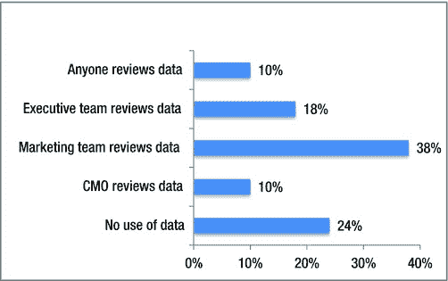
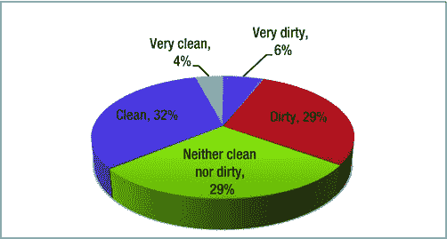
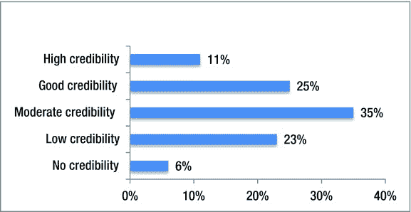

## 3. 营销分析的影响

**给我看钱**

希望前两章已经为营销分析提供了令人信服的理由。然而，仅仅收集所有正确的数据输入到合法的营销分析流程中是不够的。营销分析成功的关键在于应用。如果流程得出的结果和洞察未被使用，那么营销分析计划就没什么价值。为了让整个组织受益，分析必须影响思考、决策，并最终影响营销的运作方式。

仅将营销分析视为一种绩效管理工具，就错失了这个流程的意义。诚然，正确实施分析可以帮助营销工作做得更好：更高效、更有效。尽管分析流程应提供有助于营销事半功倍的数据，但归根结底，分析是为了创造收入。分析流程最高和最佳的用途是帮助营销部门作为一个收入中心来运作。当 CEO 用某种方式说“给我看钱”时，拥有正确分析数据并明智使用它的营销部门就能够做到这一点。

> **注意**
>
> 分析虽然有助于提高营销的效率和效果，但其最终目的是帮助营销职能部门作为一个收入中心来运作。

对于拥有分析流程的营销组织来说，肯定有一些极端情况需要避免。第一个极端是拥有了分析流程，但对输出结果不采取任何行动。第二个极端是拥有了分析流程，并期望其输出结果成为营销团队领导力的主要来源——而这其实是 CMO 或营销副总裁的工作。分析不能替代领导力。营销分析流程的定位应处于这两个极端之间。在这个位置上，分析是真实的，具有影响力，并作为一个参考点来帮助 CMO 验证决策和完善战略。

第 2 章介绍了营销分析的现状，以及人们对它们的态度和所面临的挑战。在现实世界中，组织在寻找上述两个极端之间的分析“最佳平衡点”方面做得如何？图 3-1 分享了一项研究结果¹，揭示了营销组织如何利用他们所衡量和追踪的分析数据。

图 3-1. 营销分析数据使用情况

图 3-1 显示，近四分之一的拥有分析数据的营销组织处于两个极端中的第一个：他们完全没有利用这些数据。对于这些组织来说，分析不过是瞎忙活。数据中蕴含着提升绩效或至少证明营销贡献的力量，但却被闲置了。这种不使用的情况表明，营销部门要么认为自己已经表现足够好，不需要通过使用数据来提升，要么就是根本不在乎。

最好的情况是，营销部门和 CMO 渴望将分析作为一项持续改进的策略。在没有任何来自上级压力的情况下，理想的营销团队会寻求自我提升，并利用分析作为管理其工作方式的工具。如果缺乏这种改进的热情，公司高管也可以强制要求建立指标并围绕这些指标收集数据，以便进行问责。无论哪种方式，对于那 24%不利用手头分析数据的人来说，并不存在要求其使用该资源的问责机制。

在图 3-1 所示的样本中，其余 76% 的受访者分散在四个选项里，表明他们在不同程度上使用了分析数据。这些剩余的回答均非负面，尽管其中一些可能代表了更高或更先进的使用水平。在这四个选项中，有两个——`CMO`（首席营销官）和营销团队对数据的审查——属于分析过程输出的内部使用。

仅在营销部门内部使用和报告分析数据并非坏事。即使这些数据从未流出营销部门，有效的分析数据同样具有影响决策的能力。在图 3-1 中，近半数的营销组织将分析数据保留在内部。最常见的情况是，只有营销团队成员（38%）能够访问并使用这些数据。较少见的是，只有 CMO（10%）能查看和使用这些数据。

从宏观角度来看，分析数据的主要用途之一是为决策提供信息并验证决策的有效性。即使数据仅存于部门内部，营销分析数据也丝毫不会削弱其在这方面的作用。然而，分析数据的另一个主要用途是作为一种问责机制。将分析数据报告给营销部门之外的人员，通常是高管和其他利益相关者，能够建立起健康的问责水平。当数据留在营销部门内部时，它作为问责机制的大部分效力就会丧失。较低的分析成熟度通常与将数据保留在部门内相关联。

> **`注意`**
> 若分析数据仅停留在营销部门内部，其作为问责机制的很大一部分效力将被削弱。

最高的营销分析成熟度与那些利用分析数据对外报告绩效的组织相关联。图 3-1 显示了代表分析数据对外报告的两类回答：向高管团队报告以及向组织内的任何人报告。其中占比较大的是那 18% 向高管团队报告数据的典型营销组织，这是最重要的问责层级。当这种情况发生时，希望产生的一个结果是 `CMO` 与 `CEO` 之间就营销工作内容及其贡献方式展开持续、健康的对话。分析数据是这类讨论的绝佳催化剂，尤其是在 `CEO` 期望此类问责而 `CMO` 也愿意主动提供时。

构成对外报告分析数据的两个群体中，较小的是那些实行完全透明的营销组织。它们允许组织内任何想要查看分析数据的人获取这些信息。这种关于营销工作的“无可隐瞒”态度是一种值得称赞的立场，更多组织应当追求但鲜有达到。实践这种透明度的营销团队通常与最高的分析成熟度相关联。

### 分析的影响力

> 我花在广告上的钱有一半都浪费了；问题是我不知道是哪一半。 ——约翰·沃纳梅克，19 世纪零售业先驱

诚然，分析可以帮助营销提升其绩效。通过正确选择指标、收集数据、进行细致的分析与报告，并据此做出决策，分析是一种强大的绩效增强剂。但提升的是何种绩效？这些改进又是如何实现的？如果分析是达到目的的手段，而这个目的就是更好的营收绩效，那么分析是如何帮助我们实现这一跨越的呢？

营销分析的最终目标是营收，一旦明确了营收影响和支出，就有可能推导出营销的投资回报率（`ROI`），这是第 6 章将进一步讨论的话题。那么，分析过程是如何帮助创造营收的呢？理解营销分析如何影响营收是许多分析项目的根本出发点。

要理解这一点，不妨考虑大多数潜在客户转变为客户的旅程。首先是需求的初步认知，然后是发现潜在解决方案的过程，接着是评估这些方案，并最终做出决定。营销 101 告诉我们，潜在客户必须先知晓解决方案，才能考虑它们并最终完成购买。因此，营销的很大一部分工作就是在这个购买周期中尽早建立认知。

建立这种认知有多种方式。在营销的早期阶段，用于建立认知的工具和渠道较少。营销与广告几乎等同，而印刷品是主要渠道。但即便在那个时代，也仍然需要分析数据。

上文引用过的约翰·沃纳梅克，深知缺乏广告活动分析数据所带来的限制。他唯一能用来优化广告的就是自己的直觉。

快进到 21 世纪，营销人员可以支配无数传统和数字渠道来建立认知。信息、创意和渠道的组合如此之多，以至于如果没有分析，几乎无法就优化媒体组合做出明智的决策。分析对现代营销人员而言不可或缺。

现代营销人员建立认知的努力表现为各种营销活动，其期望产出是线索：即那些表明对某种解决方案有某种程度需求或兴趣，并已提供联系方式的个人或企业。对大多数公司而言，线索是销售引擎的燃料。营销的职责是确保持续流入的线索得到培育、筛选，然后移交给销售团队。大多数时候，线索生成过程是营销分析的原点。

测试与分析的恰当结合，可以使线索生成活动要么惨淡收场，要么大获成功。由于营销人员用于线索生成的预算有限，分析便成为重要工具，帮助他们判断哪些活动应该扩大、哪些需要修改、哪些应当放弃。分析提供了营销人员优化活动所需的信息，进而生成更多线索，而销售团队则将线索转化为更多营收。

## 市场营销中的分析：案例研究与可信度

一个绝佳的例子，说明分析如何帮助营销人员开展更有效的品牌认知和潜在客户开发活动，来自 2008 年美国总统大选。2007 年，当时的候选人巴拉克·奥巴马正角逐民主党提名，但在民调中落后两位数。竞选团队的分析总监丹·西罗克认为，访问奥巴马网站的每一位访客都是提升认知度和筹集竞选资金的机遇。网站首页展示了一张候选人奥巴马的大型图片，页面底部有一个行动号召按钮。西罗克面临的问题是，哪种媒体与行动号召按钮的组合能产生最佳效果？

西罗克进行了一系列 `A/B` 测试（也称为着陆页拆分测试），以确定六张图片和四种行动号召按钮的哪种组合最为有效。所有图片都展示了候选人在不同场景下的形象。行动号召按钮的选项分别标注为“立即加入我们”、“了解更多”、“立即注册”和“注册”。西罗克的目标是找出 24 种可能的图文组合中哪种表现最佳，因此他设计了一项实验，向网站访客展示各种组合并收集数据。

他用来衡量成功的指标是注册率——即某测试组合的图片和行动号召按钮促使访客向竞选活动提供电子邮箱地址的比率。在收集到足够数据后，获胜组合得以确定，而这并非工作人员最初青睐的组合。

表现最佳组合的页面注册率为 11.6%，而原先的注册率为 8.3%。这意味着提升了近 41%的效率。在整个竞选过程中，这一差异转化为了近 290 万个额外电子邮箱注册量，平均每笔注册捐赠金额为 21 美元。经过分析优化的网页为竞选活动额外带来了 6000 万美元的收益。

在这个例子中，分析通过揭示关于网页着陆页表现的关键信息（否则这些信息将不为人知），在大范围内产生了显著影响。采取本例所述的方法当然需要成本：它需要时间、精力和一些技术投入，而这种投资往往是实施的障碍。然而，这项投资的回报几乎总是超过成本。充分了解信息的价值几乎总高于保持无知所需付出的代价。正如 MKT Media Group 首席执行官迈克·克拉斯所说：“光明的代价低于黑暗的成本。”

分析无疑将帮助营销人员改进网站上的行动号召和营销活动着陆页，但其影响远不止于此。分析还可以在以下领域发挥影响：

- **品牌认知度**：了解您的品牌所拥有的心智份额以及客户对它的情感倾向。

- **内容**：确切地知道哪些营销内容消费最广、分享最多，并能产生最佳转化效果。

- **渠道优化**：比较各种营销渠道（如电子邮件或点击付费广告）的表现，以改进其绩效或仅投资于表现最佳的渠道。

- **客户理解**：更深入地了解客户行为，从而更好地理解其需求和偏好。

- **预测智能**：在购买周期早期就准确预测哪些客户会购买以及何时购买。

这份清单仅列举了分析能够产生重大影响的部分领域，而且这些影响不仅限于营销职能，而是贯穿整个组织。然而，分析只有在基于正确的指标时才能发挥这种影响力，这些指标需要被勤勉地追踪、报告并用于影响决策，并且组织认为整个过程是可信的。即使分析流程坚如磐石，如果组织对其缺乏信任，分析也无法以应有的方式影响组织。

### 分析的可信度

拥有一个达到一定成熟度的营销分析流程是一回事，而让该流程的基本输出——数据——享有可信度则是另一回事。决策是基于这些数据做出的，因此，如果希望对这些决策有信心，那么分析流程及其产生的数据必须可靠。营销分析流程必须具有完整性和可信度，以便整个组织能够信任该流程以及由此产生的决策。

仅仅因为营销分析流程收集并报告一组指标的数据，并不意味着每个人都会相信这些数字。对于分析数据准确性和可信度的质疑，可能存在于营销组织内部和外部。有时，怀疑是因为流程可疑或输入数据存在质量问题；其他时候，数据的受益者只是不愿意相信数据所揭示的信息。

任何人怀疑营销部门收集、维护和使用的数据都是常有的事。营销所依赖的大部分数据通常存储在客户关系管理系统和营销自动化系统中。这些数据通过多种途径进入这些系统，而每条途径在保持准确性和质量方面都面临挑战。

理想情况下，组织应具备确保数据质量或清理数据的流程或机制，因为脏数据在系统中存留的时间越长，质量问题损害使用它的分析、营销活动、人员或其他系统的可能性就越高。然而，大多数组织没有正式的数据清理流程，而缺乏这一流程正是分析可信度问题的根源。图 3-2 总结了销售和营销数据质量的现状。

**`图 3-2.`** 销售和营销数据清洁度

如图 3-2 所示，仅有 36%的组织表示其销售和营销数据“清洁”或“非常清洁”。由于分析流程建立在数据基础之上，这意味着其余 64%的组织必然会看到其分析流程面临可信度差距，特别是在已知或认为数据质量较低的情况下。即使拥有清洁的数据，也不能保证营销分析流程会享有可信度。

# 数据质量与分析可信度

尽管如此，拥有清洁的数据仍是一个有效、可信的分析流程的先决条件。多数组织当前的数据质量状况应当为清理这些数据营造一种紧迫感。当考虑到数据量增长时，这种紧迫感只会加剧，因为对大多数公司而言，数据量会随着每一次销售电话、营销活动、网络研讨会或贸易展览而增长，从而使问题复杂化。

即使数据量没有增长，静态数据也不会无限期地保持有效。数据质量会随着联系人更换公司、电子邮箱、角色、职位和职责而衰减。营销分析数据当然不仅仅包含潜在客户或客户联系数据，但营销能够追踪的大多数指标最终都会追溯到客户，因此它与客户联系记录相关联。当这种情况发生时，组织需要与准确的客户和潜在客户数据建立联系。在数据质量方面不作为，就是对低劣数据质量的默认承诺。组织必须具有某种程度的主动性和流程纪律，才能将数据质量维持在任何水平上，或者（理想情况下）提升它。

关于数据质量的最后一点思考：无论输入营销分析流程的数据多么纯净，那些对流程持（或可能持）批评态度的人也必须了解数据的清洁程度。营销团队在这方面需要承担一定的公关责任。如果营销部门要维护或提升其分析流程的可信度，就必须确保数据是干净的，并且让所有人都知道它是干净的。对数据质量的任何错误认知，都可能摧毁任何分析流程的可信度。

对流程缺乏信心或信任，无论在选择和跟踪正确指标上投入了多少心血，都会严重阻碍营销分析工作的开展。分析流程中可信度问题的严重性，是分析领域一个非常现实的障碍。图 3-3 展示了在营销分析可信度范围内，各组织所处的现状。

**图 3-3.** 营销分析可信度认知

图 3-3 所示的数据触及了营销分析流程中信任度的核心。考虑到分析流程应如何运作——即产出数据，帮助营销部门使其工作与战略保持一致并表现出色——一个关键的成功因素是信任。如果分析流程不足以被信任来影响重大决策，那么它的价值何在？因此，该流程的输出必须能够影响决策。只有当流程的相关方对流程及其输出有信心时，它才可能具有影响力。

目前，只有三分之一的公司声称对其营销分析给予了“良好”或“较高”的可信度。而“中等”、“较低”或“无”可信度的认知则表明存在怀疑。这些可信度数据表明，仅仅拥有一个健全的营销分析流程是不够的；该流程还必须赢得相关方的信任，以便分析能够影响决策。对营销分析流程的真正试金石是：公司是否愿意根据流程提供的指导做出严肃决策并投入资源？第 5 章详细阐述了一个帮助组织实施健全营销分析流程的计划，该计划的一部分包括在流程输出中建立信任和信心的努力。

### 分析与决策制定

最终，营销分析流程应提供有助于做出更好决策的数据。正如第 1 章所讨论的，营销组织中的分析并非为了让决策过时，而是为决策提供信息。在做出决策后，分析还有另一个用途：判断这些决策是否正确。最成熟的营销分析流程在决策前和决策后阶段都会使用分析。

为了理解分析如何为决策提供信息并随后验证决策，让我们设想一个营销团队面临挑战时的假设性决策情景。假设你是首席营销官（CMO）。在一次高管团队会议上，首席财务官（CFO）报告称，本季度的收入预测显示将“未达标”50 万美元。经过一番讨论，首席执行官（CEO）转向你，CMO，要求你想办法弥补预测的收入缺口。

如果你所处的营销组织很少或根本不使用分析，你会怎么做？你仍然需要做出决策，并且会依赖你的经验和直觉。有时，这种方法对组织有益，但有时则不然。这就像掷骰子，在这种情况下，你会希望已经有一个分析流程可以提供一些见解。

与 CEO 开完会后，你的第一站是销售副总裁。你们俩必须共同决定收入将从何而来：新客户、现有客户，还是两者兼有？由于公司已实施客户关系管理（CRM）和营销自动化系统，做出明智决策所需的指标是现成的。你知道的是，将一个合格的潜在新客户培养到成交的平均销售周期是六个月。此外，分析告诉你，销售团队成功将你们接触的合格潜在客户中的 30% 转化为销售。以平均销售额 5000 美元计算，你需要达成 100 笔新销售才能填补收入缺口。根据你的销售转化率，营销团队需要识别出 330 个新的合格潜在客户，才能获得 50 万美元的新收入。

问题在于：你来不及在本季度结束前产生 330 个新的合格潜在客户，并让至少其中 100 个完成六个月的销售周期。因此，你继续与销售副总裁进行商议，审视销售管道中已经在跟进的机会。同样，由于你使用了适当的系统（这里指 CRM），你可以获取相关数据。

与销售副总裁合作，你分析了管道数据，移除了本季度预计会转化的潜在客户。这样做之后，你发现销售管道中有 285 个合格的潜在客户被搁置。这些机会是作为合格潜在客户进入管道、已经经历了部分购买周期，但由于各种原因，要么没有引起销售团队的足够重视，要么没有被营销部门培育。

你和销售副总裁断定，这 285 个现有的合格潜在客户代表了在本季度末弥补 50 万美元收入缺口的最佳机会。一个担忧是，平均转化率告诉你，你可以期望将这些潜在客户中的 30% 转化为销售。按此转化率，仅有 285 个潜在客户，你将获得约 85 笔销售，即 42.5 万美元，距离填补收入缺口还差 7.5 万美元。过去的经验告诉你，采用相同的方法会产生相同的结果。你花了几分钟时间大声思考，尝试一些新方法来培育管道中这些被忽视的潜在客户。离开销售副总裁办公室时，你承诺会让你的团队制定一个计划，以更高的转化率来转化这 285 个潜在客户。

回到办公室后，你召集团队讨论这个挑战。通常情况下，你的潜在客户培育工作包括通过电子邮件链接到登录页面，提供某种高级内容，例如白皮书或案例研究。你的团队因制作既引人入胜又具有视觉吸引力的内容而享有盛誉。然而，弱点一直在于让潜在客户访问登录页面以获取这些内容，这些内容被“封锁”在需要访问者提供联系信息的表单后面。

你与团队一起回顾了几次以往电子邮件营销活动的结果。每次活动，你都有包含打开率、跳出率、点击率甚至哪些收件人打开了邮件的分析数据。在审查这些数据时，你确认了之前的想法是正确的：你的打开率一直很高。这得益于你为确保 CRM 和营销自动化系统中数据质量所做的努力。然而，这些分析还显示，点击率低于行业平均水平，并且正在下降。换句话说，你的促销邮件反馈很强，但点击邮件中链接到你创建的登录页面的收件人不够多。这令人担忧，但至少分析数据告诉了你问题所在。

接下来，你与团队审查的是登录页面的网络分析数据。在这里，你发现了另一个问题。只有极少数花时间点击进入登录页面的邮件收件人会选择行动号召按钮，通常像“下载案例研究”或“立即注册”以及类似的行动号召。这些数据证实了你几个月来的直觉：你正在经历那些曾经行之有效的、经过验证的培育方法的性能下降。在此之前，你从未因预计收入缺口而产生更密切监控这些分析数据的紧迫感。

当你和团队思考这些分析数据所揭示的问题时，大家讨论了如何以不同方式培育这 285 个潜在客户，希望能产生超过 30%的转化率。如果你们能策划出一个达到 35%转化率的活动，就将获得所需的 100 笔销售，从而产生 50 万美元的收入。这个算术很简单。关键问题是，采用什么方法才能实现这一目标？

你团队中的一名成员最近一直在试验互动视频，对各种登录页面的配置进行 A/B 测试。互动视频是一种营销视频内容，其特色是内置于视频本身的行动号召链接。这些视频时长通常不超过两分钟，当视频结束时，会向观看者展示一个或多个行动号召按钮。与你通常使用登录页面的方式不同，团队测试了未被“封锁”的互动视频——换句话说，访问者不必先输入他们的联系信息。取而代之的是，在视频的结尾，其中一项行动号召允许观看者请求更多信息并与销售代表联系。

提供未封锁的内容与你团队过去使用的方法有所不同。网络表单一直是你们活动登录页面的一部分，因为它们允许你为销售团队捕获潜在客户。然而，这种情况有所不同。你并非试图捕获新潜在客户，而是为已经拥有的潜在客户加速购买周期。来自互动视频测试的分析数据看起来非常有希望：访问者显然更喜欢视频，并且他们选择点击视频末尾的“联系我”按钮的比率是你以前对其他形式内容经验数据的两倍。你决定使用互动视频来构建一个营销活动。

下一个重大的活动决策是确定视频将展示什么内容。视频营销的最佳实践表明，90 秒或更短的视频最为成功。你再次与团队一起审查分析数据，以确定哪种类型的营销信息可能对处于购买阶段后期的合格潜在客户最有效。分析过去的营销活动，你发现那些以案例研究——一个关于客户实施你的解决方案并描述所获收益的真实故事——为特色的内容具有最强的转化率。基于现有数据，你安排团队着手制作一个 90 秒的互动案例研究视频。

团队工作迅速，视频很快准备好投放。使用你的营销自动化系统，你准备了活动登录页面以及将发送给确定的那 285 个潜在客户的邮件。利用营销自动化系统中的分析数据，你确定了发送邮件的理想星期几和时间。

由于你在营销团队中建立了数据驱动的文化，他们总是思考如何衡量所做的每一件事。这个活动视频在制作时就具备了追踪观看时长和分享次数的能力。此外，你的营销自动化系统与 CRM 系统完全集成，因此当合格潜在客户观看视频时，该活动会在两个系统中被记录。另外，当潜在客户看完整个视频时，一封电子邮件提醒会被发送给销售团队的某位成员。你的活动将实时跟踪并报告这些指标，使销售团队能够在潜在客户的行为表明其兴趣时迅速做出响应。

## 营销活动分析场景

你启动了营销活动。初始邮件发送后的头几天将告诉你策略是否有效，或者你是否需要制定一个 B 计划。邮件的打开率跟踪数据显示其处于正常范围，正如你所预期。然而，最令人鼓舞的是，指向活动登录页面的点击率略高于平均水平。更棒的是，登录页面上观看案例研究视频的行动号召表现远优于之前邀请访问者消费封锁内容的登录页面。到目前为止，策略运作得非常出色，但最终的活动指标——收入——仍然未知。

是时候去查看销售副总裁那边的情况了。你顺道过去做个快速更新，发现销售部门一片沸腾！副总裁没什么时间聊天，但这是出于最好的原因。互动视频通过视频末尾嵌入的行动号召选项，引发了向销售团队咨询的热潮。案例研究视频显然引起了共鸣。副总裁分享说，许多潜在客户已经重新开始了销售对话，大意是“我们和视频中的客户有同样的问题——帮我们解决它”。销售团队正在预订演示，并与活动中定位的许多潜在客户进行高质量的互动。

几周之内，季度收入预测被上调。销售副总裁报告说，预计到本季度末将额外完成 105 笔交易，抹平了预测的收入缺口。你与营销团队复盘了这次活动，回顾所有指标以确定下次如何改进策略。大家一致认为：当你向首席财务官申请更多资金以更大力投资视频营销时，鉴于这次活动的结果，获得批准不会有任何困难。

正如上述场景所示，分析以多种方式影响着现代营销组织内部的决策，无论大小。这个场景只是展示了分析如何帮助驱动自信决策的一种方式，而这些决策的结果可以直接与收入挂钩。

### 脚注

“2013 年营销分析：基准、洞察与建议”，Demand Metric 研究公司，2013 年 3 月。[`http://www.demandmetric.com/content/marketing-analytics-benchmark-report`](http://www.demandmetric.com/content/marketing-analytics-benchmark-report)

“奥巴马如何通过一个简单的实验筹集了 6000 万美元”，Optimizely 博客，2010 年 11 月 29 日。[`http://blog.optimizely.com/2010/11/29/how-obama-raised-60-million-by-running-a-simple-experiment/`](http://blog.optimizely.com/2010/11/29/how-obama-raised-60-million-by-running-a-simple-experiment/)

“销售与营销数据质量基准报告”，Demand Metric 研究公司，2013 年 11 月。[`http://www.demandmetric.com/content/sales-marketing-data-quality-benchmark-report`](http://www.demandmetric.com/content/sales-marketing-data-quality-benchmark-report)

同上。

“2013 年营销分析：基准、洞察与建议”，Demand Metric 研究公司，2013 年 3 月。[`http://www.demandmetric.com/content/marketing-analytics-benchmark-report`](http://www.demandmetric.com/content/marketing-analytics-benchmark-report)

