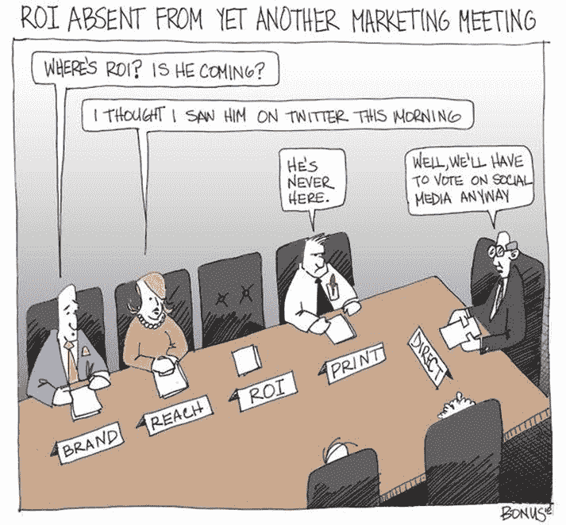

# 6. 投资回报率

## 终极指标？

对于许多营销人员来说，证明市场营销的投资回报率（`ROI`）长期以来一直是他们的心头之痛。营销部门以外的人一致赞成让营销部门报告其`ROI`。他们希望营销部门能像其他部门一样，对`ROI`负有同等责任。而营销部门内部则意见不一。一些营销人员欣然接受计算和报告`ROI`，认为这是验证营销工作的最佳方式。他们认识到，能够准确报告营销的`ROI`可以赢得认可，并且如果回报达到或超过预期，就可以更轻松地证明预算和资源的合理性。`ROI` 有可能使营销资金和运作去政治化。

营销团队中的其他人则担心需要衡量自己的`ROI`，因为这可能暴露出低绩效，并使他们面临不利后果。还有一些人干脆认为，专注于`ROI`会损害营销的真正使命。无论立场如何，营销部门在将`ROI`作为一项指标方面一直进展缓慢，正如漫画家 Brady Bonus 在图 6-1 中所描绘的那样，`ROI`成为营销讨论的一部分仍然是个例外。

图 6-1。 对于大多数营销组织而言，理解其`ROI`仍然难以捉摸

在营销人员面临的挑战中，证明`ROI`是首要挑战，其排名远在争取预算之上。¹ 无论营销人员是喜欢还是讨厌接受`ROI`的审视，许多高管层成员都期望看到这些数字，因此营销部门应该理解它是什么以及如何报告它。

营销`ROI`的一个问题是，许多营销人员根本不理解它是什么，正如这个 Quora 帖子²所说明的那样：

*   问题：“对于一家咨询公司的数字营销活动，什么样的`ROI`被认为是好的？”
*   回答：“如果你能花低于 50 美元的成本产生销售线索，那你可能做得相当不错了。特别是当你的合同金额很可能在数千美元左右时。对于像电子书下载这样的‘软转化’，20%的响应率也被认为是好的。”

这个帖子的回答虽然有所帮助，但从未明确提及任何关于`ROI`的内容，尽管它提供了一些可能有助于确定`ROI`的数据。

`ROI` 是一个衡量每次投资所获利润的盈利比率，其结果以百分比表示。企业将`ROI`作为衡量各种投资和项目成功与否的指标。它既用于评估过去的成功，也用于预测未来的成功。计算`ROI`的公式相当简单：

在计算中，成本部分不难获得。而这个等式中的“收益”要素却难以在足够的精确度下衡量，以使人们对结果产生信心。

为了说明这一点，以参加贸易展会为例，这是一种常常需要证明其合理性并报告后续`ROI`的营销活动。本例中的假设是，参会最终会带来可归属的销售收入。如表 6-1 所示，`ROI`的计算似乎非常简单，只需考虑硬性成本和收入。

表 6-1。 确定展会`ROI`的示例

| 描述 | 成本 | 收益 |
| --- | --- | --- |
| 展位/赞助费 | $15,000 | — |
| 运输费 | $1,500 | — |
| 差旅费 | $2,500 | — |
| 促销品费用 | $1,000 | — |
| 宣传资料及其他费用 | $1,000 | — |
| 总成本 | $21,000 | — |
| 展会线索带来的销售额 | — | $45,000 |
| 总回报 |   | $24,000 |
| `ROI` |   | 114% |

表 6-1 中的示例似乎让确定参加展会的`ROI`变得简单，而事实上，这里显示 114%的`ROI`意味着这项投资的回报非常出色。然而，这个场景没有考虑的是那些虽然真实存在但难以量化的软性收益。例如，品牌知名度的提升、作为行业思想领袖声誉的增强、收集到的竞争情报，以及通过与展会参会者面对面交流而产生的新产品创意。这些收益都没有在表 6-1 所示的`ROI`计算中体现出来，而其最终价值可能远远超过本例中 45,000 美元的销售额。当硬性成本和收益带来 114%的`ROI`时，或许核算这些软性收益并不重要，但当业务案例处于盈亏平衡或显示亏损时，量化这些软性收益就变得至关重要，然而却很难做到。

尽管存在这些挑战，衡量营销的`ROI`在政治上是明智之举。营销人员不能抱着精英主义的态度，仅仅因为他们认为自己是一种无法衡量的、行善的神秘力量，就将自己置于`ROI`衡量的责任之上。组织中没有任何其他部门可以免于达到`ROI`期望的要求。为什么营销部门就要例外呢？

现实情况是：在大多数组织中，以高度确定性来衡量营销的`ROI`是一个严峻的挑战，一些营销人员甚至认为这是不可能的。而日益完善的系统、技术以及使用它们捕获确定`ROI`所需数据的便捷性，正在使其成为可能。然而，并没有一个系统能够捕捉营销为创造价值所做的一切。即使有数据可以精确计算营销的`ROI`，业内一些人认为这并不总是合适的，而另一些人则认为这样做是完全错误的。

你如何将更好的客户体验转化为`ROI`？营销人员使用的系统正在变得更好，他们使用这些系统的纪律也在增强，但你仍然无法将营销所做的一切都转化为`ROI`衡量指标。为了说明这一困难，SHIFT Communications 战略执行副总裁 Scott Monty 曾说过：“早上穿裤子能带来多少`ROI`？”³ 很难确切知道答案，但不穿裤子的负面后果却很容易想象。营销也是如此：它必须做一些事情，仅仅因为做这些事情是合理的——就好比早上穿裤子这个比喻——因此，捕捉营销所做一切的`ROI`是没有意义的。

数字、品牌与传播设计公司 Forty 的创始人兼 CEO 詹姆斯·阿彻（James Archer）对他所谓的营销与广告行业的“指标迷恋”持更强烈的反对态度：“随着技术赋予我们的行业以前所未有的速度测量更多事物的能力，一种日益明显的趋势是将指标作为设计与创意工作的基础，其理念是这将确保营销工作的投资回报率。这种方法安全、可预测、简单、便于向老板展示、也便于向客户展示。它让每个人都看起来不错，感觉良好。但它是错的。”⁴ 即使在行业内部，关于衡量投资回报率也并没有达成共识。一些人认为这势在必行，另一些人认为它无伤大雅，还有一些人则认为它实际上会造成危害。

营销人员所做的某些事情确实有助于简单轻松地收集数据和计算投资回报率。例如，营销活动产生的任何网站流量，普通营销人员都可以利用它用数据淹没整个组织，并令人信服地谈论投资回报率。将收入归因于线索生成活动——这是许多营销组织的主要职责——相当简单。在收入和支出已知的情况下，确定任何数字营销活动的投资回报率通常只是简单的算术问题。

品牌建设和知名度提升，同样是大家公认的重要职责，也落在营销部门肩上。品牌资产并非那么容易衡量，即使可以衡量，它对收入的影响也很难完全理解。为了说明这一点，设想一群参加足球比赛的家长，由于你为他们设计的美妙客户体验，他们在孩子们比赛期间在场边热情地谈论你的公司或产品。这种对品牌的好感非常棒，但根本没有办法轻易捕捉这些好感数据。组织可能会从这种口碑宣传中受益，但如今根本不可能确定其投资回报率，即便可能，其中也可能涉及各种隐私方面的考量。

在关于对投资回报率应持何种态度的问题上，现代营销人员仍然面临困境。以下是营销部门衡量投资回报率的几种文化与现实情况：

*   关于营销成效的轶事不足以替代投资回报率数据。在压力之下，营销人员擅长从自身经验中提炼出生动且鼓舞人心的轶事，用以说明营销的价值和有效性。这类轶事信息往往具有说明性，但不能作为真实投资回报率信息的可接受替代品。
*   轶事信息有时非常有用。当呈现关于营销的有效投资回报率数据时，轶事对于帮助建立背景和视角非常有效，并且能为数据增添色彩。
*   市场景气时，没人会过多考虑营销的投资回报率。在大多数公司的生命周期中，总有那么一段顺风顺水的时候：每月刷新销售纪录，赢得“年度产品”或“最佳雇主”等奖项，客户和媒体的好评如潮。在这样的环境下，公司内部没多少人会考虑营销的投资回报率。每个人都默认营销工作做得极其出色，而且通常也确实如此！“东西没坏，就别修”是占主导的态度。在这种时期，营销部门在报告投资回报率方面会被免于考核，但如果真的被免了，还傻乎乎接受那才叫蠢。
*   市场艰难时，聚光灯会打在营销部门身上，对其投资回报率的审视会成为全公司的消遣。营销部门会收到来自公司各个角落的质疑性问题：“你们最近为我们做了什么？”公司正遭受收入枯竭之苦，每个人都指望营销部门能带来甘霖。关于营销支出的艰难讨论和尖锐问题不可避免，因为通过某种神奇的转变，公司里的大多数人都变成了营销领域的所谓专家。如果没有关于营销绩效的投资回报率数据，每个人都会做最坏的打算。不仅营销部门的声誉会受损，其人员编制也常常会随之缩减。

每家公司都有其独特的个性和文化，这影响着它们如何看待营销投资回报。以财务或工程文化为主导的公司，往往“不理解”营销的价值。它们以数据为导向的文化使其难以接受营销所提供的无形利益，因此营销在这些方面也得不到认可。在这种文化中，营销等同于“花架子”，要想获得尊重，更别提预算了，都难上加难。没有投资回报率数据来证明营销正在帮助创造收入，营销部门就很难帮助这些公司取得成功。而当它确实有所贡献时，功劳又往往归于别处。

拥有销售和营销文化的公司，在理解营销价值方面则更可能“开窍”。这些文化下的公司高度重视营销，几乎有一种直觉式的理解：营销是销售引擎的润滑油——即使你看不见，你也知道它在发挥作用，没有它引擎就无法运转。投资回报率固然有用，但对这些公司而言，营销是一种必需，无论是否有确凿的投资回报率证明，它都会以某种形式存在。

对于某些组织而言，ROI（投资回报率）很可能是其营销分析过程中最重要的指标。但对其他组织来说，它既不适合也不是硬性要求。绝不能想当然地认为 ROI 对所有人都必须是必备指标或关键绩效指标。持有这种想法无异于本末倒置。还有什么比实现目标更重要呢？正如第 4 章所讨论的，分析过程的一部分就是理解业务目标、执行有助于实现这些目标的营销策略，并选择能够指示该努力是否成功的指标。营销活动能否在不使用 ROI 作为指标之一的情况下实现其目标？诚实的答案是“能”。在指导营销工作的指标组合中，并不总是需要包含 ROI，但组织中的其他部门可能不这么认为。

营销人员必须对 ROI 保持正确的视角。它绝不应成为“尾巴摇狗”的主角。同时，营销人员也不能对 ROI 掉以轻心，因为有些时候，展示回报的能力恰恰是维持营销职能完整性的关键。其中一种情况就是管理层要求营销部门削减开支。能够展示其持续带来回报的营销部门，才有能力捍卫自己的预算，甚至——如果它真正发挥创收中心的作用——或许还能扩大预算。

当公司遭遇经济困难时期，CEO 和 CFO 往往被迫削减开支。大多数经验丰富的营销人员都知道，高管们寻找削减成本的首要目标通常是营销部门。无论这种刻板印象多么不公平，包括 CEO 在内的许多组织成员都认为营销部门存在浪费和过度开支。当 ROI 未被衡量和报告时，营销部门就会成为这种刻板印象的受害者。因此，衡量 ROI 可以为营销部门提供一面盾牌，有助于抵御在几轮预算削减中试图大幅削弱营销部门的企图。

那么，营销人员应如何看待报告其工作的 ROI？在这种在许多公司内部引发部门间摩擦的问题上，他们应该采取什么立场？营销的主要追求并非创造回报，而是帮助企业实现其目标。尽管这样做几乎总会伴随着某种回报，但当营销组织开始过分痴迷于 ROI 时，他们可能会失去焦点。正如 Millward Brown 公司执行副总裁戈登·怀纳所言：“将营销与财务绩效联系起来，现在不是——实际上也从来不仅仅是——关于投资回报率（ROI）。量化营销活动所实现的回报，是连接营销与财务流程中的一个必要步骤，但其本身并不足以理解营销如何帮助实现业务目标，或如何改进其贡献。”⁵

营销的核心焦点应始终坚定地放在实现业务目标上。当营销部门恰当地从业务目标中推导出自身目标，并用相关指标衡量实现目标的进展时，并不总是需要强行将 ROI 纳入指标组合。有时，将 ROI 作为一项指标意义重大。而在其他时候，使用 ROI 作为指标并不能真正帮助营销部门更有效地执行其计划。ROI 作为指标的最大缺陷之一，是它无法诊断出 ROI 低的根本原因。从这个意义上说，它有点像营销车辆仪表板上的“检查发动机”灯，只能告诉你某个地方出了问题，却无法指出问题所在。因此，了解营销的 ROI 并不能直接帮助营销人员提高其有效性。

与此同时，营销人员必须保持政治上的敏锐。在某些情况下，经济形势和公司文化的影响使得报告 ROI 成为必需。如果 ROI 是 CEO 和 CFO 用来衡量部门贡献并决定资金分配的标尺，那么营销部门必须参与其中。这在存在组织孤立的公司尤其如此，即一个部门或孤立单位将另一个部门视为资源竞争者。在这种环境中，ROI 可能被用作杠杆，以便在资源争夺和争取青睐的谈判中获取对另一个部门的优势。

事实上，公司内部各部门之间应该存在一种健康的竞争水平，因为它能催生创新和效率。在拥有强大、健康文化的公司里，这种竞争对每个人都有利。而在存在功能失调或不健康文化的公司——特别是当这种失调表现为组织孤岛时——ROI 指标就可能变成一种武器，不仅用于推进本部门的议程，还可能用于损害其他部门。

那么，ROI 是营销的终极指标吗？并非如此，但这并不意味着营销人员可以忽视 ROI。当 ROI 有助于衡量实现目标的实际进展，或作为管理整个过程的有效工具时，营销人员应在指标组合中使用它。营销部门为创造收入所做的任何事情，例如需求生成和潜在客户开发活动，都可能需要附带 ROI 指标。如果营销部门能够追踪其帮助创造的收入，那么 ROI 的计算就仅一步之遥。

> **注意**  
> 当 ROI 有助于衡量实现目标的实际进展，或作为管理整个过程的有效工具时，营销人员应在指标组合中使用它。

营销部门还会发现，在需要定位营销为组织创造的价值时，报告 ROI 也很有用。报告 ROI 可以证明营销不是一个成本中心，而是一个创收中心。报告 ROI 的需求也可能源于内部的政治压力，例如当营销部门的预算或生存受到威胁时，或者仅仅因为这是证明营销支出合理的最佳方式。衡量营销 ROI 的必要性因组织而异，因此每个组织都必须确定什么是有意义的，而不能想当然地认为它始终是正确或错误的事情。

## 投资回报率（ROI）衡量的挑战

> 我们往往高估那些可衡量事物的价值，而低估那些不可衡量事物的价值。 — 约翰·海耶斯，美国运通首席营销官

即使组织内部对于理解营销投资回报率的必要性达成完全一致，做起来也并非易事。大数据分析解决方案与整合营销应用提供商`Teradata`报告称，75%尝试计算投资回报率的营销人员表示在过程中遇到了某种问题或挑战。即便存在报告营销 ROI 的意愿，重大的挑战依然存在。

衡量营销 ROI 的挑战之一，在于确定数据采集和 ROI 报告的范畴或层级。营销部门是否应该报告整个营销职能的 ROI，提供一个代表宏观视角的单一指标？还是应该采取 ROI 的微观视角，针对其工作的特定方面（例如需求生成）进行报告？对于那些营销部门希望进行的投资（例如购置重要技术或执行某项营销活动），开发基于 ROI 的商业案例又该如何处理呢？确定营销 ROI 衡量工作的范围，是营销人员将面临的首要挑战之一。

为什么不报告整个营销职能的 ROI 呢？为什么不直接确定营销所做一切事情的回报率呢？从概念上讲，这是一个绝妙的主意，但实际操作起来却很困难。指标报告的范围越宏大，有时反而会使这些指标的意义降低。单一 ROI 衡量指标很可能在某个领域低估营销的真实价值，而在另一个领域又高估它。这里的警示与使用平均值时非常相似。正如一位老统计学家所言：如果你的脚在冰水里，头在烤箱里，平均而言，你感觉很舒适。因此，宽泛或高层的衡量指标并非总是那么有用，有时还会在无意中产生误导。

即便在当今的数字营销时代，要理解营销每项活动对收入的影响并捕获这些数据，仍然是一项不可能完成的任务。对于营销活动中那些与收入有直接关联的部分，例如数字营销活动，衡量起来就相当容易。营销人员可以将特定的收入交易与营销活动关联起来，从而实现 ROI 的精确计算。如果营销部门所做的仅仅是执行易于衡量的营销活动，那么确定整个营销职能的 ROI 就相当直接了。

显然，大多数营销职能并非只运行数字营销活动。它们为其组织提供广泛的服务，其中许多服务都难以衡量其对收入的影响。例如，营销部门如何计算在活动中赠送的促销品对收入的影响？高管在会议上发表的主题演讲如何影响收入？广告和其他品牌知名度活动的影响又如何呢？所有人都同意这些事情具有影响力和价值。但是，例如，很难将本地体育团队赞助所产生的品牌认知度，与那些因认出赞助商品牌而随后点击横幅广告的感兴趣粉丝的后续行为联系起来。这些归因挑战（第十章将更全面地探讨）使得精确计算营销 ROI 变得困难。

如果营销部门只取其工作中可衡量的方面来确定其 ROI，然后以某种方式将该 ROI 推断至整个营销职能，那么由此得出的 ROI 百分比几乎肯定过低，因为它只计入了营销部分创收活动，而非全部。这种方法最终会稀释整个营销部门的 ROI 计算，因为它在计算中包含了所有营销成本，却只纳入了可直接归因的收入。这并不能呈现真实的 ROI 图景。

有些人可能会争辩说，如果计算出的 ROI 满足最低要求，那么上述 ROI 计算方法中的缺陷就无关紧要。也许在很多时候他们是正确的。但这种计算 ROI 的方法仍然是一种估算，因此在内部面临不被接受的风险。如果公司内部的利益相关者知道营销 ROI 估算仅仅是估算，那么营销部门可能无法看到该估算获得充分内部支持。即使这是一个保守的估算，营销部门也应预料到，在试图用这种方式得出的 ROI 来证明营销投资的合理性时，会遇到一些阻力。

如果能够计算出整个、完整的营销职能的 ROI，那将是理想的情况。对大多数营销组织而言，现实情况是：要么数据根本不存在，要么获取数据以实现具有一定精确度计算的成本过高或过于困难。因此，在这个层面上了解营销的 ROI 必须附带免责声明。营销部门必须持续教育组织内的其他部门，让他们了解营销是如何创造价值的，以及为什么并非所有价值都可衡量。试图报告整个营销职能的 ROI 并没有错，但该 ROI 信息需要附带解释说明。

> **注意**  
> 营销部门必须持续教育整个组织，让他们了解营销是如何创造价值的，以及为什么 ROI 指标无法衡量所有这些价值。

更容易的做法是审视营销的一些独立组成部分。有了恰当的数据追踪，确定一次点击付费广告活动、参加一次贸易展会或营销部门为产生、筛选或培育潜在客户所做的几乎任何事情的 ROI，都并不困难。了解这些活动的 ROI 是有价值的，尤其是在比较两次类似活动时。但这种方法也有其缺陷，主要在于：衡量单一营销渠道的 ROI 忽视了现代营销真正的多渠道特性。营销人员使用大量渠道开展工作。将客户在购买周期中完成转化的所有功劳都归因于一个渠道，完全忽视了影响该转化的所有其他渠道。因此，为独立的营销组成部分或渠道计算 ROI 也并非理想方案。

除了确定 ROI 的范围和粒度之外，还存在其他挑战，例如数据挑战。这一挑战是多方面的，涉及到获取或整合确定 ROI 所需数据时面临的技能、协调、组织问题，甚至文化问题。事实上，`Teradata`数据驱动营销调查显示，营销人员计算 ROI 的首要障碍是缺乏数据整合。

营销在数据方面面临的挑战部分在于所有权：许多营销组织无法掌控自己的数据命运，因为它们并不对自己拥有的数据承担主要责任。事实上，只有不到三分之一的营销人员声称拥有或控制客户数据，超过一半的营销人员表示他们依赖 IT 部门来获取数据。如果营销部门无法不受限制地实时访问其数据，这将阻碍任何类型的分析流程，更不用说计算 ROI 了。

数据访问的挑战常常因一个老对手——组织孤岛——而变得更加糟糕。当存在孤岛时，为任何目的（而不仅仅是确定 ROI）共享数据和信息所需的跨部门合作，就变成了一场低效的外交斡旋。猜疑丛生，围绕数据、信息及其控制权的领地之争不断上演。试图获取营销部门计算 ROI 所需的数据，可能需要消耗超出营销部门现有或愿意支付的政治资本。

## 影响市场营销获取所需数据的因素

另一个阻碍市场营销部门获取所需数据的因素是组织协调不一致。当市场营销的目标与销售目标或其他关键组织目标未能良好对齐时，不仅是在投资回报率（ROI）的确定上，在诸多其他领域也很可能存在问题。然而，具体到 ROI，当销售和市场营销这两个紧密相关的职能拥有不同目标时，它们会收集不同的数据。这种协调问题带来的影响是，市场营销为了进行恰当、准确的 ROI 计算所需的数据可能根本不存在。

在某些情况下，市场营销部门无法获取所需数据，是因为它已经放弃了责任，对这个问题撒手不管（可以这么说），因为这项工作需要该部门所不具备的技术技能。正如图 2-1 所示，市场营销工作的轨迹无疑正朝着技术化方向发展。市场营销人员不能再维持技术上的无知，简单地将任何技术职能外包给 IT 部门或其他团队。即使市场营销部门不打算管理分析流程或计算其 ROI，它仍然需要技术技能来完成工作。缺乏必要技术技能的市场营销部门，正将自身命运中日益增长的一部分控制权，拱手让给部门外部那些可能同情也可能不同情市场营销的人。

销售流程的复杂性及其长度，也会给市场营销衡量 ROI 的努力带来挑战。在 B2B 环境中，长期且复杂的销售周期相当常见。在这种情况下，通常能够确定的是流程的开始时间——在收集到合格线索时，以及流程的结束时间——在达成销售时。在这两个端点之间，存在着通过多种渠道产生的众多影响因素，它们推动线索最终转化为销售。其中一些因素易于追踪，而另一些则完全未知。更长的销售周期通常会涉及更多这些影响因素。这些因素包括品牌印象和培育活动，而且很容易忽略在某个特定客户的销售周期中发生了哪些活动，或哪些活动是有效的。

确定市场营销 ROI 的挑战众多。面对报告 ROI 的压力，首席营销官（CMO）该怎么办？答案取决于该组织在营销分析和 ROI 方面已经处于什么阶段。任何希望报告其 ROI 的营销组织都应关注该指标的精确性，因为精确性带来可信度。将 ROI 用作市场营销的指标或关键绩效指标（KPI）很像跑马拉松：如果你以前从未跑过，你不能第一次就系好鞋带跑完 26.2 英里。相反，从较短的距离开始，慢慢提升。在刚开始确定市场营销 ROI 时，为了避免不知所措，请遵循一条演进路径。

*   **起步**：在衡量 ROI 时，不要试图“煮沸整个海洋”。先选择市场营销工作中的某些方面来确定其回报，从而让自己入门。例如，即使是刚刚起步的营销组织，也能确定付费搜索或其他数字营销活动的 ROI，因为这些数据是现成的。这里有个问题：营销部门中许多“入门级”的 ROI 衡量领域可能与组织目标几乎或完全无关。开始时，为了学习如何衡量和使用 ROI，这种不协调是可以接受的。但请确保衡量工作不要止步于此。在这个早期的学习阶段，ROI 的衡量结果可能应该保留在市场营销部门内部。
*   **扩展**：将 ROI 流程和指标应用于更广泛的市场营销工作。一旦在衡量和使用 ROI 方面获得一定熟练度，就应将其应用于重要的事项。使 ROI 的衡量与目标保持一致——无论是市场营销的目标还是组织的目标。正如本章所讨论的，数据的可用性或可访问性通常是实现这一点的挑战。在这个扩展阶段，你还需要开始将市场营销的 ROI 结果展示给部门外部人员，以此来测试文化氛围。这对市场营销来说仍然是一个学习过程，但同时也变成了一个教学体验。市场营销需要帮助组织的其他部门理解如何使用和解读其提供的 ROI 数据。在这个扩展阶段，市场营销不应过于雄心勃勃，试图表达其所有工作的 ROI。此处的目标是在其工作中一些战略性选择的领域，为市场营销使用 ROI 赢得认可。
*   **整合**：将 ROI 作为营销分析流程的一个组成部分，并依据常识尽可能广泛地加以应用。当 ROI 作为指标成为决策的关键影响因素时，它的使用就已经变得不可或缺。当组织达到这一成熟阶段时，本章讨论的所有关于使用 ROI 的注意事项都应适用。在适当的背景下使用 ROI，即将其作为改进的指标或工具，而不是对市场营销的裁决。确保围绕 ROI 的计算过程具有完全的完整性：不要在计算中使用推测性数据或估计值。确保文化环境是包容的，因为在这个阶段，市场营销的 ROI 结果完全透明，ROI 可能成为评判市场营销工作的唯一标准和裁决者（有时甚至是刽子手）。

## 投资回报率并非万能

> 大多数人使用统计数据，就像醉汉使用路灯柱——更多是为了支撑，而非照亮。 ——马克·吐温

如本章所述，将`ROI`作为营销指标有其利弊。争议的一方认为`ROI`是终极营销指标，而另一方则认为`ROI`并不重要，甚至作为营销指标是有害的。这两种立场都无法代表营销在`ROI`指标上应有的定位。正如许多两极分化的争论一样，真相往往介于两者之间。

暂且抛开准确衡量营销任何行为或整体行为的`ROI`所面临的所有挑战不谈。`ROI`指标既无法让营销部门，也无法让企业其他部门全面了解营销的绩效表现或改进方向。事实上，没有任何一个单一的指标能服务于这一目的。要正确进行营销分析，需要多项指标才能提供完整而准确的视角。将`ROI`视为那唯一的关键指标是不合理的。那些希望营销成败全系于`ROI`的财务实用主义者必须认识到，其他指标往往更能揭示真实的营销成果。这些指标包括市场份额、客户生命周期价值、留存率和客户获取成本等。

而那些认为`ROI`在指标体系中没有立足之地的人，也必须正视一个事实：`ROI`确实能提供实际价值。对于某些营销活动而言，`ROI`是一个极佳的效果指标。诚然，营销存在一些难以或成本过高衡量且重要的无形贡献——`ROI`显然不适用于评估这些方面。但大多数营销活动和潜在客户开发工作则很容易进行`ROI`的测定与审视。在合理的情况下，营销部门应当拥抱`ROI`。此外，营销理想主义者必须明白，有时参与`ROI`的游戏不过是出于权宜之计或政治上的明智之举。如果报告`ROI`是获取资源或保障营销未来的途径，那么营销人员就应该毫不犹豫地去做。

关于`ROI`与营销的正确立场应该是：在合理的场景下使用`ROI`。它是一个重要的指标，但它是达成目的的手段，而非目的本身。营销人员应当主动掌控确定和报告`ROI`的过程，而不是被这个过程所掌控。同时要认识到，由于本章讨论的各种挑战，将`ROI`作为营销指标使用需要时间才能成熟。然而，不难预见，在不太遥远的未来，用于追踪、收集和报告目前尚难获取的`ROI`所需输入数据的改进系统，将变得标准化且易于获得。随着营销技术的持续成熟，精确了解整个营销职能的`ROI`能力将变得更为触手可及。

## 脚注

[1] “2014 年入站营销状况”，Hubspot，第 31 页，`http://www.stateofinbound.com/`。

[2] `http://www.quora.com/What-is-considered-a-good-ROI-for-a-digital-marketing-campaign-for-a-consultancy-company`。

[3] 菲尔·约翰逊，“早上穿裤子的投资回报率是多少？衡量与问责的困境”，《广告时代》，2009 年 10 月 20 日。

[4] 詹姆斯·阿彻，“指标之欲：你真的能很好地衡量营销投资回报率吗？”，`http://forty.co/metric-lust-how-well-can-you-really-measure-marketing-roi`。

[5] 戈登·怀纳，“营销效果：不仅仅是投资回报率”，Millward Brown 博客，2008 年 2 月。

[6] “Teradata 数据驱动营销调查，全球版”，2013 年，Teradata，第 28 页，`http://teradata.com/`。

[7] “2013 年 Teradata 数据驱动营销调查，全球版”，第 8 页。

[8] “2013 年 Teradata 数据驱动营销调查，全球版”，第 13 页。

