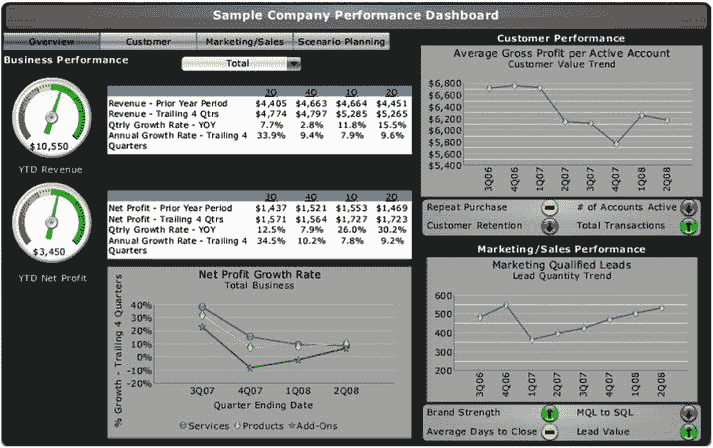
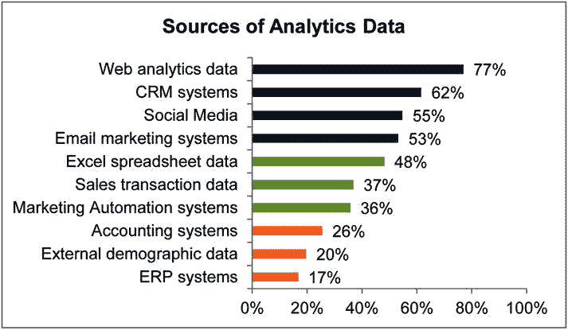
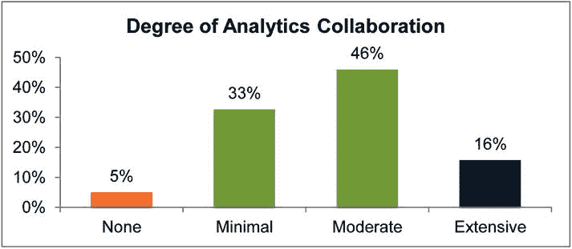

# 7. 营销仪表板

## 分析流程的声音

想象一下观看一场专业体育赛事，但记分牌无法使用或根本不存在的情景。除非你非常关注场上发生的一切，否则很难知道谁领先。或者，正如第 1 章开篇所述，想象驾驶一辆没有仪表盘提供任何信息的车辆。虽然也能开，但这会让大多数驾驶员感到不安并充满疑问：还剩多少油？我开得太快还是太慢？仪表盘不仅提供关键的性能信息，还能带来安心感或引发警报——这两种情绪状态对于长期保持车辆良好运行都至关重要。

记分牌和仪表板虽然不同，但目的一致：为营销分析流程衡量的营销策略提供实用的进度指示和问责机制。纯粹的分析师会区分记分牌（或常说的记分卡）与仪表板的不同。记分卡通常与哈佛商学院的平衡计分卡战略相关联。¹它们通过自上而下的方法创建，最终确定用于跟踪组织在执行业务战略方面成功与否的关键绩效指标（`KPIs`）。当记分牌的`KPIs`层层分解到组织的较低层级，并由各部门和个人以影响其工作的方式进行解读时，这一流程便卓有成效。虽然记分牌或记分卡是战略或关键绩效信息的界面，但它不一定是可视化的。

另一方面，仪表板为任何领域或业务应用（不仅仅是营销）提供了绩效数据的可视化界面。它们通常与实时数据源相连，并以图表或模仿汽车仪表盘的“量表”形式汇总展示绩效数据。其目的是共享仪表板，使其在营销部门内部以及对外部其他部门和高管可见，以促进问责和决策。尽管记分牌和仪表板存在差异，但在营销分析领域，这些区别并不重要。重要的是拥有一个易于访问、可视化的营销关键绩效数据界面。为简单起见，本章将使用术语`仪表板`来指代此界面。

在营销领域，营销仪表板是一种绩效管理工具和界面，提供可访问、可视化的营销`KPIs`摘要。Perceptual Edge 的创始人兼负责人 Stephen Few 给出了这样的定义：“仪表板是一个视觉展示，它集中并排列在单个屏幕上，显示实现一个或多个目标所需的最重要信息，以便一眼就能监控这些信息。”²这些仪表板有多种形式，简单到打印在纸上并贴在公告板上的一系列图表，复杂到实时更新的数字显示屏。

营销仪表板之所以重要，是因为它们能将营销分析流程产生的大量数据转化为有意义、可理解且可操作的摘要。正如本章将讨论的，营销仪表板（特意使用复数，因为通常不止一个）在其报告的内容上会不断演变，但同时它们也为营销组织内外的用户提供了一致的参照。图 7-1 显示的是由 Lenskold Group 提供的示例营销仪表板截图。³

图 7-1. 这个由 Lenskold Group 提供的营销仪表板示例包含用于目标跟踪的量表、带有选定数据明细的表格，以及关键指标的趋势跟踪图

在营销组织内部，仪表板的主要用途是作为绩效管理工具。创建和管理营销仪表板这一行为本身就要求对源数据有深入理解。创建能让营销人员看到宏观趋势和方向的仪表板，可以提供有关营销流程的、否则难以获得的洞察。因此，营销团队使用仪表板来管理和改进其核心流程。有时，查看最新的仪表板能让人确信一切顺利。另一些时候，仪表板会揭示一种趋势，如果及早处理，只需采取小幅纠正措施；但如果置之不理，未来则需大动干戈。构建和维护得当的仪表板能帮助营销人员及时发现并解决问题。

> **注意**
>
> 构建得当的营销仪表板能帮助营销人员及早发现问题并采取纠正措施。

在营销组织外部，仪表板的主要用途是作为向利益相关者通报信息的沟通工具。营销仪表板理想情况下是一份视觉丰富、易于理解的营销`KPIs`摘要。它为营销外部人员提供了一个窗口，让他们了解营销在做什么以及取得了何种成果，进而实现问责。在这种能力下，营销仪表板向组织保证营销正在发挥作用及其程度。对于组织中大多数非营销人员来说，这些仪表板是他们了解营销的主要界面。

营销仪表板的开发与部署应在营销分析流程的后期进行，即在第 5 章和第 6 章所述的规划、决策和实施完成之后。只有在确定了支持营销分析流程的指标之后，你才能开始规划哪种仪表板最能有效地向利益相关者和相关方通报营销绩效。

## 为什么你需要数据仪表盘

> 图片的最大价值在于它能迫使我们注意到那些从未预料到会看到的东西。——约翰·图基，《探索性数据分析》

仪表盘，或者更可能是一系列仪表盘，是营销分析流程中至关重要的推动工具。就像电梯演讲向潜在客户概括公司或产品的核心价值主张一样，仪表盘将营销分析过程中最重要的结果提炼成易于理解的视觉摘要。如果营销分析流程的输出讲述的是一个《战争与和平》长度的故事，那么仪表盘就提供了《克利夫笔记》的浓缩版本。营销分析仪表盘就是营销业绩报告的“高管摘要”，它是唯一可以确保人们会关注的东西。

那些首次实施营销分析流程的人会发现，该流程能够产生海量数据。而那些管理成熟营销分析流程的人，则已经淹没在（甚至可能溺毙于）营销指标数据的汪洋大海中。要持续理解所有这些数据的唯一方法，就是通过有效的视觉摘要（即仪表盘）来呈现。如果不将营销分析流程与一个或多个仪表盘搭配使用，就等于剥夺了该流程一个强大的沟通工具。

> **注意**
>
> 在营销分析流程中未能使用一个或多个仪表盘，会使其失去一个强大的沟通工具。

最初，当营销分析流程的范围很小时，或许可以利用原始数据来管理关键营销流程，并在较小程度上提供信息。但处理原始数据既繁琐又枯燥；如果营销分析流程扩展到最终覆盖营销的各个方面（理应如此），那么处理原始数据将不再是一个可扩展的流程。无需太多数据，一旦缺乏相应工具，数据管理就会变得笨重且难以驾驭。使用一个或多个仪表盘是必要的，它有助于组织和打包这些数据，使其能够实现预定目标：建立对业绩的认知，并促成提升营销效能的决策。

来自营销分析流程的数据会迅速膨胀。仅针对单一指标，大量数据的积累也用不了多久。随着新的指标被添加到营销分析组合中，每个指标都带有自己的数据集，数据总量很容易呈指数级增长。这是分析流程演进过程中的正常现象：需要分析、审查和关注的数据量很快就会暴增。为了满足预期，分析流程需要数据分析与报告工具，而仪表盘正是这类报告工具的顶峰。

数据分析过程，就其本质而言，鼓励分析人员深入探究数据。这里可以用“洋葱”来比喻，数据存在多层结构，分析人员可以一层层深入，探寻更深层的含义。这种“放大”审视营销分析数据的方法重要且必要，能为那些严谨执行的人带来诸多洞见。尽管近距离审视数据是必要的，但其缺点是会丧失全局观。营销分析流程既需要用显微镜近距离查看数据，也需要用望远镜远距离纵览全局。仪表盘正是提供这种“全局观”的最佳方式之一。如果对营销指标的分析是近观树木，那么仪表盘呈现的就是森林的全貌。

看清全局之所以如此重要，一个原因是为了发现那些只有在聚合数据随时间的推移中才能显露的趋势。当营销人员分析数据并发现了可能需要采取行动的事项时，一个好问题是：这是偶发事件还是趋势？区分数据中的偶发事件和趋势至关重要，因为前者可能无需任何行动，而后者则可能需要重大的流程变革。仪表盘提供的全局视图可以帮助营销团队快速区分偶发事件和趋势。

仪表盘如此重要的另一个原因是，它能将所有关键指标并列呈现，便于比较。仅仅查看单一指标的结果可能导致错误结论。如果这些结果非常有利或非常令人担忧，试图脱离其他相关指标的背景来解释这些结果，就可能导致解读错误和决策失误。仪表盘本质上代表营销的“生命体征”，其价值的一个重要部分就在于能够获得所有这些生命体征的完整视图。某个单独看来令人担忧的指标，当与相关指标并列呈现时，或许就没那么令人紧张了。反之，一个单独看来尚可的指标，当作为全局的一部分来看时，可能会发出必要的警报。这种对营销分析数据的整体视角，是营销分析流程需要一个或多个仪表盘的另一个原因。

组织内其他部门对销售和营销的看法，通常可以总结为这样一个问题：“你们最近为我们做了什么？”这个问题体现了一种对营销部门业绩和贡献常常抱有的怀疑态度。营销部门使用仪表盘有助于防止这个问题沦为单纯的修辞性发问，而是提供了一个问责界面，澄清了营销助力组织成功方面的迷雾。这个好处或许是营销部门在其分析流程中采用仪表盘的最重要原因，即使没有任何其他理由也足以推动其采用。

在营销分析流程中采用仪表盘的理由有很多：看清全局、发现趋势、对比不同指标以及展示问责制。这些理由中的任何一个，都足以证明开发仪表盘来支持营销分析流程的合理性。这些理由加在一起，更有力地推动了营销仪表盘的应用。

## 仪表盘成功的关键

> 如果你只关注最微小的细节，就永远无法把握全局。 — 勒罗伊·胡德⁴

营销仪表盘是一个容易理解的概念，其术语本身就非常形象，能让大多数人对其有扎实的理解。营销仪表盘的挑战在于其他方面，尤其是其实施、使用和接受度。由于仪表盘实际上充当了组织了解营销绩效的界面，因此正确实施它们至关重要。风险很高：如果营销部门发布的仪表盘成为影响营销评价的主要因素，那么营销团队就不能在这方面出错。对营销仪表盘采取轻率的态度，可能会损害营销团队在声誉、信心和政治资本方面的利益——即使他们正在良好地执行营销分析流程。本节将介绍成功实施营销仪表盘的关键考量因素。

# 营销仪表盘的对齐与实施

营销人员必须考虑营销仪表盘的许多方面，这些方面都很重要，但最重要的考量之一是对齐。正如第 5 章所讨论的，营销分析流程及其支持的指标是更高层级业务目标的反映。事实上，营销分析流程的目标和指标源自业务目标和目的。从最高层级的业务目标到最细微的营销指标，应当贯穿一条连续的线索。换句话说，应存在完全的对齐，并且这种对齐必须延伸到营销部门发布的仪表盘。

将仪表盘与目标及其相关指标对齐的概念似乎很直观。然而，在实际操作中，指标很容易与目标脱钩，仪表盘也是如此。当这种情况发生时，通常并非出于蓄意欺骗。相反，它反映了经验不足或图省事。正如第 5 章建议确保分析流程及其基础指标与业务战略和目标对齐一样，营销部门必须确保仪表盘报告的数据也与重要事项对齐，而不仅仅是那些在仪表盘上看起来不错的数据。

确保营销仪表盘良好对齐的一个关键因素是理想地选择指标。第 5 章讨论了为营销分析流程选择基于业务目标的指标的必要性。如果遵循了第 5 章的建议，那么营销仪表盘的输入数据应该已经是对齐的。假设遵守了这些建议，挑战就变成了确定将哪些指标包含在仪表盘中。合适的详细程度是怎样的？

营销仪表盘的目的并非作为分析流程所追踪的每个指标的全面目录。相反，它针对具有不同信息需求的各种受众总结关键结果。在营销分析流程的早期阶段，指标汇编通常很小，因此有可能将每个指标都汇总在单个仪表盘上。然而，正如第 6 章所述，随着营销分析流程的成熟，其范围会扩大，包括更多指标并收集更多数据。用不了多久，仪表盘可以报告的事项列表就会超过其应当报告的事项列表。

> **注意**：营销仪表盘并非旨在追踪营销分析目录中的所有指标。相反，它们应总结关键结果，以满足仪表盘受众的信息需求。

在为营销仪表盘理想地选择指标方面，最好的方法是了解仪表盘的受众。他们需要知道什么？哪些指标对于让受众在适当层面上准确了解营销绩效至关重要？当采用这种方法时，通常会为特定受众创建不同版本的营销仪表盘。例如，“高管营销仪表盘”被许多组织常规使用，它提供了高管层成员所需层级的信息和细节。营销部门不仅应发布仪表盘，还应努力了解其受众，并为他们提供最有帮助的信息。

当营销部门在分析流程中创建、发布和管理仪表盘时，常常需要处理数据准确性的问题。整个分析流程的成功取决于准确数据的可用性。许多营销人员发现，准确的数据并不总是容易获得，尤其是在流程的早期阶段。营销分析数据的收集通常需要在多个测量周期内进行调整、微调和测试方法，以确保其正确并建立对数据的信心。

营销仪表盘是这些数据的可视化呈现：可以将它们视为营销分析流程的“视觉糖果”。因此，它们的外观通常令人印象深刻且眼花缭乱，并且很容易在仪表盘上创建出令人赞叹但完全错误的数据展示。然而，数据呈现在仪表盘上这一事实本身似乎就赋予了数据权威性和可信度，即使它并不值得。

营销部门需要防范不准确的数据潜入其仪表盘。在分析数据源变得准确可靠之前，它绝不应该出现在仪表盘上，因为它出现在那里就暗示了准确性和可信度。这对营销部门来说是一个声誉和诚信问题，并且必须始终坚持在其时机成熟之前不呈现数据的原则，无论该数据作为仪表盘的一个组成部分看起来多么好。

当营销人员筛选指标并为创建的仪表盘选择数据时，理想的做法是提供该数据的实时视图。人们很容易将仪表盘视为历史数据和趋势的汇总。一眼查看关键指标一整年的数据非常有用。然而，实时了解当下正在发生的事情也至关重要。作为营销仪表盘隐喻的汽车仪表盘正是这样做的：提供速度、燃油油位和其他性能指标的实时数据。当营销仪表盘能够为某些指标提供这种即时信息时，它们提供了很大的价值。

现实情况是，营销仪表盘需要同时提供历史信息和实时信息，因为只处理其中一种信息价值有限。最终，如果它们不能提供足够广泛的信息视图，其作为信息来源的形象就会受损，从而也会拉低对营销部门的看法。然而，在仪表盘中显示实时数据存在挑战，这些挑战从信息的可用性到在仪表盘中捕获该数据不等。在仪表盘中提供实时数据的需求或愿望，往往因围绕数据的这些技术挑战而受挫。

## 市场营销仪表板实施考量

### 与数据源直接集成

实现市场营销仪表板实时数据报告的一个关键考量是与数据源直接集成。由于市场营销领域实际上不存在所谓的“记录系统”，支持营销分析流程的数据可能来自多个不同甚至互不相关的系统。在条件允许的情况下，市场营销部门应通过所有可用的集成途径（例如应用程序编程接口（`API`））将这些数据源直接连接到营销仪表板。图 7-2 展示了研究数据，显示了多种数据源及其在营销分析流程中的使用频率。

**图 7-2.** 营销分析数据源自多个系统，其中许多系统可通过`API`向仪表板提供数据

当这些集成途径存在时，市场营销人员务必加以利用，以消除将数据手动加载或复制到仪表板中的繁琐过程。复制粘贴或手动导入数据固然能完成任务，但该流程会迅速变得难以管理，进而成为制作高质量仪表板的障碍。尽管利用这些集成需要一定的技术知识，但值得从一开始就部署到位，以免整个仪表板项目因手动数据填充流程的负担而崩溃。

### 技术难题正逐步简化

幸运的是，整合策划营销分析仪表板所需的所有数据源所涉及的技术难题正变得越来越简单。第 2 章引用的《营销技术景观超级图》至少列出了 35 种用于创建仪表板和其他数据可视化的供应商解决方案。这些解决方案大多具备一个共同点：一套数据连接器和`API`，使得将不同来源的数据集成到仪表板中变得更加容易，在许多情况下甚至可实现自动化。虽然完全可以使用电子表格甚至打印图表来创建仪表板，但向其中输入数据是一个手动过程，而这往往成为发布仪表板的失败点。

本文作者最近拜访了一位客户，该客户通过打印图表并将其张贴在会议室墙上，发布了一个基于纸张的仪表板。展示的信息种类繁多、令人印象深刻，其在会议室两面墙上的组织方式也同样出色。但仔细查看后，发现大多数图表已过期数月，这正说明了当仪表板无法集成并自动填充其基础数据时所导致的问题。强烈建议使用能够消除此问题的仪表板解决方案，事实上，这也是仪表板成功的关键推动因素。

### 共享与协作

实施市场营销仪表板最重要的考量是共享与协作。无论一个仪表板设计得多么精巧、构建得多么完善，如果它不能激励观看者采取行动，那它仅仅是一件艺术品。决策的发生需要先有共享。常见的情况是，市场营销部门精心创建并发布了一个或多个仪表板，但它们从未“走出”营销部门的圈子，未能被那些需要根据其中数据采取行动的人看到。发布仪表板的过程需要包含如何与需要查看仪表板的人共享它的考量。上文讨论的每一点都为营销仪表板的共享与协作做出了贡献。

> **注：** 一个不能激励观看者采取行动的营销仪表板，仅仅是一件艺术品。行动来源于仪表板的共享与协作。

正是有效的仪表板共享促成了协作，而这种协作才从仪表板工作中创造出价值。仪表板是一个沟通与协作工具，如果协作没有发生，那么制作仪表板基本上就是无用功。协作应在多个层面进行。营销团队成员之间的部门内部协作是第一层，也是最容易推动的，因为这些团队成员通常具有物理上的邻近性。尽管如此，`CMO`（首席营销官）绝不应假设协作会是仪表板存在的自然副产品。`CMO`需要以身作则地引导协作，并设定对协作方式及其应产生结果的期望。如图 7-3 所示，围绕营销分析数据及其展示仪表板的协作并非总是理所当然的。

**图 7-3.** 超过三分之一的企业在其营销分析数据方面几乎没有协作或协作程度极低

#### 这种协作是什么样子的？

仪表板上的结果是行动的催化剂，因此，在研读仪表板显示的数据时，审阅者应关注他们所见内容的含义。仪表板结果应引发的问题很简单，但采取的行动却意义深远：

- 仪表板显示的结果对于实现潜在目标有何意义？

- 根据仪表板显示的结果，需要采取什么行动或做出什么改变？

利用第一个问题来判断仪表板上汇总的指标是表明朝目标取得了进展还是偏离了目标。这种初步判断基本上相当于市场营销部门找准定位，了解自己在实现目标方面处于何种位置。在采取任何行动或尝试纠正路线之前，营销部门只需要知道自己的位置。如果仪表板显示有进展，通常无需采取任何行动，因为仪表板表明当前的营销流程正在交付预期的结果。尽管如此，理解为何取得有利结果与找出未能达成目标的原因同样有价值。围绕第一个问题的协作通常非常简单：所有相关方共同审阅仪表板结果，以确定对其含义是否达成一致。

仪表板结果若显示未朝目标取得进展，则应触发问题排查工作。这是协作最有价值的时刻，首先要了解结果的根本原因，然后决定如何改变现状。市场营销人员需要明白，仪表板的存在并不能确保协作会自动发生。营销部门必须主导协作过程，而仪表板则成为促进协作的工具。

### 工具选择与协作

市场营销部门为其分析流程和仪表板报告所选择的工具，确实会影响协作效果的好坏。某些分析工具比其他工具更能促进协作，研究表明，某些工具选择实际上能更好地预测协作效果：

- 数据可视化工具

- 统计分析软件

- 商业智能工具

- 演示软件或工具

## 实现仪表盘极致体验

> 千里之行，始于足下。 —老子

尽管上述列举的工具选择有助于推动协作，但同一项研究也发现，有一项工具的使用实际上降低了协作效率：电子表格。这令人担忧，因为电子表格也是最常用的营销分析工具之一。它们具有普遍存在的优势，大多数营销人员无需培训即可使用。利用分析数据构建电子表格、进行数字运算，并轻松点击几下生成一些仪表盘图表，相对容易。问题出现在分享电子表格数据、追踪不同版本以及管理分发时。电子表格并非为协作而设计。营销人员可能会一直将电子表格作为营销分析流程的一部分，但他们应了解其局限性，并寻求使用能更好促进围绕分析数据进行协作和决策的工具。

本章前面部分提到，营销分析流程的理想伴侣并非单个仪表盘，而是一系列仪表盘。随着营销分析流程的成熟，很有可能使用一系列仪表盘，在几个非常具体的关注领域呈现数据。应该使用多少个仪表盘？答案并非对每个营销组织都相同，但有一个简单的模型效果不错：一个高管层仪表盘，汇总最重要的指标，以及若干支持性仪表盘，在战略领域提供详细信息。目标是让信息易于获取并有效传达，而不是让仪表盘堆满数据。在构建和组织营销仪表盘时，应牢记这一目标。

创建合适的仪表盘集合是一个渐进的过程。营销人员不应试图在一开始就把所有最终可能需要的仪表盘都部署到位。应从高管层仪表盘开始，它仅提供分析流程中追踪指标的最广泛视图。营销部门应定制此高管层仪表盘，以满足其受众（顾名思义，通常是高管层）的信息需求。以下是高管层营销仪表盘的数据元素示例配置：

*   营销项目指标：整体绩效指标，如产生的收入和当前预算状态。

*   客户项目指标：客户获取成本、客户留存率、客户生命周期价值、净推荐值等。

*   潜在客户生成指标：按渠道划分的新潜在客户、每个潜在客户成本、转化率、创建的商机等。

*   网站指标：流量来源、热门页面、独立访客数、跳出率、网站停留时间等。

完善高管层营销仪表盘是一个迭代过程。需要一些调整来构建合适的指标组合，以清晰简洁地传达营销绩效状况。一旦实现了令人满意的配置，预计未来将根据不断变化的营销环境和战略进行调整。最好理解这一点：高管层营销仪表盘就其需要传达的结果而言是动态变化的。

有了高管层营销仪表盘之后，很可能需要一系列支持性仪表盘。营销团队应创建其他仪表盘，以反映其优先级以及传达相关信息的必要性。仪表盘的数量没有规定，仪表盘多并不一定比少好。如前所述，仪表盘是管理和沟通工具，因此数量足以做好这些工作即可。然而，营销组织中确实存在一些常见的特定仪表盘。以下是其他更具体的营销仪表盘主题的部分列表：

*   需求生成指标：用于报告活动绩效以及与潜在客户从捕获到资格确认再到转化流程相关的指标的仪表盘。

*   内容营销指标：用于追踪内容创建、发布和消费过程的仪表盘。内容营销仪表盘应包括数量和互动度指标，例如分享情况。

*   社交媒体指标：用于追踪在所有使用的社交网络上社交媒体营销活动的活跃度、互动度和覆盖面的仪表盘。

*   公关指标：用于按频率、来源、主题、类型、语气、曝光量和影响（响应）追踪媒体提及情况的仪表盘。

*   活动营销指标：用于按类型、成本、参与度、潜在客户和产生的收入追踪活动的仪表盘。

*   数字营销指标：用于追踪数字营销活动结果的仪表盘，例如曝光量、落地页浏览量、转化率、捕获的潜在客户和产生的收入。

*   网络营销指标：用于通过流量来源、页面浏览量、独立访问量、引荐来源、关键词、搜索排名和其他关键指标追踪网站有效性的仪表盘。

仅从浏览这个营销仪表盘的部分列表，就很容易看出它们所追踪的数据存在一些冗余。这些仪表盘报告也存在于其他仪表盘上的数据是可以的，实际上也是必要的。每个仪表盘都应呈现其设计用于追踪的营销计划的完整摘要，这会导致相同的数据出现在多个仪表盘上。这样做的需求说明了手动用数据填充仪表盘的挑战：你必须追踪所有需要出现数据的位置，并确保数据一致性。营销部门发布的仪表盘越多，就越可能遇到手动用数据填充仪表盘时的版本控制挑战。

营销仪表盘是营销分析流程的重要组成部分。它是为该流程赋予声音、促进围绕营销成果进行分享与协作的方式，这将有助于营销部门做得更好。一旦营销部门确定了需要追踪的指标，并开始为分析流程收集可靠数据，就应开始以仪表盘的形式发布这些数据。

## 脚注

1.  “记分卡与仪表盘，” Klipfolio， [`http://www.klipfolio.com/resources/articles/what-are-dashboards-scorecards`](http://www.klipfolio.com/resources/articles/what-are-dashboards-scorecards)。

2.  Stephen Few，“仪表盘设计中的常见陷阱，” 2006 年 2 月，第 2 页， [`http://www.perceptualedge.com/articles/Whitepapers/Common_Pitfalls.pdf`](http://www.perceptualedge.com/articles/Whitepapers/Common_Pitfalls.pdf)。

3.  参见 [`http://www.lenskold.com/solutions/dashboards.html`](http://www.lenskold.com/solutions/dashboards.html)。

4.  “西雅图的莱罗伊·胡德在白宫获得国家科学奖章，” Valerie Bauman，《普吉特海湾商业杂志》，2013 年 2 月 1 日； [`http://www.bizjournals.com/seattle/blog/2013/02/seattles-lee-hood-receives-national.html?page=all`](http://www.bizjournals.com/seattle/blog/2013/02/seattles-lee-hood-receives-national.html?page=all)。

5.  “销售与营销分析：衡量与优化绩效，” Demand Metric，2013 年 12 月，第 13 页； [`http://www.demandmetric.com/content/sales-marketing-analytics-benchmark-report`](http://www.demandmetric.com/content/sales-marketing-analytics-benchmark-report)。

6.  首席营销技术官博客，Scott Brinker，2015 年 1 月 12 日；[`http://chiefmartec.com/2015/01/marketing-technology-landscape-supergraphic-2015/`](http://chiefmartec.com/2015/01/marketing-technology-landscape-supergraphic-2015/)。

7.  “销售与营销分析”，第 25 页。

8.  “销售与营销分析”，第 27 页。

