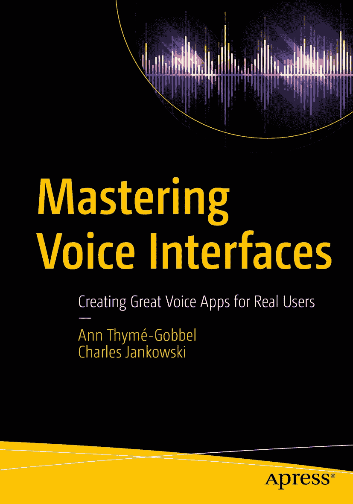
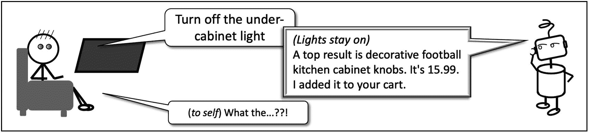

ISBN 978-1-4842-7004-2  
e-ISBN 978-1-4842-7005-9  
[`doi.org/10.1007/978-1-4842-7005-9`](https://doi.org/10.1007/978-1-4842-7005-9)  
© Ann Thymé-Gobbel, Charles Jankowski 2021  
Apress 标准出版社  

本出版物中通用描述性名称、注册商标、商标、服务标记等的使用，即使未作明确声明，也不意味着这些名称不受相关保护性法律和法规的约束，因此可自由用于一般用途。出版商、作者和编辑可合理假定，本书中的建议和信息在出版之日是真实准确的。出版商、作者或编辑均不对本书所含材料或可能存在的任何错误或遗漏提供明示或暗示的担保。出版商对已出版地图中的管辖权主张及机构归属保持中立。

本 Apress 印记由注册公司 APress Media, LLC（Springer Nature 的一部分）出版。注册公司地址为：美国纽约州纽约市纽约广场 1 号，邮编 10004。

*献给所有致力于创造更佳语音体验的人——以及所有希望使用这些体验的人。*

## 引言

我们生活在语音技术的黄金时代。以语音优先的对话式交互——利用自动语音识别（ASR）和自然语言理解（NLU）的人机界面——似乎突然无处不在：从听写和 Siri 回答的问题；家庭交互及亚马逊 Alexa、谷歌助手、微软小娜和三星 Bixby 等助手；移动语音请求及 Nuance 等企业的解决方案；到车载控制、游戏等等。无论你走到哪里，都能看到人们与设备交谈，或谈论与设备交谈！

这场语音爆发源于重大技术改进与便捷访问的完美风暴，让任何想创造可与人对话之物的人都能轻松实现。这是一场潜力尚未开发的早期辉煌淘金热。无论对刚接触设备对话的新手，还是对我们这些在语音和自然语言自动化领域工作多年的人来说，这都令人兴奋。语音交互创建曾经只是少数设计师和开发者（如我们）在暗处涉足的领域。如今它已走向光明，每个人都想参与其中。许多工具能帮你快速构建功能性的语音交互。语音似乎无所不能！

但宏大的承诺也伴随着期望落空、开发者失望和用户幻灭的风险。这种情况已经发生。许多语音解决方案评分很低，原因不难看出。我们两人都有几个可以对话的设备：不同平台的智能音箱、灯光、音频接收器、电视，甚至还有一个假壁炉。我们使用这些设备，但常常遇到意想不到甚至令人不快的体验，比如本书一位作者最近想关灯时发生的交互。在图 1 中，我们让棍子机器人代表实际的智能语音助手（IVA）。

**图 1** 用户与控制家用电灯的语音助手之间的真实对话

我们看着朋友们向语音设备询问信息和娱乐，尝试各种方法，却常常得不到期望的结果。他们勉强接受几个能用的用例，同时感到沮丧。而其他有语音开发经验的朋友则担心“语音寒冬”——一项新兴技术一旦交到用户手中，却无法跟上炒作的热度。大公司正大力押注语音，但只有少数语音应用实现了许多人期望的投资回报率。为什么？机会并不缺乏，但街上也没有铺满黄金。高德纳 2019 年炒作周期分析^(¹) 得出结论，由于根本性障碍和挑战，语音助手有落入可怕的“绝望之谷”的风险。

由于在语音领域深耕已久，我们见识过语音解决方案的能力，于是开始思考：*为什么它不能更好？* 我们开始分析：*我明白那里发生了什么……调优不够……* 或 *对上下文做了错误假设……* 或 *措辞太模糊……* 或 *没有考虑含义* 等等，最终归结为：*我们想要使用运行良好的语音设备！*

我们查阅了现有资源，发现即使材料不错，通常也只关注完整语音创建过程的某一部分——要么是设计，要么是开发。缺少的是能将所有内容整合起来，解释语音作为一种交互模态的“为什么”和“如何做”，且不受特定平台限制的东西。缺少的是解释为什么用户、系统和业务的需求都必须得到满足并协同工作的东西。缺少的是针对复杂现实应用融入适合语音的发现和测试方法的东西。在不了解人类如何处理和生成语音的情况下创建语音应用，有点像通过把意面扔到墙上看看是否粘住来判断它是否煮熟。你可以这么做，但会不必要地混乱，而且很可能得不到你期望的结果。

这就是我们写这本书的动机开始成形的地方。*我们如何分享经验？* ***我们*** *能帮助他人成功并避免不必要的错误吗？基于我们现在对语音开发的了解，我们希望有人今天能教我们什么？* 多年来，我们认识到在这个领域取得成功始于理解口语自然语言的独特之处。我们曾在大小公司工作过，在不同组织从事产品开发、客户服务、研发、设计、开发、测试、研究、教学，甚至市场研究、策略和规划。所有这些都让我们确信：**创造成功语音交互的方式，是与一个理解真实用户需求、能恰当应用现有技术和资源的团队合作**。

好消息是：功能完备的语音系统已经存在相当长一段时间了，而对口语的分析则更早。语音系统并非几年前凭空出现，也不会在短期内消失。如果我们认为语音毫无价值，就不会将整个职业生涯都投入这个领域！但我们确实在思考如何避免“语音寒冬”。Alexa 和 Google Assistant 的语音设计核心，是建立在多年经过充分验证的观察所总结出的最佳实践之上的。这背后是有原因的：**用户现在与几十年前并无不同，因为他们都是使用口语的人，而口语是人类最本质的特征**。随着行业格局的成熟和技术的演进，同样的限制和问题依然会反复出现，因为口语这种交互模式本身并未改变。任何对话系统都必须理解普通人的日常言语，并处理误解。刚接触语音应用的开发者很快会意识到，他们面对的是大量相互关联的复杂因素，需要更深入的理解。我们为您提供具体的技巧和指南，以便您能做出明智的选择，而不是盲目套用算法或依赖那些可能突然变化的工具和平台。

本书借鉴了我们在服务交付和产品开发中的实践经验，通过真实案例来说明问题可能出在哪里、为何经常发生，以及如何在问题出现时避免或解决它们。最终形成了一套可操作的步骤和技巧策略，适用于任何平台上的任何规模的语音应用。为了鼓励大家能把握全局，而不仅仅是自己的一亩三分地，我们在每一章中都有意融合了设计、开发以及产品/项目管理方面的考量。

## 基础

**第 1 章至第 3 章**为当今大多数以语音为先的解决方案所使用的技术奠定了坚实基础。您将了解人类如何使用语言，从而理解我们代码示例、设计细节和讨论所依据的语音用户界面（VUI）最佳实践背后的原因。您还将获得与语音交互代码示例的初步体验。这些章节不要求任何特殊背景。当您理解了口语自然语言的独特之处后，就可以将语音设计和开发提升到下一个阶段了。

## 第一阶段：发现

**第 4 章和第 5 章**聚焦于语音优先开发的三个阶段中的第一个阶段：规划。语音优先的成功取决于业务/产品需求、系统/技术依赖与限制、以及理解用户需求与目标这三者之间的平衡。专注于语音的需求发现是大多数语音开发书籍中未涉及的主题，而我们亲眼目睹了忽略此阶段对最终语音解决方案造成的损害。本部分还将深入探讨如何将发现结果转化为高层架构设计和详细的对话规范。

## 第二阶段：设计驱动的开发

这是本书的核心，涵盖了创建和实现语音系统的主要阶段：我们称之为设计驱动的开发。每一章都介绍针对语音优先对话特定特征的代码和技术，解释每个特征为何构成挑战，以及为什么某些解决方案优于其他方案。**第 6 章至第 9 章**聚焦于核心特征。**第 10 章和第 11 章**深入探讨识别与解析。**第 12 章和第 13 章**探讨语音对话失败时的情况以及如何使其重回正轨。这些主题对语音至关重要，因为用户所说的内容不能被限制。**第 14 章和第 15 章**更深入地探讨了使语音优先解决方案真正强大的主题和方法。

## 第三阶段：测试与调优

**第 16 章和第 17 章**涵盖了语音优先开发成功的第三阶段：发布与上线。您将学习收集和分析数据、测试和调优语音解决方案的技术，以及如何解读发现结果，以便在生产部署前后快速、恰当地解决问题。

因为我们专注于优秀语音解决方案的“如何做”和“为什么”，所以您在这里学到的内容适用于人与机器通过语音进行通信的各种设备类型和平台，即使这些平台发生变化。我们的目标是保持平台无关性，但这在同时提供一种人类语言的具体示例和只需最少设置即可运行的代码示例时颇具挑战。因此，我们使用英语示例。尽管不同语言的细节有所差异，但底层概念适用于所有自然语言，因为这关乎人类的认知、感知和产出。此外，我们决定使用 Google 平台，因为该平台及其便捷的 API（应用程序编程接口）广泛可用。然而，这并非一本针对特定平台如何制作技能或操作的“菜谱”；它是一本深入且实用的手册，旨在为任何平台或设备（包括智能音箱、呼叫中心路由和移动设备）创建成功的语音应用。当不同设备类型需要不同的语音交互时，我们会明确指出。所有代码示例均可在 GitHub 上获取（[`www.apress.com/source-code`](http://www.apress.com/source-code)）。有许多重要主题我们只是略微提及，例如伦理，仅仅是因为它们需要比本书所能提供的更深入的探讨。

我们通过两个虚构的助手来阐述这些概念：一个用于查找餐厅，另一个用于健康任务。我们选择这些场景是因为它们涵盖了您可能遇到的设计和实现复杂性的所有方面，并且因为某些任务（如健康和金融）比其他任务要求更高的准确性。由于我们两人在健康领域都拥有丰富的第一手语音设计和开发经验，这使我们能够与您分享真实的语音优先体验，尽管在为此或任何其他医疗语音应用推荐设计和实现方案时，我们绝不做出任何形式的医疗声明。

## 欢迎来到语音优先开发的世界！

请加入我们，利用当今可用的语音技术，共同打造用户喜爱的语音应用。我们很乐意与您分享数十年来在语音和自然语言解决方案方面的经验。有些方案非常出色，我们引以为傲；而另一些则不尽如人意。您将听到这两方面的故事——有问题的那些往往更有趣！我们会隐去姓名，并在故事和示例中修改细节以模糊来源，但请相信它们都是真实的案例。希望我们的书能帮助您跨越“绝望之谷”，进入“ enlightenment 之坡”。请随我们一同从错误和成功中学习，为大家打造出色的语音交互体验！

> *未来属于那些能听见它到来的人。*
> 
> ——大卫·鲍伊

## 致谢

首先，我们要感谢所有直接或间接为本书做出贡献的人：语音解决方案的用户和创造者。我们同样珍视你们的辛勤工作、错误和解决方案，因为我们深知这其中的复杂性。当我们指出某些不尽人意的体验时，是因为它们提供了宝贵的学习机会。

衷心感谢我们的技术审阅者，他们投入了大量精力提供深思熟虑的评论。没有你们细致的工作，这本书将大为逊色：David James、Cathy Pearl 和 Marius Wolf。感谢一路上提供反馈的每一个人。还要感谢 Apress 团队，他们始终以鼓励、幽默和有益的建议带领我们冲过终点线：Celestin Suresh John、Matt Moodie 和 Aditee Mirashi。

感谢我们的朋友、家人和研究参与者，他们提供了数据、轶事和观点，以及多年来使用过我们语音系统的数百万用户。正是因为有你们，我们才对提供卓越体验充满热情。

感谢我们过去和现在的同事与客户，感谢他们富有洞察力的讨论和数据，这些不断塑造着我们对这一领域的理解。特别感谢 Nuance Professional Services 和研发部门的同事。此外，还要感谢 Amazon Lab126、Brain Technologies、CloudMinds、Denon/Sound United、Gamgee/22otters、Loose Cannon Systems、MIT Lincoln Laboratory、MIT Spoken Language Systems Group、Natural Speech Technologies、Performance Technology Partners 和 Voxware 的同事们。

我们无法一一列举多年来影响我们思考的每一个人，因此仅在此列出那些直接或间接影响、支持或为本书完成做出具体贡献的领域内人士，无论他们是否知晓：Aimee Percy、Bob Quinn、Carrie Armel、Claudia Pateras、Damien Dabrowski、Dave Noelle、Dave Rich、Diane Stephenson、Donald Burbano、Eric Tober、Erin Diehm、Hoi Young、Ian Menzies、Jan Houston Smith、Janice Mandel、Jared Strawderman、Jeff Shrager、Jennifer Balogh、Jenny DeGroot、Joseph Tyler、Karen Kaushansky、Laura Marino、Linda Thibault、Lisa Falkson、Malan Gandhi、Margaret Urban、Maria Astrinaki、Marikka Rypa、Martha Senturia、Neal Sikka、Peter Celinski、Philippe Charest、Rebecca Nowlin Green、Renee Schwall、Robby Kilgore、Ron Croen、Roxanne St Cyr、Sandy Hutchins、Shamitha Somashekar、Sondra Ahlen、Steve Springer、Sumedha Kshirsagar、Susan Hura、Teenie Matlock、Tony Sheeder 和 Vitaly Yurchenko。

感谢所有组织会议的优秀团队，让我们得以学习和分享经验。特别感谢 ReWork AI Assistant Summit 以及 UXLx 的 Bruno Figueiredo 团队。

感谢美丽的加利福尼亚州布里斯班小镇及其居民和企业，为我们提供了绝佳的真实世界案例，尤其是 Na Na’s Kitchen、Melissa’s Taqueria 和 Madhouse Coffee。毫无疑问，这里是“星之城”。

最重要的是，感谢我们的家人，他们终于不用再问：“你们什么时候才能写完？！”Ann 感谢 Randy，他无条件的支持让这一切成为可能；也感谢她的父母 Asta 和 Hans，他们证明了热爱学习和尝试新事物不受年龄或母语的限制。Charles 向他的妻子 Jennifer 以及孩子 Jarek、Alina 和 Garin 致以深深的感谢，他们忍受了他为这个项目投入了太长时间；同时也要向某位瑞典人致敬，他带领 Charles 参与了语音用户界面系统这一迷人领域的多项有价值的事业，例如本书！

## 关于作者

## 关于技术审阅者

## 脚注

1

