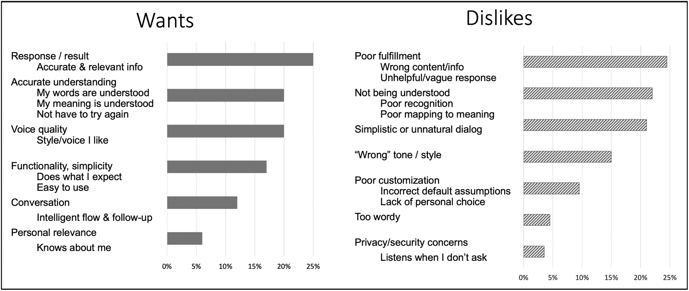
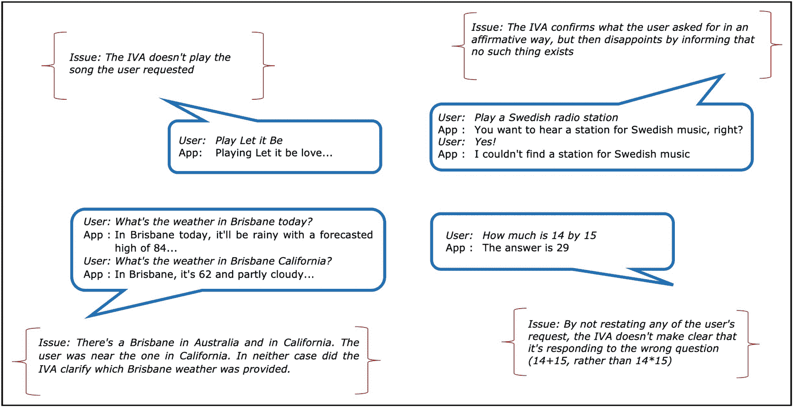
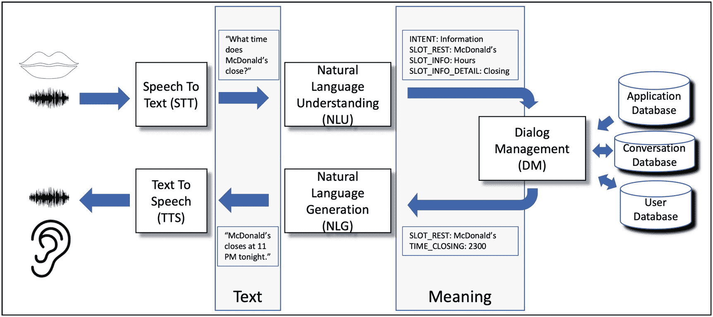
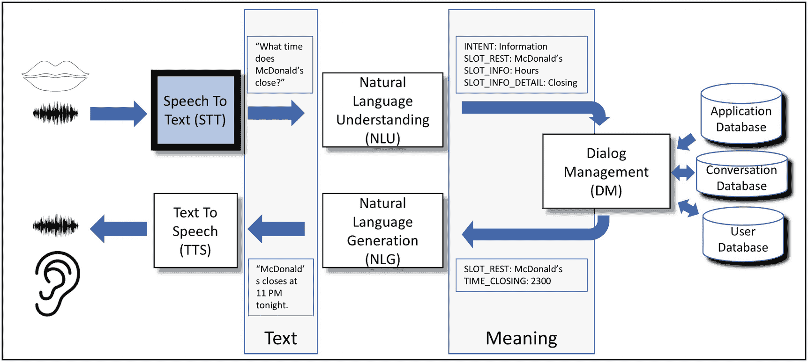
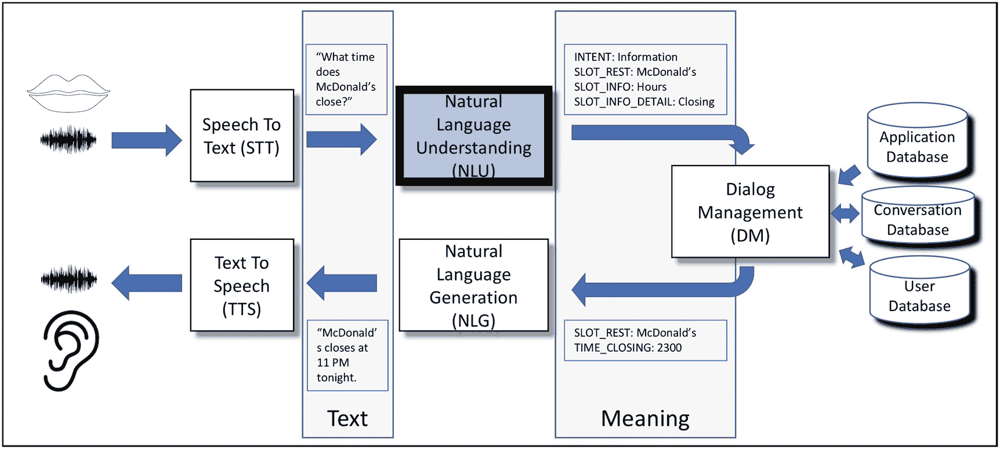
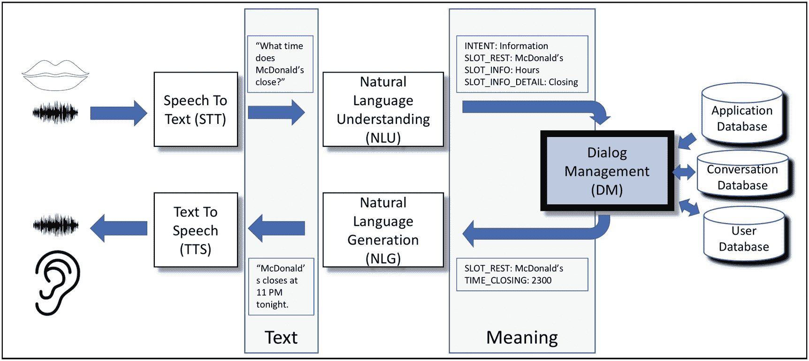
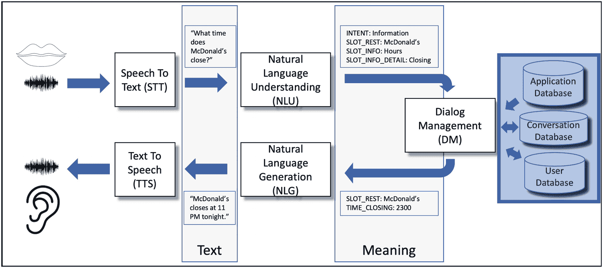
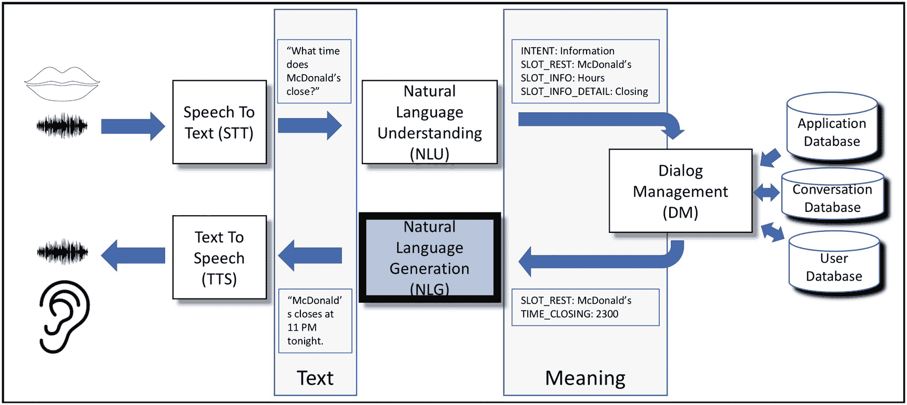
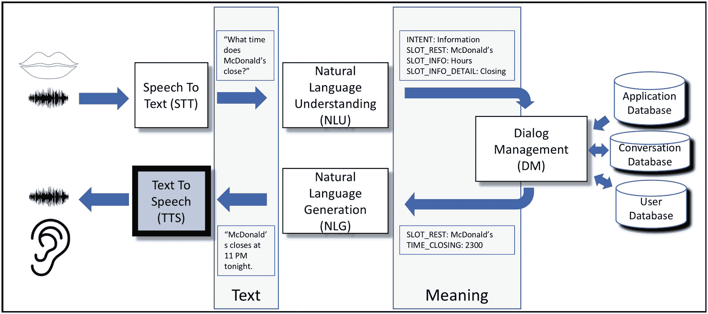
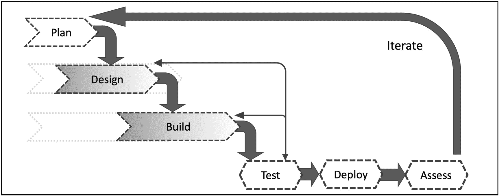

# 自然语言与会话设计

“自然”意味着无需特殊训练。自然意味着用户能够像在相同情境下与人交谈一样表达自己，被理解，并获得类似真人给出的回应。如果用户说出指令，比如*把客厅音量调到 45*，他们应该期望该房间内音量范围为 0–100 的设备当前输出的音频会变大。VUI 不应试图改变房间内的灯光，也不应尝试其他未开启或没有 0–100 音量范围的音频设备。用户还应能够以多种略有差异、能被人类理解的方式下达指令（*音量调高…*、*客厅音量…*、*增大音量…*、*让音乐更响…*），而不是局限于少数几个规定的词语或短语。自然的对话会使用像*那些*和*我的*这样的词语，并期望它们被正确理解。自然还意味着 VUI 的回应是根据情境量身定制的。高级用户通常更喜欢简洁快速的提示，而不是新手需要的详细解释。如果新用户听到*您想转账多少？*，专家用户只需要*金额？*

“话轮转换”是任何会话式对话的一部分，是两个参与者之间轮流说话和倾听的来回互动，通过短期和长期记忆建立在先前信息的基础上，遵循既定的对话模式，知道何时以及如何评论、澄清或纠正某事。有时参与者 A 主导，有时参与者 B 主导——这就是你在后续章节中会学到的混合主动权的概念。话轮转换遵循习得的、大多为潜意识层面的模式，涉及何时以及如何提问、回应或分享新信息。

重要的是，“会话式”并不意味着冗长啰嗦。它也不仅仅因为非正式或使用俚语就称为会话式。会话式意味着两个参与者之间使用自然语言进行对话，其行为方式符合在相同情境下纯人类对话的预期。^(²)

## 关于语音技术的说法

在明确了这些初步定义之后，现在让我们来看看当今关于语音交互的一些常见说法和观点。读完本书后，你将了解这些说法背后的现实情况，这有助于你创建更好的语音解决方案。

### 说法：每个人都拥有智能语音设备并一直在使用它

确实，数百万台智能音箱已经售出，而且数量还在增加。营销报告并没有在这些数字上撒谎，但如果设备只是在角落里积灰，那又有什么意义呢？Alexa、Google 和其他平台面临的最大问题之一是低回访率或留存率。找到准确的留存统计数据可能很困难；可以理解的是，没有企业会公开分享这些数据。VoiceLabs^(³)的研究发现，用户在第二周仍然活跃的概率只有 6%。语音是一种交互模式。有时人们想和设备说话，因为它实用且快捷；其他时候则不然。但如果你能为他们解决一个问题并且解决得很好，他们就会想使用你的解决方案。一位开发者仅仅通过关心用户——分析问题出在哪里并修复问题——就将语音技能的留存率从 10%提高到了 25%。评分也随之上升。^(⁴)

我们自己的研究告诉我们，人们喜欢为特定任务与设备交谈的想法，但却因不信任和糟糕体验的双重阻碍而却步。对超过 200 份在线调查回复的分类（图 1-1）显示，语音技术用户因无法得到他们想要的东西而受阻，解决方案缺乏准确性、集成度或结果相关性。^(⁵)好消息是，如果你能为人们提供对他们有效的东西，他们就会想要你的解决方案。

图 1-1 用户想要什么以及他们感觉得到了什么

### 说法：你可以简单地在现有 GUI 或触摸界面上“添加语音”

你或你的同事很可能会建议说，*我们已经构建了这个设备，现在大家都在做语音——让我们给它加上语音吧！*不幸的是，事情没那么简单。我们从基于电话的语音优先 IVR（交互式语音应答）开发中了解到，将语音和按键音输入结合起来并非易事。如果你是从一个带有屏幕和按钮的物理设备开始的，你必须愿意重新审视你的原始设计。不做任何改动就想让它适用于语音是不太可能的。即使你只想添加几个语音命令，你也需要重新审视早期的选择，并准备好重新设计其中部分或全部内容。下拉菜单在 GUI 中无处不在，对屏幕来说可能很棒；但它们不是语音的正确选择。此外，简单地“添加语音”并没有利用语音的关键优势：让人们使用“正常的”自然语言快速找到特定信息，或一步完成复杂任务。菜单限制了选择，但语音用户不能被限制：他们可以而且会说出任何话。我们彼此交谈时不会使用菜单，除非我们需要澄清一句话或回应一个直接问题，比如*你们有什么沙拉酱？*浏览语音菜单很困难，因为它转瞬即逝——你会在你的 VUI 中使用菜单来帮助用户在需要时推进，但必须精心设计，并包含使用用户自然想到的词语的快捷方式。

那么，如果你想在现有 UI 上“添加语音”，是不是应该放下这本书放弃呢？不！别灰心！你将学习 VUI 和 GUI 之间的区别以及原因——理解这些差异将使你的整个开发过程更加顺畅。应用基于真实用户数据的既定最佳实践是你成功的工具。如果你从头开始构建一个多模态解决方案，要以实现约束最多的模态为主导。这通常是语音。

### 说法：语音或聊天机器人，两者都是会话式的，所以基本相同

聊天机器人很少是语音优先的。机器人实际上可能比设计良好的纯语音 UI 更不自由。有些机器人就像是按键音系统的 GUI 版本，提供一些以文本标签按钮或预设回复形式呈现的选项，而机器人的对话则以文本形式显示在屏幕上。即使用户可以对机器人说话，也很少有机器人提供语音输出，这使得交互与双方都使用语音的情况截然不同。你将进一步了解语音和文本有何不同以及为什么这很重要。

“会话式”既适用于语音机器人也适用于文本机器人。是的，有相似之处，但让我们明确一点：口语对话和书面对话在许多层面上都有所不同，包括使用的词语、句子是否完整、缩写等等。为简单起见，我们假设“聊天机器人”主要使用文本，而“语音助手”使用语音。

### 说法：我会说这种语言，VUI 设计还有什么更多的？

正如你将学到的，语音的设计和实现涉及很多方面。在 Ann 最近举办的一次语音设计教程结束时，一位参与者感叹道，*即使是像设置定时器这样的小事，也有这么多可能出错的地方。这比我原先想的要复杂得多！*那位参与者明白了。“委员会设计”是语音开发中一个相关的陷阱和耗时点。学习如何思考词语的含义以及如何识别歧义，能帮助你在任何情况下做出正确的 VUI 选择，并缩短不必要的讨论。

### 主张：每个语音解决方案都需要鲜明的个性

在纯娱乐之外的大多数使用场景中，语音交互的目标是完成某项任务。你可能听说过“形式与功能”的权衡。具有任务目标的语音交互通常更接近功能端，但这并不意味着风格不重要。恰恰相反：它之所以重要，是因为所有元素都会相互作用并影响用户。但如果没有功能，形式就变得无关紧要。而且，并非所有人都喜欢同一种形式。

别担心；任何带有语音的系统都会拥有个性，无论你是否希望如此。但并非每个人都会对你选择的语音风格或它讲的笑话表现出同样的热情。而且你无法控制人们的反应。在一项在线调查中，我们询问了语音助手用户的喜好与厌恶。^(⁶) 有些人喜欢古怪的幽默感；另一些人则明确表示不想听笑话。被视为虚假的友好态度可能成为语音解决方案的致命伤。用词选择和一致性也是你需要小心的个性方面，正如你在本书中将会学到的。

### 主张：聘请编剧；他们能写对话

企业很难跟上招聘 VUI 设计师的需求，而且可以理解的是，他们甚至不确定该寻找什么样的技能组合或经验，因此他们往往会撒更大的网，却常常不了解哪些类型的思维或知识对这项工作最为重要。就像设计师和开发人员很少拥有相同的技能组合一样，为戏剧或电影写剧本与理解人们如何自然地相互交谈或与机器交谈是两码事。许多经验丰富的编剧是优秀的 VUI 设计师，为 VUI 注入生命力固然重要，但这离不开对语音技术、人类认知、言语感知和产生的深入理解。无论谁设计 VUI，都需要对真实的人如何表达自己、这种表达如何随情境变化以及个体之间有何差异、提示语措辞的微小差异如何导致用户反应的显著不同感兴趣。我们曾看到用户在一款银行 VUI 用`Hey!`问候他们时翻白眼，并对`Got it!`回应以`No, you didn't!`。当 VUI 使用某些常见措辞（`You wanna cancel the first or the second?`）而不是更清晰的版本（`Which should I cancel, the first or the second?`）时，我们看到了系统性能低下。可靠的语音响应不能孤立地创建，也不能在不理解完整流程、技术特性和内容访问限制的情况下创建。口语与书面语具有不同的特征，而自发性言语与剧本式表演在语音技术中的重要方面也有所不同，你将会看到这一点。你将了解到为什么处理错误情况和边缘情况所花费的精力比处理快乐路径（一切按预期进行的完美用例）更多。

### 主张：语音识别已解决；如今基本完美

任何使用过语音解决方案的人都应该清楚，即使拥有当今惊人的识别技术，它们也远非完美。正如你在图 1-1 中所见，我们的调查中语音助手用户提到的最主要的厌恶点是内容贫乏（无用的回答或缺乏信息）和识别不佳（无法理解或理解错误）。各有四分之一的调查参与者提到了这两点。这绝非完美的迹象。这些发现得到了 2020 年 Adobe 语音调查的支持。^(⁷) 虽然语音使用量在增加，但 57%的受访者表示，糟糕的识别性能和结果阻碍了他们更多地使用语音。该调查估计准确率约为 75%。^(⁸) 这意味着每四个请求中就有一个以某种方式失败。这太糟糕了。在处理 IVR 时，我们不会停止性能改进，直到准确率远超过 90%，因为用户的挫败感对语音实现来说是致命的。

由于识别并不完美，你不能在评估性能时仅仅依赖文本结果。你需要倾听用户实际说了什么，判断词语是否被正确捕获，然后确定意图是否得到了恰当处理。如果你只能接触到正确的识别结果以及成功的解释和实现，那么你就无法了解那些未被映射到 `VUI` 处理范围内的请求。此外，非地区口音的美式英语与浓重地区口音或非母语口音之间的识别性能仍然存在差异。在后续章节中，你将学习用户特征如何影响设计和开发选择，以及如何基于真实用户数据改进性能。

创建不会产生误导、含糊、怪异或完全错误的对话响应需要付出巨大努力。图 1-2 展示了用户与智能语音助手（`IVA`）之间的一些真实对话示例；你将在本书中看到更多。这里有三个要点：

图 1-2 四次真实智能音箱语音交互的转录文本及其不理想的原因。每一次都是可以避免的；每一次都会削弱用户对语音和正在说话的应用程序的信任。

*   为语音设计是复杂的。即使是经验丰富的专家也仍然会犯错。
*   大多数奇怪的 `IVA` 响应是可以避免的，或者至少可以更顺畅地处理。
*   良好地回应至关重要。你需要关注细节并处理你能处理的事情，而不是指望它足够好。

你很快就会开始了解在语音优先开发中，规划、设计和构建之间的紧密关系，这种关系比许多其他学科更为密切。原因之一是底层语音技术仍然不完美，所有相关方都需要考虑到各自必须应对的限制。

语音技术尚未被接受或标准化到你可以随意拼凑出一个方案，指望用户自己摸索或失败后继续尝试的程度。他们不会——除非他们是喜欢找出失败原因的语音专家，但我们是一群奇怪的人。大多数人尝试几次后就不会再费心使用你的语音应用，并且会乐于在社交媒体上分享原因，这些原因往往很有道理：

*   `我很恼火，虚拟助手分不清一个名为“客厅”的灯光系统和一个名为“客厅”的接收器。如果我说“在客厅播放酷玩乐队的歌”，为什么它就不能明白灯不会输出音频呢？`
*   `我的音乐库里有一个叫‘Megahit’的乐队，所以当我要求听它时，[她]说“好的”，然后播放了“热门金曲”，放了一些流行垃圾。`^(⁹)

更糟糕的是，当你的语音应用无法理解某些对用户有严重后果的事情（可能与隐私、财务或健康相关）时，你可能会陷入公关噩梦。例子会立即病毒式传播。你可能听说过 Alexa 将私人对话发送给了非预期的接收者，对`你和 CIA 有联系吗？`的含糊回答，或者三星 S Voice 对`我头疼`回应以`它在你肩膀上`。^(¹⁰) 你可以轻松地在网上找到这些以及其他例子。更好的是，开始收集你自己的例子，思考为什么某些事情听起来很奇怪，以及你可能会如何解决它。我们使用这些例子并非为了指责——我们知道这些东西有多复杂——我们只是想让你明白为什么把它做对很重要。

### 主张：人工智能负责理解人们所说的话

机器学习和神经网络使语音比以往任何时候都更强大，但人工智能尚未“包办一切”。与人类相比，当今的语音用户界面在范围和世界知识方面仍然非常有限。原因之一是现有的开发框架缺乏完整的世界知识模型。作为人类，即使在执行狭窄的任务时，我们在说话和倾听时也会带入对世界的认知。^(¹¹) 当今语音应用创建者面临的最大问题之一是缺乏对数据的访问权限，而这些数据本可以帮助解决处理过程中的不足。你将了解如何利用现有资源（无需在大量数据上训练模型）来完成任务，以及如果你拥有更多数据，又能做些什么。任何孤立的自然语言理解（`NLU`）都不足以胜任，无论它在“理解”用户方面有多么出色。为了与用户成功沟通，你仍然需要将这种理解转化为针对特定用户及其情境量身定制的回应。本书涵盖了从开始到结束的完整流程。

人工智能在过去几年取得了巨大进步。这使得语音优先开发比以往更容易实现。语音自动化已经广泛可用了几十年，只是并非以亚马逊 Alexa 或谷歌助手的形式，而通常是以基于电话的交互式语音应答（`IVR`）系统形式存在——如果你今天给银行或航空公司打电话，可能仍会与之互动。如今的不同之处在于，访问语音平台和工具的便捷性，以及语音向新设备的扩展。而相同之处则在于人们说话和交谈的方式，以及口语的局限性和优势。

### 主张：`IVR` 如今已无关紧要，没什么可学的

`IVR` 名声不佳，主要是因为太多例子将语音当作按键式电话来对待，导致一切都成了菜单树。但几十年来，任何称职的、被允许履行职责的 `VUI` 设计师都不会再创建那种“*按或说 1*”的 `IVR` 系统。如今的 `IVR` 系统使用了统计自然语言处理与基于规则的模式匹配相结合的复杂技术。尽管这些方法已经存在了十多年，但它们仍在不断改进，这给人造成了一种不准确的印象，即处理自然语言请求的 `IVR` 是新近才出现的。

语音是一种具有特定优势和局限性的交互方式。“自然”意味着用户在表达方式上有一定的自由度，因此不必非要说“*一*”而不是“*是*”，而是可以说从“*是*”到“*嗯，我想是的*”以及“*那绝对正确*”等各种表达。

我们两人都曾广泛从事 `IVR` 相关工作，如今大多数拥有丰富语音产品经验的人也是如此。我们绝不会声称所有 `IVR` 系统都完美无缺，但我们可以告诉你，你能从它们身上学到很多东西。`IVR` 是语音优先系统，其用户（通常未经培训）用自己的语言与技术对话以完成某些任务，当 `IVR` 实施得当时，这些任务通常能成功完成。如今 `IVR` 与家用系统的主要区别在于用例：`IVR` 用于与公司的业务关系，而家用助手则主要专注于娱乐和家务。当家用助手进一步扩展到商业应用时，理解这一重要区别至关重要，因为它会影响用户如何说话和互动，以及他们期望得到什么样的回应，你将在后文中看到这一点。但口语的“规则”仍然适用，这使得跨设备和平台的对话相似之处多于不同之处。根据 Adobe 语音调查，人们现在要求为账户余额查询、支付、预订和预约提供语音解决方案——而这些正是 `IVR` 几十年来常见的任务。

构建具有语音输入和/或输出的产品，意味着要构建适合每个用户需求并有助于他们成功的产品。如果应用得当，语音可以在某些情境下让某些人的某些交互变得更加容易。如果做得不好，交互就会变得令人厌烦，而技术则成了偷工减料、强硬的业务逻辑和糟糕选择的便利替罪羊。这一点在今天和二十年前一样正确。你将学习如何在当今环境中将其应用于你的语音优先开发。

### 主张：时机已过，Alexa 是赢家

也许是，也许不是。并非对 Alexa 不敬——她是当前领域的先行者，并开拓了比亚马逊预期更大的市场，这给了 Alexa 两年的领先时间。技术和用户都已准备就绪；Siri 铺平了道路，但亚马逊勇敢地迈出了这一步，我们对此表示赞赏。得益于 Alexa 和整个语音生态系统的成功，谷歌有机会从头开始架构他们的系统，以吸收经验教训。亚马逊的智能音箱市场份额仍然最大，但领先优势已经缩小，估计从 2018 年的 72% 降至 2020 年的 53%，而谷歌的份额则从 18% 增至 31%。^(¹²) 对于不以听写或呼叫中心交互为中心的以用户为中心的语音助手来说，亚马逊拥有所谓的“先行者（劣势）优势”；率先将成功的产品推向市场意味着其他人可以从你的成功和错误中学习。我们大量谈论亚马逊和谷歌；在撰写本文时，它们是当今英语语音助手领域最大的参与者。但它们并非唯一。苹果已将 `HomePod` 带入这个领域。别忘了还有微软、三星、Facebook 和 Nuance。这个领域在不断变化。

即使现在，仍有空间容纳完全原生或利用现有技术按需构建、或针对特定用户群体或情境的解决方案。这为更小、更灵活的对话平台和语音引擎（包括开源解决方案）创造了机会。此外，并非所有语音开发都是为智能音箱进行的。如今，大量工作是在更广泛的设备和环境中（包括移动设备）实现语音功能。这种趋势不太可能放缓；相反，这也是本书保持平台无关性目标的原因之一：我们教你如何将语音优先思维应用于任何平台或解决方案，同时保持实用性和具体性。

### 主张：每个人都需要语音解决方案；语音适用于一切

如果我们试图告诉你这一点，那是在撒谎——而且你应该对任何此类说法持高度怀疑态度。并非每个人都需要一个移动应用，那么他们为什么需要一个语音解决方案呢？一家医院发现尿液样本采集的污染率很高。他们认为问题在于患者拿着尿杯时难以处理说明，于是想要一个语音解决方案。在设计过程中，我们研究了环境，意识到真正需要的是在洗手间里放一张小桌子。有时语音并非必要的解决方案。如果一个应用需要用户的隐私或敏感信息，而用户又在公共场所使用该应用，那么语音就不是正确的方法，或者至少不适用于整个交互过程。了解你的用户，这样你才能创造出他们想要和需要的东西。在 2020 年 Adobe 语音调查中，62% 的人觉得在公共场合使用语音技术很尴尬。只有四分之一的人使用语音执行比虚拟助手设备多年来提供的功能更复杂的任务。人们设置定时器、点播音乐、获取天气更新、发起通话，或者通过语音进行搜索或发送短信。

好消息是，人们想要语音解决方案，无论是简单的还是复杂的；他们只是想要那些运行良好的解决方案。语音解决方案的优势在于它就像与人交谈一样：方便、易用且快速。或者说，理应如此。如果识别效果差，理解导致结果不稳定，就会变得令人沮丧。如果你能构建出适合用户需求的语音解决方案，这个领域对你来说就充满了机遇。

### 语音技术组件简介

# 语音系统架构

在开始创建第一个应用程序之前，有必要结合目前所学内容，讨论一下语音系统的架构。在图 1-3 中，您可以看到语音系统的一般核心组件及其交互方式，流程从左上角开始，到左下角结束。该图特意设计得较为抽象：这种通用方法适用于大多数类型的系统和平台。同样，我们保持中立态度，不关注此核心框之外的任何输入或输出组件细节，例如麦克风或扬声器的位置或类型。在第 3 章中，您将看到它如何转化为我们在本书大多数代码示例中使用的 Google Dialogflow 方法。在图 1-3 的示例中，想象用户向语音系统提问“麦当劳几点关门？”，系统找到答案后回应“麦当劳今晚 11 点关门”。

**图 1-3 语音优先系统的通用架构**

这些组件以这种往返方式布局，是为了突出对话的两个方向：顶行代表用户说话以及计算机解释该话语；底行则聚焦于计算机的响应。简单来说，用户说话，该音频信号被捕获（自动语音识别）并转换为文本（语音转文本），然后为文本分配结构（自然语言处理），以帮助赋予含义（自然语言理解）和上下文（对话管理器）。确定结果后，系统决定如何响应（自然语言生成）并生成语音响应（文本转语音）。每个组件的缩写词收录在表 1-1 中，以供参考。接下来，让我们仔细看看每个组件。

### 表 1-1 语音系统组件的缩写词

| 缩写词 | 组件       |
| ------ | ---------- |
| `ASR`  | 自动语音识别 |
| `DM`   | 对话管理器，或对话管理 |
| `NLG`  | 自然语言生成 |
| `NLP`  | 自然语言处理 |
| `NLU`  | 自然语言理解 |
| `STT`  | 语音转文本 |
| `TTS`  | 文本转语音 |

## 语音转文本

第一个组件是语音转文本（`STT`），如图 1-4 所示。`STT` 的输入是用户所说的内容，这被称为话语。通过使用 `ASR`，输出是捕获到的口语化话语的表示。在此示例中，输出的文本是“What time does McDonald’s close?”。话语可以是一个单词或一个或多个句子，但在信息型系统中，通常不超过一个句子。文本结果会被送入 `NLU`，这是语音系统的下一个组件。

**图 1-4 语音转文本，语音优先系统管线的起点**

### 深入探讨：STT 是否优于人类识别与理解？

几年前，微软研究院宣称他们在 `STT` 上实现了超越人类的表现，引起了巨大轰动^(¹³)。这是否意味着所有 `ASR` 工程师都应该回家了呢？并非如此。首先，微软的研究是在实验室环境中完成的。对于生产环境中的 `STT` 来说，要做到完全准确并足够快速地提供答案，仍然很困难。在某些受限场景下，计算机可以比人类更好地理解某些语音。但许多常见用例并不在这些限制范围内。人类对话语音是混乱的，充满了带有口音的不完整单词，并且它建立在共享经验、几天前的对话以及通用世界知识的直接和间接引用之上。大多数“智能 AI”语音应用仍然出奇地脆弱，还有许多复杂的工作要做。话虽如此，在过去的几年里，`STT` 已经有了显著的改进。为什么呢？

首先，更快的计算能力。根据摩尔定律，每平方英寸的晶体管数量每两年翻一番。如今你的智能手机拥有的计算能力超过了阿波罗 11 号导航计算机。这种计算能力的巨大提升在质上改变了可能的交互方式。

其次，新的或改进的算法。神经网络自 20 世纪 50 年代中期就已存在，但直到最近几年，计算机的速度才足以充分发挥这些算法的全部潜力。随着算法的改进以及现在可行的新方法，`ASR` 利用各种大型深度学习网络架构取得了长足的进步。

第三，数据！问问任何有经验的语音工程师，他们更愿意要一个稍微花哨一点的算法还是更多的数据；他们会选择数据，因为他们知道性能通常会随着数据的增加而提升。而运行在更快服务器上的更大规模的深度学习网络，需要被提供能让网络学习的原材料，那就是数据——来自真实用户与已部署系统对话的真实数据。这就是为什么谷歌多年前部署了免费的 `GOOG411` 应用程序的原因之一——为 `ASR` 模型收集数据，也是为什么 Alexa 和 Siri 现在比刚出现时好得多的原因。一旦你达到了合理的性能水平，你就可以部署真正的应用程序，并使用这些数据来构建更好的模型，但你必须从一个至少可用的东西开始，否则你将无法获得用于额外训练和改进的良好数据。

## 自然语言理解

识别用户说出的单词仅仅是开始。语音系统要做出响应，必须确定用户通过这些单词表达的含义。确定含义是自然语言理解（`NLU`）组件的领域，如图 1-5 所示。`NLU` 的输入是来自 `STT` 的单词；输出则是某种含义的表示。

**图 1-5 语音优先系统中的自然语言理解（`NLU`）组件**

你可能会问“含义”是什么意思。这实际上是一个有趣且开放的问题，但就我们当前的讨论而言，让我们聚焦于含义的两个部分：

- **意图**：整体结果，为捕获的话语分配可能的目标。用户想做什么？在示例中，用户询问麦当劳何时关门，因此我们可以将意图称为“信息”。
- **槽位**（或**实体**）：除了核心意图之外，话语中通常还包含其他重要内容。在此示例中，有三个这样的内容：我们正在寻找的信息类型（营业时间）、该信息的细化细节（关门时间），以及我们谈论的是哪家餐厅（麦当劳）。

意图和槽位是语音优先开发中的核心概念。`NLU` 有多种方法，稍后你将了解它们的区别。在最高层面上，`NLU` 可以是基于规则的，也可以是统计的。基于规则的方法使用模式或语法，其中识别的关键词或完整短语需要匹配预定义的模式。这些模式需要根据用户数据仔细定义和完善，以最大限度地提高与用户所说内容的正确匹配，并最大限度地减少不匹配的可能性。其优点是精确控制、匹配原因清晰以及创建迅速。另一种通用的 `NLU` 方法是统计方法，其匹配基于与训练数据的相似性。其缺点是需要大量训练数据，这会减缓在新领域的部署速度，并给特定短语的处理方式带来一定程度的不确定性。其优点是不需要精确匹配。你将在第 10 章和第 11 章中学习如何创建语法和分配含义。

`NLU` 组件也适用于文本聊天机器人吗？既是也不是。在最简单的形式中，聊天机器人就是去掉音频、仅使用文本进行输入和输出的结果。如果你有一个文本聊天机器人，你可以从为所有组件构建的内容开始，但很快你会发现需要进行修改。主要原因是口语和书面语在最关键的层面上差异很大。你的 `NLU` 模型需要适应这些差异。初步看来，简单的字符串替换可以实现部分功能，但远非如此简单。尽管如此，语音优先系统中的一些基本问题也是聊天机器人所共有的，并且近年来涌现出的许多用于构建机器人的工具本质上都是为了构建这些组件而设计的。

## 对话管理

假设你识别了所说的内容并解释了其含义，接下来呢？语音系统存在的首要原因是为了对请求或问题生成某种响应。这就是对话管理（`DM`）的用武之地，如图 1-6 所示。`DM` 负责获取话语的意图，并应用各种条件和上下文来决定如何响应。你是否从用户那里获得了响应所需的信息，还是需要提出后续问题？答案是什么？你甚至是否有答案？在此示例中，内容并不复杂：你想告诉用户麦当劳的关门时间。

**图 1-6 语音优先系统中的对话管理（`DM`）组件**

你已经发现了一个复杂之处：如何知道是哪家麦当劳？答案可能是离用户当前位置最近的那家，但也可能不是。你应该询问用户还是提供一些选择？你能假设是用户之前问过的那家吗？如果你需要问所有这些，等到你确定答案时，任何地点还会营业吗？没有唯一正确的选择，因为它取决于许多上下文和选择。随着语音交互变得更加复杂，`DM` 也会迅速变得更加复杂。

`DM` 的输出是一个抽象表示，系统将使用它来形成对用户的最佳响应，同时考虑应用于用户所说含义的各种条件和上下文。上下文是第 14 章的主题。

你已经初步体会到 `DM` 连接着至少三个重要信息源所带来的复杂性，如图 1-7 所示。在大多数实际情况下，这绝不是一个数据库，甚至不是三个，而是一个由 Web 服务（例如访问麦当劳网站或 Web 服务）和逻辑（从返回的数据中提取关门时间）组成的错综复杂的网络，希望它能提供必要的信息。

**图 1-7 语音优先系统中的数据访问组件：应用程序、对话和用户数据库**

即使基础设施正在建设以使信息访问更容易，它通常也是系统的一个薄弱环节，因为它通常涉及你无法控制的外部数据库和内容。

- **应用程序数据库**：回答所需问题的信息来源。在我们的示例中，它是你找到商店营业时间的地方。原始数据源可能返回与满足请求无关的额外信息；`DM` 需要提取所需的信息（关门时间）来构建一个合理且信息丰富的响应的含义。
- **对话数据库**：一个数据存储，用于跟踪对话上下文，即当前（或最近）与语音系统对话中发生的事情。它可以是一个正式的数据库，也可以是存储在内存中的内容。例如，如果你的用户问“告诉我一家离我近且现在营业的餐厅”，而麦当劳是结果之一，用户可能会接着问“它几点关门？”。为了自然地回答，系统必须记住麦当劳是对话中最后提到的餐厅，并据此给出合理的答案。人类一直这样做；在上下文中正确解释“它”来替代“麦当劳”，而不必一直重复这个名字，就是使用了回指。对话数据库是使回指生效的关键。没有回指，任何对话式对话都不会自然（第 14 章）。
- **用户数据库**：跨对话存储用户信息的长期上下文。它使个性化成为可能，即了解用户并做出恰当回应。具备个性化功能的语音系统可能会对“现在什么店还开着？”回复一份它知道用户喜欢的餐厅列表。用户数据库还可能追踪用户位置，以便在用户询问“离我家近的？”时直接回应，无需再次询问。如果任务涉及支付、购物或音乐流媒体请求，则需要用户的账户信息或访问权限。如果缺少某些信息，也会影响系统的回应。你将在第 15 章了解关于个性化的内容。

`DM` 通常是当今更复杂系统的一个薄弱环节，原因只有一个：很难做到完美。它通常涉及与“外部世界”信息的交互，例如外部账户访问或元数据限制，以及当前用户上下文，例如用户位置、之前的对话，甚至话语的精确措辞。`DM` 也是所有结果的控制器，这些结果取决于执行请求操作时有哪些可用设备，例如调高音量。

成功秘诀 1.1 对话管理是你的秘密武器

一个详细且准确的 `DM`，并与外部数据源和相关数据建立功能链接，是你实现语音优先成功并给用户留下深刻印象的关键。没有它，你的解决方案将无法以自然的对话方式回应，听起来会笨拙，好像不太理解用户。没有它，你就无法满足用户的需求。如果你掌握了 `DM` 并利用它来创建回应，你将构建一个令人印象深刻的对话式语音优先系统。

### 自然语言生成

自然语言生成（`NLG`）从 `DM` 中获取抽象含义，并将其转化为将向用户回应的文本。在流程中，这是图 1-8 所示的第四个组件。在示例中，你的 `DM` 数据库给出了麦当劳的打烊时间为“2300”，因此你的 `NLG` 生成文本“麦当劳今晚 11 点打烊”。请注意你如何在文本中将“2300”转换为“11 PM”；`NLG` 的功能之一就是将正式或面向代码的概念转化为用户期望且能理解的概念。让你的语音系统听起来自然至关重要，这既关乎用户满意度，也关乎成功。出乎意料或不清晰的系统回应会导致用户困惑，并可能引发你的系统无法处理的回应。如果你的用户群体是普通的美国英语使用者，你会选择“11 PM”；如果是军事人员，你可能会选择“2300 hours”。上下文对于像如何说出一个数字这样基本的事情也很重要。想想看，如果数字“1120”分别指代时间、金额、街道地址或电视频道，你会如何以不同的方式说出它。

图 1-8

语音优先系统中的自然语言生成，即 `NLG`

你的 `VUI` 需要理解用户说出这些内容的不同方式，并利用上下文生成恰当的回应。你将在第 14 章和第 15 章了解关于上下文和语音输出的内容。

值得注意的是，`NLG` 并不总是语音系统的一个独立组件。在许多系统中，包括你将在此构建的系统，语言生成被内置到对话管理中，因此 `DM` 本质上提供了回应的文本。我们在此将这些功能分开，是因为从概念上讲，将系统视为具有文本和含义输入、含义和文本输出，以及 `DM` 来桥接这两种含义是有益的。还有其他系统，例如翻译，目前需要独立的 `NLG`；其含义与语言无关，你可以想象 `NLG` 和 `NLU` 基于不同的语言。

成功秘诀 1.2 分离抽象层次

将 `NLG` 视为一个独立组件，可以灵活地添加其他语言甚至交互模式，而无需从头重做整个系统。即使你将 `NLG` 和 `DM` 结合起来，也要养成将抽象含义与最终输出分离并追踪两者的习惯。

### 文本转语音

流程的最后一步是向用户播放音频回应。口头回应可以是预先录制的人类语音或合成语音。基于文本生成回应是文本转语音（`TTS`）的职责，如图 1-9 所示。`TTS` 当然非常依赖语言。`TTS` 系统，或 `TTS`“引擎”，不仅为每种语言，而且为每种语言中的不同角色（男/女、老人/儿童等）都有独立的模型。`TTS` 可以根据投入和资源以多种方式创建。语音片段可以拼接并平滑过渡，或者可以在语音录音上训练深度神经网络。无论哪种方式，从头创建这些 `TTS` 模型都是一个昂贵的过程，并且需要语音演员提供大量时长的语音。

图 1-9

文本转语音或 `TTS`，语音优先系统流程的最后一步

`TTS` 组件可能涉及查找存储的预生成 `TTS` 音频文件，或在需要时生成回应。选择取决于资源和需求。基于云的 `TTS` 可以使用大量内存和 CPU，因此可以使用更大的 `TTS` 模型以获得更高质量的结果，但会有响应延迟。设备端 `TTS` 由于设备内存和 CPU 的限制而使用较小的模型，因此音质可能没那么好，但响应非常快，并且不需要连接到云服务器。随着计算能力的提高，这种情况也在改变。

如今的 `TTS` 几乎与人类语音难以区分（参见“深入探讨”部分）。那么，为什么许多面向客户的语音系统仍然录制系统要说的短语，而不是使用 `TTS` 呢？录制需要大量工作；但它也为强调某些词语、发音名称或传达恰当情感提供了最大程度的控制——这些都是语言中难以自动化的领域。对于数字、日期、时间以及餐厅名称等内容，你需要分别录制片段，然后将它们拼接起来以提供完整的输出话语。在示例中，你可能会有单独的音频片段用于“麦当劳”、“打烊时间”、“11”、“点”和“今晚”，或者（更可能的是）这些片段的某些组合。这有时被称为拼接式提示录音，或 `CPR`。你将在第 15 章了解更多关于使用预先录制的人类语音或合成 `TTS` 的利弊。

这最后一步还可能涉及播放其他内容，如音乐或电影，或执行某些操作，如打开灯。你将在后续章节中了解更多相关内容。

现在你已经了解了语音系统的架构和技术组件。理解每个组件的用途和挑战有助于你预见可能遇到的限制，并为你的 `VUI` 选择最佳实现方案。现有的语音开发平台对于许多用途来说已经相当完整，但随着你构建更复杂的系统，你会发现你可能不希望被每个平台所施加的某些限制所屏蔽。你有可能修改任何或所有组件，并从单独的模块中组合出自己的平台。

### 语音管道的难度分析

那么，每个步骤以及端到端管道的难度如何？总的来说，在语音管道图中，越靠右的位置，问题就越难。这并不是说`STT`（语音转文本）和`TTS`（文本转语音）不是极其困难的问题，但这些领域目前已经达到了接近人类水平的性能，而`NLU`（自然语言理解）和`NLG`（自然语言生成）尚未达到。完全理解任何说话者任何句子的含义，是一个尚未实现的目标。部分问题在于，`NLU`/`NLG`弥合了词语与意义之间的鸿沟，而在理论层面上对“意义”的理解仍然不足。完整的人类认知模型，以及人类如何如此出色（或不出色）地做到这一点，其复杂性难以理解，并且在几乎所有语音系统中都缺乏，因此任何试图模仿人类行为的机器都只能是一种近似。

然后是对话。正确解读某人的意图并生成合理的回应，在今天显然是可行的。但对话越长或越复杂，用户与系统之间的来回交流就越不像人类对话。这是因为对话反映的不仅仅是孤立句子的含义。它涉及整个对话的意义和意图，无论是查询银行账户余额、寻找晚餐地点，还是分享对某支运动队失利的感受！它涉及对世界的一般性共同理解，特别是用户的环境和情绪状态。它涉及以适当的确定性或情感进行回应。这些是该领域当前的前沿，要突破这些前沿，需要认知科学、神经科学、计算机科学和心理语言学等多个领域的共同努力。

### 深入探讨：TTS 合成——它像人类语音吗？

与所有其他核心使能技术一样，合成的`TTS`在过去几年中取得了巨大进步。其改进程度之大，以至于几年前，代表有声书录音配音演员的工会抱怨说，亚马逊`Kindle`上的`TTS`效果太好了，可能会让他们失业！这或许有些夸张，但当这种情况发生时，你就知道技术在取得重大进步。不仅质量提高了，创建新声音也变得更简单、更快速。

# 语音技术

`TTS`合成的改进（重新）引发了关于是否应该构建与人类无法区分的系统的社会评论热潮——这更接近于通过图灵测试，并迫使我们在音频世界中思考“什么是真实的？”，就像过去几年在图像和视频领域一样。从 2018 年`Google I/O`大会上的`Google Duplex`演示来看，最近的结果令人印象深刻；你必须仔细寻找，才能发现虚拟助手的声音哪里听起来不机械。它甚至加入了听起来像人类的“嗯哼”声，这通常不是`TTS`的领域，但使互动听起来更人性化。你将在第 14 章和第 15 章中了解更多关于其影响的内容。

特别是，来自`Google DeepMind`的`WaveNet`和同样来自`Google`的`Tacotron`，提供了比其他`TTS`引擎更自然的语音（根据人类听众的判断）。要获得这样的效果，仍然需要数小时非常高质量的工作室录音，但这正在不断改进。如今，任何人都可以负担得起地，通过几个小时的朗读文本（`descript.com`）创建自己声音的合成版本，但使用主要平台之一的`TTS`的好处是，别人已经为你完成了艰苦的工作。我们将在第 15 章中回到使用`TTS`与录制人类语音的利弊；我们自己也经常同时使用两者。

## 语音构建的房子：语音开发成功的阶段

你不需要处于语音研究的前沿，就能迅速意识到创建`VUI`（语音用户界面）所涉及的复杂性——只需看看一个关于餐厅营业时间的简单问题所涉及的步骤即可。如果在此基础上，你还要与一群背景和目标各异的团队成员合作，你该如何成功？在本节中，我们将向你介绍一种适用于创建任何规模和类型的高质量语音系统的策略——这也是我们整本书布局所反映的策略。我们以建造房子作为类比，来说明构建语音解决方案所涉及的内容。这是一个我们在项目启动会上成功使用过的类比，用于向不熟悉语音的客户和利益相关者解释所涉及的内容。欢迎你在自己的会议中使用这个类比。

### 成功提示 1.3 教育并统一团队中每个人的认知水平

如果你与他人合作开展语音项目或产品，不要假设大家拥有共同的知识。因为每个人都共享一种语言，理解对我们人类来说似乎很容易，所以从第一天起就需要明确说明各种假设。包括所有接触该项目的人。

语音优先开发是一套最佳实践和指南，专门旨在最大化成功并最小化在创建对话式语音解决方案时常见陷阱的风险。

图 1-10 展示了一个专注于语音优先的通用生命周期图。你们中的一些人可能会注意到，这看起来有点像经典的瀑布流程，有明确的步骤通向下一步，不同技能的人执行各自的部分，然后交接，再也不会看到它。瀑布模型的一个有效批评是这种“扔过墙”的心态，即执行步骤`X`的人无需担心步骤`X+1`。这种方法对语音效果不佳。建造房子也是如此。你的规划师/建筑师需要理解设计和建筑学，以免提出会倒塌的方案。设计师应该了解资源和法规，并理解什么是可行的。建造者需要理解设计规范并使用正确的材料，等等。为了促进与他人的沟通，并建造出人们愿意居住的房子，每个人都需要理解他人的任务和挑战。同时，有些任务需要比其他任务更早推进，后者才能开始。这就是代表规划、设计和构建阶段的相互重叠和连接的块的原因。将其视为一种修改后的分阶段方法。一切不能并行进行；一些分阶段是必要的。但各阶段应该重叠，并在“边界”之间进行大量沟通。

**图 1-10** 适用于语音优先开发的修改后的应用生命周期流程

那么，如果我们认同瀑布式方法在部署中看到实际结果之前可能需要很长时间，那么采用旨在更快看到结果并迭代的敏捷流程又如何呢？毕竟，我们确实有从“评估”回到“计划”的整个循环；这难道不是为敏捷量身定做的吗？也许吧。我们非常务实：我们坚信使用任何能有效解决问题的方法。我们只关心每一步都能从其他步骤中获得充分信息，并且评估是在迭代步骤中适当进行的。而且，我们从经验中知道，语音开发并不容易模块化。如果你要采用敏捷流程的小增量方法，请确保语音团队的所有成员都参与其中。特别是，要考虑到语音软件开发中必要但在其他类型软件开发中不存在的任务，例如语音特定的测试，以及那些可能涉及截然不同工作量的熟悉任务。注意不要忽视步骤之间的相互依赖关系、详细需求发现和设计的必要性，以及广泛测试和逐步向更多用户群体开放应用的好处。用户故事在敏捷方法中很流行，也是我们使用的工具之一。你将学习如何找到最有效的用户数据，以便将用户故事建立在适当的数据基础上。语音优先开发中的“评估”步骤依赖于将`VUI`交到实际用户手中并观察其行为和结果，这自然需要时间。你将了解为什么推出有限的语音功能很棘手，以及为什么语音的最小可行产品（`MVP`）的定义本质上与其他交互界面不同。提示：你无法限制用户说什么，所以如果你还没有完全处理好，就需要优雅地应对。

### 计划

如果你要建一所房子，第一件事是什么？拿起锤子？买木材？浇筑混凝土？不，不，都不对。首先，你要弄清楚你要建什么——或者你是否应该建！语音技术确实很酷，但我们要明确一点：它并不是人们从今往后会使用的唯一界面。对新的、有前景的事物感到兴奋是完全自然的，正所谓“手里拿着锤子，看什么都像钉子”。我们见过最善意的销售人员说服客户，认为语音是所有用户和用例的唯一解决方案。遗憾的是，事实并非如此，原因我们将在本书中探讨。如果你的用户需要在公交车上输入信用卡号，猜猜看？语音并不是正确的选择。用键盘输入数字没问题，当然还有隐私问题。但如果他们在开车时需要输入电话号码，语音就是一个很好的选择。关键在于，语音是一种交互方式，是达到目的的手段。有许多方式可以让用户完成某件事；确保你以正确的方式实施了正确的方式，并知道何时建议其他解决方案。要为用户着想，考虑他们在不同环境下完成任务的最佳方式是什么。语音并非在所有时候都是所有用户的答案。如果你想创建一个人们愿意使用的语音解决方案，不要问“我能用语音构建什么？”，而要问“什么任务用语音解决会更好？”

任何称职的建筑师都会在去绘图板之前，更不用说召集施工队之前，就尽早提出这些问题。那么，为什么不在开发语音优先交互之前先进行规划呢？从基础开始：

-   谁会住在这所房子里？有多少人？他们多大年纪，是什么关系？年幼的孩子、室友、大家庭？有什么特殊需求吗？

-   他们喜欢过去住所的哪些方面？他们打算长期住在那里吗？他们在家工作吗？有特殊收藏品吗？喜欢烹饪、园艺、举办派对吗？

-   这里能建什么？预算是多少？时间表？许可证需求？公用设施接入？

上述列表中的问题在语音开发中有明显的对应关系：了解最终用户，即将要与语音解决方案交互的人，以及产品所有者希望从中获得什么。如果你做对了，你实际上会了解到你和产品所有者之前都不知道的关于用户的不少信息。在当今的语音开发文献中，规划阶段被严重低估，以至于我们用了整整一章（第 4 章）来强调你在进行任何开发之前应该提出的核心问题。如果你规划了一层的家庭住宅，你以后就不能在同一个地基上建造十层的公寓楼。所有语音平台也各不相同——如果你的`VUI`需要某些功能或数据访问，那么现在就是弄清楚你是否能利用现有资源创建你想要的东西的时候了。

规划阶段需要产品/项目经理的稳健把控，他要在第一天就将设计师和工程师召集到一起。确保每个人不仅知道正在构建的业务目标，而且在细化需求时，让他们直接参与与利益相关者和客户的讨论。现在是时候从语音技术和用户体验的角度验证关于可行性的假设了。早期的用户体验研究（`UXR`）对成功至关重要。第 5 章涵盖了适合这个早期阶段的`UXR`方法。

#### 成功提示 1.4 谨慎对待你的用户故事假设

我们见过太多“作为一个用户……”的故事最终变成了已实现的功能，但并没有真正研究和理解用户实际想要或需要什么。如果顾问或客户告诉你一些关于用户的事情，要弄清楚这除了是一厢情愿、以己度人或可能具有误导性的统计数据之外，还有什么依据。

### 设计

住户的需求与期望将影响诸多设计决策：是否需要正式客厅、杂物间、多车位车库？相同面积的房屋可能拥有不同数量的房间，以及单层或多层结构。这些都属于常见范围内的个性化选择。但若无充分理由，不建议建造每层仅一个房间的十层住宅，或将车库置于厨房与餐厅之间的布局。尽管建筑师通常不会操心浴室该刷什么颜色，但了解墙面需要涂刷这一事实仍很重要——毕竟墙面材质不能选错。建筑设计与室内设计——两者虽不同却相互关联。

那么语音优先设计呢？如何将规划转化为设计与实现，自然是本书的核心关注点，但这里先举一个示例：

- 你提供哪些功能？（用户能做什么？）当用户提出功能范围外的请求时会发生什么？
- 如何组织功能？是否需要选项列表？如果需要，哪个选项应排在首位，原因是什么？用户如何知晓可用功能？用户是依次提出单个请求还是连续多个请求？这有点像房屋的动线设计——你可以把洗衣房放在前门旁边，但通常不会这么做。你希望最常用的功能易于访问，而不常用的功能不那么显眼（但仍需方便获取）。
- 是否允许自然语言交互？即用户能否通过类似*您想做什么？*的提示（而非*请说 A、B 或 C*）非常自然地提出请求？
- 在对话的每个节点，你的系统会对用户说什么？为何选择特定的正式程度、语气或人格？你希望用户产生何种反应？
- 在对话的每个节点，你期望用户说什么？你如何预判他们的回应并妥善处理？用户如何知道该说什么？他们目前如何完成这项任务？

- 你使用的是录制好的系统提示语（若是，由谁录制？）还是合成语音（若是，采用哪种合成方案？）音频文件是预先存储还是按需生成？能否编辑发音？调整语速？快速更新？成本是否高昂？
- 当系统无法理解用户时会发生什么？这种情况必然出现。用户如何在不感到挫败的情况下重回正轨？
- 当用户保持沉默时会发生什么？这种情况同样会出现。你是否会持续要求他们说话？如果应用超时，他们是否需要重新开始？
- 设计选择是否与你所选技术的能力相匹配？任何规划都可能产生多种设计方案，但如果平台或流程的某个部分无法提供某些元数据以良好运作，你就需要另择设计方案。

对于房屋而言，设计阶段的输出通常是一套蓝图和/或其他文档，这些文档本质上能让建筑商和工匠将房屋搭建起来。对于语音交互，详细设计会纳入 VUI 设计规范；你将在第 5 章了解更多关于创建这些规范的选项。你不必过于拘泥形式——这取决于你的具体情况。如果你正在为外部客户或与较大团队共同创建解决方案，你们都需要一些具体的东西来审阅。说实话，即使你只与一两个人合作，或者你构建的内容具有一定复杂度，你会发现除了脑海中的想法之外，拥有一些能驱动构建过程的东西仍然非常有用。设计也有不同层面：语音用户体验更像建筑设计，而详细的 VUI 设计则更像室内设计，正如你将在第 5 章及后续章节中看到的那样。在设计过程中，你会学到一些与假设不符的东西。有时规划阶段得到的答案并不正确，有时你并未提出所有应该问的问题。如果发生这种情况，你必须进行推测，借鉴其他 VUI 设计的经验，或者重新回到规划阶段。这个阶段自然是语音用户体验和 UI 设计师的领域，他们需要与语音工程师及其他工程师紧密协作，具体取决于正在构建的内容。如果是多模态解决方案，视觉设计师也会参与其中。

#### 成功秘诀 1.5 并非所有设计都相同

如果你正在构建一个既使用语音又具有物理形态的设备，那么设备的工业设计不仅需要外观出色，还必须为语音输入/输出提供良好功能。设备的形状是否鼓励用户对着麦克风所在位置说话？还是用户的手或物品会遮挡输入？指示灯是否不仅赏心悦目，还能有意义地指示设备是否处于聆听状态？设计的方方面面都很重要；不要只专注于某一方面而忽略了其他。

### 语音交互的开发流程

蓝图在手。现在拿起锤子和锯子，开始建造房屋吧！语音优先开发的首要选择之一就是使用哪个平台。这或许根本算不上一个选择——你或其他人可能已经说过：“我们需要一个 Alexa 技能来实现 X 功能。”选择可能是智能音箱助手、移动语音应用、基于电话的 IVR 系统、从零开始构建的独立设备，或其他方案。同样，你在本书中学到的大部分内容都足够通用，可以跨平台和设备应用。每个平台都附带一套工具。稍后，你将了解这些工具何时表现出色，何时会触及你可能需要完成的任务的极限。建筑工人可能有自己偏爱的锤子品牌；你可能有自己偏爱的编程语言。建筑工人可以使用其他品牌，因为他们懂得如何敲钉子；一旦你学会了编程，你就能在学习其他语言的同时运用你的编码技能。通过本书，无论你为哪个平台或设备构建，都能应用语音最佳实践。

你会发现 VUI 规范中存在错误、表述不清之处，或缺少需要处理的用例。也许设计阶段并未从规划阶段获得所有答案。因此，你现在要么实施你最好的推测，要么重新审视之前的决策以做出改变。如果你已经构建了某些东西而现在必须修改怎么办？显然，没有正确的规划可能会代价高昂——无论是拆掉浴室墙壁还是重写代码。但如果你等待，修复起来只会更难。虽然这个阶段主要是工程师和编码人员的舞台，但始终会有设计变更的需求。这些变更需要与设计师和语音科学家协调进行，以确保用户在整个语音系统中获得一致的响应。

#### 构建

现在，你可以开始编码和构建了。

#### 测试

下一个重要步骤是测试与验证。不同类型的测试与验证显然适用于房屋建造和语音开发，但核心理念是相通的：它是否符合规格？是否安全？语音开发多了一层复杂性：用户很可能没有直接参与规格制定，而解决方案必须适用于众多用户，而不仅仅是一个家庭。

大多数工具都提供模拟环境，你可以通过文本或语音测试某个短语，看看它是否按预期工作。但这只是测试的一个方面。通常需要进行一些早期测试，以验证用户是否会按照你预想的词语和短语做出回应（他们往往不会！）。这可能会影响对话流程。让一些潜在的真实用户尽早尝试你的作品，看看他们的请求是否按照你和他们的预期得到处理，你将从中受益匪浅。

测试语音应用需要特殊训练。最成功的测试需要团队中每个角色的参与。语音测试的类型、执行方法以及它们能告诉你什么，是当今语音优先开发中其他被忽视的方面，这就是为什么我们在第 16 章中重点介绍几种测试类型。

#### 部署与评估

很好，你已经测试了你创建的内容，并且它表现良好，那么现在你只需“按下按钮”部署应用，就大功告成了，对吗？不，你不应该这样做。主要原因在于需要迭代，也就是我们一直在讨论的评估/重复概念。总有可以改进的地方，而当真实用户从未与你的语音优先解决方案互动过时，很可能有很多地方可以改进。一种可能性是，首先只向一小部分用户群体开放，然后进行你的评估/重复循环。有时你只是像抛硬币一样决定哪些用户先体验；有时你会更刻意地选择。

你的语音优先解决方案已部署，并且你有了用户！这是一个非常激动人心的时刻。同时，这也是（至少应该是）最令人不安的时刻之一。你希望最终产品既出色又有用。但事实果真如此吗？你怎么知道呢？

这就是评估阶段发挥作用的地方。你需要监控应用行为的每一个可用方面。这可能包括分析人们所说内容的文本解释（由于语音识别并不完美，你实际上是在查看系统“认为”人们在说什么的假设）。这可能涉及聆听原始语音，以了解用户真正**在说什么以及他们是如何说的。一个得到所需内容后兴奋用户发出的欢快*是的！*与当你第三次要求用户确认同一件事时，他们相当恼火的*是的*之间是有区别的。这还包括端到端地聆听整个用户对话，以探究奇怪的时机、延迟、噪音以及许多其他问题。这是从定性角度出发的。如果你知道要寻找什么，还有大量的统计数据可以说明问题：用户在请求什么、完成一项交易需要多长时间、语音识别器返回正确答案的频率、用户需要重新措辞并再次尝试的频率，等等。这是第 17 章的主题。

#### 迭代

一旦你了解了哪些地方可以改进，就进行修改。你找到数据，从而更新需求、修改设计方面、添加更多用于训练的短语，等等。

你多久重复一次？永远重复下去？嗯，不是的。对于一个规模适中的商业级部署，在全面上线之前，尝试进行一两次试点，然后在上线后再进行一次迭代。最后，每季度（如果情况变化迅速）或每年重新审视性能并进行另一次迭代是一个非常好的主意，哪怕仅仅是因为你的用户群体或业务环境在不断变化，而这些变化可能并不明显。在用户群（例如，你刚刚进行了一次合并，增加了使用不同术语或来自不同背景的新客户）或业务（例如，你刚刚添加了新产品或提高了价格；请参阅“来自一线”部分）发生任何已知的重大变化后，检查一切是否仍然正常尤为重要。诚然，这些是针对每天可能处理数万名用户的工业级语音应用的指导方针；一个智能家居助手应用可能不会这样做。这也是第 17 章的一个主题。

##### 来自语音一线：“取消？我们不需要那个！”

我们曾为一位重要客户开发一个语音解决方案，开始时我们采用标准的“按部就班”方式——先弄清楚功能应该是什么，以及用户多久会想要做这个或那个。

我们根据用户访谈以及与客户客服和市场人员的会议来确定功能。最初的需求中没有包括取消账户的功能。我们多次询问*你确定吗？*关于省略这个功能，并解释了我们为什么在许多其他应用中看到它是必需的。但客户很坚决，当然，是他们付钱！

你可以猜到部署时发生了什么。四分之一的用户请求都是关于取消账户的！我们实际上已经准备好快速添加账户取消处理功能——我们知道这会发生。我们并不是在指责那些坚持认为我们不需要涵盖取消账户功能的人。关键在于，当你部署语音时，你会学到很多关于你的客户和用户想要做什么的知识！有时这些发现是令人惊讶和不舒服的，就像这次一样。通常它们不会这么戏剧化。

经验教训：当你评估系统性能并倾听用户实际所说的话时，你可以学到很多东西，并且你必须对重新审视之前的决定持开放态度。通过规划和知识准备得越充分，不得不重新开始的风险就越小。

## 接下来做什么？

你可能在想，哇，这听起来像是很多工作和额外的步骤。我为什么要做所有这些？你当然可以构建一些东西而不去担心这些细节。你可以在网上找到解释如何使用某个优秀工具的文章和视频。但它会是一个出色的应用吗？用户会想使用它吗？他们会再次回来吗？所有这些阶段——规划、测试、部署、评估和重复——都是为了在任何平台上成功完成任何任务，尤其是复杂任务。仅仅拿起锤子，钉几颗钉子，然后希望最终建成的房子能让住户满意是不够的。你需要确保这是一栋好房子：不仅是一栋不会倒塌的房子，而且是一栋功能齐全、美观的房子——归根结底，是一栋居民愿意居住的房子！

我们在本书中涵盖了很多内容，但不必感到不知所措。你不需要独自处理所有事情。在下一章中，你将了解口语的特殊之处，人类和计算机如何处理语音，以及为什么有些事情比其他事情更难。^(¹⁶)

## 摘要

- 许多关于语音的常见说法都基于误解——通过理解这些误解背后的本质，你可以避免许多陷阱。要解决原因，而不是结果。
- 尽管口语和书面沟通的目标相同，但它们在根本方式上存在差异，这些差异对于语音优先开发和对话式交互至关重要。
- 结合敏捷和瀑布方法的最佳方面，并在语音开发的各个阶段进行迭代，可以带来成功的部署，这得益于语音处理组件的互联性。

- 在对话的每一步都可能出现理解失败，并可能对后续每一步产生潜在后果。
- 创建一个优秀的语音应用程序不仅仅是构建和设计；你还需要规划、设计、构建、测试、部署和评估。

脚注：1 2 3 4 5 6 7 8 9 10 11 12 13 14 15