# 2. 将语音牢记于心

多年来，我们发现，那些创建最成功语音交互的人，既理解底层技术，也理解人们如何使用口语。在这些主题上打下坚实基础，有助于你在设计和构建语音系统的每一步中，从众多可能选项中进行选择。用鲍尔和西里洛的话来说^(¹⁷)：“现代文明要求人们习得并使用语言。我们必须了解它是如何运作的。”

本章首先概述语音作为一种模态——一种具有自身特定特征的交互模式。你将了解语音与其他模态的不同之处，以及为什么这对用户体验和你所创建产品的最终成功至关重要。你将认识语音优先对话中的两个参与者——“人类”和“计算机”，并了解它们各自如何说话和倾听。由此，你将理解对各自而言什么是容易的、什么是具有挑战性的，以及为什么它们对两者来说是不同的。然后，你将学习核心的 VUI 原则，这些原则将成为你今后构建每一个语音优先交互的指路明灯。

## 为什么语音与众不同

创建成功的对话式语音交互的秘诀在于理解语音。你可能会想，这有什么大不了的，或者它与开发 GUI 或基于文本的聊天机器人有何不同。难道`Alexa`不应该为你处理这些细节吗？如果有人不得不向`Google Assistant`重复两次才能得到答案，这真的很重要吗？如果`Cortana`或`Bixby`几乎正确地处理了一个请求，难道这还不够好吗？诚然，这些语音助手为你处理了很多事情，但绝非全部。即使在简单的语音交互中，也很容易因为某些问题而从用户的角度导致对话失败。你多久会向`Siri`口述一次，结果却得到一个发音相似但在上下文中完全无意义的词？不要气馁：经验丰富的语音设计师和开发者自己也会犯错。这很复杂。当被要求播放“Let It Be”时，我们的一台家用语音助手回应道：“正在播放‘Let It Be Love’”，这是一首好听的曲子，但并非期望的披头士歌曲。作为用户，我没有得到我想要的，尽管这个请求对人类听众来说是直截了当的。

语音关乎声音——制造声音、处理声音和解释声音。音频信号是短暂且多变的，由不同的声音产生，并且在一种共享语言中几乎是无限的。大量信息必须通过非常狭窄的声音流来传达，同时依赖听者的工作记忆。误解的风险始终存在。所有这些都使其立即与其他模态区分开来，正如你将在本章后面看到的那样。

语音是一种模态：一种利用我们的感官将信息编码以供人类消费的方式。书面文本、图像和标志是视觉的；语音、噪音和音乐是听觉的。对我们人类来说，处理不同模态信息的方式存在巨大差异：我们如何理解阅读的内容与我们如何理解听到的信息。这种差异是语音设计和开发与视觉或触觉界面截然不同的所有原因背后的根源。多模态界面结合了多种模态，以提供可能更丰富的体验。

如果你是从 GUI 或基于 Web 的背景进入语音世界，你自然会把你对视觉界面的了解应用到听觉界面上。许多基本原则是相通的，但如何最好地实现它们却因模态而异。正如第 1 章所介绍的，语音优先意味着开发一种适合语音模态的用户界面，而不受限于更适合其他模态的框架。到本章结束时，你将理解为什么以及如何这一点很重要。

你会听到“对话式”这个术语既应用于基于文本的聊天机器人交互，也应用于语音交互。与其他图形界面相比，两者都具有开放式的特点，但由于处理方式的不同，它们并不相同。对话式交互意味着两个参与者之间的来回或轮流交互。它意味着一种非正式的、自然语言的、词汇广泛的交互，但也可能遵循某种模式而更加正式。它可以是简短的一轮或两轮交互，也可以是更长的多轮交互。轮次越多，对话性越强。我们不认为听写是对话式的，因为它具有单向性。

本书聚焦于有目标的自然语言对话式（按我们的定义）语音优先交互：用户试图执行某些任务的对话。示例包括预订航班、请求播放特定歌曲、设置定时器、在账户间转账、开灯、切换电视频道、信息查询等。这是当今语音的核心用例。它也是任何更复杂交互所需的来回轮流的基础^(¹⁸)。

如果语音助手无法理解用户，用户就必须重新尝试。这会是世界末日吗？不，但这会令人恼火地浪费精力，导致用户不满并缺乏信任。他们会收到不准确的信息，并抱怨自己不被理解。最终他们会停止使用，甚至公开嘲笑它，导致负面公关。更糟的是，如果金融交易被误解，用户可能会蒙受经济损失，影响每个人的财务底线。显然，你宁愿从一开始就避免所有这些问题，而不是事后补救。随着用户对语音越来越熟悉，他们期望从语音用户界面（VUI）中获得更复杂的“智能”行为。

### 成功技巧 2.1：练习分析语音对话

感受 VUI 好坏的最佳、最快且最廉价的方法之一，就是亲自体验它——并且有意识地去体验。练习分析和思考语音。尽可能多地寻找语音系统，按预期方式使用它们，并做笔记。你得到了预期的答案或结果吗？细节程度、语气、速度和准确性如何？你信任这个结果吗？为什么信任或不信任？如果你重新表述一个请求，会发生什么？它在什么时候会失败？如果你尝试说一些无意义的话呢？你能做什么、能说什么，这一点是否清晰？重要的是，你为什么会这么想？针对你的使用场景和情况，有哪些可以改进的地方？改变你的环境，思考其他用途。这会改变情况吗？在扩展到观察其他用户之前，先开始练习分析自己的反应——他们的反应会有所不同。

### 动手实践：编码前的思维实验

在第 3 章中，你将搭建并运行你的第一个功能性对话式语音应用：一个简单的餐厅查找器版本，可能类似于图 2-1。

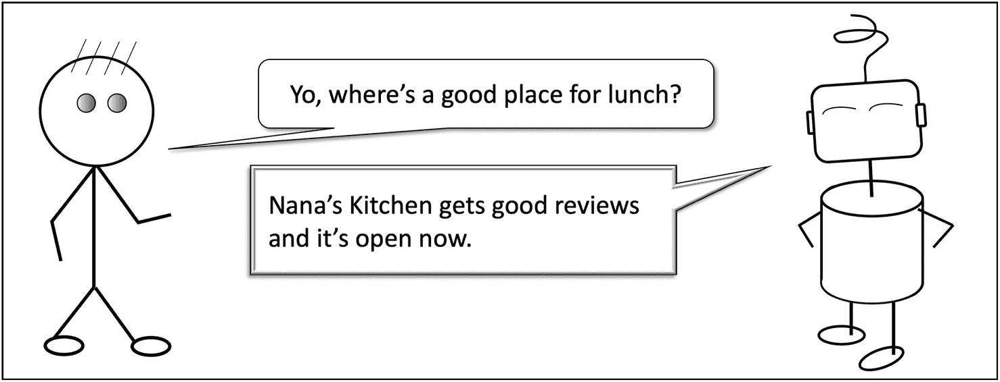

图 2-1：用户与语音助手之间的餐厅查找器示例对话

在阅读本章时，思考其中涉及的细节：

- **地理范围**：它将覆盖哪些地理区域？如果有范围限制，用户如何知晓？如果用户询问一个你未覆盖的地点，会发生什么？你是否假设用户希望匹配他们当前位置附近的餐厅？为什么这样假设或不这样假设？你如何让用户清楚你的假设，如果你的假设错了会发生什么？

- **搜索**：查找餐厅时使用哪些搜索参数？名称、位置、菜系、营业时间、价格范围、特定菜单项……？你向用户展示多少条结果，以及按什么顺序展示？最近、最受欢迎？你何时以及如何澄清你的假设？用户能否覆盖这些假设？他们如何知道？他们能否逐步缩小范围找到结果？

- **信息**：用户能获取哪些信息？位置、营业时间和菜系类型似乎是显而易见的。你如何保持信息更新？餐厅名称的匹配（无论是发音还是确切名称）有多模糊？当用户不被理解时会发生什么？

- **用户信息**：针对每个用户的响应有多定制化？你对用户、他们的偏好、位置以及过去的餐厅访问记录了解多少？你能基于过去的搜索进行构建吗？你是否应该假设他们下次想要类似的东西？同样，用户如何知道有哪些可用信息，如果他们要求你无法提供的东西会发生什么？

### 语音对话及其参与者

语音优先开发需要利用对话双方（人类和计算机）的优势，并最小化其弱点，帮助他们达成目标。成功的对话式语音交互是由那些理解语音模态的设计师和开发者构建的——他们了解可用的技术，并对人们如何通过说话和倾听进行交流感兴趣。就是这样——这就是语音的全部秘诀。剩下的都是细节……当然，魔鬼总是在细节之中。

我们的目标是创建像图 2-2 中那样的交互，它代表了两个需要说话、倾听并理解彼此的参与者之间的对话。

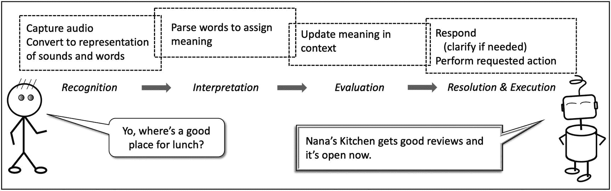

图 2-2：一次人机对话轮次的基本步骤

关键在于，两个对话参与者各自拥有特定且截然不同的优势和劣势。人类一方基于人类的生理和生物学，口语由此发展而来。计算机一方则依赖技术来处理语音输入，并使用合成或录制的语音进行响应。因此，现实情况更像图 2-3 所示。

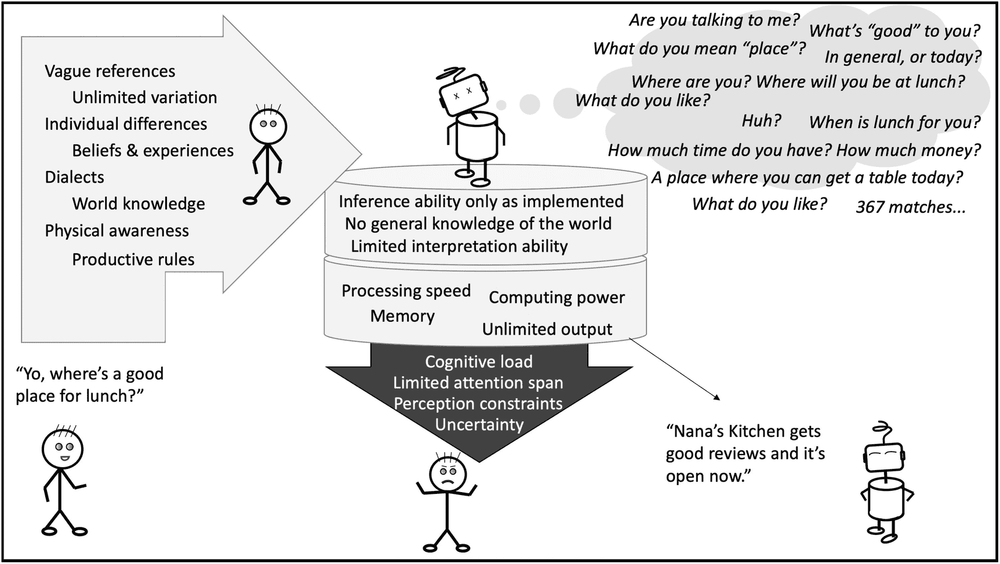

图 2-3：一次人机对话轮次更现实的步骤

要创建成功的语音交互，你需要理解对话背后的原理。那么，让我们来认识一下我们的两位对话参与者——人类和计算机——首先分别了解他们，然后再将他们置于对话的语境中。

#### 人类：口语自然语言

口语自然语言（简称语音）是人类独有的能力。可以说，这是最具人类特征的特质。我们通过语音与他人交流，天生具备听音和发声的能力，这使我们能够本能地创造并理解特定语言中的特定声音和词汇。细节上虽有差异，比如我们掌握的词汇和发出的声音不同，但作为一个物种，所有人类都拥有语音能力。^(¹⁹)

你可能会问，那人工智能机器人、鹦鹉、蜜蜂或猿类呢？它们不也有语言吗？从自然语言的完整定义来看，它们并不具备。它们可以发出人类语言的声音，或对某些口语词汇做出反应，或以其他方式交流，但它们并不具备人类（口语）自然语言的所有特征——那些使其既简单又独特的特征：

- **离散性**：由一组数量有限的独立单元（声音）构成，其形式大多具有任意性（因此不同语言之间存在差异）。

- **规则性**：有一套系统，能将较小的单元组合成较大的单元，而这些较大的单元又能进一步组合，以表示更高层次的复杂性。

- **生成性与无限性**：能够利用规则创造出无限的单元组合，并能创造出前所未闻但易于理解的新组合。

- **时空位移性**：能够表达过去或未来的概念、从未到过的地方、抽象思想、谎言或虚构内容。

## 习得性与社会性

这些特征是普遍的；但一旦某种特定组合确立下来，它就足够固定，可以预测并形成一种特定的语言，这种语言儿童容易习得，成年人也能学会。

让我们看一个例子。想象一下，你如何轻松地将饥饿感加上对时间点的认知，转化为`[午餐时间]`这个概念，然后再将这个概念转化为声音，形成一串词语，比如`想吃点东西吗？` 你的朋友同样轻松地听到你的话，赋予其含义，并根据自己的理解和语境用词语回应，也许是`好啊`（图`2-4`）。

**图 2-4** 语音交互：说话者-听者之间的对话与解决

你刚刚创建并参与了一次语音对话，这是两个参与者之间的一次简短交谈，在这个例子中是你和你的朋友。你发起了对话，你的朋友做出了回应，双方轮流发言，并凭直觉意识到目标已经达成，从而使对话完整结束。很简单，对吧？当我们开始剖析产生和理解甚至这样简短对话所涉及的多个层次和步骤时，你会发现它一点也不简单。

现在，我们先跳过人们如何形成驱动其言语的概念，而是从最基础的部分开始：语音音频信号。^(²⁰)

语音是一种声学波形：由我们的嘴巴和声道做出的动作（或发音）决定的特定频率的空气振动。“get”中的“e”与“food”中的“oo”具有不同的频率。实际上，这些声音在不同说话者和不同词语之间存在无限的变异。即使是同一个人说同一个词，每次的声学特征也不同。你在“food”中听到（或感知到）的“oo”——被标记为音素`[u]`——实际上是一组频率略有不同的声音。

你作为人类，具备对这些听觉信号进行分类的能力，这让你能够将不同说话者和不同词语中的多个`[u]`实例归为一类，并将它们解释为你的语言中同一个有意义的离散声音单元（即音位）的实例，同时忽略其变异，甚至到了完全注意不到的程度（图`2-5`）。

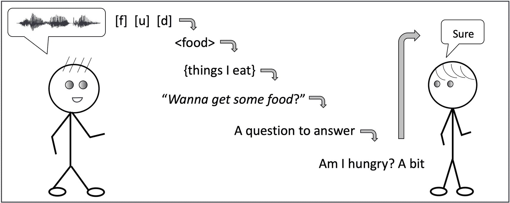

**图 2-5** 语音是一种存在巨大变异的音频流

由于语音是一种波形，它是在时间上以线性序列产生和听到的。它是转瞬即逝的：一旦某句话被说出，无论是否被听到，它都消失了。作为听者，你需要将听到的内容保存在工作记忆中；你不能“倒带”，也不能等到语音停止后再审视整个内容，同时思考如何回应。因此，你会实时解析听到的内容：在语音流持续进行的同时，根据听到的内容创建并更新关于声音、词语和含义的假设（工作理论或猜测）。话语越模糊或越嘈杂，你就需要越长时间保持假设的活跃状态，直到获得足够的信息来确定最可能的匹配。如果你从厨房听到“你想喝点可<噪音>吗？”，你首要的假设可能是“可可”或“咖啡”，也可能是“可乐”或“玉米”。你会根据其他上下文自动为每个假设分配概率。如果你需要知道哪个是正确的，你可能只需要问说话者他们说了什么。但如果他们紧接着说“如果你也想喝，我就现煮一壶”，那么你就可以选择“咖啡”并放弃其他假设。

使用假设来寻找最佳匹配是一个非常重要的概念——正如你将看到的，这是对话中计算机端所使用的方法，尽管计算机可以轻松追踪许多假设，而我们人类的能力非常有限。假设越多，听者的认知负荷就越大。这个重要概念源于认知心理学。它是指某人成功完成某项任务所需的心智努力，特别是将某些内容保存在工作记忆中所需要的努力。它本身并非一个与语音相关的概念；认知负荷适用于所有类型的人类信息处理。但由于语音具有线性和转瞬即逝的特性，它在语音处理中尤其重要。因此，限制认知负荷是语音用户界面（VUI）设计的核心。你将在本书中多次听到这个概念。

当你（下意识地）决定已经听到足够的信息来确认一个假设时，你最终会得出对话语的解释。你的朋友逐渐听到了构成`想吃点东西吗？这次我请客`的声音，并在听到那个令人兴奋的最后一个词之前就知道你在谈论吃饭，并意识到你要买单。

意义不仅通过词语传达，还通过这些词语的说话方式来传达：音高、音高变化幅度、持续时间和响度都承载着关于说话者的信息——他们来自哪里、感觉如何等等。将英语句子的语调从降调改为升调，可以将其含义从陈述或命令（`去拿吃的。`）变为疑问（`去拿吃的？`）。想象一下，当你问`想吃点东西吗？这次我请客，但我忘带钱包了`（图`2-6`）时，你朋友回答`好啊！`的音高，与回答同一个词时的音高有何不同。我们使用这种韵律和语调，通过强调短语中新的或重要的词语，或者通过将较长的信息（如数字）用短暂停顿分成组块，来减轻听者的认知负荷。我们也用它来传达我们对自己所说内容的态度以及我们的整体情绪状态。这意味着我们所说和所听到的一切中都并行堆叠着大量信息！

**图 2-6** 语音交互是共享对世界的理解

词语是符号，让我们即使在事物不在眼前时也能指代它们，这些事物在时间和空间上发生了位移。位移性让我们能够指代不在此时此地的事物、事件和抽象概念，比如`你喜欢我们上周去的那个地方吗？`

# 人类语音沟通

我们将声音组合成单词、将单词组合成短语和句子以传达含义的方式，也存在无穷无尽的变化。其中许多变化是相关的，例如具有不同含义的单词；而另一些变化则与短语的核心含义无关，比如说 `yes` 还是 `yeah`，或者是否存在不流畅现象——那些犹豫、重新开始以及发音中的小卡顿，比如 `um` 和 `er`，作为听者，我们通常非常擅长忽略这些。不流畅是口语区别于书面语的一个方面。

面对所有这些无穷无尽的变化，人们又如何能理解任何事物的含义呢？你可能会想起学校的经历并指出，“Wanna get some food?” 甚至不是“规范的英语”。如果我们像写作那样说话，我们应该说“Do you want to…”或者至少是“Want to…”，但这听起来会异常正式。

我们之所以能够进行交流，是因为我们运用了各种策略和“参与规则”。我们“知道”这些规则；我们很难解释清楚它们，但我们肯定知道它们何时被打破。我们也期望其他对话参与者遵守同样的规则。词语组合的预期含义以及可接受的互动方式，是我们特定文化和语言中学习并与他人共享的内容。

## 沟通的灵活性

### 参与规则

轮流发言就是其中一条规则。双方参与者不能同时说话和倾听而不影响沟通效果，因此他们需要轮流发言，并感知何时该从说话切换到倾听，反之亦然。轮流发言的具体细节取决于对话的目标、参与者之间的关系以及他们共同的文化背景。

另一条规则是保罗·格莱斯的合作原则：对话参与者通常会努力为达成共同目标做出贡献。^(²¹) 当我说 `Can you close the window?` 时，我期望你实际去关上窗户，而不是回答 `Yes, I can` 然后什么都不做。从表面上看，这只是一个简单的是/否问题，因此要做出恰当回应，需要的不仅仅是词汇和语法知识。打破参与规则可能是一种刻意的幽默来源——至于另一位参与者是否觉得好笑，则是另一个问题，它本身也有一套参与规则。你将在后续章节中了解更多关于这条规则及相关规则的内容。

另一个相关的沟通模型是弗里德曼·舒尔茨·冯·图恩的四侧模型。^(²²) 该模型强调，所有信息都有四个侧面：事实、自我表露、关系和诉求。说话者通过这四个侧面过滤每一条信息，但在不同时间侧重点不同。听者则通过相同的过滤器接收信息，但很可能每个侧面的接收程度也不同。

人们通过学习和使用语言以及与其他说话者互动，或多或少地自动学会了这些“规则”。人们也期望他人具备相同的能力，以便能够讨论广泛的话题。这使得语音成为一个基于规则的、富有成效且惊人稳健的系统，它由（对我们而言）有限的单元组成，这些单元可以以无限的方式组合。其结果是一个极其强大的沟通系统——也是一个非常人性化的系统（图 2-7）。

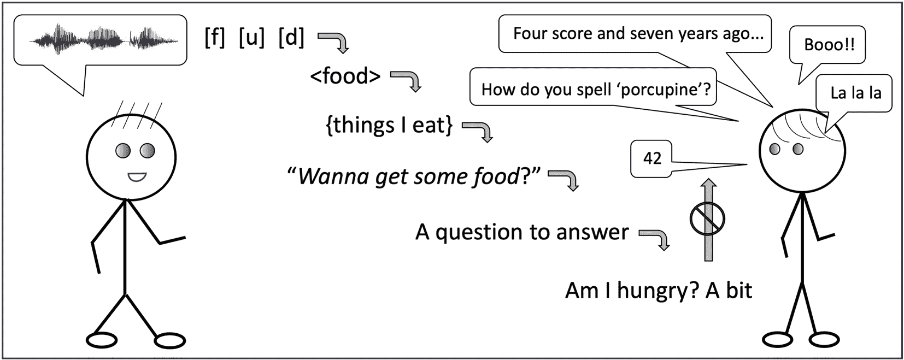

> 图 2-7：语音遵循自然语言的“规则”，例如合作原则

### 清晰与假设

清晰对于被理解显然很重要，但清晰意味着精确。法律文件力求精确以避免歧义，因此篇幅很长。如果我们说话必须像法律文件那样不做出任何假设，对话将永无止境。问题在于，有时假设是错误的。两个人的概念永远不会完全相同，因为心智模型基于过往经验和认知偏差。他们会假设自己的心智模型有多少是与对话伙伴共享的。表述越模糊，听者就越需要要么假设，要么澄清。当你提议去吃午餐时，你的朋友正确地听到了你的话，但如果你对细节表述不清呢？如果你想吃拉面，而你的朋友想吃披萨呢？如果你的朋友理解了你对午餐的想法但不想吃拉面，这次对话还算成功吗？你如何知道哪些内容需要澄清以及需要澄清到何种详细程度？有些假设比其他假设更需要验证。诀窍在于知道哪些是哪些（图 2-8）。

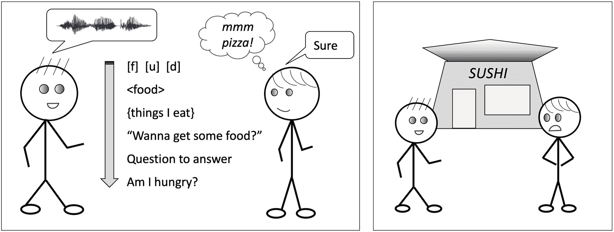

> 图 2-8：语音是共享假设并了解对话伙伴的一些情况

作为听者，我们常常会错过所说内容的一部分。如果对话主题很熟悉，你可能会漏掉一两个词，但仍然能把握整体大意，因此这个过程可以相当稳健。在其他时候，你可能会误解或听到一些模棱两可或含糊不清的内容。如果你的朋友用你完全听不懂的词语回应，对话就失败了：你要么需要再试一次，要么请求澄清，要么放弃。你会使用消歧、澄清、核实和确认等策略来修复错误，并达到一定程度的理解信心水平，这些策略你将从第 7 章开始了解更多。如果你当时问你的朋友 `Wanna get some ramen?`，答案可能就不同了。也许你的朋友当时应该问 `Where’re we going?` 或者 `Can we get pizza?`（图 2-9）。

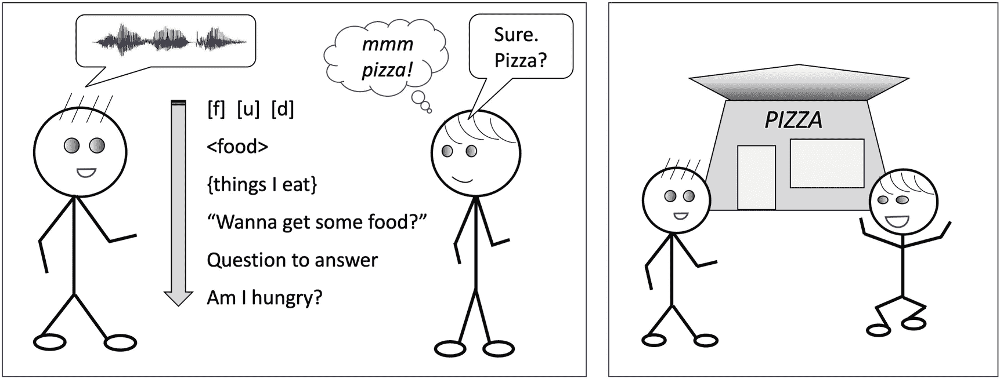

> 图 2-9：语音是澄清歧义以最大程度减少误解并传达共同理解

### 人类沟通总结

进行对话意味着遵循这些潜意识的“规则”：你假设并期望任何说话的人或事物都会以可预测的方式回应和互动，并且他们也期望你如此。你甚至可以在对方毫无察觉的情况下影响他们说话的方式；如果你说话声音更大或更快，你的听者也会如此。试试看。人们在与技术对话时，会本能地应用相同的对话规则和社会期望——即使知道对话对象是机器。这意味着，当对话发生在人类和语音助手之间时，同样的策略也适用。这正是语音用户界面设计成为可能的原因。

总结人类对话参与者的特征，人类语音沟通的优势在于它几乎是无限的，但又基于规则，并由少量既定单元构成。人类听者面临的挑战在于将信息保存在记忆中以进行解读并据此行动所带来的认知负荷。人们依赖各种策略来避免或修复误解；我们想当然地认为，他人能够理解我们那些模糊和含混的表达。考虑到所涉及的所有步骤，我们竟然能够相互沟通，这真是太神奇了！

## 计算机：语音识别与理解

计算机是如何做到的呢？这听起来很棘手，但别担心！我们正是为此提供帮助的。理解人们如何说话和倾听，就成功了一半。在解释了对话中计算机端的基础知识之后，我们将在本书的剩余部分向你展示如何成功地将所有要素整合在一起。你会看到，利用当今已有的方法和工具，你就能实现巨大的语音应用改进——无需发明新东西。

在第 1 章中，你已经了解了语音系统的组成部分。现在让我们深入探讨这些组件，以理解为什么某些方面比其他方面更具挑战性。计算机如何完成人类所做的事情？就像人类既能说话也能倾听一样，计算机也是如此。但计算机必须被“教会”人类所掌握的一切，包括如何处理模糊或歧义的表达。事实上，你的大部分工作将致力于减少和处理错误结果。与人类一样，计算机需要策略来最小化识别错误和理解错误；需要确认、纠正和验证；还需要解决歧义。它们不需要使用与人类相同的底层策略——也不会使用，因为它们的构建方式不同——但从人类的角度来看，最终结果必须相同，甚至更好。因此，计算机的技巧在于处理人类输入时发挥其优势。

在最高层面上，计算机有两项任务：第一，捕获用户的语音并将其转化为文字和含义；第二，以有意义且恰当的方式回应用户，可以是口头回应、某种行动，或两者兼有。让我们重新审视第 1 章中介绍的语音系统（图 2-10），并展开一些细节；重叠方框的原因很快就会明了。这两项核心任务可以进一步细分为以下五个步骤，在图中编号为 1-5：

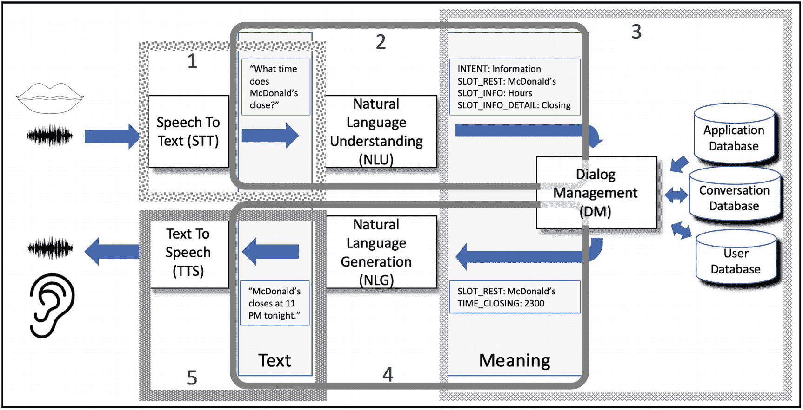

> 图 2-10：语音优先系统扩展后的详细说明

1.  **识别**：通过自动语音识别（ASR）捕获语音，并将波形信号频率转换为可用于将该信号映射为音素的格式。
2.  **理解**：使用模式匹配和规则方法，将识别出的音素映射为文本（单词和短语）。
3.  **意图评估**：使用规则匹配方法，将文本结果与其（希望是）预期的含义表示进行映射。
4.  **意图解析与执行**：尝试通过适当的行动或回应来满足已理解的请求。
5.  **计算机语音回应**：包含两个核心方面：内容（所选词汇、详细程度等）及其传递方式（录制语音与合成语音、情感语调、语音性别等）。

当你的用户询问“哪里有好吃的？”时，识别的第一部分捕获模拟波形并将其转换为数字表示（图 2-11 中的 A）。这是通过以非常频繁的固定间隔测量或采样波形来完成的。识别器使用**声学模型**将数字表示映射到特定的音素（B）。最好的声学模型是使用各种算法和方法在大量语音数据上训练出来的。语言模型（LM）通过将音素字符串映射到最接近的单词和文本字符串来解释它（C）。相互竞争的映射会有一个相关的可能性或置信度分数，该分数取决于上下文和其他因素（D）。置信度分数可用于从众多映射中选出最可能的一个，解析也是如此。当你在手机上口述消息却得到错误的文本结果时，置信度的正确分配往往是失败的原因。置信度用于一些强大的技术，我们稍后会向你展示。获胜的假设会根据语法和/或统计模型进行评估，这些模型将文本映射到意图，即其含义的表示（E）。此时，通常认为的识别和意图映射已经完成，但用户尚未从中获得任何东西。最后一步是基于上下文生成适当的回应，并提供所请求的内容或信息（F）。

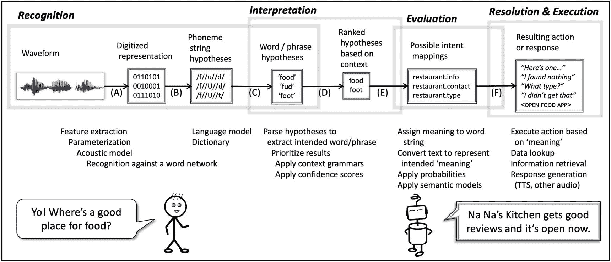

图 2-11

## 计算机理解并回应短语的详细过程

每一步都可能出现问题。如果计算机在过程早期就选错了假设，一个人类很容易忽略的小错误可能会像滚雪球一样扩大，以至于在过程结束时，结果变得毫无意义，这种情况在人类对话中永远不会发生。背景噪音和其他声音尤其成问题。如第 1 章所述，近年来识别性能有了很大提升，但并非完美，你在手机上口述时很容易就能发现这一点。大声说出任何句子；你会意识到你并不是孤立地说出单词，而是作为一个连续的字符串，声音混合在一起，一个单词流入下一个单词，并影响其发音方式。如果你犹豫、重新开始或在某个单词上打嗝，生成的转录很可能不是你想要的。如果一个声音处于两个音素模式匹配的边缘，而意外的匹配获胜，就可能导致错误的单词边界，最终将`engulfing them all`理解为`and golf in the mall`。解析成单词很难；为这些单词赋予预期的含义可能更难。即使识别性能出色，如果文本到意图的映射不够稳健，意图解析步骤也会失败。

### 意图评估、解析与执行

你可能主要处理步骤 3 和 4（意图评估、解析与执行）。这些步骤是你为每个用户请求指定应发生什么的地方。在 Alexa 或 Google Assistant 等平台内工作与在原生解决方案中工作的主要区别在于，平台提供了一个黑盒子的便利，为你处理许多细节，特别是涉及从步骤 2 到步骤 3 的过渡。为了这种便利，你放弃了在更早步骤中访问和影响结果的好处，稍后你会看到这一点。

### 模式匹配与假设跟踪

关于计算机如何处理语音，首先要理解的是，这一切都关乎模式匹配，并在每一步从众多可能的假设中选出最佳假设。识别器的目标是找到最佳答案，即与其所知内容的最佳匹配——可以将其想象为一组磁铁，试图抓住抛向它们的东西。识别器会创建许多假设，这些假设会随着每一段新声音的输入而更新。每个新的声音片段都提供了额外信息，影响所有活跃假设的概率（每块磁铁的强度）。在语音开始时，需要保持大量假设活跃，因为后续信息可能会将理解的尺度倾向另一个音素、另一个单词等。上下文有助于人类和计算机减少潜在的假设，并发生在语音的各个层面：对对话参与者的预期、对话主题及其相关术语的知识、语法结构、前面的单词和声音等。虽然上下文被对话双方使用，但认知负荷显然不是计算机关心的问题。它可以在捕获和分析额外语音输入的同时，并行保持许多假设。

并行跟踪多个假设使得 ASR 成为可能。上下文和约束减少了可能的匹配数量，逐渐使一个假设浮出水面。当用户语音结束时，得分最高的语音假设获胜。通常，会有一个获胜者的得分明显高于其他假设。有时，这个最高得分并不高，或者只是略高于其他假设。这意味着计算机对最佳结果的准确性不太有信心。此时，计算机会根据设置和预定标准做出决定。

- 如果置信度低于某个选定的阈值，则拒绝该模式。如果原本应该选择该假设，则属于错误拒绝；如果拒绝是正确的做法，则属于正确拒绝。

- 如果置信度高于阈值，则接受该模式。如果它是“错误答案”，则属于错误接受；如果它与用户的预期话语匹配，则属于正确接受。

显然，任何“错误”的结果都应避免，并在发生时进行处理。您将在第 10、12 和 13 章中了解更多关于如何处理这些情况的内容。

### 成功提示 2.2 设定合理的期望

设定合理的期望对于 VUI 的成功至关重要。这意味着要向用户阐明您的实现对于某个主题具备何种程度的知识。这并非易事。在 VUI 内部，您依赖于 VUI 所说内容的措辞。在 IVR 中，VUI 通常以菜单或带有说明性示例的开放式问题开始。VUI 越通用，难度就越大，但可以在无法完成某些操作时的响应中传达大量信息。您将在第 12 和 13 章中了解这一点。在 VUI 交互之外，这涉及营销、销售和资源材料。广泛的信息检索从一开始就是谷歌的核心；Alexa 最初的关注范围则更有针对性，例如播放音乐和天气等少数信息领域。用户不一定知道这一点。他们只知道一个助手能回答而另一个不能。您会看到博客文章和文章将不同的助手相互比较，比较哪个“更聪明”。请务必阅读这些以及您遇到的任何其他与语音相关的内容。从中学习，但明智的做法是对任何结论持保留态度。

并非所有事情对可怜的计算机来说都很难。方言可能并不像您想象的那么具有挑战性。^(²³) 在内存中保存信息或生成一长串假设对计算机来说显然不是挑战。相反，挑战在于以一种人类易于理解的方式呈现这些信息。

总结一下语音对话中计算机方面的情况，其优势在于大规模并行计算，有助于确定将声音映射到单词或短语的特定假设。但它有时仍会灾难性地失败。其弱点包括必须被教导在充满变化、模糊性的信号中理解“一切”的意图，以及需要某种程度的推理或推断的更广泛的世界知识。

## 人机语音对话

那么，您现在已准备好开始创建两个具有截然不同优势和劣势的参与者之间的对话。为语音进行开发意味着平衡这些优势和劣势：如果您按照人类的期望和限制来构建，您的用户将会成功并留下来。要做到这一点，请记住，语音交互完全关乎声音，即使有辅助的视觉支持。表 2-1 总结了我们刚刚讨论的人类和计算机的特征，比较了各自的优势和劣势。我们在本章前面的午餐示例中涵盖了所有这些特征，前五个是人类语言的特征，后两个是任何音频流的特征。

**表 2-1** 人类与计算机对语音产生特征感知的比较

| 语音产生特征 | 人类的感知挑战 | 计算机的感知实现挑战 |
| --- | --- | --- |
| 离散性 | 极小 | 巨大 |
| 基于规则 | 极小 | 巨大 |
| 生产性与无限性 | 极小 | 巨大 |
| 置换性 | 极小 | 巨大 |
| 习得性与社会性 | 一些 | 巨大 |
| 线性与顺序性 | 巨大 | 极小 |
| 短暂性 | 巨大 | 极小 |

您之前了解到，人类与技术的所有互动本质上都是社交互动，语音更是如此。人们对任何支持语音的设备的期望直接影响他们如何与 VUI 设备对话。计算机响应的每个方面都会设定关于其能力的期望，并影响用户将如何与之交互。当您与技术对话时，您会应用相同的对话规则，即使您知道它不是一个人。这就是语音的魅力——也是诅咒：每个人“都知道如何进行对话”。如果您希望您的语音交互无处不在且表现良好，您就不需要向用户解释如何与您的语音助手对话。任何属于目标用户群体的人，都应该能够凭借其固有的知识成功使用，而无需特殊培训。

这使得语音不同于其他技术和模式，并将责任放在您（作为开发者）身上，要求您充分了解人们如何进行对话，以帮助他们成功。很少有事情比系统无法兑现承诺更让语音技术用户感到沮丧。我们多年来在行业中的自身经验强调，与语音设备的头几次交互将决定用户愿意继续使用语音并信任它的程度。早期的成功至关重要。当然，随着时间的推移，一些用户会调整他们所说的话以便被理解，变得更“像计算机”——`合作原则`预测了这一点。但其他用户在此之前就会放弃尝试，因为他们无法得到他们要求的东西。如果用户需要改变才能成功，那么对话将仍然受限。只有当允许人们像人一样说话时，语音交互才能真正变得无处不在。当用户面对新的语音情境时，他们会依赖与人交谈时的期望，遵循人类对话的参与规则，正是因为语音如此“人性化”。他们会根据语音助手说了什么以及如何说的来做出假设并做出回应。作为听众，我们甚至会对说话者是谁产生相似的情感反应和判断。这似乎是无法避免的。

### 成功提示 2.3 让用户早期获得成功

成功的早期互动能提高用户满意度和持续使用的可能性。旨在通过包含一两个非常简单且稳健的交互，让用户的首次语音交互获得成功。

好消息是，您越了解人们如何自然地说话和倾听，就越能通过为每种情境设计和实现正确的行为来避免灾难性的失败。

当你为语音进行开发时，需要意识到，只要语音用户界面（VUI）在监听，人们随时可能说出任何内容。这是图形用户界面（GUI）与听觉型 VUI 之间最大的区别之一：即使你明确告诉用户`说“是”或“否”`，他们也可能出于合理原因说出其他内容，比如`“也许”`。或者他们会用你意想不到的词语回应，比如`“好嘞”`或`“当然啦”`。又或者他们在回应前会咳嗽或犹豫。如果这些声音被 VUI 作为输入捕获，你必须要么做出回应，要么在确定是无意噪音时找到忽略它的方法。如果用户说的是合理的内容，你不能简单地要求他们换用其他词语。

然而，这一点很重要：虽然从技术上讲你确实无法限制人们说什么，但根据`合作原则`，人们也的确希望沟通并成功完成任务。人们在**如何**表达、语音质量、发音以及用词上存在巨大差异——正如你在本章所学，变异是人类语言的一部分。但人们**说什么**通常比你想象中更具可预测性。绝大多数用户会停留在某个领域和任务的预期范围内——这也是语言的一部分。有些人会试图捉弄你的 VUI，在订披萨的过程中突然说些题外话，比如`“谁赢了最近的 F1 比赛？”`。好吧。如果这不是你的核心用例，就不应成为你的关注点。不要试图处理每一种变异，尤其是在起步阶段。只需专注于根据任务或领域预测预期变异，最大化识别准确率，并正确解读领域内话语的含义。

### 成功技巧 2.4 措辞直接影响用户的回应方式

在进行语音开发时，始终从自问“两个人在类似对话中如何交流”开始。预测回应、使用的词语、对话的下一步、可能产生困惑的地方等。以此为基础设计你的 VUI 对话。使其清晰易懂。你通过 VUI 提示语的措辞和表达方式影响用户的回应。你的 VUI 对话越清晰，用户的回应就越可预测——每个人也就越成功。

GUI 与 VUI 的差异总结在表 2-2 中。我们还将文本机器人纳入此比较。移动应用机器人兼具 GUI 和 VUI 的相似之处：由于是视觉化的，它们不像语音那样转瞬即逝；由于输入是书面语言，它们可以像语音一样使用不受约束的语言。

## 表 2-2：视觉界面与语音界面的差异

| `GUI`/视觉界面 | 机器人/视觉语言 | `VUI`/音频语言 |
| :--- | :--- | :--- |
| 用户输入大多是**受约束的**（点击、轻触、输入）。 | 用户输入可以是受约束的（轻触）或不受约束的（打字）。 | 用户输入**无法被约束**（可以说任何内容）。 |
| 信息**持续存在**，直到用户离开（文本、图像）。 | 信息持续存在，直到用户离开（文本）。 | 信息**转瞬即逝**，用户无法控制信息流（音频）。 |
| 信息**并行**呈现（整个屏幕或页面）。 | 信息线性呈现（一次一个字符）。 | 信息**线性**呈现（一次一个声音）。 |
| 与人类沟通的等价性有限（基于与物理对象的相似性产生预期）。 | 与人类沟通有熟悉的等价性（基于与短信的相似性产生预期）。 | 与根深蒂固的**社会**行为高度相似（基于与人类语言的相似性产生预期）。 |

### 多模态角落

人类处理视觉信息与音频/语音信息的基本差异提醒我们，即使处理的是词语，书面语言和口语也截然不同。这就是为什么用语音改造视觉界面效果不佳：它既没有利用人们自然说话的方式，也没有考虑用户聆听和处理信息的挑战——因此需要优先考虑语音设计。这也是为什么从语音列表中选择很棘手。轻触屏幕很容易，但想象一下图 2-12 中的对话：可怜的用户将很难记住所有选项以便做出选择。在语音中呈现选项列表是可行的，但你需要知道如何呈现选项以及如何处理回应。在屏幕上从结果中选择显然认知负荷更低；这与用语音提出复杂请求（而非打字或导航）的较低认知负荷相得益彰。只需记住，对于大多数用例，你需要设计出既适用于用户能看到并触摸屏幕时，也适用于他们无法看到屏幕时的语音提示。如果用户输入是语音，通常可以假设音频输出是可接受的。

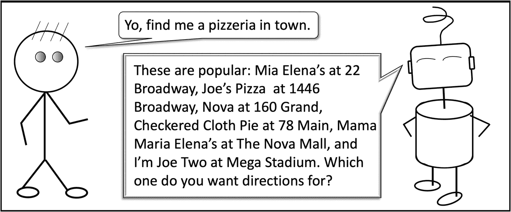

**图 2-12** 对于通过听觉而非视觉获取的列表，认知负荷很高

## 成功技巧 2.5：VUI 关乎声音，因此要用声音来评估

通过文字看到信息与仅通过听觉接收相同信息是不同的。在规划任何语音交互时，务必通过向他人大声朗读来进行合理性检查，观察他们在哪里犹豫以及如何回应，尤其是当他们说出你意料之外的内容时。

现在你理解了，当 VUI 设备需要准确处理单个用户话语时所涉及的复杂性。在典型的对话中，存在来回互动，每一轮都建立在前一轮所说和理解的内容之上（图 2-13）。这意味着需要追踪更多上下文，以避免每一步出现误解。成对的对话轮次有时被称为**相邻对**。它们很重要，因为它们限制了你在第二轮中需要处理的变异。你将在本书中看到更多关于话轮转换的内容。

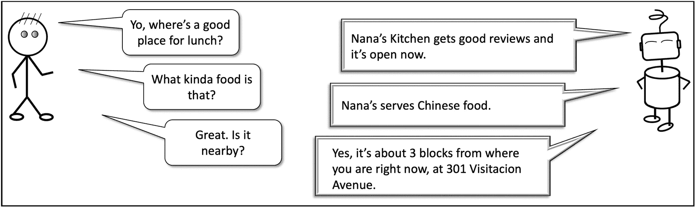

**图 2-13** 对话包含多个轮次，每一轮都建立在前一轮的基础上

很好！你的语音 UI 已将用户话语映射到某种含义。但工作尚未完成——直到你做出回应或满足用户请求。如果用户要求听某首歌的特定版本，但音乐服务提供商与该艺术家没有协议，你可能只能回应一句*“抱歉，我无法处理这个请求”*。还记得本章开头那个例子吗？当用户说“播放《Let It Be》”时，结果却听到了“Let It Be Love”？这是因为搜索使用了模糊匹配，并且偏向于包含后者而非前者的音乐库。这种方法本身没有错，但细节决定成败。你可能实现了完美的识别，并为用户话语赋予了正确的含义，但仍然因为无法执行命令而失败。用户只会注意到他们没有获得想要的东西；他们不知道哪里出了问题。这是当今语音助手最容易被忽视的方面之一，并且不容易妥善解决。这就是**语音的三条腿凳子**（图 2-14）：用户只知道他们从凳子上摔了下来；他们不知道也不关心原因，或者哪条腿断了。

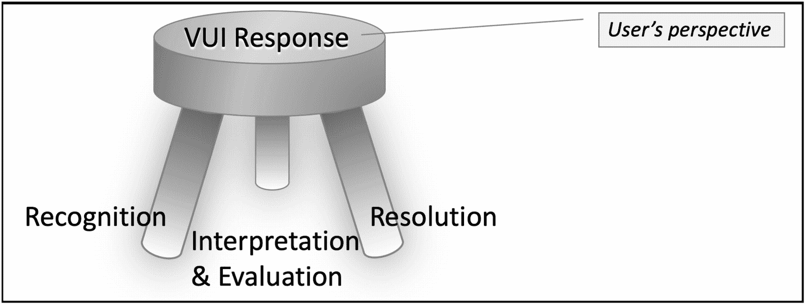

**图 2-14** 语音的三条腿凳子

## 成功技巧 2.6：不要承诺无法实现的语音用户界面

如果用户得不到他们想要的东西，他们不会关心哪里出了问题。要在真实用户环境中，遵循实际的生产限制，将交互推进到“真正”的终点。与其增加运行不佳或未经测试的新功能，不如专注于把少数事情做好。尽可能提供解释；如果用户感到被理解，他们会更宽容你无法满足他们的要求，这一点与人类交往类似。

对人类来说天生容易的事情对计算机来说却很困难，反之亦然。这就是你作为语音开发者面临的挑战：在平衡用户对人类语音对话的期望与技术限制的同时，还要平衡人类的认知局限与技术优势，如表 2-3 所示。方便的是，第三列是对语音设计与实现核心原则的简明总结。

**表 2-3** 语音的挑战与核心设计原则

| 语音是…… | ……这对……构成挑战 | ……因此请运用核心 VUI 设计原则来…… |
| :--- | :--- | :--- |
| 线性且转瞬即逝 | 用户，由于认知负荷 | 平衡清晰度与效率 |
| 无限多样 | 识别与理解，由于变化性 | 通过覆盖范围最大化准确性与鲁棒性，以避免错误并支持优雅恢复 |
| 具有社交性 | 生成与理解，由于缺乏对世界的认知模型 | 融入预期的对话策略、上下文以及用户与领域知识，以支持自然的对话式交互 |

## 下一步是什么？

在继续之前，请再看一眼表 2-3。语音优先开发的每一个方面都源于这张表的内容。可以说，整本书都聚焦于此，无论是解决歧义的策略、处理回指、应对变化、理解措辞如何影响响应、选择何时以及如何确认，甚至知道何时停止尝试理解用户。

当然，人类理解语音的能力也并非无限。你的牙医可能无法帮你调试代码，或弄清楚为什么你的烤箱打不开。他们不会提出正确的问题来分析问题，但你也不会期望他们这样做。思考一下如何为语音应用设定场景，让用户凭直觉知道他们能做什么、不能做什么。

如果你是一名开发者，你不需要自己成为 VUI 设计师，但你需要理解语音的特性，以便专注于重要的事情。你已经走在正确的路上了！无论你的角色是什么，我们推荐阅读 Nass 和 Brave 合著的 *Wired for Speech*——这本书信息丰富且非常有趣。如果你想深入探究语音和语言中声音的细节，可以寻找涵盖声学、发音或听觉语音学、感知与生成的书籍。若想了解语言处理背后的认知原理，请查阅 Jeff Johnson 的 *Designing with the Mind in Mind*。如果你对人类言语中的意义层次感兴趣，可以寻找关于话语、言语行为、话轮转换和会话分析（包括相邻对）的书籍和文章。

在第 3 章中，你将开始深入实现，首先从搭建你的语音开发环境开始。魔鬼总在细节中，而在语音领域，你将花费大量精力处理这些细节。语音用户的要求很高——恰恰因为它是语音。好消息是，通过理解人们使用语音时哪些事情容易、哪些具有挑战性，你已经领先于那些仅仅因为工具易用就盲目构建的人。你将具备开发出用户能够成功交互的产品所需的条件。成功的用户就是快乐的用户。那么，让我们开始帮助用户走向成功吧！

## 总结

*   语音具有与视觉和触觉模态截然不同的特性：它转瞬即逝、线性且无限多样。为语音进行设计与开发必须迎合这些特性。
*   VUI 是两个具有不同优势与劣势的参与者之间的对话。成功的 VUI 通过应用核心 VUI 原则，建立在双方优势之上。
*   用户无法被约束；他们能够也将会说出任何话。你的 VUI 需要以符合用户期望的方式进行引导、预测和响应。
*   人类对话建立在话语中未明确表达的信息和假设之上。这些指代、世界知识、上下文以及对过去和未来交互的引用，也需要由计算机来处理。
*   为了使对话成功，VUI 必须正确识别用户说出的词语，正确理解其含义，并要么给出用户期望的结果，要么提供无法做到的原因。

