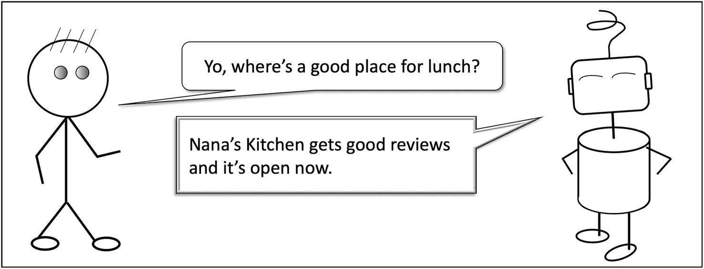
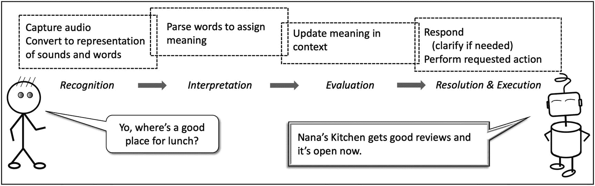
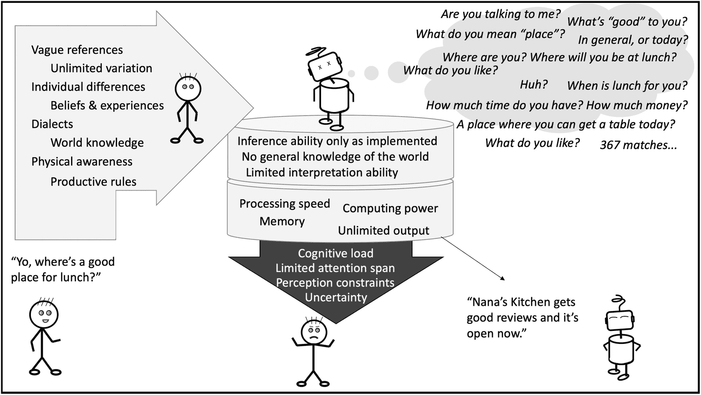
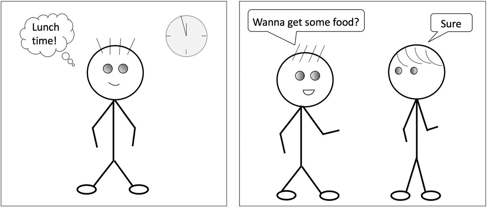
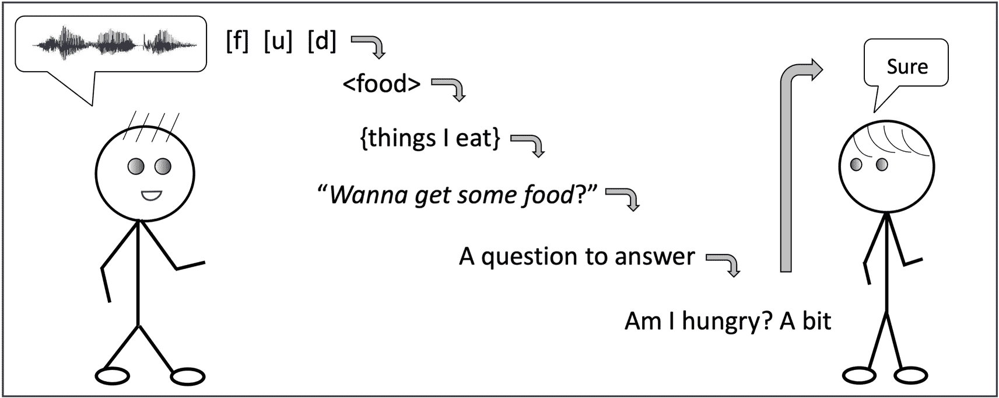

# 2. 将语音牢记于心

多年来，我们发现，那些创建最成功语音交互的人，既理解底层技术，也理解人们如何使用口语。在这些主题上打下坚实基础，有助于你在设计和构建语音系统的每一步中，从众多可能选项中进行选择。用鲍尔和西里洛的话来说^(¹⁷)：“现代文明要求人们习得并使用语言。我们必须了解它是如何运作的。”

本章首先概述语音作为一种模态——一种具有自身特定特征的交互模式。你将了解语音与其他模态的不同之处，以及为什么这对用户体验和你所创建产品的最终成功至关重要。你将认识语音优先对话中的两个参与者——“人类”和“计算机”，并了解它们各自如何说话和倾听。由此，你将理解对各自而言什么是容易的、什么是具有挑战性的，以及为什么它们对两者来说是不同的。然后，你将学习核心的 VUI 原则，这些原则将成为你今后构建每一个语音优先交互的指路明灯。

## 为什么语音与众不同

创建成功的对话式语音交互的秘诀在于理解语音。你可能会想，这有什么大不了的，或者它与开发 GUI 或基于文本的聊天机器人有何不同。难道`Alexa`不应该为你处理这些细节吗？如果有人不得不向`Google Assistant`重复两次才能得到答案，这真的很重要吗？如果`Cortana`或`Bixby`几乎正确地处理了一个请求，难道这还不够好吗？诚然，这些语音助手为你处理了很多事情，但绝非全部。即使在简单的语音交互中，也很容易因为某些问题而从用户的角度导致对话失败。你多久会向`Siri`口述一次，结果却得到一个发音相似但在上下文中完全无意义的词？不要气馁：经验丰富的语音设计师和开发者自己也会犯错。这很复杂。当被要求播放“Let It Be”时，我们的一台家用语音助手回应道：“正在播放‘Let It Be Love’”，这是一首好听的曲子，但并非期望的披头士歌曲。作为用户，我没有得到我想要的，尽管这个请求对人类听众来说是直截了当的。

语音关乎声音——制造声音、处理声音和解释声音。音频信号是短暂且多变的，由不同的声音产生，并且在一种共享语言中几乎是无限的。大量信息必须通过非常狭窄的声音流来传达，同时依赖听者的工作记忆。误解的风险始终存在。所有这些都使其立即与其他模态区分开来，正如你将在本章后面看到的那样。

语音是一种模态：一种利用我们的感官将信息编码以供人类消费的方式。书面文本、图像和标志是视觉的；语音、噪音和音乐是听觉的。对我们人类来说，处理不同模态信息的方式存在巨大差异：我们如何理解阅读的内容与我们如何理解听到的信息。这种差异是语音设计和开发与视觉或触觉界面截然不同的所有原因背后的根源。多模态界面结合了多种模态，以提供可能更丰富的体验。

如果你是从 GUI 或基于 Web 的背景进入语音世界，你自然会把你对视觉界面的了解应用到听觉界面上。许多基本原则是相通的，但如何最好地实现它们却因模态而异。正如第 1 章所介绍的，语音优先意味着开发一种适合语音模态的用户界面，而不受限于更适合其他模态的框架。到本章结束时，你将理解为什么以及如何这一点很重要。

你会听到“对话式”这个术语既应用于基于文本的聊天机器人交互，也应用于语音交互。与其他图形界面相比，两者都具有开放式的特点，但由于处理方式的不同，它们并不相同。对话式交互意味着两个参与者之间的来回或轮流交互。它意味着一种非正式的、自然语言的、词汇广泛的交互，但也可能遵循某种模式而更加正式。它可以是简短的一轮或两轮交互，也可以是更长的多轮交互。轮次越多，对话性越强。我们不认为听写是对话式的，因为它具有单向性。

本书聚焦于有目标的自然语言对话式（按我们的定义）语音优先交互：用户试图执行某些任务的对话。示例包括预订航班、请求播放特定歌曲、设置定时器、在账户间转账、开灯、切换电视频道、信息查询等。这是当今语音的核心用例。它也是任何更复杂交互所需的来回轮流的基础^(¹⁸)。

如果语音助手无法理解用户，用户就必须重新尝试。这会是世界末日吗？不，但这会令人恼火地浪费精力，导致用户不满并缺乏信任。他们会收到不准确的信息，并抱怨自己不被理解。最终他们会停止使用，甚至公开嘲笑它，导致负面公关。更糟的是，如果金融交易被误解，用户可能会蒙受经济损失，影响每个人的财务底线。显然，你宁愿从一开始就避免所有这些问题，而不是事后补救。随着用户对语音越来越熟悉，他们期望从语音用户界面（VUI）中获得更复杂的“智能”行为。

### 成功技巧 2.1：练习分析语音对话

感受 VUI 好坏的最佳、最快且最廉价的方法之一，就是亲自体验它——并且有意识地去体验。练习分析和思考语音。尽可能多地寻找语音系统，按预期方式使用它们，并做笔记。你得到了预期的答案或结果吗？细节程度、语气、速度和准确性如何？你信任这个结果吗？为什么信任或不信任？如果你重新表述一个请求，会发生什么？它在什么时候会失败？如果你尝试说一些无意义的话呢？你能做什么、能说什么，这一点是否清晰？重要的是，你为什么会这么想？针对你的使用场景和情况，有哪些可以改进的地方？改变你的环境，思考其他用途。这会改变情况吗？在扩展到观察其他用户之前，先开始练习分析自己的反应——他们的反应会有所不同。

### 动手实践：编码前的思维实验

在第 3 章中，你将搭建并运行你的第一个功能性对话式语音应用：一个简单的餐厅查找器版本，可能类似于图 2-1。

图 2-1：用户与语音助手之间的餐厅查找器示例对话

在阅读本章时，思考其中涉及的细节：

- **地理范围**：它将覆盖哪些地理区域？如果有范围限制，用户如何知晓？如果用户询问一个你未覆盖的地点，会发生什么？你是否假设用户希望匹配他们当前位置附近的餐厅？为什么这样假设或不这样假设？你如何让用户清楚你的假设，如果你的假设错了会发生什么？

- **搜索**：查找餐厅时使用哪些搜索参数？名称、位置、菜系、营业时间、价格范围、特定菜单项……？你向用户展示多少条结果，以及按什么顺序展示？最近、最受欢迎？你何时以及如何澄清你的假设？用户能否覆盖这些假设？他们如何知道？他们能否逐步缩小范围找到结果？

- **信息**：用户能获取哪些信息？位置、营业时间和菜系类型似乎是显而易见的。你如何保持信息更新？餐厅名称的匹配（无论是发音还是确切名称）有多模糊？当用户不被理解时会发生什么？

- **用户信息**：针对每个用户的响应有多定制化？你对用户、他们的偏好、位置以及过去的餐厅访问记录了解多少？你能基于过去的搜索进行构建吗？你是否应该假设他们下次想要类似的东西？同样，用户如何知道有哪些可用信息，如果他们要求你无法提供的东西会发生什么？

### 语音对话及其参与者

语音优先开发需要利用对话双方（人类和计算机）的优势，并最小化其弱点，帮助他们达成目标。成功的对话式语音交互是由那些理解语音模态的设计师和开发者构建的——他们了解可用的技术，并对人们如何通过说话和倾听进行交流感兴趣。就是这样——这就是语音的全部秘诀。剩下的都是细节……当然，魔鬼总是在细节之中。

我们的目标是创建像图 2-2 中那样的交互，它代表了两个需要说话、倾听并理解彼此的参与者之间的对话。

图 2-2：一次人机对话轮次的基本步骤

关键在于，两个对话参与者各自拥有特定且截然不同的优势和劣势。人类一方基于人类的生理和生物学，口语由此发展而来。计算机一方则依赖技术来处理语音输入，并使用合成或录制的语音进行响应。因此，现实情况更像图 2-3 所示。

图 2-3：一次人机对话轮次更现实的步骤

要创建成功的语音交互，你需要理解对话背后的原理。那么，让我们来认识一下我们的两位对话参与者——人类和计算机——首先分别了解他们，然后再将他们置于对话的语境中。

#### 人类：口语自然语言

口语自然语言（简称语音）是人类独有的能力。可以说，这是最具人类特征的特质。我们通过语音与他人交流，天生具备听音和发声的能力，这使我们能够本能地创造并理解特定语言中的特定声音和词汇。细节上虽有差异，比如我们掌握的词汇和发出的声音不同，但作为一个物种，所有人类都拥有语音能力。^(¹⁹)

你可能会问，那人工智能机器人、鹦鹉、蜜蜂或猿类呢？它们不也有语言吗？从自然语言的完整定义来看，它们并不具备。它们可以发出人类语言的声音，或对某些口语词汇做出反应，或以其他方式交流，但它们并不具备人类（口语）自然语言的所有特征——那些使其既简单又独特的特征：

- **离散性**：由一组数量有限的独立单元（声音）构成，其形式大多具有任意性（因此不同语言之间存在差异）。

- **规则性**：有一套系统，能将较小的单元组合成较大的单元，而这些较大的单元又能进一步组合，以表示更高层次的复杂性。

- **生成性与无限性**：能够利用规则创造出无限的单元组合，并能创造出前所未闻但易于理解的新组合。

- **时空位移性**：能够表达过去或未来的概念、从未到过的地方、抽象思想、谎言或虚构内容。

## 习得性与社会性

这些特征是普遍的；但一旦某种特定组合确立下来，它就足够固定，可以预测并形成一种特定的语言，这种语言儿童容易习得，成年人也能学会。

让我们看一个例子。想象一下，你如何轻松地将饥饿感加上对时间点的认知，转化为`[午餐时间]`这个概念，然后再将这个概念转化为声音，形成一串词语，比如`想吃点东西吗？` 你的朋友同样轻松地听到你的话，赋予其含义，并根据自己的理解和语境用词语回应，也许是`好啊`（图`2-4`）。

**图 2-4** 语音交互：说话者-听者之间的对话与解决

你刚刚创建并参与了一次语音对话，这是两个参与者之间的一次简短交谈，在这个例子中是你和你的朋友。你发起了对话，你的朋友做出了回应，双方轮流发言，并凭直觉意识到目标已经达成，从而使对话完整结束。很简单，对吧？当我们开始剖析产生和理解甚至这样简短对话所涉及的多个层次和步骤时，你会发现它一点也不简单。

现在，我们先跳过人们如何形成驱动其言语的概念，而是从最基础的部分开始：语音音频信号。^(²⁰)

语音是一种声学波形：由我们的嘴巴和声道做出的动作（或发音）决定的特定频率的空气振动。“get”中的“e”与“food”中的“oo”具有不同的频率。实际上，这些声音在不同说话者和不同词语之间存在无限的变异。即使是同一个人说同一个词，每次的声学特征也不同。你在“food”中听到（或感知到）的“oo”——被标记为音素`[u]`——实际上是一组频率略有不同的声音。

你作为人类，具备对这些听觉信号进行分类的能力，这让你能够将不同说话者和不同词语中的多个`[u]`实例归为一类，并将它们解释为你的语言中同一个有意义的离散声音单元（即音位）的实例，同时忽略其变异，甚至到了完全注意不到的程度（图`2-5`）。

**图 2-5** 语音是一种存在巨大变异的音频流

由于语音是一种波形，它是在时间上以线性序列产生和听到的。它是转瞬即逝的：一旦某句话被说出，无论是否被听到，它都消失了。作为听者，你需要将听到的内容保存在工作记忆中；你不能“倒带”，也不能等到语音停止后再审视整个内容，同时思考如何回应。因此，你会实时解析听到的内容：在语音流持续进行的同时，根据听到的内容创建并更新关于声音、词语和含义的假设（工作理论或猜测）。话语越模糊或越嘈杂，你就需要越长时间保持假设的活跃状态，直到获得足够的信息来确定最可能的匹配。如果你从厨房听到“你想喝点可<噪音>吗？”，你首要的假设可能是“可可”或“咖啡”，也可能是“可乐”或“玉米”。你会根据其他上下文自动为每个假设分配概率。如果你需要知道哪个是正确的，你可能只需要问说话者他们说了什么。但如果他们紧接着说“如果你也想喝，我就现煮一壶”，那么你就可以选择“咖啡”并放弃其他假设。

使用假设来寻找最佳匹配是一个非常重要的概念——正如你将看到的，这是对话中计算机端所使用的方法，尽管计算机可以轻松追踪许多假设，而我们人类的能力非常有限。假设越多，听者的认知负荷就越大。这个重要概念源于认知心理学。它是指某人成功完成某项任务所需的心智努力，特别是将某些内容保存在工作记忆中所需要的努力。它本身并非一个与语音相关的概念；认知负荷适用于所有类型的人类信息处理。但由于语音具有线性和转瞬即逝的特性，它在语音处理中尤其重要。因此，限制认知负荷是语音用户界面（VUI）设计的核心。你将在本书中多次听到这个概念。

当你（下意识地）决定已经听到足够的信息来确认一个假设时，你最终会得出对话语的解释。你的朋友逐渐听到了构成`想吃点东西吗？这次我请客`的声音，并在听到那个令人兴奋的最后一个词之前就知道你在谈论吃饭，并意识到你要买单。

意义不仅通过词语传达，还通过这些词语的说话方式来传达：音高、音高变化幅度、持续时间和响度都承载着关于说话者的信息——他们来自哪里、感觉如何等等。将英语句子的语调从降调改为升调，可以将其含义从陈述或命令（`去拿吃的。`）变为疑问（`去拿吃的？`）。想象一下，当你问`想吃点东西吗？这次我请客，但我忘带钱包了`（图`2-6`）时，你朋友回答`好啊！`的音高，与回答同一个词时的音高有何不同。我们使用这种韵律和语调，通过强调短语中新的或重要的词语，或者通过将较长的信息（如数字）用短暂停顿分成组块，来减轻听者的认知负荷。我们也用它来传达我们对自己所说内容的态度以及我们的整体情绪状态。这意味着我们所说和所听到的一切中都并行堆叠着大量信息！

**图 2-6** 语音交互是共享对世界的理解

词语是符号，让我们即使在事物不在眼前时也能指代它们，这些事物在时间和空间上发生了位移。位移性让我们能够指代不在此时此地的事物、事件和抽象概念，比如`你喜欢我们上周去的那个地方吗？`