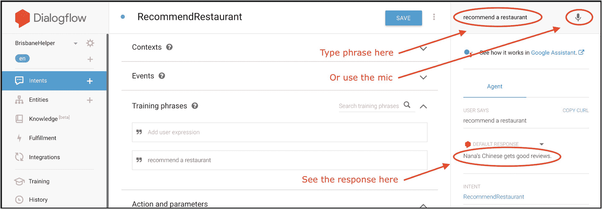

# 3. 运行语音应用——并发现问题

在前两章中，我们向你介绍了语音交互技术，以及为什么在对话交互中，有些事对人类和机器来说比其他事更难做对。现在是时候动手实践，让你自己的简单语音优先交互系统运行起来了。我们将继续使用熟悉的餐饮领域；这是一个方便的概念测试平台——找餐厅可能是你熟悉的事情，而且它涵盖了许多语音优先的概念。找餐厅的任务看似简单，但事情很快就会变得复杂。当你扩展功能以应对真实用户时，你会很快偏离“快乐路径”，不过我们暂时先不考虑现实情况。

## 动手实践：准备餐厅查找器

图 3-1（类似于图 2-1）展示了一个简单的餐厅查找器。用户请求推荐，语音助手给出一个推荐。仅此而已。关于符号的说明：面板 2 中的“AGENT”是简写，表示你暂时无需关心语音助手的名称、平台或唤醒方式。它可以是`唤醒词`，例如 `Alexa` 或 `嘿，Google`，也可以是按下按钮。对于 IVR 系统，则是拨打一个号码。它仅表示此对话由用户发起。

图 3-1

用户与语音助手之间一个合理的餐厅查找器对话

接下来，让我们定义这个交互，以便你能构建它。在第 2 章中，你开始思考为餐厅查找器需要做出的决策。许多决策都涉及范围：用户请求推荐某个特定城市的餐厅；应用根据用户指定的参数，按距离远近排序，给出几个最佳匹配建议。你将在第 4 章中了解如何以及为何要限制范围；以下是初步尝试：

- **地理范围**：你的初始餐厅查找器仅限于一个预定义区域——一个小镇，因为在无约束的名称识别上做到出色非常复杂。因此，我们选择了旧金山地区的一个小城市：布里斯班。镇上大约只有 20 家提供食物的场所。
- **搜索范围**：从简单开始，用户无法细化搜索，也不能根据食物类型或营业时间进行搜索；他们只能从预定义的回复集中获得一个推荐。
- **信息范围**：同样，你限制了初始功能。你需要一份该城市所有餐厅的列表，以及一组回复（例如营业时间或街道地址），以便基于该列表进行播放。
- **用户范围**：不基于用户设置提供定制化结果，也没有后续问题来细化搜索。但要确保用户每次不会听到相同的建议，因此需要跟踪某些信息。假设可以有多个用户。
- **交互范围**：从创建自定义语音应用开始，即一个技能（针对 Alexa）或操作（针对 Google）。访问主要来自固定设备（而非移动应用或车载设备），可能是在室内、家中或工作场所，且不需要屏幕。

**成功提示 3.1 语音成功基于范围与限制**

无论你在创建何种语音交互，大部分时间都应花在理解范围并尽可能限制它上——同时要知道你无法限制用户行为。这意味着你需要找出处理超出范围请求的最佳方式。“你”指的是你：设计师、开发者和产品负责人。

确定范围后，你定义一切顺利时的基本对话：即快乐路径。推荐的起点是编写示例对话：

- **用户** *AGENT，让布里斯班助手推荐一家餐厅。*
- **AGENT** *[查找数据并生成合适的回复。]*
- **AGENT** *娜娜中餐馆评价不错。*

示例对话贯穿本书。它们是语音应用功能的高层示例，展示了如何提供功能、理解什么以及应用会给出什么回复。示例对话是语音的概念草图，展示了核心功能和代表性对话；它们并未展示用户可能说出的每一种措辞。任何“真实”实现都会使用多个示例对话，但这是这个餐厅查找器第一个版本的全部功能，所以一个就够了。是时候构建它了。

### 选择语音平台

如今，你可以访问数量不断增长、能力不断提升的语音平台，因此无需从零开始用独立模块构建自己的平台。使用你偏好的、可访问的平台来构建简单的餐厅查找器。我们假设许多人会使用 Amazon Alexa 或 Google Assistant 平台。如果编码不是你的核心优势，可以利用众多无代码平台之一，让你的作品在这两个平台上运行。^(²⁷) 如果你更喜欢开源的灵活性，还有其他选择。^(²⁸) 任何成熟的平台都能让你快速运行起一些功能性的东西，一个具体的沙盒，用于体验和理解核心概念。这正是我们当前需要的。记住：你**不是**在阅读特定平台的菜谱——我们涵盖概念，并提供具体示例供你运行和体验，以扎实理解语音。我们实际上建议你使用多个平台（包括你感兴趣但我们未涉及的平台）来开发本章中的简单对话。观察哪些是平台特有的，哪些是所有平台共有的，这有助于你成为更强大的语音实践者，并且减少对任何特定平台的依赖。早期，你会倾向于那些为你处理尽可能多细节的平台。随着经验增长，你会希望获得更多灵活性。并且你将能够利用这种灵活性而不陷入麻烦。你需要一个稳定、强大且具有卓越语音识别能力的平台。在本书中，我们选择走 Google 路线，原因将在本章稍后说明。但首先，让我们直接开始构建！

### 动手实践：实现餐厅查找器

是时候实现图 3-1 中的基本餐厅查找器了。你将使用 Actions on Google，即 Google Assistant 的开发者平台。目前只有一个问题，但这足以开始。我们将引导你完成设置步骤，指出一些需要注意的事项，但不会深入每个细节。更多详情，请参考众多可用参考资料之一以获取最新信息。^(²⁹)

#### 基本设置

开始吧……*OK, Google，让布里斯班助手推荐一家餐厅*。

1. 创建一个 Google 账户，或登录现有账户。
2. 打开 `Actions on Google` 开发者控制台^(³⁰) 并创建一个新项目。
    1. 点击 `New Project` 按钮，然后输入 `BrisbaneHelper` 作为项目名称。点击 `Create Project`。
    2. 对于“你想构建哪种类型的 Action？”，选择 `Custom`。点击 `Next`。
    3. **重要**：在询问“你想如何构建它？”的屏幕上，一直滚动到底部，点击“点击此处使用 Dialogflow 构建你的 Action。”本章稍后，我们将讨论为何使用 Dialogflow。
    4. 选择“构建你的 Action”，然后“添加 Action”。
    5. 点击“开始使用”，然后点击“构建”。
3. 应打开 `Dialogflow`（`Dialogflow Essentials`）。点击“创建”。

在引用的网页上，系统会要求你启用 `Fulfillment`。`Fulfillment` 是 `Dialogflow` 与你构建的 Web 服务连接以进行更详细处理的能力（类似于 Alexa 使用的 `AWS Lambda` 函数）。这里你不需要它，因为布里斯班助手非常简单。在第 7 章中，你将添加这种灵活性。

#### 步骤 1：响应调用

在 `Dialogflow` 中，选择自动创建的“Default Welcome Intent”。这是用户调用时交互的起点——换句话说，当用户说 *OK, Google，与布里斯班助手对话* 时。

1. 点击“Responses”。点击垃圾桶图标删除任何现有回复。
2. 输入类似“欢迎来到布里斯班助手。我能帮你什么？”或“你好，我是布里斯班助手。你有什么问题？”的内容。这会在用户未指定问题而触发操作时添加一条新回复。
3. 在“Intents”窗口中，点击“Save”。

#### 步骤 2：明确用户会说什么

在 `Dialogflow`（与 Alexa 类似）中，意图是用户“执行操作”的基本“单元”，例如请求信息（*推荐一家餐厅*、*什么时候营业？*、*他们接受预订吗？*）或请求执行某些操作（*订一份披萨外卖*、*预订晚上 7 点的位子*）。

1. 创建一个新意图。在 `Intents` 右侧，点击加号符号（`+`）。
2. 在 `Intent name` 字段中输入 `RecommendRestaurant`。保存。

在语音应用中，“执行操作”的方式当然是通过说话。请明确用户可能会说什么来提出请求。

1. 在 `Training Phrases` 部分，点击 `Add Training Phrases`。
2. 在 `Add User Expression` 框中，输入“Recommend a restaurant”。
3. 按下 `Enter` 键，然后点击 `Save`。这就是示例对话中的短语。

#### 步骤 3：明确 VUI 会说什么

接下来，明确当用户说“*推荐一家餐厅*”时，操作应如何响应。

1. 找到 `Enter a Text Response Variant`。输入“娜娜中餐馆评价不错”。按下 `return` 键。
2. 应用响应后，此对话即告完成，你就大功告成了。点击 `Set this intent as end of conversation` 左侧的滑块。如果不这样做，操作将不会结束，而是在给出推荐后等待用户继续说话。点击 `Save`。

#### 步骤 4：将 Dialogflow 连接到 Actions on Google

你已经在 `Dialogflow` 中定义了对话，但你是从 `Actions on Google` 开始的，这是扩展 Google Assistant 的开发环境。你需要将两者连接起来。

# 步骤 5：测试你的 VUI

你已经构建了简单的应用。太棒了！是时候测试了。你可以通过多种方式进行测试：在 `Dialogflow` 中、在 `Actions` 控制台中，或使用 Google 设备。

## 使用 Dialogflow 进行测试

在 `Dialogflow` 中，你可以使用文本或语音进行测试，如图 3-2 所示：

图 3-2

测试方法 #1：`Dialogflow`

* `文本测试`：找到 `Try It Now`，然后输入“recommend a restaurant”。按下 `Enter` 键。它应该会显示正确的响应：“娜娜中餐馆评价不错。”

* `语音测试`：找到 `Try It Now`，点击麦克风图标（只需点击；不要长按），然后说 `Recommend a restaurant`。再次点击麦克风停止收听。你应该会得到与文本测试相同的响应。

### 故障排除

在使用 `Actions on Google` 进行测试之前，请前往你的 Google 账户的 `Activity Controls` 页面，并开启 `Web & App Activity`、`Device Information` 和 `Voice & Audio Activity` 权限。

## 使用 Actions 控制台进行测试

在 `Actions` 控制台中，你可以使用文本或语音进行测试：

1. 在你的 `Actions` 控制台窗口中，点击 `Test`。
    * 确保你的音量没有静音。
2. 调用该操作。输入“Talk to Brisbane Helper”。或者点击麦克风并说出这句话。这次，你不需要再次点击它；它会自动停止收听。
    * 在 `Dialogflow` 中测试时，这个调用短语不是必需的。但现在你进入了 `Actions on Google`，你需要告诉 `Google Assistant` 如何访问你的技能，因此你将调用短语设置为“Brisbane Helper”。
3. 你应该会听到响应 `Sure, here’s the test version of Brisbane Helper`，然后可能是一个不同的声音说：`Welcome to Brisbane Helper. How can I help?` 你之前添加了那个提示。
4. 输入，或点击麦克风并说出神奇短语：“recommend a restaurant”。
5. 你应该会得到预期的响应：`Na Na’s Chinese gets good reviews`。

## 使用 Assistant、Home 或 Nest 设备进行测试

如果你已经阅读了我们之前提到的一些资源，你会看到有一个定义明确的发布流程，可以让其他用户使用你的创作。这有多酷？请参考这些资源了解当前流程——记住这些东西是不断变化的。对于快速测试，只要你的设备（`Google Home`、`Nest Hub` 或 `iOS/Android` 上的 `Google Assistant` 应用）登录了与你的开发环境相同的 Google 账户，你就可以使用该设备进行测试，这非常方便。

1. 使用你用于 `Actions on Google` 和 `Dialogflow` 的同一个 Google 账户设置你的 `Google Home` 设备。
2. 现在我们需要定义如何从 `Google Home` 或其他设备访问你的应用。在 `Actions` 控制台（你刚刚测试的地方）中，点击顶部的 `Develop`，然后点击左侧的 `Invocation`。在 `Display Name` 下，输入“Brisbane Helper”。点击右上角的 `Save`。
3. 当设备准备就绪后，说：“`OK, Google, talk to Brisbane Helper`。”
4. 这里你需要同时使用唤醒词和调用短语。
5. 你会听到与在模拟器中相同的内容，但它是从你的设备中发出的。太棒了！

### 我是否需要使用 Google Home 设备进行测试？

你可能想知道是否真的需要在你应用的目标平台上进行“设备上”测试。严格来说，不需要，在流程早期不需要。但如果你想构建一个不仅能做某事而且能做好某事的语音应用，你需要将自己置于预期用户的思维模式中。这是本书反复出现的主题。这意味着要以用户的方式体验应用。因此，只要有可能，我们强烈建议你在用户将体验的相同环境、相同上下文和条件下，以及在他们将使用的相同平台和生态系统中测试你构建的内容。

# 步骤 6：保存、导出或导入你的工作

你可以选择保存你的工作以便与他人分享，以及使用他人的工作。

1. 在 `Dialogflow` 中，点击应用名称旁边的齿轮图标。
2. 点击 `Export and Import`。
3. 点击 `Export as ZIP`。该文件将作为 `APPNAME.zip` 保存在 `Downloads` 目录中。如果你想跟踪版本，可以重命名它。

要从 `.zip` 文件加载应用：

1. 在 `Dialogflow` 中，点击应用名称旁边的齿轮图标。
2. 点击 `Export and Import`。
3. 点击 `Restore from ZIP`。加载前，所有当前的意图和实体都将被清除。

你还可以选择 `Import from ZIP`。如果存在重复项，现有的意图和实体将被替换。请注意，你必须实际输入单词“restore”才能从 `.zip` 文件恢复，因为该过程会清除你当前拥有的所有内容。

现在你已经构建了一个能做一件非常简单事情的语音应用。你很快就会回到你的餐厅应用来扩展它。但首先，让我们更仔细地看看 Google 平台以及我们为什么选择使用它。

# 为何我们选用 Google 上的 Actions 与 Assistant

简而言之：我们必须做出选择。本书的主要目标并非专门教授如何创建 `Google` 操作，而是演示适用于任何语音开发（无论使用何种框架）的概念与原则。我们恰好欣赏 `Google` 的诸多方面，同样也欣赏 `Alexa`、`Nuance`、`Apple`、`Bixby`、`Mycroft` 等等平台。我们本想在书中对比六种平台，但篇幅已然足够长，因此为简洁起见，我们不得不选择其一。以下是我们选择 `Google` 的部分原因。

首先，我们想要一个广泛可用、免费使用、支持良好、足够成熟稳健、适用于多种场景，并且在所有核心语音系统组件上具备一流性能的平台。它应该为最终用户以及设计师和开发者所熟悉，并提供多语言组件和支持。同时，它应“自带”构建完整功能所需的所有工具、硬件和软件，但又不完全受限于这些组件。

还有其他实际考量。我们希望您无需担心复杂性，除非我们为了阐述某个观点而必须涉及。但我们也不希望您依赖某个特定平台所提供的功能，更不希望您受其限制。这不是学习语音的正确方式。随着您的对话变得愈发复杂，或者当您使用的平台缺少某些工具或功能时，您将需要具备自定义能力，以便为用户提供最佳体验。这正是我们的关注点。

满足所有这些标准，基本上将选择范围缩小到了 `Amazon` 和 `Google`。与 `Amazon` 相比，我们在使用 `Google`（以及 `Nuance` 和一些开源平台）创建语音交互方面拥有更多经验，因此我们知道它能很好地满足我们的目的，并且自然能引导我们使用 `Google` 进行更深入的实践开发，例如利用 `Google Cloud Speech-to-Text API`。但别担心：`Alexa` 和 `Google` 在对话式语音方面共享许多概念和方法，因此您在一个平台上看到的思路同样适用于另一个平台以及其他平台。

至于额外代码，基于产品开发的个人经验，我们个人更偏爱 `Python` 而非 `Node.js`；它灵活多变，几乎是语音和自然语言领域的标准。最终，您应该根据您的具体用例，选择最适合您整体产品开发环境、并能提供最佳语音和语言性能的方案。没有放之四海而皆准的正确答案。

再次强调，这并非一本关于 `Google` 上的 `Actions`、特定设备或特定用例的“菜谱”或手册——我们使用这个平台，是为了让您能够利用现有资源，比从头拼凑所有组件更快地构建出产品。平台和计算能力会不断变化——我们后续章节讨论的高级功能，在您读到那些章节时可能已在 `Actions` 平台上可用，这非常好。但您仍然需要理解工具背后的原理才能正确使用它。而这正是本书的核心。语音就是语音；自然对话界面所依赖的核心原则，与十年前、二十年前并无二致。口语原则适用于所有平台和设备，因为它关乎人类语言。

## Google 的语音开发生态系统

让我们更仔细地审视 `Google` 语音开发架构，看看它如何与我们第 1 章关于语音的讨论相对应。图 3-3 是图 1-3 和图 2-10 的变体，展示了相同的构建模块如何融入 `Google Assistant` 语音服务和 `Actions on Google` 框架。

这里的对应关系是近似的。请将其视为一个宏观图景，而非 `Google` 语音架构的定义。`Google Assistant` 语音开发涉及三个主要构建模块：

*   `Actions on Google` 用于 `STT` 和 `TTS`
*   `Dialogflow` 用于 `NLU`、`NLG` 和 `DM`
*   `Node.js` 或 `Python` 作为后端，处理除最简单 `DM` 之外的所有事务

这些组件中的许多可以单独使用，增加了灵活性。`Google` 提供了用于语音转文本、文本转语音、自然语言和翻译等的云 `API`。我们使用 `Actions on Google` 和 `Dialogflow`，因为它们将这些组件很好地打包在一起，让您可以专注于应用设计，并且它们还能与我们用于测试的硬件（如 `Google Home`）进行交互。

### Actions on Google

`Actions on Google` 是一个平台，`Google Assistant` 的“智能语音”功能可在此平台上扩展为各种操作。该框架的一大优势在于，平台通过其库和服务处理了语音开发中一些最棘手的组件（`STT`、`NLU`、`TTS`）。因此，您在起步阶段可以专注于实现 `DM` 和 `NLG` 部分的核心工作，以构建应用。

#### Dialogflow

在 `Actions on Google` 中，至少有三种方式可以设计对话：

*   `Actions SDK`：一种类似代码的 `API`，用于指定操作、意图等
*   `Dialogflow`：一个更偏向图形用户界面的应用，为 `Actions SDK` 提供了图形化封装，增加了 `NLU` 功能，并融入了机器学习，允许对映射到意图的短语进行同义词扩展
*   `Actions Builder`：一个更新的图形用户界面，与 `Actions on Google` 的连接更直接。

您目前将使用 `Dialogflow`，以便专注于应用构建而非代码格式。`Dialogflow` 大致负责处理操作的 `NLU`、`DM` 和 `NLG` 组件。从 `DM` 和 `NLG` 的角度来看，应用的主要职责是根据用户输入、上下文和对话进度，决定接下来要说什么。有两种方式可以指定系统回放给用户的响应：

*   通过 `Dialogflow` 的 `GUI` 提供静态响应。
*   使用 `webhook` 后端提供响应。这种方式可以非常动态，并依赖于历史记录、用户数据或应用数据——即图 3-3 中所示的所有数据源。我们将在后续章节中大量使用 `webhook`。

`Dialogflow` 在简单性、可扩展性、性能和各组件的开放性之间取得了良好的平衡。它也是成熟稳定的，因为它已经存在了一段时间——对于我们教授设计原则和最佳实践的目标而言，这比包含最新的平台特性更为重要。因此，我们使用现在称为 `Dialogflow ES` 的版本，而不是更新的（且非免费的）`Dialog CX`，并且我们不使用 `Actions Builder` 环境，因为它不如 `ES` 灵活（目前仅能部署到 `Assistant`，无法部署到第三方渠道）。

## 依赖工具的利与弊

直到不久以前，除非你从事研究工作，或受雇于少数几家直接从事语音领域的企业，否则几乎不可能创建任何形式的语音交互。如今，我们可以轻松获取几年前还不存在的工具和平台。几乎任何拥有标准笔记本电脑和免费账户的人，都能快速拼凑出一个能对语音做出响应的东西。如果你已经用过 `Google Assistant` 或 `Amazon Alexa`，你就会知道这些平台通过为你处理许多细节，提供了大量“免费”功能。

但工具和平台来去匆匆，而且变化迅速，正如我们在上一节中提到的。就在编写本章的过程中，至少有一个语音工具从免费变成了付费，另一个改了名，还有一个被收购了。如果你依赖工具为你处理细节，那么当这些工具消失或发生变化时，你可能会陷入困境。更重要的是，就我们的目标而言，如果你不明白为什么得到某个结果，或者无法访问你需要修复的内容，你就无法学会如何改进你的语音交互。随着用户对语音越来越精通、越来越熟悉，他们的要求也变得越来越高。与某个特定框架绑定过紧，可能会限制你创建合适的语音交互或打造脱颖而出的产品的能力。

如果你需要对响应进行精确控制，或者需要安全地访问数据，该怎么办？如果你要处理大型数据集、有品牌需求、需要与其他系统集成，或者需要访问用户的语音内容以进行验证，又该怎么办？或者，如果你需要对准确性和对特定请求的响应进行精确控制呢？那么，你就需要这些平台可能无法提供的更多功能，并且你需要承担起开发工作中更大的一部分。幸运的是，对于语音来说，这些都不是新问题。解决这些问题的方法确实存在，但它们要么尚未开放给开发者修改，要么其相关性尚未被完全理解。如今，大多数语音开发者都是这个领域的新手，并且只在一个平台上拥有经验。我们的目标之一，就是重新引入一些因难以获取而被搁置的强大技术。随着这些功能的加入，你仍然需要知道如何应用它们。你所做的选择会影响你构建的每一个语音应用，从最简单的问答系统到完整的处方续药系统。学会“用语音思考”将让你有能力做出正确的选择。

如果你选择在 `Google` 和 `Alexa` 平台内进行开发，你可能会用生态系统访问权限、便利性和开发速度来换取各种限制。如果你愿意并且有能力建立自己的环境，使用自己的解析和设计方案，那么一个全新的世界将向你敞开，让你在每一步都有选择，创造出与他人不同的东西。但正如生活中的情况一样，选择和灵活性也带来了更大的责任和更周密的规划。只有你自己知道什么对你来说是正确的答案。

每家公司还提供用于其他语音用例的产品，例如：

- **物联网（IoT）用例**：`AGENT，把客厅的灯调暗` 或 `AGENT，把温度设为 70 度`。通过向 `Alexa Echo` 设备或 `Google Home` 设备发出语音命令来控制家电。这些家电本身没有用于语音响应的麦克风或扬声器。它们是联网设备，通常被称为智能家居。

- **内置麦克风和扬声器的第三方设备，利用 `Alexa` 或 `Google` 的识别和自然语言处理“智能”**：`AGENT，播放皇后乐队的音乐`。语音命令指向一个拥有自己麦克风和扬声器，但被两个语音助手之一“占据”的设备。这些是内置设备。

通用的语音用户界面最佳实践适用于所有用例，但细节有所不同，因为用户需求不同，设备功能各异，并且不同的重叠架构和生态系统需要相互交互。自定义技能和操作需要调用，而智能家居和内置设备则不需要。由于智能家居和内置应用程序的关注点更窄、需求更具体，我们在本书中不重点关注这些。

你可能根本不需要调用词或唤醒词。如果语音用户界面以其他方式界定，例如，拨打交互式语音应答系统的电话、按下通话键的设备、始终开启的免提设备，或者独立于常见智能家居生态系统之外的语音用户界面，情况就是如此。它们都是有效且当前存在的环境——它们同样都能产生出色或糟糕的语音交互。

**成功秘诀 3.2 你确定那个词的意思和你认为的一样吗？**

请注意，产品名称和功能几乎在不断变化，正如你对快速发展的高科技所期望的那样。你在这里看到的是 2020-2021 年撰写时的状况。如果你与团队一起在 `Amazon` 或 `Google` 平台上，或在任何其他地方，构建自定义技能或操作、智能设备或带有自己音频输入和输出的扬声器，请确保团队中的每个人都清楚在该方法中哪些是可能的，哪些是不可能的，并且每个人都对同一个产品使用相同的名称。

## 动手实践：做出改变

回到餐厅查找器。你已经启动并运行，正在与你的语音助手对话。太棒了，它能用了。更好的是，你让你的技能或操作上线，并自豪地告诉你的朋友们。他们使用了它，然后……他们告诉你它不好用。

发生了什么？为什么它在你那里好用，而他们却抱怨？如果你只构建了我们之前介绍的内容，那么很可能出现了以下一些问题：

1. 他们提出了在你定义范围内的请求，但这些请求

    1. 被拒绝了

    2. 导致了错误的响应

    3. 导致了误导性的响应

    4. 导致了信息不足的响应

    5. 导致了听起来奇怪或不对劲的响应

2. 他们询问了你已知超出范围的事情。

3. 尽管你创建了几个变体，但他们只听到了一种响应。

我们建议你不要忽视你的朋友，也不要因为他们没有用正确的方式说话而说他们愚蠢！实际上，你没有做好规划——理解你的用户并为他们设计——因为我们还没有告诉你如何去做。本章旨在让你初步体验这个过程，所以让我们看看如何解决这些问题。

**成功秘诀 3.3** 如果用户说了，你就必须处理。句号。

你的用户之所以是你的用户，是因为他们愿意，所以要善待他们，像对待朋友一样，而不是敌人或物品。这似乎显而易见，但人们很容易陷入这样的想法：`没人会那么说` 或 `这么说真蠢`，甚至 `如果他们不看我关于涵盖内容的描述，那是他们自己的错`。大多数时候，用户并不是故意要搞垮系统，而且他们自己也知道。当然，你可以为超出范围的请求创建巧妙的响应，但不要以牺牲让实际预期体验更稳健为代价。^(³⁶)

### 添加更多含义相同的短语

对于问题 1a（拒绝）的情况，你的朋友们可能提出了措辞合理的请求，但这些请求并未包含在你的训练短语或基于这些短语自动生成的覆盖范围内。也许他们没有说`餐厅`或`吃饭`，而是说了`最好的地方是哪里？`或`去哪儿？`或者他们包含了你没有覆盖到的开场白：`我非常想了解一家我不熟悉的新咖啡馆。` 请记住：语音交互的一个核心优势是，人们不必学习一套命令——他们可以正常说话。你的第一个解决方案是增加多样性；如果你认为你已经覆盖了所有情况，可以问问几个人他们会如何表达这个请求。稍后，我们将向你展示更系统、更详尽的方法。

#### 突破极限

首先，让我们做一点测试。回想一下，你只添加了一个训练短语“推荐一家餐厅”。你可能会认为必须一字不差地说出这句话。试试下面这些短语：

- “推荐一家餐厅。”（这最好能行，毕竟这是你唯一添加的短语！）

- “推荐餐厅。”“请推荐一家餐厅。”

- “你能帮我推荐一家餐厅吗？”

- “你能不能推荐一家餐厅让我去吃饭？”

- “你能告诉我一家好餐厅吗？”

- “有什么好餐厅？”“你能推荐一家好餐厅吗？”

- “推荐个吃饭的地方。”“有什么餐厅推荐吗？”

- “哪里有好吃的？”“我该去哪里吃？”

- “我去哪儿能弄点吃的？”

嗯，这很有趣。你应该会发现，除了最后两组短语，其他短语仍然能返回正确的答案！这是为什么呢？

回顾一下第 1 章，特别是“自然语言理解”（`NLU`）部分。`NLU` 是一个模块，它接收一串单词并生成句子的含义。在这里，含义就是你创建的意图 `RecommendRestaurant`。如果你有多个意图（很快就会有），`NLU` 会判断哪个意图（如果有的话）与说出的短语匹配，并为该意图生成相应的响应（这里我们把 `Intent` 首字母大写，因为这是 `Dialogflow` 中一个非常具体的概念，我们之前见过）。

它是如何工作的？你可能会想，`啊哈！如果句子中同时包含“推荐”和“餐厅”，那就对了，对吧？` 不对：`有什么好餐厅？` 和 `推荐个吃饭的地方` 都成功了。嗯。也许只要包含“推荐”或“餐厅”中的一个就行？目前看来是这样，但你马上要添加一些会打破这个假设的短语。当你添加足够多的短语来使应用变得健壮时，像这样的规则会变得过于笨拙，所以你需要某种自动化的方法。

实际情况是，`Dialogflow` 正在利用自然语言处理和机器学习等各种技术，“学习”如何自动将你的训练短语映射到意图。或者更确切地说，它是在利用规则以及单词、短语与含义之间的统计映射。当你添加更多短语并点击“保存”时，它会利用这些新短语重新学习。自动提取含义，尤其是根据新数据训练这样的过程，是研究人员多年来一直努力攻克的问题，而你在谷歌、Alexa 和其他系统中看到的正是这些努力的成果。这并非全部答案，但请尽情享受吧！

#### 拒绝

让我们看看列表中的最后三个短语。当你说`哪里有好吃的？`时，发生了什么？它很可能回复了`抱歉，你能再说一遍吗？`、`你说什么？`之类的话。这就是**拒绝**，是构建优秀语音应用最重要的概念之一，也是你在第 2 章首次学到的。基本上，应用（特别是 `NLU` 部分）不仅要推测用户的请求代表哪个意图，还要判断`它是否不属于任何意图`。当 `NLU` 认为没有任何意图匹配时，你就会听到`抱歉，你能再说一遍吗？`。这个回复是一个默认回复。现在先别担心它是不是一个好的回复（剧透：它不是）；只需记住拒绝这个概念的重要性。随着你设计和开发更复杂的语音交互，你可能会惊讶地发现，你的大部分精力都花在了处理拒绝上。

#### 修复拒绝

正如你所料，如果应用拒绝了太多合理的用户表述，而你的用户只听到`抱歉……`，那可不是好事。你可以通过添加更多短语来解决这个问题。现在让我们在 `Dialogflow` 中操作：

1. 确保你仍在 `Dialogflow` 的 `BrisbaneHelper` 项目中。如果没有，请打开它。

2. 选择 `RecommendRestaurant` 意图。

3. 在“训练短语”中，找到“添加用户表达式”。输入“哪里有好吃的？”按回车键。

4. 点击“保存”。

5. 当看到“代理训练完成”时，重新测试`哪里有好吃的？`

6. 现在你应该能得到正确的答案了。

你已经添加了一个被拒绝的短语。继续测试。试试`我该去哪里吃？` 它也能工作，即使你并没有把它作为短语添加进去！再次，智能的机器学习 `NLU` 前来救场；它推断出`哪里有好吃的？`和`我该去哪里吃？`具有足够相似的含义。那`我去哪儿能弄点吃的？`呢？这个仍然被拒绝。一旦我们也添加这个短语，整个列表应该就都能通过了。

**故障排除**

添加短语后，别忘了不仅要点击“保存”，还要等待 `Dialogflow` 显示“代理训练完成”的提示。只有到那时，新短语才会生效。在等待期间，`NLU` 正在使用机器学习进行重新训练，这需要一点时间。

### 扩展信息覆盖范围

Na Na's 可能好评如潮，但有时人们需要吃点不同的东西。既然你已经在输入方面增加了一些变化，那让我们也在输出方面增加一些，改变用户在请求餐厅推荐时可能听到的回复。在 `Dialogflow` 中：

1. 确保你仍在 `BrisbaneHelper` 项目中。如果没有，请打开它。

2. 选择“意图”，然后选择 `RecommendRestaurant` 意图。

3. 找到“回复”部分。在“输入文本回复变体”处，输入“别忘了去 Star Box Food 尝尝乳蛋饼。并且要在午餐结束前赶到那里。”按回车键。然后点击“保存”。

4. 当看到“代理训练完成”时，使用`推荐一家餐厅`这个短语进行测试。你应该会得到关于 Na Na's 或 Star Box 的两个回复之一。

5. 再添加几个短语：

    - “你知道吗，Madhouse Coffee 供应三明治和其他小吃？”

    - “再远一点，但基本还在布里斯班范围内呢？7 Mile House 在 Bayshore，WhiteCaps Drinks 在 Sierra Point 那边。”

回复是如何从列表中选中的呢？它是随机的，但会稍微调整以避免连续两次播放相同的回复。问题 3（听到相同的回复）如果不随机化回复，就会是一个逻辑疏忽。要留意这些！稍后，你将学习更详细的方案，比如可能会考虑哪些餐厅正在营业，或者用户想找什么类型的食物等等。

### 增加粒度

前面列出的问题 1b–e（不正确或奇怪的回复）有两个相关原因。其一，仅仅是知道如何用最佳措辞表达清晰明确的回复。我们将在后续章节中详细讨论这一点。另一个原因，即使回复措辞得当也必不可少：意图粒度。目前，只有一个没有槽位的单一意图。如果你的朋友问“推荐一家吃早餐的餐厅”，他们可能被理解，也可能没被理解。也就是说，`吃早餐`这个信息可能被解释器忽略了。由于还没有处理`[MEAL]`（餐食）的功能，如果回复恰好指向一家只供应晚餐的餐厅，那就会出错。对于……`现在营业`、……`营业到很晚`或……`明天营业`也是如此，如果餐厅没开门，而你又尚未追踪和比较时间，就会出错。如果他们说的是“推荐一家墨西哥餐厅”，他们可不想听到一家很棒的中餐馆。

你需要支持这些示例短语，从“推荐一家吃早餐的餐厅”开始。在 `Dialogflow` 中：

1. 点击意图右侧的加号 (+) 创建一个新意图。将其命名为 `RecommendRestaurantBreakfast`。

2. 添加训练短语“推荐一家吃早餐的餐厅。”

3. 添加回复短语“如果你早上饿了，有几个选择。你觉得 Madhouse Coffee 或 Melissa’s Taqueria 怎么样？”

4. 在“回复”中，将此意图设置为对话结束。

5. 保存并测试。

继续为不同的搜索条件支持更多示例短语：

1. “推荐一家营业到很晚的餐厅”：
    - 创建一个新意图 `RecommendRestaurantLate`，并添加示例短语“推荐一家营业到很晚的餐厅。”

    - 添加回复“Mama Mia Pizza 营业到很晚。”

    - 启用“将意图设置为对话结束”。保存并测试。

2. “推荐一家墨西哥餐厅”：

### 创建一个新意图

-   创建一个新意图 `RecommendRestaurantMexican`，并添加示例短语“推荐一家墨西哥餐厅。”

-   添加回复“想吃墨西哥菜？试试 Melissa’s Taqueria。”

-   启用“将意图设置为对话结束”。保存并测试。

现在你支持了早餐、深夜和墨西哥菜。你可能会想，`哇，这可能会变得非常混乱；难道要为所有其他菜系、餐食类型、时间段以及每一种组合都创建意图吗？` 这里你使用了静态回复，是的，用这种方法，组合数量会非常庞大。但你很快就会学到一些增强功能，比如槽位或实体，以及动态或 webhook 回复，信不信由你，它们能让你用一个意图支持所有这些可能性。

### 成功提示 3.4 你的用户不是你的免费测试员

当然，你想根据真实用户的数据来更新你的语音交互，但不要指望你的用户为你调试语音应用。从多样化的 Alpha 测试者群体中获取话语示例。找到那些会告诉你他们是否感觉被理解**并且**回复是否准确的 Beta 测试者。没有这些，你永远无法摆脱差评。

这是否意味着你必须回答每一个问题？不。这意味着你可以从识别更多用户所说内容开始，以避免问题并显得更智能，直到你添加实际功能。你可以将最相关的信息添加到每个提示中。也许用户没有要求，但如果信息简短，他们可能也不会介意听到。你也可以处理一些词语，比如`现在营业`和`晚餐`，即使你无法提供答案。使用示例对话来展示非理想路径的交互：

-   **用户**：`嘿，Google，让 Brisbane Helper 推荐一家现在营业的餐厅。`

-   **VUI**：`Na Na’s 评价不错。除周六外，他们每天供应午餐和晚餐。`

-   **用户**：`嘿，Google，让 Brisbane Helper 推荐一家现在营业的餐厅。`

-   **VUI**：`Na Na’s 评价不错。我不太确定他们的营业时间。`

### 成功提示 3.5 每个人都希望被倾听和理解

你能将越多的未满足请求从“未处理”转变为“已处理”，你的语音交互就显得越智能。当你认可用户时，即使你无法做到他们要求的事，他们也会感到被理解。

那么问题 2，真正的超出范围请求呢？你无法涵盖所有情况，所有平台上的所有 VUI 都是如此。因此，你需要一些适当模糊的回复，比如告诉用户你无法提供帮助，但给他们一些通用的信息，也许暗示一下你能提供什么。或者你可以让用户再试一次。再次询问，或重新提示，对于某些任务和交互类型来说比其他更合适。这是一个大话题，你将在第 13 章中学习。

-   **用户**：`嘿，Google，让 Brisbane Helper 推荐一个评分最高但不拥挤的地方。`

-   **VUI**：[无匹配处理。]

-   **VUI**：`我不确定如何帮您解决这个问题，但这里有一个布里斯班的通用推荐。Na Na’s 评价不错。`

## 预览：静态回复与动态回复

到目前为止，我们处理回复的方式是使用静态回复。当你在意图的“回复”部分指定回复时，就会用到它们。除了我们讨论过的随机化功能外，静态回复无法进行任何逻辑或决策，这极大地限制了你的能力。另一种选择是使用动态回复或 webhook 回复。这些回复由你编写的代码（我们将使用 Python）生成。在这里，你可以想象拥有无限的逻辑来按菜系、时间段等过滤回复。当你为意图启用“履行”时，就会使用 webhook 回复，你很快就会这样做。请查看 `https://dialogflow.com/docs/intents/responses` 上的文档，了解有关使用静态回复与 webhook 回复的更多详细信息。

### 下一步是什么？

看看最后几个示例对话，思考一下这些回复在哪些情境下效果较好或较差。你会对措辞做出哪些改变，以扩大覆盖面，使回复听起来“智能”，但实际上并未满足请求？

通过这个快速简单的语音开发介绍，你已经开始了解哪些事情会让语音应用陷入困境，哪些事情则不成问题。这正是你在语音领域取得成功需要掌握的：如何发现大大小小的问题并修复它们。理想路径通常相对直接；鲁棒性才是有点棘手的地方。通过学习“如何做”以及“为什么这样做”，你可以最大限度地减少对特定工具和平台的依赖，同时学习如何为特定情境选择最佳实现方案，并创建平台不会限制你的对话式交互。

当你想要创建一个健壮且功能良好的语音应用时，首先要提出你已经开始提出的那类问题——只是要更详细。在下一章中，我们将探讨流程中的“蓝图”部分。

### 摘要

-   由于语音本质上是无限的，你需要仔细定义你的 VUI 范围。

-   可以在不满足请求的情况下处理请求。措辞得当的语音提示可以向用户表明他们被理解了，即使他们无法得到所要求的内容。

-   学会预测用户会要求什么以及他们会如何表达。可用的语音助手生态系统工具可以让你快速上手，但 VUI 的性能始终需要通过迭代来提高覆盖率。

-   VUI 可能在很多方面让用户失望：无法识别合理的请求、完全没有响应、响应错误或信息不充分，或者以用户无法理解的方式响应。所有这些问题都必须解决，并且各有不同的解决方案。

脚注 1 2 3 4 5 6 7 8 9 10 11

