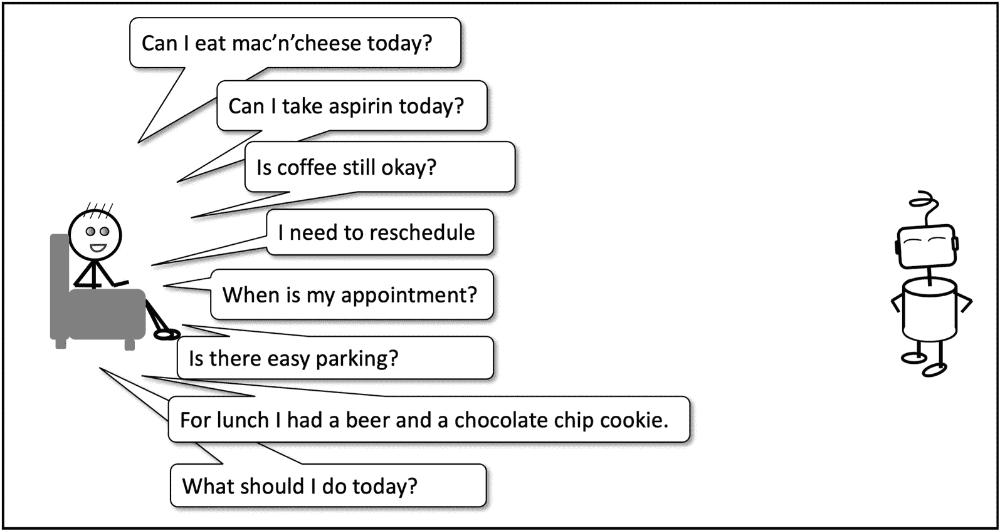

# 4. 通过发现来定义：为谁构建什么、如何构建以及为何构建

由于创建语音系统是一个热门话题，你可以找到很多讲座和在线课程，教你如何在很短的时间内构建一个 VUI。确实，你可以非常快速地让某些东西运行起来，这很棒。你在第 3 章中已经做到了这一点。如果你的目标只是自己使用，那已经足够了。但是，如果你想为他人构建一个健壮的系统，那该怎么办？你如何构建一个运行良好且满足他们需求和期望的系统？而且，利用你现有的资源，是否有可能构建出这样的系统？

你需要一个基于相关语音问题答案的计划——这些答案将指导你的设计和开发。这就是本章的内容：提出正确的问题并解读答案。即使你以前写过规范，你也会怀疑 VUI 是不同的。你是对的。

那么这些问题是什么呢？它们通常被归类为功能需求（你在构建什么？它做什么？）和非功能需求（谁会使用它以及为什么使用？）。在本章中，我们将相当详细地逐步介绍发现过程，让你了解我们是如何处理它的。随着你继续阅读本书，你将理解这些问题背后的原因、答案为何重要，以及当没有提出正确的问题或答案不正确或被忽略时，事情为何会出错。因此，重点在于对语音最重要的需求。你可能会注意到我们在不同类别的需求问题之间跳转。你是对的。我们故意这样做是为了强调，如果你将发现过程视为一个整体，而不是将其区分为功能性与非功能性，或业务、用户和系统需求，那么你将更加成功。组织上的分离对于文档编写来说是可以的，但在信息收集过程中则不然。所有答案都与设计师、开发人员和产品负责人相关。没有人可以在启动会议上因为“他们的”部分当前没有被讨论而去喝咖啡休息。^(³⁸)

> **成功技巧 4.1 从第一天起就让设计师和开发人员参与**
>
> 避免知识孤岛。如果你在团队内部和跨团队工作，每个人都需要对语音的优势和限制有扎实的理解。从一开始就让所有人参与进来，并倾听彼此的关注点和建议。在这个领域，你无法在真空中良好地工作：一切都会影响其他一切，没有哪个需求比其他需求更重要。相互尊重，并在发现过程中包括设计师、语音科学家和开发人员——他们会从不同的角度提出问题。`VUI` 设计、`VUX` 研究、`NLU` 和语法开发、数据库编程、系统架构、市场营销——这些都涉及不同的技能，很难在一个人身上找到全部甚至大部分技能。你显然需要在其领域内拥有核心专业知识的人来担任其角色。如果他们也有语音经验，那就太好了。如果没有，请专注于寻找那些对真实用户行为和数据表现出明显兴趣的人，那些理解与语音交互与与文本和图像交互根本不同的人，那些愿意学习并且团队合作良好的人。

为语音构建始终是一种平衡。即使对于最简单的 `VUI`，在开始实施之前制定一个计划也是有帮助的。经验丰富的 `VUI` 设计师和开发人员会以发现过程开始所有语音项目，利用他们的语音经验在心理上勾销非问题，同时标记潜在的复杂性。开始练习这个习惯——凭借前几章的基础知识，你已经可以走得很远了。本章中有很多文字。在需要时将其作为资源使用。只是不要忽略在考虑语音的情况下进行发现。

## 通用功能：你在构建什么？

让我们从最基本的问题开始：你的语音应用的目标是什么？你产生这个想法是有原因的：你看到了某个需求，或者有人付费让你实现他们的想法。你的答案会影响开发语音解决方案的方方面面——特定内容的需求与可用性、安全性、准确性等——进而影响设计选择并导致权衡取舍。

> **成功技巧 4.2** 从来不存在“唯一正确”的方法
>
> 没有哪种 `VUI` 设计能保证成功，但有很多方法可以提高或降低你的成功率。设计选择总是需要做出的，它们将直接取决于需求、资源、时间表和其他约束条件。你在开始时了解得越多，就越有可能做出人们愿意使用的 `VUI` 决策。

一个好的起点是将你的想法付诸文字：用几句话描述你的 `VUI` 的目的和目标、领域和主要任务，以及如果你已有初步构想，则描述基本流程。这个简短的高层摘要，即电梯演讲，对于餐厅查找器来说可以是这样：

-   针对特定城市的餐厅查找器。根据搜索项，应用会回复一个最佳匹配建议。用户通过指定菜系或营业时间来搜索 X 城市的本地餐厅。`VUI` 会回复一个匹配项，或者在必要时要求用户澄清以区分餐厅。用户可以跟进请求进行预订，指定时间、日期和用餐人数。

把你的演讲告诉一个朋友，请他们用自己的话向你描述他们听到了什么，并问他们期望能够完成什么、能够说什么、以及应用会提供什么回复。这与你自己的想法一致吗？很好。你已经上路了。

现在，查询餐厅信息是我们大多数人都做过的事情，所以我们很清楚它应该是什么样子。但语音的部分挑战在于构建一个别人也想用的东西，即使他们与你不同。如果你正在构建一个你不太熟悉的东西呢？如果你的应用行为可能影响用户的健康呢？

在本章中，你将规划一个语音应用，帮助人们为即将到来的医疗程序做准备。假设这个程序不危及生命，但对用户来说不熟悉，是一个具有一定指导复杂性的程序，比如胃肠科手术或小型门诊手术。原因如下：

-   健康和医疗领域很复杂，同时也包含了基础知识。它涵盖了设计和实现复杂性的每个关键方面。它甚至涉及食物，所以你在餐厅应用上花的时间没有白费！

-   人们对在健康和医疗领域使用语音非常感兴趣。谁不想做好事呢？但这个领域对结果的准确性和置信度要求比大多数更简单的实现所能提供的要高，使其成为这本注重实际应用的书籍的完美主题。

-   我们两位作者都在这个领域拥有第一手的语音设计和开发经验，使其成为与您分享真实生活经验和语音优先开发现实的现实背景。^(³⁹) 我们将逐步引导您完成一个我们自己在为移动设备、智能家居助手、呼叫中心系统和其他设备创建语音交互时多次成功使用的流程。

所以，这里有一个新的电梯演讲：

-   一个程序准备助手，在医疗程序前的几天里指导患者，以降低因准备不足而重新安排程序的可能性。用户会根据其程序前的天数，收到针对其个性化定制的饮食或药物必要更改的及时通知，这样他们就不会错过可能影响其程序的事情。他们还可以询问有关程序的问题，例如是否可以吃某种特定食物或服用某种指定药物，并听到一个简短的信息性回复，他们知道这个回复已得到医生的批准。他们还可以联系自己的医生。

让我们暂停功能讨论，更仔细地看看你未来的用户——理解他们将指导你提出下一组问题。

## 用户需求：谁会使用它，他们想要什么？

语音成功的关键在于理解用户的需求和期望，并说他们的语言、理解他们的语言。你的假设会影响从风格、措辞、内容到整体流程以及为了让用户享受交互而需要解释的一切。你如何真正知道用户想要什么？养成每个语音项目都从快速研究开始的习惯。从线上开始。你很快就会发现人们对程序（它是什么、如何做以及为什么做）和具体的准备任务有疑问。记下常见问题和答案。在现实生活中，你会根据你为其构建应用的医疗服务提供者提供的材料来做到这一点，但概念是相同的。此外，你可能需要在信息不足的情况下界定工作范围，以帮助创建销售报价。如果你在与医疗服务提供者会面之前做了背景研究，那么在收集问题答案时会高效得多。第 5 章将介绍一些查找用户数据的方法。现在，我们假设你可以访问一个可靠的来源。

牢记语音，你在发现用户需求期间的主要目标是了解人们目前是如何完成你的 `VUI` 将要处理的任务的：

-   识别用户群体（主题专业知识、使用的特殊术语、儿童声音、浓重口音、一个设备上的一个或多个用户等）

-   识别当前任务是如何完成的，需要多少步骤，以及它是如何“结束”的。

-   识别任务完成的时间和频率的任何模式，包括触发开始的因素（处方续药、想开灯或获取路线、账单支付提醒等）

-   识别用户的环境、活动和情绪状态（背景噪音类型、在家静止、在户外行走、开车时、心烦意乱等）

-   确定是否存在用户无法说话或无法听设备执行任务的原因。

> **来自语音前线**
>
> 一位同事为一家国际银行设计 `VUI`，他从查看银行网站开始，记录账户类型和名称、提供的服务、对读者的称呼风格和正式程度等信息。这些信息对 `VUI` 至关重要。它列出了人们会期望和使用的词语和功能。如果这与语音系统之间存在不匹配，用户将无法被理解并感到恼火，而 `VUI` 看起来一点也不“智能”。我们的同事在启动会上展示的示例对话中融入了这些信息，给银行留下了深刻印象。这有助于聚焦发现会议：了解典型客户、他们通常拥有多少账户、他们多久联系一次银行、最常见的任务是什么、他们一次会话中完成一个或多个任务的频率、账单通常何时到达、账号和登录访问的格式等等。所有这些都为设计决策、流程、提示措辞、确认需求、后端调用、识别挑战以及用户更可能需要上下文帮助的地方提供了信息。

### 用户画像与特征

你的目标用户是谁？是你不甚了解的广泛人群，还是更狭窄的用户群体，比如儿童，或者拥有账户和交互历史记录的公司客户？你需要了解他们是否存在与普通人群显著不同的特征。如果大部分用户属于特定世代或地理位置，或者对内容（不）熟悉，又或者他们是非母语使用者，不熟悉某些词汇或带有浓重口音，你可能需要调整提示语的措辞、语音的速度和音色、等待回复的时长，以及流程和处理的各个方面。如果你有多个不同的用户群体，例如新手用户和专家用户，你可以为每个群体设计不同的处理方式。更多内容请参见第 15 章。

> **来自语音实践一线**
>
> 在一个多语言应用中，某个功能在所有可用语言中都使用了相同的名称。这是一个商标名称，因此公司自然希望使用该名称。问题在于，这个名称是一个英文单词，并未翻译成其他语言。由于语音识别基于语言模型，且非母语使用者与母语使用者的发音不同，导致这个对公司最重要的短语识别效果不佳。

对于一般信息，你无需知道用户是谁；在相同情境下，答案对所有人都一样。但你对用户了解得越多，就能设计出越有趣的对话式语音交互，从融入偏好设置到提供推荐，再到处理安全数据。这需要更多的开发工作，但潜在回报也更大。此外，任何能缩小选项或潜在匹配范围的方法都有助于提升识别率，从而促进成功。利用上下文来预测用户行为是成功的关键，因为它同样能缩小语音识别和自然语言理解的搜索空间，并加快对话速度。

## 成功秘诀 4.3 用户也是利益相关者

你通常会听说在项目发现阶段要召集业务利益相关者，并尽早让技术代表参与进来。请确保你的最终用户从一开始就得到准确的代表。业务利益相关者、系统实施者和最终用户需要在决策桌上拥有平等的代表权。由于语音技术通常仍不太为人所理解，请计划好知识转移，并创造机会让每个人都参与到语音学习中来。其好处是能打造出更好的语音用户界面。

你是否需要在同一账户或接入点上区分多个用户？移动语音应用通常假设是单人使用场景，但家用助手设备要么假设通过一个账户访问的所有用户都是同一人，要么允许将家庭中的多个用户识别为独立用户。对于某些医疗应用，为患者和护理人员设置不同的档案是有意义的，但对于简单的门诊手术流程则无此必要。表 4-1 总结了这些关注点。

**表 4-1** 手术准备应用的用户画像与特征需求

| **用户是谁？** | 已预约特定手术的人。年龄偏大，但可以是任何成年人。 |
| --- | --- |
| **是否了解用户画像？** | 是，以便提供准确且有针对性回复。 |
| **是否需要区分多个用户？** | 否。 |
| **访问限制？** | 任何人都可以访问一般信息。对于个人信息，需要一定的身份验证。 |

### 使用模式

**来自语音实践一线**

在一个金融股票语音系统中，当我们看到通话时长长达一小时甚至更久时，我们以为出了什么问题。结果发现，多任务处理的交易员会持续通过语音请求实时股票报价，直到他们听到满意的价格。对话流程、快速节奏和信息内容对核心重度用户来说效果很好。

暂且不论数据从何而来，你需要了解哪些功能使用最频繁，哪些最不频繁。请记住：语音用户界面与图形用户界面的不同之处在于，听众/用户必须将所有信息保存在短期记忆中。这就是为什么你需要利用任务频率等因素：以最小化用户认知负荷的顺序呈现选项和信息。使用频率也会影响用户对多槽位请求和模糊请求的回应方式。通常，用户对任务越不熟悉，他们就越可能让语音用户界面主导请求必要信息的过程。你将在第 3 部分深入了解这一点。

你的用户与语音用户界面交互的频率如何？如果交互频繁，你应致力于使用更简短的提示语，并利用过去用户话语中的信息来加快速度。如果任务复杂且使用不频繁，你将需要更多的解释性细节、有用的提示和错误处理。如果你同时拥有频繁用户和不频繁用户，可以基于“新手”与“专家”来个性化体验。可以为新手用户提供更详细、更具解释性的提示语。

在某些情境下，即使之前的请求已经完成，人们也会提出后续问题。或者他们会用不同的变量再次提出相同的问题，就像前面股票报价的例子那样。你需要了解这一点是否与你的语音应用相关，以便让用户在流程中操作更顺畅。更多内容请参见第 14 章。

在手术准备应用中，你可以预期大部分是新手用户，并且根据任务不同，使用频率会有所混合。预计一般性问题会有大量使用，而随着手术临近，关于食物的具体问题会增加。某些任务只会发生一次，例如具体的手术准备说明。在该任务中，相同的步骤会重复多次，因此假设你需要从任务说明开始，但可以很快地缩减为简短的提示语。你将在第 13 章学习关于缩减提示语及其他策略。

### 心智模型与领域知识

**来自语音前线**

某银行对其语音优先手机应用中账单支付完成率低的问题感到担忧。结果发现，用户以为自己操作成功了：他们只想了解到期日和金额，便在完成支付前愉快地挂断了电话。这是对用户心智模型的误解。并非所有看似糟糕的情况都真的糟糕。

心智模型，即人们内心对事物运作方式的表征，是语音领域的一个重要概念。心智模型解释了用户对对话中谁在何时说什么、如何开始和结束对话，甚至对合适的话题和用词的预期。这些预期会影响用户如何表达自己以及他们期望听到什么，这有助于在嘈杂环境中理解他人所说的话。因此，你的语音用户界面（`VUI`）应反映这些预期并加以利用，而非忽视或打破它们。如果你处理的事情在现实生活或现有应用中有对应的方法，请在此基础上构建。如果用户能够遵循自己的预期、自然地表达并被理解，他们将更有可能成功。

如果你的餐厅查找应用期望用户搜索官方名称`Na Na’s Kitchen`，但所有当地人都只知道它叫`Na Na’s`，那你最好两者都能处理！有些人会一次性提供所有信息（`在 Na Na’s Kitchen 为六个人预订明晚 7 点的位子`），而另一些人则会先指定一条信息，然后将对话控制权交给对方——或 `VUI`——来引导他们完成其余信息的填写。一个面向专业交易员的股票交易语音应用，其流程需要模仿这些交易是如何向真人下达的。如何构建特定的对话类型是第 6 章的核心主题。第 15 章将更详细地探讨心智模型。

**来自语音前线**

人们在确认对话中听到`不`之后，很自然地会立即跟上更正后的信息——因此会回答`不，是 1965 年`，而不是仅仅说`不`，然后等待对方或 `VUI` 来询问正确的信息。在一个语音优先的银行应用中，仅仅通过增加这一路径（基于理解人们如何纠正识别错误），成功率就提高了 8%。成功源于理解用户自然的说话方式。

对于某些对话和设备，用户期望某种形式的结束，比如能够说`再见`或听到一个确认号码。如果这是心智模型的一部分，请务必允许这样做，而无需强制用户执行某个操作。关键点总结在表 4-2 中。

**表 4-2** 用户对术前准备语音应用流程的心智模型需求

| **人们目前如何做这件事？** | 在线查询、阅读说明书、致电护理团队、询问朋友。 |
| --- | --- |
| **术语** | 人们不一定知道医疗物品的“正确”术语。用户不知道许多药物名称的发音。 |
| **期望** | 高信息准确性，在相关时提供选择，在预约前进行确认。 |

### 环境与心理状态

**来自语音前线**

在一个语音优先的处方续方应用中，用户需要提供他们的处方编号，但通常手边没有。我们增加了暂停对话的功能，直到用户说`继续`，这样他们就有时间去找编号，而不会丢失之前提供的信息并不得不重新开始。成功源于理解用户所处的环境。

你的语音应用将在什么环境中使用？环境嘈杂吗？如果是，是哪种噪音？对于语音识别来说，响亮的白噪音或机械噪音不如用户附近的多重人声（侧方谈话）问题大，包括电视背景噪音。如果你预计会有噪音，并且用户注意力分散或压力较大，同时还需要高精度或困难的识别，那么你需要一些方法来提高成功率。你能引入语音生物识别技术——基于用户的声音进行识别——来尽量减少对其他声音的响应吗？如果这样做，你如何处理多个用户，包括客人和访客？更多内容见第 15 章。

用户为何决定与 `VUI` 互动：触发事件是什么？对于术前准备应用来说，这一点显而易见。他们是否分心？他们是感到压力还是放松？他们是在多任务处理，手或眼（或两者）都很忙吗？如果有屏幕可用于输出，在上下文中是否有用？如果任务在精神上或身体上压力很大，就像大多数医疗应用那样，你的 `VUI` 应该说得稍慢且平静，使用更简单的词语，重申关键信息，或者通过询问一个简单的理解性问题来确认用户是否理解。所有这些问题的答案将导向不同的 `VUI` 解决方案。

你需要从用户那里获取信息吗？比如产品型号、信用卡号、电话号码或处方编号？如果是，他们是熟记于心并能随时提供，还是需要时间去找？如果他们正在完成任务的过程中，你希望他们能够暂停，而不是不得不重新开始。人们背诵自己熟记的信息（如出生日期）时，与阅读信息（如信用卡号）时的说话方式不同。这将影响你的语音应用如何监听、允许的停顿以及必要的重试次数。表 4-3 展示了示例应用的环境和用户心理状态信息。

**表 4-3** 术前准备应用的环境与用户心理状态需求

| **什么环境？噪音或隐私影响？** | 家中或商店；私密或半私密；静止或移动。对于通知，避免措辞可能带来的尴尬。 |
| --- | --- |
| **用户心理状态？** | 比平时更紧张，可能分心且疲惫。 |
| **用户提供的信息？** | 初始设置时需要。 |
| **模态的优势与挑战？** | 屏幕有帮助，但非必需。 |
| **特殊行为？** | 即时（`JIT`）提示；行为与手术时间安排相关联。 |

### 从通用功能到详细功能

现在我们对用户需求有了更好的理解，让我们回到功能定义上。目标是定义你的 `VUI` 应处理的每个任务，并识别出语音可能面临挑战的任何警示信号。

#### 步骤 1：定义核心功能

根据你对用户需求的了解，列出你计划包含的核心功能（图 4-1）。

图 4-1 用户提出的典型问题有助于你定义健康助手核心功能

在初步研究帮助你了解用户的痛点和需求后，利用这些理解来确定应用的核心功能：

- 用户对流程本身有疑问：*会疼吗？*、*实验室附近有停车场吗？*，或者*保险能报销吗？* 语音应用非常适合处理这类问题：提供针对性答案，无需翻阅大量资料。

# 高级功能设计与意图划分

-   用户还对流程前所需的低纤维饮食调整有疑问。许多医疗流程通常都涉及某种饮食调整。你希望允许用户在流程前的任何时间点询问哪些食物是允许的，既包括一般性问题（`我（今天）能吃什么？`），也包括具体问题（`我能吃<某种食物>吗？我能喝咖啡吗？`）。同样，语音是理想选择：在广阔的搜索空间中快速检索信息，无需逐级浏览菜单。

-   与药物调整相关的用药问题也是如此。用户应该能够提出一般性问题（`我（不）能服用哪些药物？`）和具体问题（`我能服用<某种药物>吗？`）。没有比语音更好的方式了：用户无需拼写拗口的药名！

-   用户正确执行任何准备任务（例如测量血压或饮用某种液体来为流程做好准备）非常重要。因此，你需要为此提供分步指导。语音对话支持免提操作，因此再次体现了语音的巨大优势。

-   VUI 无法回答所有问题，因此用户需要一种联系其医疗团队的方式（`我预约要迟到了`或`我需要和我的医生谈谈`）。安排或重新安排预约是另一个重要功能。

-   有些人喜欢记录他们每天吃了什么。那么，让我们加入一个饮食日记。

当你能够总结你的 VUI 的功能，并且确定了满足用户最常见和最频繁需求的功能时，你就达到了高级功能目标。将核心功能（本节中带下划线的部分）纳入你的功能需求中（表 4-4）。由于此应用涉及个人医疗数据，你需要某种形式的登录，但让我们稍后再讨论这个问题。

表 4-4 示例流程准备功能的一般高级初始描述

| 功能 | 描述 |
| --- | --- |
| **总体** | 一个帮助用户为医疗流程做准备的健康助手。语音助手可以回答与流程准备相关的问题，包括一般信息、饮食和用药限制以及当天的操作说明。经过适当身份验证的用户可以获得个性化答案、访问其预约日历并联系其护理团队。 |

> **成功提示 4.4 倾听：在探索阶段不要限制自己**
>
> 即使你知道某些功能用语音实现起来会有点棘手，或者你认为只有少数用户需要它，但你现在还不确定。我们见过项目经理催促探索性讨论，却不理解让技术团队提出看似模糊的问题、让利益相关者或客户自由发挥的价值。你将了解到隐藏的期望，甚至内部权力斗争，这些在以后会变得很重要。听懂言外之意并非不光彩；它使你能够找到最佳解决方案。

## 步骤 2：从功能到意图和槽位

当你从一般功能转向详细功能时，你需要将你的核心功能“翻译”成意图。你在第 1 章至第 3 章中已经了解了意图。将意图视为句子中的动词：搜索、导航、安排等等。探索的一个目标是澄清足够的细节，以便为你的设计定义意图。意图是所有语音优先系统和架构的核心，代表了用户的目标。分离意图可以使设计、编码和未来的变更更加清晰；合并它们则毫无益处。如果一个功能满足以下条件，它就是一个很好的候选独立意图：

-   可以从 VUI 的顶层访问。
-   其含义和结果与其他意图明显不同。
-   需要与其他意图不同的、具有独特步骤的对话。
-   依赖于与其他意图不同的数据访问。

表 4-5 总结了流程准备的八个核心功能。根据我们的指导原则，所有八个功能看起来都是很好的候选。真巧。☺

表 4-5 流程准备语音应用的功能

| 1. 获取今日待办任务列表。 | 5. 导航分步说明。 |
| 2. 询问流程相关信息。 | 6. 联系医疗团队。 |
| 3. 按名称搜索食物/饮料。 | 7. 安排/更改预约。 |
| 4. 按名称搜索药物。 | 8. 更新饮食日记。 |

在继续之前，让我们更详细地看看它们。前四个是信息请求，但它们在主题、用户提出请求的方式以及应用需要处理的查找逻辑上有所不同：

1.  **获取待办列表**：响应取决于查询时间相对于用户流程的时间：`我今天需要做什么？` VUI 需要根据流程的日期和时间计算相对时间。
2.  **搜索一般信息**：此信息不具时间敏感性，任何有权访问语音应用的人都可以获取，没有隐私问题：`这个流程常见吗？`、`这个流程需要多长时间？`
3.  **搜索食物（和饮料）**：针对特定项目的查询：`我今天能吃意大利辣香肠披萨吗？`、`我还能喝牛奶吗？` 这意味着需要查询某个数据库来找到答案。
4.  **搜索药物**：也是针对特定项目的查询（`我还能服用阿司匹林吗？`），因此需要另一个数据库查询来找到这些答案。由于食物和药物需要非常不同的数据集，它们应该分开处理，同时允许措辞非常相似的请求。

接下来的四个是不同类型的任务完成请求：

1.  **准备**：一组允许用户进行一些导航的分步交互：`重复一遍`、`继续`。
2.  **联系服务提供者**：联系详情是用户特定的，也需要来自护理团队的信息：`给我的医生发条消息`、`给史密斯医生的手机打电话`。这是一个从数据查找开始的任务。
3.  **安排和更改预约**：取决于用户和护理团队的日程安排：`我需要重新安排我的复诊预约`。
4.  **更新饮食日记**：更新涉及与食物搜索相同的数据库，外加在单个语句中处理多个项目。

还有一个功能与其他功能不同，因为用户不会发起对话：

1.  **接收提醒**：由应用发起。提醒内容与距离预定流程的时间相关，因此某个后台进程将持续检查是否到了播放提醒的时间。

为每个意图起一个简短描述性的名称（表 4-6）。

表 4-6 命名核心意图

| 1. `ToDoInfo` | 5. `PrepNav` |
| 2. `GeneralInfo` | 6. `Contact` |
| 3. `FoodSearch` | 7. `Schedule` |
| 4. `MedSearch` | 8. `FoodDiary` |